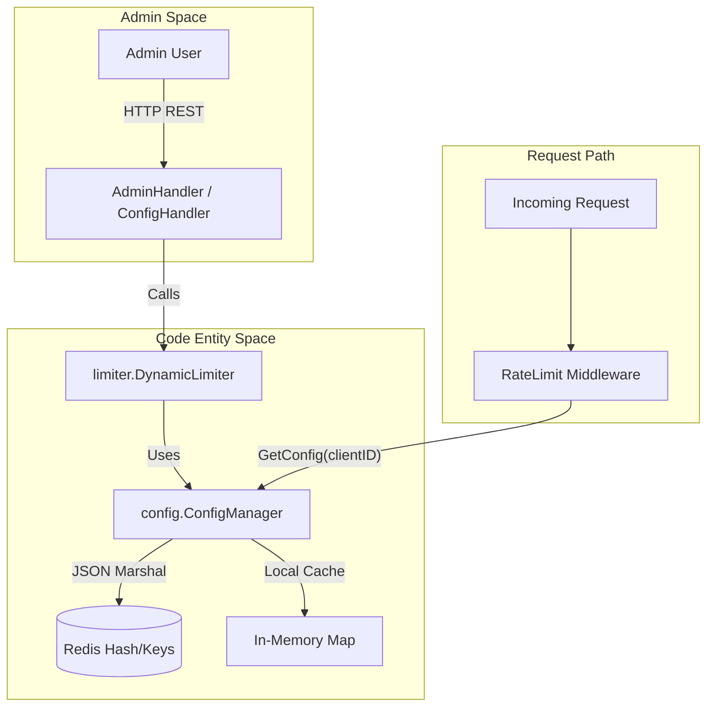
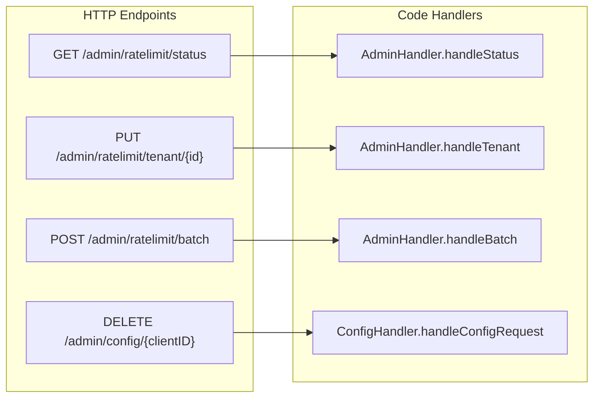

<!-- source: DeepWiki mcp.deepwiki.com · repo NVIDIA/go-ratelimit · page 5 Configuration & Admin API · fetched 2026-10-26 -->

# Configuration & Admin API

Relevant source files

The following files were used as context for generating this wiki page:

- [pkg/api/admin_handler.go](pkg/api/admin_handler.go)
- [pkg/api/config_handler.go](pkg/api/config_handler.go)
- [pkg/config/config.go](pkg/config/config.go)
- [pkg/config/manager.go](pkg/config/manager.go)

The `go-ratelimit` library provides a robust system for managing rate limit configurations at runtime. This system allows administrators to override default limits for specific clients or tenants without restarting the service. The configuration layer consists of a backend `ConfigManager` that handles persistence and caching, and two HTTP-based handlers for remote administration.

### Runtime Configuration Overview

The configuration system bridges the gap between static application defaults and dynamic operational requirements. It uses Redis as a central source of truth for overrides, ensuring consistency across multiple service instances.

#### System Interaction Diagram

"Configuration System Flow"

Sources: [pkg/config/manager.go:36-44](), [pkg/api/admin_handler.go:49-52](), [pkg/api/config_handler.go:27-30]()

---

### ConfigManager & ClientConfig

The `config.ConfigManager` is the core entity responsible for the lifecycle of per-client settings. It manages the `config.ClientConfig` struct, which defines the specific limits for a client identifier.

*   **`ClientConfig`**: Contains `RequestLimit`, `ByteLimit`, and `WindowSecs` [pkg/config/manager.go:29-33]().
*   **Persistence**: Overrides are stored in Redis using keys formatted as `{prefix}:config:{clientID}` [pkg/config/manager.go:59-61]().
*   **Caching**: To minimize Redis round-trips, the manager maintains an internal `map[string]ClientConfig` with a default 1-minute TTL [pkg/config/manager.go:48-55]().

For a deep dive into caching logic and YAML-based logging configuration, see [ConfigManager & Per-Client Overrides](#5.1).

Sources: [pkg/config/manager.go:29-61](), [pkg/config/config.go:24-32]()

---

### Admin HTTP Interfaces

The library provides two distinct HTTP handlers to expose configuration management over the network. Both require an `X-Admin-Key` for authentication [pkg/api/admin_handler.go:85-91]().

| Handler | Purpose | Primary Routes |
| :--- | :--- | :--- |
| **`ConfigHandler`** | Standard configuration management for clients. | `/admin/config/{clientID}` [pkg/api/config_handler.go:47]() |
| **`AdminHandler`** | Enhanced API compatible with multi-tenant systems (e.g., Loki). | `/admin/ratelimit/tenant/{id}`, `/admin/ratelimit/batch` [pkg/api/admin_handler.go:65-72]() |

#### Admin API Routing

"Admin API Entity Mapping"

Sources: [pkg/api/admin_handler.go:63-76](), [pkg/api/config_handler.go:46-48]()

For a full reference of all endpoints, batch operation formats, and authentication headers, see [Admin HTTP Endpoints](#5.2).

Sources: [pkg/api/admin_handler.go:63-76](), [pkg/api/config_handler.go:46-48]()

---

