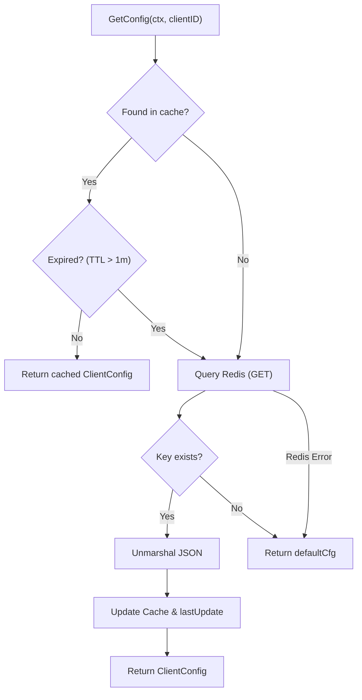
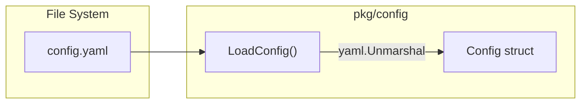

<!-- source: DeepWiki mcp.deepwiki.com · repo NVIDIA/go-ratelimit · page 5.1 ConfigManager & Per-Client Overrides · fetched 2026-10-26 -->

# ConfigManager & Per-Client Overrides

<details>
<summary>Relevant source files</summary>

The following files were used as context for generating this wiki page:

- [pkg/config/config.go](pkg/config/config.go)
- [pkg/config/config_test.go](pkg/config/config_test.go)
- [pkg/config/manager.go](pkg/config/manager.go)

</details>


The `ConfigManager` is the central component responsible for managing and persisting rate limit configurations for individual clients. It enables dynamic adjustments to rate limits (requests, bytes, and window duration) without requiring a service restart, utilizing Redis as a persistent store and an internal memory cache for performance.

### Overview of ClientConfig

The `ClientConfig` struct defines the specific limits applied to a client. These parameters are used by dynamic limiters to determine if a request should be allowed.

| Field | Type | JSON Key | Description |
| :--- | :--- | :--- | :--- |
| `RequestLimit` | `int` | `request_limit` | Maximum number of requests allowed in the window. |
| `ByteLimit` | `int64` | `byte_limit` | Maximum number of bytes allowed in the window. |
| `WindowSecs` | `int` | `window_secs` | The duration of the sliding window in seconds. |

**Sources:** [pkg/config/manager.go:29-33]()

---

### The ConfigManager Implementation

The `ConfigManager` coordinates between the application, a Redis backend, and a local in-memory cache.

#### Data Structure
The `ConfigManager` maintains a local cache to minimize Redis round-trips for high-throughput request paths.

- **Redis Storage**: Configs are stored as JSON strings.
- **In-Memory Cache**: A `map[string]ClientConfig` protected by a `sync.RWMutex`.
- **Cache TTL**: Hardcoded to 1 minute (`time.Minute`).
- **Cache Invalidation**: Tracked via a `lastUpdate` map containing timestamps for each client entry.

**Sources:** [pkg/config/manager.go:36-44](), [pkg/config/manager.go:47-56]()

#### Data Flow: GetConfig
The `GetConfig` method follows a tiered lookup strategy to ensure low latency while maintaining consistency.

Title: Config Retrieval Flow

**Sources:** [pkg/config/manager.go:65-99]()

---

### Configuration Persistence in Redis

`ConfigManager` uses a specific key naming convention to isolate client configurations within Redis.

- **Key Format**: `{prefix}:config:{clientID}`.
- **Method**: `configKey(clientID string)`.

#### Key Methods

| Method | Logic |
| :--- | :--- |
| `SetConfig` | Validates that limits are positive, marshals the `ClientConfig` to JSON, performs a Redis `SET`, and updates the local cache. |
| `DeleteConfig` | Executes a Redis `DEL` and removes the client entry from both the `cache` and `lastUpdate` maps. |
| `SetDefaultConfig` | Thread-safely updates the `defaultCfg` used when no client-specific override exists. |

**Sources:** [pkg/config/manager.go:59-61](), [pkg/config/manager.go:102-132](), [pkg/config/manager.go:135-148](), [pkg/config/manager.go:159-164]()

---

### System Configuration (YAML)

While `ConfigManager` handles runtime client overrides, the global server settings (primarily logging) are managed via a YAML-based `Config` struct. This is typically loaded at process startup.

#### Configuration Structure
The server configuration focuses on observability levels and output destinations.

| Field | YAML Key | Description |
| :--- | :--- | :--- |
| `Logging.ConsoleLevel` | `logging.console_level` | Log level for stdout (e.g., "info", "debug"). |
| `Logging.FileLevel` | `logging.file_level` | Log level for file output. |
| `Logging.File` | `logging.file` | Path to the log file. |

**Sources:** [pkg/config/config.go:24-32]()

#### Implementation of LoadConfig
The `LoadConfig` function reads the file from disk and unmarshals it using `gopkg.in/yaml.v2`.

Title: Server Configuration Loading

**Sources:** [pkg/config/config.go:37-51]()

---

### Code Entity Mapping

The following diagram maps the logical configuration concepts to the specific Go entities and Redis structures.

Title: Configuration Entity Mapping
```mermaid
classDiagram
    class ConfigManager {
        +rdb redis.Cmdable
        +prefix string
        +defaultCfg ClientConfig
        +cache map[string]ClientConfig
        +GetConfig(ctx, clientID)
        +SetConfig(ctx, clientID, cfg)
    }

    class ClientConfig {
        +RequestLimit int
        +ByteLimit int64
        +WindowSecs int
    }

    class RedisStore {
        <<database>>
        "{prefix}:config:{clientID}" : JSON_STRING
    }

    ConfigManager "1" *-- "many" ClientConfig : manages
    ConfigManager ..> RedisStore : persists to
    ClientConfig ..> RedisStore : serialized as
```

**Sources:** [pkg/config/manager.go:29-44](), [pkg/config/manager.go:59-61]()

---

