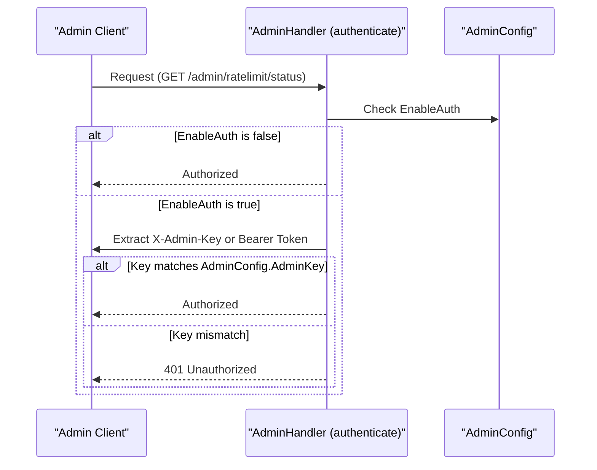
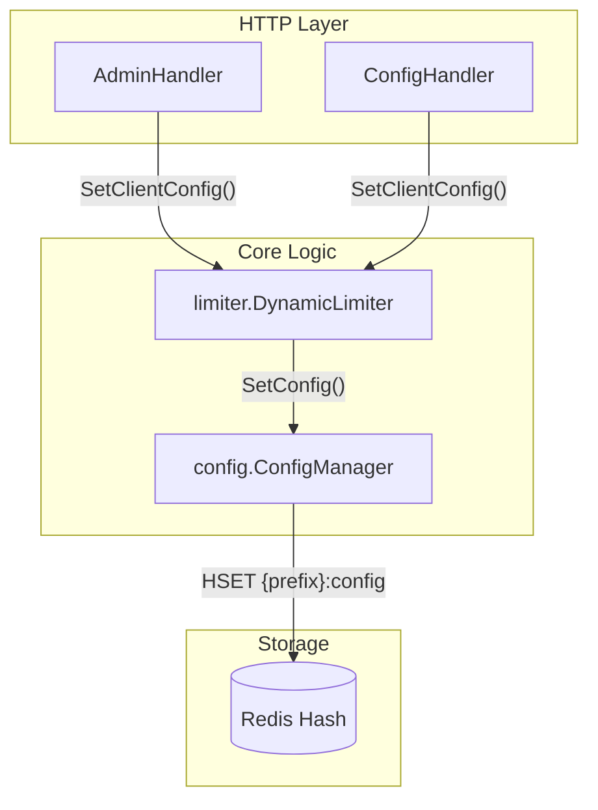

<!-- source: DeepWiki mcp.deepwiki.com · repo NVIDIA/go-ratelimit · page 5.2 Admin HTTP Endpoints · fetched 2026-10-26 -->

# Admin HTTP Endpoints

<details>
<summary>Relevant source files</summary>

The following files were used as context for generating this wiki page:

- [pkg/api/admin_handler.go](pkg/api/admin_handler.go)
- [pkg/api/api_test.go](pkg/api/api_test.go)
- [pkg/api/config_handler.go](pkg/api/config_handler.go)
- [test-admin-api.sh](test-admin-api.sh)

</details>


The `go-ratelimit` service provides a suite of administrative REST endpoints for real-time monitoring and dynamic configuration of rate limits. These endpoints allow operators to view system status, modify per-client or per-tenant limits (requests and bytes) without restarting the service, and perform batch updates.

The implementation is split between two primary handlers:
1.  **ConfigHandler**: Focused on individual client configuration management.
2.  **AdminHandler**: A comprehensive suite including status reporting, tenant-specific management (Loki-compatible), and batch operations.

## Authentication and Security

Administrative endpoints require authentication via a pre-shared key. The system checks for the key in the following order:
1.  The `X-Admin-Key` header [pkg/api/admin_handler.go:85-85]().
2.  The `Authorization` header with a `Bearer ` prefix [pkg/api/admin_handler.go:87-88]().

If `EnableAuth` is set to `false` in the `AdminConfig`, authentication is bypassed [pkg/api/admin_handler.go:80-82]().

### Request Authentication Flow

The following diagram illustrates how an admin request is validated against the `AdminHandler`.

**Admin Request Validation Flow**

**Sources:** [pkg/api/admin_handler.go:79-92](), [pkg/api/admin_handler.go:31-45]()

---

## ConfigHandler Endpoints

The `ConfigHandler` provides basic CRUD operations for client-specific rate limit overrides. These overrides are stored in Redis via the `DynamicLimiter`.

| Endpoint | Method | Description |
| :--- | :--- | :--- |
| `/admin/config/{clientID}` | `GET` | Retrieves the current configuration for a specific client [pkg/api/config_handler.go:81-90](). |
| `/admin/config/{clientID}` | `PUT` | Updates the `request_limit`, `byte_limit`, and `window_secs` for a client [pkg/api/config_handler.go:93-108](). |
| `/admin/config/{clientID}` | `DELETE` | Removes custom overrides, reverting the client to system defaults [pkg/api/config_handler.go:111-120](). |

**Sources:** [pkg/api/config_handler.go:46-48](), [pkg/api/config_handler.go:68-77]()

---

## AdminHandler Endpoints

The `AdminHandler` provides an enhanced set of endpoints designed for operational visibility and compatibility with multi-tenant systems like Loki.

### 1. System Status
**Endpoint:** `GET /admin/ratelimit/status`

Returns a JSON object containing the current service configuration, Redis connectivity address, and default global limits.

**Response Example:**
```json
{
  "rate_limiting_enabled": true,
  "redis_address": "localhost:6379",
  "default_request_limit": 100,
  "default_byte_limit": 1048576,
  "default_window": "1m0s",
  "service_status": "initialized"
}
```
**Sources:** [pkg/api/admin_handler.go:95-119]()

### 2. Tenant Management
**Endpoint:** `/admin/ratelimit/tenant/{tenantID}`

This endpoint maps tenant IDs to internal client IDs using the prefix `tenant-` (e.g., tenant `abc` becomes client `tenant-abc`) [pkg/api/admin_handler.go:143-143]().

*   **GET**: Retrieve tenant limits.
*   **PUT/POST**: Set limits via JSON body containing `request_limit`, `byte_limit`, and `window_secs` [pkg/api/admin_handler.go:218-223]().
*   **DELETE**: Reset tenant to default values.

### 3. Client Management
**Endpoint:** `/admin/ratelimit/client/{clientID}`

Identical to tenant management but uses the provided `clientID` directly without a prefix [pkg/api/admin_handler.go:172-187]().

### 4. Batch Operations
**Endpoint:** `POST /admin/ratelimit/batch`

Allows updating multiple clients or tenants in a single HTTP request to reduce overhead.

**Sources:** [pkg/api/admin_handler.go:63-76](), [pkg/api/admin_handler.go:122-155]()

---

## Implementation and Data Flow

The admin handlers do not manipulate Redis directly; they act as a proxy for the `DynamicLimiter`, which coordinates with the `ConfigManager` to persist settings.

**Code Entity Interaction Diagram**


### Key Functions
*   `RegisterRoutes(mux *http.ServeMux)`: Attaches the handlers to the standard library multiplexer [pkg/api/admin_handler.go:63-76]().
*   `handleLegacyConfig`: Provides a bridge between the new `AdminHandler` and the older `/admin/config/` path for backward compatibility [pkg/api/admin_handler.go:75-75]().
*   `getClientConfig`: Helper that returns system defaults if no custom override is found in Redis [pkg/api/admin_handler.go:191-200]().

**Sources:** [pkg/api/admin_handler.go:49-60](), [pkg/api/config_handler.go:27-38](), [pkg/api/config_handler.go:46-48]()

---

## Testing Admin APIs

The repository includes a comprehensive test suite in `pkg/api/api_test.go` and a shell script `test-admin-api.sh` for manual verification.

### Integration Testing Pattern
The tests utilize a live Redis instance (skipping if unavailable) to verify that PUT requests correctly update the state retrieved by GET requests [pkg/api/api_test.go:40-51]().

**Common Test Cases:**
*   `TestAdminHandlerStatusEndpoint`: Verifies JSON structure and authentication rejection [pkg/api/api_test.go:62-146]().
*   `TestAdminHandlerTenantConfiguration`: Verifies that setting a limit for tenant `test-tenant` correctly stores it under the `tenant-test-tenant` key [pkg/api/api_test.go:148-241]().

**Sources:** [pkg/api/api_test.go:62-241](), [test-admin-api.sh:1-117]()

---

