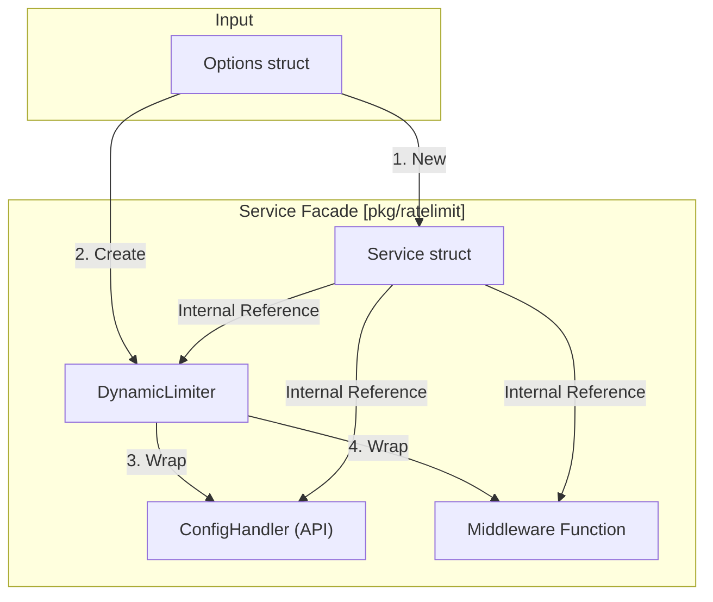
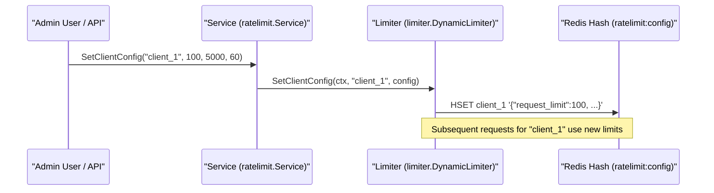

<!-- source: DeepWiki mcp.deepwiki.com · repo NVIDIA/go-ratelimit · page 6 High-Level Service Facade · fetched 2026-10-26 -->

# High-Level Service Facade

Relevant source files

The following files were used as context for generating this wiki page:

- [pkg/ratelimit/ratelimit.go](pkg/ratelimit/ratelimit.go)
- [pkg/ratelimit/ratelimit_comprehensive_test.go](pkg/ratelimit/ratelimit_comprehensive_test.go)
- [pkg/ratelimit/ratelimit_test.go](pkg/ratelimit/ratelimit_test.go)

The `pkg/ratelimit` package provides a high-level facade via the `Service` type, which simplifies the integration of rate limiting into HTTP applications. It orchestrates the underlying `DynamicLimiter`, `ConfigHandler` (Admin API), and `Middleware` components into a single, cohesive interface [pkg/ratelimit/ratelimit.go:16-18]().

### Service Configuration

The `Service` is configured using the `Options` struct, which defines the default behavior for the rate limiter and the connection to the storage backend.

| Field | Type | Description |
| :--- | :--- | :--- |
| `Redis` | `*redis.Client` | **Required.** The client used for storing rate limit counters and configuration [pkg/ratelimit/ratelimit.go:36](). |
| `Prefix` | `string` | Namespace for Redis keys (default: "ratelimit") [pkg/ratelimit/ratelimit.go:39](). |
| `RequestLimit` | `int` | Default allowed requests per window [pkg/ratelimit/ratelimit.go:42](). |
| `ByteLimit` | `int64` | Default allowed bytes per window [pkg/ratelimit/ratelimit.go:45](). |
| `Window` | `time.Duration` | The duration of the sliding window (e.g., `time.Minute`) [pkg/ratelimit/ratelimit.go:48](). |
| `KeyFunc` | `func(*http.Request) string` | Logic to extract a unique identifier (e.g., IP, API Key) from a request [pkg/ratelimit/ratelimit.go:51](). |
| `Logger` | `middleware.Logger` | Optional structured logger for tracking rate limit events [pkg/ratelimit/ratelimit.go:54](). |

#### Default Options
The `DefaultOptions(redis)` function provides a standard configuration: 60 requests/min, 1MB/min, and keying by client IP [pkg/ratelimit/ratelimit.go:58-67]().

**Sources:** [pkg/ratelimit/ratelimit.go:34-67]()

---

### Service Initialization

The `Service` can be initialized through two primary constructors depending on whether you want the facade to manage the limiter lifecycle or use an existing one.

#### Service Component Relationships
This diagram shows how `Service.New()` assembles the internal components.

Title: Service Initialization Data Flow

**Sources:** [pkg/ratelimit/ratelimit.go:70-137]()

*   **`New(options Options) *Service`**: Validates options, initializes a `DynamicLimiter`, sets up the `ConfigHandler`, and prepares the default middleware with the provided logger [pkg/ratelimit/ratelimit.go:79-121]().
*   **`NewFromLimiter(dynamicLimiter *limiter.DynamicLimiter) *Service`**: Allows re-using an existing limiter instance, which is useful when sharing the same Redis-backed state across different service facades [pkg/ratelimit/ratelimit.go:124-137]().

---

### Middleware Integration

The `Service` provides several convenience methods to generate HTTP middleware for different use cases.

#### Standard Middleware
*   **`Middleware()`**: Returns a standard `http.Handler` middleware that applies the configured rate limiting to every request processed by the handler [pkg/ratelimit/ratelimit.go:140-142]().

#### Selective Middleware
*   **`SelectiveMiddleware(matcher middleware.PathMatcher)`**: Applies rate limiting only if the request path matches specific criteria [pkg/ratelimit/ratelimit.go:150-152]().
*   **Path Matchers**: The package exposes helper functions for path matching:
    *   `MatchPathPrefix(prefix)` [pkg/ratelimit/ratelimit.go:155-157]()
    *   `MatchPathExact(path)` [pkg/ratelimit/ratelimit.go:159-161]()
    *   `MatchPathRegex(pattern)` [pkg/ratelimit/ratelimit.go:163-165]()
    *   `MatchAny(matchers...)` / `MatchNone(matchers...)` [pkg/ratelimit/ratelimit.go:169-177]()

#### Request Size Tracking
*   **`MiddlewareWithRequestSize(requestSizeFunc)`**: Unlike the default middleware which tracks bytes written in the *response*, this variant allows tracking the *request* size (e.g., via `Content-Length` or a custom calculator) [pkg/ratelimit/ratelimit.go:145-147]().

**Sources:** [pkg/ratelimit/ratelimit.go:140-177](), [pkg/ratelimit/ratelimit_test.go:65-149]()

---

### Runtime Configuration & API

The `Service` facilitates runtime updates to rate limits without requiring a service restart.

#### Programmatic Configuration
You can modify client-specific limits directly through the service:
*   **`SetClientConfig(clientID, reqLimit, byteLimit, windowSecs)`**: Persists a custom configuration for a specific client ID in Redis [pkg/ratelimit/ratelimit.go:190-197]().
*   **`ResetClientConfig(clientID)`**: Removes the client-specific override, causing the client to fall back to the service's default limits [pkg/ratelimit/ratelimit.go:199-202]().

#### Configuration API
*   **`RegisterConfigAPI(mux *http.ServeMux)`**: Automatically registers the RESTful admin endpoints (e.g., `/admin/config/{clientID}`) onto the provided `http.ServeMux` [pkg/ratelimit/ratelimit.go:180-182]().

Title: Runtime Configuration Flow

**Sources:** [pkg/ratelimit/ratelimit.go:180-202]()

---

### Key Extraction Helpers

The facade re-exports several `KeyFunc` utilities to assist in defining how requests are identified.

*   **`KeyByIP`**: Uses the request's `RemoteAddr` [pkg/ratelimit/ratelimit.go:210-212]().
*   **`KeyByClientID(clientID)`**: Returns a function that keys all requests to a static ID (useful for tenant-specific middlewares) [pkg/ratelimit/ratelimit.go:216-220]().
*   **`KeyByClientIDAndRoute(clientID)`**: Combines a client identifier with the request path to provide granular per-route limiting for a specific client [pkg/ratelimit/ratelimit.go:223-228]().

**Sources:** [pkg/ratelimit/ratelimit.go:205-228](), [pkg/ratelimit/ratelimit_test.go:151-179]()

---

