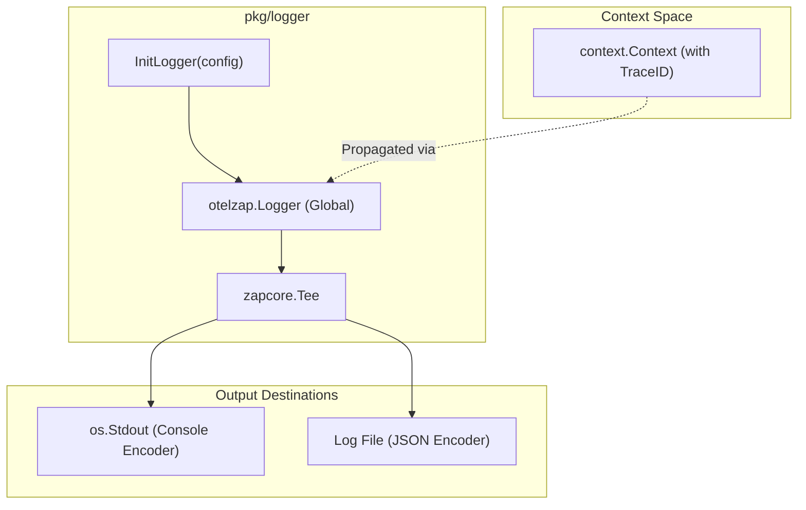
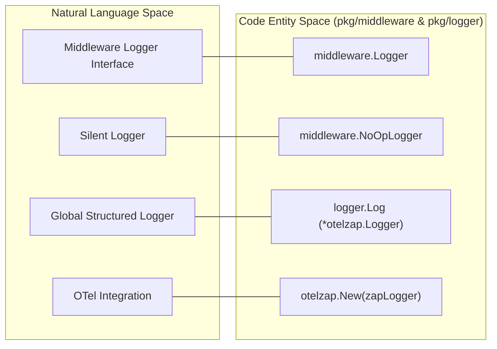

<!-- source: DeepWiki mcp.deepwiki.com · repo NVIDIA/go-ratelimit · page 7 Observability & Logging · fetched 2026-10-26 -->

# Observability & Logging

Relevant source files

The following files were used as context for generating this wiki page:

- [NOTICE](NOTICE)
- [pkg/logger/logger.go](pkg/logger/logger.go)
- [pkg/middleware/logger.go](pkg/middleware/logger.go)

The `go-ratelimit` library provides a robust observability stack centered around structured logging and OpenTelemetry integration. It utilizes `zap` for high-performance logging and `otelzap` to ensure log entries are correlated with distributed traces.

## Logging Architecture

The logging system is built on a tiered approach, allowing for both global structured logging and specialized middleware logging.

### Global Logger (`pkg/logger`)

The primary logging utility is found in `pkg/logger`. It initializes a global `otelzap.Logger` that supports dual-output: a human-readable console format and a machine-readable JSON format for file storage [pkg/logger/logger.go:29-30]().

#### Logger Initialization
The `InitLogger` function configures the global logger based on a YAML configuration. It sets up two `zapcore` cores:
1.  **Console Core**: Uses `zap.NewDevelopmentEncoderConfig()` for human-readable output to `os.Stdout` [pkg/logger/logger.go:67-73]().
2.  **File Core**: Uses `zap.NewProductionEncoderConfig()` (JSON) to write to a specified log file [pkg/logger/logger.go:70-74]().

These cores are combined using `zapcore.NewTee` and wrapped with `otelzap` to provide OpenTelemetry context propagation [pkg/logger/logger.go:77-83]().

### Middleware Logger Interface

The `pkg/middleware` package defines a generic `Logger` interface. This allows users to inject their own logging implementations into the rate-limiting middleware without depending on the specific `zap` implementation used by the library core.

| Entity | Type | Description |
| :--- | :--- | :--- |
| `Logger` | `interface` | Defines `Info` and `Error` methods for middleware reporting [pkg/middleware/logger.go:19-22](). |
| `NoOpLogger` | `struct` | A silent implementation that discards all log entries, used by default if no logger is provided [pkg/middleware/logger.go:25-28](). |

**Sources:**
- [pkg/logger/logger.go:29-91]()
- [pkg/middleware/logger.go:19-29]()

## Configuration via YAML

Log levels and file paths are controlled via the `config.Config` struct. The library supports standard levels: `debug`, `info`, `warn`, and `error`.

### Log Level Mapping
The system maps string values from the configuration to `zapcore.Level` types:

| Config String | Zap Level |
| :--- | :--- |
| `debug` | `zapcore.DebugLevel` |
| `info` | `zapcore.InfoLevel` |
| `warn` | `zapcore.WarnLevel` |
| `error` | `zapcore.ErrorLevel` |

**Sources:**
- [pkg/logger/logger.go:35-59]()

## OpenTelemetry Integration

The library integrates with OpenTelemetry via the `otelzap` wrapper. This ensures that when a request context contains trace information, the logs generated by the rate limiter include the corresponding `trace_id` and `span_id`.

### Trace Correlation Flow

The following diagram illustrates how the `otelzap` logger interacts with the system components to produce trace-aware logs.

**Logger Data Flow**

**Sources:**
- [pkg/logger/logger.go:24-30]()
- [pkg/logger/logger.go:82-84]()
- [NOTICE:23-24]()

## Custom Logger Implementations

Users can implement specialized logging behaviors by satisfying the `middleware.Logger` interface or using the provided `CustomLogger` in `pkg/logger`.

### Channel-based Logging
The `CustomLogger` struct in `pkg/logger` allows log messages to be sent to a Go channel. This is useful for real-time monitoring dashboards or internal event processing [pkg/logger/logger.go:94-96]().

*   **Non-blocking**: The `Log` method uses a `select` block with a `default` case to ensure that if the log channel is full, the message is dropped rather than blocking the request execution [pkg/logger/logger.go:110-114]().
*   **Dual Reporting**: It simultaneously logs to the global `otelzap` logger and the provided channel [pkg/logger/logger.go:108-111]().

**Sources:**
- [pkg/logger/logger.go:94-115]()

## Component Mapping

The following diagram maps the observability concepts to the specific code entities in the repository.

**Observability Entity Mapping**

**Sources:**
- [pkg/middleware/logger.go:19-25]()
- [pkg/logger/logger.go:29-30]()
- [pkg/logger/logger.go:83-83]()

---

