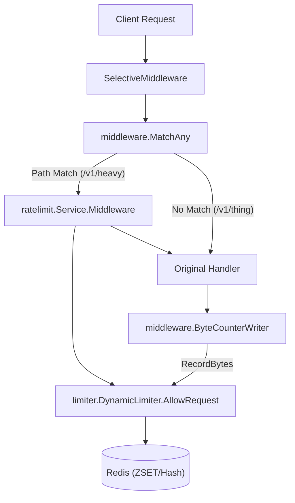
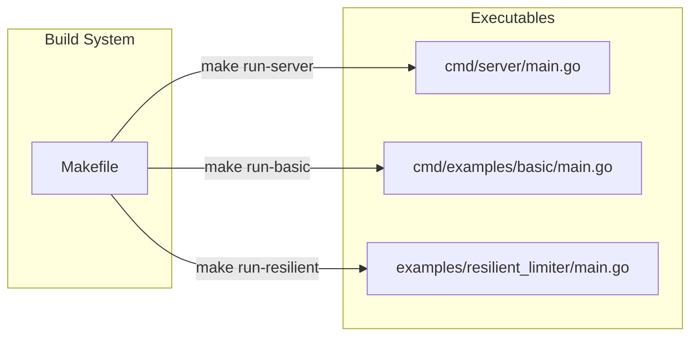

<!-- source: DeepWiki mcp.deepwiki.com · repo NVIDIA/go-ratelimit · page 8 Examples & Reference Server · fetched 2026-10-26 -->

# Examples & Reference Server

Relevant source files

The following files were used as context for generating this wiki page:

- [Makefile](Makefile)
- [cmd/server/main.go](cmd/server/main.go)
- [main.go](main.go)

The `go-ratelimit` repository provides a variety of runnable examples and a full reference server implementation to demonstrate the library's capabilities. These examples range from basic IP-based limiting to complex resilient setups that handle Redis outages gracefully.

The primary entry points for exploring the code in action are:
*   **`cmd/examples/`**: Minimalist examples focusing on specific features like custom headers or logging.
*   **`examples/`**: Advanced scenarios involving resilience and dynamic configuration.
*   **`cmd/server/`**: A feature-complete reference implementation of a rate-limited API server.

### Reference Server Implementation

The reference server in `cmd/server/main.go` demonstrates how to integrate the library into a production-like environment. It utilizes a `limiter.DynamicLimiter` to provide per-client overrides while maintaining a global default policy.

**Key Reference Server Components:**
| Component | Implementation Detail |
| :--- | :--- |
| **Limiter** | `limiter.NewDynamicLimiter` with a 1MB/10 req/min default [cmd/server/main.go:64-71]() |
| **Key Extraction** | Custom `keyByClientID` function using query parameters with IP fallback [cmd/server/main.go:53-60]() |
| **Middleware** | `SelectiveMiddleware` using `MatchAny` to target specific "heavy" paths [cmd/server/main.go:125-131]() |
| **Admin API** | `api.NewConfigHandler` registered to allow runtime limit updates [cmd/server/main.go:98-99]() |

**Reference Server Flow**
The diagram below maps the reference server's request flow to specific code entities.

"Reference Server Request Lifecycle"

Sources: [cmd/server/main.go:122-132](), [cmd/server/main.go:64-71]()

---

### Running Examples

The project includes a `Makefile` with convenience targets to build and run all examples. This ensures that the environment (like Redis connectivity) is verified before execution.

| Target | Description | Source |
| :--- | :--- | :--- |
| `make run-server` | Starts the reference server on `:8082` | [Makefile:118-120]() |
| `make run-basic` | Runs the basic IP-based limiting example | [Makefile:108-110]() |
| `make run-resilient` | Runs the Redis-to-Memory fallback example | [Makefile:123-125]() |
| `make run-dynamic` | Runs the dynamic configuration example | [Makefile:113-115]() |

"Build and Execution Entity Mapping"

Sources: [Makefile:107-135]()

---

### Child Pages

For detailed walkthroughs of specific example categories, refer to the following sub-pages:

#### [Basic & Header-Based Examples](#8.1)
Covers standard usage patterns, including:
*   **Header-Based Limiting**: Using `KeyByHeader`, `KeyByMultipleHeaders`, and `KeyByHeaderWithFallback` for multi-tenant scenarios.
*   **Simple Logging**: Integration of custom loggers into the rate-limiting lifecycle.

#### [Resilient & Dynamic-Resilient Examples](#8.2)
Covers high-availability and advanced configuration patterns:
*   **Resilient Limiter**: Setting up `ResilientLimiter` with automatic failover to in-memory tracking when Redis is unavailable.
*   **Dynamic Resilience**: Combining per-client dynamic configuration with the resilience layer to ensure limits are enforced even during infrastructure degradation.

Sources: [cmd/server/main.go:1-147](), [Makefile:1-165]()

---

