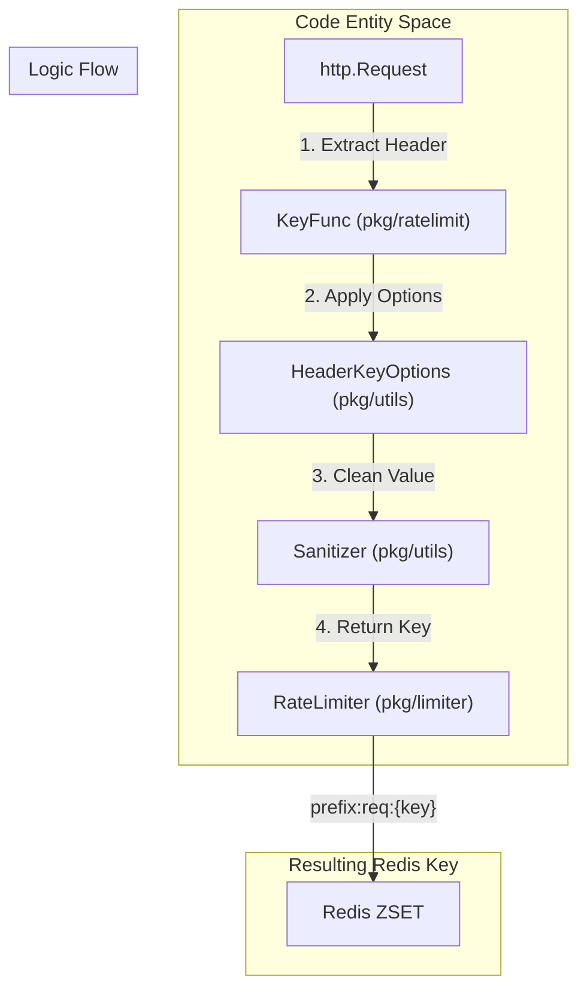
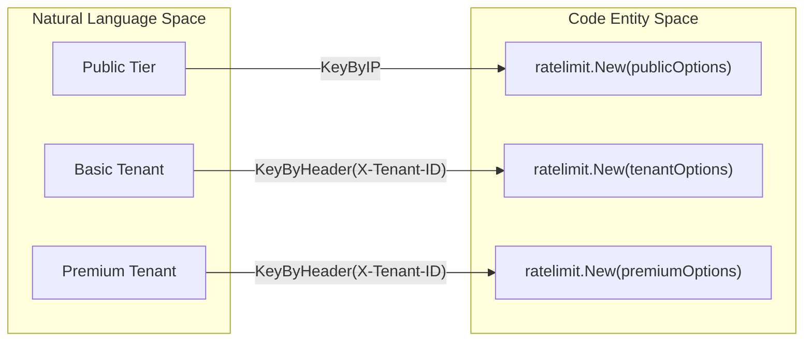

<!-- source: DeepWiki mcp.deepwiki.com · repo NVIDIA/go-ratelimit · page 8.1 Basic & Header-Based Examples · fetched 2026-10-26 -->

# Basic & Header-Based Examples

<details>
<summary>Relevant source files</summary>

The following files were used as context for generating this wiki page:

- [docs/HEADER_BASED_RATE_LIMITING.md](docs/HEADER_BASED_RATE_LIMITING.md)
- [examples/header_based_limiting/main.go](examples/header_based_limiting/main.go)
- [examples/simple_logger/main.go](examples/simple_logger/main.go)

</details>


This page provides a technical deep dive into implementing rate limiting strategies that go beyond simple IP-based tracking. It focuses on header-based extraction for multi-tenant scenarios and the integration of custom logging infrastructure.

## Header-Based Rate Limiting

Header-based limiting allows the system to identify clients using HTTP metadata. This is essential for SaaS platforms where a single IP might represent multiple users or where specific API keys and tenant IDs determine service levels.

### Key Extraction Strategies

The `pkg/ratelimit` and `pkg/utils` packages provide several functions to map incoming `*http.Request` objects to unique identifiers (keys) used for Redis tracking.

| Strategy | Function | Description |
| :--- | :--- | :--- |
| **Simple Header** | `KeyByHeader(name)` | Extracts a single header value as the key. |
| **Advanced Header** | `KeyByHeaderWithOptions(opts)` | Provides sanitization, case-sensitivity control, and default values. |
| **Composite Key** | `KeyByMultipleHeaders(names, sep)` | Joins multiple header values with a separator. |
| **Fallback Chain** | `KeyByHeaderWithFallback(names)` | Iterates through a list of headers, returning the first one found. |

### Implementation Flow: Header to Redis Key

The following diagram illustrates how a request's headers are transformed into a rate-limit key within the `ratelimit.Service`.

**Header Extraction Data Flow**

Sources: [docs/HEADER_BASED_RATE_LIMITING.md:13-21](), [examples/header_based_limiting/main.go:56-67](), [pkg/utils/headers.go:1-100]() (implied by usage in examples).

### Advanced Header Options
Using `KeyByHeaderWithOptions`, developers can enforce strict validation on incoming headers to prevent "key-space pollution" (where malicious clients send random header values to bloat Redis memory).

- **Sanitizers**: Functions like `utils.AlphanumericSanitizer` or `utils.UUIDSanitizer` ensure the key conforms to expected formats before it reaches the database [docs/HEADER_BASED_RATE_LIMITING.md:106-123]().
- **Default Values**: If a header is missing, `DefaultValue` prevents the request from being un-limited, often falling back to a "guest" or "anonymous" bucket [docs/HEADER_BASED_RATE_LIMITING.md:84-91]().

---

## Multi-Tenant Scenario Example

In a real-world multi-tenant API, different endpoints often require different `ratelimit.Options`. The `header_based_limiting` example demonstrates creating multiple service instances to handle different tiers.

**Multi-Tier Architecture**

Sources: [examples/header_based_limiting/main.go:189-228](), [docs/HEADER_BASED_RATE_LIMITING.md:160-187]().

In this implementation:
1. **Public Tier**: Uses `KeyByIP` with low limits (e.g., 10 requests/min) [examples/header_based_limiting/main.go:195-203]().
2. **Tenant Tier**: Uses `KeyByHeaderWithOptions` with `UUIDSanitizer` to identify valid tenants via the `X-Tenant-ID` header [examples/header_based_limiting/main.go:206-218]().
3. **Premium Tier**: Similar to Tenant tier but configured with higher `RequestLimit` and `ByteLimit` values [examples/header_based_limiting/main.go:221-230]().

---

## Simple Logger Integration

The `simple_logger` example demonstrates how to integrate the rate limiter into existing observability stacks by implementing the `middleware.Logger` interface.

### Implementing the Logger Interface
The `middleware.Logger` interface requires two methods: `Info` and `Error`.

```go
type SimpleLogger struct{}

func (s SimpleLogger) Info(msg string, keysAndValues ...interface{}) {
    log.Printf("[INFO] %s %v\n", msg, keysAndValues)
}

func (s SimpleLogger) Error(msg string, keysAndValues ...interface{}) {
    log.Printf("[ERROR] %s %v\n", msg, keysAndValues)
}
```
Sources: [examples/simple_logger/main.go:31-39]().

### Configuration in Service Options
The custom logger is passed into the `ratelimit.Options` struct during service initialization. This logger will then capture events such as rate-limit triggers, Redis connection issues, and configuration updates.

```go
options := ratelimit.Options{
    Redis:        redisClient,
    Prefix:       "example:ratelimit",
    RequestLimit: 10,
    Window:       time.Minute,
    KeyFunc:      customKeyFunc,
    Logger:       SimpleLogger{}, // Custom implementation injected here
}

service := ratelimit.New(options)
```
Sources: [examples/simple_logger/main.go:56-73]().

### Data Flow with Logging
When a request is processed by `service.Middleware()`, the following sequence occurs:
1. The middleware calls `AllowRequest` on the internal limiter.
2. If an error occurs (e.g., Redis is down), the limiter calls `Logger.Error`.
3. If the request is denied (Rate Limit Exceeded), the middleware can log this event via `Logger.Info` if configured.

Sources: [examples/simple_logger/main.go:91](), [pkg/ratelimit/service.go]() (implied by service structure).

---

