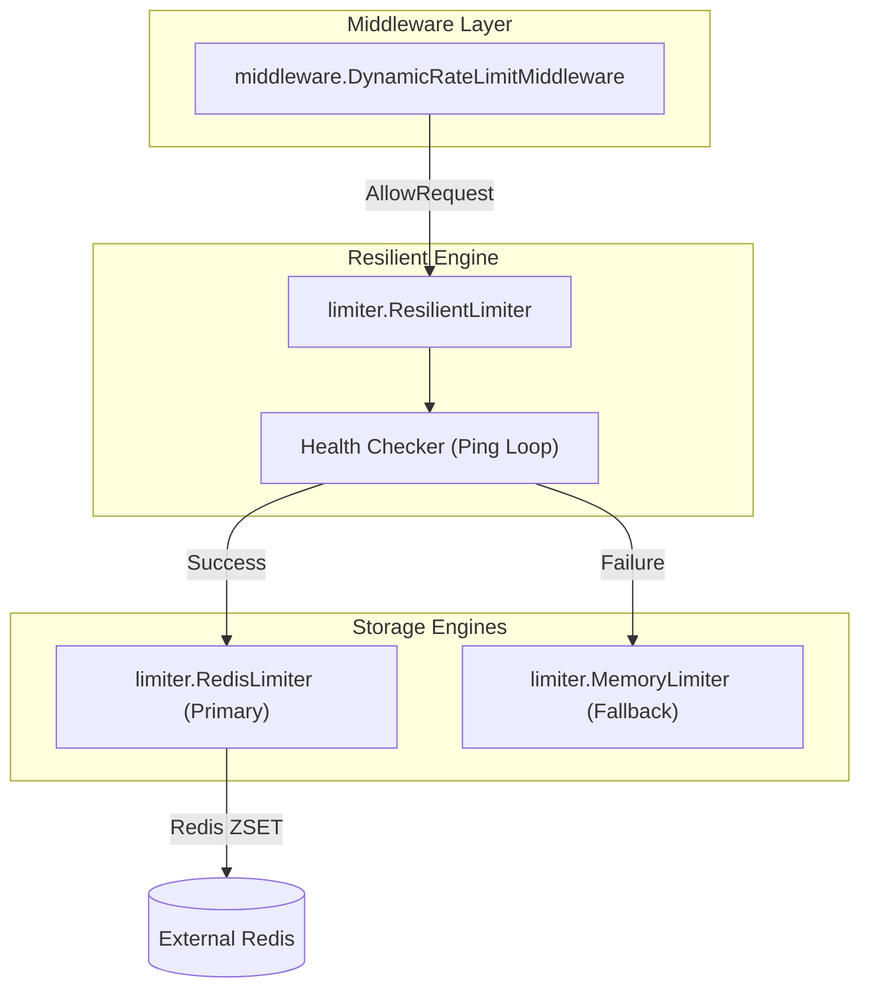
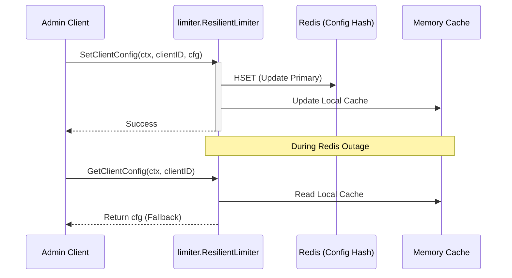

<!-- source: DeepWiki mcp.deepwiki.com · repo NVIDIA/go-ratelimit · page 8.2 Resilient & Dynamic-Resilient Examples · fetched 2026-10-26 -->

# Resilient & Dynamic-Resilient Examples

Relevant source files

The following files were used as context for generating this wiki page:

- [docs/RESILIENT_RATE_LIMITING.md](docs/RESILIENT_RATE_LIMITING.md)
- [examples/dynamic_resilient/main.go](examples/dynamic_resilient/main.go)
- [examples/resilient_limiter/main.go](examples/resilient_limiter/main.go)

This page details the implementation and usage of the `ResilientLimiter`, which provides a high-availability rate limiting strategy by combining distributed Redis-backed limiting with local in-memory fallbacks. It specifically covers the `resilient_limiter` and `dynamic_resilient` examples provided in the codebase.

## Overview of Resilient Rate Limiting

The resilient strategy is designed to maintain rate limit enforcement even during Redis infrastructure outages [docs/RESILIENT_RATE_LIMITING.md:1-13](). It operates in two modes:

1.  **Normal Operation**: Uses Redis as the primary store for distributed limiting and configuration [docs/RESILIENT_RATE_LIMITING.md:16-22]().
2.  **Fallback Operation**: Automatically switches to an internal `MemoryLimiter` when Redis is unavailable [docs/RESILIENT_RATE_LIMITING.md:24-31]().

### Component Interaction Diagram
This diagram shows how the `ResilientLimiter` bridges the gap between the `DynamicRateLimitMiddleware` and the underlying storage engines.

**Resilient Strategy Flow**

Sources: [docs/RESILIENT_RATE_LIMITING.md:7-12](), [docs/RESILIENT_RATE_LIMITING.md:89-97](), [examples/resilient_limiter/main.go:194-194]()

## Resilient Limiter Example (`resilient_limiter`)

The `resilient_limiter` example demonstrates the basic setup of a `ResilientLimiter` with a custom health toggle for testing purposes.

### Implementation Details
The example initializes a Redis client and passes it to `limiter.NewResilientLimiter` [examples/resilient_limiter/main.go:42-88](). It uses a custom `KeyFunc` that extracts a `client_id` from the URL query parameters [examples/resilient_limiter/main.go:70-77]().

| Feature | Implementation | File Reference |
| :--- | :--- | :--- |
| **Constructor** | `limiter.NewResilientLimiter` | [examples/resilient_limiter/main.go:81-88]() |
| **Health Toggle** | `/admin/toggle-redis` endpoint | [examples/resilient_limiter/main.go:133-141]() |
| **Default Update** | `UpdateDefaultConfig` | [examples/resilient_limiter/main.go:181-184]() |
| **Middleware** | `middleware.DynamicRateLimitMiddleware` | [examples/resilient_limiter/main.go:194-194]() |

### Default Configuration Management
The `ResilientLimiter` allows updating global defaults that apply to all clients not specifically overridden. In the example, the `/admin/update-defaults` endpoint accepts a JSON body to modify these values at runtime [examples/resilient_limiter/main.go:153-191]().

Sources: [examples/resilient_limiter/main.go:81-88](), [examples/resilient_limiter/main.go:153-191](), [docs/RESILIENT_RATE_LIMITING.md:80-85]()

## Dynamic-Resilient Example (`dynamic_resilient`)

The `dynamic_resilient` example combines the fallback capabilities of the resilient limiter with the per-client configuration management of the dynamic limiter.

### Key Logic and Data Flow
This example highlights how client-specific configurations (stored in `config.ClientConfig`) are synchronized between Redis and the local memory cache to ensure consistency during a failover [docs/RESILIENT_RATE_LIMITING.md:107-114]().

**Configuration Synchronization Flow**

Sources: [docs/RESILIENT_RATE_LIMITING.md:33-40](), [docs/RESILIENT_RATE_LIMITING.md:107-114](), [examples/dynamic_resilient/main.go:115-130]()

### Client-Specific Endpoints
The example provides endpoints to manage individual client tiers:
- **`GET /v1/my-limits`**: Retrieves the current effective limits for a `client_id`, indicating whether they are served from Redis or Memory [examples/dynamic_resilient/main.go:108-130]().
- **`POST /admin/set-limits`**: Uses `resilientLimiter.SetClientConfig` to override defaults for a specific client [examples/dynamic_resilient/main.go:194-211]().

## Operational Guidance

### Health Check Mechanism
The `ResilientLimiter` performs periodic health checks to manage state transitions:
- **Interval**: Defaults to 5 seconds [docs/RESILIENT_RATE_LIMITING.md:93-93]().
- **Timeout**: Health check pings have a strict 500ms timeout to ensure the application doesn't hang on a slow Redis instance [docs/RESILIENT_RATE_LIMITING.md:94-94]().
- **Recovery**: Once Redis pings succeed again, the limiter automatically promotes Redis back to the primary role [docs/RESILIENT_RATE_LIMITING.md:37-38]().

### Clustered Environments
In a distributed deployment, the following behavior should be expected:
- **Redis Up**: All application instances share the same global counters in Redis, providing strict distributed rate limiting [docs/RESILIENT_RATE_LIMITING.md:135-135]().
- **Redis Down**: Each application instance falls back to its own `MemoryLimiter`. This means the aggregate limit across the cluster becomes `N * Limit` (where N is the number of instances) [docs/RESILIENT_RATE_LIMITING.md:136-137]().

Sources: [docs/RESILIENT_RATE_LIMITING.md:89-97](), [docs/RESILIENT_RATE_LIMITING.md:131-139]()

---

