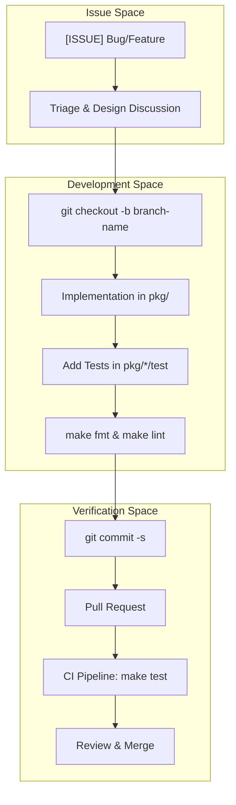
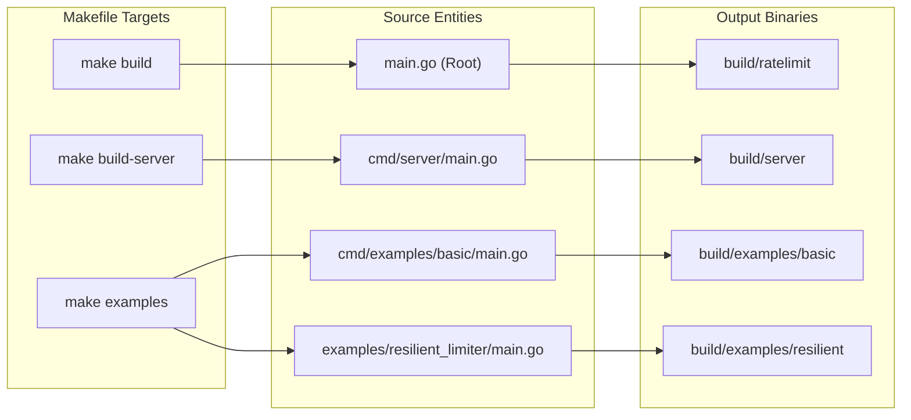

<!-- source: DeepWiki mcp.deepwiki.com · repo NVIDIA/go-ratelimit · page 9 Development & Contributing · fetched 2026-10-26 -->

# Development & Contributing

<details>
<summary>Relevant source files</summary>

The following files were used as context for generating this wiki page:

- [.github/ISSUE_TEMPLATE/bug_report.md](.github/ISSUE_TEMPLATE/bug_report.md)
- [.github/ISSUE_TEMPLATE/feature_request.md](.github/ISSUE_TEMPLATE/feature_request.md)
- [.gitignore](.gitignore)
- [CONTRIBUTING.md](CONTRIBUTING.md)
- [Makefile](Makefile)

</details>


This page provides technical guidance for contributors to the `go-ratelimit` repository. It covers the project structure, automated workflows, development standards, and the processes required to ensure high-quality code contributions.

## Repository Layout

The repository is organized into distinct packages following standard Go conventions. The core logic resides in `pkg/`, while entry points and demonstrations are located in `cmd/` and `examples/`.

| Directory | Purpose |
| :--- | :--- |
| `cmd/server` | Reference implementation of a standalone rate-limiting server [Makefile:24](). |
| `cmd/examples` | Basic and dynamic usage examples [Makefile:23](). |
| `examples/` | Advanced usage scenarios like resilient and dynamic-resilient configurations [Makefile:26-28](). |
| `pkg/limiter` | Core sliding-window algorithms and Redis/In-memory implementations [CONTRIBUTING.md:128](). |
| `pkg/middleware` | HTTP middleware for intercepting requests and tracking response sizes. |
| `pkg/utils` | Key extraction functions and sanitization logic. |
| `pkg/config` | Configuration management and Admin API handlers. |

**Sources:** [Makefile:22-28](), [CONTRIBUTING.md:128]()

## Development Workflow & Makefile Targets

The project uses a `Makefile` to standardize common development tasks. Contributors are expected to use these targets to validate their changes before submitting a Pull Request.

### Primary Targets

*   **`make build`**: Compiles the main binary into the `build/` directory using `-trimpath` for reproducible builds [Makefile:31-34]().
*   **`make test`**: Executes all unit and integration tests with verbose output [Makefile:37-38]().
*   **`make test-cover`**: Runs tests and generates an HTML coverage report (`coverage.out`) [Makefile:41-43]().
*   **`make lint`**: Runs `golangci-lint`. If the linter is not found, the script attempts to install it automatically [Makefile:52-60]().
*   **`make fmt`**: Formats all Go files using `go fmt` [Makefile:63-64]().
*   **`make tidy`**: Runs `go mod tidy` to clean up the `go.mod` and `go.sum` files [Makefile:71-72]().
*   **`make verify`**: Checks that dependencies match the expected hashes in `go.sum` [Makefile:67-68]().
*   **`make examples`**: Builds all example binaries (basic, server, resilient, dynamic) into the `build/examples/` directory [Makefile:75-105]().

### Local Testing Environment

Tests for Redis-backed limiters require a running Redis instance (version ≥ 5.0) [CONTRIBUTING.md:73](). Contributors can spin up a local instance using Docker:

```bash
docker run -d -p 6379:6379 redis:latest
```

**Sources:** [Makefile:31-105](), [CONTRIBUTING.md:71-74](), [CONTRIBUTING.md:137-141]()

## Code Contribution Standards

### DCO Sign-off Requirement
All commits must be signed off to certify compliance with the Developer Certificate of Origin (DCO) [CONTRIBUTING.md:204-209](). This is performed by adding the `-s` flag to your git commit command:

```bash
git commit -s -m "Brief description of changes"
```
This appends a `Signed-off-by: Your Name <email@example.com>` line to the commit message [CONTRIBUTING.md:210-217]().

### Code Quality & Linting
The project utilizes `golangci-lint` for static analysis [CONTRIBUTING.md:182-190](). To ensure consistency, contributors are encouraged to set up a git pre-commit hook:

```bash
cat > .git/hooks/pre-commit << 'EOF'
#!/bin/sh
make fmt
make lint
EOF
chmod +x .git/hooks/pre-commit
```

### Pull Request Process
1.  **Fork and Branch**: Create a descriptive branch name (e.g., `fix-redis-lua-script`) [CONTRIBUTING.md:30-31]().
2.  **Unit Testing**: New features or bug fixes must include unit tests. Refer to `pkg/*/test` for existing patterns [CONTRIBUTING.md:33]().
3.  **CI Validation**: Open a Draft PR to trigger Continuous Integration. CI checks for formatting, linting, and successful test execution across supported architectures (x86_64, aarch64) [CONTRIBUTING.md:34-37, 79-83]().

**Sources:** [CONTRIBUTING.md:30-40](), [CONTRIBUTING.md:180-202](), [CONTRIBUTING.md:204-217]()

## System Architecture Mapping

The following diagrams map the logical contribution flow and the relationship between the build system and the codebase entities.

### Contribution Logic Flow
This diagram illustrates the lifecycle of a contribution from issue identification to CI validation.


**Sources:** [CONTRIBUTING.md:1-41](), [Makefile:138]()

### Build Entity Relationship
This diagram maps the `Makefile` targets to the specific code directories and binaries they produce.


**Sources:** [Makefile:31-34](), [Makefile:84-105]()

## CI/CD Pipeline Expectations

The CI pipeline executes on every Pull Request and expects the following:
1.  **Environment**: Go ≥ 1.21 on Linux or macOS [CONTRIBUTING.md:67-77]().
2.  **Static Analysis**: No failures from `golangci-lint` [Makefile:52-60]().
3.  **Dependency Integrity**: `go mod verify` must pass [Makefile:67-68]().
4.  **Test Suite**: All tests in `pkg/...` must pass, including those utilizing the `mock_redis` or a live Redis instance [CONTRIBUTING.md:121-135]().
5.  **Race Detection**: CI runs tests with the `-race` flag to ensure thread safety in the sliding window implementations [CONTRIBUTING.md:133-134]().

**Sources:** [CONTRIBUTING.md:65-83](), [Makefile:138-164]()

---

