# Page: Overview

# Overview

<details>
<summary>Relevant source files</summary>

The following files were used as context for generating this wiki page:

- [CHANGELOG.md](CHANGELOG.md)
- [LICENSE](LICENSE)
- [NOTICE](NOTICE)
- [README.md](README.md)

</details>


NVIDIA® `go-ratelimit` is a high-performance, distributed rate limiting library designed for Go HTTP services. It facilitates resource protection by limiting both the number of requests and the total bandwidth (bytes served) consumed by clients [README.md:1-4]().

By utilizing Redis as a central state store, it ensures consistent rate limiting across multiple server instances in a distributed environment [README.md:11-12](). The library implements a **Sliding Window Algorithm**, which provides higher accuracy than fixed windows by preventing traffic bursts at window boundaries [CHANGELOG.md:13]().

## Key Capabilities

*   **Dual Rate Limiting**: Monitors and restricts both request counts and response sizes (bytes) [README.md:10]().
*   **Distributed Architecture**: Built on Redis to synchronize limits across a cluster of service instances [README.md:12]().
*   **Resilience**: Automatically falls back to local in-memory limiting if the Redis connection is lost [README.md:13]().
*   **Dynamic Configuration**: Allows runtime updates to rate limits for specific clients via a REST API or programmatic interface [README.md:14]().
*   **Flexible Key Extraction**: Supports limiting by IP, Client ID, or complex HTTP header combinations with built-in sanitizers [README.md:16-19]().
*   **RFC Compliance**: Automatically injects standard rate limit headers into HTTP responses [README.md:15]().

## System Components

The library is organized into several distinct layers that handle request interception, limit evaluation, and state management.

### Conceptual Architecture
The following diagram illustrates how an incoming request flows through the system components.

**Request Flow and Component Relationship**
```mermaid
graph TD
    subgraph "HTTP Layer"
        "http.Request" --> "Middleware[pkg/middleware]"
        "Middleware[pkg/middleware]" -- "1. Extract Key" --> "KeyFunc[pkg/utils]"
        "Middleware[pkg/middleware]" -- "2. Check Limit" --> "Limiter[pkg/limiter]"
        "Middleware[pkg/middleware]" -- "3. Wrap Response" --> "ByteCounterWriter[pkg/middleware]"
    end

    subgraph "Logic Layer"
        "Limiter[pkg/limiter]" -- "Lookup Config" --> "ConfigManager[pkg/config]"
        "Limiter[pkg/limiter]" -- "Execute Lua" --> "Redis[External]"
        "Limiter[pkg/limiter]" -- "Fallback" --> "MemoryLimiter[pkg/limiter]"
    end

    subgraph "Admin Layer"
        "AdminHandler[pkg/config]" -- "Update" --> "ConfigManager[pkg/config]"
    end
```
Sources: [README.md:41-53](), [pkg/ratelimit/service.go:1-50](), [pkg/middleware/middleware.go:1-30]()

### Code Entity Mapping
This diagram maps high-level concepts to the specific Go types and interfaces used in the codebase.

**Code Entity Space Mapping**
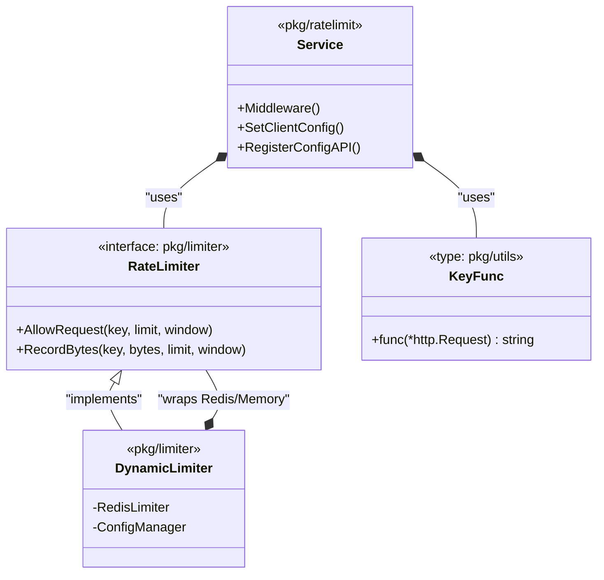
Sources: [pkg/ratelimit/service.go:23-45](), [pkg/limiter/limiter.go:10-25](), [pkg/utils/keys.go:10-15]()

## Major Packages

| Package | Responsibility |
| :--- | :--- |
| `pkg/ratelimit` | The primary entry point. Provides the `Service` facade to simplify integration [pkg/ratelimit/service.go:23](). |
| `pkg/limiter` | The core engine. Contains the sliding window logic and Redis/In-Memory implementations [pkg/limiter/limiter.go:1](). |
| `pkg/middleware` | HTTP middleware that intercepts requests, checks limits, and tracks response bytes [pkg/middleware/middleware.go:1](). |
| `pkg/config` | Manages runtime configuration and the Admin API for per-client overrides [pkg/config/config.go:1](). |
| `pkg/utils` | Provides utilities for key extraction from headers, IPs, and sanitization [pkg/utils/keys.go:1](). |

## Next Steps

To dive deeper into specific areas of `go-ratelimit`, refer to the following child pages:

*   **[Getting Started](#1.1)**: Prerequisites and a step-by-step guide to your first integration.
*   **[Design & Architecture](#1.2)**: A technical deep dive into the sliding window algorithm, Redis data structures, and the request lifecycle.

Sources: [README.md:20-25](), [README.md:56-71](), [CHANGELOG.md:12-23]()

---

# Page: Getting Started

# Getting Started

<details>
<summary>Relevant source files</summary>

The following files were used as context for generating this wiki page:

- [CONTRIBUTING.md](CONTRIBUTING.md)
- [Makefile](Makefile)
- [SETUP_GUIDE.md](SETUP_GUIDE.md)
- [go.mod](go.mod)
- [go.sum](go.sum)

</details>


This page provides a step-by-step guide for developers to integrate `go-ratelimit` into their Go applications. It covers environmental requirements, installation, and basic implementation patterns.

## Prerequisites

Before installing the library, ensure your environment meets the following minimum requirements:

*   **Go**: Version 1.21 or higher [go.mod:3-3](), [CONTRIBUTING.md:69-69]().
*   **Redis**: Version 5.0 or higher (required for distributed rate limiting) [CONTRIBUTING.md:73-73]().
*   **Operating System**: Linux (Ubuntu LTS recommended), macOS, or Windows [CONTRIBUTING.md:75-78]().
*   **Architecture**: x86_64 or aarch64 [CONTRIBUTING.md:79-82]().

### Setting up Redis

The library uses Redis to store sliding-window request counts and byte usage [SETUP_GUIDE.md:7-7](). You can run Redis via Docker for local development:

```bash
docker run -d -p 6379:6379 --name redis redis:latest
```
[CONTRIBUTING.md:140-140](), [SETUP_GUIDE.md:21-21]()

**Sources:** [CONTRIBUTING.md:65-82](), [SETUP_GUIDE.md:3-51](), [go.mod:1-4]()

---

## Installation

Add `go-ratelimit` to your project using `go get`:

```bash
go get github.com/NVIDIA/go-ratelimit
```
[SETUP_GUIDE.md:86-88]()

To build from source or run tests within the repository:

```bash
git clone https://github.com/NVIDIA/go-ratelimit.git
cd go-ratelimit
go mod download
make build
```
[CONTRIBUTING.md:89-101](), [Makefile:31-34]()

**Sources:** [CONTRIBUTING.md:84-101](), [Makefile:1-35](), [SETUP_GUIDE.md:83-88]()

---

## Minimal Integration

The primary entry point for the library is the `ratelimit.Service` facade [SETUP_GUIDE.md:104-104](). Below is a minimal example of integrating the rate limiter as an HTTP middleware.

### Code Snippet

```go
import (
    "github.com/NVIDIA/go-ratelimit/pkg/ratelimit"
    "github.com/redis/go-redis/v9"
)

func main() {
    // 1. Initialize Redis Client
    rdb := redis.NewClient(&redis.Options{
        Addr: "localhost:6379",
    })

    // 2. Configure Limiter Options
    // DefaultOptions provides a 1-minute window, 100 req/min, 10MB/min
    options := ratelimit.DefaultOptions(rdb)
    
    // 3. Instantiate the Service
    service := ratelimit.New(options)

    // 4. Wrap your HTTP handler/mux with Middleware
    mux := http.NewServeMux()
    mux.HandleFunc("/api/hello", helloHandler)
    
    protectedHandler := service.Middleware()(mux)
    http.ListenAndServe(":8080", protectedHandler)
}
```
[SETUP_GUIDE.md:91-108]()

### Integration Data Flow

The following diagram illustrates how the `ratelimit.Service` interacts with the `pkg/middleware` and `pkg/limiter` components during a request.

**Request Lifecycle via Service Facade**
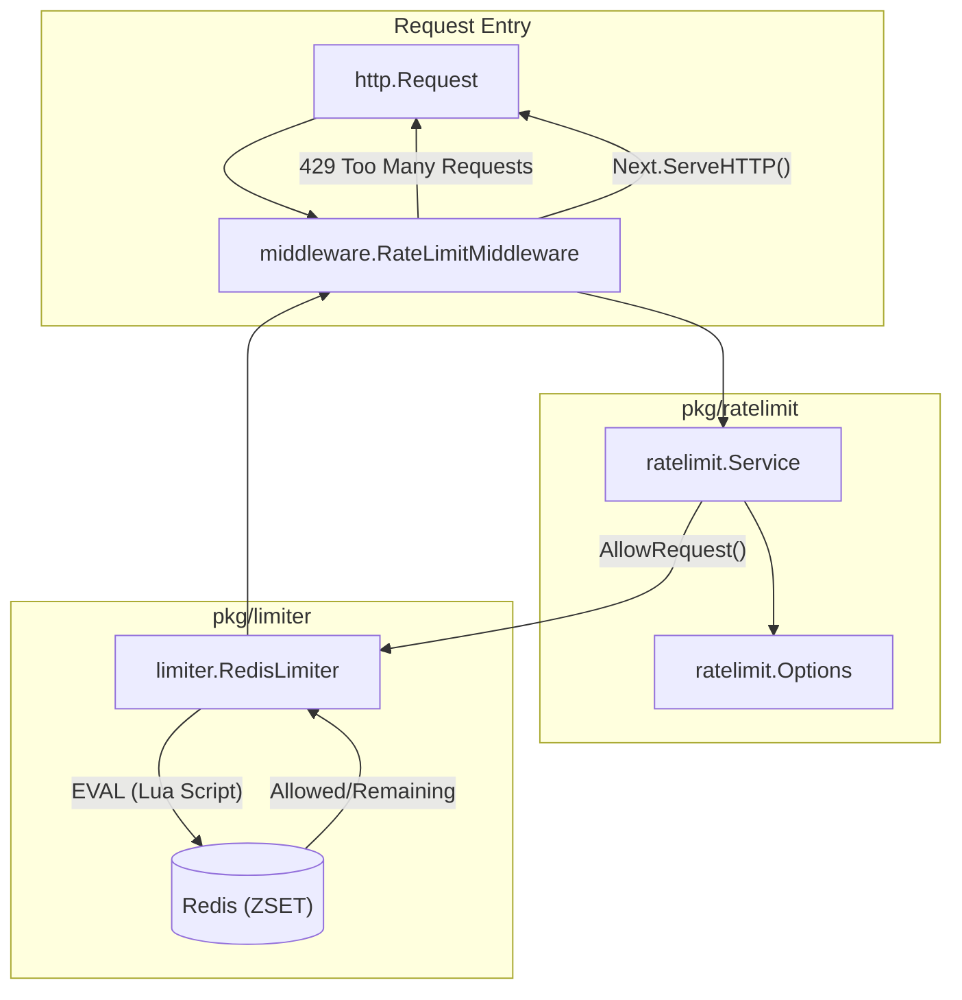
**Sources:** [SETUP_GUIDE.md:90-120](), [Makefile:118-121]()

---

## Running the Example Server

The repository includes a reference implementation that demonstrates request-count and byte-based limiting.

### 1. Start the Server
```bash
make run-server
```
[Makefile:118-121](), [SETUP_GUIDE.md:61-61]()

The server listens on port `8082` [SETUP_GUIDE.md:64-64]().

### 2. Verify Rate Limiting
You can test the default limits (typically 10 requests per window in examples) using a loop:

```bash
for i in {1..11}; do 
    curl -w "\nStatus: %{http_code}\n" "http://localhost:8082/v1/thing?client_id=user123"
done
```
[SETUP_GUIDE.md:126-132]()

### 3. Verify Byte Limiting
The example server provides a "heavy" endpoint to test throughput limits:

```bash
curl -s -w "Status: %{http_code}, Size: %{size_download} bytes\n" \
     "http://localhost:8082/v1/heavy?client_id=user123"
```
[SETUP_GUIDE.md:66-66](), [SETUP_GUIDE.md:142-146]()

**Sources:** [Makefile:118-121](), [SETUP_GUIDE.md:55-81](), [SETUP_GUIDE.md:124-150]()

---

## Component Mapping

This table maps the conceptual "Getting Started" steps to the specific code entities involved.

| Step | Code Entity | File Path |
| :--- | :--- | :--- |
| **Configuration** | `ratelimit.Options` | [pkg/ratelimit/service.go]() (inferred) |
| **Initialization** | `ratelimit.New()` | [pkg/ratelimit/service.go]() (inferred) |
| **Key Extraction** | `ratelimit.KeyByClientIDAndRoute` | [pkg/utils/keys.go]() (inferred) |
| **Middleware** | `service.Middleware()` | [pkg/ratelimit/service.go]() (inferred) |
| **Data Storage** | `redis.Client` | [go.mod:6-6]() |

**Architecture Mapping**
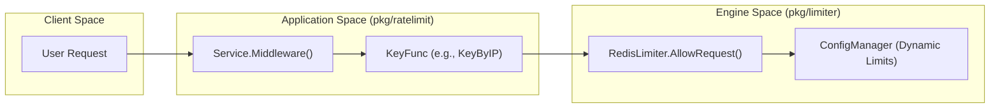
**Sources:** [SETUP_GUIDE.md:91-120](), [SETUP_GUIDE.md:163-201](), [go.mod:5-11]()

---

# Page: Design & Architecture

# Design & Architecture

<details>
<summary>Relevant source files</summary>

The following files were used as context for generating this wiki page:

- [DESIGN.md](DESIGN.md)
- [pkg/limiter/dual_limiter.go](pkg/limiter/dual_limiter.go)
- [pkg/limiter/limiter_interface.go](pkg/limiter/limiter_interface.go)
- [pkg/limiter/redis.go](pkg/limiter/redis.go)
- [pkg/ratelimit/ratelimit.go](pkg/ratelimit/ratelimit.go)

</details>


This page provides a detailed walkthrough of the `go-ratelimit` system design. It covers the modular package layout, the end-to-end request lifecycle, the sliding window algorithm implementation in Redis, and the dual-limiting mechanism for requests and data throughput.

## System Overview

The library is structured into modular components that separate rate-limiting logic, HTTP middleware, and configuration management [DESIGN.md:19-30]().

### Package Layout
*   `pkg/ratelimit`: The high-level facade providing the `Service` type for easy integration [pkg/ratelimit/ratelimit.go:16-18]().
*   `pkg/limiter`: The core engine containing various `RateLimiter` implementations [pkg/limiter/limiter_interface.go:14-29]().
*   `pkg/middleware`: HTTP interceptors that handle the request/response lifecycle [DESIGN.md:89-99]().
*   `pkg/config`: Logic for managing per-client configuration overrides [DESIGN.md:107-118]().
*   `pkg/api`: REST handlers for administrative configuration tasks [DESIGN.md:119-131]().
*   `pkg/utils`: Key generation and request parsing utilities [DESIGN.md:132-145]().

### Architecture Diagram
The following diagram illustrates the relationship between the application middleware, the core limiter, and the Redis backend.

**System Component Interaction**
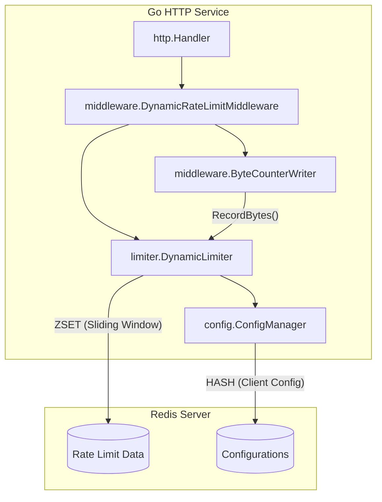
Sources: [DESIGN.md:32-50](), [pkg/ratelimit/ratelimit.go:70-76](), [pkg/limiter/dual_limiter.go:27-35]()

---

## Request Lifecycle

The system processes every incoming request through a specific sequence to ensure limits are enforced before and after the application logic executes.

1.  **Key Extraction**: The `middleware` uses a `KeyFunc` (e.g., `utils.KeyByIP`) to identify the client [pkg/ratelimit/ratelimit.go:50-51](), [DESIGN.md:148-152]().
2.  **Pre-check (Request Limit)**: The middleware calls `limiter.AllowRequest`. This executes a Lua script in Redis to check the request count against the sliding window [pkg/limiter/dual_limiter.go:71-85]().
3.  **Instrumentation**: If allowed, the `http.ResponseWriter` is wrapped in a `ByteCounterWriter` [DESIGN.md:156-157]().
4.  **Application Logic**: The next handler in the chain is called.
5.  **Post-check (Byte Limit)**: Once the response is sent, the `ByteCounterWriter` provides the total bytes written. The middleware then calls `limiter.RecordBytes` to update the byte-based sliding window [pkg/limiter/dual_limiter.go:88-102](), [DESIGN.md:157-158]().

**Request Flow Sequence**
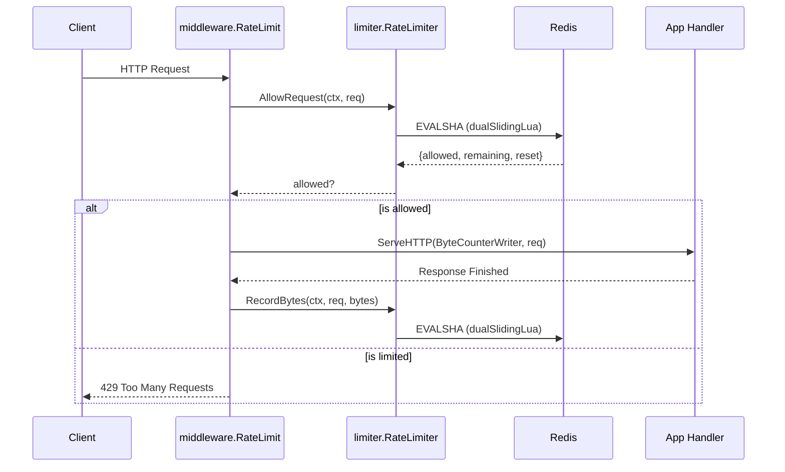
Sources: [DESIGN.md:148-158](), [pkg/limiter/dual_limiter.go:71-102](), [pkg/limiter/limiter_interface.go:14-29]()

---

## Rate Limiting Algorithm

The library implements a **Sliding Window** algorithm using Redis Sorted Sets (`ZSET`). Unlike a fixed window, this approach prevents traffic bursts at window boundaries [DESIGN.md:169-184]().

### Redis Data Structures
The system uses two `ZSET` keys per client-key to track usage independently:
1.  **Request Key**: `prefix:req:<key>` [pkg/limiter/dual_limiter.go:57]()
2.  **Byte Key**: `prefix:byte:<key>` [pkg/limiter/dual_limiter.go:58]()

### Lua Script Implementation
To ensure atomicity, all sliding window operations (pruning, counting, and adding) are performed within a single Lua script (`dualSlidingLua`) [pkg/limiter/dual_limiter.go:111-192]().

| Step | Operation | Description |
| :--- | :--- | :--- |
| **1. Prune** | `ZREMRANGEBYSCORE` | Removes all members with timestamps older than `now - window_ms` [pkg/limiter/dual_limiter.go:126-127](). |
| **2. Count** | `ZCARD` / `ZRANGE` | Gets current request count and iterates over byte entries to sum total bytes [pkg/limiter/dual_limiter.go:129-140](). |
| **3. Check** | Logic | Compares counts against `req_limit` and `byte_limit` [pkg/limiter/dual_limiter.go:147-169](). |
| **4. Record** | `ZADD` | If allowed, adds a new entry with format `bytes-timestamp-random` to ensure uniqueness [pkg/limiter/dual_limiter.go:161-162](). |
| **5. TTL** | `PEXPIRE` | Sets the key to expire shortly after the window ends to clean up inactive clients [pkg/limiter/dual_limiter.go:188-189](). |

Sources: [pkg/limiter/dual_limiter.go:111-192](), [pkg/limiter/redis.go:74-118]()

---

## Dual Rate Limiting

The `DualLimiter` (and its dynamic counterpart) provides simultaneous protection for both request frequency and data volume [pkg/limiter/dual_limiter.go:27-35]().

### Request Limiting
Tracks the number of discrete HTTP requests. This is useful for protecting CPU-bound resources or downstream APIs with per-call costs [DESIGN.md:10]().

### Byte Limiting
Tracks the total payload size (usually response size). This is critical for protecting egress bandwidth and preventing "Large Response" attacks [DESIGN.md:10]().

**Limiter Configuration Structure**
```go
type DualLimiter struct {
	rdb          *redis.Client
	prefix       string
	requestLimit int           // Max requests per window
	byteLimit    int64         // Max bytes per window
	window       time.Duration // Sliding window size
	lua          *redis.Script
	keyBuilder   func(*http.Request) string
}
```
Sources: [pkg/limiter/dual_limiter.go:27-35](), [pkg/ratelimit/ratelimit.go:34-55]()

---

# Page: Core Limiter Package

# Core Limiter Package

<details>
<summary>Relevant source files</summary>

The following files were used as context for generating this wiki page:

- [pkg/limiter/dual_limiter.go](pkg/limiter/dual_limiter.go)
- [pkg/limiter/dynamic_limiter.go](pkg/limiter/dynamic_limiter.go)
- [pkg/limiter/limiter_interface.go](pkg/limiter/limiter_interface.go)
- [pkg/limiter/memory.go](pkg/limiter/memory.go)
- [pkg/limiter/resilient_limiter.go](pkg/limiter/resilient_limiter.go)

</details>


The `pkg/limiter` package is the core engine of `go-ratelimit`. It provides the sliding-window logic required to track and enforce both request-count and byte-throughput limits. The package is designed around a central interface, allowing for different storage backends and resiliency strategies.

### The RateLimiter Interface

All limiters in this package implement the `RateLimiter` interface [pkg/limiter/limiter_interface.go:14-29](). This interface ensures that regardless of the underlying storage (Redis or In-Memory), the middleware can interact with the engine using a consistent set of methods:

| Method | Description |
| :--- | :--- |
| `AllowRequest` | Validates if a new request can proceed based on count limits. |
| `RecordBytes` | Updates the sliding window with a specific byte count and checks byte limits. |
| `GetClientConfig` | Retrieves the `ClientConfig` (limits and window) for a specific ID. |
| `GetCurrentUsage` | Returns the current byte usage within the active window. |
| `GetLastKey` | Returns the generated Redis/Memory key for the request. |

**Sources:**
- [pkg/limiter/limiter_interface.go:14-29]()

---

### Implementation Architecture

The package provides three primary concrete implementations that cater to different deployment needs, ranging from distributed production environments to local development or fallback scenarios.

#### Limiter Type Association
The following diagram maps the high-level system concepts to the specific Go types found in the `pkg/limiter` package.

**Diagram: Limiter Entity Mapping**
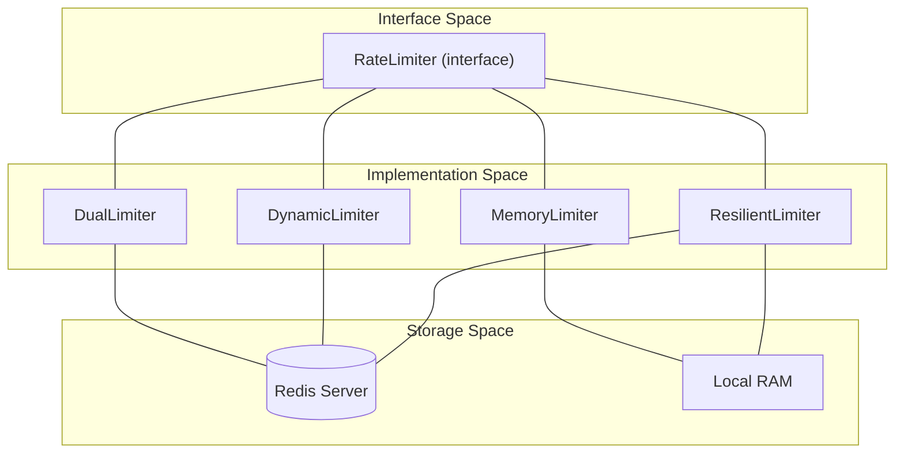
**Sources:**
- [pkg/limiter/dual_limiter.go:27-35]()
- [pkg/limiter/dynamic_limiter.go:31-37]()
- [pkg/limiter/memory.go:28-42]()
- [pkg/limiter/resilient_limiter.go:30-40]()

---

### Redis-backed Limiters

These limiters utilize Redis Sorted Sets (ZSETs) and Lua scripting to provide atomic, distributed rate limiting across multiple application instances.

*   **`DualLimiter`**: A basic implementation that applies a single set of global limits (request count and byte count) across all keys [pkg/limiter/dual_limiter.go:27-35]().
*   **`DynamicLimiter`**: An advanced version that integrates with a `ConfigManager` to allow per-client limit overrides stored in Redis [pkg/limiter/dynamic_limiter.go:31-37]().

For implementation details on Lua scripts and Redis key structures, see **[Redis-backed Limiters](#2.1)**.

**Sources:**
- [pkg/limiter/dual_limiter.go:38-55]()
- [pkg/limiter/dynamic_limiter.go:40-65]()

---

### Resilient & In-Memory Limiters

For environments where Redis availability cannot be guaranteed or for standalone local use, the package provides memory-based alternatives.

*   **`MemoryLimiter`**: Tracks sliding windows using local Go maps and slices. It is ideal for testing or single-instance applications [pkg/limiter/memory.go:28-42]().
*   **`ResilientLimiter`**: A wrapper that treats a `DynamicLimiter` as the primary engine but automatically falls back to a `MemoryLimiter` if Redis pings fail or return errors [pkg/limiter/resilient_limiter.go:30-40]().

The following diagram illustrates the fallback logic within the `ResilientLimiter`.

**Diagram: ResilientLimiter Request Flow**
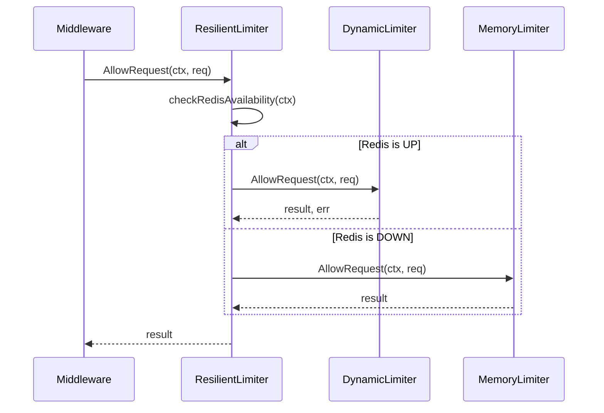

For details on the health-check loop and memory management, see **[Resilient & In-Memory Limiters](#2.2)**.

**Sources:**
- [pkg/limiter/resilient_limiter.go:118-129]()
- [pkg/limiter/resilient_limiter.go:89-111]()
- [pkg/limiter/memory.go:159-226]()

---

### Limiter Testing

The `pkg/limiter` package includes a robust testing suite that utilizes a `MockRedisClient` to simulate various Redis failure modes, ensuring the `ResilientLimiter` behaves correctly during network partitions.

For information on unit tests and integration patterns, see **[Limiter Testing](#2.3)**.

---

# Page: Redis-backed Limiters

# Redis-backed Limiters

<details>
<summary>Relevant source files</summary>

The following files were used as context for generating this wiki page:

- [pkg/limiter/dual_limiter.go](pkg/limiter/dual_limiter.go)
- [pkg/limiter/dynamic_limiter.go](pkg/limiter/dynamic_limiter.go)
- [pkg/limiter/mock_redis.go](pkg/limiter/mock_redis.go)
- [pkg/limiter/redis.go](pkg/limiter/redis.go)

</details>


This page provides a deep dive into the Redis-based implementations of the `RateLimiter` interface. These limiters utilize Redis sorted sets (ZSETs) and Lua scripting to provide atomic, distributed sliding-window rate limiting.

## Overview of Redis Limiters

The `pkg/limiter` package provides three primary Redis-backed implementations:

1.  **`RedisLimiter`**: A standard sliding-window limiter tracking request counts [pkg/limiter/redis.go:27-34]().
2.  **`DualLimiter`**: An advanced limiter that tracks both request counts and total bytes transferred within the window [pkg/limiter/dual_limiter.go:27-35]().
3.  **`DynamicLimiter`**: A wrapper around the dual-limiting logic that supports per-client configuration overrides via a `ConfigManager` [pkg/limiter/dynamic_limiter.go:31-37]().

### Data Flow: Request to Redis

The following diagram illustrates how a request flows from the code entities into the Redis data structures.

**Entity Mapping: Code to Redis**
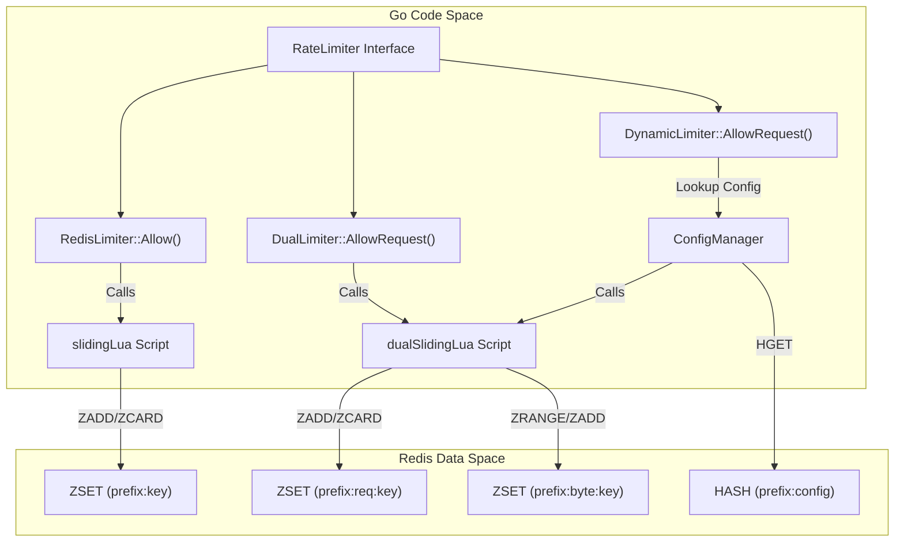
Sources: [pkg/limiter/redis.go:51-63](), [pkg/limiter/dual_limiter.go:71-85](), [pkg/limiter/dynamic_limiter.go:88-116]()

---

## Sliding Window Implementation

All Redis limiters use a sliding window algorithm implemented via Lua scripts to ensure atomicity. Unlike a fixed-window counter, the sliding window tracks the timestamp of every individual event, providing smoother enforcement.

### Key Naming Conventions
Keys are namespaced using a prefix and specific type identifiers:
*   **Request Keys**: `prefix:req:key` [pkg/limiter/dual_limiter.go:57]().
*   **Byte Keys**: `prefix:byte:key` [pkg/limiter/dual_limiter.go:58]().

### The Lua Logic
The scripts (`slidingLua` and `dualSlidingLua`) perform the following steps in a single atomic transaction:
1.  **Time Sync**: Fetch the current time from Redis using `TIME` to ensure consistency across distributed nodes [pkg/limiter/redis.go:80-81]().
2.  **Pruning**: Remove all entries with scores (timestamps) older than `now - window_ms` using `ZREMRANGEBYSCORE` [pkg/limiter/redis.go:86]().
3.  **Counting**: Calculate the current usage using `ZCARD` (for requests) or by iterating through `ZRANGE` (for bytes) [pkg/limiter/dual_limiter.go:129-140]().
4.  **Verification**: Compare current usage against limits.
5.  **Recording**: If allowed, add a new entry to the ZSET with the current timestamp as the score. Members are unique strings formatted as `timestamp-random` to allow multiple entries at the same millisecond [pkg/limiter/redis.go:95-96]().
6.  **TTL Management**: Set a `PEXPIRE` on the key for `window_ms + 1000` to ensure cleanup if the client stops sending requests [pkg/limiter/redis.go:115]().

Sources: [pkg/limiter/redis.go:74-118](), [pkg/limiter/dual_limiter.go:111-192]()

---

## DualLimiter: Request & Byte Tracking

The `DualLimiter` tracks two distinct metrics. While requests are tracked as simple counts in a ZSET, bytes require summing the values stored within the ZSET members.

### Byte Member Format
Because Redis ZSETs only store scores (floats) and members (strings), byte counts are encoded directly into the member string:
`"{bytes}-{timestamp}-{random}"` [pkg/limiter/dual_limiter.go:161]().

When calculating total usage, the Lua script iterates over the set and extracts the prefix of each member string [pkg/limiter/dual_limiter.go:133-140]().

**DualLimiter Interaction**
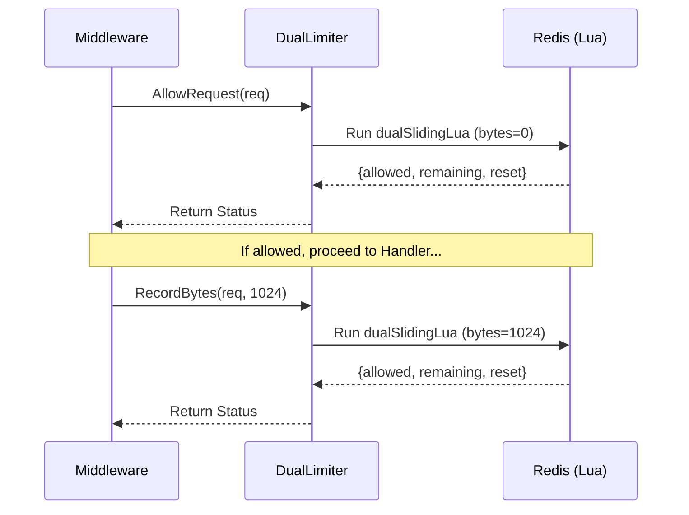
Sources: [pkg/limiter/dual_limiter.go:71-102](), [pkg/limiter/dual_limiter.go:147-169]()

---

## DynamicLimiter & ConfigManager

`DynamicLimiter` provides the most flexibility by allowing different limits for different clients (e.g., Tier 1 vs Tier 2 users).

### Client Identification
The limiter uses an `extractClientID` helper to parse the key generated by the `keyBuilder`. It specifically looks for `apikey:` prefixes to identify the tenant for configuration lookups [pkg/limiter/dynamic_limiter.go:76-85]().

### Configuration Lookup
Before executing the Lua script, the `DynamicLimiter` queries the `ConfigManager`.
1.  **Cache Check**: `ConfigManager` first checks an internal in-memory cache.
2.  **Redis Fetch**: If not in cache, it fetches the `ClientConfig` (JSON) from a Redis Hash.
3.  **Fallback**: If no client-specific config exists, it returns the `defaultCfg` provided at construction [pkg/limiter/dynamic_limiter.go:49-56]().

| Function | Role |
| :--- | :--- |
| `AllowRequest` | Looks up config, then checks request count limit [pkg/limiter/dynamic_limiter.go:88](). |
| `RecordBytes` | Looks up config, then adds bytes to the byte ZSET [pkg/limiter/dynamic_limiter.go:124](). |
| `SetClientConfig` | Persists a new `ClientConfig` to Redis for a specific ID [pkg/limiter/dynamic_limiter.go:159](). |
| `GetCurrentUsage` | Sums existing byte entries in Redis without adding a new one [pkg/limiter/dynamic_limiter.go:169](). |

Sources: [pkg/limiter/dynamic_limiter.go:31-65](), [pkg/limiter/dynamic_limiter.go:154-166]()

---

## Testing with Mock Redis

To facilitate unit testing without a live Redis instance, the package includes `RedisMockClient`. This mock implements the `redis.Cmdable` interface and simulates the behavior of ZSETs and TTLs in-memory.

*   **State Tracking**: Uses `map[string][]zsetEntry` to simulate Redis ZSETs [pkg/limiter/mock_redis.go:34]().
*   **Failure Simulation**: The `failNext` flag allows developers to test "fail-open" or "fail-closed" logic by forcing the next Redis command to return an error [pkg/limiter/mock_redis.go:37]().

Sources: [pkg/limiter/mock_redis.go:31-53]()

---

# Page: Resilient & In-Memory Limiters

# Resilient & In-Memory Limiters

<details>
<summary>Relevant source files</summary>

The following files were used as context for generating this wiki page:

- [pkg/limiter/memory.go](pkg/limiter/memory.go)
- [pkg/limiter/resilient_limiter.go](pkg/limiter/resilient_limiter.go)
- [pkg/limiter/resilient_limiter_test.go](pkg/limiter/resilient_limiter_test.go)

</details>


This page details the implementation of local and fault-tolerant rate limiting in `go-ratelimit`. It covers the `MemoryLimiter`, which tracks usage in the application's heap, and the `ResilientLimiter`, which provides a high-availability wrapper that automatically switches between Redis and local memory based on backend health.

## MemoryLimiter

The `MemoryLimiter` provides a standalone, thread-safe implementation of the sliding-window algorithm without external dependencies [pkg/limiter/memory.go:28-42](). It is used both as a lightweight local limiter and as the fallback mechanism for the `ResilientLimiter`.

### Data Structures
`MemoryLimiter` uses Go maps and slices to track timestamps and byte usage:
*   **`requestWindows`**: A map of keys to slices of `time.Time`, representing individual request timestamps [pkg/limiter/memory.go:36]().
*   **`byteWindows`**: A map of keys to slices of `ByteRecord`, which pair a byte count with a timestamp [pkg/limiter/memory.go:37,45-48]().
*   **`clientConfigs`**: Stores per-client overrides in-memory [pkg/limiter/memory.go:38]().

### Implementation Logic
1.  **Sliding Window**: When `AllowRequest` or `RecordBytes` is called, the limiter filters out timestamps older than the current window duration (`now - window`) [pkg/limiter/memory.go:176-192]().
2.  **Cleanup Loop**: To prevent memory leaks from inactive keys, the limiter performs a `cleanup()` operation [pkg/limiter/memory.go:80-122](). This runs at most once per `cleanupInterval` (default 1 minute) and removes expired entries and empty keys from the maps [pkg/limiter/memory.go:75,88-91]().
3.  **Concurrency**: Access to internal maps is protected by a `sync.RWMutex` (`mu`) [pkg/limiter/memory.go:35]().

**Sources:** [pkg/limiter/memory.go:28-42](), [pkg/limiter/memory.go:80-122](), [pkg/limiter/memory.go:176-192]()

---

## ResilientLimiter

The `ResilientLimiter` implements a "Redis-primary, Memory-fallback" strategy. It ensures that rate limiting continues to function even if the Redis cluster becomes unreachable or returns errors.

### Component Relationship
The following diagram illustrates how the `ResilientLimiter` orchestrates the flow between the primary `DynamicLimiter` (Redis-backed) and the secondary `MemoryLimiter`.

**ResilientLimiter Internal Routing**
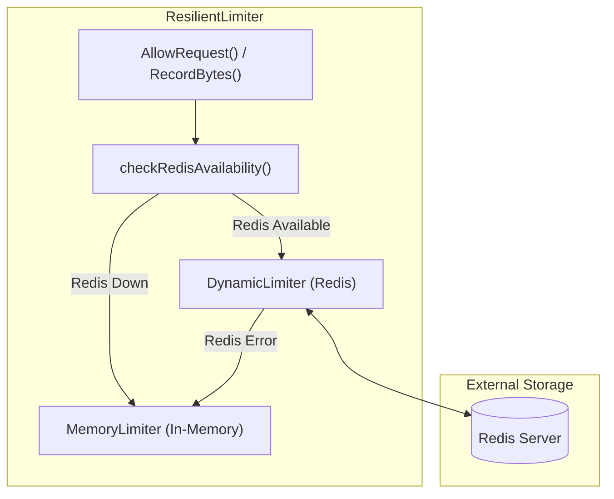
**Sources:** [pkg/limiter/resilient_limiter.go:30-40](), [pkg/limiter/resilient_limiter.go:118-129]()

### Health-Check Ping Loop
The limiter does not ping Redis on every request. Instead, it uses a throttled health check:
*   **Interval**: Availability is cached for `redisCheckInterval` (default 5 seconds) [pkg/limiter/resilient_limiter.go:84,90]().
*   **Mechanism**: It executes a `Ping()` against the `redis.Cmdable` with a 500ms timeout [pkg/limiter/resilient_limiter.go:97-102]().
*   **Promotion/Demotion**: If a Redis operation fails during a request, the limiter immediately logs the error and falls back to memory for that specific call [pkg/limiter/resilient_limiter.go:125,138]().

### Configuration Synchronization
To maintain consistency during failover, the `ResilientLimiter` attempts to keep both backends in sync:
*   **`GetClientConfig`**: When fetching config from Redis, it successfully updates the local `MemoryLimiter` cache with the retrieved values [pkg/limiter/resilient_limiter.go:144-156]().
*   **`SetClientConfig`**: Updates are applied to the `MemoryLimiter` first, then propagated to Redis if available [pkg/limiter/resilient_limiter.go:158-168]().

**Sources:** [pkg/limiter/resilient_limiter.go:89-111](), [pkg/limiter/resilient_limiter.go:144-168]()

---

## Code Entity Mapping

This diagram maps the natural language concepts of "Resilience" to the specific Go types and methods in the codebase.

**Limiter Interface to Implementation Map**
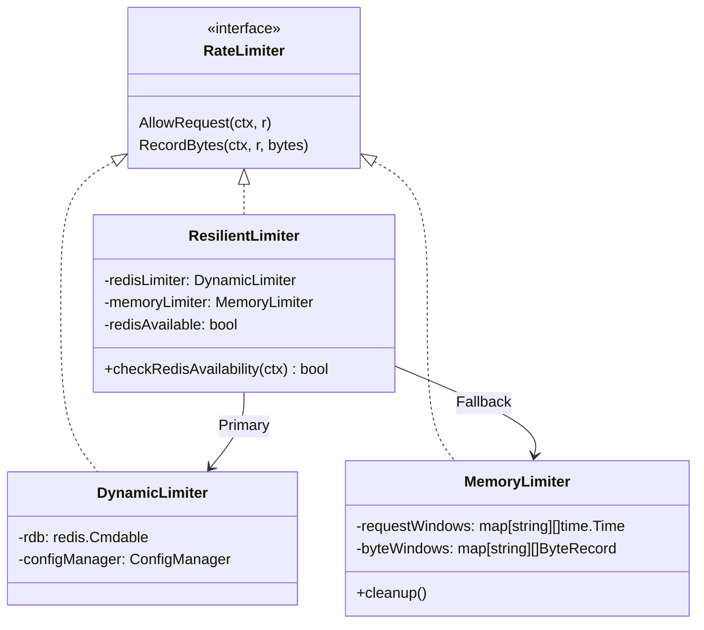
**Sources:** [pkg/limiter/memory.go:28-42](), [pkg/limiter/resilient_limiter.go:30-40](), [pkg/limiter/resilient_limiter.go:118-129]()

## Usage Summary

| Feature | MemoryLimiter | ResilientLimiter |
| :--- | :--- | :--- |
| **Primary Storage** | RAM (Go Maps) | Redis (ZSETs) |
| **Failover** | N/A | Automatic to Memory |
| **Distributed** | No (Per-instance) | Yes (Shared via Redis) |
| **Performance** | Extremely High (Local) | High (Network Latency) |
| **Best For** | Local testing, Sidecars | Production APIs |

**Sources:** [pkg/limiter/memory.go:51-77](), [pkg/limiter/resilient_limiter.go:43-86]()

---

# Page: Limiter Testing

# Limiter Testing

<details>
<summary>Relevant source files</summary>

The following files were used as context for generating this wiki page:

- [pkg/limiter/dual_limiter_test.go](pkg/limiter/dual_limiter_test.go)
- [pkg/limiter/dynamic_limiter_test.go](pkg/limiter/dynamic_limiter_test.go)
- [pkg/limiter/limiter_test.go](pkg/limiter/limiter_test.go)
- [pkg/limiter/mock_redis.go](pkg/limiter/mock_redis.go)
- [pkg/limiter/mock_test.go](pkg/limiter/mock_test.go)
- [pkg/limiter/redis_test.go](pkg/limiter/redis_test.go)

</details>


The `limiter` package employs a multi-tiered testing strategy to ensure the correctness of rate-limiting logic across different implementations. This includes unit tests for individual limiter types, a custom mock Redis implementation for isolated logic verification, and integration patterns for testing against live Redis instances.

## Test Strategy Overview

The testing framework is designed to validate the sliding window algorithm, atomicity of operations, and the resilience of the system under various conditions.

| Test Level | Scope | Key Components |
|:---|:---|:---|
| **Unit Tests** | Individual limiter logic and configuration | `RedisLimiter`, `DualLimiter`, `DynamicLimiter` |
| **Mocking** | Redis protocol simulation without external dependencies | `RedisMockClient`, `MockRedisClient` |
| **Concurrency Tests** | Thread-safety and race condition detection | `TestConcurrentRateLimiting` |
| **Integration** | Real-world behavior against a live Redis instance | `testConcurrentAccess`, `testConcurrentDualAccess` |

**Sources:** [pkg/limiter/limiter_test.go:52-57](), [pkg/limiter/mock_redis.go:31-38]()

---

## Mocking Redis

To facilitate fast and reliable unit testing without requiring a running Redis server, the package provides two mock implementations.

### RedisMockClient
The `RedisMockClient` implements a subset of the `go-redis` interface using in-memory maps and mutexes. It simulates standard Redis commands such as `GET`, `SET`, `ZADD`, and `ZREMRANGEBYSCORE` to validate the sliding window Lua script logic.

*   **State Management:** Uses `map[string]interface{}` for simple keys and `map[string][]zsetEntry` for sorted sets [pkg/limiter/mock_redis.go:31-35]().
*   **Failure Simulation:** The `failNext` flag and `SimulateFailure()` method allow tests to verify how limiters handle Redis connectivity issues [pkg/limiter/mock_redis.go:307-313]().

### Mock Lua Execution
While the actual limiters use `redis.Script` [pkg/limiter/redis_test.go:226-237](), tests often use `InMemoryLimiter` or `InMemoryDualLimiter` to verify the mathematical correctness of the windowing logic before it is translated into Lua [pkg/limiter/mock_test.go:163-196]().

**Sources:** [pkg/limiter/mock_redis.go:31-53](), [pkg/limiter/mock_test.go:163-174]()

---

## Unit Testing Limiter Types

Each concrete implementation of the `RateLimiter` interface has a corresponding test suite.

### RedisLimiter Tests
Tests focus on key generation and basic allowance logic.
*   **Key Generation:** Validates that keys are correctly namespaced using the prefix and `KeyFunc` [pkg/limiter/redis_test.go:62-73]().
*   **Lua Initialization:** Ensures the `slidingLua` script contains necessary Redis commands like `ZREMRANGEBYSCORE` and `ZCARD` [pkg/limiter/redis_test.go:226-237]().

### DualLimiter Tests
Focuses on the interplay between request counts and byte counts.
*   **Limit Priority:** Tests verify scenarios where the request limit is hit before the byte limit, and vice versa [pkg/limiter/dual_limiter_test.go:147-177]().
*   **Key Separation:** Ensures `api:req:ID` and `api:byte:ID` keys are generated distinctly [pkg/limiter/dual_limiter_test.go:64-79]().

### DynamicLimiter Tests
Validates the integration with `ConfigManager`.
*   **Config Overrides:** Tests the transition from default limits to client-specific overrides stored in Redis [pkg/limiter/dynamic_limiter_test.go:177-212]().
*   **Client ID Extraction:** Validates the `extractClientID` helper used to parse keys for configuration lookups [pkg/limiter/dynamic_limiter_test.go:75-109]().

**Sources:** [pkg/limiter/redis_test.go:31-49](), [pkg/limiter/dual_limiter_test.go:31-50](), [pkg/limiter/dynamic_limiter_test.go:33-61]()

---

## Integration and Concurrency Testing

The `TestConcurrentRateLimiting` function provides a framework for high-load testing. These tests are skipped in "short" mode (`go test -short`) and require a local Redis instance on port `6379` [pkg/limiter/limiter_test.go:53-68]().

### Concurrency Data Flow

The diagram below illustrates how `testConcurrentAccess` coordinates multiple goroutines to stress a `RateLimiter` implementation.

**Diagram: Concurrent Test Execution Flow**
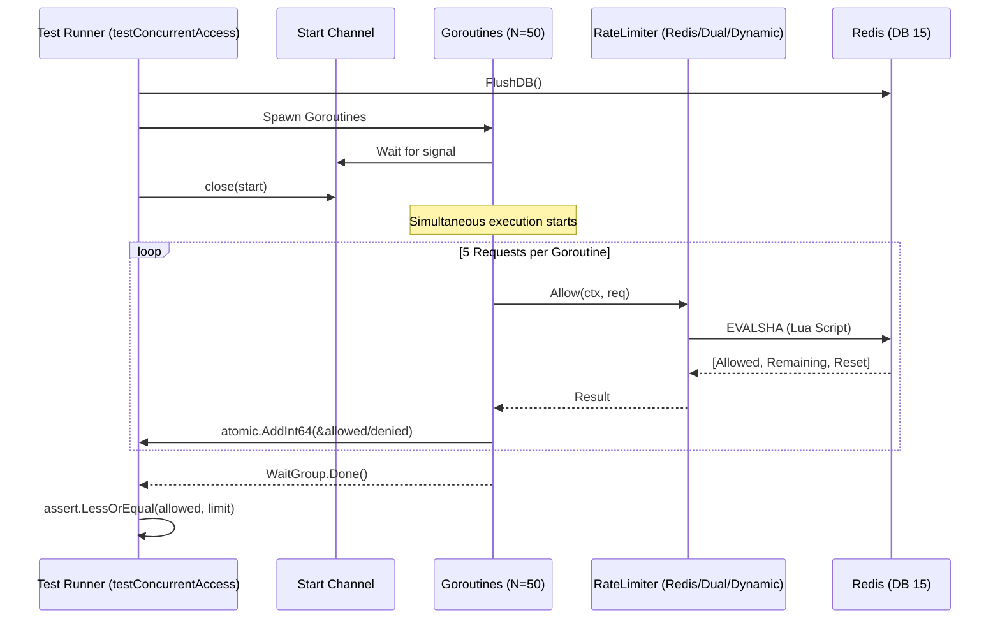
**Sources:** [pkg/limiter/limiter_test.go:101-153]()

---

## Code Entity Mapping

The following diagram bridges the test helper structures to the actual limiter implementations being tested.

**Diagram: Test Entity Relationships**
```mermaid
classDiagram
    class TestHelpers {
        +CreateTestRequest()
    }
    class RedisMockClient {
        +data: map
        +zsets: map
        +SimulateFailure()
    }
    class RateLimiterTests {
        +testConcurrentAccess(RedisLimiter)
        +testConcurrentDualAccess(DualLimiter)
        +testConcurrentDynamicAccess(DynamicLimiter)
    }

    TestHelpers ..> RateLimiterTests : provides requests
    RedisMockClient ..|> "go-redis Client" : mocks
    RateLimiterTests --> "pkg/limiter": tests
```

### Key Test Functions
| Function | File | Purpose |
|:---|:---|:---|
| `testConcurrentAccess` | [pkg/limiter/limiter_test.go:101]() | Stress tests `RedisLimiter` with atomic counters for allowed/denied requests. |
| `testConcurrentDualAccess` | [pkg/limiter/limiter_test.go:156]() | Validates `DualLimiter` by alternating between `AllowRequest` and `RecordBytes` calls across goroutines. |
| `extractClientID` | [pkg/limiter/dynamic_limiter_test.go:105]() | Internal helper tested to ensure correct mapping of Redis keys to `ConfigManager` client IDs. |

**Sources:** [pkg/limiter/limiter_test.go:101-230](), [pkg/limiter/dynamic_limiter_test.go:75-109]()

---

# Page: Middleware Layer

# Middleware Layer

<details>
<summary>Relevant source files</summary>

The following files were used as context for generating this wiki page:

- [pkg/middleware/dynamic_ratelimit.go](pkg/middleware/dynamic_ratelimit.go)
- [pkg/middleware/middleware_test.go](pkg/middleware/middleware_test.go)
- [pkg/middleware/ratelimit.go](pkg/middleware/ratelimit.go)

</details>


The `pkg/middleware` package provides the glue between the HTTP request lifecycle and the core rate limiting engines. It implements standard Go `func(http.Handler) http.Handler` middleware that handles key extraction, policy enforcement, and response instrumentation for byte-based tracking.

### Request Lifecycle

When a request enters the middleware, it follows a structured lifecycle to ensure both request-count and byte-throughput limits are respected.

#### 1. Key Extraction & Policy Check
The middleware first identifies the client using a `KeyFunc` or the internal `extractClientID` helper [pkg/middleware/dynamic_ratelimit.go:121-174](). It then calls `AllowRequest` on the `RateLimiter` interface [pkg/middleware/dynamic_ratelimit.go:41](). If the request count exceeds the limit, the middleware terminates the chain with an `http.StatusTooManyRequests` (429) and sets the `Retry-After` header [pkg/middleware/dynamic_ratelimit.go:78-83]().

#### 2. Response Wrapping
If the request is allowed, the middleware wraps the original `http.ResponseWriter` in a `ByteCounterWriter` [pkg/middleware/dynamic_ratelimit.go:86](). This wrapper intercepts all `Write` calls to calculate the total payload size delivered to the client.

#### 3. Post-Handler Recording
After the downstream handler completes, the middleware inspects the HTTP status code. If the response was successful (status < 400), it calls `RecordBytes` to update the sliding window for byte throughput [pkg/middleware/dynamic_ratelimit.go:92-94]().

### Middleware Flow Architecture

The following diagram illustrates the interaction between the middleware components and the `RateLimiter` interface.

**Middleware Sequence Diagram**
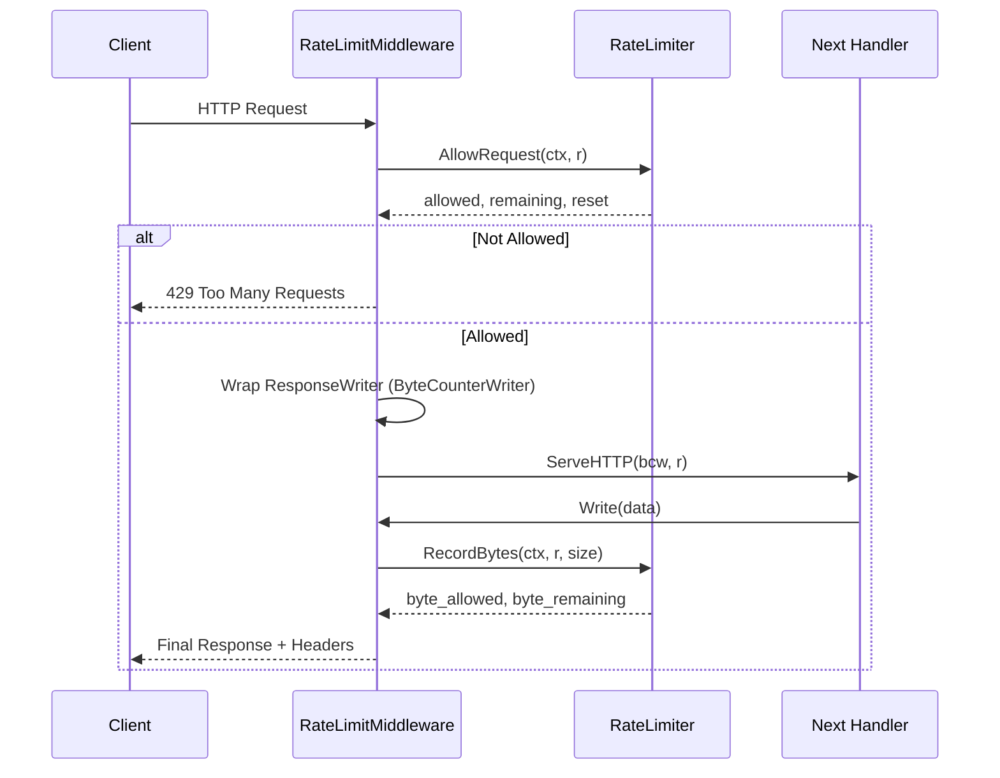
Sources: [pkg/middleware/dynamic_ratelimit.go:39-115](), [pkg/middleware/ratelimit.go:29-56]()

### Middleware Components

The package is built around several core entities that manage the transition from HTTP metadata to rate limit logic.

| Entity | Role | Location |
| :--- | :--- | :--- |
| `RateLimitMiddleware` | Simple middleware for global Redis-backed request limiting. | [pkg/middleware/ratelimit.go:29]() |
| `DynamicRateLimitMiddleware` | Advanced middleware supporting per-client config and byte limiting. | [pkg/middleware/dynamic_ratelimit.go:27]() |
| `ByteCounterWriter` | A wrapper that tracks the number of bytes written to the response. | [pkg/middleware/byte_counter.go]() |
| `extractClientID` | Helper to find client identity in headers (e.g., `X-Client-ID`, `X-Scope-OrgID`). | [pkg/middleware/dynamic_ratelimit.go:121]() |

**Code Entity Mapping**
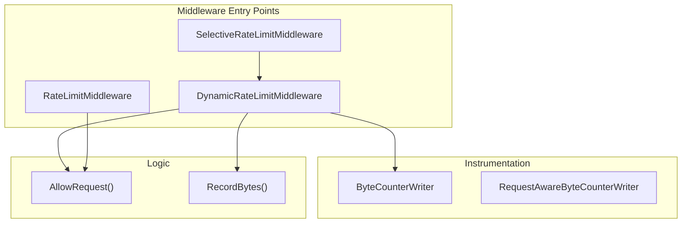
Sources: [pkg/middleware/dynamic_ratelimit.go:27-117](), [pkg/middleware/ratelimit.go:29-56](), [pkg/middleware/selective_ratelimit.go:27-45]()

### Response Headers

The middleware injects standard and custom headers to inform clients of their current quota status.

*   **Request Quota**: `RateLimit-Request-Limit`, `RateLimit-Request-Remaining`, `RateLimit-Request-Reset` [pkg/middleware/dynamic_ratelimit.go:56-64]().
*   **Byte Quota**: `RateLimit-Bytes-Limit`, `RateLimit-Bytes-Remaining`, `RateLimit-Bytes-Reset` [pkg/middleware/dynamic_ratelimit.go:105-107]().

---

### Sub-Pages

For detailed implementation details on specific middleware features, refer to the following child pages:

*   [Middleware Variants](#3.1)
    Detailed reference for all middleware constructors, including `SelectiveRateLimitMiddleware` and `PathMatcher` logic for targeting specific URL patterns.
*   [ByteCounterWriter & Response Instrumentation](#3.2)
    Deep dive into how the middleware intercepts response data, handles `http.Flusher`/`http.Hijacker` interfaces, and calculates throughput accurately.

---

# Page: Middleware Variants

# Middleware Variants

<details>
<summary>Relevant source files</summary>

The following files were used as context for generating this wiki page:

- [pkg/middleware/dual_ratelimit.go](pkg/middleware/dual_ratelimit.go)
- [pkg/middleware/dynamic_ratelimit.go](pkg/middleware/dynamic_ratelimit.go)
- [pkg/middleware/dynamic_ratelimit_request_aware.go](pkg/middleware/dynamic_ratelimit_request_aware.go)
- [pkg/middleware/ratelimit.go](pkg/middleware/ratelimit.go)
- [pkg/middleware/selective_ratelimit.go](pkg/middleware/selective_ratelimit.go)

</details>


The `pkg/middleware` package provides several HTTP middleware constructors designed to wrap standard `http.Handler` objects. These variants allow developers to choose between simple global policies, dynamic per-client configurations, and selective path-based enforcement. All variants handle the extraction of rate limit keys, interaction with the underlying `limiter` package, and the injection of standard RFC-compliant rate limit headers into the response.

## Core Middleware Variants

### RateLimitMiddleware (Simple)
The `RateLimitMiddleware` is the most basic implementation, designed for enforcing a single global policy using a `RedisLimiter` [pkg/middleware/ratelimit.go:29-29](). It tracks request counts but does not support byte-based limiting or dynamic configuration overrides.

*   **Implementation**: It calls `rl.Allow(r.Context(), r)` to check quota [pkg/middleware/ratelimit.go:32-32]().
*   **Headers**: Sets `RateLimit-Limit`, `RateLimit-Remaining`, and `RateLimit-Reset` [pkg/middleware/ratelimit.go:43-45]().
*   **Fail-safe**: Returns an `http.StatusInternalServerError` if the limiter encounters a Redis error [pkg/middleware/ratelimit.go:35-35]().

### DynamicRateLimitMiddleware
The `DynamicRateLimitMiddleware` is the primary variant for multi-tenant systems. It accepts any implementation of the `RateLimiter` interface (typically a `DynamicLimiter`) [pkg/middleware/dynamic_ratelimit.go:27-27]().

*   **Dual Enforcement**: It checks request counts before the handler runs and records byte usage after the handler completes [pkg/middleware/dynamic_ratelimit.go:41-94]().
*   **Config Lookup**: It uses `extractClientID` to identify the tenant and fetches their specific `ClientConfig` [pkg/middleware/dynamic_ratelimit.go:51-52]().
*   **Post-facto Recording**: Byte usage is recorded only for successful responses (Status < 400) [pkg/middleware/dynamic_ratelimit.go:92-94]().

### DynamicRateLimitMiddlewareWithLogger
A variant of the dynamic middleware that accepts a custom `Logger` interface [pkg/middleware/dynamic_ratelimit.go:32-32](). If no logger is provided, it defaults to a `NoOpLogger` [pkg/middleware/dynamic_ratelimit.go:35-35](). It provides detailed logs for header injection, quota exhaustion, and byte recording [pkg/middleware/dynamic_ratelimit.go:55-113]().

### DynamicRateLimitMiddlewareWithRequestSize
This variant introduces a "pre-flight" byte check. It uses a `RequestSizeFunc` to estimate the size of an incoming request (e.g., from a `Content-Length` header) before executing the downstream handler [pkg/middleware/dynamic_ratelimit_request_aware.go:26-26]().

*   **Pre-flight Logic**: If the `expectedSize` exceeds the `bytesRemaining`, the request is rejected immediately with a `429 Too Many Requests` [pkg/middleware/dynamic_ratelimit_request_aware.go:83-95]().
*   **Data Flow**: Uses `NewRequestAwareByteCounterWriter` to wrap the response [pkg/middleware/dynamic_ratelimit_request_aware.go:100-100]().

### SelectiveRateLimitMiddleware
This variant allows for conditional rate limiting based on the request path [pkg/middleware/selective_ratelimit.go:30-30](). It takes a `PathMatcher` function; if the matcher returns `false`, the rate limiter is bypassed entirely [pkg/middleware/selective_ratelimit.go:34-38]().

**Sources:**
[pkg/middleware/ratelimit.go:28-56](), [pkg/middleware/dynamic_ratelimit.go:26-117](), [pkg/middleware/dynamic_ratelimit_request_aware.go:25-131](), [pkg/middleware/selective_ratelimit.go:29-45]()

---

## Request Lifecycle and Data Flow

The following diagram illustrates the execution flow within `DynamicRateLimitMiddlewareWithRequestSize`, showing how it bridges the HTTP request to the internal limiter logic.

**Middleware Execution Sequence**
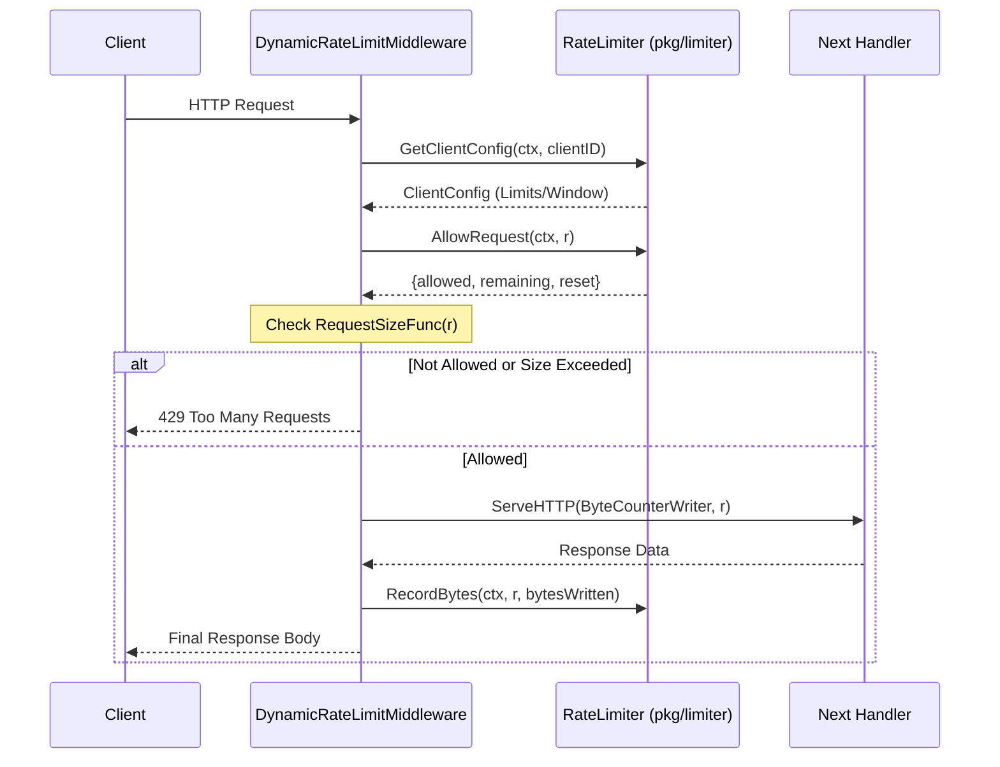
**Sources:**
[pkg/middleware/dynamic_ratelimit_request_aware.go:33-129](), [pkg/middleware/dynamic_ratelimit.go:39-115]()

---

## Path Matcher Combinators

The `SelectiveRateLimitMiddleware` relies on `PathMatcher` functions [pkg/middleware/selective_ratelimit.go:27-27](). The package provides several built-in combinators to build complex matching logic.

| Function | Description | Implementation |
| :--- | :--- | :--- |
| `MatchPathPrefix` | Matches if the path starts with the string. | `strings.HasPrefix` [pkg/middleware/selective_ratelimit.go:48-52]() |
| `MatchPathExact` | Matches the path string exactly. | `path == exactPath` [pkg/middleware/selective_ratelimit.go:55-59]() |
| `MatchPathRegex` | Matches the path against a regular expression. | `regexp.MatchString` [pkg/middleware/selective_ratelimit.go:62-67]() |
| `MatchAny` | Logical OR: returns true if any matcher matches. | Loop through matchers [pkg/middleware/selective_ratelimit.go:70-79]() |
| `MatchNone` | Logical NOT: returns true if no matchers match. | Loop through matchers [pkg/middleware/selective_ratelimit.go:82-91]() |

**Sources:**
[pkg/middleware/selective_ratelimit.go:47-91]()

---

## Client ID Extraction Logic

The `extractClientID` function is used by dynamic middleware variants to determine which `ClientConfig` to apply. It scans the request in a specific order of priority:

**Client Identification Hierarchy**
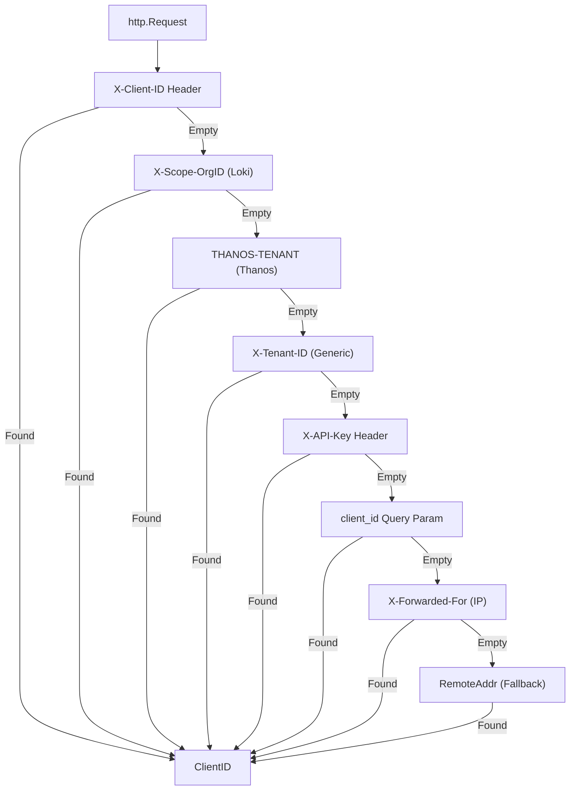
**Sources:**
[pkg/middleware/dynamic_ratelimit.go:121-174]()

## Summary of Constructors

| Constructor | Limiter Type | Key Features |
| :--- | :--- | :--- |
| `RateLimitMiddleware` | `*limiter.RedisLimiter` | Simple, global request-count limiting. |
| `DynamicRateLimitMiddleware` | `limiter.RateLimiter` | Per-client dynamic config, dual (request/byte) limiting. |
| `DynamicRateLimitMiddlewareWithLogger` | `limiter.RateLimiter` | Adds structured logging for limit enforcement. |
| `DynamicRateLimitMiddlewareWithRequestSize` | `limiter.RateLimiter` | Pre-flight byte checks via `RequestSizeFunc`. |
| `SelectiveRateLimitMiddleware` | `*limiter.DynamicLimiter` | Path-based exclusion/inclusion logic. |

**Sources:**
[pkg/middleware/ratelimit.go:29](), [pkg/middleware/dynamic_ratelimit.go:27](), [pkg/middleware/dynamic_ratelimit.go:32](), [pkg/middleware/dynamic_ratelimit_request_aware.go:26](), [pkg/middleware/selective_ratelimit.go:30]()

---

# Page: ByteCounterWriter & Response Instrumentation

# ByteCounterWriter & Response Instrumentation

<details>
<summary>Relevant source files</summary>

The following files were used as context for generating this wiki page:

- [pkg/middleware/bytecounter.go](pkg/middleware/bytecounter.go)
- [pkg/middleware/logger.go](pkg/middleware/logger.go)
- [pkg/middleware/request_aware_bytecounter.go](pkg/middleware/request_aware_bytecounter.go)

</details>


The `go-ratelimit` library provides sophisticated response instrumentation to support byte-based rate limiting. Since HTTP handlers write to an `http.ResponseWriter` during execution, the system must intercept these calls to accurately measure the data volume processed before reporting it back to the rate limiter. This is achieved through two primary wrapper types: `ByteCounterWriter` and `RequestAwareByteCounterWriter`.

## ByteCounterWriter

The `ByteCounterWriter` is a specialized wrapper for `http.ResponseWriter` designed to capture metadata about the HTTP response that is otherwise lost once the handler finishes execution. It tracks the total number of bytes written to the client and the HTTP status code returned by the handler.

### Key Capabilities
- **Byte Tracking**: Intercepts `Write` calls to increment an internal counter [pkg/middleware/bytecounter.go:40-44]().
- **Status Code Capture**: Overrides `WriteHeader` to store the status code for later logging or analysis [pkg/middleware/bytecounter.go:47-50]().
- **Interface Satisfaction**: Implements `http.Flusher` and `http.Hijacker` by delegating to the underlying writer if supported, ensuring compatibility with WebSockets and streaming responses [pkg/middleware/bytecounter.go:53-65]().

### Implementation Details
The struct embeds the original `http.ResponseWriter`, allowing it to act as a transparent proxy.

| Field | Type | Description |
| :--- | :--- | :--- |
| `ResponseWriter` | `http.ResponseWriter` | The original writer being wrapped [pkg/middleware/bytecounter.go:26](). |
| `BytesWritten` | `int64` | Cumulative count of bytes sent via `Write` [pkg/middleware/bytecounter.go:27](). |
| `StatusCode` | `int` | The HTTP status code (defaults to 200 OK) [pkg/middleware/bytecounter.go:28,35](). |

**Sources:** [pkg/middleware/bytecounter.go:24-37]()

## RequestAwareByteCounterWriter

In some scenarios, rate limiting should be based on the size of the incoming request (e.g., file uploads) rather than the outgoing response. The `RequestAwareByteCounterWriter` extends the basic byte counter to prioritize request-side metrics when provided.

### Data Flow Logic
1. Upon the first call to `Write`, the writer executes a `RequestSizeFunc` [pkg/middleware/request_aware_bytecounter.go:43-45]().
2. If the function successfully retrieves a request size, that value is assigned to `BytesWritten`, and the writer enters a `bytesRecorded` state [pkg/middleware/request_aware_bytecounter.go:46-50]().
3. If no request size is available, it falls back to counting response bytes as they are written, identical to the standard `ByteCounterWriter` [pkg/middleware/request_aware_bytecounter.go:57-60]().

**Sources:** [pkg/middleware/request_aware_bytecounter.go:22-62]()

## Instrumentation Lifecycle

The following diagram illustrates how the middleware utilizes these writers to bridge the gap between the HTTP handler and the `RateLimiter` recording logic.

### Response Interception Flow
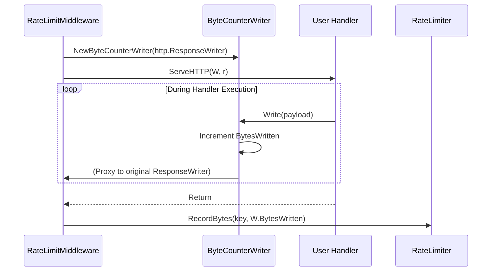
**Sources:** [pkg/middleware/bytecounter.go:32-44](), [pkg/middleware/request_aware_bytecounter.go:43-62]()

## Code Entity Mapping

The following diagram maps the logical instrumentation components to their specific code entities and interfaces.

### Instrumentation Entity Map
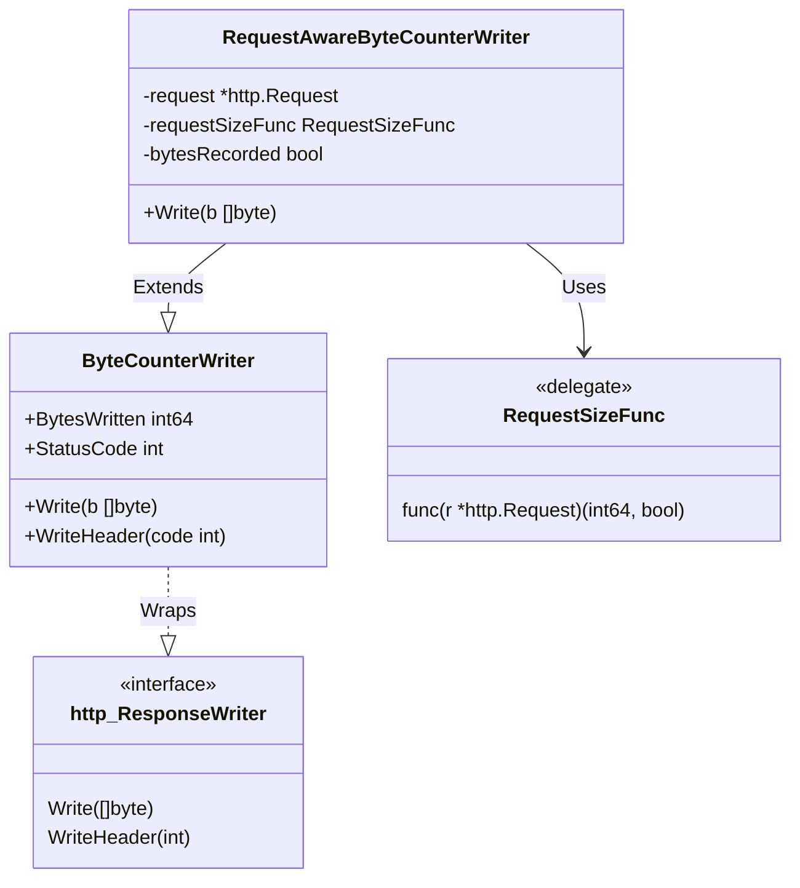
**Sources:** [pkg/middleware/bytecounter.go:25-30](), [pkg/middleware/request_aware_bytecounter.go:23-31]()

## Interface Support (Flusher & Hijacker)

To ensure that the middleware does not break standard HTTP features, the `ByteCounterWriter` explicitly checks the capabilities of the underlying `http.ResponseWriter`.

- **Flushing**: If the wrapped writer implements `http.Flusher`, the `Flush()` method is exposed and delegated [pkg/middleware/bytecounter.go:53-57]().
- **Hijacking**: If the wrapped writer implements `http.Hijacker`, the `Hijack()` method allows the caller to take over the connection (essential for protocols like WebSockets) [pkg/middleware/bytecounter.go:60-65]().

**Sources:** [pkg/middleware/bytecounter.go:52-65]()

---

# Page: Key Extraction & Utilities

# Key Extraction & Utilities

<details>
<summary>Relevant source files</summary>

The following files were used as context for generating this wiki page:

- [pkg/utils/header_keys.go](pkg/utils/header_keys.go)
- [pkg/utils/request.go](pkg/utils/request.go)

</details>


The `pkg/utils` package provides the logic for mapping incoming HTTP requests to unique rate-limit keys. This process is central to the library's ability to differentiate between clients, tenants, or specific API routes. The package defines a standard `KeyFunc` signature and offers a variety of factory functions to generate these keys based on IP addresses, headers, or composite request data.

### The Key Extraction Process

Rate limiting relies on identifying the "subject" of the limit. The `go-ratelimit` library uses a functional approach where a `KeyFunc` examines an `*http.Request` and returns a string that acts as the unique identifier in the Redis backend.

The following diagram illustrates how the `middleware` uses `utils` to derive a key before interacting with the `limiter`.

**Request to Key Mapping Flow**
```mermaid
graph TD
    subgraph "HTTP Request"
        REQ["http.Request"]
    end

    subgraph "pkg/utils"
        KF["KeyFunc (type)"]
        H_OPT["HeaderKeyOptions"]
        SAN["Sanitizer (func)"]
    end

    subgraph "Redis Key Space"
        RK["prefix:req:extracted_key"]
    end

    REQ -->|"Passed to"| KF
    KF -->|"Uses"| H_OPT
    H_OPT -->|"Invokes"| SAN
    SAN -->|"Returns Clean Value"| KF
    KF -->|"Returns String"| RK
```
Sources: [pkg/utils/header_keys.go:25-48](), [pkg/utils/header_keys.go:70-109](), [pkg/utils/request.go:25-48]()

---

### Key Generation Functions

The library provides several built-in strategies for key generation. These range from simple IP-based identification to complex multi-header fallback logic.

| Strategy | Function / Type | Description |
|:---|:---|:---|
| **IP-Based** | `KeyByIP` | Uses `ClientIP(r)` to identify the client. [pkg/utils/request.go:25-27]() |
| **Client ID** | `KeyByClientID` | Uses a provided ID, falling back to IP if the ID is empty. [pkg/utils/request.go:29-37]() |
| **Route-Aware** | `KeyByClientIDAndRoute` | Combines a client ID with a normalized URL path bucket. [pkg/utils/request.go:39-48]() |
| **Header-Based** | `KeyByHeader` | Extracts a key from a specific HTTP header (e.g., `X-API-Key`). [pkg/utils/header_keys.go:63-67]() |
| **Composite** | `KeyByMultipleHeaders` | Joins multiple header values into a single delimited key. [pkg/utils/header_keys.go:118-148]() |
| **Fallback** | `KeyByHeaderWithFallback` | Tries a list of headers in order until a value is found. [pkg/utils/header_keys.go:157-175]() |

For a detailed reference on implementing these strategies and how they namespace keys in Redis, see **[Key Generation Functions](#4.1)**.

---

### Advanced Configuration & Sanitization

When extracting keys from user-provided headers, it is critical to prevent "key-space pollution" or injection attacks in Redis. The `HeaderKeyOptions` struct allows for fine-grained control over how header values are processed.

**Key Extraction Entities**
```mermaid
classDiagram
    class HeaderKeyOptions {
        +string HeaderName
        +string Prefix
        +string DefaultValue
        +bool CaseSensitive
        +bool AllowEmpty
        +func Sanitizer
    }
    class Sanitizers {
        +AlphanumericSanitizer(string)
        +UUIDSanitizer(string)
        +MaxLengthSanitizer(int)
    }
    HeaderKeyOptions --> Sanitizers : "Uses"
```
Sources: [pkg/utils/header_keys.go:25-48](), [pkg/utils/header_keys.go:179-217]()

#### Sanitizers
Sanitizers are functions with the signature `func(string) string`. They are executed during key extraction to normalize the input. Built-in options include:
*   **`AlphanumericSanitizer`**: Strips all non-alphanumeric characters. [pkg/utils/header_keys.go:180-188]()
*   **`UUIDSanitizer`**: Validates and normalizes 32-character hex strings. [pkg/utils/header_keys.go:191-207]()
*   **`MaxLengthSanitizer`**: Truncates values to prevent excessively long keys. [pkg/utils/header_keys.go:210-217]()

For details on configuring these options and preventing Redis injection, see **[Header Sanitizers](#4.2)**.

---

### Request Utilities

The package also includes helper functions for common request inspection tasks:
*   **`ClientIP`**: Extracts the IP, honoring the `X-Forwarded-For` header if present. [pkg/utils/request.go:65-76]()
*   **`RouteBucket`**: Normalizes URL paths (e.g., `/v1/users/123` becomes `/v1/users`) to allow for aggregate rate limiting across resource endpoints. [pkg/utils/request.go:51-62]()

Sources: [pkg/utils/request.go:51-76]()

---

# Page: Key Generation Functions

# Key Generation Functions

<details>
<summary>Relevant source files</summary>

The following files were used as context for generating this wiki page:

- [docs/HEADER_BASED_RATE_LIMITING.md](docs/HEADER_BASED_RATE_LIMITING.md)
- [pkg/utils/header_keys.go](pkg/utils/header_keys.go)
- [pkg/utils/header_keys_test.go](pkg/utils/header_keys_test.go)
- [pkg/utils/request.go](pkg/utils/request.go)
- [pkg/utils/request_test.go](pkg/utils/request_test.go)

</details>


The `go-ratelimit` library uses key generation functions to map incoming HTTP requests to unique identifiers used for tracking rate limits in Redis. These functions determine the granularity of the rate limiting—whether it is applied per IP address, per authenticated user, or per specific request header.

## Overview

A `KeyFunc` is a functional type that accepts an `*http.Request` and returns a `string`. This string serves as the unique identifier for the client in the rate limiting engine. When used with Redis-backed limiters, these keys are namespaced and used to build the final Redis keys (e.g., `prefix:req:<generated_key>`).

### Key Flow and Redis Namespacing

The following diagram illustrates how a request flows through a `KeyFunc` to become a Redis key:

**Request to Redis Key Mapping**
```mermaid
graph TD
    subgraph "Natural Language Space"
        Req["Incoming HTTP Request"]
        Logic["Key Extraction Logic"]
        Namespace["Redis Namespace"]
    end

    subgraph "Code Entity Space"
        R["http.Request"]
        KF["KeyFunc (pkg/utils)"]
        LIM["RedisLimiter (pkg/limiter)"]
        FinalKey["Redis Key (ZSET)"]
    end

    Req --> R
    Logic --> KF
    R --> KF
    KF -- "returns string key" --> LIM
    Namespace --> LIM
    LIM -- "prefix:req:key" --> FinalKey
```
Sources: [pkg/utils/header_keys.go:50-63](), [pkg/utils/request.go:24-27]()

---

## Standard Key Functions

The library provides several built-in functions for common identification strategies.

### KeyByIP
`KeyByIP` extracts the client's IP address. It honors the `X-Forwarded-For` header if present, taking the first entry in the comma-separated list. If the header is missing, it falls back to `r.RemoteAddr`.

*   **Format**: `ip:<ip_address>`
*   **Implementation**: [pkg/utils/request.go:25-27]()
*   **IP Extraction**: [pkg/utils/request.go:65-76]()

### KeyByClientID
`KeyByClientID` is intended for use after a request has been authenticated. If the `clientID` provided is empty, it falls back to `KeyByIP`.

*   **Format**: `client:<clientID>` or `ip:<ip_address>`
*   **Implementation**: [pkg/utils/request.go:31-37]()

### KeyByClientIDAndRoute
This function combines a client identifier with a normalized URL path (route bucket). This allows for per-route rate limiting for specific users.

*   **Format**: `client:<clientID>|route:<bucket>`
*   **Route Normalization**: The `RouteBucket` function normalizes paths to the first two segments (e.g., `/v1/users/123` becomes `/v1/users`).
*   **Implementation**: [pkg/utils/request.go:41-48](), [pkg/utils/request.go:51-62]()

---

## Header-Based Key Functions

Header-based functions allow for flexible limiting based on custom metadata, such as API keys or Tenant IDs.

### KeyByHeader
A convenience wrapper around `KeyByHeaderWithOptions` that extracts a single header value.

*   **Source**: [pkg/utils/header_keys.go:63-67]()

### KeyByHeaderWithOptions
Provides fine-grained control over header extraction via the `HeaderKeyOptions` struct.

| Option | Type | Description |
| :--- | :--- | :--- |
| `HeaderName` | `string` | The HTTP header to inspect. |
| `Prefix` | `string` | Optional prefix for the resulting key (e.g., `tenant:`). |
| `DefaultValue` | `string` | Value used if header is missing. If empty, falls back to IP. |
| `CaseSensitive`| `bool` | Whether to preserve case (default `false` / lowercase). |
| `Sanitizer` | `func` | Function to clean/validate the header value. |

**Header Extraction Logic**
```mermaid
graph TD
    Start["http.Request.Header.Get(HeaderName)"]
    Case["CaseSensitive?"]
    Sanitize["Apply Sanitizer"]
    EmptyCheck{"Is Empty?"}
    DefaultVal{"DefaultValue set?"}
    IPFallback["header-NAME-fallback:IP"]
    FinalPrefix{"Prefix set?"}
    
    Start --> Case
    Case -- "No" --> Lower["strings.ToLower"]
    Case -- "Yes" --> Sanitize
    Lower --> Sanitize
    Sanitize --> EmptyCheck
    EmptyCheck -- "No" --> FinalPrefix
    EmptyCheck -- "Yes" --> DefaultVal
    DefaultVal -- "Yes" --> UseDefault["Use DefaultValue"]
    DefaultVal -- "No" --> IPFallback
    UseDefault --> FinalPrefix
    FinalPrefix -- "Yes" --> Result["Prefix:Value"]
    FinalPrefix -- "No" --> Result2["Value"]
```
Sources: [pkg/utils/header_keys.go:25-48](), [pkg/utils/header_keys.go:70-109]()

### KeyByMultipleHeaders
Creates a composite key by joining multiple header values with a separator. If all specified headers are missing, it falls back to an IP-based key.

*   **Example**: `X-Tenant-ID: "t1"`, `X-Region: "us"` with separator `:` results in `t1:us`.
*   **Implementation**: [pkg/utils/header_keys.go:118-148]()

### KeyByHeaderWithFallback
Tries a list of headers in order. The first non-empty header found is used to generate the key.

*   **Format**: `header:<header_name>:<value>`
*   **Implementation**: [pkg/utils/header_keys.go:157-175]()

---

## Fallback Chain Logic

Many key functions implement a fallback mechanism to ensure a request is always identified, even if preferred metadata (like a Client ID or Header) is missing.

1.  **Direct Value**: The function attempts to extract the primary identifier (e.g., `r.Header.Get("X-API-Key")`).
2.  **Default Value**: If the primary value is empty and `DefaultValue` is configured in `HeaderKeyOptions`, that value is used. [pkg/utils/header_keys.go:92-93]()
3.  **IP Fallback**: If no value is found and no default is set, the system generates a fallback key using the client's IP. [pkg/utils/header_keys.go:96-99]()

| Function | Fallback Format |
| :--- | :--- |
| `KeyByHeader` | `header-<name>-fallback:<IP>` |
| `KeyByMultipleHeaders` | `multi-header-fallback:<IP>` |
| `KeyByHeaderWithFallback` | `header-fallback:<IP>` |
| `KeyByClientID` | `ip:<IP>` |

Sources: [pkg/utils/header_keys.go:91-100](), [pkg/utils/header_keys.go:142-144](), [pkg/utils/request.go:32-35]()

---

## Sanitizers

Sanitizers are functions applied to header values before they are used as keys. This prevents "key-space pollution" or potential injection attacks in Redis.

*   **`AlphanumericSanitizer`**: Removes all characters except `a-z`, `A-Z`, and `0-9`. [pkg/utils/header_keys.go:180-188]()
*   **`UUIDSanitizer`**: Validates the value is a 32-character hex string (normalizes by removing hyphens and lowercasing). [pkg/utils/header_keys.go:191-207]()
*   **`MaxLengthSanitizer(n)`**: Truncates the string to the first `n` characters. [pkg/utils/header_keys.go:210-217]()

Sources: [pkg/utils/header_keys.go:177-217]()

---

# Page: Header Sanitizers

# Header Sanitizers

<details>
<summary>Relevant source files</summary>

The following files were used as context for generating this wiki page:

- [pkg/utils/header_keys.go](pkg/utils/header_keys.go)
- [pkg/utils/header_keys_test.go](pkg/utils/header_keys_test.go)

</details>


Header Sanitizers are utility functions used within the `pkg/utils` package to clean, validate, and normalize values extracted from HTTP headers before they are used as rate-limiting keys. These sanitizers are critical for preventing key-space pollution in Redis and protecting against injection attacks or unexpected character encoding issues.

## Overview and Purpose

When rate limiting based on client-provided headers (e.g., `X-Tenant-ID` or `X-API-Key`), the extracted value is used to construct a Redis key. Without sanitization, a malicious client could provide headers containing special characters (like `:` or spaces) that might interfere with Redis key namespacing or cause memory exhaustion by generating an infinite number of unique, malformed keys.

Sanitizers are integrated into the key extraction pipeline via the `HeaderKeyOptions` struct [pkg/utils/header_keys.go:25-48]().

### Data Flow: Header to Key

The following diagram illustrates how a raw HTTP header value is processed through a sanitizer to produce a safe Redis key.

**Header Sanitization Process**
```mermaid
graph TD
    subgraph "Natural Language Space"
        R["HTTP Request"]
        H["Header Value"]
        K["Final Redis Key"]
    end

    subgraph "Code Entity Space"
        Req["*http.Request"]
        HKO["HeaderKeyOptions"]
        S["Sanitizer func(string) string"]
        KBO["KeyByHeaderWithOptions"]
    end

    Req -->|"r.Header.Get()"| H
    H -->|"Apply Sanitizer"| S
    S -->|"Cleaned Value"| KBO
    HKO -.->|"Configures"| S
    KBO -->|"Prefix + Value"| K
```
Sources: [pkg/utils/header_keys.go:70-109]()

## Built-in Sanitizers

The library provides several pre-defined sanitizers for common use cases.

### AlphanumericSanitizer
The `AlphanumericSanitizer` iterates through the input string and retains only characters in the ranges `[a-z]`, `[A-Z]`, and `[0-9]` [pkg/utils/header_keys.go:180-188](). This is the safest option for general IDs and names.

### UUIDSanitizer
The `UUIDSanitizer` is designed for headers containing UUIDs. It performs the following steps:
1. Converts the value to lowercase [pkg/utils/header_keys.go:193]().
2. Removes all hyphens [pkg/utils/header_keys.go:193]().
3. Validates that the resulting string is exactly 32 characters long [pkg/utils/header_keys.go:196-198]().
4. Verifies that all characters are hexadecimal (`0-9`, `a-f`) [pkg/utils/header_keys.go:200-204]().
If validation fails, it returns an empty string, which typically triggers a fallback to IP-based limiting [pkg/utils/header_keys.go:91-100]().

### MaxLengthSanitizer
The `MaxLengthSanitizer` is a higher-order function that returns a sanitizer function. It truncates any input string that exceeds the specified `maxLength` [pkg/utils/header_keys.go:210-217](). This prevents "long-key" attacks that could consume excessive Redis memory.

| Sanitizer | Implementation Logic | Primary Use Case |
| :--- | :--- | :--- |
| `AlphanumericSanitizer` | Filters `[a-zA-Z0-9]` | Generic Tenant IDs, API Keys |
| `UUIDSanitizer` | Hex-only, 32-char length check | System-generated UUIDs |
| `MaxLengthSanitizer(n)` | `value[:n]` truncation | Preventing memory exhaustion |

Sources: [pkg/utils/header_keys.go:177-217]()

## Integration with HeaderKeyOptions

Sanitizers are plugged into the key generation logic by assigning them to the `Sanitizer` field of `HeaderKeyOptions`.

**Key Extraction Logic with Sanitizers**
```mermaid
flowchart TD
    Start["KeyByHeaderWithOptions()"] --> GetHeader["Extract Header Value"]
    GetHeader --> CaseCheck{"CaseSensitive == false?"}
    CaseCheck -- "Yes" --> Lower["strings.ToLower()"]
    CaseCheck -- "No" --> SanitizerCheck{"Sanitizer != nil?"}
    Lower --> SanitizerCheck
    SanitizerCheck -- "Yes" --> ExecSanitizer["Execute Sanitizer Function"]
    ExecSanitizer --> EmptyCheck{"Value == empty?"}
    SanitizerCheck -- "No" --> EmptyCheck
    EmptyCheck -- "Yes" --> Fallback["Use DefaultValue or IP Fallback"]
    EmptyCheck -- "No" --> PrefixCheck{"Prefix exists?"}
    PrefixCheck -- "Yes" --> FinalKey["fmt.Sprintf(Prefix:Value)"]
    PrefixCheck -- "No" --> ReturnValue["Return Value"]
```
Sources: [pkg/utils/header_keys.go:76-108]()

### Example: Custom Sanitizer
Users can implement the `func(string) string` signature to provide custom logic, such as stripping specific suffixes or performing checksum validation.

```go
// Example of a custom sanitizer used in HeaderKeyOptions
opts := utils.HeaderKeyOptions{
    HeaderName: "X-Custom-ID",
    Sanitizer: func(val string) string {
        // Custom logic: only allow lowercase and underscores
        return strings.Map(func(r rune) rune {
            if (r >= 'a' && r <= 'z') || r == '_' {
                return r
            }
            return -1
        }, val)
    },
}
keyFunc := utils.KeyByHeaderWithOptions(opts)
```
Sources: [pkg/utils/header_keys.go:45-47](), [pkg/utils/header_keys.go:86-89]()

## Testing Sanitizers

The robustness of these sanitizers is verified in `pkg/utils/header_keys_test.go`. The tests ensure that:
1. `AlphanumericSanitizer` correctly strips special characters like `!@#` [pkg/utils/header_keys_test.go:123-127]().
2. `MaxLengthSanitizer` truncates strings accurately while preserving prefixes [pkg/utils/header_keys_test.go:130-137]().
3. Sanitizers integrate correctly with the `CaseSensitive` and `Prefix` options within the `KeyByHeaderWithOptions` factory [pkg/utils/header_keys_test.go:76-157]().

Sources: [pkg/utils/header_keys_test.go:120-137](), [pkg/utils/header_keys_test.go:262-263]()

---

# Page: Configuration & Admin API

# Configuration & Admin API

<details>
<summary>Relevant source files</summary>

The following files were used as context for generating this wiki page:

- [pkg/api/admin_handler.go](pkg/api/admin_handler.go)
- [pkg/api/config_handler.go](pkg/api/config_handler.go)
- [pkg/config/config.go](pkg/config/config.go)
- [pkg/config/manager.go](pkg/config/manager.go)

</details>


The `go-ratelimit` library provides a robust system for managing rate limit configurations at runtime. This system allows administrators to override default limits for specific clients or tenants without restarting the service. The configuration layer consists of a backend `ConfigManager` that handles persistence and caching, and two HTTP-based handlers for remote administration.

### Runtime Configuration Overview

The configuration system bridges the gap between static application defaults and dynamic operational requirements. It uses Redis as a central source of truth for overrides, ensuring consistency across multiple service instances.

#### System Interaction Diagram

"Configuration System Flow"
```mermaid
graph TD
    subgraph "Admin Space"
        A["Admin User"] -- "HTTP REST" --> B["AdminHandler / ConfigHandler"]
    end

    subgraph "Code Entity Space"
        B -- "Calls" --> C["limiter.DynamicLimiter"]
        C -- "Uses" --> D["config.ConfigManager"]
        D -- "JSON Marshal" --> E[("Redis Hash/Keys")]
        D -- "Local Cache" --> F["In-Memory Map"]
    end

    subgraph "Request Path"
        G["Incoming Request"] --> H["RateLimit Middleware"]
        H -- "GetConfig(clientID)" --> D
    end
```
Sources: [pkg/config/manager.go:36-44](), [pkg/api/admin_handler.go:49-52](), [pkg/api/config_handler.go:27-30]()

---

### ConfigManager & ClientConfig

The `config.ConfigManager` is the core entity responsible for the lifecycle of per-client settings. It manages the `config.ClientConfig` struct, which defines the specific limits for a client identifier.

*   **`ClientConfig`**: Contains `RequestLimit`, `ByteLimit`, and `WindowSecs` [pkg/config/manager.go:29-33]().
*   **Persistence**: Overrides are stored in Redis using keys formatted as `{prefix}:config:{clientID}` [pkg/config/manager.go:59-61]().
*   **Caching**: To minimize Redis round-trips, the manager maintains an internal `map[string]ClientConfig` with a default 1-minute TTL [pkg/config/manager.go:48-55]().

For a deep dive into caching logic and YAML-based logging configuration, see [ConfigManager & Per-Client Overrides](#5.1).

Sources: [pkg/config/manager.go:29-61](), [pkg/config/config.go:24-32]()

---

### Admin HTTP Interfaces

The library provides two distinct HTTP handlers to expose configuration management over the network. Both require an `X-Admin-Key` for authentication [pkg/api/admin_handler.go:85-91]().

| Handler | Purpose | Primary Routes |
| :--- | :--- | :--- |
| **`ConfigHandler`** | Standard configuration management for clients. | `/admin/config/{clientID}` [pkg/api/config_handler.go:47]() |
| **`AdminHandler`** | Enhanced API compatible with multi-tenant systems (e.g., Loki). | `/admin/ratelimit/tenant/{id}`, `/admin/ratelimit/batch` [pkg/api/admin_handler.go:65-72]() |

#### Admin API Routing

"Admin API Entity Mapping"
```mermaid
graph LR
    subgraph "HTTP Endpoints"
        R1["GET /admin/ratelimit/status"]
        R2["PUT /admin/ratelimit/tenant/{id}"]
        R3["POST /admin/ratelimit/batch"]
        R4["DELETE /admin/config/{clientID}"]
    end

    subgraph "Code Handlers"
        H1["AdminHandler.handleStatus"]
        H2["AdminHandler.handleTenant"]
        H3["AdminHandler.handleBatch"]
        H4["ConfigHandler.handleConfigRequest"]
    end

    R1 --> H1
    R2 --> H2
    R3 --> H3
    R4 --> H4
```
Sources: [pkg/api/admin_handler.go:63-76](), [pkg/api/config_handler.go:46-48]()

For a full reference of all endpoints, batch operation formats, and authentication headers, see [Admin HTTP Endpoints](#5.2).

Sources: [pkg/api/admin_handler.go:63-76](), [pkg/api/config_handler.go:46-48]()

---

# Page: ConfigManager & Per-Client Overrides

# ConfigManager & Per-Client Overrides

<details>
<summary>Relevant source files</summary>

The following files were used as context for generating this wiki page:

- [pkg/config/config.go](pkg/config/config.go)
- [pkg/config/config_test.go](pkg/config/config_test.go)
- [pkg/config/manager.go](pkg/config/manager.go)

</details>


The `ConfigManager` is the central component responsible for managing and persisting rate limit configurations for individual clients. It enables dynamic adjustments to rate limits (requests, bytes, and window duration) without requiring a service restart, utilizing Redis as a persistent store and an internal memory cache for performance.

### Overview of ClientConfig

The `ClientConfig` struct defines the specific limits applied to a client. These parameters are used by dynamic limiters to determine if a request should be allowed.

| Field | Type | JSON Key | Description |
| :--- | :--- | :--- | :--- |
| `RequestLimit` | `int` | `request_limit` | Maximum number of requests allowed in the window. |
| `ByteLimit` | `int64` | `byte_limit` | Maximum number of bytes allowed in the window. |
| `WindowSecs` | `int` | `window_secs` | The duration of the sliding window in seconds. |

**Sources:** [pkg/config/manager.go:29-33]()

---

### The ConfigManager Implementation

The `ConfigManager` coordinates between the application, a Redis backend, and a local in-memory cache.

#### Data Structure
The `ConfigManager` maintains a local cache to minimize Redis round-trips for high-throughput request paths.

- **Redis Storage**: Configs are stored as JSON strings.
- **In-Memory Cache**: A `map[string]ClientConfig` protected by a `sync.RWMutex`.
- **Cache TTL**: Hardcoded to 1 minute (`time.Minute`).
- **Cache Invalidation**: Tracked via a `lastUpdate` map containing timestamps for each client entry.

**Sources:** [pkg/config/manager.go:36-44](), [pkg/config/manager.go:47-56]()

#### Data Flow: GetConfig
The `GetConfig` method follows a tiered lookup strategy to ensure low latency while maintaining consistency.

Title: Config Retrieval Flow
```mermaid
graph TD
    A["GetConfig(ctx, clientID)"] --> B{"Found in cache?"}
    B -- "Yes" --> C{"Expired? (TTL > 1m)"}
    C -- "No" --> D["Return cached ClientConfig"]
    C -- "Yes" --> E["Query Redis (GET)"]
    B -- "No" --> E
    E --> F{"Key exists?"}
    F -- "Yes" --> G["Unmarshal JSON"]
    G --> H["Update Cache & lastUpdate"]
    H --> I["Return ClientConfig"]
    F -- "No" --> J["Return defaultCfg"]
    E -- "Redis Error" --> J
```
**Sources:** [pkg/config/manager.go:65-99]()

---

### Configuration Persistence in Redis

`ConfigManager` uses a specific key naming convention to isolate client configurations within Redis.

- **Key Format**: `{prefix}:config:{clientID}`.
- **Method**: `configKey(clientID string)`.

#### Key Methods

| Method | Logic |
| :--- | :--- |
| `SetConfig` | Validates that limits are positive, marshals the `ClientConfig` to JSON, performs a Redis `SET`, and updates the local cache. |
| `DeleteConfig` | Executes a Redis `DEL` and removes the client entry from both the `cache` and `lastUpdate` maps. |
| `SetDefaultConfig` | Thread-safely updates the `defaultCfg` used when no client-specific override exists. |

**Sources:** [pkg/config/manager.go:59-61](), [pkg/config/manager.go:102-132](), [pkg/config/manager.go:135-148](), [pkg/config/manager.go:159-164]()

---

### System Configuration (YAML)

While `ConfigManager` handles runtime client overrides, the global server settings (primarily logging) are managed via a YAML-based `Config` struct. This is typically loaded at process startup.

#### Configuration Structure
The server configuration focuses on observability levels and output destinations.

| Field | YAML Key | Description |
| :--- | :--- | :--- |
| `Logging.ConsoleLevel` | `logging.console_level` | Log level for stdout (e.g., "info", "debug"). |
| `Logging.FileLevel` | `logging.file_level` | Log level for file output. |
| `Logging.File` | `logging.file` | Path to the log file. |

**Sources:** [pkg/config/config.go:24-32]()

#### Implementation of LoadConfig
The `LoadConfig` function reads the file from disk and unmarshals it using `gopkg.in/yaml.v2`.

Title: Server Configuration Loading
```mermaid
graph LR
    subgraph "File System"
        YAML["config.yaml"]
    end
    subgraph "pkg/config"
        LC["LoadConfig()"]
        C["Config struct"]
    end
    YAML --> LC
    LC -->|"yaml.Unmarshal"| C
```
**Sources:** [pkg/config/config.go:37-51]()

---

### Code Entity Mapping

The following diagram maps the logical configuration concepts to the specific Go entities and Redis structures.

Title: Configuration Entity Mapping
```mermaid
classDiagram
    class ConfigManager {
        +rdb redis.Cmdable
        +prefix string
        +defaultCfg ClientConfig
        +cache map[string]ClientConfig
        +GetConfig(ctx, clientID)
        +SetConfig(ctx, clientID, cfg)
    }

    class ClientConfig {
        +RequestLimit int
        +ByteLimit int64
        +WindowSecs int
    }

    class RedisStore {
        <<database>>
        "{prefix}:config:{clientID}" : JSON_STRING
    }

    ConfigManager "1" *-- "many" ClientConfig : manages
    ConfigManager ..> RedisStore : persists to
    ClientConfig ..> RedisStore : serialized as
```

**Sources:** [pkg/config/manager.go:29-44](), [pkg/config/manager.go:59-61]()

---

# Page: Admin HTTP Endpoints

# Admin HTTP Endpoints

<details>
<summary>Relevant source files</summary>

The following files were used as context for generating this wiki page:

- [pkg/api/admin_handler.go](pkg/api/admin_handler.go)
- [pkg/api/api_test.go](pkg/api/api_test.go)
- [pkg/api/config_handler.go](pkg/api/config_handler.go)
- [test-admin-api.sh](test-admin-api.sh)

</details>


The `go-ratelimit` service provides a suite of administrative REST endpoints for real-time monitoring and dynamic configuration of rate limits. These endpoints allow operators to view system status, modify per-client or per-tenant limits (requests and bytes) without restarting the service, and perform batch updates.

The implementation is split between two primary handlers:
1.  **ConfigHandler**: Focused on individual client configuration management.
2.  **AdminHandler**: A comprehensive suite including status reporting, tenant-specific management (Loki-compatible), and batch operations.

## Authentication and Security

Administrative endpoints require authentication via a pre-shared key. The system checks for the key in the following order:
1.  The `X-Admin-Key` header [pkg/api/admin_handler.go:85-85]().
2.  The `Authorization` header with a `Bearer ` prefix [pkg/api/admin_handler.go:87-88]().

If `EnableAuth` is set to `false` in the `AdminConfig`, authentication is bypassed [pkg/api/admin_handler.go:80-82]().

### Request Authentication Flow

The following diagram illustrates how an admin request is validated against the `AdminHandler`.

**Admin Request Validation Flow**
```mermaid
sequenceDiagram
    participant Client as "Admin Client"
    participant Handler as "AdminHandler (authenticate)"
    participant Config as "AdminConfig"

    Client->>Handler: Request (GET /admin/ratelimit/status)
    Handler->>Config: Check EnableAuth
    alt EnableAuth is false
        Handler-->>Client: Authorized
    else EnableAuth is true
        Handler->>Client: Extract X-Admin-Key or Bearer Token
        alt Key matches AdminConfig.AdminKey
            Handler-->>Client: Authorized
        else Key mismatch
            Handler-->>Client: 401 Unauthorized
        end
    end
```
**Sources:** [pkg/api/admin_handler.go:79-92](), [pkg/api/admin_handler.go:31-45]()

---

## ConfigHandler Endpoints

The `ConfigHandler` provides basic CRUD operations for client-specific rate limit overrides. These overrides are stored in Redis via the `DynamicLimiter`.

| Endpoint | Method | Description |
| :--- | :--- | :--- |
| `/admin/config/{clientID}` | `GET` | Retrieves the current configuration for a specific client [pkg/api/config_handler.go:81-90](). |
| `/admin/config/{clientID}` | `PUT` | Updates the `request_limit`, `byte_limit`, and `window_secs` for a client [pkg/api/config_handler.go:93-108](). |
| `/admin/config/{clientID}` | `DELETE` | Removes custom overrides, reverting the client to system defaults [pkg/api/config_handler.go:111-120](). |

**Sources:** [pkg/api/config_handler.go:46-48](), [pkg/api/config_handler.go:68-77]()

---

## AdminHandler Endpoints

The `AdminHandler` provides an enhanced set of endpoints designed for operational visibility and compatibility with multi-tenant systems like Loki.

### 1. System Status
**Endpoint:** `GET /admin/ratelimit/status`

Returns a JSON object containing the current service configuration, Redis connectivity address, and default global limits.

**Response Example:**
```json
{
  "rate_limiting_enabled": true,
  "redis_address": "localhost:6379",
  "default_request_limit": 100,
  "default_byte_limit": 1048576,
  "default_window": "1m0s",
  "service_status": "initialized"
}
```
**Sources:** [pkg/api/admin_handler.go:95-119]()

### 2. Tenant Management
**Endpoint:** `/admin/ratelimit/tenant/{tenantID}`

This endpoint maps tenant IDs to internal client IDs using the prefix `tenant-` (e.g., tenant `abc` becomes client `tenant-abc`) [pkg/api/admin_handler.go:143-143]().

*   **GET**: Retrieve tenant limits.
*   **PUT/POST**: Set limits via JSON body containing `request_limit`, `byte_limit`, and `window_secs` [pkg/api/admin_handler.go:218-223]().
*   **DELETE**: Reset tenant to default values.

### 3. Client Management
**Endpoint:** `/admin/ratelimit/client/{clientID}`

Identical to tenant management but uses the provided `clientID` directly without a prefix [pkg/api/admin_handler.go:172-187]().

### 4. Batch Operations
**Endpoint:** `POST /admin/ratelimit/batch`

Allows updating multiple clients or tenants in a single HTTP request to reduce overhead.

**Sources:** [pkg/api/admin_handler.go:63-76](), [pkg/api/admin_handler.go:122-155]()

---

## Implementation and Data Flow

The admin handlers do not manipulate Redis directly; they act as a proxy for the `DynamicLimiter`, which coordinates with the `ConfigManager` to persist settings.

**Code Entity Interaction Diagram**
```mermaid
graph TD
    subgraph "HTTP Layer"
        AH["AdminHandler"]
        CH["ConfigHandler"]
    end

    subgraph "Core Logic"
        DL["limiter.DynamicLimiter"]
        CM["config.ConfigManager"]
    end

    subgraph "Storage"
        RD[("Redis Hash")]
    end

    AH -- "SetClientConfig()" --> DL
    CH -- "SetClientConfig()" --> DL
    DL -- "SetConfig()" --> CM
    CM -- "HSET {prefix}:config" --> RD
```

### Key Functions
*   `RegisterRoutes(mux *http.ServeMux)`: Attaches the handlers to the standard library multiplexer [pkg/api/admin_handler.go:63-76]().
*   `handleLegacyConfig`: Provides a bridge between the new `AdminHandler` and the older `/admin/config/` path for backward compatibility [pkg/api/admin_handler.go:75-75]().
*   `getClientConfig`: Helper that returns system defaults if no custom override is found in Redis [pkg/api/admin_handler.go:191-200]().

**Sources:** [pkg/api/admin_handler.go:49-60](), [pkg/api/config_handler.go:27-38](), [pkg/api/config_handler.go:46-48]()

---

## Testing Admin APIs

The repository includes a comprehensive test suite in `pkg/api/api_test.go` and a shell script `test-admin-api.sh` for manual verification.

### Integration Testing Pattern
The tests utilize a live Redis instance (skipping if unavailable) to verify that PUT requests correctly update the state retrieved by GET requests [pkg/api/api_test.go:40-51]().

**Common Test Cases:**
*   `TestAdminHandlerStatusEndpoint`: Verifies JSON structure and authentication rejection [pkg/api/api_test.go:62-146]().
*   `TestAdminHandlerTenantConfiguration`: Verifies that setting a limit for tenant `test-tenant` correctly stores it under the `tenant-test-tenant` key [pkg/api/api_test.go:148-241]().

**Sources:** [pkg/api/api_test.go:62-241](), [test-admin-api.sh:1-117]()

---

# Page: High-Level Service Facade

# High-Level Service Facade

<details>
<summary>Relevant source files</summary>

The following files were used as context for generating this wiki page:

- [pkg/ratelimit/ratelimit.go](pkg/ratelimit/ratelimit.go)
- [pkg/ratelimit/ratelimit_comprehensive_test.go](pkg/ratelimit/ratelimit_comprehensive_test.go)
- [pkg/ratelimit/ratelimit_test.go](pkg/ratelimit/ratelimit_test.go)

</details>


The `pkg/ratelimit` package provides a high-level facade via the `Service` type, which simplifies the integration of rate limiting into HTTP applications. It orchestrates the underlying `DynamicLimiter`, `ConfigHandler` (Admin API), and `Middleware` components into a single, cohesive interface [pkg/ratelimit/ratelimit.go:16-18]().

### Service Configuration

The `Service` is configured using the `Options` struct, which defines the default behavior for the rate limiter and the connection to the storage backend.

| Field | Type | Description |
| :--- | :--- | :--- |
| `Redis` | `*redis.Client` | **Required.** The client used for storing rate limit counters and configuration [pkg/ratelimit/ratelimit.go:36](). |
| `Prefix` | `string` | Namespace for Redis keys (default: "ratelimit") [pkg/ratelimit/ratelimit.go:39](). |
| `RequestLimit` | `int` | Default allowed requests per window [pkg/ratelimit/ratelimit.go:42](). |
| `ByteLimit` | `int64` | Default allowed bytes per window [pkg/ratelimit/ratelimit.go:45](). |
| `Window` | `time.Duration` | The duration of the sliding window (e.g., `time.Minute`) [pkg/ratelimit/ratelimit.go:48](). |
| `KeyFunc` | `func(*http.Request) string` | Logic to extract a unique identifier (e.g., IP, API Key) from a request [pkg/ratelimit/ratelimit.go:51](). |
| `Logger` | `middleware.Logger` | Optional structured logger for tracking rate limit events [pkg/ratelimit/ratelimit.go:54](). |

#### Default Options
The `DefaultOptions(redis)` function provides a standard configuration: 60 requests/min, 1MB/min, and keying by client IP [pkg/ratelimit/ratelimit.go:58-67]().

**Sources:** [pkg/ratelimit/ratelimit.go:34-67]()

---

### Service Initialization

The `Service` can be initialized through two primary constructors depending on whether you want the facade to manage the limiter lifecycle or use an existing one.

#### Service Component Relationships
This diagram shows how `Service.New()` assembles the internal components.

Title: Service Initialization Data Flow
```mermaid
graph TD
    subgraph "Input"
        OPT["Options struct"]
    end

    subgraph "Service Facade [pkg/ratelimit]"
        SVC["Service struct"]
        DL["DynamicLimiter"]
        CH["ConfigHandler (API)"]
        MW["Middleware Function"]
    end

    OPT -->|1. New| SVC
    OPT -->|2. Create| DL
    DL -->|3. Wrap| CH
    DL -->|4. Wrap| MW
    SVC -->|Internal Reference| DL
    SVC -->|Internal Reference| CH
    SVC -->|Internal Reference| MW
```
**Sources:** [pkg/ratelimit/ratelimit.go:70-137]()

*   **`New(options Options) *Service`**: Validates options, initializes a `DynamicLimiter`, sets up the `ConfigHandler`, and prepares the default middleware with the provided logger [pkg/ratelimit/ratelimit.go:79-121]().
*   **`NewFromLimiter(dynamicLimiter *limiter.DynamicLimiter) *Service`**: Allows re-using an existing limiter instance, which is useful when sharing the same Redis-backed state across different service facades [pkg/ratelimit/ratelimit.go:124-137]().

---

### Middleware Integration

The `Service` provides several convenience methods to generate HTTP middleware for different use cases.

#### Standard Middleware
*   **`Middleware()`**: Returns a standard `http.Handler` middleware that applies the configured rate limiting to every request processed by the handler [pkg/ratelimit/ratelimit.go:140-142]().

#### Selective Middleware
*   **`SelectiveMiddleware(matcher middleware.PathMatcher)`**: Applies rate limiting only if the request path matches specific criteria [pkg/ratelimit/ratelimit.go:150-152]().
*   **Path Matchers**: The package exposes helper functions for path matching:
    *   `MatchPathPrefix(prefix)` [pkg/ratelimit/ratelimit.go:155-157]()
    *   `MatchPathExact(path)` [pkg/ratelimit/ratelimit.go:159-161]()
    *   `MatchPathRegex(pattern)` [pkg/ratelimit/ratelimit.go:163-165]()
    *   `MatchAny(matchers...)` / `MatchNone(matchers...)` [pkg/ratelimit/ratelimit.go:169-177]()

#### Request Size Tracking
*   **`MiddlewareWithRequestSize(requestSizeFunc)`**: Unlike the default middleware which tracks bytes written in the *response*, this variant allows tracking the *request* size (e.g., via `Content-Length` or a custom calculator) [pkg/ratelimit/ratelimit.go:145-147]().

**Sources:** [pkg/ratelimit/ratelimit.go:140-177](), [pkg/ratelimit/ratelimit_test.go:65-149]()

---

### Runtime Configuration & API

The `Service` facilitates runtime updates to rate limits without requiring a service restart.

#### Programmatic Configuration
You can modify client-specific limits directly through the service:
*   **`SetClientConfig(clientID, reqLimit, byteLimit, windowSecs)`**: Persists a custom configuration for a specific client ID in Redis [pkg/ratelimit/ratelimit.go:190-197]().
*   **`ResetClientConfig(clientID)`**: Removes the client-specific override, causing the client to fall back to the service's default limits [pkg/ratelimit/ratelimit.go:199-202]().

#### Configuration API
*   **`RegisterConfigAPI(mux *http.ServeMux)`**: Automatically registers the RESTful admin endpoints (e.g., `/admin/config/{clientID}`) onto the provided `http.ServeMux` [pkg/ratelimit/ratelimit.go:180-182]().

Title: Runtime Configuration Flow
```mermaid
sequenceDiagram
    participant Admin as "Admin User / API"
    participant SVC as "Service (ratelimit.Service)"
    participant DL as "Limiter (limiter.DynamicLimiter)"
    participant REDIS as "Redis Hash (ratelimit:config)"

    Admin->>SVC: SetClientConfig("client_1", 100, 5000, 60)
    SVC->>DL: SetClientConfig(ctx, "client_1", config)
    DL->>REDIS: HSET client_1 '{"request_limit":100, ...}'
    
    Note over DL, REDIS: Subsequent requests for "client_1" use new limits
```
**Sources:** [pkg/ratelimit/ratelimit.go:180-202]()

---

### Key Extraction Helpers

The facade re-exports several `KeyFunc` utilities to assist in defining how requests are identified.

*   **`KeyByIP`**: Uses the request's `RemoteAddr` [pkg/ratelimit/ratelimit.go:210-212]().
*   **`KeyByClientID(clientID)`**: Returns a function that keys all requests to a static ID (useful for tenant-specific middlewares) [pkg/ratelimit/ratelimit.go:216-220]().
*   **`KeyByClientIDAndRoute(clientID)`**: Combines a client identifier with the request path to provide granular per-route limiting for a specific client [pkg/ratelimit/ratelimit.go:223-228]().

**Sources:** [pkg/ratelimit/ratelimit.go:205-228](), [pkg/ratelimit/ratelimit_test.go:151-179]()

---

# Page: Observability & Logging

# Observability & Logging

<details>
<summary>Relevant source files</summary>

The following files were used as context for generating this wiki page:

- [NOTICE](NOTICE)
- [pkg/logger/logger.go](pkg/logger/logger.go)
- [pkg/middleware/logger.go](pkg/middleware/logger.go)

</details>


The `go-ratelimit` library provides a robust observability stack centered around structured logging and OpenTelemetry integration. It utilizes `zap` for high-performance logging and `otelzap` to ensure log entries are correlated with distributed traces.

## Logging Architecture

The logging system is built on a tiered approach, allowing for both global structured logging and specialized middleware logging.

### Global Logger (`pkg/logger`)

The primary logging utility is found in `pkg/logger`. It initializes a global `otelzap.Logger` that supports dual-output: a human-readable console format and a machine-readable JSON format for file storage [pkg/logger/logger.go:29-30]().

#### Logger Initialization
The `InitLogger` function configures the global logger based on a YAML configuration. It sets up two `zapcore` cores:
1.  **Console Core**: Uses `zap.NewDevelopmentEncoderConfig()` for human-readable output to `os.Stdout` [pkg/logger/logger.go:67-73]().
2.  **File Core**: Uses `zap.NewProductionEncoderConfig()` (JSON) to write to a specified log file [pkg/logger/logger.go:70-74]().

These cores are combined using `zapcore.NewTee` and wrapped with `otelzap` to provide OpenTelemetry context propagation [pkg/logger/logger.go:77-83]().

### Middleware Logger Interface

The `pkg/middleware` package defines a generic `Logger` interface. This allows users to inject their own logging implementations into the rate-limiting middleware without depending on the specific `zap` implementation used by the library core.

| Entity | Type | Description |
| :--- | :--- | :--- |
| `Logger` | `interface` | Defines `Info` and `Error` methods for middleware reporting [pkg/middleware/logger.go:19-22](). |
| `NoOpLogger` | `struct` | A silent implementation that discards all log entries, used by default if no logger is provided [pkg/middleware/logger.go:25-28](). |

**Sources:**
- [pkg/logger/logger.go:29-91]()
- [pkg/middleware/logger.go:19-29]()

## Configuration via YAML

Log levels and file paths are controlled via the `config.Config` struct. The library supports standard levels: `debug`, `info`, `warn`, and `error`.

### Log Level Mapping
The system maps string values from the configuration to `zapcore.Level` types:

| Config String | Zap Level |
| :--- | :--- |
| `debug` | `zapcore.DebugLevel` |
| `info` | `zapcore.InfoLevel` |
| `warn` | `zapcore.WarnLevel` |
| `error` | `zapcore.ErrorLevel` |

**Sources:**
- [pkg/logger/logger.go:35-59]()

## OpenTelemetry Integration

The library integrates with OpenTelemetry via the `otelzap` wrapper. This ensures that when a request context contains trace information, the logs generated by the rate limiter include the corresponding `trace_id` and `span_id`.

### Trace Correlation Flow

The following diagram illustrates how the `otelzap` logger interacts with the system components to produce trace-aware logs.

**Logger Data Flow**
```mermaid
graph TD
    subgraph "Context Space"
        CTX["context.Context (with TraceID)"]
    end

    subgraph "pkg/logger"
        IL["InitLogger(config)"]
        OZL["otelzap.Logger (Global)"]
        ZC["zapcore.Tee"]
    end

    subgraph "Output Destinations"
        STDOUT["os.Stdout (Console Encoder)"]
        FILE["Log File (JSON Encoder)"]
    end

    IL --> OZL
    OZL --> ZC
    ZC --> STDOUT
    ZC --> FILE
    CTX -. "Propagated via" .-> OZL
```

**Sources:**
- [pkg/logger/logger.go:24-30]()
- [pkg/logger/logger.go:82-84]()
- [NOTICE:23-24]()

## Custom Logger Implementations

Users can implement specialized logging behaviors by satisfying the `middleware.Logger` interface or using the provided `CustomLogger` in `pkg/logger`.

### Channel-based Logging
The `CustomLogger` struct in `pkg/logger` allows log messages to be sent to a Go channel. This is useful for real-time monitoring dashboards or internal event processing [pkg/logger/logger.go:94-96]().

*   **Non-blocking**: The `Log` method uses a `select` block with a `default` case to ensure that if the log channel is full, the message is dropped rather than blocking the request execution [pkg/logger/logger.go:110-114]().
*   **Dual Reporting**: It simultaneously logs to the global `otelzap` logger and the provided channel [pkg/logger/logger.go:108-111]().

**Sources:**
- [pkg/logger/logger.go:94-115]()

## Component Mapping

The following diagram maps the observability concepts to the specific code entities in the repository.

**Observability Entity Mapping**
```mermaid
graph LR
    subgraph "Natural Language Space"
        LOG_IFACE["Middleware Logger Interface"]
        SILENT_LOG["Silent Logger"]
        GLOBAL_LOG["Global Structured Logger"]
        OTEL_INTEG["OTel Integration"]
    end

    subgraph "Code Entity Space (pkg/middleware & pkg/logger)"
        L_INT["middleware.Logger"]
        NOOP["middleware.NoOpLogger"]
        GL_VAR["logger.Log (*otelzap.Logger)"]
        OZ_WRAP["otelzap.New(zapLogger)"]
    end

    LOG_IFACE --- L_INT
    SILENT_LOG --- NOOP
    GLOBAL_LOG --- GL_VAR
    OTEL_INTEG --- OZ_WRAP
```

**Sources:**
- [pkg/middleware/logger.go:19-25]()
- [pkg/logger/logger.go:29-30]()
- [pkg/logger/logger.go:83-83]()

---

# Page: Examples & Reference Server

# Examples & Reference Server

<details>
<summary>Relevant source files</summary>

The following files were used as context for generating this wiki page:

- [Makefile](Makefile)
- [cmd/server/main.go](cmd/server/main.go)
- [main.go](main.go)

</details>


The `go-ratelimit` repository provides a variety of runnable examples and a full reference server implementation to demonstrate the library's capabilities. These examples range from basic IP-based limiting to complex resilient setups that handle Redis outages gracefully.

The primary entry points for exploring the code in action are:
*   **`cmd/examples/`**: Minimalist examples focusing on specific features like custom headers or logging.
*   **`examples/`**: Advanced scenarios involving resilience and dynamic configuration.
*   **`cmd/server/`**: A feature-complete reference implementation of a rate-limited API server.

### Reference Server Implementation

The reference server in `cmd/server/main.go` demonstrates how to integrate the library into a production-like environment. It utilizes a `limiter.DynamicLimiter` to provide per-client overrides while maintaining a global default policy.

**Key Reference Server Components:**
| Component | Implementation Detail |
| :--- | :--- |
| **Limiter** | `limiter.NewDynamicLimiter` with a 1MB/10 req/min default [cmd/server/main.go:64-71]() |
| **Key Extraction** | Custom `keyByClientID` function using query parameters with IP fallback [cmd/server/main.go:53-60]() |
| **Middleware** | `SelectiveMiddleware` using `MatchAny` to target specific "heavy" paths [cmd/server/main.go:125-131]() |
| **Admin API** | `api.NewConfigHandler` registered to allow runtime limit updates [cmd/server/main.go:98-99]() |

**Reference Server Flow**
The diagram below maps the reference server's request flow to specific code entities.

"Reference Server Request Lifecycle"
```mermaid
graph TD
    Client["Client Request"] --> SL["SelectiveMiddleware"]
    SL --> PM["middleware.MatchAny"]
    PM -- "Path Match (/v1/heavy)" --> RL["ratelimit.Service.Middleware"]
    PM -- "No Match (/v1/thing)" --> Handler["Original Handler"]
    
    RL --> DL["limiter.DynamicLimiter.AllowRequest"]
    DL --> REDIS[("Redis (ZSET/Hash)")]
    
    RL --> Handler
    Handler --> BCW["middleware.ByteCounterWriter"]
    BCW -- "RecordBytes" --> DL
```
Sources: [cmd/server/main.go:122-132](), [cmd/server/main.go:64-71]()

---

### Running Examples

The project includes a `Makefile` with convenience targets to build and run all examples. This ensures that the environment (like Redis connectivity) is verified before execution.

| Target | Description | Source |
| :--- | :--- | :--- |
| `make run-server` | Starts the reference server on `:8082` | [Makefile:118-120]() |
| `make run-basic` | Runs the basic IP-based limiting example | [Makefile:108-110]() |
| `make run-resilient` | Runs the Redis-to-Memory fallback example | [Makefile:123-125]() |
| `make run-dynamic` | Runs the dynamic configuration example | [Makefile:113-115]() |

"Build and Execution Entity Mapping"
```mermaid
graph LR
    subgraph "Build System"
        MF["Makefile"]
    end

    subgraph "Executables"
        BS["cmd/server/main.go"]
        BE["cmd/examples/basic/main.go"]
        RE["examples/resilient_limiter/main.go"]
    end

    MF -- "make run-server" --> BS
    MF -- "make run-basic" --> BE
    MF -- "make run-resilient" --> RE
```
Sources: [Makefile:107-135]()

---

### Child Pages

For detailed walkthroughs of specific example categories, refer to the following sub-pages:

#### [Basic & Header-Based Examples](#8.1)
Covers standard usage patterns, including:
*   **Header-Based Limiting**: Using `KeyByHeader`, `KeyByMultipleHeaders`, and `KeyByHeaderWithFallback` for multi-tenant scenarios.
*   **Simple Logging**: Integration of custom loggers into the rate-limiting lifecycle.

#### [Resilient & Dynamic-Resilient Examples](#8.2)
Covers high-availability and advanced configuration patterns:
*   **Resilient Limiter**: Setting up `ResilientLimiter` with automatic failover to in-memory tracking when Redis is unavailable.
*   **Dynamic Resilience**: Combining per-client dynamic configuration with the resilience layer to ensure limits are enforced even during infrastructure degradation.

Sources: [cmd/server/main.go:1-147](), [Makefile:1-165]()

---

# Page: Basic & Header-Based Examples

# Basic & Header-Based Examples

<details>
<summary>Relevant source files</summary>

The following files were used as context for generating this wiki page:

- [docs/HEADER_BASED_RATE_LIMITING.md](docs/HEADER_BASED_RATE_LIMITING.md)
- [examples/header_based_limiting/main.go](examples/header_based_limiting/main.go)
- [examples/simple_logger/main.go](examples/simple_logger/main.go)

</details>


This page provides a technical deep dive into implementing rate limiting strategies that go beyond simple IP-based tracking. It focuses on header-based extraction for multi-tenant scenarios and the integration of custom logging infrastructure.

## Header-Based Rate Limiting

Header-based limiting allows the system to identify clients using HTTP metadata. This is essential for SaaS platforms where a single IP might represent multiple users or where specific API keys and tenant IDs determine service levels.

### Key Extraction Strategies

The `pkg/ratelimit` and `pkg/utils` packages provide several functions to map incoming `*http.Request` objects to unique identifiers (keys) used for Redis tracking.

| Strategy | Function | Description |
| :--- | :--- | :--- |
| **Simple Header** | `KeyByHeader(name)` | Extracts a single header value as the key. |
| **Advanced Header** | `KeyByHeaderWithOptions(opts)` | Provides sanitization, case-sensitivity control, and default values. |
| **Composite Key** | `KeyByMultipleHeaders(names, sep)` | Joins multiple header values with a separator. |
| **Fallback Chain** | `KeyByHeaderWithFallback(names)` | Iterates through a list of headers, returning the first one found. |

### Implementation Flow: Header to Redis Key

The following diagram illustrates how a request's headers are transformed into a rate-limit key within the `ratelimit.Service`.

**Header Extraction Data Flow**
```mermaid
graph TD
    subgraph "Code Entity Space"
        R["http.Request"]
        KF["KeyFunc (pkg/ratelimit)"]
        HKO["HeaderKeyOptions (pkg/utils)"]
        SAN["Sanitizer (pkg/utils)"]
        RL["RateLimiter (pkg/limiter)"]
    end

    subgraph "Logic Flow"
        R -->|"1. Extract Header"| KF
        KF -->|"2. Apply Options"| HKO
        HKO -->|"3. Clean Value"| SAN
        SAN -->|"4. Return Key"| RL
    end

    subgraph "Resulting Redis Key"
        RL -->|"prefix:req:{key}"| REDIS["Redis ZSET"]
    end
```
Sources: [docs/HEADER_BASED_RATE_LIMITING.md:13-21](), [examples/header_based_limiting/main.go:56-67](), [pkg/utils/headers.go:1-100]() (implied by usage in examples).

### Advanced Header Options
Using `KeyByHeaderWithOptions`, developers can enforce strict validation on incoming headers to prevent "key-space pollution" (where malicious clients send random header values to bloat Redis memory).

- **Sanitizers**: Functions like `utils.AlphanumericSanitizer` or `utils.UUIDSanitizer` ensure the key conforms to expected formats before it reaches the database [docs/HEADER_BASED_RATE_LIMITING.md:106-123]().
- **Default Values**: If a header is missing, `DefaultValue` prevents the request from being un-limited, often falling back to a "guest" or "anonymous" bucket [docs/HEADER_BASED_RATE_LIMITING.md:84-91]().

---

## Multi-Tenant Scenario Example

In a real-world multi-tenant API, different endpoints often require different `ratelimit.Options`. The `header_based_limiting` example demonstrates creating multiple service instances to handle different tiers.

**Multi-Tier Architecture**
```mermaid
graph LR
    subgraph "Natural Language Space"
        Public["Public Tier"]
        Basic["Basic Tenant"]
        Premium["Premium Tenant"]
    end

    subgraph "Code Entity Space"
        PublicLimiter["ratelimit.New(publicOptions)"]
        BasicLimiter["ratelimit.New(tenantOptions)"]
        PremiumLimiter["ratelimit.New(premiumOptions)"]
    end

    Public -->|"KeyByIP"| PublicLimiter
    Basic -->|"KeyByHeader(X-Tenant-ID)"| BasicLimiter
    Premium -->|"KeyByHeader(X-Tenant-ID)"| PremiumLimiter
```
Sources: [examples/header_based_limiting/main.go:189-228](), [docs/HEADER_BASED_RATE_LIMITING.md:160-187]().

In this implementation:
1. **Public Tier**: Uses `KeyByIP` with low limits (e.g., 10 requests/min) [examples/header_based_limiting/main.go:195-203]().
2. **Tenant Tier**: Uses `KeyByHeaderWithOptions` with `UUIDSanitizer` to identify valid tenants via the `X-Tenant-ID` header [examples/header_based_limiting/main.go:206-218]().
3. **Premium Tier**: Similar to Tenant tier but configured with higher `RequestLimit` and `ByteLimit` values [examples/header_based_limiting/main.go:221-230]().

---

## Simple Logger Integration

The `simple_logger` example demonstrates how to integrate the rate limiter into existing observability stacks by implementing the `middleware.Logger` interface.

### Implementing the Logger Interface
The `middleware.Logger` interface requires two methods: `Info` and `Error`.

```go
type SimpleLogger struct{}

func (s SimpleLogger) Info(msg string, keysAndValues ...interface{}) {
    log.Printf("[INFO] %s %v\n", msg, keysAndValues)
}

func (s SimpleLogger) Error(msg string, keysAndValues ...interface{}) {
    log.Printf("[ERROR] %s %v\n", msg, keysAndValues)
}
```
Sources: [examples/simple_logger/main.go:31-39]().

### Configuration in Service Options
The custom logger is passed into the `ratelimit.Options` struct during service initialization. This logger will then capture events such as rate-limit triggers, Redis connection issues, and configuration updates.

```go
options := ratelimit.Options{
    Redis:        redisClient,
    Prefix:       "example:ratelimit",
    RequestLimit: 10,
    Window:       time.Minute,
    KeyFunc:      customKeyFunc,
    Logger:       SimpleLogger{}, // Custom implementation injected here
}

service := ratelimit.New(options)
```
Sources: [examples/simple_logger/main.go:56-73]().

### Data Flow with Logging
When a request is processed by `service.Middleware()`, the following sequence occurs:
1. The middleware calls `AllowRequest` on the internal limiter.
2. If an error occurs (e.g., Redis is down), the limiter calls `Logger.Error`.
3. If the request is denied (Rate Limit Exceeded), the middleware can log this event via `Logger.Info` if configured.

Sources: [examples/simple_logger/main.go:91](), [pkg/ratelimit/service.go]() (implied by service structure).

---

# Page: Resilient & Dynamic-Resilient Examples

# Resilient & Dynamic-Resilient Examples

<details>
<summary>Relevant source files</summary>

The following files were used as context for generating this wiki page:

- [docs/RESILIENT_RATE_LIMITING.md](docs/RESILIENT_RATE_LIMITING.md)
- [examples/dynamic_resilient/main.go](examples/dynamic_resilient/main.go)
- [examples/resilient_limiter/main.go](examples/resilient_limiter/main.go)

</details>


This page details the implementation and usage of the `ResilientLimiter`, which provides a high-availability rate limiting strategy by combining distributed Redis-backed limiting with local in-memory fallbacks. It specifically covers the `resilient_limiter` and `dynamic_resilient` examples provided in the codebase.

## Overview of Resilient Rate Limiting

The resilient strategy is designed to maintain rate limit enforcement even during Redis infrastructure outages [docs/RESILIENT_RATE_LIMITING.md:1-13](). It operates in two modes:

1.  **Normal Operation**: Uses Redis as the primary store for distributed limiting and configuration [docs/RESILIENT_RATE_LIMITING.md:16-22]().
2.  **Fallback Operation**: Automatically switches to an internal `MemoryLimiter` when Redis is unavailable [docs/RESILIENT_RATE_LIMITING.md:24-31]().

### Component Interaction Diagram
This diagram shows how the `ResilientLimiter` bridges the gap between the `DynamicRateLimitMiddleware` and the underlying storage engines.

**Resilient Strategy Flow**
```mermaid
graph TD
    subgraph "Middleware Layer"
        M["middleware.DynamicRateLimitMiddleware"]
    end

    subgraph "Resilient Engine"
        RL["limiter.ResilientLimiter"]
        HC["Health Checker (Ping Loop)"]
    end

    subgraph "Storage Engines"
        RD["limiter.RedisLimiter (Primary)"]
        ML["limiter.MemoryLimiter (Fallback)"]
    end

    M -->|AllowRequest| RL
    RL --> HC
    HC -->|Success| RD
    HC -->|Failure| ML
    RD -->|Redis ZSET| REDIS[("External Redis")]
```
Sources: [docs/RESILIENT_RATE_LIMITING.md:7-12](), [docs/RESILIENT_RATE_LIMITING.md:89-97](), [examples/resilient_limiter/main.go:194-194]()

## Resilient Limiter Example (`resilient_limiter`)

The `resilient_limiter` example demonstrates the basic setup of a `ResilientLimiter` with a custom health toggle for testing purposes.

### Implementation Details
The example initializes a Redis client and passes it to `limiter.NewResilientLimiter` [examples/resilient_limiter/main.go:42-88](). It uses a custom `KeyFunc` that extracts a `client_id` from the URL query parameters [examples/resilient_limiter/main.go:70-77]().

| Feature | Implementation | File Reference |
| :--- | :--- | :--- |
| **Constructor** | `limiter.NewResilientLimiter` | [examples/resilient_limiter/main.go:81-88]() |
| **Health Toggle** | `/admin/toggle-redis` endpoint | [examples/resilient_limiter/main.go:133-141]() |
| **Default Update** | `UpdateDefaultConfig` | [examples/resilient_limiter/main.go:181-184]() |
| **Middleware** | `middleware.DynamicRateLimitMiddleware` | [examples/resilient_limiter/main.go:194-194]() |

### Default Configuration Management
The `ResilientLimiter` allows updating global defaults that apply to all clients not specifically overridden. In the example, the `/admin/update-defaults` endpoint accepts a JSON body to modify these values at runtime [examples/resilient_limiter/main.go:153-191]().

Sources: [examples/resilient_limiter/main.go:81-88](), [examples/resilient_limiter/main.go:153-191](), [docs/RESILIENT_RATE_LIMITING.md:80-85]()

## Dynamic-Resilient Example (`dynamic_resilient`)

The `dynamic_resilient` example combines the fallback capabilities of the resilient limiter with the per-client configuration management of the dynamic limiter.

### Key Logic and Data Flow
This example highlights how client-specific configurations (stored in `config.ClientConfig`) are synchronized between Redis and the local memory cache to ensure consistency during a failover [docs/RESILIENT_RATE_LIMITING.md:107-114]().

**Configuration Synchronization Flow**
```mermaid
sequenceDiagram
    participant Admin as Admin Client
    participant RL as limiter.ResilientLimiter
    participant Redis as Redis (Config Hash)
    participant Mem as Memory Cache

    Admin->>RL: SetClientConfig(ctx, clientID, cfg)
    activate RL
    RL->>Redis: HSET (Update Primary)
    RL->>Mem: Update Local Cache
    RL-->>Admin: Success
    deactivate RL

    Note over RL, Mem: During Redis Outage
    Admin->>RL: GetClientConfig(ctx, clientID)
    RL->>Mem: Read Local Cache
    RL-->>Admin: Return cfg (Fallback)
```
Sources: [docs/RESILIENT_RATE_LIMITING.md:33-40](), [docs/RESILIENT_RATE_LIMITING.md:107-114](), [examples/dynamic_resilient/main.go:115-130]()

### Client-Specific Endpoints
The example provides endpoints to manage individual client tiers:
- **`GET /v1/my-limits`**: Retrieves the current effective limits for a `client_id`, indicating whether they are served from Redis or Memory [examples/dynamic_resilient/main.go:108-130]().
- **`POST /admin/set-limits`**: Uses `resilientLimiter.SetClientConfig` to override defaults for a specific client [examples/dynamic_resilient/main.go:194-211]().

## Operational Guidance

### Health Check Mechanism
The `ResilientLimiter` performs periodic health checks to manage state transitions:
- **Interval**: Defaults to 5 seconds [docs/RESILIENT_RATE_LIMITING.md:93-93]().
- **Timeout**: Health check pings have a strict 500ms timeout to ensure the application doesn't hang on a slow Redis instance [docs/RESILIENT_RATE_LIMITING.md:94-94]().
- **Recovery**: Once Redis pings succeed again, the limiter automatically promotes Redis back to the primary role [docs/RESILIENT_RATE_LIMITING.md:37-38]().

### Clustered Environments
In a distributed deployment, the following behavior should be expected:
- **Redis Up**: All application instances share the same global counters in Redis, providing strict distributed rate limiting [docs/RESILIENT_RATE_LIMITING.md:135-135]().
- **Redis Down**: Each application instance falls back to its own `MemoryLimiter`. This means the aggregate limit across the cluster becomes `N * Limit` (where N is the number of instances) [docs/RESILIENT_RATE_LIMITING.md:136-137]().

Sources: [docs/RESILIENT_RATE_LIMITING.md:89-97](), [docs/RESILIENT_RATE_LIMITING.md:131-139]()

---

# Page: Development & Contributing

# Development & Contributing

<details>
<summary>Relevant source files</summary>

The following files were used as context for generating this wiki page:

- [.github/ISSUE_TEMPLATE/bug_report.md](.github/ISSUE_TEMPLATE/bug_report.md)
- [.github/ISSUE_TEMPLATE/feature_request.md](.github/ISSUE_TEMPLATE/feature_request.md)
- [.gitignore](.gitignore)
- [CONTRIBUTING.md](CONTRIBUTING.md)
- [Makefile](Makefile)

</details>


This page provides technical guidance for contributors to the `go-ratelimit` repository. It covers the project structure, automated workflows, development standards, and the processes required to ensure high-quality code contributions.

## Repository Layout

The repository is organized into distinct packages following standard Go conventions. The core logic resides in `pkg/`, while entry points and demonstrations are located in `cmd/` and `examples/`.

| Directory | Purpose |
| :--- | :--- |
| `cmd/server` | Reference implementation of a standalone rate-limiting server [Makefile:24](). |
| `cmd/examples` | Basic and dynamic usage examples [Makefile:23](). |
| `examples/` | Advanced usage scenarios like resilient and dynamic-resilient configurations [Makefile:26-28](). |
| `pkg/limiter` | Core sliding-window algorithms and Redis/In-memory implementations [CONTRIBUTING.md:128](). |
| `pkg/middleware` | HTTP middleware for intercepting requests and tracking response sizes. |
| `pkg/utils` | Key extraction functions and sanitization logic. |
| `pkg/config` | Configuration management and Admin API handlers. |

**Sources:** [Makefile:22-28](), [CONTRIBUTING.md:128]()

## Development Workflow & Makefile Targets

The project uses a `Makefile` to standardize common development tasks. Contributors are expected to use these targets to validate their changes before submitting a Pull Request.

### Primary Targets

*   **`make build`**: Compiles the main binary into the `build/` directory using `-trimpath` for reproducible builds [Makefile:31-34]().
*   **`make test`**: Executes all unit and integration tests with verbose output [Makefile:37-38]().
*   **`make test-cover`**: Runs tests and generates an HTML coverage report (`coverage.out`) [Makefile:41-43]().
*   **`make lint`**: Runs `golangci-lint`. If the linter is not found, the script attempts to install it automatically [Makefile:52-60]().
*   **`make fmt`**: Formats all Go files using `go fmt` [Makefile:63-64]().
*   **`make tidy`**: Runs `go mod tidy` to clean up the `go.mod` and `go.sum` files [Makefile:71-72]().
*   **`make verify`**: Checks that dependencies match the expected hashes in `go.sum` [Makefile:67-68]().
*   **`make examples`**: Builds all example binaries (basic, server, resilient, dynamic) into the `build/examples/` directory [Makefile:75-105]().

### Local Testing Environment

Tests for Redis-backed limiters require a running Redis instance (version ≥ 5.0) [CONTRIBUTING.md:73](). Contributors can spin up a local instance using Docker:

```bash
docker run -d -p 6379:6379 redis:latest
```

**Sources:** [Makefile:31-105](), [CONTRIBUTING.md:71-74](), [CONTRIBUTING.md:137-141]()

## Code Contribution Standards

### DCO Sign-off Requirement
All commits must be signed off to certify compliance with the Developer Certificate of Origin (DCO) [CONTRIBUTING.md:204-209](). This is performed by adding the `-s` flag to your git commit command:

```bash
git commit -s -m "Brief description of changes"
```
This appends a `Signed-off-by: Your Name <email@example.com>` line to the commit message [CONTRIBUTING.md:210-217]().

### Code Quality & Linting
The project utilizes `golangci-lint` for static analysis [CONTRIBUTING.md:182-190](). To ensure consistency, contributors are encouraged to set up a git pre-commit hook:

```bash
cat > .git/hooks/pre-commit << 'EOF'
#!/bin/sh
make fmt
make lint
EOF
chmod +x .git/hooks/pre-commit
```

### Pull Request Process
1.  **Fork and Branch**: Create a descriptive branch name (e.g., `fix-redis-lua-script`) [CONTRIBUTING.md:30-31]().
2.  **Unit Testing**: New features or bug fixes must include unit tests. Refer to `pkg/*/test` for existing patterns [CONTRIBUTING.md:33]().
3.  **CI Validation**: Open a Draft PR to trigger Continuous Integration. CI checks for formatting, linting, and successful test execution across supported architectures (x86_64, aarch64) [CONTRIBUTING.md:34-37, 79-83]().

**Sources:** [CONTRIBUTING.md:30-40](), [CONTRIBUTING.md:180-202](), [CONTRIBUTING.md:204-217]()

## System Architecture Mapping

The following diagrams map the logical contribution flow and the relationship between the build system and the codebase entities.

### Contribution Logic Flow
This diagram illustrates the lifecycle of a contribution from issue identification to CI validation.

```mermaid
graph TD
    subgraph "Issue Space"
        A["[ISSUE] Bug/Feature"] --> B["Triage & Design Discussion"]
    end

    subgraph "Development Space"
        B --> C["git checkout -b branch-name"]
        C --> D["Implementation in pkg/"]
        D --> E["Add Tests in pkg/*/test"]
        E --> F["make fmt & make lint"]
    end

    subgraph "Verification Space"
        F --> G["git commit -s"]
        G --> H["Pull Request"]
        H --> I["CI Pipeline: make test"]
        I --> J["Review & Merge"]
    end
```
**Sources:** [CONTRIBUTING.md:1-41](), [Makefile:138]()

### Build Entity Relationship
This diagram maps the `Makefile` targets to the specific code directories and binaries they produce.

```mermaid
graph LR
    subgraph "Makefile Targets"
        T1["make build"]
        T2["make build-server"]
        T3["make examples"]
    end

    subgraph "Source Entities"
        S1["main.go (Root)"]
        S2["cmd/server/main.go"]
        S3["cmd/examples/basic/main.go"]
        S4["examples/resilient_limiter/main.go"]
    end

    subgraph "Output Binaries"
        B1["build/ratelimit"]
        B2["build/server"]
        B3["build/examples/basic"]
        B4["build/examples/resilient"]
    end

    T1 --> S1
    S1 --> B1
    T2 --> S2
    S2 --> B2
    T3 --> S3
    T3 --> S4
    S3 --> B3
    S4 --> B4
```
**Sources:** [Makefile:31-34](), [Makefile:84-105]()

## CI/CD Pipeline Expectations

The CI pipeline executes on every Pull Request and expects the following:
1.  **Environment**: Go ≥ 1.21 on Linux or macOS [CONTRIBUTING.md:67-77]().
2.  **Static Analysis**: No failures from `golangci-lint` [Makefile:52-60]().
3.  **Dependency Integrity**: `go mod verify` must pass [Makefile:67-68]().
4.  **Test Suite**: All tests in `pkg/...` must pass, including those utilizing the `mock_redis` or a live Redis instance [CONTRIBUTING.md:121-135]().
5.  **Race Detection**: CI runs tests with the `-race` flag to ensure thread safety in the sliding window implementations [CONTRIBUTING.md:133-134]().

**Sources:** [CONTRIBUTING.md:65-83](), [Makefile:138-164]()

---

# Page: Glossary

# Glossary

<details>
<summary>Relevant source files</summary>

The following files were used as context for generating this wiki page:

- [CHANGELOG.md](CHANGELOG.md)
- [DESIGN.md](DESIGN.md)
- [README.md](README.md)
- [pkg/api/admin_handler.go](pkg/api/admin_handler.go)
- [pkg/config/manager.go](pkg/config/manager.go)
- [pkg/limiter/dual_limiter.go](pkg/limiter/dual_limiter.go)
- [pkg/limiter/dynamic_limiter.go](pkg/limiter/dynamic_limiter.go)
- [pkg/limiter/limiter_interface.go](pkg/limiter/limiter_interface.go)
- [pkg/limiter/memory.go](pkg/limiter/memory.go)
- [pkg/limiter/redis.go](pkg/limiter/redis.go)
- [pkg/limiter/resilient_limiter.go](pkg/limiter/resilient_limiter.go)
- [pkg/middleware/bytecounter.go](pkg/middleware/bytecounter.go)
- [pkg/middleware/selective_ratelimit.go](pkg/middleware/selective_ratelimit.go)
- [pkg/ratelimit/ratelimit.go](pkg/ratelimit/ratelimit.go)
- [pkg/utils/header_keys.go](pkg/utils/header_keys.go)

</details>


This page provides technical definitions for codebase-specific terms, architectural concepts, and domain entities used within the `go-ratelimit` library.

## Purpose and Scope

The glossary serves as a reference for onboarding engineers to understand the mapping between abstract rate-limiting concepts (e.g., "Sliding Window") and their concrete implementation in Go (e.g., `pkg/limiter/dual_limiter.go`). It covers the core engine, the middleware instrumentation, and the configuration management system.

## Domain Concepts & Code Entities

### Rate Limiting Engine

The engine is built around the `RateLimiter` interface, which defines how requests are evaluated and how resource consumption is tracked.

| Term | Definition | Implementation |
|:---|:---|:---|
| **Sliding Window** | An algorithm that tracks request timestamps in a moving time frame to prevent traffic spikes at boundary transitions. | [pkg/limiter/dual_limiter.go:111-192]() |
| **Dual Limiting** | The capability to simultaneously enforce limits on both the number of requests and the total bandwidth (bytes) consumed. | [pkg/limiter/dual_limiter.go:27-35]() |
| **Resilient Fallback** | A mechanism where the system automatically switches to an in-memory limiter if the primary Redis instance becomes unavailable. | [pkg/limiter/resilient_limiter.go:30-40]() |
| **Key Builder** | A function (`KeyFunc`) that extracts a unique identifier from an `http.Request` to group rate limits (e.g., by IP, API Key, or Tenant). | [pkg/ratelimit/ratelimit.go:66-66]() |

**Diagram: Request Evaluation Data Flow**

```mermaid
graph TD
    subgraph "Natural Language Space"
    A["Incoming Request"] --> B{"Is Allowed?"}
    B -- "Yes" --> C["Process & Count Bytes"]
    B -- "No" --> D["Reject 429"]
    end

    subgraph "Code Entity Space"
    R["http.Request"] --> AR["RateLimiter.AllowRequest()"]
    AR --> Lua["dualSlidingLua script"]
    Lua --> ZSET["Redis ZSET (req_key)"]
    C --> RB["RateLimiter.RecordBytes()"]
    RB --> BCW["middleware.ByteCounterWriter"]
    end
```
Sources: [pkg/limiter/limiter_interface.go:14-29](), [pkg/limiter/dual_limiter.go:111-192](), [pkg/middleware/bytecounter.go:25-29]()

### Implementation Types

#### 1. DualLimiter
A Redis-backed implementation that uses two distinct keys per client: one for request counts (`prefix:req:key`) and one for byte counts (`prefix:byte:key`) [pkg/limiter/dual_limiter.go:57-58](). It leverages a Lua script to ensure atomicity of the sliding window logic [pkg/limiter/dual_limiter.go:111-192]().

#### 2. DynamicLimiter
An extension of the rate limiting logic that integrates with a `ConfigManager` [pkg/limiter/dynamic_limiter.go:31-37](). It allows per-client overrides for `RequestLimit`, `ByteLimit`, and `WindowSecs` stored in Redis [pkg/config/manager.go:29-33]().

#### 3. ResilientLimiter
A wrapper that manages a `DynamicLimiter` (Redis) and a `MemoryLimiter` (In-Memory) [pkg/limiter/resilient_limiter.go:30-40](). It performs periodic health checks via `Ping()` to determine the active backend [pkg/limiter/resilient_limiter.go:89-111]().

#### 4. ByteCounterWriter
A decorator for `http.ResponseWriter` that intercepts the `Write` and `WriteHeader` methods [pkg/middleware/bytecounter.go:25-29](). It allows the middleware to capture the actual response size after the application handler has executed [pkg/middleware/bytecounter.go:40-44]().

### Configuration & Administration

**Diagram: Configuration Management Bridge**

```mermaid
graph LR
    subgraph "Natural Language Space"
    Admin["Admin User"] --> Update["Update Client Limit"]
    Update --> Persistence["Store in Redis"]
    Persistence --> Cache["Local Cache (1 min)"]
    end

    subgraph "Code Entity Space"
    H["api.AdminHandler"] --> CM["config.ConfigManager.SetConfig"]
    CM --> RDB["redis.Cmdable.Set"]
    CM --> MAP["ConfigManager.cache (map[string]ClientConfig)"]
    end
```
Sources: [pkg/api/admin_handler.go:49-52](), [pkg/config/manager.go:36-44](), [pkg/config/manager.go:102-132]()

| Term | Definition | Implementation |
|:---|:---|:---|
| **ConfigManager** | Handles the lifecycle of `ClientConfig` objects, providing a local memory cache with a 1-minute TTL to reduce Redis load. | [pkg/config/manager.go:36-44]() |
| **AdminHandler** | A set of HTTP endpoints providing a RESTful interface for managing tenant and client rate limits at runtime. | [pkg/api/admin_handler.go:49-52]() |
| **Sanitizer** | A utility function used during key extraction to clean header values, preventing Redis injection or key-space pollution. | [pkg/utils/header_keys.go:109-109]() |
| **Selective Middleware** | A middleware variant that uses `PathMatcher` logic to apply rate limits only to specific URI patterns. | [pkg/middleware/selective_ratelimit.go:30-35]() |

## Abbreviations

*   **ZSET**: Redis Sorted Set, used to store timestamps (scores) and unique request identifiers (members) [pkg/limiter/dual_limiter.go:187-189]().
*   **TTL**: Time To Live, applied to Redis keys to ensure they expire slightly after the sliding window duration to prevent data accumulation [pkg/limiter/dual_limiter.go:188-189]().
*   **BCW**: `ByteCounterWriter`, the struct responsible for response instrumentation [pkg/middleware/bytecounter.go:25-29]().

Sources: [pkg/limiter/dual_limiter.go:111-192](), [pkg/config/manager.go:54-54](), [pkg/middleware/bytecounter.go:25-29]()