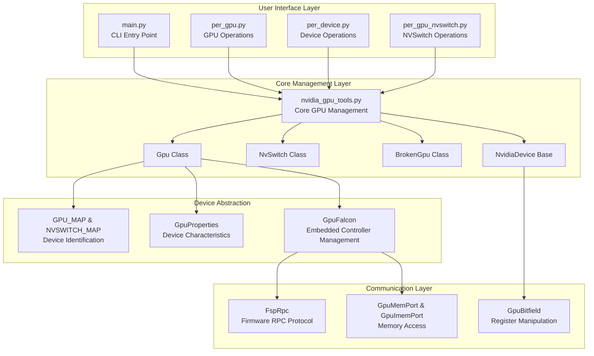
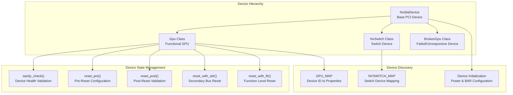
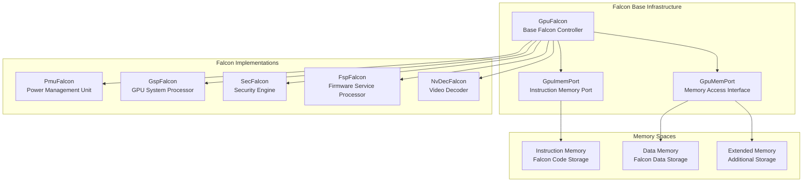
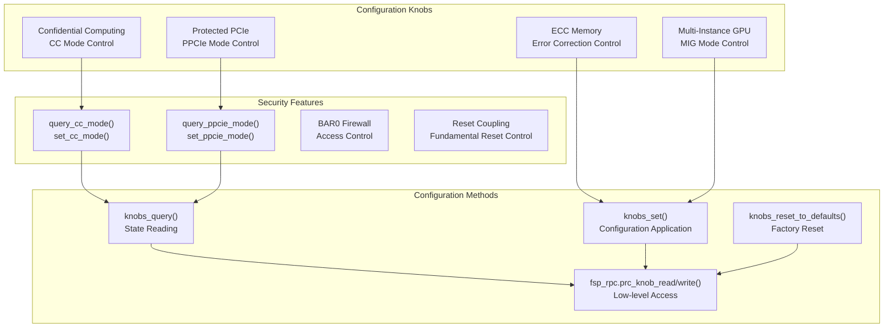
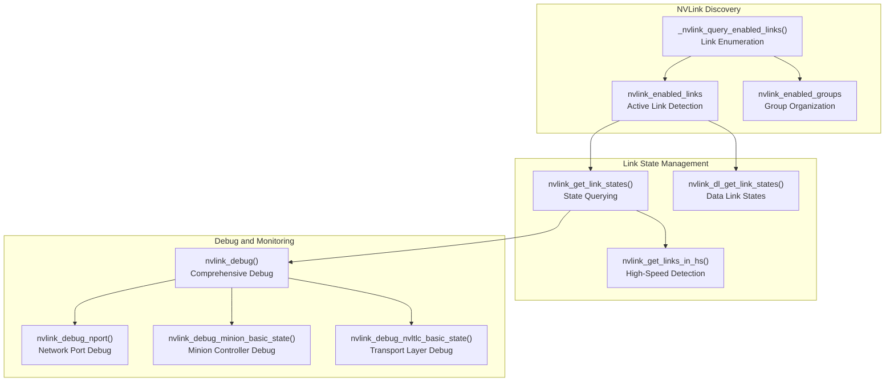

<!-- source: DeepWiki mcp.deepwiki.com · repo NVIDIA/gpu-admin-tools · page 1 Overview · fetched 2026-10-26 -->

# Overview

Relevant source files

The following files were used as context for generating this wiki page:

- [README.md](README.md)
- [nvidia_gpu_tools.py](nvidia_gpu_tools.py)

## Purpose and Scope

The `nvidia-gpu-admin-tools` repository provides a privileged Python-based administration utility for NVIDIA GPU and NVSwitch devices. The system enables low-level configuration, debugging, and security management operations including Confidential Computing mode control, NVLink management, and comprehensive device state inspection. This toolkit operates at the hardware abstraction layer, providing direct access to GPU registers, embedded controllers (Falcons), and communication protocols.

For information about specific CLI operations, see [Command Line Interface](#3). For details about communication protocols and RPC systems, see [Communication Systems](#4). For device-specific hardware management, see [GPU Units and Subsystems](#6).

## System Architecture

The system follows a layered architecture with the core `nvidia_gpu_tools.py` module serving as the foundation for all GPU management operations:

**Sources:** [nvidia_gpu_tools.py:1-50](), [nvidia_gpu_tools.py:100-913](), [README.md:1-25]()

## Core Device Management System

The central management system is built around the `NvidiaDevice` base class and its specialized implementations for different device types and states:

The `GPU_MAP` and `NVSWITCH_MAP` dictionaries provide comprehensive device identification and capability mapping for supported hardware generations from Kepler through Blackwell architectures.

**Sources:** [nvidia_gpu_tools.py:1008-1055](), [nvidia_gpu_tools.py:100-913](), [nvidia_gpu_tools.py:965-1002]()

## Embedded Controller (Falcon) Management

The system provides extensive management of GPU embedded controllers through a hierarchical falcon class system:

Each falcon provides specific functionality: `PmuFalcon` manages power states, `GspFalcon` handles system-level operations, `SecFalcon` manages security features, and `FspFalcon` provides firmware services and RPC communication.

**Sources:** [nvidia_gpu_tools.py:2037-2494](), [nvidia_gpu_tools.py:2495-2543](), [nvidia_gpu_tools.py:1930-2036]()

## Configuration and Security Management

The system implements comprehensive configuration management through PRC (Product Reconfiguration) knobs and security features:

The configuration system supports three CC modes: `"off"` (default operation), `"on"` (full security features), and `"devtools"` (security with debugging enabled).

**Sources:** [nvidia_gpu_tools.py:1662-1800](), [nvidia_gpu_tools.py:1821-1851](), [README.md:5-23]()

## NVLink Management System

The system provides comprehensive NVLink management capabilities for multi-GPU communication:

The NVLink system supports architecture-specific implementations with different protocols for Hopper (`nvlink_debug_h100()`) versus Blackwell (`nvlink_debug_b100()`) generations.

**Sources:** [nvidia_gpu_tools.py:1323-1346](), [nvidia_gpu_tools.py:1548-1656](), [nvidia_gpu_tools.py:1261-1322]()

---

