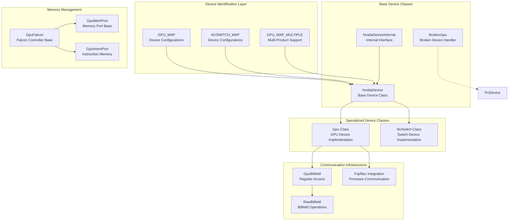
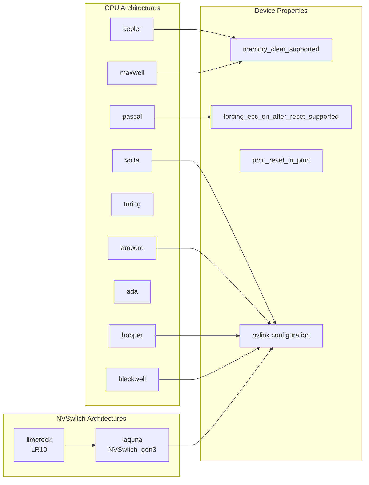
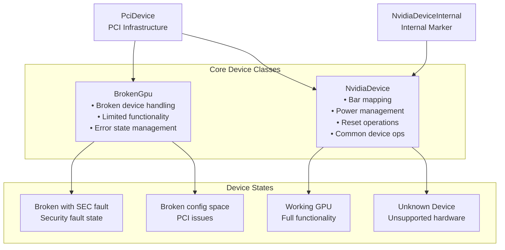
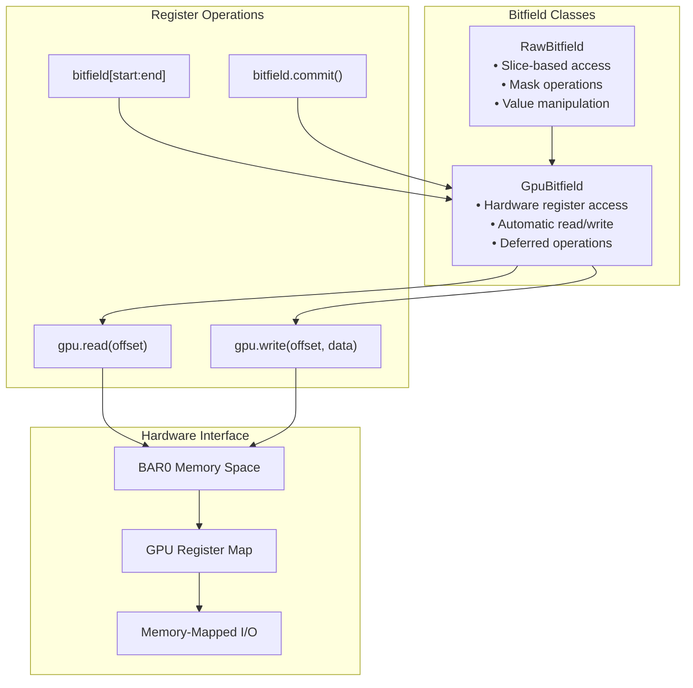

<!-- source: DeepWiki mcp.deepwiki.com · repo NVIDIA/gpu-admin-tools · page 2 Core Architecture · fetched 2026-10-26 -->

# Core Architecture

Relevant source files

The following files were used as context for generating this wiki page:

- [gpu/__init__.py](gpu/__init__.py)
- [nvidia_gpu_tools.py](nvidia_gpu_tools.py)

The Core Architecture represents the foundational system that provides GPU and NVSwitch device management capabilities through the central `nvidia_gpu_tools.py` module. This system handles device identification, instantiation, communication, and control operations across multiple GPU architectures and device types.

For information about specific device operations and CLI interfaces, see [Device Operations](#3.2). For details about communication protocols and RPC systems, see [Communication Systems](#4).

## System Overview

The core architecture establishes a hierarchical device management framework built around the `NvidiaDevice` base class and specialized implementations for different device types and states. The system provides unified interfaces for hardware communication, memory management, and device control operations.

### Core Architecture Diagram

Sources: [nvidia_gpu_tools.py:50-913](), [nvidia_gpu_tools.py:1004-1055](), [nvidia_gpu_tools.py:915-964]()

## Device Identification and Mapping

The system uses comprehensive device mapping tables to identify and configure GPU and NVSwitch devices based on their hardware characteristics.

### Device Mapping Structure

| Component | Purpose | Key Properties |
|-----------|---------|----------------|
| `GPU_MAP` | Primary GPU device configurations | Architecture, memory support, falcon configurations |
| `NVSWITCH_MAP` | NVSwitch device configurations | Link counts, falcon support, architecture |
| `GPU_MAP_MULTIPLE` | Multi-product device disambiguation | Device ID to product name mapping |

### Device Architecture Support

Sources: [nvidia_gpu_tools.py:50-78](), [nvidia_gpu_tools.py:83-913]()

## Base Device Classes

The foundation of the device management system consists of several key base classes that provide common functionality and interfaces.

### Class Hierarchy

Sources: [nvidia_gpu_tools.py:1004-1055](), [nvidia_gpu_tools.py:965-1003]()

### NvidiaDevice Base Functionality

The `NvidiaDevice` class provides essential device management capabilities:

- **Power Management**: Automatic D0 state enforcement and power control handling
- **BAR0 Mapping**: Memory-mapped register access infrastructure  
- **Reset Operations**: FLR and SBR reset support with pre/post validation
- **Device Units**: Dynamic discovery and caching of GPU functional units
- **Falcon Management**: Embedded controller initialization and communication

Key properties initialized during device creation include form factor detection (`is_pcie`, `is_sxm`), interconnect support (`has_c2c`, `is_nvlink_supported`), and reset capabilities (`is_reset_coupling_supported`).

Sources: [nvidia_gpu_tools.py:1016-1055](), [nvidia_gpu_tools.py:1104-1176]()

## Memory and Communication Infrastructure

The core architecture provides sophisticated memory access and communication systems built around bitfield operations and direct hardware communication.

### Bitfield Access System

Sources: [nvidia_gpu_tools.py:915-964](), [nvidia_gpu_tools.py:1257-1259]()

### Hardware Communication Methods

The core architecture provides multiple levels of hardware access:

| Method | Purpose | Usage Pattern |
|--------|---------|---------------|
| `read()/write()` | Direct register access | Immediate hardware operations |
| `read_bad_ok()` | Fault-tolerant reads | Accessing potentially offline hardware |
| `bitfield()` | Structured field access | Multi-bit register field manipulation |
| `poll_register()` | Synchronous waiting | Waiting for hardware state changes |

The system includes comprehensive register polling capabilities with timeout handling, automatic retry logic, and debug tracing support for complex hardware state monitoring operations.

Sources: [nvidia_gpu_tools.py:1080-1088](), [nvidia_gpu_tools.py:1194-1249]()

---

