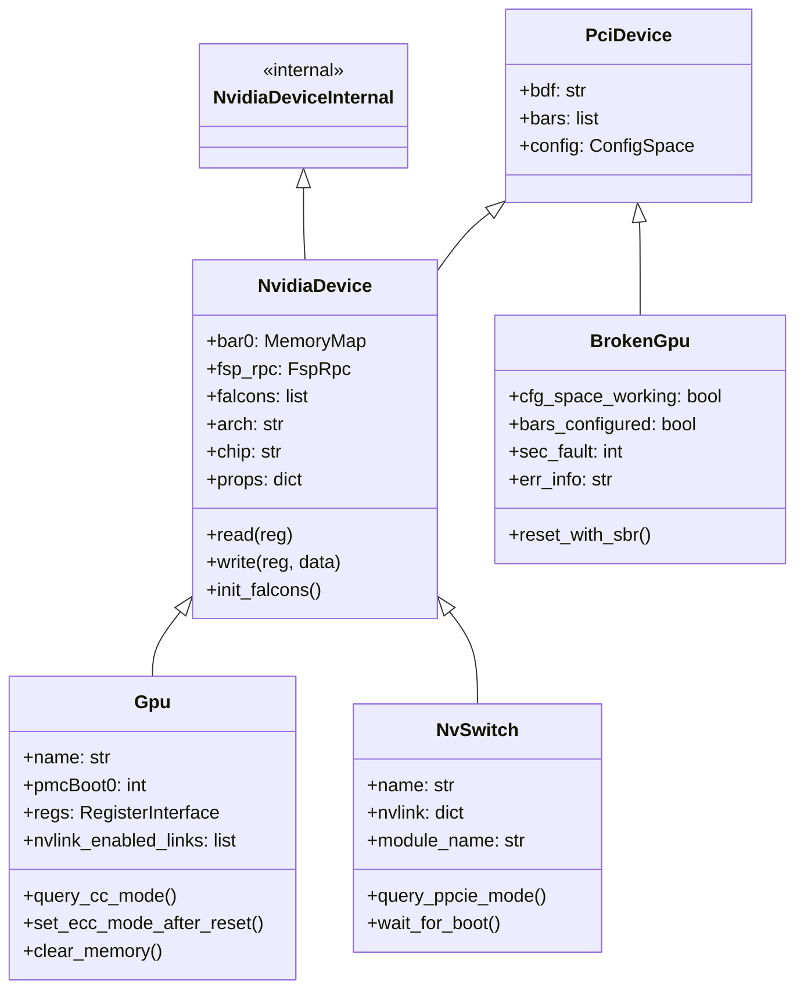
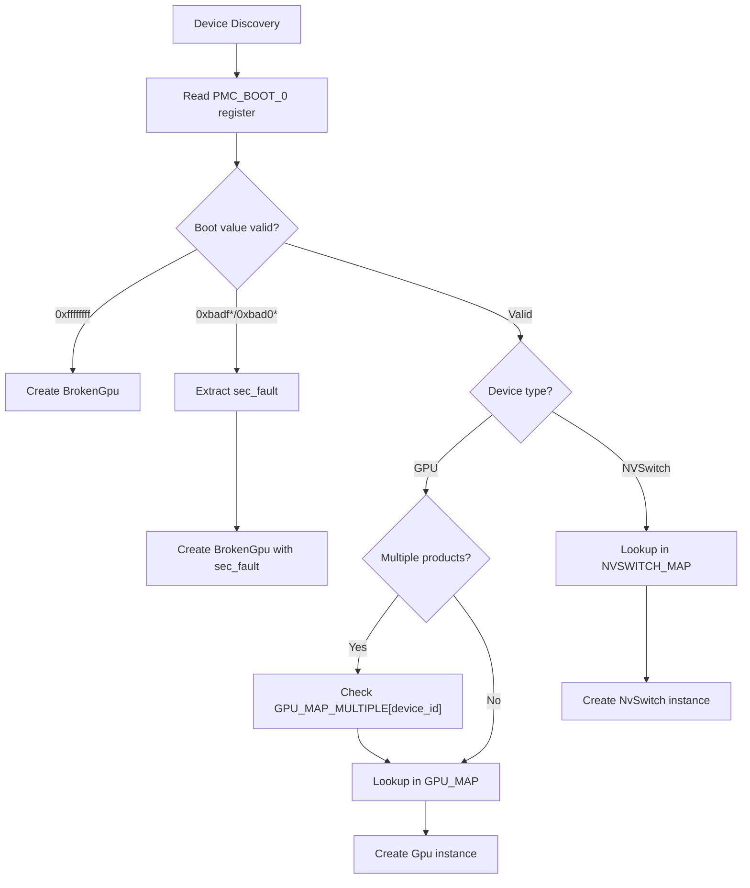
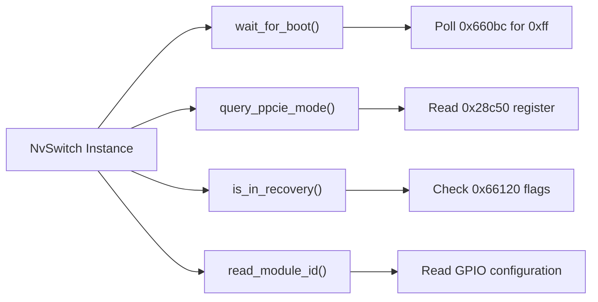
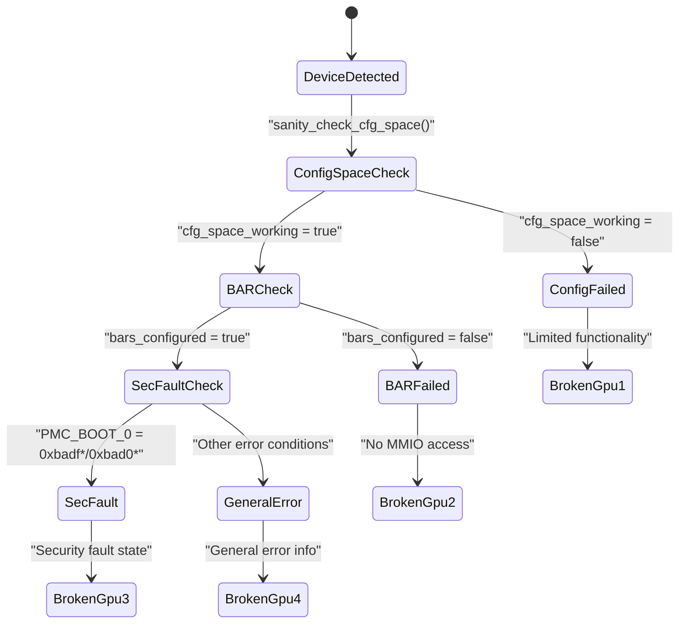
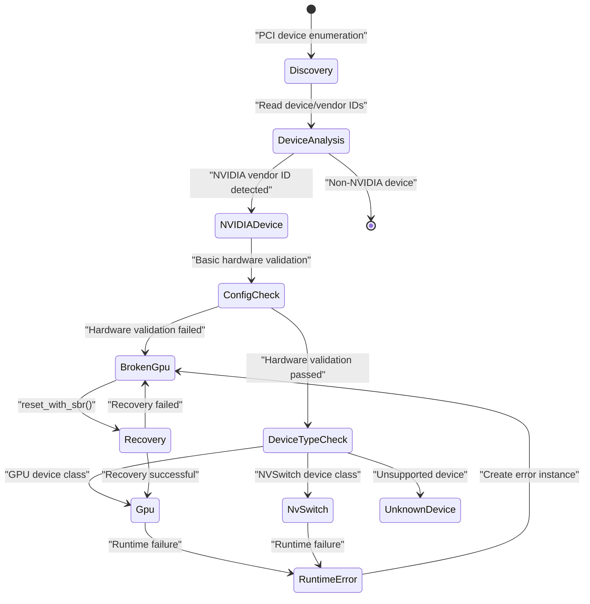

<!-- source: DeepWiki mcp.deepwiki.com · repo NVIDIA/gpu-admin-tools · page 2.1 GPU and NVSwitch Classes · fetched 2026-10-26 -->

# GPU and NVSwitch Classes

<details>
<summary>Relevant source files</summary>

The following files were used as context for generating this wiki page:

- [nvidia_gpu_tools.py](nvidia_gpu_tools.py)

</details>


This document covers the core device classes that represent NVIDIA GPUs and NVSwitches in different operational states. These classes form the foundation of the GPU admin tools architecture, providing device identification, capability detection, and hardware abstraction. For information about the embedded falcon processors managed by these devices, see [Falcon Management System](#2.2). For details about memory interfaces and communication protocols, see [Memory Ports and Communication](#2.3).

## Class Hierarchy and Relationships

The device representation follows a clear inheritance hierarchy with specialized classes for different device types and states:



Sources: [nvidia_gpu_tools.py:1004-1018](), [nvidia_gpu_tools.py:3183-3188](), [nvidia_gpu_tools.py:2946-2951](), [nvidia_gpu_tools.py:965-971]()

## Device Identification and Mapping

Device identification relies on multiple mapping structures that translate hardware identifiers to device properties and capabilities:

### Device Mapping Tables

| Map Type | Purpose | Line Reference |
|----------|---------|----------------|
| `GPU_MAP` | Primary GPU device mapping by PMC boot register | [nvidia_gpu_tools.py:100-913]() |
| `GPU_MAP_MULTIPLE` | Multi-product architectures with device ID disambiguation | [nvidia_gpu_tools.py:83-98]() |
| `NVSWITCH_MAP` | NVSwitch device mapping and configuration | [nvidia_gpu_tools.py:51-78]() |
| `GPU_ARCHES` | GPU architecture progression | [nvidia_gpu_tools.py:50]() |
| `NVSWITCH_ARCHES` | NVSwitch architecture progression | [nvidia_gpu_tools.py:79]() |

### Device Recognition Flow



Sources: [nvidia_gpu_tools.py:3251-3280](), [nvidia_gpu_tools.py:2964-2972](), [nvidia_gpu_tools.py:3267-3267]()

## Gpu Class

The `Gpu` class represents functional NVIDIA GPU devices and provides comprehensive hardware management capabilities.

### Core Properties and Initialization

The GPU initialization process involves multiple phases of hardware detection and configuration:

```python
# Key initialization steps from Gpu.__init__
# 1. PCI configuration and BAR mapping
# 2. Architecture detection via device ID or PMC boot register  
# 3. Property lookup and capability detection
# 4. Register interface initialization
# 5. Falcon processor discovery
```

### Architecture Detection and Capabilities

| Architecture | GPU_ARCHES Index | Key Capabilities |
|--------------|------------------|------------------|
| `kepler` | 1 | Basic falcon management |
| `maxwell` | 2 | SEC falcon, NVENC/NVDEC |
| `pascal` | 3 | Enhanced security, EMEM |
| `volta` | 4 | GSP falcon, NVLink |
| `turing` | 5 | Memory clearing, ECC control |
| `ampere` | 6 | Enhanced NVLink, MIG mode |
| `ada` | 7 | Reduced GSP dependency |
| `hopper` | 8 | FSP-based control, CC mode |
| `blackwell` | 9 | MSE, enhanced security |

### Device State Queries

The `Gpu` class provides numerous state query methods:

- `query_cc_mode()` - Confidential Computing mode status [nvidia_gpu_tools.py:3667-3675]()
- `query_ppcie_mode()` - Protected PCIe mode status [nvidia_gpu_tools.py:3772-3781]()  
- `query_final_ecc_state()` - ECC memory state [nvidia_gpu_tools.py:3623-3635]()
- `query_mig_mode()` - Multi-Instance GPU mode [nvidia_gpu_tools.py:3900-3909]()

Sources: [nvidia_gpu_tools.py:3183-3352](), [nvidia_gpu_tools.py:3402-3481]()

## NvSwitch Class

The `NvSwitch` class manages NVIDIA switch fabric devices that provide high-bandwidth GPU-to-GPU connectivity.

### Architecture Support

NVSwitch devices follow their own architecture progression with specific capabilities:

- **limerock** (`LR10`): Basic switch functionality with SOE falcon
- **laguna** (`NVSwitch_gen3`): Enhanced with FSP support, 64 NVLink ports

### Key Capabilities



### NVLink Management

NVSwitch devices provide extensive NVLink fabric management:

- Link state monitoring via `nvlink_get_link_states()`
- Debug capabilities through `nvlink_debug_*()` methods
- Topology mapping for multi-switch configurations

Sources: [nvidia_gpu_tools.py:2946-3169](), [nvidia_gpu_tools.py:3000-3014]()

## BrokenGpu Class

The `BrokenGpu` class handles devices that have failed hardware validation or are in error states.

### Error Classification



### Recovery Capabilities

The `BrokenGpu` class provides limited recovery options:

- `reset_with_sbr()` - Attempts secondary bus reset through parent bridge
- Basic configuration space access when `cfg_space_working = true`
- BAR0 mapping for security fault analysis when `bars_configured = true`

### Error Information Storage

| Field | Type | Purpose |
|-------|------|---------|
| `cfg_space_working` | bool | PCI config space accessibility |
| `bars_configured` | bool | BAR register validity |
| `sec_fault` | int | Security fault code from hardware |
| `err_info` | str | Human-readable error description |

Sources: [nvidia_gpu_tools.py:965-1002](), [nvidia_gpu_tools.py:989-992]()

## Device State Transitions

The relationship between device classes reflects different operational states and error conditions:



Sources: [nvidia_gpu_tools.py:3190-3304](), [nvidia_gpu_tools.py:2954-2998](), [nvidia_gpu_tools.py:966-982]()

---

