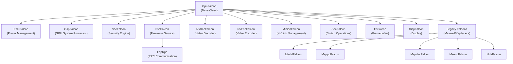
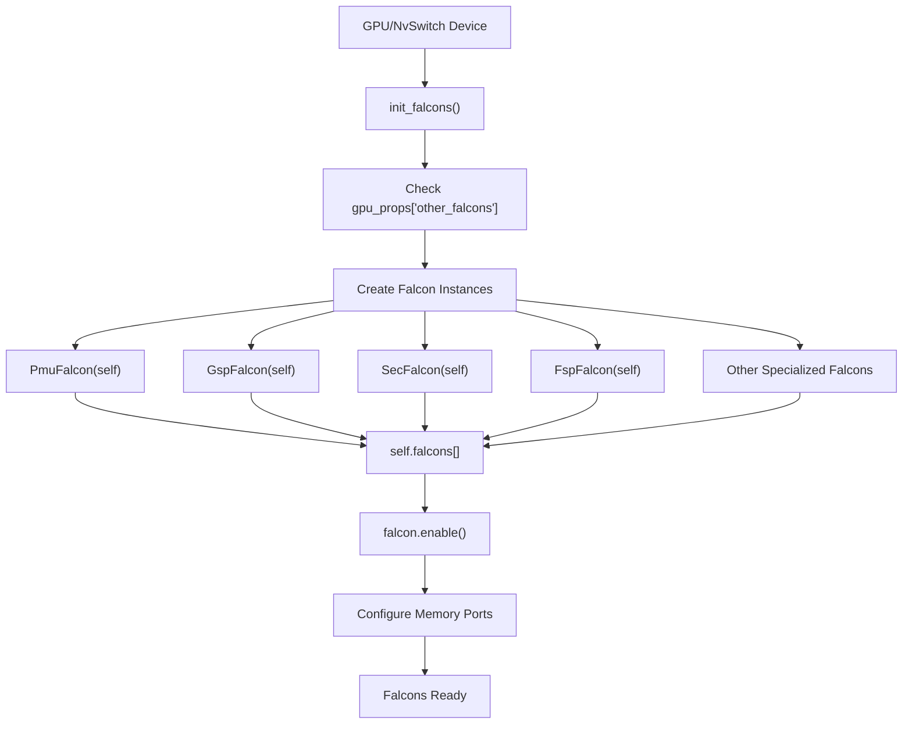
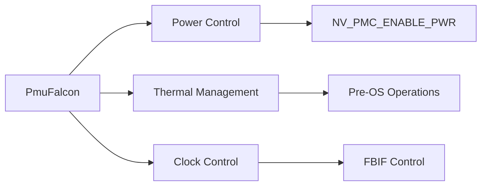
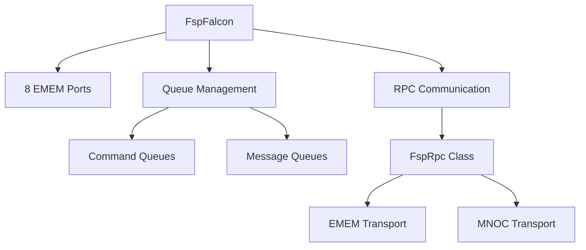
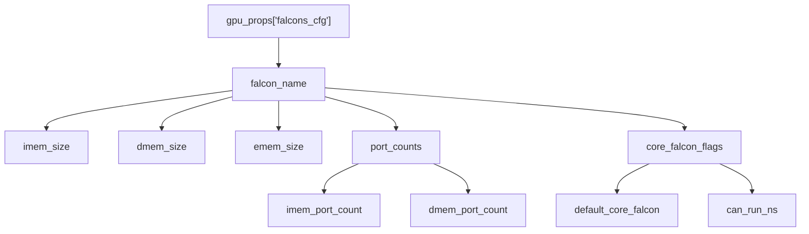
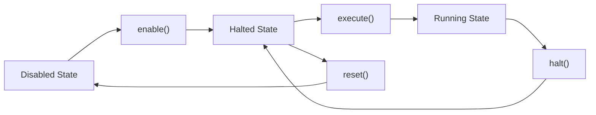
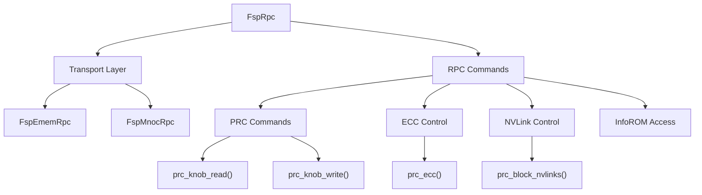

<!-- source: DeepWiki mcp.deepwiki.com · repo NVIDIA/gpu-admin-tools · page 2.2 Falcon Management System · fetched 2026-10-26 -->

# Falcon Management System

Relevant source files

The following files were used as context for generating this wiki page:

- [nvidia_gpu_tools.py](nvidia_gpu_tools.py)

The Falcon Management System provides a unified interface for managing embedded microcontrollers (Falcons) within NVIDIA GPUs and NVSwitches. This system handles initialization, configuration, memory management, and communication with various specialized falcon processors including PMU (Power Management Unit), GSP (GPU System Processor), SEC (Security Engine), and FSP (Firmware Service Processor).

For information about memory port abstractions and falcon communication mechanisms, see [Memory Ports and Communication](#2.3). For details about the broader GPU device management context, see [GPU and NVSwitch Classes](#2.1).

## Falcon Architecture Overview

The falcon management system is built around a hierarchical class structure with `GpuFalcon` as the base class providing common functionality for all falcon types. Each specialized falcon inherits this base functionality while adding processor-specific capabilities.

### Falcon Class Hierarchy

Sources: [nvidia_gpu_tools.py:2037-2700]()

### Falcon Initialization Flow

Sources: [nvidia_gpu_tools.py:3354-3400](), [nvidia_gpu_tools.py:3057-3068]()

## Core Falcon Classes

### GpuFalcon Base Class

The `GpuFalcon` class provides the foundational functionality for all falcon processors, including memory port management, hardware configuration discovery, and basic control operations.

| Property | Description | Source Lines |
|----------|-------------|--------------|
| `name` | Falcon identifier string | [nvidia_gpu_tools.py:2039]() |
| `cpuctl` | CPU control register address | [nvidia_gpu_tools.py:2044]() |
| `mem_ports` | List of memory port objects | [nvidia_gpu_tools.py:2060]() |
| `has_emem` | Extended memory support flag | [nvidia_gpu_tools.py:2048]() |
| `max_imem_size` | Instruction memory size | [nvidia_gpu_tools.py:2155-2171]() |
| `max_dmem_size` | Data memory size | [nvidia_gpu_tools.py:2173-2190]() |

### Key Falcon Operations

| Method | Purpose | Source Lines |
|--------|---------|--------------|
| `enable()` | Enable falcon processor | [nvidia_gpu_tools.py:2416-2438]() |
| `disable()` | Disable falcon processor | [nvidia_gpu_tools.py:2390-2401]() |
| `reset()` | Reset falcon to initial state | [nvidia_gpu_tools.py:2450-2451]() |
| `execute()` | Start falcon execution | [nvidia_gpu_tools.py:2364-2369]() |
| `halt()` | Stop falcon execution | [nvidia_gpu_tools.py:2403-2409]() |
| `sreset()` | Software reset falcon | [nvidia_gpu_tools.py:2380-2388]() |

Sources: [nvidia_gpu_tools.py:2037-2494]()

## Falcon Types and Specializations

### Power Management Unit (PMU)

The `PmuFalcon` manages GPU power states, thermal monitoring, and power control operations. It's the primary falcon for pre-Hopper architectures.

Sources: [nvidia_gpu_tools.py:2495-2514]()

### GPU System Processor (GSP)

The `GspFalcon` handles system-level GPU operations and serves as the primary management processor for modern GPU architectures.

- **EMEM Support**: Has extended memory for larger firmware
- **FBIF Integration**: Framebuffer interface control
- **Hopper+ Primary**: Main management falcon for Hopper and newer

Sources: [nvidia_gpu_tools.py:2557-2572]()

### Security Engine (SEC)

The `SecFalcon` manages cryptographic operations, secure boot, and security policy enforcement.

- **EMEM Support**: From Pascal 10x onwards
- **Microcode Versions**: Readable via `read_ucode_version()`
- **PKC Operations**: Public key cryptography support

Sources: [nvidia_gpu_tools.py:2574-2605]()

### Firmware Service Processor (FSP)

The `FspFalcon` provides system services and RPC communication for Hopper+ architectures.

Sources: [nvidia_gpu_tools.py:2682-2700](), [nvidia_gpu_tools.py:2704-2944]()

## Falcon Configuration and Properties

### Configuration Discovery

Falcon properties are determined through a combination of:

1. **Static Configuration**: Defined in `GPU_MAP` and `NVSWITCH_MAP`
2. **Hardware Discovery**: Read from falcon HWCFG registers
3. **Architecture Defaults**: Based on GPU generation

### Configuration Structure

### Example Configuration

| GPU | Falcon | IMEM Size | DMEM Size | EMEM Size | Ports |
|-----|--------|-----------|-----------|-----------|-------|
| A100 | PMU | 131072 | 131072 | - | I:1, D:4 |
| A100 | GSP | 65536 | 65536 | 8192 | I:1, D:1 |
| A100 | SEC | 65536 | 65536 | 8192 | I:1, D:1 |

Sources: [nvidia_gpu_tools.py:517-581](), [nvidia_gpu_tools.py:2155-2277]()

## Falcon Management Operations

### Memory Management

Falcons provide three types of memory access:

| Memory Type | Purpose | Access Method |
|-------------|---------|---------------|
| IMEM | Instruction Memory | `load_imem()`, `read_imem()` |
| DMEM | Data Memory | `load_dmem()`, `read_dmem()` |
| EMEM | Extended Memory | `write_emem()`, `read_emem()` |

### Control Flow Operations

Sources: [nvidia_gpu_tools.py:2334-2475]()

### Hardware Configuration Validation

The system validates falcon configurations by comparing static configuration data with hardware-reported values:

- **Memory Size Validation**: Ensures `falcons_cfg` matches HWCFG registers
- **Port Count Validation**: Verifies port counts against hardware capabilities
- **Feature Flag Validation**: Checks compatibility between configuration and hardware features

Sources: [nvidia_gpu_tools.py:2167-2169](), [nvidia_gpu_tools.py:2186-2188](), [nvidia_gpu_tools.py:2205-2207]()

## FSP RPC Communication

### RPC Architecture

The `FspRpc` class provides Remote Procedure Call communication with the Firmware Service Processor using MCTP (Management Component Transport Protocol) headers.

### Key RPC Operations

| Method | Purpose | Source Lines |
|--------|---------|--------------|
| `prc_knob_read()` | Read PRC configuration knob | [nvidia_gpu_tools.py:2837-2856]() |
| `prc_knob_write()` | Write PRC configuration knob | [nvidia_gpu_tools.py:2858-2874]() |
| `prc_ecc()` | Configure ECC settings | [nvidia_gpu_tools.py:2775-2790]() |
| `prc_block_nvlinks()` | Block specific NVLink ports | [nvidia_gpu_tools.py:2792-2824]() |
| `inforom_read()` | Read InfoROM data | [nvidia_gpu_tools.py:2892-2909]() |

Sources: [nvidia_gpu_tools.py:2704-2944]()

---

