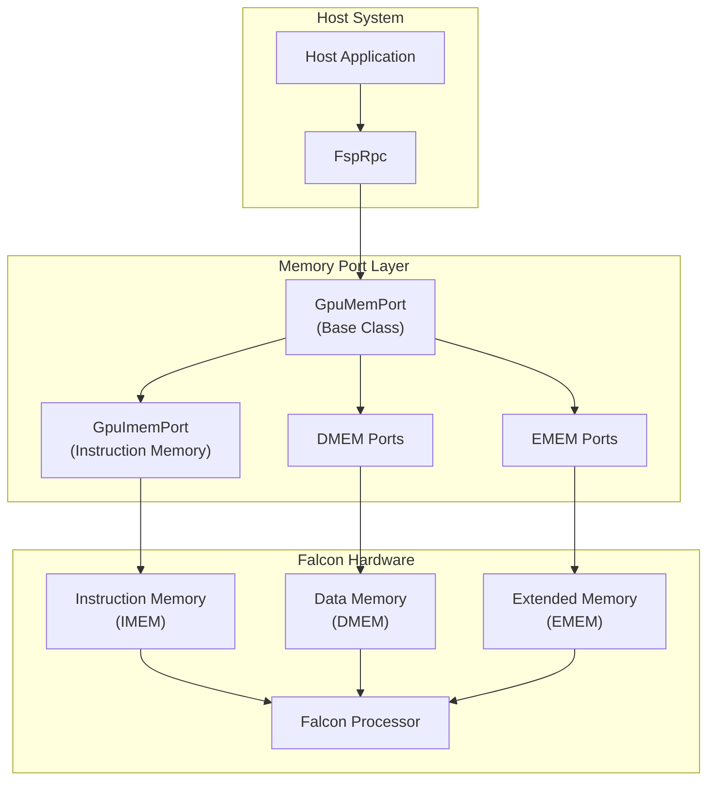
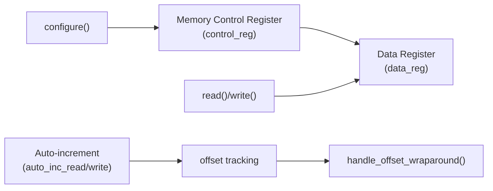
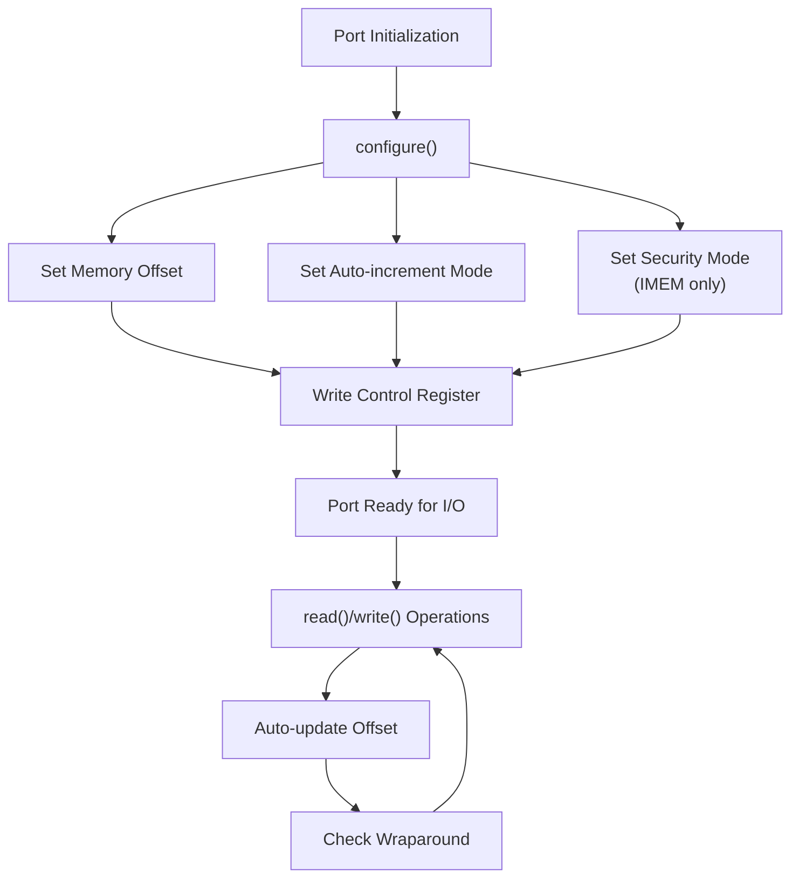
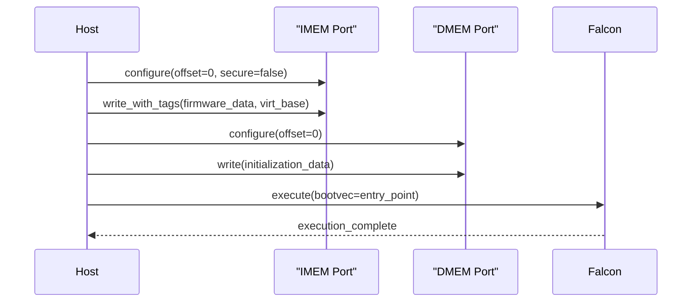
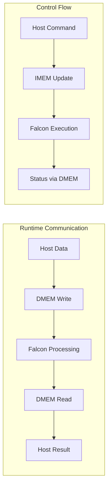
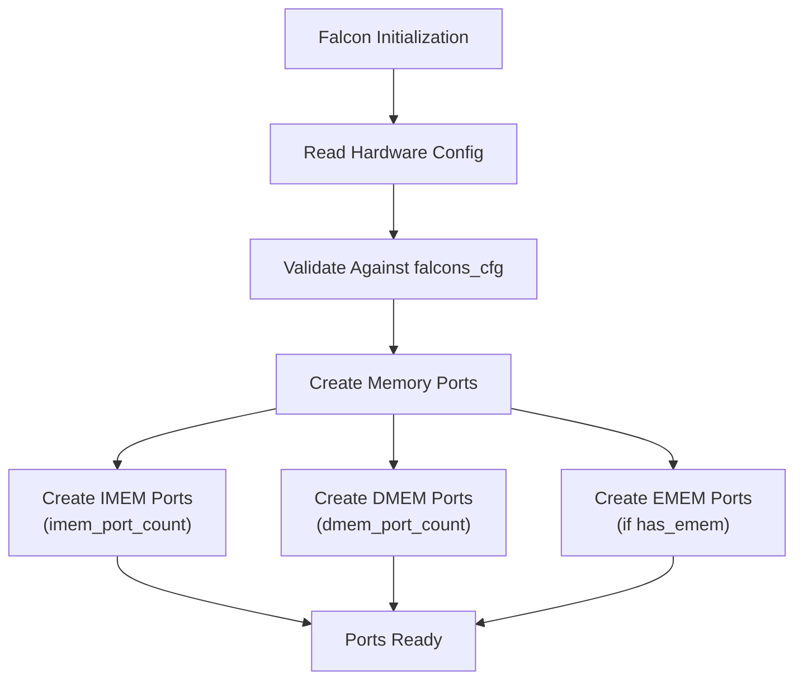

<!-- source: DeepWiki mcp.deepwiki.com · repo NVIDIA/gpu-admin-tools · page 2.3 Memory Ports and Communication · fetched 2026-10-26 -->

# Memory Ports and Communication

<details>
<summary>Relevant source files</summary>

The following files were used as context for generating this wiki page:

- [nvidia_gpu_tools.py](nvidia_gpu_tools.py)

</details>


This page documents the memory port abstractions and communication mechanisms that enable interaction between the host system and GPU falcon processors. It covers the IMEM (instruction memory), DMEM (data memory), and EMEM (extended memory) port implementations and their role in falcon communication protocols.

For information about falcon processor management, see [Falcon Management System](#2.2). For details about specific RPC communication protocols, see [Communication Systems](#4).

## Overview

The memory port system provides a standardized interface for accessing different memory spaces within GPU falcon processors. These ports serve as the fundamental communication mechanism between the host system and embedded falcon controllers, enabling firmware loading, data exchange, and control operations.



Sources: [nvidia_gpu_tools.py:1930-2036](), [nvidia_gpu_tools.py:2704-2942]()

## Memory Port Architecture

The memory port system is built around a hierarchy of classes that abstract different types of memory access:

| Class | Purpose | Memory Type | Special Features |
|-------|---------|-------------|------------------|
| `GpuMemPort` | Base memory port | Data memory | Auto-increment, configurable offset |
| `GpuImemPort` | Instruction memory port | Instruction memory | Virtual tagging, code loading |
| EMEM ports | Extended memory port | Extended memory | Multiple ports per falcon |

### GpuMemPort Base Class

The `GpuMemPort` class provides the fundamental memory access interface with the following key properties:

- **Configurable addressing**: Supports offset-based addressing with auto-increment
- **Size constraints**: Enforces maximum memory size limits per falcon
- **Hardware abstraction**: Translates logical operations to register-level access



Sources: [nvidia_gpu_tools.py:1930-2009]()

## Memory Port Types

### Instruction Memory Ports (IMEM)

Instruction memory ports extend the base functionality with support for virtual addressing and code loading:

```python
# Key capabilities from GpuImemPort
- write_with_tags(): Supports virtual address tagging for code loading
- imemt_reg: Tag register for virtual base address management
- Automatic padding: Ensures proper alignment for instruction blocks
```

The IMEM port handles firmware loading with virtual-to-physical address translation, essential for falcon processor initialization.

Sources: [nvidia_gpu_tools.py:2010-2036]()

### Data Memory Ports (DMEM)

Data memory ports provide standard memory access for falcon data operations:

- **Multiple ports**: Most falcons support multiple DMEM ports for parallel access
- **Data exchange**: Primary mechanism for runtime data communication
- **Configuration storage**: Used for storing operational parameters

### Extended Memory Ports (EMEM)

Extended memory ports offer additional memory space for advanced falcon processors:

- **Larger capacity**: Typically 8KB of additional memory space
- **Multiple instances**: Up to 8 ports per falcon on advanced architectures
- **Communication buffering**: Used by RPC systems for message queuing

Sources: [nvidia_gpu_tools.py:2085-2090]()

## Port Configuration and Management

Memory ports require configuration before use, establishing addressing mode, auto-increment behavior, and security settings:



### Configuration Parameters

| Parameter | Description | Values |
|-----------|-------------|---------|
| `offset` | Current memory offset | 0 to `max_size` |
| `auto_inc_read` | Auto-increment on read | True/False |
| `auto_inc_write` | Auto-increment on write | True/False |
| `secure_imem` | Secure instruction mode | True/False (IMEM only) |

Sources: [nvidia_gpu_tools.py:1949-1981]()

## Communication Patterns

### Falcon Initialization

The typical falcon initialization sequence demonstrates memory port usage:



### Runtime Data Exchange

During normal operation, memory ports facilitate ongoing communication:



Sources: [nvidia_gpu_tools.py:2334-2378]()

## Integration with Falcon Processors

Memory ports are tightly integrated with the falcon processor architecture through the `GpuFalcon` class:

### Port Allocation

Each falcon processor maintains arrays of memory ports based on hardware capabilities:

```python
# Port allocation pattern from GpuFalcon.__init__
self.imem_ports = []  # Instruction memory ports
self.dmem_ports = []  # Data memory ports  
self.emem_ports = []  # Extended memory ports (if supported)
```

### Hardware Configuration Validation

The system validates port configurations against hardware capabilities:

- **Port counts**: Verified against `imem_port_count` and `dmem_port_count`
- **Memory sizes**: Checked against `max_imem_size` and `max_dmem_size`
- **Feature support**: EMEM availability based on falcon architecture



Sources: [nvidia_gpu_tools.py:2060-2084](), [nvidia_gpu_tools.py:2155-2247]()

---

