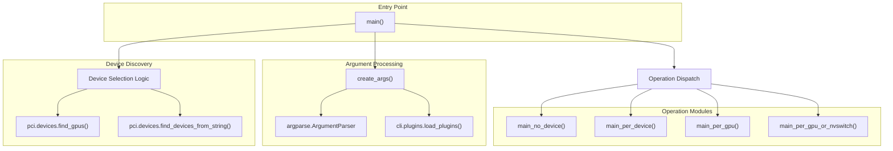
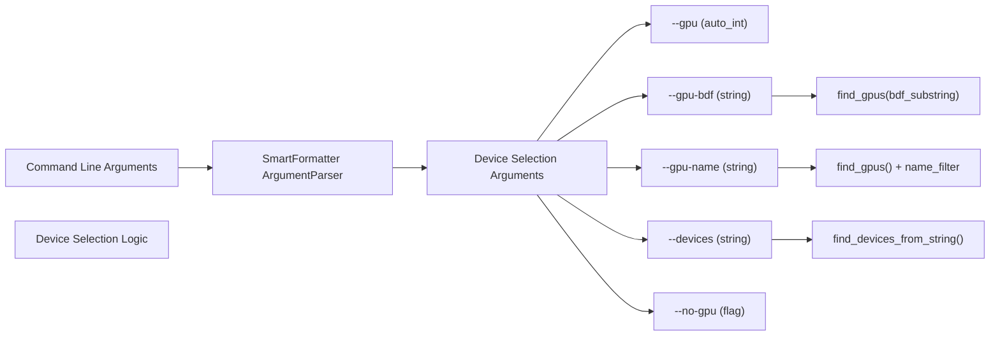
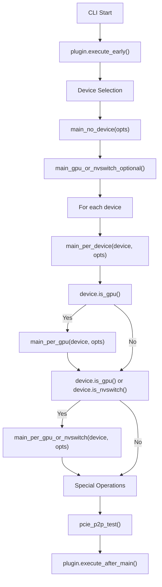
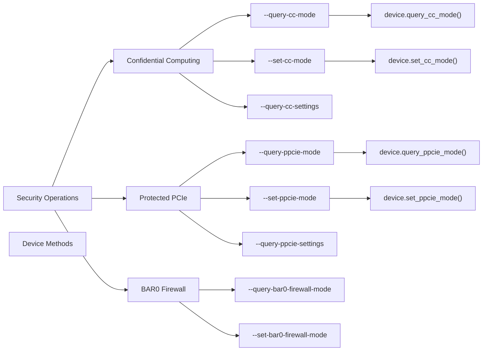
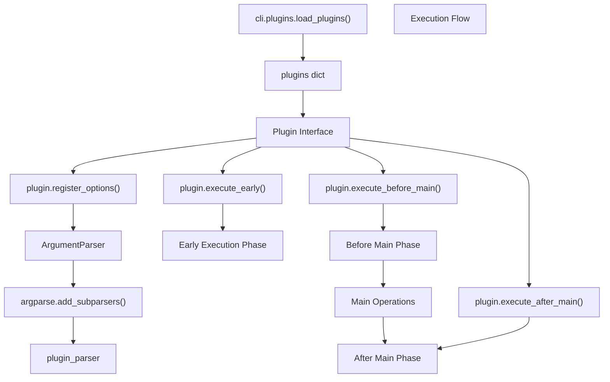
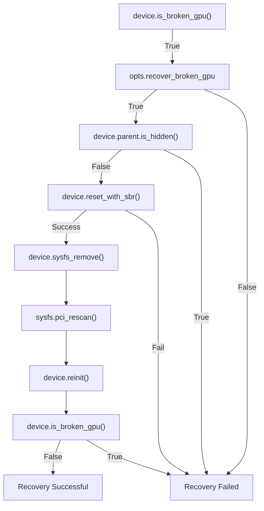

<!-- source: DeepWiki mcp.deepwiki.com · repo NVIDIA/gpu-admin-tools · page 3 Command Line Interface · fetched 2026-10-26 -->

# Command Line Interface

Relevant source files

The following files were used as context for generating this wiki page:

- [cli/main.py](cli/main.py)
- [cli/per_gpu_nvswitch.py](cli/per_gpu_nvswitch.py)
- [gpu/units/__init__.py](gpu/units/__init__.py)

The Command Line Interface (CLI) provides the primary user-facing entry point for the nvidia-gpu-admin-tools system. It implements a comprehensive argument parsing framework, device selection logic, and operation dispatch system that routes commands to appropriate device-specific handlers based on device type and capabilities.

For information about the underlying GPU and device management systems that the CLI controls, see [Core Architecture](#2). For details about specific GPU units and subsystems that can be controlled through the CLI, see [GPU Units and Subsystems](#6).

## CLI Architecture Overview

The CLI system follows a layered dispatch architecture that separates argument parsing, device selection, and operation execution into distinct phases.

Sources: [cli/main.py:249-371]()

## Device Selection and Argument Parsing

The CLI supports multiple device selection methods through a flexible argument parsing system implemented in the `create_args()` function.

### Device Selection Methods

| Selection Method | Argument | Description | Example |
|------------------|----------|-------------|---------|
| Device String | `--devices` | Generic selector with multiple formats | `gpus[0:2]`, `nvswitches` |
| GPU Index | `--gpu` | Select GPU by numeric index | `--gpu 0` |
| BDF Address | `--gpu-bdf` | Select by Bus:Device.Function | `--gpu-bdf 01:00` |
| GPU Name | `--gpu-name` | Select by device name substring | `--gpu-name T4` |
| No Device | `--no-gpu` | Operations without device context | `--no-gpu` |

Sources: [cli/main.py:75-194](), [cli/main.py:278-330]()

## Operation Categories and Dispatch Flow

The CLI dispatches operations through a hierarchical execution model where different operation categories are executed in sequence based on device type and requirements.

### Operation Execution Flow

Sources: [cli/main.py:349-371]()

## GPU and NVSwitch Specific Operations

The `main_per_gpu_or_nvswitch()` function handles operations that apply to both GPU and NVSwitch devices, implementing device capability checks and error handling.

### Device State and Recovery Operations

| Operation | CLI Argument | Function | Description |
|-----------|--------------|----------|-------------|
| Broken GPU Recovery | `--recover-broken-gpu` | `device.reset_with_sbr()` | Attempts SBR reset and OS rescan |
| SBR Reset | `--reset-with-sbr` | `device.reset_with_sbr()` | Secondary Bus Reset |
| FLR Reset | `--reset-with-flr` | `device.reset_with_flr()` | Function Level Reset |
| OS Reset | `--reset-with-os` | `device.reset_with_os()` | OS-initiated reset |
| BAR0 Read | `--read-bar0` | `device.read()` | Direct register access |
| BAR0 Write | `--write-bar0` | `device.write_verbose()` | Direct register write |

### Security and Configuration Operations

Sources: [cli/per_gpu_nvswitch.py:34-238]()

### NVLink Management Operations

The CLI provides comprehensive NVLink blocking and testing capabilities through the device's NVLink unit interface.

| Operation | CLI Argument | Implementation | Description |
|-----------|--------------|----------------|-------------|
| Block Specific Links | `--block-nvlink [links]` | `device.nvlink_unit.block_nvlinks()` | Block specified NVLink indices |
| Block All Links | `--block-all-nvlinks` | `device.nvlink_unit.block_nvlinks(range(num_nvlinks))` | Block all available NVLinks |
| Test Blocking | `--test-nvlink-blocking` | `device.nvlink_unit.test_nvlink_blocking()` | Validate NVLink blocking functionality |
| Debug Dump | `--nvlink-debug-dump` | `device.nvlink_debug()` | Output NVLink debug information |

Sources: [cli/per_gpu_nvswitch.py:186-230]()

## Plugin System Architecture

The CLI supports a plugin architecture that allows extending functionality through dynamically loaded modules.

Sources: [cli/main.py:187-194](), [cli/main.py:263-268](), [cli/main.py:335-337](), [cli/main.py:368-371]()

## Error Handling and Device State Management

The CLI implements comprehensive error handling for device state issues and operational failures.

### Broken GPU Recovery Process

Sources: [cli/per_gpu_nvswitch.py:35-59]()

## Configuration Validation and Testing

The CLI includes built-in testing capabilities for validating device configuration changes and system functionality.

| Test Operation | CLI Argument | Purpose | Implementation |
|----------------|--------------|---------|----------------|
| CC Mode Switch | `--test-cc-mode-switch` | Validate CC mode transitions | Device-specific test methods |
| PPCIe Mode Switch | `--test-ppcie-mode-switch` | Validate PPCIe mode transitions | `device.test_ppcie_mode_switch()` |
| NVLink Blocking | `--test-nvlink-blocking` | Validate NVLink blocking functionality | `device.nvlink_unit.test_nvlink_blocking()` |
| PCI P2P | `--test-pcie-p2p` | Test peer-to-peer GPU communication | `pcie_p2p_test()` |
| Knob Reset | `--knobs-reset-to-defaults-test` | Test PRC knob reset functionality | `device.knobs_reset_to_defaults_test()` |

Sources: [cli/main.py:131-139](), [cli/main.py:172-177](), [cli/per_gpu_nvswitch.py:162-177](), [cli/per_gpu_nvswitch.py:206-210](), [cli/per_gpu_nvswitch.py:223-226]()

---

