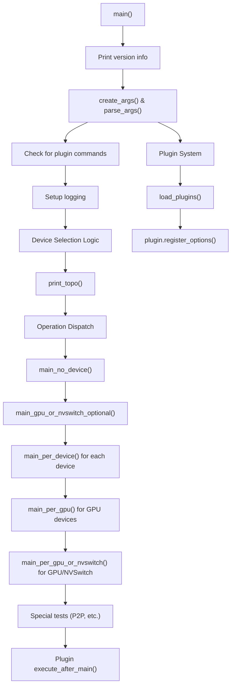
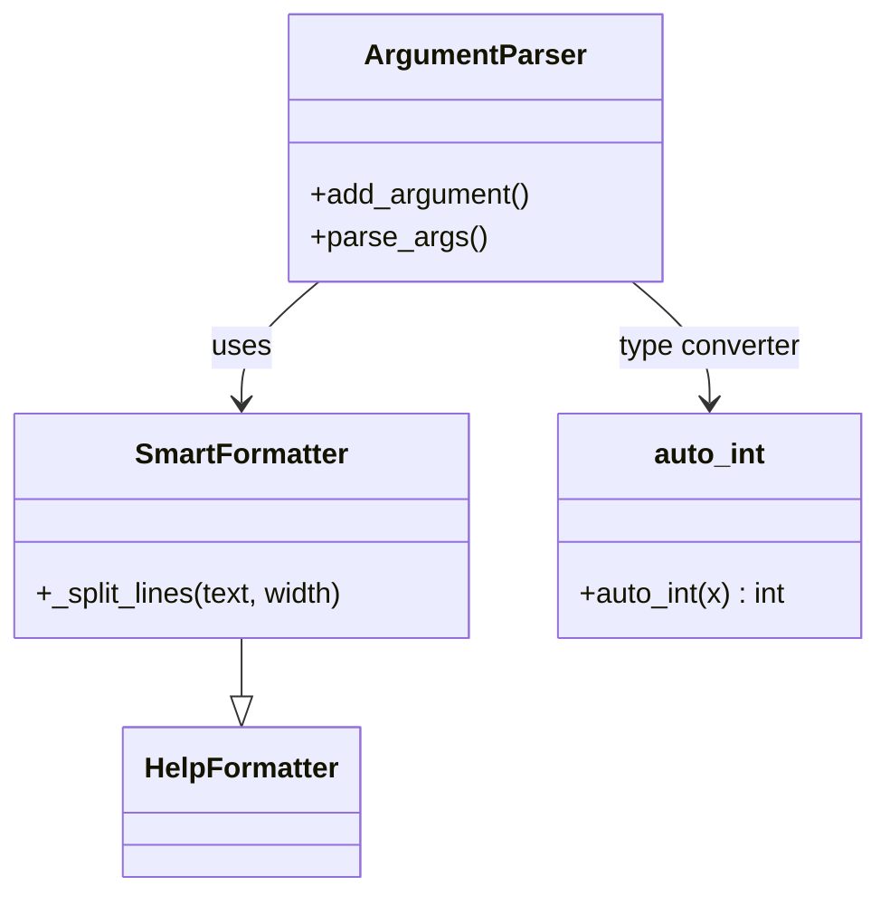
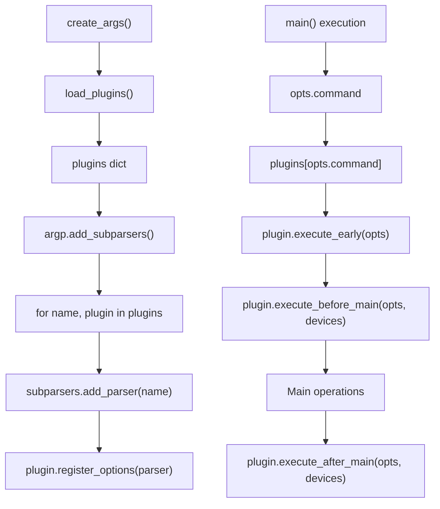
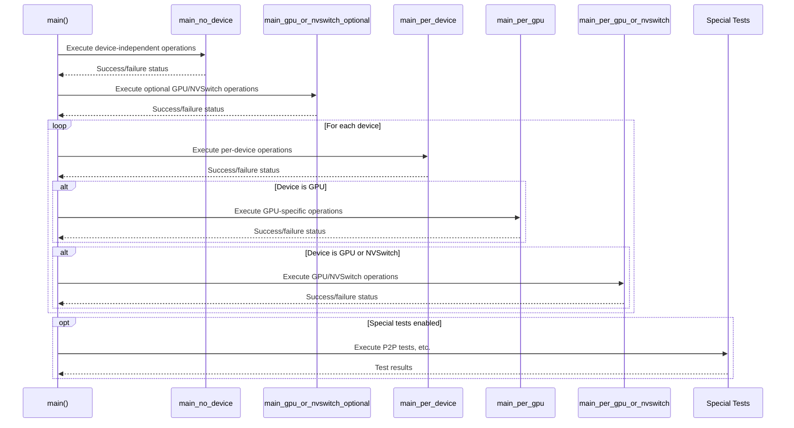
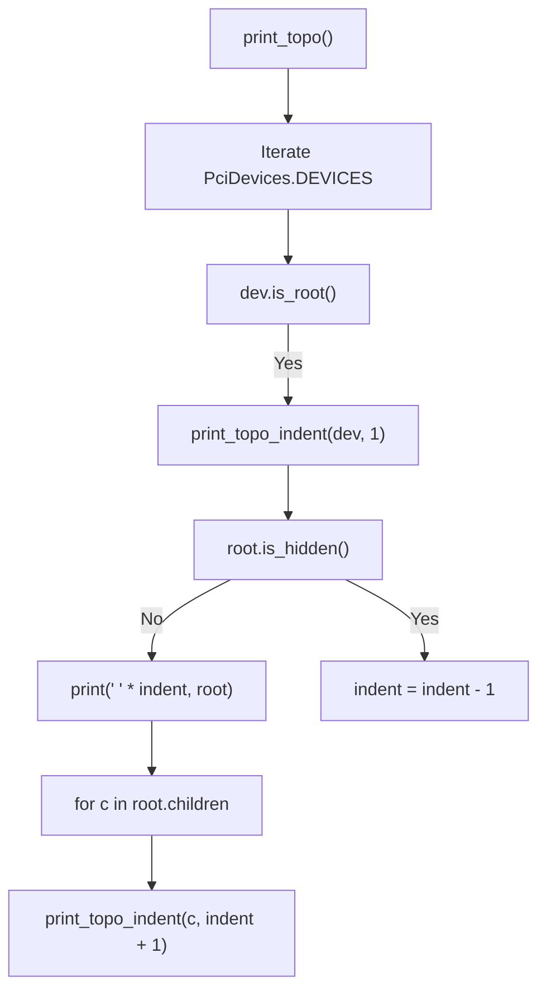

<!-- source: DeepWiki mcp.deepwiki.com · repo NVIDIA/gpu-admin-tools · page 3.1 Main CLI Entry Point · fetched 2026-10-26 -->

# Main CLI Entry Point

<details>
<summary>Relevant source files</summary>

The following files were used as context for generating this wiki page:

- [cli/main.py](cli/main.py)
- [gpu/units/__init__.py](gpu/units/__init__.py)

</details>


This page documents the main CLI entry point of the nvidia-gpu-admin-tools, focusing on the argument parsing system, device selection logic, plugin architecture, and operation dispatch mechanisms implemented in the primary command-line interface.

For information about specific device operations, see [Device Operations](#3.2). For GPU and NVSwitch-specific operations, see [GPU and NVSwitch Operations](#3.3).

## Purpose and Scope

The main CLI entry point serves as the primary user interface for the nvidia-gpu-admin-tools, providing a unified command-line interface for GPU configuration, debugging, and management operations. It handles argument parsing, device discovery and selection, plugin loading, and orchestrates the execution of various device-specific operations.

## Main Entry Point Structure

The CLI system is built around the `main()` function in [cli/main.py:249-371](), which serves as the primary entry point. The system also provides an `init()` function for library usage at [cli/main.py:243-248]().



Sources: [cli/main.py:249-371]()

## Argument Parsing System

The argument parsing system is implemented through the `create_args()` function at [cli/main.py:75-194](), which creates an `ArgumentParser` with a custom `SmartFormatter` class for enhanced help text formatting.

### Core Argument Categories

| Category | Key Arguments | Purpose |
|----------|---------------|---------|
| Device Selection | `--devices`, `--gpu`, `--gpu-bdf`, `--gpu-name`, `--no-gpu` | Device identification and selection |
| Reset Operations | `--reset-with-sbr`, `--reset-with-flr`, `--reset-with-os` | Device reset mechanisms |
| Configuration | `--set-cc-mode`, `--set-ppcie-mode`, `--set-bar0-firewall-mode` | Security and configuration settings |
| Query Operations | `--query-*` options | Device state and property queries |
| Testing | `--test-*` options | Various device and system tests |
| System Integration | `--sysfs-bind`, `--sysfs-unbind`, `--remove-from-os` | OS integration operations |

### Smart Formatter Implementation

The `SmartFormatter` class at [cli/main.py:68-73]() extends `argparse.HelpFormatter` to support raw text formatting for multi-line help strings when prefixed with `R|`.



Sources: [cli/main.py:68-73](), [cli/main.py:65-66](), [cli/main.py:75-194]()

## Device Selection Logic

The device selection system provides multiple mechanisms for identifying and selecting target devices, implemented primarily in [cli/main.py:278-330]().

### Selection Methods

```mermaid
flowchart TD
    DeviceSelect["Device Selection"] --> GPUBdf{"`--gpu-bdf`<br/>specified?"}
    DeviceSelect --> GPUName{"`--gpu-name`<br/>specified?"}
    DeviceSelect --> DevicesStr{"`--devices`<br/>specified?"}
    DeviceSelect --> NoGPU{"`--no-gpu`<br/>specified?"}
    DeviceSelect --> DefaultGPU["Default GPU selection"]
    
    GPUBdf -->|Yes| FindBDF["find_gpus(opts.gpu_bdf)"]
    FindBDF --> ValidateSingle["Validate single match"]
    
    GPUName -->|Yes| FindName["find_gpus() + filter by name"]
    FindName --> SelectFirst["Select first match"]
    
    DevicesStr -->|Yes| FindDevices["find_devices_from_string()"]
    FindDevices --> ValidateDevices["Validate devices found"]
    
    NoGPU -->|Yes| SetNone["gpu = None, devices = []"]
    
    DefaultGPU --> FindAll["find_gpus() - list all"]
    FindAll --> CheckIndex["Check --gpu index"]
    CheckIndex --> SelectByIndex["gpus[opts.gpu]"]
```

### Device String Parser

The `--devices` argument supports a sophisticated device specification syntax:
- `gpus` - All NVIDIA GPUs
- `gpus[n]` - Nth NVIDIA GPU  
- `gpus[n:m]` - GPU range from n to m
- `nvswitches` - All NVIDIA NVSwitches
- `vendor:device` - Devices by vendor:device ID
- `domain:bus:device.function` - Specific BDF address

Sources: [cli/main.py:278-330](), [cli/main.py:78-86]()

## Plugin System

The plugin system provides extensibility for the CLI through dynamically loaded plugins, managed by the plugin loading mechanism at [cli/main.py:187-194]().



### Plugin Execution Phases

| Phase | Method | Timing | Purpose |
|-------|--------|--------|---------|
| Early | `execute_early()` | Before device discovery | Early validation and setup |
| Before Main | `execute_before_main()` | After device selection | Pre-operation setup |
| After Main | `execute_after_main()` | After all operations | Cleanup and post-processing |

Sources: [cli/main.py:187-194](), [cli/main.py:264-268](), [cli/main.py:335-337](), [cli/main.py:368-370]()

## Operation Dispatch Flow

The main execution flow orchestrates different types of operations through a structured dispatch system, implemented in [cli/main.py:349-370]().



### Operation Categories

The dispatch system handles four main categories of operations:

1. **Device-Independent Operations** - Operations that don't require specific devices
2. **Optional Operations** - Operations that can work with or without devices
3. **Per-Device Operations** - Operations executed for each selected device
4. **Device-Type-Specific Operations** - Operations specific to GPUs or NVSwitches

Sources: [cli/main.py:349-370]()

## Topology and Device Information

The system provides device topology visualization through the `print_topo()` function at [cli/main.py:57-63](), which displays the PCI device hierarchy.



### Version and Diagnostic Information

The system displays version information and command-line arguments at startup through [cli/main.py:250-252](), using the version constant defined at [cli/main.py:42]().

Sources: [cli/main.py:57-63](), [cli/main.py:48-54](), [cli/main.py:250-252](), [cli/main.py:42]()

---

