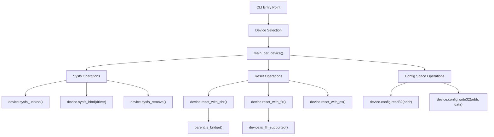
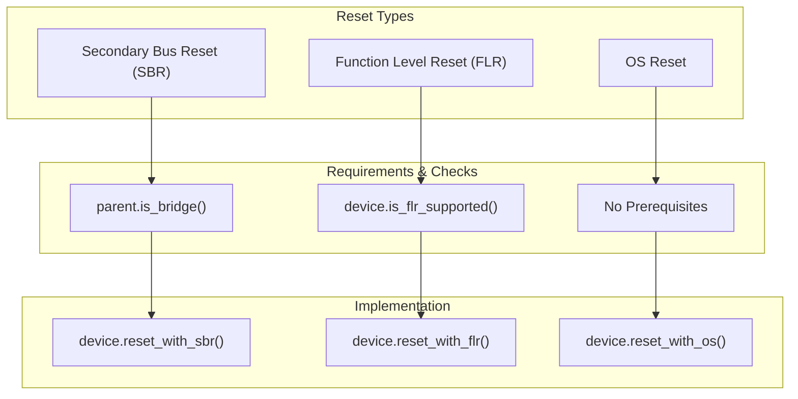
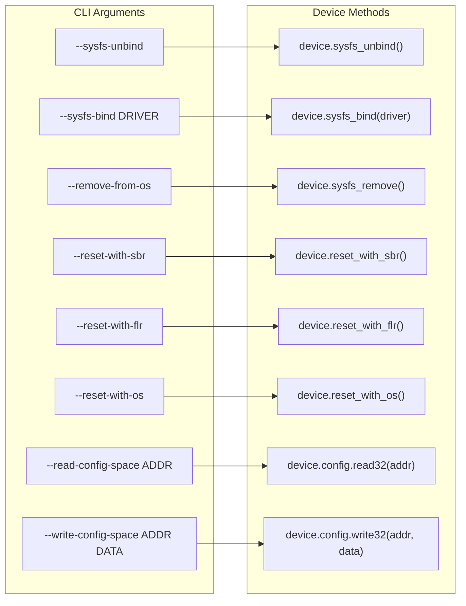

<!-- source: DeepWiki mcp.deepwiki.com · repo NVIDIA/gpu-admin-tools · page 3.2 Device Operations · fetched 2026-10-26 -->

# Device Operations

<details>
<summary>Relevant source files</summary>

The following files were used as context for generating this wiki page:

- [cli/no_device.py](cli/no_device.py)
- [cli/per_device.py](cli/per_device.py)

</details>


This page documents the per-device operations available through the command line interface, specifically focusing on device-level management functions that operate on individual PCI devices rather than GPU-specific functionality. These operations provide fundamental device control including sysfs manipulation, various reset mechanisms, and configuration space access.

For GPU-specific operations that leverage the full GPU object model, see [GPU and NVSwitch Operations](#3.3). For the main CLI entry point and argument parsing, see [Main CLI Entry Point](#3.1). For PCI-level configuration space definitions, see [PCI Interface](#8.1).

## Operation Categories

The device operations are implemented in the `main_per_device` function and fall into three main categories:

| Category | Operations | Purpose |
|----------|------------|---------|
| Sysfs Management | `sysfs_bind`, `sysfs_unbind`, `sysfs_remove` | Control driver binding and device visibility |
| Reset Operations | `reset_with_sbr`, `reset_with_flr`, `reset_with_os` | Various device reset mechanisms |
| Configuration Access | `read_config_space`, `write_config_space` | Direct PCI configuration space manipulation |

Sources: [cli/per_device.py:26-64]()

## Device Operation Flow



Sources: [cli/per_device.py:26-64]()

## Sysfs Operations

The sysfs operations provide control over device driver binding and kernel visibility:

### Unbind Operation
The `sysfs_unbind` operation detaches the current driver from the device without specifying a replacement driver.

```python
device.sysfs_unbind()
```

### Bind Operation  
The `sysfs_bind` operation attaches a specified driver to the device. The driver name is provided as a command line argument.

```python
device.sysfs_bind(opts.sysfs_bind)
```

### Remove Operation
The `sysfs_remove` operation removes the device from the operating system's view entirely.

```python
device.sysfs_remove()
```

Sources: [cli/per_device.py:27-31](), [cli/per_device.py:49-50]()

## Reset Operations

Three different reset mechanisms are supported, each with different scopes and requirements:



### Secondary Bus Reset (SBR)
SBR resets the device by resetting the upstream PCI bridge. This requires that the parent device is accessible and is a bridge.

```python
if not device.parent.is_bridge():
    error("Cannot reset the GPU with SBR as the upstream bridge is not accessible")
else:
    device.reset_with_sbr()
```

### Function Level Reset (FLR)
FLR resets only the specific PCI function and requires device support for this capability.

```python
if device.is_flr_supported():
    device.reset_with_flr()
else:
    error(f"{device} cannot reset with FLR as it is not supported")
```

### OS Reset
OS reset uses operating system mechanisms to reset the device and has no specific hardware requirements.

```python
device.reset_with_os()
```

Sources: [cli/per_device.py:33-47]()

## Configuration Space Access

Direct access to PCI configuration space is provided through read and write operations:

### Configuration Read
Reads a 32-bit value from the specified configuration space address:

```python
addr = opts.read_config_space
data = device.config.read32(addr)
info("Config space read 0x%x = 0x%x", addr, data)
```

### Configuration Write  
Writes a 32-bit value to the specified configuration space address:

```python
addr = opts.write_config_space[0]
data = opts.write_config_space[1]  
device.config.write32(addr, data)
```

Sources: [cli/per_device.py:52-60]()

## Operation Mapping



Sources: [cli/per_device.py:26-64]()

## Error Handling

The device operations include validation and error reporting:

- SBR operations verify bridge accessibility before attempting reset
- FLR operations check device capability support
- Configuration space operations log read values for verification
- Error messages provide specific failure reasons for debugging

The function returns `True` on successful completion, allowing the CLI framework to track operation success.

Sources: [cli/per_device.py:34-44](), [cli/per_device.py:64]()

---

