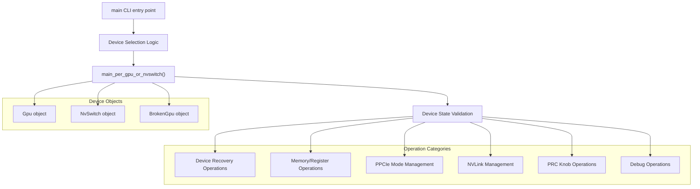
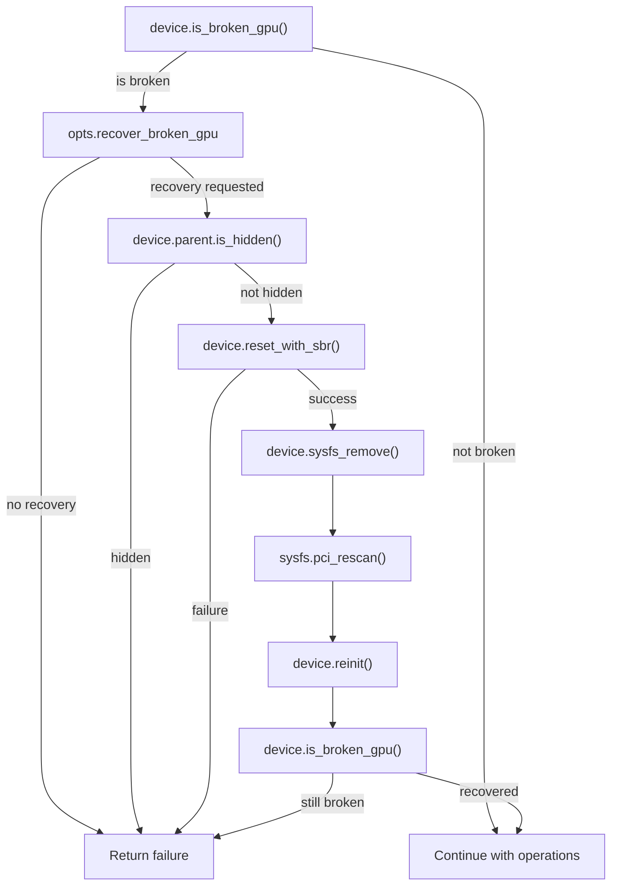
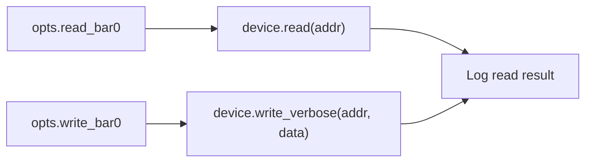
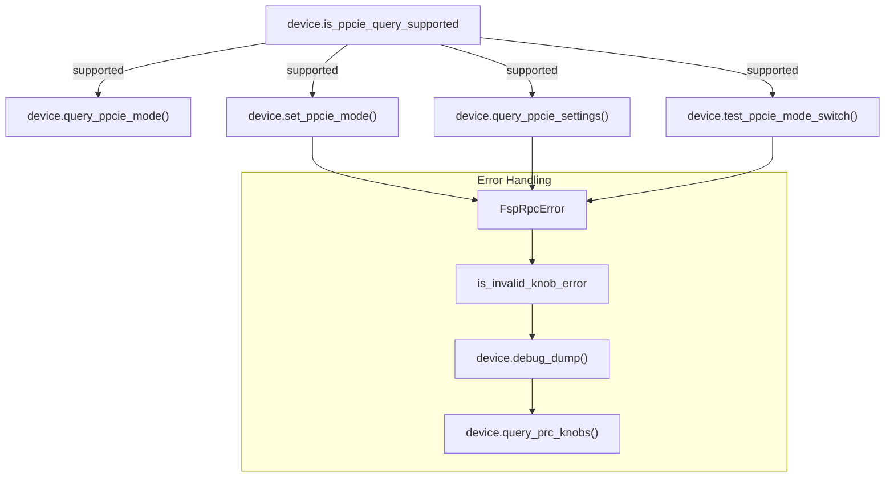
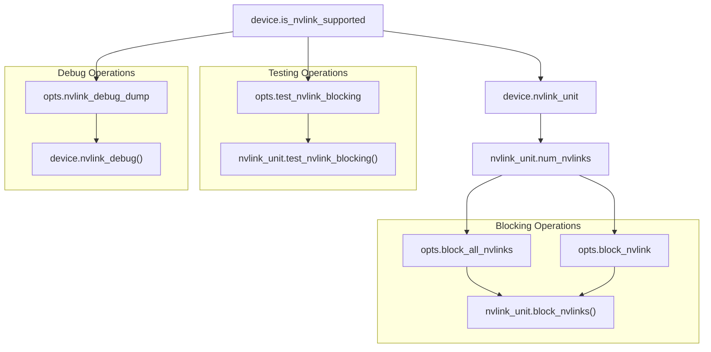
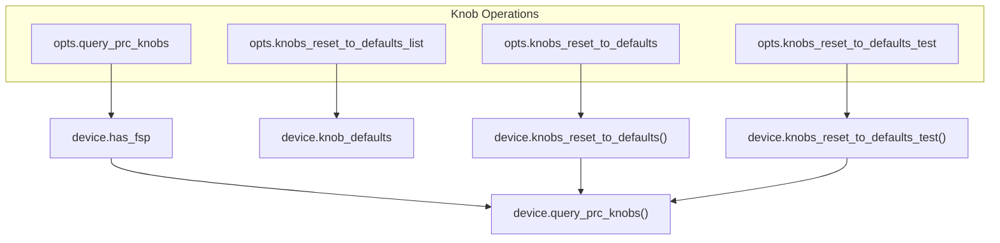
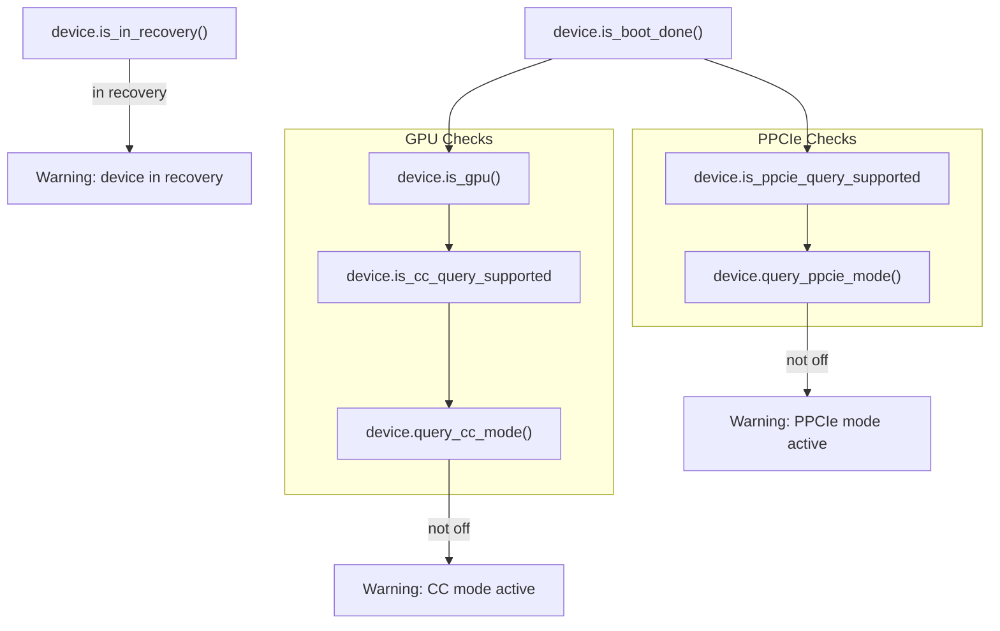

<!-- source: DeepWiki mcp.deepwiki.com · repo NVIDIA/gpu-admin-tools · page 3.3 GPU and NVSwitch Operations · fetched 2026-10-26 -->

# GPU and NVSwitch Operations

Relevant source files

The following files were used as context for generating this wiki page:

- [cli/per_gpu.py](cli/per_gpu.py)
- [cli/per_gpu_nvswitch.py](cli/per_gpu_nvswitch.py)

## Purpose and Scope

This document covers the implementation of GPU-specific and NVSwitch-specific command-line operations that are shared between both device types. These operations include PPCIe mode management, NVLink blocking and testing, PRC knob configuration, device recovery, and various diagnostic capabilities. 

The operations documented here are implemented in the shared GPU/NVSwitch CLI handler and are distinct from GPU-only operations covered in [Device Operations](#3.2). For broader CLI architecture and device selection, see [Main CLI Entry Point](#3.1).

## Architecture Overview

The GPU and NVSwitch operations system is centered around the `main_per_gpu_or_nvswitch` function, which handles operations that can be performed on both GPU and NVSwitch devices.

Sources: [cli/per_gpu_nvswitch.py:34-60]()

## Device Recovery Operations

The system provides comprehensive device recovery capabilities for handling broken GPUs and restoring them to functional state.

### Recovery Flow

The recovery process uses Secondary Bus Reset (SBR) followed by PCI rescanning to restore broken devices:

| Operation | Purpose | Implementation |
|-----------|---------|----------------|
| `is_broken_gpu()` | Check device state | Device status validation |
| `reset_with_sbr()` | Perform secondary bus reset | Hardware reset operation |
| `sysfs_remove()` | Remove from sysfs | Linux sysfs manipulation |
| `pci_rescan()` | Rescan PCI bus | PCI enumeration refresh |

Sources: [cli/per_gpu_nvswitch.py:35-59]()

## Memory and Register Operations

### BAR0 Access Operations

The system provides direct BAR0 memory access for low-level device interaction:

| Operation | CLI Option | Function | Purpose |
|-----------|------------|----------|---------|
| BAR0 Read | `--read-bar0` | `device.read(addr)` | Read 32-bit value from BAR0 offset |
| BAR0 Write | `--write-bar0` | `device.write_verbose(addr, data)` | Write 32-bit value to BAR0 offset |

Sources: [cli/per_gpu_nvswitch.py:77-85]()

## PPCIe Mode Management

PPCIe (Privacy-Preserving PCIe) mode management provides secure communication capabilities for supported devices.

### PPCIe Operation Flow

### PPCIe Operations

| Operation | CLI Option | Function | Purpose |
|-----------|------------|----------|---------|
| Query Mode | `--query-ppcie-mode` | `query_ppcie_mode()` | Get current PPCIe mode |
| Set Mode | `--set-ppcie-mode` | `set_ppcie_mode()` | Configure PPCIe mode |
| Query Settings | `--query-ppcie-settings` | `query_ppcie_settings()` | Get PPCIe configuration |
| Test Switch | `--test-ppcie-mode-switch` | `test_ppcie_mode_switch()` | Validate mode switching |

The system includes automatic reset capability when `--reset-after-ppcie-mode-switch` is specified, which validates the mode change after reset.

Sources: [cli/per_gpu_nvswitch.py:102-177]()

## NVLink Management

NVLink management provides comprehensive control over high-speed interconnect links between GPUs and switches.

### NVLink Operation Architecture

### NVLink Operations

| Operation | CLI Option | Implementation | Purpose |
|-----------|------------|----------------|---------|
| Block All Links | `--block-all-nvlinks` | `range(num_nvlinks)` | Block all NVLink connections |
| Block Specific Links | `--block-nvlink` | `opts.block_nvlink` | Block specified link indices |
| Test Blocking | `--test-nvlink-blocking` | `test_nvlink_blocking()` | Validate blocking functionality |
| Debug Dump | `--nvlink-debug-dump` | `nvlink_debug()` | Generate NVLink diagnostics |

The system validates link indices against the device's `num_nvlinks` capability and provides comprehensive error reporting for invalid configurations.

Sources: [cli/per_gpu_nvswitch.py:186-230]()

## PRC Knob Management

Product Reconfiguration (PRC) knobs provide runtime configuration control for device features and security settings.

### Knob Management Flow

### PRC Knob Operations

| Operation | CLI Option | Function | Purpose |
|-----------|------------|----------|---------|
| Query Knobs | `--query-prc-knobs` | `query_prc_knobs()` | List all PRC knob values |
| List Defaults | `--knobs-reset-to-defaults-list` | `knob_defaults` | Show available default knobs |
| Reset Knobs | `--knobs-reset-to-defaults` | `knobs_reset_to_defaults()` | Reset specified knobs to defaults |
| Test Reset | `--knobs-reset-to-defaults-test` | `knobs_reset_to_defaults_test()` | Validate reset functionality |

The knob reset operation supports the `--knobs-reset-to-defaults-assume-no-pending-changes` flag for bypassing pending change validation.

Sources: [cli/per_gpu_nvswitch.py:91-226]()

## Device State Monitoring

The system continuously monitors device state and provides warnings for operational modes that may limit functionality.

### State Monitoring Flow

The monitoring system provides early warnings when devices are in modes that may restrict debugging or administrative functionality:

- **Recovery Mode**: Device is in firmware recovery state
- **CC Mode**: Confidential Computing mode is active
- **PPCIe Mode**: Privacy-Preserving PCIe mode is active

Sources: [cli/per_gpu_nvswitch.py:61-75]()

## Debug and Diagnostic Operations

### Debug Operations

| Operation | CLI Option | Function | Purpose |
|-----------|------------|----------|---------|
| Debug Dump | `--debug-dump` | `device.debug_dump()` | Generate comprehensive device diagnostics |
| Module Name | `--query-module-name` | `device.module_name` | Get device module identifier |

The debug dump operation provides detailed device state information for troubleshooting and is automatically invoked during error conditions in PPCIe and knob operations.

Sources: [cli/per_gpu_nvswitch.py:87-89](), [cli/per_gpu_nvswitch.py:180-184]()

---

