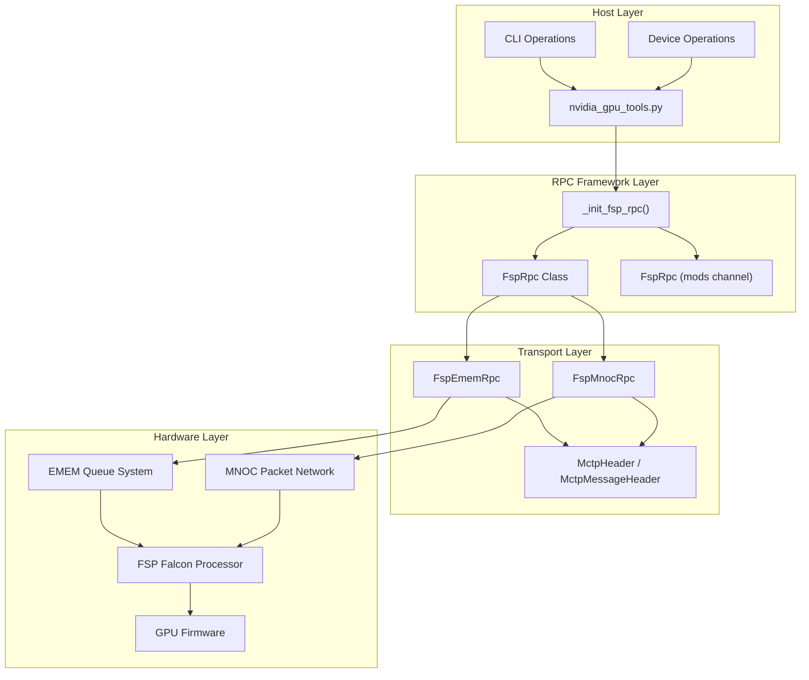
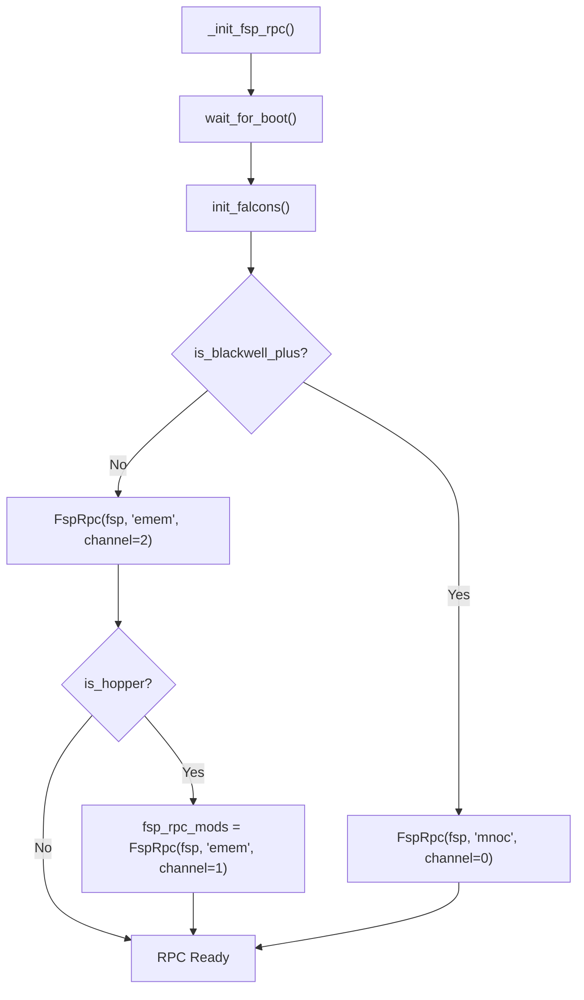
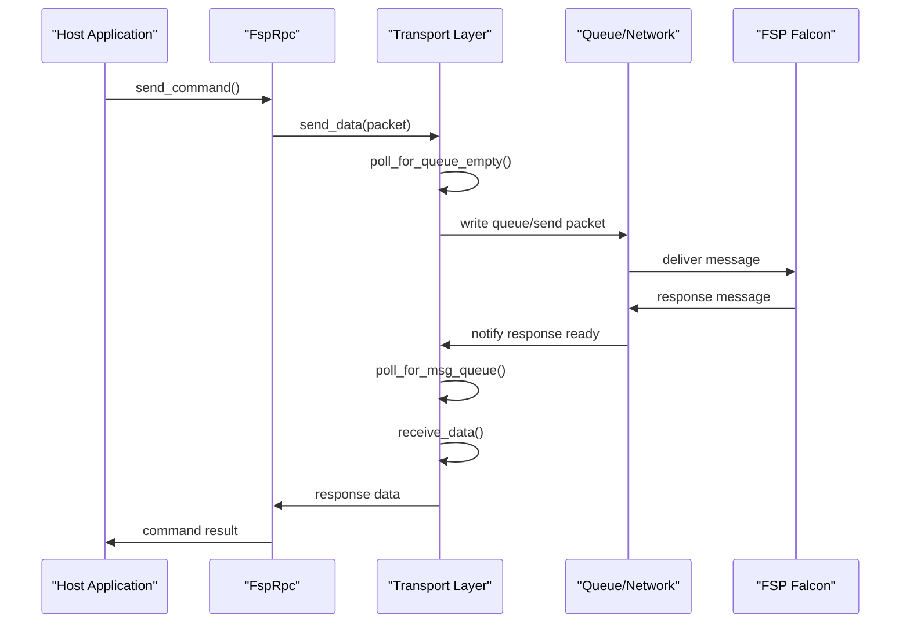

<!-- source: DeepWiki mcp.deepwiki.com · repo NVIDIA/gpu-admin-tools · page 4 Communication Systems · fetched 2026-10-26 -->

# Communication Systems

Relevant source files

The following files were used as context for generating this wiki page:

- [gpu/fsp_emem_rpc.py](gpu/fsp_emem_rpc.py)
- [gpu/fsp_mctp.py](gpu/fsp_mctp.py)
- [gpu/fsp_mnoc_rpc.py](gpu/fsp_mnoc_rpc.py)
- [nvidia_gpu_tools.py](nvidia_gpu_tools.py)

This page provides an overview of the RPC communication architecture that enables host-to-firmware communication between the NVIDIA GPU administration tools and GPU firmware processors. The communication systems facilitate command execution, status monitoring, and configuration management through structured message passing protocols.

For detailed information about specific transport implementations, see [FSP RPC Framework](#4.1), [EMEM Transport](#4.2), and [MNOC Transport](#4.3). For falcon processor management, see [Falcon Management System](#2.2).

## Communication Architecture Overview

The communication system implements a layered architecture where the host communicates with GPU firmware through the Firmware Service Processor (FSP) using either EMEM or MNOC transport protocols. The system automatically selects the appropriate transport based on GPU architecture.

Sources: [nvidia_gpu_tools.py:1177-1192](), [gpu/fsp_emem_rpc.py:33-141](), [gpu/fsp_mnoc_rpc.py:26-37]()

## Transport Selection Logic

The system automatically selects the appropriate transport mechanism based on GPU architecture and channel requirements. The selection logic is implemented in the `_init_fsp_rpc()` method.

| Architecture | Primary Transport | Channel | Secondary Transport | Channel |
|--------------|------------------|---------|-------------------|---------|
| Blackwell+ | MNOC | 0 | - | - |
| Hopper | EMEM | 2 | EMEM (mods) | 1 |
| Other | EMEM | 2 | - | - |

Sources: [nvidia_gpu_tools.py:1177-1192]()

## Key Communication Classes

### FspRpc Framework
The `FspRpc` class serves as the primary interface for FSP communication, abstracting transport-specific details and providing a unified API for firmware interaction.

### Transport Layer Classes

| Class | File | Purpose | Max Packet Size |
|-------|------|---------|----------------|
| `FspEmemRpc` | gpu/fsp_emem_rpc.py | EMEM-based transport with queue management | 1024 bytes |
| `FspMnocRpc` | gpu/fsp_mnoc_rpc.py | MNOC-based transport with packet handling | 4160 bytes (port 0), 1024 bytes (port 1) |

### Message Protocol Classes

| Class | File | Purpose |
|-------|------|---------|
| `MctpHeader` | gpu/fsp_mctp.py | MCTP transport header with SOM/EOM sequencing |
| `MctpMessageHeader` | gpu/fsp_mctp.py | MCTP message header with vendor ID and type |

Sources: [gpu/fsp_emem_rpc.py:33-41](), [gpu/fsp_mnoc_rpc.py:26-37](), [gpu/fsp_mctp.py:26-58]()

## Communication Flow and State Management

The communication system implements robust state management with queue monitoring, timeout handling, and automatic recovery mechanisms.

### EMEM Transport Flow
- Queue-based communication using head/tail pointers
- Channel-specific EMEM base addresses (channel_num * 1024)
- Dual queue system: command queue and message queue
- Automatic queue reset and state recovery

### MNOC Transport Flow  
- Packet-based communication through MNOC network
- Port-specific packet size limits
- Direct packet transmission without explicit queuing
- Hardware-managed flow control

Sources: [gpu/fsp_emem_rpc.py:42-141](), [gpu/fsp_mnoc_rpc.py:26-37]()

## Integration with GPU Management

The communication systems are tightly integrated with the broader GPU management framework through the `NvidiaDevice` class hierarchy:

- **Initialization**: FSP RPC is lazily initialized when first accessed via `_init_fsp_rpc()`
- **Lifecycle**: RPC connections are managed per-device and persist for the device lifetime
- **Error Handling**: Communication errors are propagated through the GPU error hierarchy
- **Channel Management**: Multiple RPC channels can be established for different purposes (main communication, mods operations)

The communication layer enables all higher-level GPU operations including configuration changes, status monitoring, security operations, and firmware updates through a reliable, architecture-aware transport abstraction.

Sources: [nvidia_gpu_tools.py:1039-1055](), [nvidia_gpu_tools.py:1177-1192]()

---

