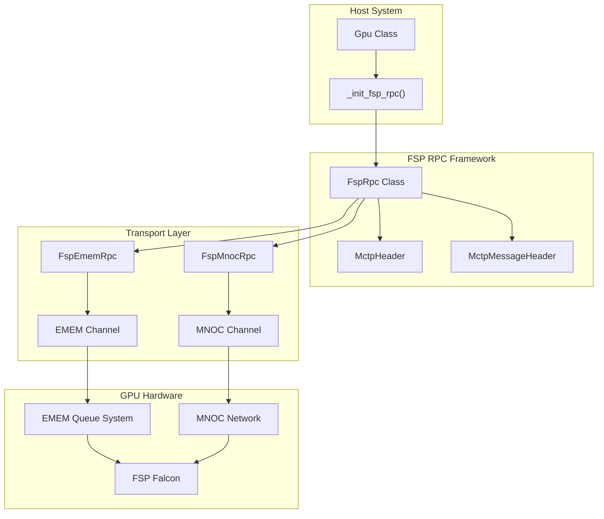
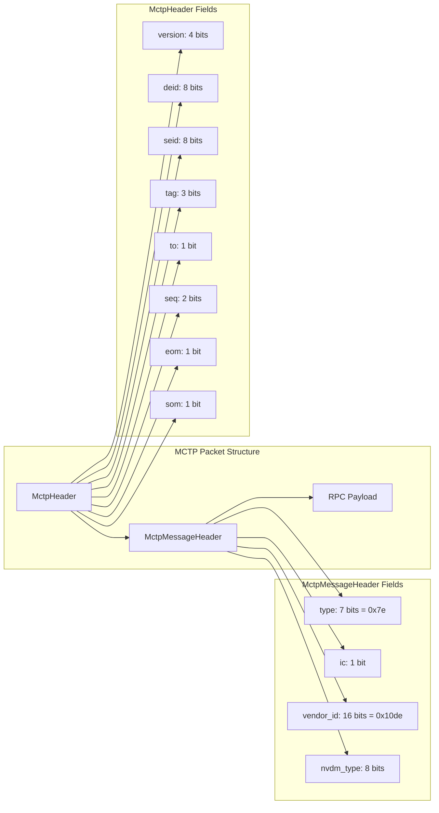
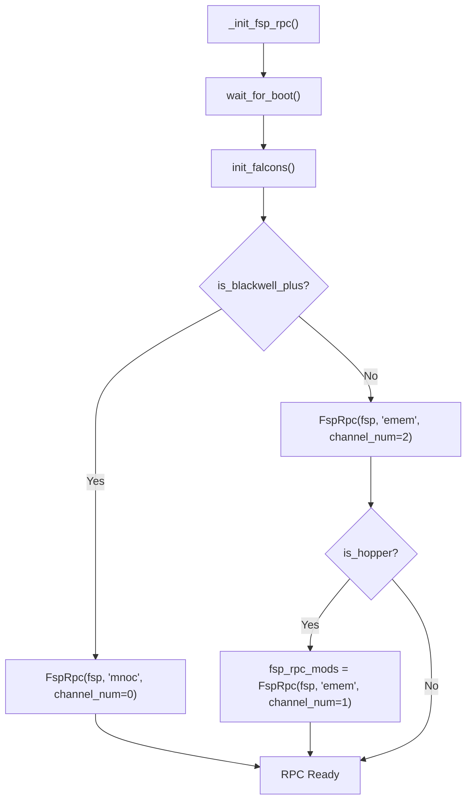
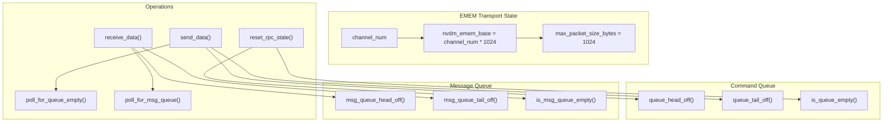
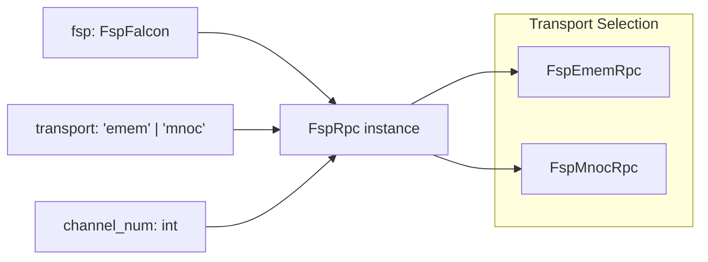

<!-- source: DeepWiki mcp.deepwiki.com · repo NVIDIA/gpu-admin-tools · page 4.1 FSP RPC Framework · fetched 2026-10-26 -->

# FSP RPC Framework

Relevant source files

The following files were used as context for generating this wiki page:

- [gpu/fsp_emem_rpc.py](gpu/fsp_emem_rpc.py)
- [gpu/fsp_mctp.py](gpu/fsp_mctp.py)
- [nvidia_gpu_tools.py](nvidia_gpu_tools.py)

## Purpose and Scope

The FSP RPC Framework provides a standardized communication interface between the host system and the Firmware Service Processor (FSP) falcon on NVIDIA GPU devices. This framework implements the Management Component Transport Protocol (MCTP) for reliable message exchange and supports multiple transport layers including EMEM (Extended Memory) and MNOC (Memory Network on Chip) depending on the GPU architecture.

For information about the broader falcon management system, see [Falcon Management System](#2.2). For details about specific transport implementations, see [EMEM Transport](#4.2) and [MNOC Transport](#4.3).

## Architecture Overview

The FSP RPC Framework consists of three main layers: the MCTP protocol implementation, transport layer abstraction, and the high-level RPC interface.

**Sources:** [nvidia_gpu_tools.py:1177-1193](), [gpu/fsp_emem_rpc.py:33-42](), [gpu/fsp_mctp.py:26-57]()

## MCTP Protocol Implementation

The framework implements MCTP (Management Component Transport Protocol) headers for standardized message formatting. The protocol uses NVIDIA's vendor-specific message types for GPU-specific communication.

The `MctpHeader` class defines the transport-level framing with start-of-message (`som`) and end-of-message (`eom`) flags both set to 1 for single-packet messages. The `MctpMessageHeader` specifies NVIDIA vendor messages with type `0x7e` and vendor ID `0x10de`.

**Sources:** [gpu/fsp_mctp.py:26-57]()

## Transport Layer Architecture

The FSP RPC Framework supports architecture-specific transport mechanisms selected at initialization time based on GPU generation.

### Transport Selection Logic

| GPU Architecture | Primary Transport | Channel | Additional Channels |
|------------------|-------------------|---------|-------------------|
| Blackwell+ | MNOC | 0 | None |
| Hopper | EMEM | 2 | Channel 1 for mods |
| Pre-Hopper | EMEM | 2 | None |

**Sources:** [nvidia_gpu_tools.py:1177-1193]()

## EMEM Transport Implementation

The `FspEmemRpc` class implements queue-based communication over the Extended Memory interface with robust error handling and state management.

### Queue Management

The EMEM transport uses dual queue systems for command and response handling:

**Sources:** [gpu/fsp_emem_rpc.py:33-141]()

### Error Handling and Timeout Management

The framework implements comprehensive timeout and error handling:

| Operation | Timeout | Error Type | Recovery Action |
|-----------|---------|------------|-----------------|
| `poll_for_msg_queue()` | 5 seconds | `GpuRpcTimeout` | Fatal by default, optional non-fatal |
| `poll_for_queue_empty()` | 1 second | `GpuRpcTimeout` | Queue state reset |
| `receive_data()` | 5 seconds | `GpuRpcTimeout` | Connection reset |

**Sources:** [gpu/fsp_emem_rpc.py:84-116](), [gpu/error.py]()

## FSP RPC Class Structure

The main `FspRpc` class coordinates between the MCTP protocol layer and the selected transport mechanism. The class is instantiated with transport-specific parameters and maintains the communication session state.

### Initialization Pattern

The FSP RPC system supports multiple concurrent channels, with Hopper GPUs maintaining separate instances for different operational contexts (`fsp_rpc` for general operations, `fsp_rpc_mods` for module-specific commands).

**Sources:** [nvidia_gpu_tools.py:1177-1193](), [nvidia_gpu_tools.py:1040]()

## Integration with Device Management

The FSP RPC Framework integrates tightly with the broader GPU management system, requiring proper falcon initialization and boot completion before activation:

1. **Boot Synchronization**: `wait_for_boot()` ensures FSP firmware is ready
2. **Falcon Initialization**: `init_falcons()` prepares the FSP falcon for communication  
3. **Architecture Detection**: GPU generation determines transport selection
4. **Channel Allocation**: Multiple channels support concurrent operations

**Sources:** [nvidia_gpu_tools.py:1177-1193]()

---

