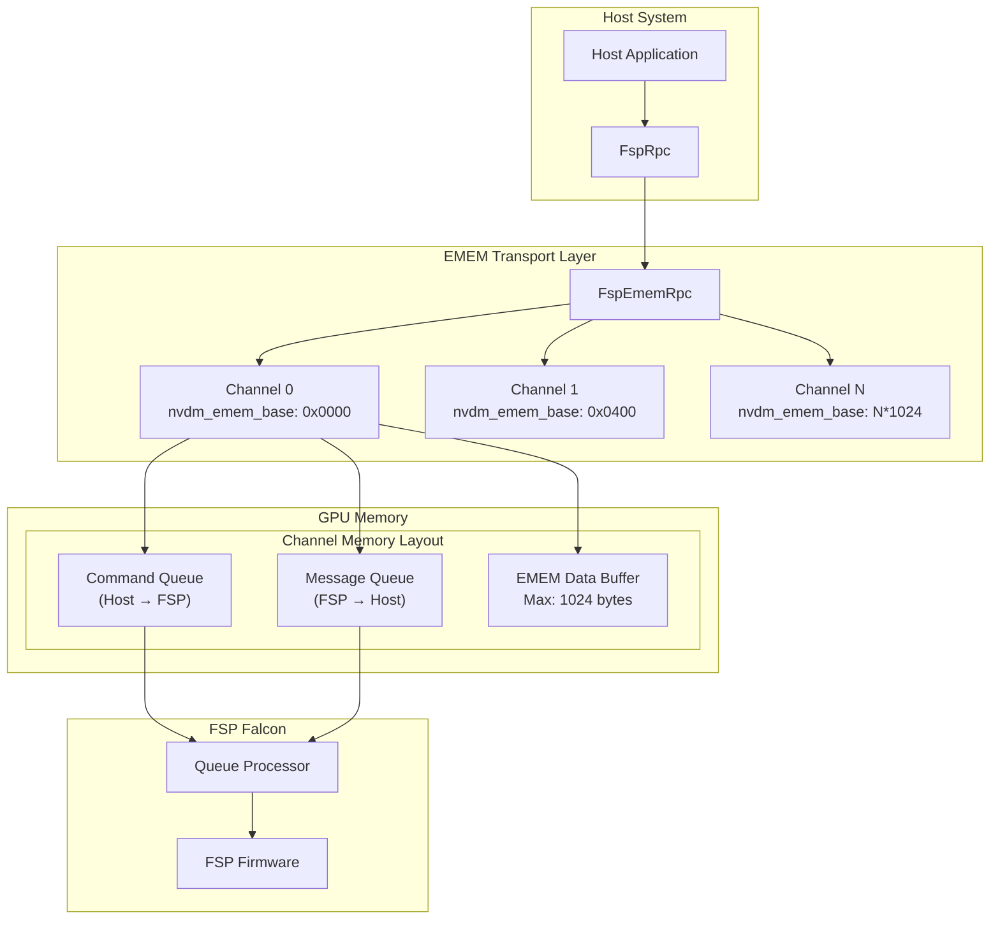
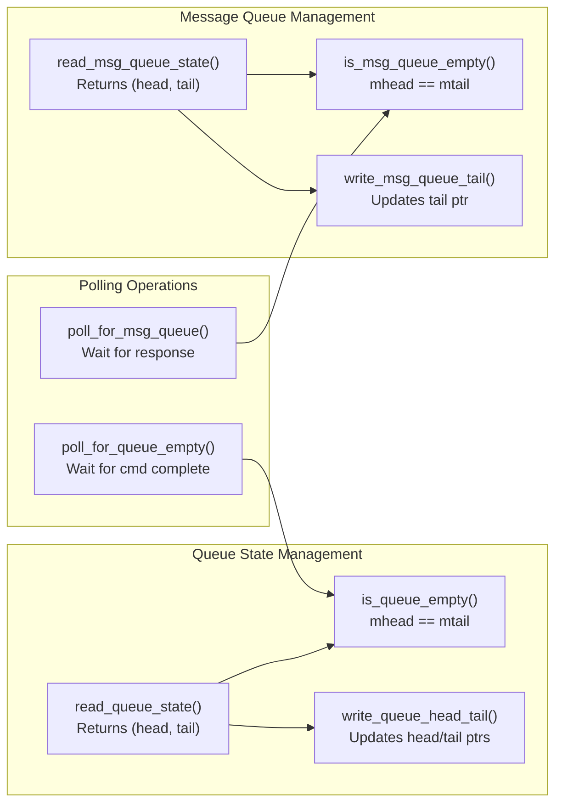
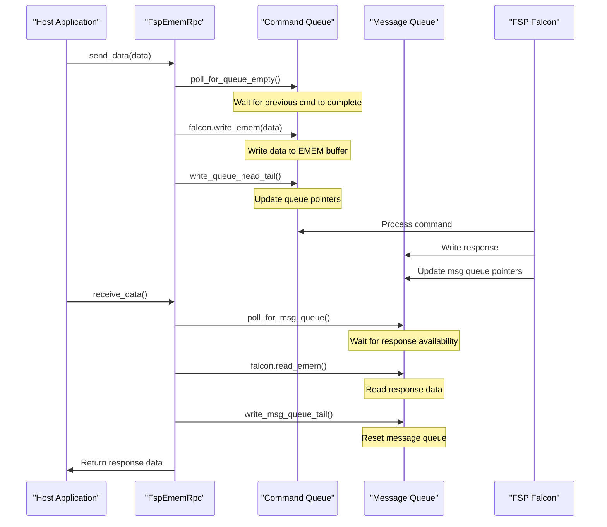
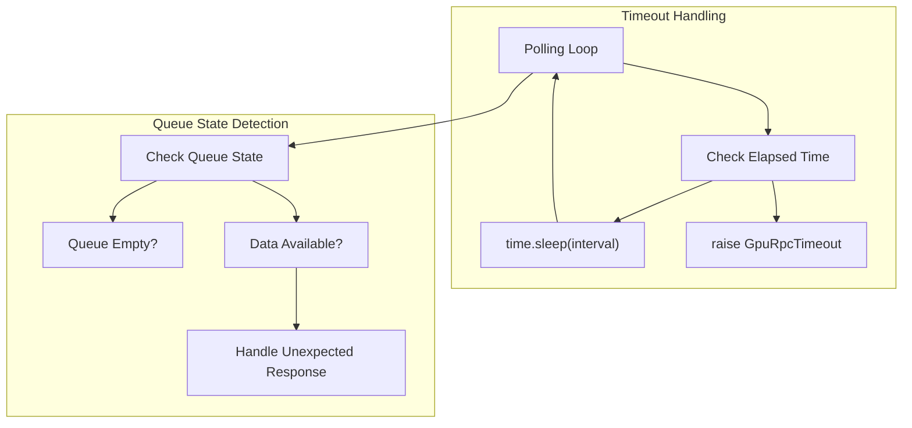

<!-- source: DeepWiki mcp.deepwiki.com · repo NVIDIA/gpu-admin-tools · page 4.2 EMEM Transport · fetched 2026-10-26 -->

# EMEM Transport

Relevant source files

The following files were used as context for generating this wiki page:

- [gpu/fsp_emem_rpc.py](gpu/fsp_emem_rpc.py)
- [gpu/fsp_mctp.py](gpu/fsp_mctp.py)

## Purpose and Scope

The EMEM Transport system provides a queue-based communication layer for host-to-firmware Remote Procedure Call (RPC) operations using Extended Memory (EMEM) as the underlying transport medium. This transport layer enables the host system to communicate with the Firmware Service Processor (FSP) falcon through memory-mapped queues and message passing.

For information about the broader FSP RPC framework that utilizes this transport, see [FSP RPC Framework](#4.1). For details about the alternative MNOC-based transport mechanism, see [MNOC Transport](#4.3).

## Architecture Overview

The EMEM transport is implemented through the `FspEmemRpc` class, which manages bi-directional communication between the host and FSP falcon using dedicated memory channels. Each channel operates with a pair of queues: a command queue for host-to-firmware messages and a message queue for firmware-to-host responses.

**Sources:** [gpu/fsp_emem_rpc.py:33-42]()

## Channel and Queue Management

Each `FspEmemRpc` instance manages a single communication channel identified by `channel_num`. The channel uses a dedicated 1024-byte memory region starting at `nvdm_emem_base = channel_num * 1024`. Two separate queue pairs handle bidirectional communication:

| Queue Type | Direction | Purpose | Head/Tail Registers |
|------------|-----------|---------|---------------------|
| Command Queue | Host → FSP | Send RPC requests | `queue_head_off`, `queue_tail_off` |
| Message Queue | FSP → Host | Receive RPC responses | `msg_queue_head_off`, `msg_queue_tail_off` |

**Sources:** [gpu/fsp_emem_rpc.py:61-82](), [gpu/fsp_emem_rpc.py:84-116]()

## Communication Flow

The EMEM transport implements a synchronous request-response communication pattern. Each RPC operation follows a specific sequence of queue operations and memory transfers:

**Sources:** [gpu/fsp_emem_rpc.py:118-140]()

## Data Transmission Protocol

The EMEM transport handles data packets with a maximum size of 1024 bytes per channel. Data transmission involves direct memory writes to the EMEM buffer followed by queue pointer updates to signal data availability:

### Send Operation
The `send_data` method implements the transmission protocol:
1. **Queue Synchronization**: Wait for command queue to be empty using `poll_for_queue_empty()`
2. **Data Transfer**: Write packet data to EMEM using `falcon.write_emem()`
3. **Queue Signaling**: Update queue head/tail pointers to indicate new data

### Receive Operation  
The `receive_data` method implements the reception protocol:
1. **Response Polling**: Wait for message queue activity using `poll_for_msg_queue()`
2. **Size Calculation**: Determine response size from queue pointer difference
3. **Data Retrieval**: Read response data from EMEM using `falcon.read_emem()`
4. **Queue Reset**: Clear message queue by resetting tail pointer

**Sources:** [gpu/fsp_emem_rpc.py:118-124](), [gpu/fsp_emem_rpc.py:125-140]()

## Error Handling and Timeouts

The EMEM transport implements comprehensive timeout and error handling mechanisms to ensure robust communication:

### Timeout Configuration
| Operation | Default Timeout | Purpose |
|-----------|----------------|---------|
| Message Queue Poll | 5 seconds | Wait for FSP response |
| Command Queue Empty | 1 second | Wait for command completion |
| Sleep Interval | 0.01 seconds | Polling frequency for messages |
| Sleep Interval | 0.001 seconds | Polling frequency for queue empty |

### Error Conditions
The transport raises `GpuRpcTimeout` exceptions when:
- Message queue polling exceeds timeout threshold
- Command queue fails to empty within timeout period
- Unexpected early responses are detected during queue polling

**Sources:** [gpu/fsp_emem_rpc.py:84-98](), [gpu/fsp_emem_rpc.py:99-116]()

## State Management and Reset

The EMEM transport provides state management capabilities to handle initialization and error recovery scenarios. The `reset_rpc_state` method ensures clean communication channel startup:

### Reset Sequence
1. **State Assessment**: Check if both command and message queues are empty
2. **Settling Wait**: Allow pending operations to complete if queues are active  
3. **Queue Reset**: Force both queue head/tail pointers to base addresses
4. **Channel Cleanup**: Clear any residual data from previous sessions

This reset mechanism ensures reliable communication channel establishment and provides recovery from error conditions that might leave queues in inconsistent states.

**Sources:** [gpu/fsp_emem_rpc.py:47-60]()

---

