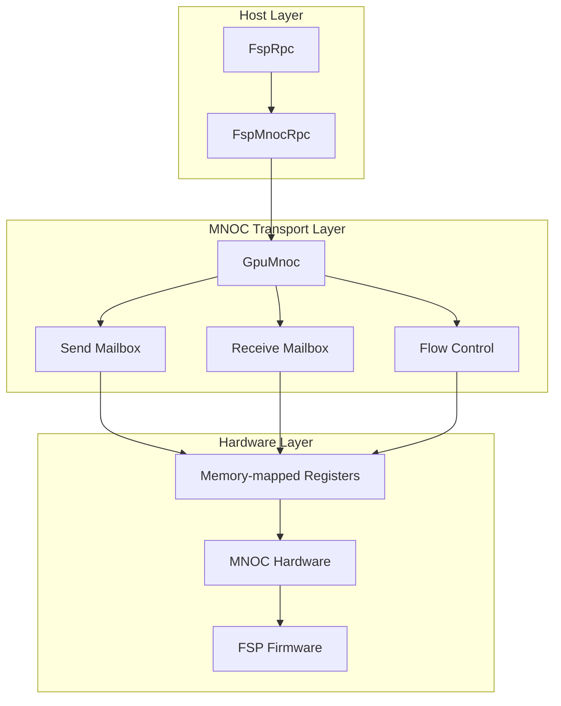
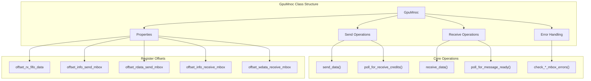
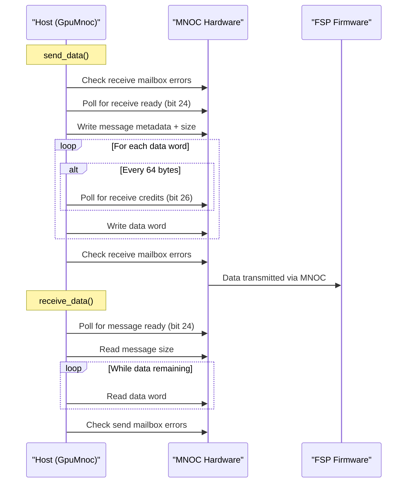
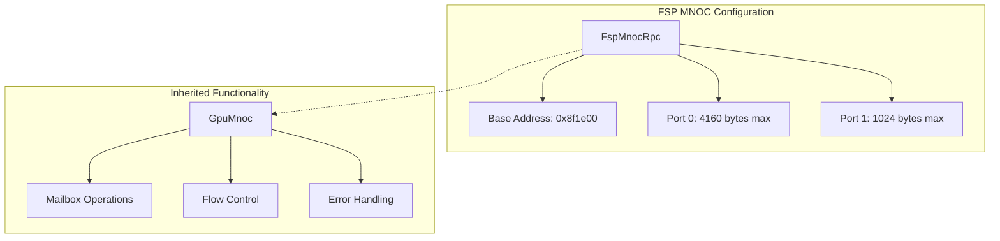

<!-- source: DeepWiki mcp.deepwiki.com · repo NVIDIA/gpu-admin-tools · page 4.3 MNOC Transport · fetched 2026-10-26 -->

# MNOC Transport

Relevant source files

The following files were used as context for generating this wiki page:

- [gpu/fsp_mnoc_rpc.py](gpu/fsp_mnoc_rpc.py)
- [gpu/mnoc.py](gpu/mnoc.py)

## Purpose and Scope

The MNOC Transport system provides a packet-based communication mechanism for interacting with the GPU's Memory Network on Chip (MNOC). This transport layer enables host-to-firmware communication, particularly for FSP (Firmware Service Processor) RPC operations. The MNOC transport is one of two primary communication transports used by the FSP RPC framework, alongside EMEM transport (see [EMEM Transport](#4.2)). For the broader FSP RPC framework context, see [FSP RPC Framework](#4.1).

## Architecture Overview

The MNOC transport implements a mailbox-based communication protocol that operates through memory-mapped registers. The system uses separate send and receive mailboxes with flow control mechanisms to ensure reliable data transmission between the host and firmware.

### MNOC Transport Architecture

Sources: [gpu/mnoc.py:28-36](), [gpu/fsp_mnoc_rpc.py:26-36]()

## Core Components

### GpuMnoc Class

The `GpuMnoc` class serves as the base implementation for MNOC communication, providing low-level mailbox operations and register access patterns.

Sources: [gpu/mnoc.py:28-121]()

### Register Layout

The MNOC transport uses a structured register layout with base offsets and port-specific addressing:

| Register | Offset Calculation | Purpose |
|----------|-------------------|---------|
| RX FIFO Data | `base + port * 8` | Data reception FIFO |
| Info Send Mailbox | `base + 0x104 + port * 12` | Send message metadata |
| RData Send Mailbox | `info_send_mbox + 4` | Send message data |
| Info Receive Mailbox | `base + 0x184 + port * 12` | Receive message metadata |
| WData Receive Mailbox | `info_receive_mbox + 4` | Receive message data |

Sources: [gpu/mnoc.py:38-56]()

## Communication Protocol

### Data Transmission Flow

The MNOC transport implements a credit-based flow control mechanism for reliable data transmission:

Sources: [gpu/mnoc.py:70-121]()

### Message Structure

Messages transmitted through MNOC contain:
- **Size field**: 20-bit message size in the info mailbox [gpu/mnoc.py:76-78]()
- **Control bits**: Bit 20 set for valid messages [gpu/mnoc.py:77]()
- **Data payload**: 32-bit words transmitted through data mailboxes [gpu/mnoc.py:81-85]()

### Flow Control and Error Handling

The protocol implements several safety mechanisms:

| Mechanism | Bit Position | Purpose |
|-----------|--------------|---------|
| Message Ready | Bit 24 | Indicates message available in send mailbox |
| Error Flag | Bit 25 | Indicates mailbox error condition |
| Credits Available | Bit 26 | Flow control for data transmission |

Error conditions are checked at multiple points and raise `GpuError` exceptions with descriptive messages [gpu/mnoc.py:89-97]().

Sources: [gpu/mnoc.py:58-68](), [gpu/mnoc.py:89-97]()

## FSP-Specific Implementation

### FspMnocRpc Class

The `FspMnocRpc` class extends `GpuMnoc` to provide FSP-specific configuration and packet size limits:

Sources: [gpu/fsp_mnoc_rpc.py:26-36]()

### Port Configuration

FSP MNOC supports two ports with different capabilities:

| Port | Max Packet Size | Use Case |
|------|----------------|----------|
| 0 | 4160 bytes | High-bandwidth operations |
| 1 | 1024 bytes | Standard operations |

The port selection affects the maximum data payload that can be transmitted in a single operation [gpu/fsp_mnoc_rpc.py:31-36]().

## Timeout and Error Recovery

The MNOC transport implements comprehensive timeout handling:

- **Default timeout**: 1 second for most operations [gpu/mnoc.py:61-62]()
- **Receive timeout**: 5 seconds for receive ready polling [gpu/mnoc.py:65]()
- **Credit timeout**: 1 second for flow control [gpu/mnoc.py:68]()

When timeouts occur during receive operations, the system checks for hardware errors before raising `GpuRpcTimeout` exceptions [gpu/mnoc.py:102-108]().

Sources: [gpu/mnoc.py:61-68](), [gpu/mnoc.py:99-108]()

---

