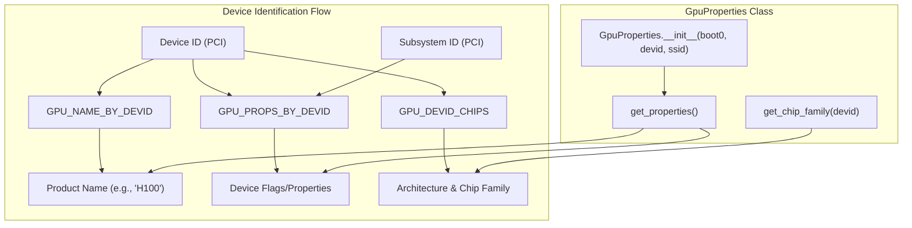
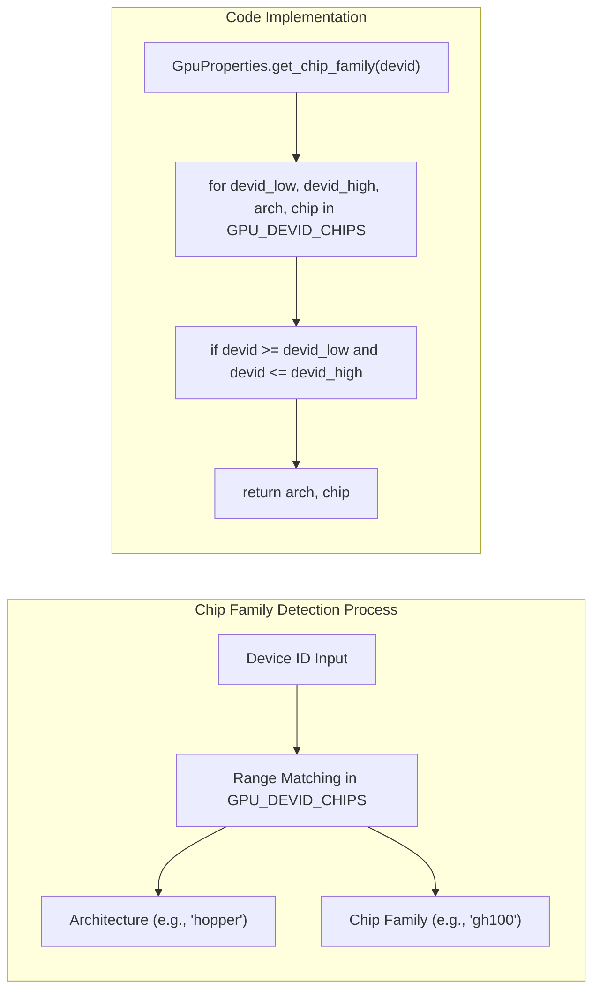
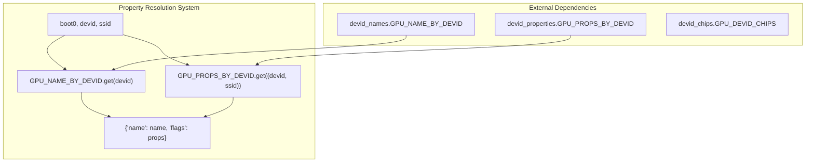
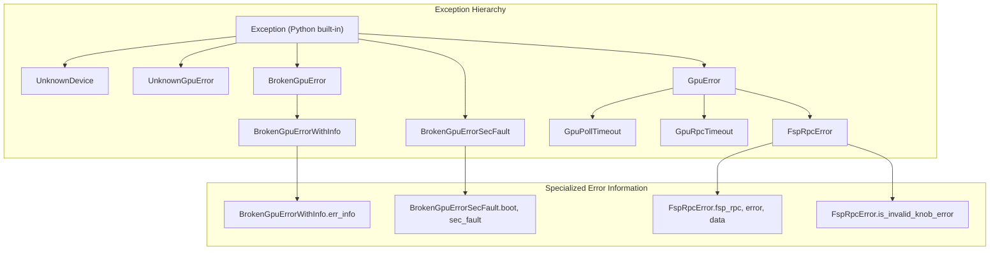
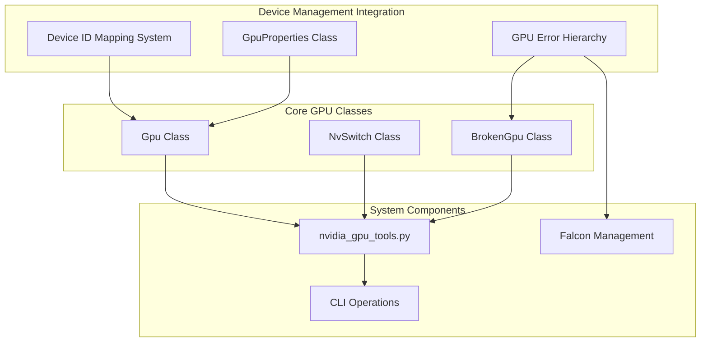

<!-- source: DeepWiki mcp.deepwiki.com · repo NVIDIA/gpu-admin-tools · page 5 Device Management · fetched 2026-10-26 -->

# Device Management

Relevant source files

The following files were used as context for generating this wiki page:

- [gpu/devid_names.py](gpu/devid_names.py)
- [gpu/error.py](gpu/error.py)
- [gpu/properties.py](gpu/properties.py)

This document covers the device management subsystem responsible for identifying GPU devices, determining their properties and capabilities, and handling device-related errors. The system provides the foundation for recognizing different GPU models, understanding their characteristics, and gracefully handling failure conditions.

For information about the core GPU management classes that utilize this device management system, see [Core Architecture](#2). For details about system integration and PCI device handling, see [System Integration](#8).

## Device Identification System

The device identification system maps PCI device IDs to recognizable GPU product names and determines device capabilities. This system is built around a central mapping table that translates hardware identifiers into human-readable names and device classifications.

### Device ID to Name Mapping

The core of device identification is the `GPU_NAME_BY_DEVID` dictionary in [gpu/devid_names.py:24-69](), which maps hexadecimal device IDs to GPU product names. This mapping covers major GPU families including:

| GPU Family | Device ID Range | Examples |
|------------|-----------------|----------|
| L-series (Ada) | 0x26B5 - 0x27B8 | L2, L4, L20, L40, L40S, L40G |
| H-series (Hopper) | 0x2309 - 0x2348 | H100, H200, H800, H20, GH200 |
| B-series (Blackwell) | 0x2901 - 0x2941 | B200, GB200 |

Sources: [gpu/devid_names.py:24-69](), [gpu/properties.py:28-47]()

### Architecture and Chip Family Detection

The system determines GPU architecture and chip family through the `get_chip_family()` static method in the `GpuProperties` class. This method uses device ID ranges defined in `GPU_DEVID_CHIPS` to classify devices into architectural families.

Sources: [gpu/properties.py:42-47]()

## Device Properties Management

The `GpuProperties` class serves as the central interface for retrieving device characteristics based on hardware identifiers. It combines device ID, subsystem ID, and boot configuration data to provide comprehensive device information.

### GpuProperties Class Interface

The `GpuProperties` class is initialized with three key parameters:
- `boot0`: Boot configuration data
- `devid`: PCI device ID
- `ssid`: PCI subsystem ID

The primary interface method `get_properties()` returns a dictionary containing the device name and capability flags determined from the hardware identifiers.

| Method | Purpose | Return Value |
|--------|---------|--------------|
| `__init__(boot0, devid, ssid)` | Initialize with hardware identifiers | None |
| `get_properties()` | Retrieve device name and flags | Dict with 'name' and 'flags' keys |
| `get_chip_family(devid)` | Determine architecture family | Tuple of (architecture, chip) |

Sources: [gpu/properties.py:28-47]()

## Error Handling System

The device management system includes a comprehensive error hierarchy for handling various GPU-related failure conditions. These exceptions provide specific error types for different failure scenarios encountered during device operations.

### GPU Error Hierarchy

The error system is organized into several categories based on the type of failure:

| Exception Class | Purpose | Usage Context |
|----------------|---------|---------------|
| `UnknownDevice` | Device not recognized | Device enumeration failures |
| `UnknownGpuError` | GPU state unknown | Initialization failures |
| `BrokenGpuError` | GPU hardware failure | Device malfunction detection |
| `BrokenGpuErrorWithInfo` | GPU failure with details | Extended failure information |
| `BrokenGpuErrorSecFault` | Security fault detection | Security engine failures |
| `GpuError` | General GPU operation error | Base class for GPU errors |
| `GpuPollTimeout` | Polling operation timeout | Waiting for GPU state changes |
| `GpuRpcTimeout` | RPC communication timeout | FSP communication failures |
| `FspRpcError` | FSP RPC specific error | FSP protocol errors with details |

Sources: [gpu/error.py:24-61]()

### Specialized Error Types

#### FSP RPC Error Handling

The `FspRpcError` class provides detailed information about FSP communication failures, including the specific FSP instance, error code, and associated data. It includes specialized detection for invalid knob errors through the `is_invalid_knob_error` property.

#### Security Fault Errors

The `BrokenGpuErrorSecFault` exception captures security engine faults with both boot state and fault information, enabling detailed analysis of security-related failures.

#### Broken GPU State Management

The broken GPU error classes (`BrokenGpuError`, `BrokenGpuErrorWithInfo`) handle cases where GPU hardware has failed or entered an unrecoverable state, with optional extended error information.

## Integration with Core Systems

The device management system integrates closely with the core GPU management architecture, providing the foundational identification and property resolution services used throughout the system.

Sources: [gpu/devid_names.py:24-69](), [gpu/properties.py:28-47](), [gpu/error.py:24-61]()

The device management system serves as the foundation for device recognition and error handling throughout the GPU administration tools, enabling the higher-level systems to make informed decisions about device capabilities and handle failure conditions appropriately.

---

