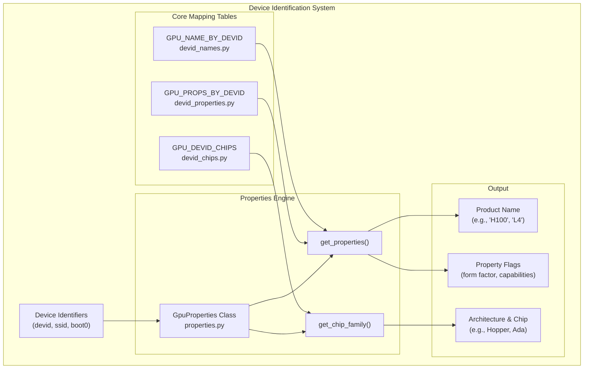
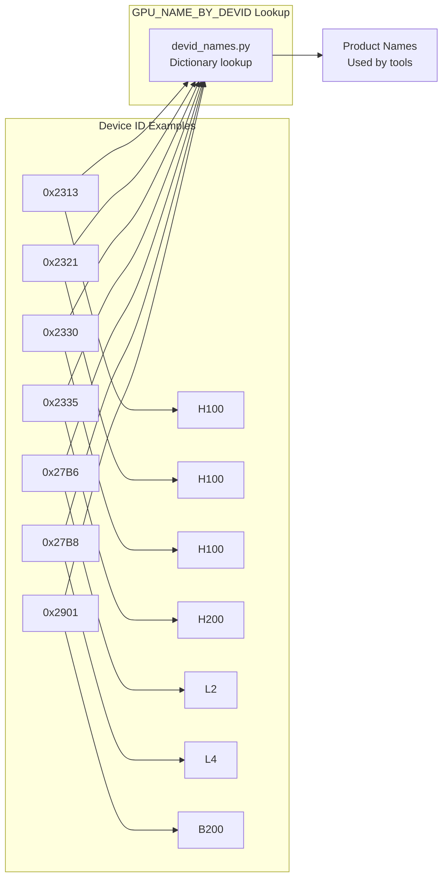
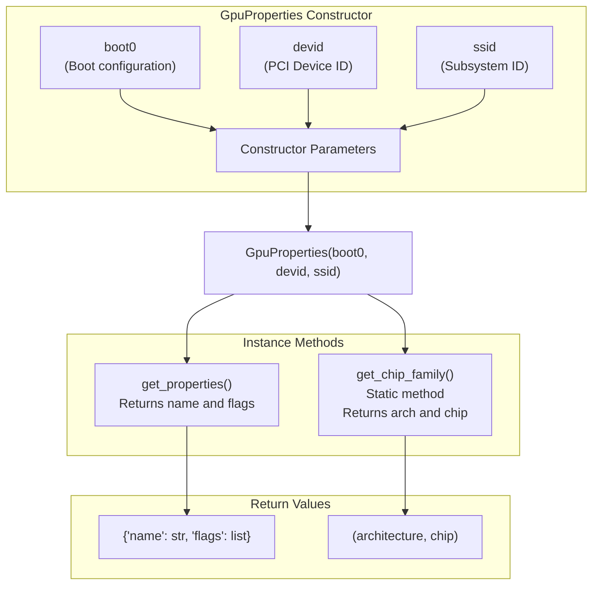
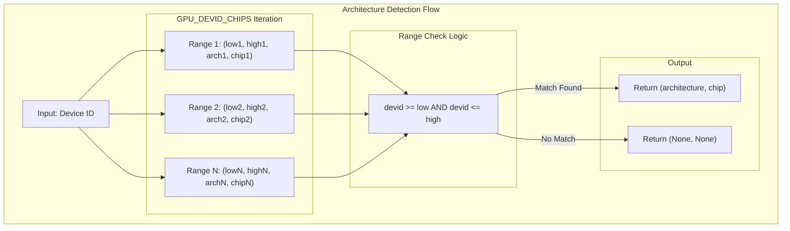
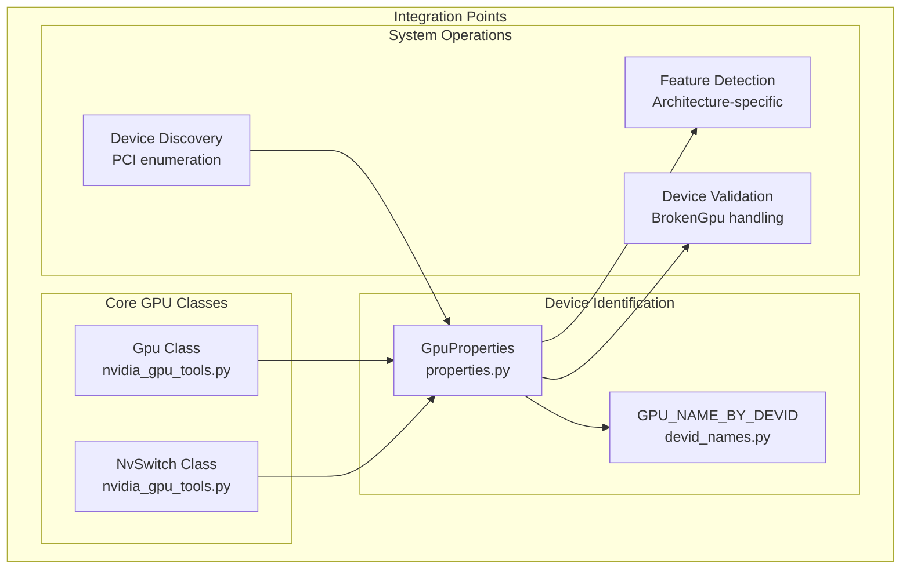

<!-- source: DeepWiki mcp.deepwiki.com · repo NVIDIA/gpu-admin-tools · page 5.1 Device Identification · fetched 2026-10-26 -->

# Device Identification

Relevant source files

The following files were used as context for generating this wiki page:

- [gpu/devid_names.py](gpu/devid_names.py)
- [gpu/properties.py](gpu/properties.py)

## Purpose and Scope

This document covers the device identification system that maps GPU device IDs to product names and basic categorization. The system provides the foundational layer for recognizing GPU hardware variants and determining their basic characteristics. For detailed device properties and form factor determination, see [Device Properties and Characteristics](#5.2). For error handling during device identification, see [Error Handling](#5.3).

## System Overview

The device identification system consists of three main components that work together to identify and categorize GPU hardware:

Sources: [gpu/properties.py:28-48](), [gpu/devid_names.py:24-69]()

## Device ID to Name Mapping

The primary device identification mechanism uses the `GPU_NAME_BY_DEVID` dictionary to map PCI device IDs to product names. This mapping covers the current generation of NVIDIA GPUs across different product lines.

### Supported GPU Families

| Device ID Range | Product Line | Examples |
|----------------|--------------|----------|
| 0x27xx | Ada Lovelace L-series | L2, L4, L20, L40 variants |
| 0x23xx | Hopper H-series | H100, H200, H800, H20 variants |
| 0x29xx | Blackwell B-series | B200, GB200 |

The mapping supports multiple device IDs per product name to accommodate different SKUs and configurations:

Sources: [gpu/devid_names.py:24-69]()

## GPU Properties Class

The `GpuProperties` class provides the interface for device identification and property retrieval. It accepts three key identifiers and provides methods to extract device information.

### Class Interface

Sources: [gpu/properties.py:28-48]()

### Property Resolution Process

The `get_properties()` method combines device ID and subsystem ID to determine both the product name and specific configuration flags:

1. **Name Resolution**: Uses `devid` to lookup product name in `GPU_NAME_BY_DEVID`
2. **Flag Resolution**: Uses `(devid, ssid)` tuple to lookup configuration flags in `GPU_PROPS_BY_DEVID`
3. **Return Structure**: Provides unified dictionary with both name and flags

Sources: [gpu/properties.py:34-40]()

## Architecture and Chip Family Detection

The system provides architecture-level identification through the static `get_chip_family()` method, which determines the GPU architecture and chip family from device ID ranges.

### Range-Based Detection

The method iterates through `GPU_DEVID_CHIPS` data structure containing tuples of:
- `devid_low`: Lower bound of device ID range
- `devid_high`: Upper bound of device ID range  
- `arch`: Architecture name (e.g., "Hopper", "Ada", "Blackwell")
- `chip`: Chip family designation

Sources: [gpu/properties.py:42-47]()

## Integration with Core System

The device identification system integrates with the broader GPU management architecture through the properties interface, providing the foundation for device-specific behavior and capability determination.

Sources: [gpu/properties.py:24-26](), [gpu/devid_names.py:24]()

The identification system serves as the entry point for all device-specific operations, ensuring that the correct drivers, features, and limitations are applied based on the detected hardware configuration.

---

