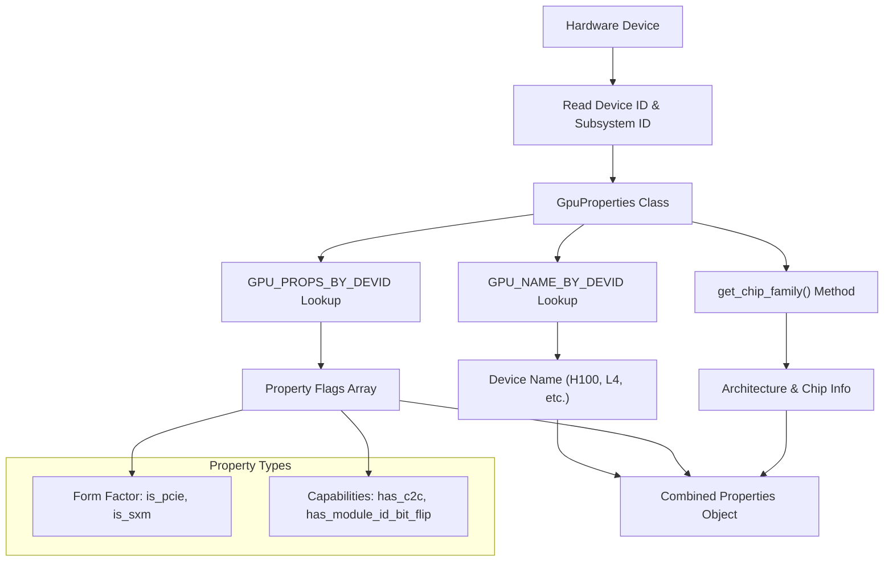
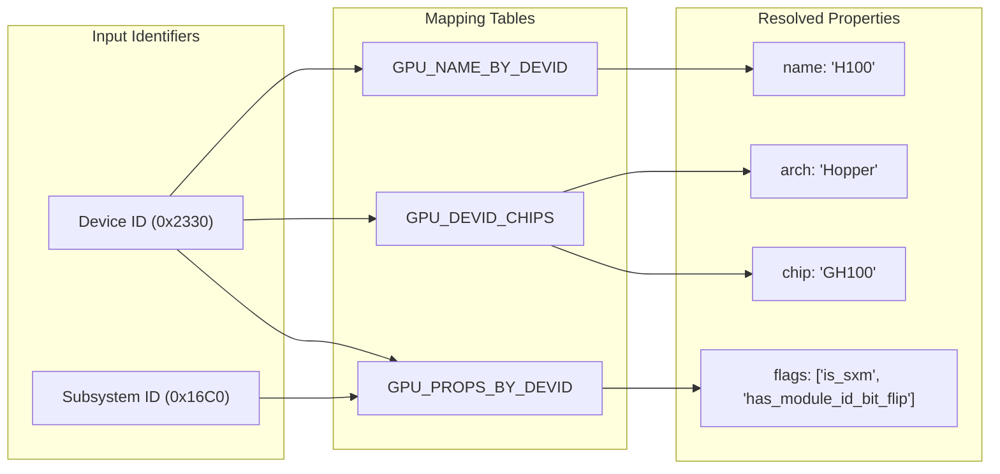

<!-- source: DeepWiki mcp.deepwiki.com · repo NVIDIA/gpu-admin-tools · page 5.2 Device Properties and Characteristics · fetched 2026-10-26 -->

# Device Properties and Characteristics

<details>
<summary>Relevant source files</summary>

The following files were used as context for generating this wiki page:

- [gpu/devid_names.py](gpu/devid_names.py)
- [gpu/devid_properties.py](gpu/devid_properties.py)
- [gpu/properties.py](gpu/properties.py)

</details>


This document explains how the GPU administration tools determine device properties and characteristics from hardware device identifiers. The system uses device ID (DEVID) and subsystem ID (SSID) combinations to identify form factors, capabilities, and hardware features of GPU devices.

For information about device identification and naming, see [Device Identification](#5.1). For error handling related to device properties, see [Error Handling](#5.3).

## Property Determination System

The device property system operates by matching device and subsystem ID pairs against known configurations to determine hardware characteristics. This enables the tools to adapt behavior based on the specific GPU variant and form factor.



Sources: [gpu/properties.py:28-48](), [gpu/devid_names.py:24-69](), [gpu/devid_properties.py:24-85]()

## Device Property Mapping System

The property system uses three main data structures to map device identifiers to characteristics:

| Data Structure | Purpose | Key Format | Value Format |
|----------------|---------|-------------|--------------|
| `GPU_NAME_BY_DEVID` | Device naming | Device ID (int) | Product name (string) |
| `GPU_PROPS_BY_DEVID` | Property flags | (Device ID, Subsystem ID) tuple | Property flags (list) |
| `GPU_DEVID_CHIPS` | Architecture mapping | Range specification | Architecture and chip info |



Sources: [gpu/devid_names.py:24-69](), [gpu/devid_properties.py:24-85](), [gpu/properties.py:34-46]()

## Form Factor Detection

The system distinguishes between different GPU form factors using specific property flags:

### PCIe Form Factor
Devices with the `is_pcie` flag represent standard PCIe add-in cards suitable for general-purpose systems.

**Example PCIe Devices:**
- H100 PCIe: `(0x2321, 0x1839): ['is_pcie']`
- H800 PCIe: `(0x2322, 0x17A4): ['is_pcie']`
- H200 PCIe: `(0x233B, 0x1996): ['is_pcie']`

### SXM Form Factor  
Devices with the `is_sxm` flag represent SXM (Server eXtension Module) form factors designed for high-performance computing systems.

**Example SXM Devices:**
- H100 SXM: `(0x2330, 0x16C0): ['is_sxm', 'has_module_id_bit_flip']`
- H200 SXM: `(0x2335, 0x18BE): ['is_sxm', 'has_module_id_bit_flip']`

Sources: [gpu/devid_properties.py:25-85]()

## Capability Flags

The property system defines several capability flags that indicate hardware features:

### Chip-to-Chip Communication (`has_c2c`)
Indicates devices that support chip-to-chip interconnect capabilities, typically found in multi-GPU configurations:
- GH200 devices: `(0x2342, 0x16EB): ['has_c2c', 'is_sxm']`
- GB200 devices: `(0x2941, 0x2045): ['has_c2c', 'is_sxm']`

### Module ID Bit Flip (`has_module_id_bit_flip`)
Indicates devices that have a specific hardware characteristic affecting module identification:
- Most SXM H100 variants include this flag
- H20 SXM devices: `(0x2328, 0x1905): ['is_sxm', 'has_module_id_bit_flip']`

Sources: [gpu/devid_properties.py:32-84]()

## GpuProperties Class Implementation

The `GpuProperties` class provides the interface for retrieving device properties:

```mermaid
classDiagram
    class GpuProperties {
        +boot0: int
        +devid: int  
        +ssid: int
        +__init__(boot0, devid, ssid)
        +get_properties() dict
        +get_chip_family(devid) tuple~static~
    }
    
    class "GPU_NAME_BY_DEVID" {
        <<dictionary>>
        +0x2313: "H100"
        +0x2330: "H100" 
        +0x2335: "H200"
        +0x2901: "B200"
    }
    
    class "GPU_PROPS_BY_DEVID" {
        <<dictionary>>
        +(0x2330, 0x16C0): ["is_sxm", "has_module_id_bit_flip"]
        +(0x2321, 0x1839): ["is_pcie"]
        +(0x2342, 0x16EB): ["has_c2c", "is_sxm"]
    }
    
    GpuProperties --> "GPU_NAME_BY_DEVID" : uses for naming
    GpuProperties --> "GPU_PROPS_BY_DEVID" : uses for properties
```

### Key Methods

**`get_properties()`** - Returns a dictionary containing:
- `name`: Product name from `GPU_NAME_BY_DEVID`
- `flags`: Property list from `GPU_PROPS_BY_DEVID`

**`get_chip_family(devid)`** - Static method that determines architecture and chip family from device ID ranges.

Sources: [gpu/properties.py:28-47]()

## Property Resolution Process

The property resolution follows this sequence:

1. **Extract Identifiers**: Device ID and Subsystem ID are read from hardware
2. **Name Resolution**: Device ID is looked up in `GPU_NAME_BY_DEVID` for product name
3. **Property Resolution**: (Device ID, Subsystem ID) tuple is looked up in `GPU_PROPS_BY_DEVID` for capability flags
4. **Architecture Resolution**: Device ID range is matched in `GPU_DEVID_CHIPS` for architecture information
5. **Combine Results**: All resolved properties are combined into a unified properties object

This system enables the GPU administration tools to automatically adapt their behavior based on the specific hardware variant detected, ensuring appropriate handling of form factor differences and hardware capabilities.

Sources: [gpu/properties.py:34-40](), [gpu/devid_names.py:24-69](), [gpu/devid_properties.py:24-85]()

---

