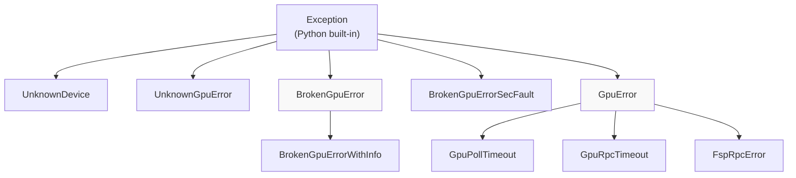
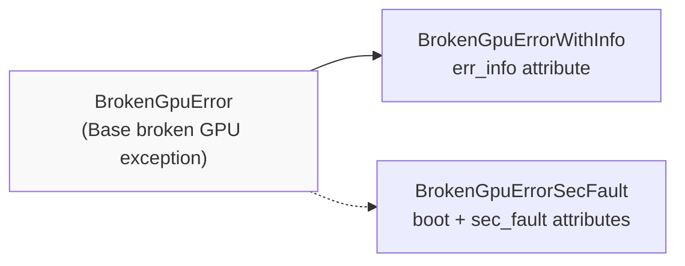
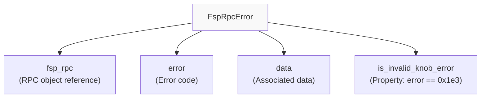
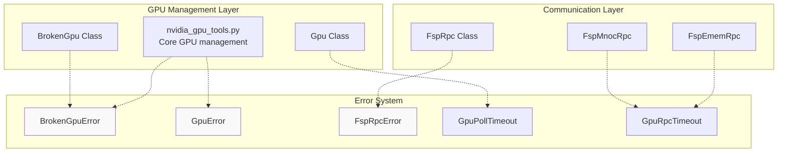

<!-- source: DeepWiki mcp.deepwiki.com · repo NVIDIA/gpu-admin-tools · page 5.3 Error Handling · fetched 2026-10-26 -->

# Error Handling

Relevant source files

The following files were used as context for generating this wiki page:

- [gpu/error.py](gpu/error.py)

## Purpose and Scope

The error handling system provides a comprehensive hierarchy of exceptions for GPU-related operations and fault management within the nvidia-gpu-admin-tools. This system defines specific exception types for different failure modes including device identification failures, GPU hardware faults, communication timeouts, and RPC protocol errors.

For information about device identification and properties that may trigger these errors, see [Device Identification](#5.1) and [Device Properties and Characteristics](#5.2). For details about the RPC communication systems that use these errors, see [Communication Systems](#4).

## Exception Hierarchy

The error handling system is organized into a hierarchical structure of exception classes, each designed to handle specific failure scenarios in GPU management operations.

**Exception Hierarchy Overview**

*Sources: [gpu/error.py:24-61]()*

## Device-Level Errors

### UnknownDevice Exception

The `UnknownDevice` exception is raised when the system encounters a device that cannot be identified or is not supported by the current device mapping tables.

### UnknownGpuError Exception  

The `UnknownGpuError` exception handles cases where GPU-specific operations fail due to unrecognized GPU configurations or unsupported GPU variants.

*Sources: [gpu/error.py:24-28]()*

## Broken GPU Error Categories

### BrokenGpuError

The base `BrokenGpuError` exception represents hardware faults or initialization failures that render a GPU unusable for normal operations.

### BrokenGpuErrorWithInfo

`BrokenGpuErrorWithInfo` extends `BrokenGpuError` to include additional diagnostic information about the failure condition. The constructor accepts an `err_info` parameter that contains structured error details.

### BrokenGpuErrorSecFault

`BrokenGpuErrorSecFault` handles security-related hardware faults during GPU initialization. It captures both boot status and security fault information through its `boot` and `sec_fault` attributes.

**Broken GPU Error Specialization**

*Sources: [gpu/error.py:30-41]()*

## General GPU Operation Errors

### GpuError

The `GpuError` base class serves as the parent for all general GPU operation failures that are not related to hardware faults or device identification issues.

### GpuPollTimeout

`GpuPollTimeout` indicates that a polling operation on GPU registers or status has exceeded its timeout threshold without receiving the expected response.

### GpuRpcTimeout  

`GpuRpcTimeout` represents timeout failures in RPC communication between the host and GPU firmware components.

*Sources: [gpu/error.py:42-49]()*

## FSP RPC Error Handling

### FspRpcError Class

The `FspRpcError` class provides detailed error reporting for Firmware Service Processor RPC operations. It captures the complete context of RPC failures including the RPC object, error code, and associated data.

**FspRpcError Structure and Properties**

#### Constructor Parameters

The `FspRpcError` constructor accepts three parameters:
- `fsp_rpc`: Reference to the FSP RPC object that generated the error
- `fsp_error`: Numeric error code returned by the FSP
- `data`: List of data values associated with the error condition

#### Error Message Format

The exception automatically generates a formatted error message that includes the RPC object identifier, hexadecimal error code, and hexadecimal representation of all data values.

#### Invalid Knob Error Detection

The `is_invalid_knob_error` property provides a convenient way to detect invalid knob operations by checking if the error code equals `0x1e3`. This allows calling code to handle invalid knob errors specifically without hardcoding the error value.

*Sources: [gpu/error.py:51-61]()*

## Integration with GPU Management System

**Error Handling Integration Points**

The error handling system integrates with the broader GPU management architecture by providing specific exception types that correspond to different failure modes in device management, communication, and hardware operation.

*Sources: [gpu/error.py:24-61]()*

---

