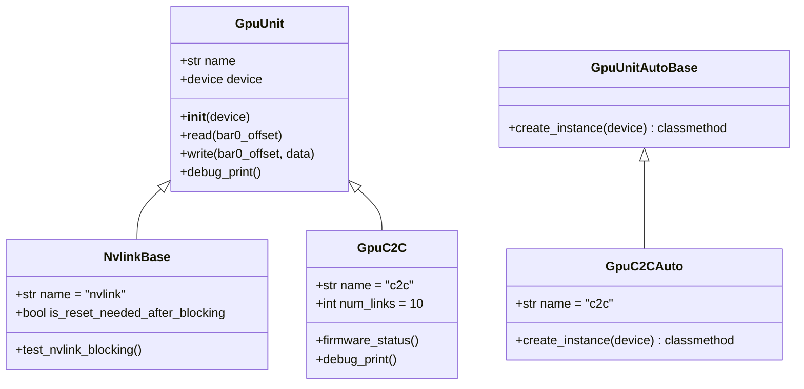
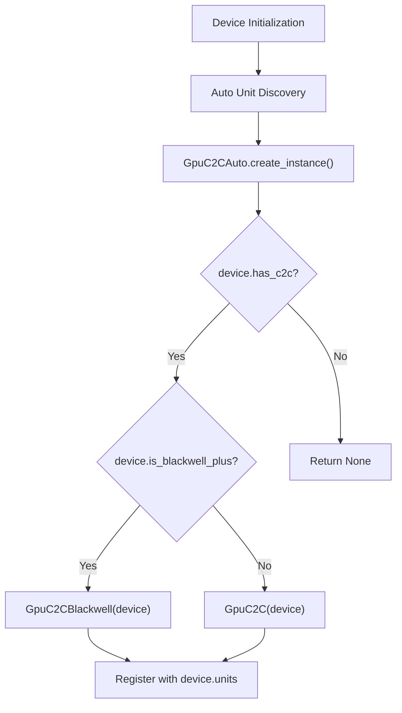
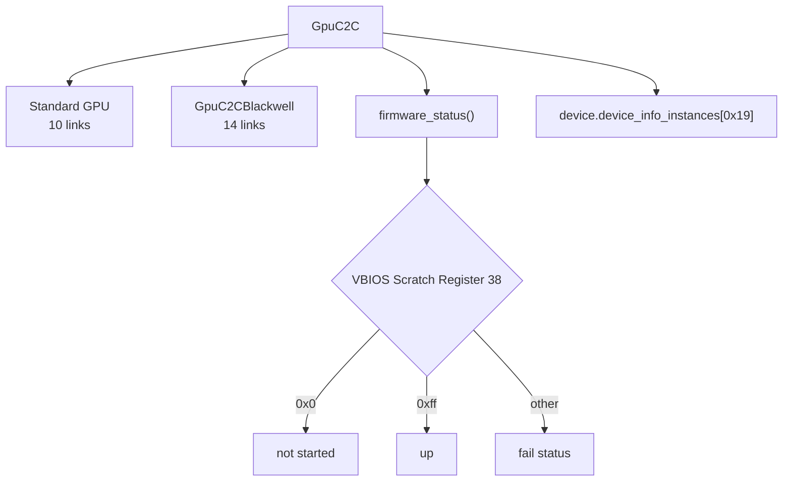
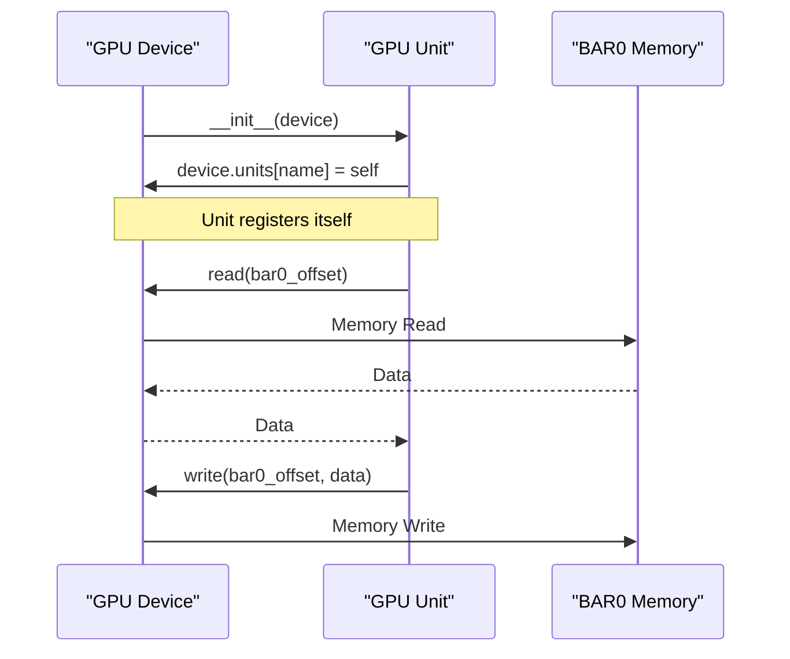
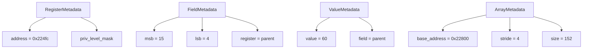

<!-- source: DeepWiki mcp.deepwiki.com · repo NVIDIA/gpu-admin-tools · page 6 GPU Units and Subsystems · fetched 2026-10-26 -->

# GPU Units and Subsystems

Relevant source files

The following files were used as context for generating this wiki page:

- [gpu/regs/gb202/top_int.py](gpu/regs/gb202/top_int.py)
- [gpu/unit.py](gpu/unit.py)
- [gpu/units/c2c.py](gpu/units/c2c.py)
- [gpu/units/nvlink.py](gpu/units/nvlink.py)
- [utils/nice_struct.py](utils/nice_struct.py)

This document provides an overview of the modular GPU unit system that enables hardware abstraction and management of GPU subsystems. The unit framework provides a standardized interface for accessing and controlling various GPU components such as NVLink interconnects, chip-to-chip communication, and other hardware units.

For information about the core GPU management classes that coordinate these units, see [Core Architecture](#2). For details about register-level control and bitfield manipulation used by units, see [Configuration and Control](#7).

## Unit Framework Architecture

The GPU unit system is built around a hierarchical class structure that provides both manual instantiation and automatic discovery mechanisms. The base `GpuUnit` class establishes the fundamental interface for all GPU subsystems.

### Base Unit Classes

The `GpuUnit` base class provides the fundamental interface for all GPU subsystems through direct BAR0 memory access. Each unit registers itself with its parent device and provides a standardized `debug_print()` method for diagnostics.

Sources: [gpu/unit.py:24-42]()

### Auto-Discovery Mechanism

The `GpuUnitAutoBase` class enables automatic unit discovery and instantiation based on device capabilities. Auto units implement a `create_instance()` class method that evaluates device properties and returns appropriate unit instances.

Sources: [gpu/units/c2c.py:54-68](), [gpu/unit.py:44-50]()

## Key Subsystem Implementations

### NVLink Management System

The NVLink subsystem provides high-speed GPU interconnect management across different architectures. The `NvlinkBase` class implements blocking, unblocking, and status monitoring for NVLink connections.

| Feature | Implementation | Purpose |
|---------|---------------|----------|
| Link Blocking | `block_nvlinks()` | Disable specific NVLink connections |
| Status Monitoring | `get_enabled_nvlinks()` | Query active link status |
| Reset Integration | `is_reset_needed_after_blocking` | Control reset behavior |
| FSP Interface | `NvlinkFspInterface` | Firmware communication for link control |

The NVLink system supports persistent and non-persistent blocking modes through FSP RPC communication.

Sources: [gpu/units/nvlink.py:28-75]()

### Chip-to-Chip Communication

The C2C subsystem manages multi-chip GPU configurations and provides firmware status monitoring. Architecture-specific implementations handle different link counts and capabilities.

The C2C firmware status is monitored through VBIOS scratch register 38, providing real-time status of the chip-to-chip communication subsystem.

Sources: [gpu/units/c2c.py:28-52]()

## Unit Registration and Memory Access

### Device Integration

All GPU units integrate with their parent device through a standardized registration mechanism and memory access interface.

Units access GPU registers through the device's BAR0 interface, providing abstracted access to hardware registers while maintaining the parent-child relationship.

Sources: [gpu/unit.py:27-35]()

### Data Structure Support

The unit system leverages structured data handling through the `NiceStruct` framework for complex register and configuration data management.

| Component | Purpose | Implementation |
|-----------|---------|----------------|
| `NiceStructMeta` | Metaclass for struct construction | Format string generation |
| `NiceStruct` | Base structured data class | Byte serialization/deserialization |
| `from_bytes()` | Data deserialization | Binary data parsing |
| `to_bytes()` | Data serialization | Binary data generation |
| Bitfield Support | Register field extraction | Automatic bit manipulation |

The structured data framework enables units to handle complex register layouts and configuration data with automatic serialization support.

Sources: [utils/nice_struct.py:27-205]()

## Register and Configuration Infrastructure

GPU units rely on extensive register definitions and metadata for hardware control. The register system provides privilege control, field definitions, and value mappings.

The register metadata system provides comprehensive definitions for GPU configuration registers, including privilege level controls and structured field access.

Sources: [gpu/regs/gb202/top_int.py:24-31](), [gpu/regs/gb202/top_int.py:587-644]()

---

