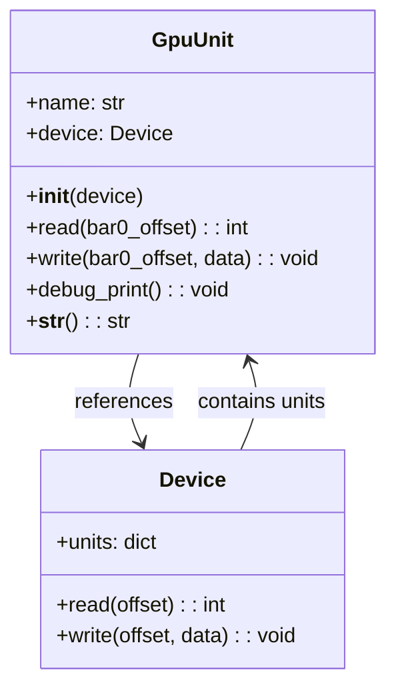
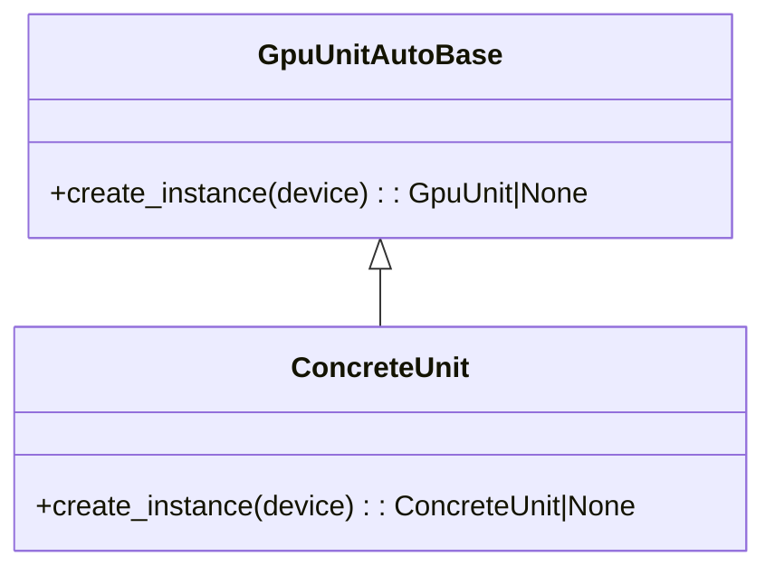
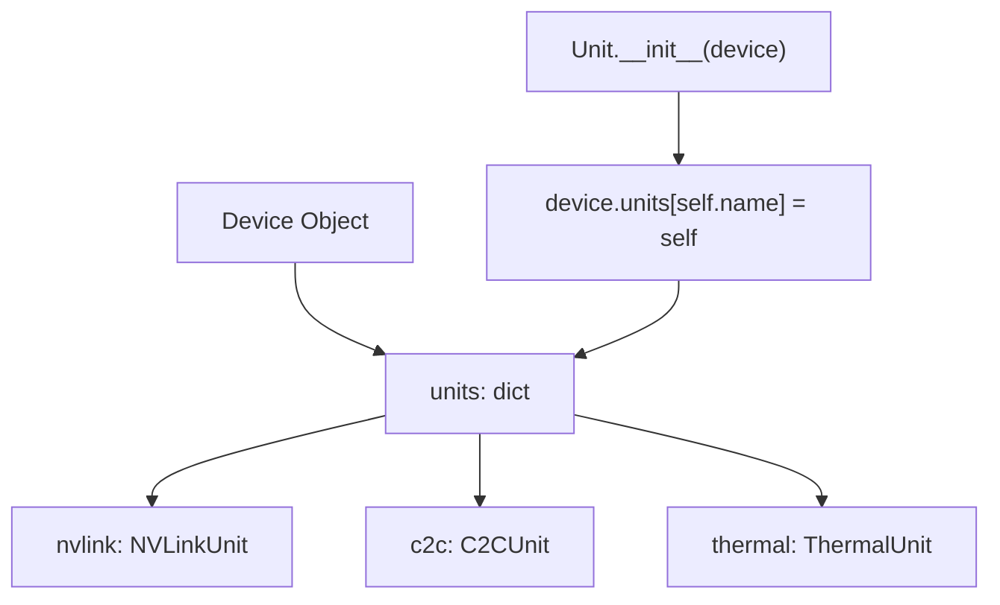
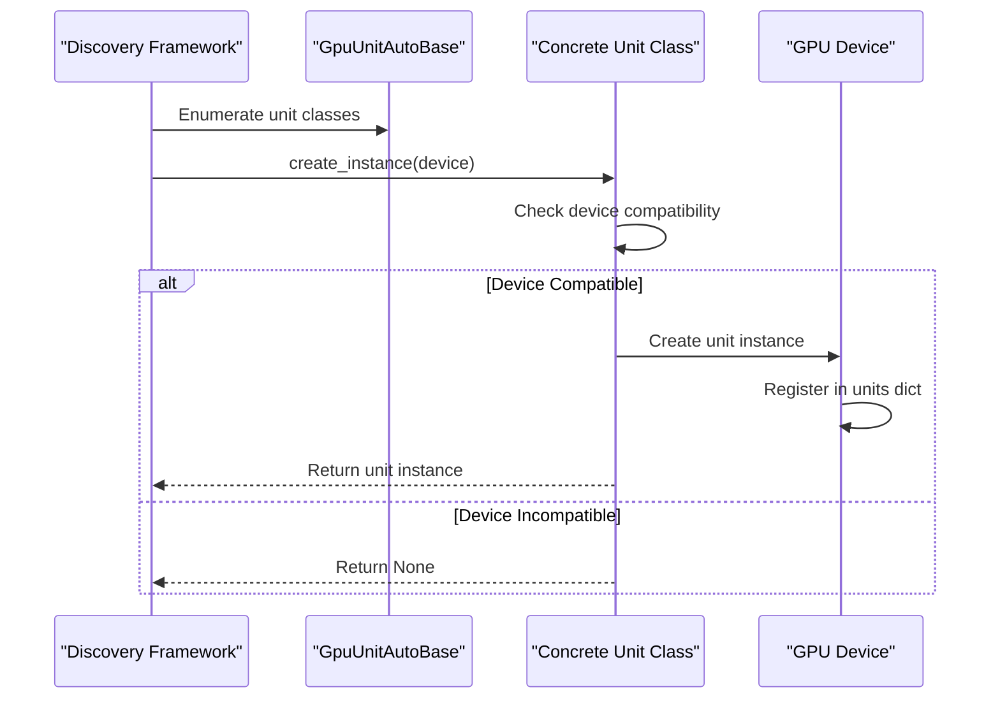
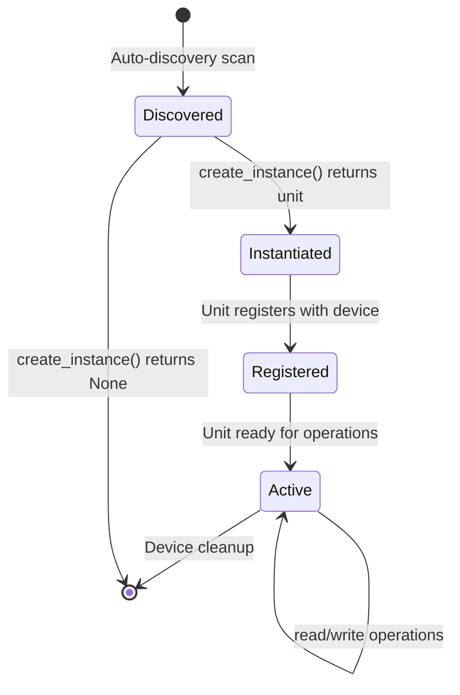
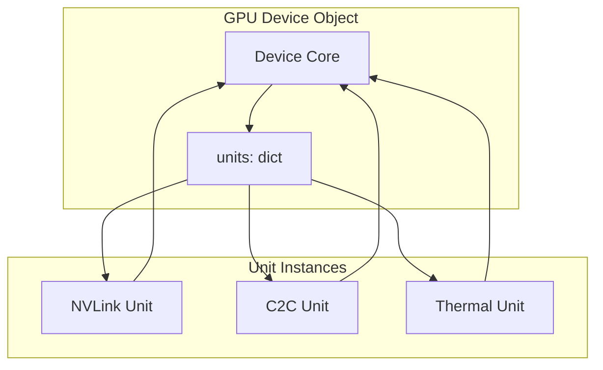
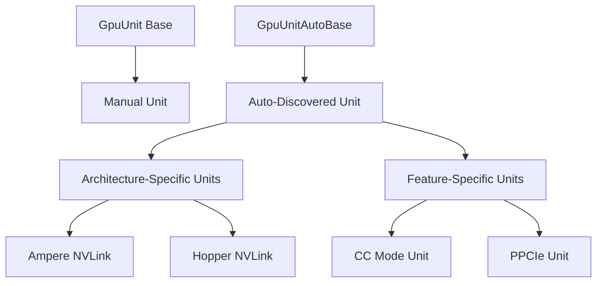

<!-- source: DeepWiki mcp.deepwiki.com · repo NVIDIA/gpu-admin-tools · page 6.1 Unit Framework · fetched 2026-10-26 -->

# Unit Framework

Relevant source files

The following files were used as context for generating this wiki page:

- [gpu/unit.py](gpu/unit.py)
- [utils/nice_struct.py](utils/nice_struct.py)

## Purpose and Scope

The Unit Framework provides a modular hardware abstraction system for GPU subsystems and components. It enables different GPU hardware units (such as NVLink controllers, C2C interfaces, and thermal management systems) to be implemented as separate, reusable modules that integrate seamlessly with GPU device objects. This framework supports both manual unit instantiation and automatic discovery of appropriate units based on device characteristics.

For information about specific unit implementations like NVLink management, see [NVLink Management](#6.2). For C2C subsystem details, see [Chip-to-Chip Communication](#6.3).

## Core Unit Classes

The framework consists of two primary base classes that provide the foundation for all GPU units:

### GpuUnit Base Class

The `GpuUnit` class provides the fundamental interface for GPU hardware units. Each unit maintains a reference to its parent device and registers itself in the device's unit registry upon instantiation.

**Unit Registration and BAR0 Access**

Units automatically register themselves with their parent device during initialization [gpu/unit.py:27-29](). The framework provides standardized BAR0 register access methods that delegate to the parent device [gpu/unit.py:31-35]().

### GpuUnitAutoBase Auto-Discovery Class

The `GpuUnitAutoBase` class enables automatic unit discovery and instantiation based on device characteristics. Concrete unit implementations inherit from this class and implement device-specific creation logic.

**Factory Pattern Implementation**

The `create_instance` class method serves as a factory function that returns an appropriate unit instance for the given device, or `None` if the unit is not applicable [gpu/unit.py:48-50]().

Sources: [gpu/unit.py:24-51]()

## Unit Discovery and Integration

### Device Unit Registry

Each GPU device maintains a units dictionary that serves as a registry for all active units. Units are indexed by their `name` attribute, providing fast lookup and preventing duplicate registrations.

**Automatic Registration Process**

When a unit is instantiated, it automatically adds itself to the device's unit registry using its `name` as the key [gpu/unit.py:29](). This ensures all units are discoverable through the parent device object.

### Auto-Discovery Mechanism

The auto-discovery system allows the framework to automatically instantiate appropriate units for specific device types without manual configuration.

**Discovery Implementation**

Unit classes implementing `GpuUnitAutoBase` are automatically discovered from the `gpu/units/` directory. The discovery mechanism iterates through available unit classes and calls their `create_instance` method to determine applicability [gpu/unit.py:45-50]().

Sources: [gpu/unit.py:44-50]()

## Hardware Abstraction Interface

### Register Access Pattern

The unit framework standardizes hardware register access through a consistent BAR0 interface. All units inherit read and write methods that delegate to the parent device's register access functions.

| Method | Purpose | Parameters | Return Type |
|--------|---------|------------|-------------|
| `read()` | Read BAR0 register | `bar0_offset: int` | `int` |
| `write()` | Write BAR0 register | `bar0_offset: int, data: int` | `void` |
| `debug_print()` | Debug output | None | `void` |

**Register Access Delegation**

Units do not directly access hardware registers. Instead, they delegate all register operations to the parent device object, which handles the actual hardware interface [gpu/unit.py:31-35]().

### Unit Lifecycle Management

**Lifecycle Phases**

1. **Discovery**: Unit classes are found in the `gpu/units/` directory
2. **Compatibility Check**: `create_instance()` evaluates device compatibility  
3. **Instantiation**: Compatible units are created and initialized
4. **Registration**: Units register themselves in the device's unit registry
5. **Operation**: Units provide hardware abstraction services

Sources: [gpu/unit.py:27-29](), [gpu/unit.py:48-50]()

## Integration Patterns

### Device-Unit Relationship

The framework establishes a bidirectional relationship between devices and their units, enabling both unit-to-device communication and device-to-unit enumeration.

**Bidirectional Access**

- Units access device functionality through the `device` reference [gpu/unit.py:28]()
- Devices access units through the `units` dictionary registry [gpu/unit.py:29]()
- Register operations flow from units to device hardware interface [gpu/unit.py:31-35]()

### Extensibility Model

The framework supports easy extension through inheritance and the auto-discovery system. New GPU subsystems can be added by creating classes that inherit from either `GpuUnit` or `GpuUnitAutoBase`.

**Extension Guidelines**

- Inherit from `GpuUnit` for manually instantiated units
- Inherit from `GpuUnitAutoBase` for automatically discovered units  
- Implement `create_instance()` with device compatibility logic
- Set a unique `name` attribute for unit registry identification

Sources: [gpu/unit.py:24-26](), [gpu/unit.py:44-50]()

---

