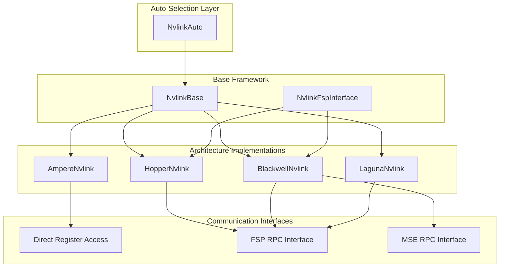
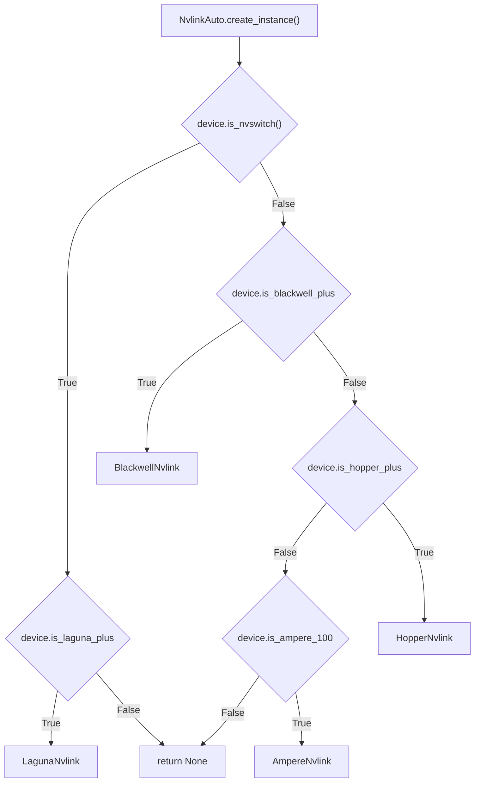
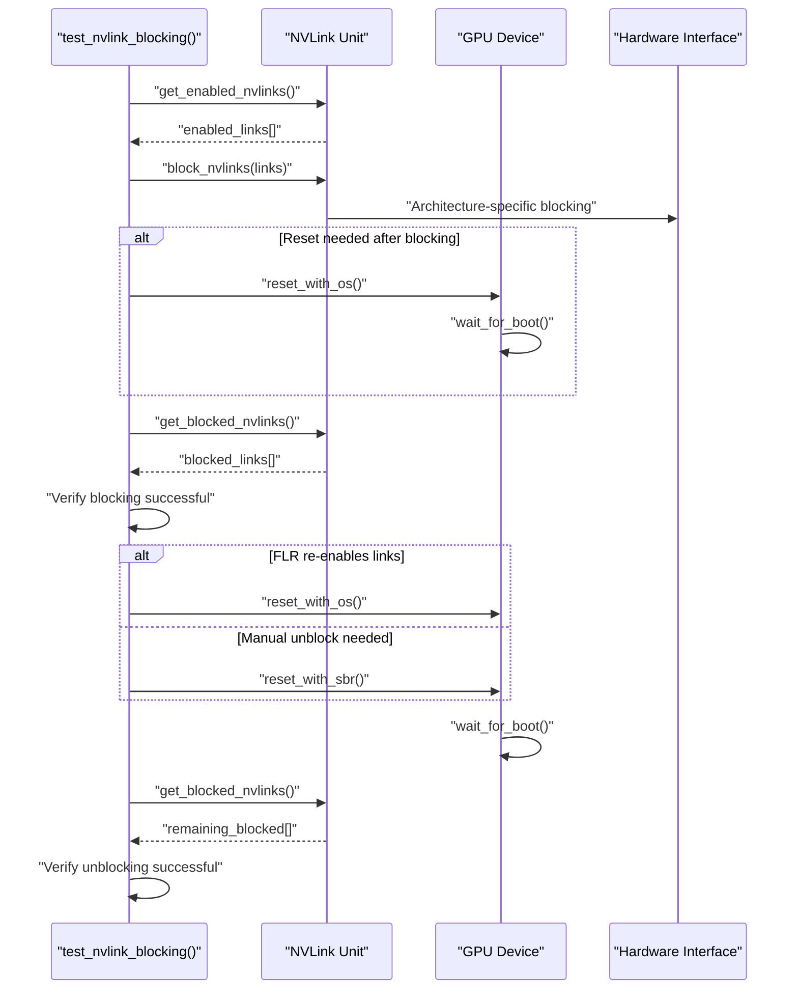

<!-- source: DeepWiki mcp.deepwiki.com · repo NVIDIA/gpu-admin-tools · page 6.2 NVLink Management · fetched 2026-10-26 -->

# NVLink Management

<details>
<summary>Relevant source files</summary>

The following files were used as context for generating this wiki page:

- [gpu/regs/gb202/top_int.py](gpu/regs/gb202/top_int.py)
- [gpu/units/nvlink.py](gpu/units/nvlink.py)
- [gpu/units/nvlink_ampere.py](gpu/units/nvlink_ampere.py)
- [gpu/units/nvlink_auto.py](gpu/units/nvlink_auto.py)
- [gpu/units/nvlink_blackwell.py](gpu/units/nvlink_blackwell.py)

</details>


This document covers the NVLink management subsystem, which provides architecture-specific implementations for controlling NVLink interconnects across different GPU generations. The system supports blocking/unblocking NVLinks, status monitoring, and testing functionality through both direct register access and FSP RPC interfaces.

For information about the broader GPU unit framework, see [Unit Framework](#6.1). For chip-to-chip communication beyond NVLink, see [Chip-to-Chip Communication](#6.3).

## Architecture Overview

The NVLink management system uses a modular architecture with automatic device-specific implementation selection. The system supports multiple GPU architectures (Ampere, Hopper, Blackwell) and NVSwitch devices, each with different register layouts, capabilities, and communication protocols.



Sources: [gpu/units/nvlink_auto.py:26-49](), [gpu/units/nvlink.py:28-75](), [gpu/units/nvlink_blackwell.py:28-48]()

## Base NVLink Framework

### NvlinkBase Class

The `NvlinkBase` class provides the core framework for NVLink management across all architectures. It defines the interface for blocking/unblocking operations and implements comprehensive testing functionality.

| Property | Description | Default Value |
|----------|-------------|---------------|
| `name` | Unit identifier | `"nvlink"` |
| `is_reset_needed_after_blocking` | Whether reset is required after blocking | `True` |
| `does_flr_reenable_links` | Whether FLR automatically re-enables links | Architecture-dependent |
| `num_nvlinks` | Number of NVLinks supported | Architecture-dependent |

Key methods include:

- `test_nvlink_blocking()` - Comprehensive test that blocks all enabled links, verifies blocking, then unblocks and verifies
- `block_nvlinks(nvlinks)` - Abstract method for blocking specified links
- `get_enabled_nvlinks()` - Returns list of available/enabled NVLink IDs
- `get_blocked_nvlinks()` - Returns list of currently blocked NVLink IDs

Sources: [gpu/units/nvlink.py:28-70]()

### NvlinkFspInterface Class

The `NvlinkFspInterface` provides FSP RPC-based NVLink control for newer architectures that support firmware-mediated NVLink management.

```python
def block_nvlinks(self, nvlinks):
    self.device._init_fsp_rpc()
    self.device.fsp_rpc.prc_block_nvlinks(nvlinks, persistent=False)
```

This interface delegates NVLink blocking operations to the FSP RPC system, which handles the low-level hardware control through firmware.

Sources: [gpu/units/nvlink.py:71-75]()

## Architecture-Specific Implementations

### Ampere NVLink Implementation

The `AmpereNvlink` class provides direct register-based control for Ampere GPUs with 12 NVLinks organized in groups of 4.

| Configuration | Value |
|---------------|-------|
| `num_nvlinks` | 12 |
| `_links_per_group` | 4 |
| `_base_offset` | `0xa00000` |
| `_per_group_offset` | `0x40000` |
| `does_flr_reenable_links` | `False` |
| `is_reset_needed_after_blocking` | `False` |

#### Register Layout

The implementation calculates NVLink register offsets using a hierarchical addressing scheme:

```python
def _nvlink_offset(self, link, reg=0):
    link_0_offset = 0x17000
    per_link_offset = 0x8000
    
    iob = link // self._links_per_group
    iolink = link % self._links_per_group
    link_offset = self._base_offset + self._per_group_offset * iob + link_0_offset + per_link_offset * iolink
    return link_offset + reg
```

#### Blocking Operations

NVLink blocking uses two registers per link:
- Offset `0x64c`: Block control register (set to `0x1` to block)
- Offset `0x650`: Lock register (set to `0x1` to lock the block state)

Sources: [gpu/units/nvlink_ampere.py:26-77]()

### Blackwell NVLink Implementation

The `BlackwellNvlink` class uses FSP RPC and MSE interfaces for NVLink control, with dynamic link discovery through device info tables.

| Configuration | Value |
|---------------|-------|
| `does_flr_reenable_links` | `True` |
| Link discovery | Dynamic via device info instances |

#### Dynamic Link Discovery

```python
def __init__(self, device):
    super().__init__(device)
    self.present_links = self.device.device_info_instances[self.device.regs.top_int.NV_PTOP_DEVICE_INFO2_DEV_TYPE_ENUM_V_EFTKKQKC.value]
    self.num_nvlinks = len(self.present_links)
```

#### Status Monitoring

Blackwell uses MSE RPC for link status monitoring:

```python
def get_blocked_nvlinks(self):
    self.device.init_mse()
    link_states = self.device.mse.portlist_status()
    blocked_links = []
    for link in range(self.num_nvlinks):
        if link_states[link] == "disabled":
            blocked_links.append(link)
    return blocked_links
```

Sources: [gpu/units/nvlink_blackwell.py:28-48]()

## Auto-Selection Mechanism

The `NvlinkAuto` class implements automatic architecture detection and appropriate implementation selection.



The selection logic prioritizes newer architectures and includes special handling for NVSwitch devices. Unsupported architectures return `None`, indicating no NVLink support.

Sources: [gpu/units/nvlink_auto.py:26-49]()

## NVLink Operations

### Blocking and Unblocking Flow

The NVLink blocking/unblocking process varies by architecture but follows a consistent high-level pattern:



### Architecture-Specific Differences

| Architecture | Blocking Method | Reset After Block | FLR Re-enables |
|--------------|----------------|-------------------|----------------|
| Ampere | Direct registers | No | No |
| Hopper | FSP RPC | Yes | Yes |
| Blackwell | FSP RPC + MSE | Yes | Yes |
| Laguna (NVSwitch) | FSP RPC | Yes | Implementation-dependent |

Sources: [gpu/units/nvlink.py:37-69](), [gpu/units/nvlink_ampere.py:33-34](), [gpu/units/nvlink_blackwell.py:29]()

## Integration with Device Management

NVLink units integrate with the broader device management system through the GPU unit framework. The unit is automatically instantiated and attached to compatible devices:

```python
def __init__(self, device):
    super().__init__(device)
    device.nvlink_unit = self
    device.is_nvlink_supported = True
```

This integration enables other parts of the system to check NVLink availability (`device.is_nvlink_supported`) and access NVLink operations through the device (`device.nvlink_unit`).

Sources: [gpu/units/nvlink.py:32-35]()

---

