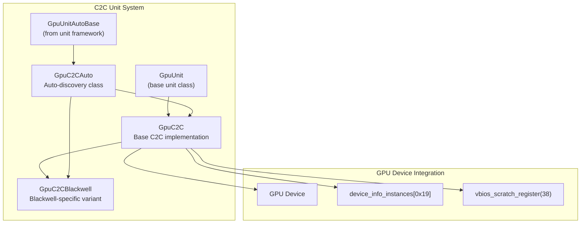
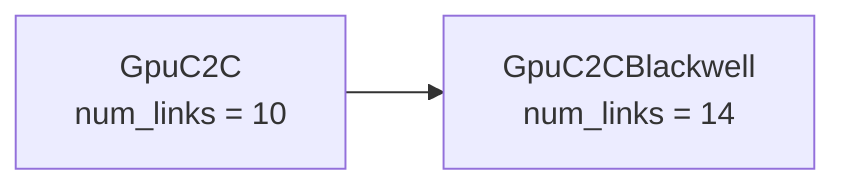
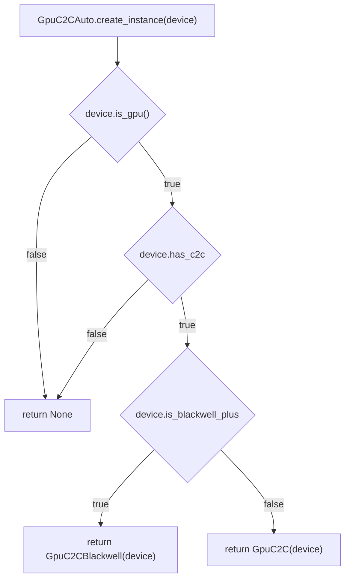
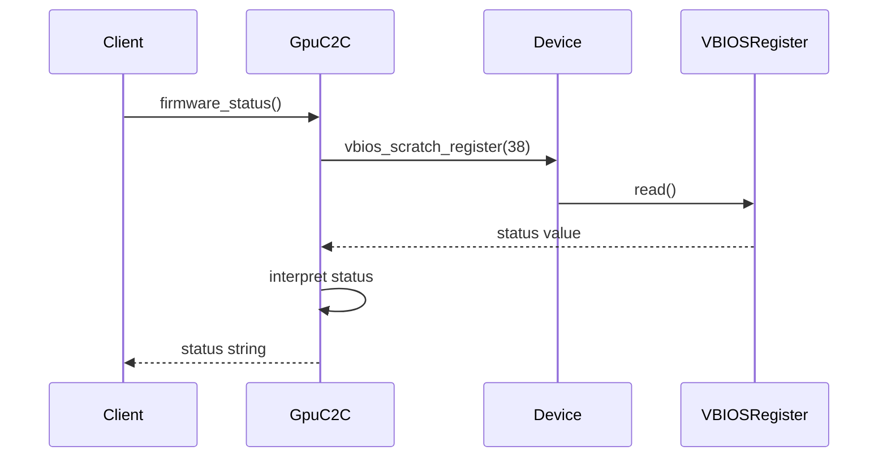

<!-- source: DeepWiki mcp.deepwiki.com · repo NVIDIA/gpu-admin-tools · page 6.3 Chip-to-Chip Communication · fetched 2026-10-26 -->

# Chip-to-Chip Communication

Relevant source files

The following files were used as context for generating this wiki page:

- [gpu/units/c2c.py](gpu/units/c2c.py)

## Purpose and Scope

This document covers the Chip-to-Chip (C2C) communication subsystem within the GPU units framework. The C2C system enables communication between multiple chips in multi-chip GPU configurations and provides firmware status monitoring capabilities. This system is implemented as part of the modular GPU unit architecture.

For information about the broader GPU unit framework, see [Unit Framework](#6.1). For NVLink management which handles inter-chip communication in other contexts, see [NVLink Management](#6.2).

## System Overview

The C2C subsystem provides hardware abstraction for chip-to-chip communication links in multi-chip GPU configurations. It monitors firmware status, tracks link counts, and handles architecture-specific variations through an auto-discovery mechanism.

**C2C System Architecture**

Sources: [gpu/units/c2c.py:24-69]()

## Class Hierarchy and Auto-Discovery

The C2C system implements a three-tier class hierarchy with automatic device detection and instantiation.

### Base C2C Implementation

The `GpuC2C` class provides the core C2C functionality:

| Property | Default Value | Description |
|----------|---------------|-------------|
| `name` | "c2c" | Unit identifier |
| `num_links` | 10 | Number of C2C links |
| `instances` | `device_info_instances[0x19]` | Device instance information |

The base implementation supports 10 C2C links and integrates with the GPU device through the `gpu.c2c` attribute assignment.

Sources: [gpu/units/c2c.py:28-49]()

### Architecture-Specific Variants

Architecture-specific classes override base parameters:

**C2C Architecture Variants**

The Blackwell architecture increases the link count to 14 links compared to the base 10 links.

Sources: [gpu/units/c2c.py:51-52]()

### Auto-Discovery Mechanism

The `GpuC2CAuto` class implements device-specific instantiation logic:

**C2C Auto-Discovery Flow**

The auto-discovery process validates device type and C2C capability before selecting the appropriate implementation class.

Sources: [gpu/units/c2c.py:54-68]()

## Firmware Status Monitoring

The C2C unit provides firmware status monitoring through VBIOS scratch register access.

### Status Values

The `firmware_status()` method reads from VBIOS scratch register 38 and interprets the values:

| Register Value | Status | Description |
|----------------|---------|-------------|
| `0x0` | "not started" | Firmware has not begun initialization |
| `0xff` | "up" | Firmware is running and operational |
| Other values | "fail {value:#x}" | Firmware initialization failed with error code |

### Status Implementation

**Firmware Status Query Sequence**

The firmware status check involves reading a specific VBIOS scratch register and interpreting the returned value according to predefined status codes.

Sources: [gpu/units/c2c.py:39-46]()

## Debug and Monitoring Interface

The C2C unit provides debug output through the `debug_print()` method, which logs comprehensive status information:

- Device identification
- Current firmware status
- Number of configured links
- Device instance information

This debug interface integrates with the Python logging system using the `info` level.

Sources: [gpu/units/c2c.py:48-49]()

## Integration with GPU Unit Framework

The C2C system integrates with the broader GPU unit framework through several mechanisms:

### Unit Registration

The C2C unit registers itself with the parent GPU device by setting the `gpu.c2c` attribute during initialization, enabling direct access to C2C functionality from the GPU object.

### Auto-Discovery Integration

The `GpuC2CAuto` class inherits from `GpuUnitAutoBase`, participating in the automatic unit discovery and instantiation process managed by the GPU unit framework.

### Memory Access

C2C operations utilize the `GpuUnit` base class's register read/write capabilities for accessing VBIOS scratch registers and device information.

Sources: [gpu/units/c2c.py:24-25, 34-37]()

---

