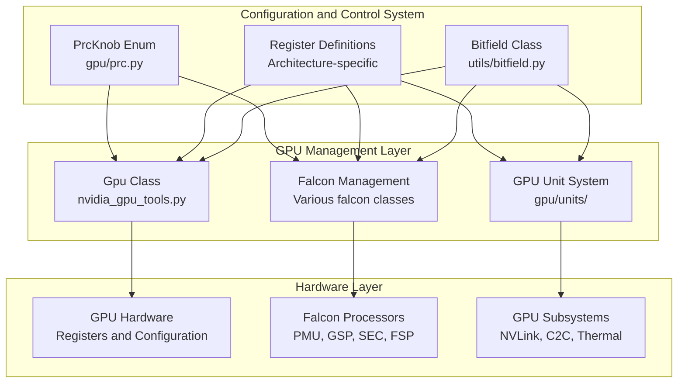
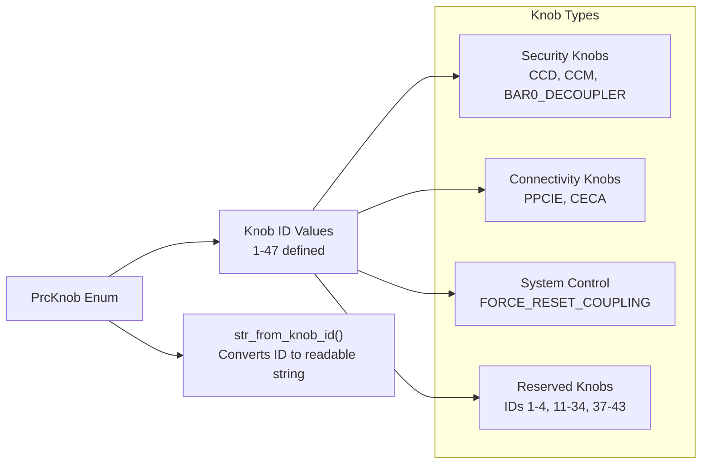
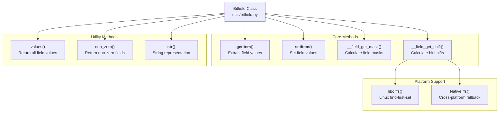
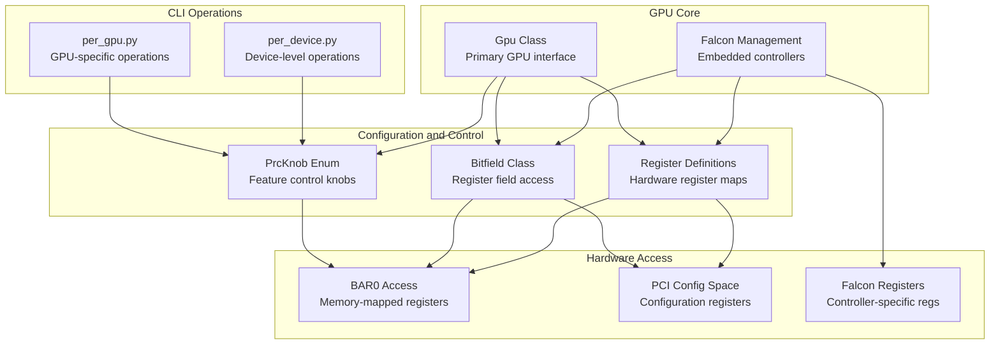

<!-- source: DeepWiki mcp.deepwiki.com · repo NVIDIA/gpu-admin-tools · page 7 Configuration and Control · fetched 2026-10-26 -->

# Configuration and Control

Relevant source files

The following files were used as context for generating this wiki page:

- [gpu/prc.py](gpu/prc.py)
- [utils/bitfield.py](utils/bitfield.py)

The Configuration and Control system provides low-level infrastructure for managing GPU hardware settings, register manipulation, and hardware feature control. This system encompasses PRC (Product Reconfiguration) knobs for runtime feature control, register definitions for hardware access, and bitfield utilities for structured data manipulation.

For device identification and properties, see [Device Management](#5). For GPU unit-specific configuration, see [GPU Units and Subsystems](#6). For system-level integration, see [System Integration](#8).

## System Overview

The Configuration and Control system forms the foundation for hardware-level GPU management, providing three core capabilities:

**Sources:** [gpu/prc.py:26-113](), [utils/bitfield.py:37-108]()

## PRC Knobs System

The PRC (Product Reconfiguration) knobs system provides runtime control over GPU hardware features through the `PrcKnob` enum. These knobs control critical security, connectivity, and operational modes.

### Core PRC Knob Categories

| Knob Category | Knob IDs | Purpose |
|---------------|----------|---------|
| **Confidential Computing** | `PRC_KNOB_ID_CCD_ALLOW_INB` (5) `PRC_KNOB_ID_CCD` (6) `PRC_KNOB_ID_CCM_ALLOW_INB` (7) `PRC_KNOB_ID_CCM` (8) | Enable/disable confidential computing modes |
| **BAR0 Security** | `PRC_KNOB_ID_BAR0_DECOUPLER_ALLOW_INB` (9) `PRC_KNOB_ID_BAR0_DECOUPLER` (10) | Control BAR0 access decoupling |
| **PCIe Configuration** | `PRC_KNOB_ID_PPCIE_ALLOW_INB` (44) `PRC_KNOB_ID_PPCIE` (45) | Control PCIe P2P modes |
| **Reset Control** | `PRC_KNOB_ID_FORCE_RESET_COUPLING_ALLOW_INB` (35) `PRC_KNOB_ID_FORCE_RESET_COUPLING` (36) | Manage reset coupling behavior |
| **Certificate Authority** | `PRC_KNOB_ID_CECA_ALLOW_INB` (46) `PRC_KNOB_ID_CECA` (47) | Control certificate authority features |

### PRC Knob Interface

The `PrcKnob` enum provides a standardized interface for knob identification and management:

The `str_from_knob_id()` method at [gpu/prc.py:114-123]() provides human-readable knob identification by combining enum names with numeric values in both decimal and hexadecimal formats.

**Sources:** [gpu/prc.py:26-47](), [gpu/prc.py:90-113](), [gpu/prc.py:114-123]()

## Bitfield Utilities

The `Bitfield` class provides structured access to hardware register bitfields, enabling safe manipulation of register contents through field-based operations rather than raw bit manipulation.

### Bitfield Class Architecture

### Field Definition System

Bitfield classes define their fields through a `fields` class attribute, supporting both single-bit and multi-bit field definitions:

- **Single-bit fields**: Defined as integer mask values
- **Multi-bit fields**: Defined as tuples `(high_bit, low_bit)` for bit ranges

The bitfield system automatically handles mask calculation and bit shifting through the internal methods at [utils/bitfield.py:47-63]().

### Platform Optimization

The bitfield system includes platform-specific optimizations for the find-first-set operation:

- **Linux**: Uses `libc.ffs()` for optimal performance [utils/bitfield.py:27-32]()
- **Other platforms**: Falls back to native Python implementation [utils/bitfield.py:34-35]()

**Sources:** [utils/bitfield.py:37-46](), [utils/bitfield.py:47-77](), [utils/bitfield.py:88-107](), [utils/bitfield.py:24-35]()

## Integration with GPU Management

The Configuration and Control system integrates with the broader GPU management infrastructure through multiple pathways:

The configuration system serves as the interface layer between high-level GPU management operations and low-level hardware access, providing:

- **Type-safe configuration**: PRC knobs ensure valid feature control operations
- **Structured register access**: Bitfield utilities prevent register corruption
- **Cross-architecture support**: Register definitions abstract hardware differences
- **Debugging support**: Comprehensive field inspection and string representation

**Sources:** [gpu/prc.py:114-123](), [utils/bitfield.py:79-107]()

---

