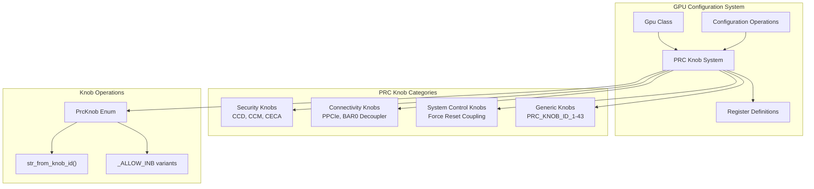
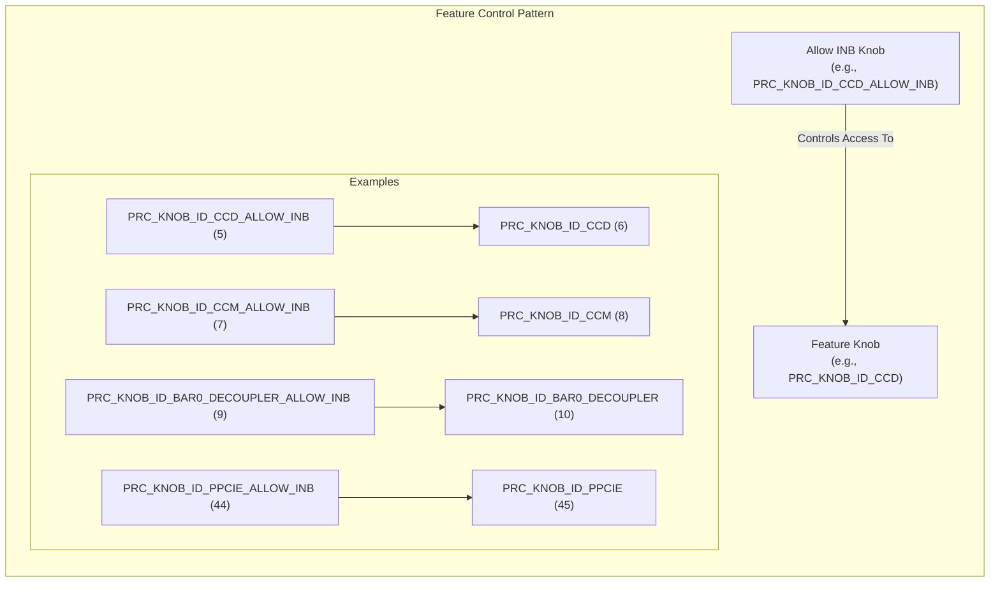

<!-- source: DeepWiki mcp.deepwiki.com · repo NVIDIA/gpu-admin-tools · page 7.1 PRC Knobs · fetched 2026-10-26 -->

# PRC Knobs

<details>
<summary>Relevant source files</summary>

The following files were used as context for generating this wiki page:

- [gpu/prc.py](gpu/prc.py)

</details>


This document covers the Product Reconfiguration (PRC) knob system that provides enumerated identifiers for controlling various GPU hardware features and security settings. PRC knobs enable runtime configuration of GPU behavior including Confidential Computing mode, PPCIe functionality, BAR0 decoupling, and reset coupling mechanisms.

For information about register definitions and hardware control interfaces, see [Register Definitions](#7.2). For broader GPU configuration management, see [Configuration and Control](#7).

## Overview

The PRC (Product Reconfiguration) knob system provides a standardized enumeration for identifying configurable GPU hardware features. These knobs represent individual configuration parameters that can be modified to control GPU behavior, security features, and operational modes.



Sources: [gpu/prc.py:1-124]()

## PRC Knob Enumeration

The `PrcKnob` enum class defines all available configuration knobs with their corresponding numeric identifiers. The enumeration provides both named knobs for specific features and generic numbered knobs for extensibility.

### Knob Structure

```mermaid
graph LR
    subgraph "PrcKnob Enum Structure"
        BaseEnum["PrcKnob(Enum)"]
        
        subgraph "Named Feature Knobs"
            CCD["PRC_KNOB_ID_CCD (6)"]
            CCDAllow["PRC_KNOB_ID_CCD_ALLOW_INB (5)"]
            CCM["PRC_KNOB_ID_CCM (8)"]
            CCMAllow["PRC_KNOB_ID_CCM_ALLOW_INB (7)"]
            BAR0["PRC_KNOB_ID_BAR0_DECOUPLER (10)"]
            BAR0Allow["PRC_KNOB_ID_BAR0_DECOUPLER_ALLOW_INB (9)"]
            PPCIe["PRC_KNOB_ID_PPCIE (45)"]
            PPCIeAllow["PRC_KNOB_ID_PPCIE_ALLOW_INB (44)"]
            CECA["PRC_KNOB_ID_CECA (47)"]
            CECAAllow["PRC_KNOB_ID_CECA_ALLOW_INB (46)"]
            ResetCoupling["PRC_KNOB_ID_FORCE_RESET_COUPLING (36)"]
            ResetCouplingAllow["PRC_KNOB_ID_FORCE_RESET_COUPLING_ALLOW_INB (35)"]
        end
        
        subgraph "Generic Knobs"
            Generic1["PRC_KNOB_ID_1 through PRC_KNOB_ID_43"]
        end
        
        subgraph "Utility Methods"
            StrFormatter["str_from_knob_id(knob_id)"]
        end
    end
    
    BaseEnum --> CCD
    BaseEnum --> CCM
    BaseEnum --> BAR0
    BaseEnum --> PPCIe
    BaseEnum --> CECA
    BaseEnum --> ResetCoupling
    BaseEnum --> Generic1
    BaseEnum --> StrFormatter
```



Sources: [gpu/prc.py:26-113]()

## Knob Categories

### Security and Confidential Computing Knobs

These knobs control security features and Confidential Computing functionality:

| Knob Name | ID | Purpose |
|-----------|----|---------| 
| `PRC_KNOB_ID_CCD_ALLOW_INB` | 5 | Controls CCD inbound access permissions |
| `PRC_KNOB_ID_CCD` | 6 | Confidential Computing Device mode control |
| `PRC_KNOB_ID_CCM_ALLOW_INB` | 7 | Controls CCM inbound access permissions |
| `PRC_KNOB_ID_CCM` | 8 | Confidential Computing Mode control |
| `PRC_KNOB_ID_CECA_ALLOW_INB` | 46 | Controls CECA inbound access permissions |
| `PRC_KNOB_ID_CECA` | 47 | Confidential Environment and Compute Attestation |

### Connectivity and Interface Knobs

These knobs manage GPU connectivity and interface behavior:

| Knob Name | ID | Purpose |
|-----------|----|---------| 
| `PRC_KNOB_ID_BAR0_DECOUPLER_ALLOW_INB` | 9 | Controls BAR0 decoupler inbound access |
| `PRC_KNOB_ID_BAR0_DECOUPLER` | 10 | BAR0 decoupling functionality control |
| `PRC_KNOB_ID_PPCIE_ALLOW_INB` | 44 | Controls PPCIe inbound access permissions |
| `PRC_KNOB_ID_PPCIE` | 45 | Private PCIe mode control |

### System Control Knobs

These knobs manage system-level GPU behavior:

| Knob Name | ID | Purpose |
|-----------|----|---------| 
| `PRC_KNOB_ID_FORCE_RESET_COUPLING_ALLOW_INB` | 35 | Controls reset coupling inbound access |
| `PRC_KNOB_ID_FORCE_RESET_COUPLING` | 36 | Forces reset coupling behavior |

Sources: [gpu/prc.py:35-113]()

## Allow INB Pattern

Many PRC knobs follow an "_ALLOW_INB" pattern where each feature knob has a corresponding permission knob that controls inbound access to that feature. This provides fine-grained access control over GPU configuration capabilities.



Sources: [gpu/prc.py:35-47](), [gpu/prc.py:90-92](), [gpu/prc.py:108-112]()

## Utility Functions

### Knob ID Formatting

The `str_from_knob_id` class method provides human-readable formatting for knob identifiers, combining the enum name (when available) with decimal and hexadecimal representations.

```python
# Example usage pattern:
knob_name = PrcKnob.str_from_knob_id(6)
# Returns: "PRC_KNOB_ID_CCD 6 (0x6)"

knob_name = PrcKnob.str_from_knob_id(999)  # Unknown knob
# Returns: "999 (0x3e7)"
```

The method handles both known enum values and unknown knob IDs gracefully, ensuring robust display formatting for debugging and logging purposes.

Sources: [gpu/prc.py:114-123]()

## Integration with GPU System

PRC knobs integrate with the broader GPU management system through the core GPU class and configuration operations. The enumeration provides a standardized interface for referencing specific hardware configuration parameters across different GPU architectures and firmware versions.

The knob system supports both runtime configuration changes and persistent settings that survive GPU resets, depending on the specific knob implementation and hardware capabilities.

Sources: [gpu/prc.py:1-124]()

---

