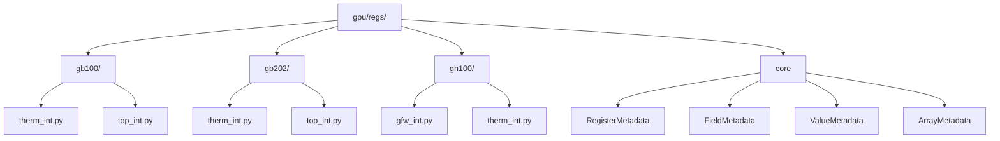
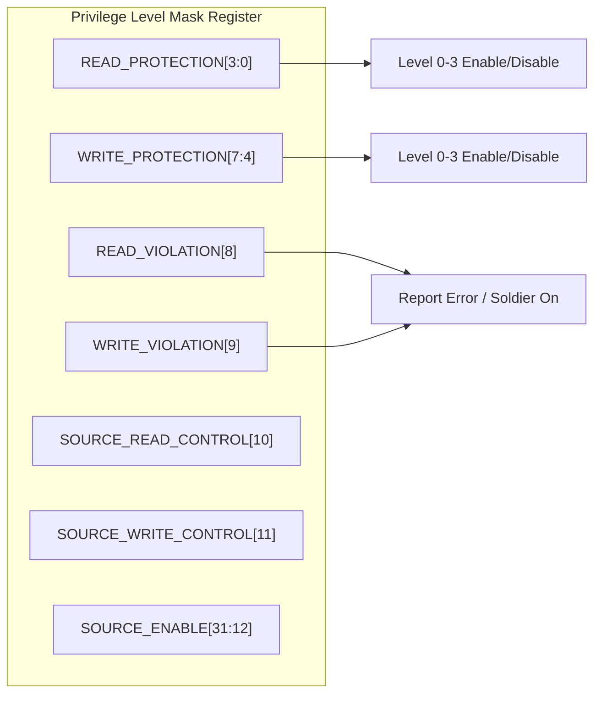
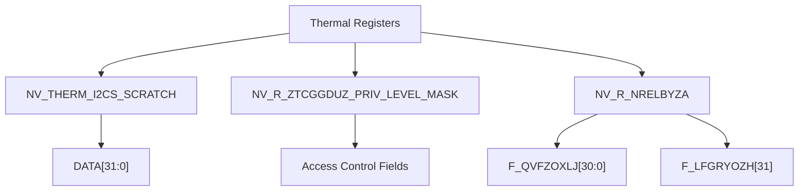
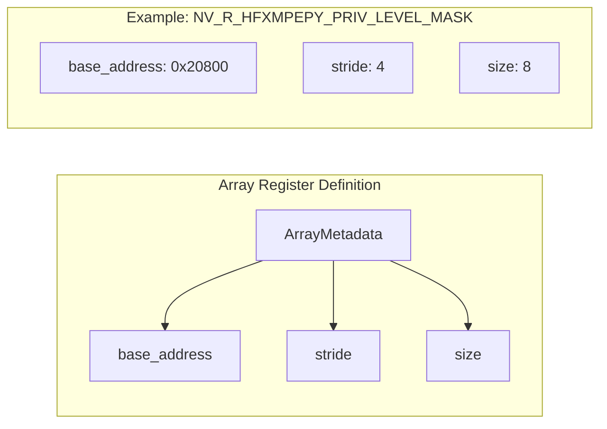
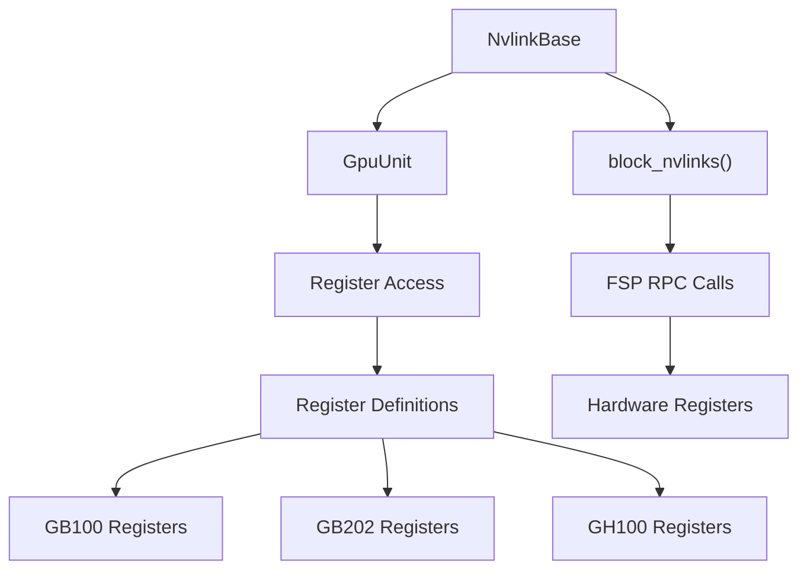

<!-- source: DeepWiki mcp.deepwiki.com · repo NVIDIA/gpu-admin-tools · page 7.2 Register Definitions · fetched 2026-10-26 -->

# Register Definitions

<details>
<summary>Relevant source files</summary>

The following files were used as context for generating this wiki page:

- [gpu/regs/gb100/therm_int.py](gpu/regs/gb100/therm_int.py)
- [gpu/regs/gb100/top_int.py](gpu/regs/gb100/top_int.py)
- [gpu/regs/gb202/therm_int.py](gpu/regs/gb202/therm_int.py)
- [gpu/regs/gb202/top_int.py](gpu/regs/gb202/top_int.py)
- [gpu/regs/gh100/gfw_int.py](gpu/regs/gh100/gfw_int.py)
- [gpu/regs/gh100/therm_int.py](gpu/regs/gh100/therm_int.py)
- [gpu/units/nvlink.py](gpu/units/nvlink.py)

</details>


## Purpose and Scope

This document covers the GPU register definition system used to describe hardware registers across different NVIDIA GPU architectures. The register definitions provide structured metadata for register addresses, field layouts, privilege controls, and valid values. This system enables programmatic access to GPU hardware registers for configuration, debugging, and security management.

For information about higher-level configuration through PRC knobs, see [PRC Knobs](#7.1). For utilities that manipulate register bitfields and data, see [Bitfield and Data Utilities](#7.3).

## Register Definition Framework

The register definition system is built around a metadata-driven approach using structured Python classes from `gpu.regs.core`. This framework provides type-safe definitions of hardware registers across multiple GPU architectures.

### Core Metadata Classes

```mermaid
classDiagram
    class RegisterMetadata {
        +string name
        +int address
        +RegisterMetadata priv_level_mask
    }
    
    class FieldMetadata {
        +string name
        +int msb
        +int lsb
        +RegisterMetadata register
    }
    
    class ValueMetadata {
        +string name
        +int value
        +FieldMetadata field
    }
    
    class ArrayMetadata {
        +string name
        +int base_address
        +int stride
        +int size
    }
    
    RegisterMetadata ||--o{ FieldMetadata : contains
    FieldMetadata ||--o{ ValueMetadata : has_values
    RegisterMetadata ||--|| RegisterMetadata : privilege_mask
```

**Sources:** [gpu/regs/gb100/therm_int.py:24](), [gpu/regs/gb202/therm_int.py:24](), [gpu/regs/gh100/therm_int.py:24]()

## Architecture Organization

The register definitions are organized by GPU architecture, with each architecture having its own subdirectory containing subsystem-specific register files.

### Architecture Directory Structure



**Sources:** [gpu/regs/gb100/therm_int.py:1](), [gpu/regs/gb202/therm_int.py:1](), [gpu/regs/gh100/therm_int.py:1](), [gpu/regs/gb100/top_int.py:1](), [gpu/regs/gb202/top_int.py:1](), [gpu/regs/gh100/gfw_int.py:1]()

## Register Categories

### Privilege Level Mask Registers

Privilege level mask registers control access permissions for other registers based on security privilege levels (0-3).

| Architecture | Register Name | Address | Purpose |
|--------------|---------------|---------|---------|
| GB100 | `NV_R_TZTTQTID_PRIV_LEVEL_MASK` | 0x2002c | Thermal register privilege control |
| GB100 | `NV_R_ZTCGGDUZ_PRIV_LEVEL_MASK` | 0x2038c | Thermal scratch privilege control |
| GB202 | `NV_R_TZTTQTID_PRIV_LEVEL_MASK` | 0xad002c | Thermal register privilege control |
| GB202 | `NV_R_ZTCGGDUZ_PRIV_LEVEL_MASK` | 0xad038c | Thermal scratch privilege control |

**Sources:** [gpu/regs/gb100/therm_int.py:27-30](), [gpu/regs/gb100/therm_int.py:302-305](), [gpu/regs/gb202/therm_int.py:27-30](), [gpu/regs/gb202/therm_int.py:302-305]()

### Privilege Control Fields

Each privilege level mask register contains standardized fields for access control:



**Sources:** [gpu/regs/gb100/therm_int.py:32-141](), [gpu/regs/gb202/therm_int.py:32-141]()

### Thermal Management Registers

Thermal management registers provide temperature monitoring and control functionality:



**Sources:** [gpu/regs/gb100/therm_int.py:582-637](), [gpu/regs/gb202/therm_int.py:582-637](), [gpu/regs/gh100/therm_int.py:81-97]()

### Device Information Registers

Device information registers contain hardware topology and configuration data:

| Register | Purpose | Architecture |
|----------|---------|--------------|
| `NV_PTOP_DEVICE_INFO_CFG` | Device table configuration | GB100, GB202 |
| `NV_PTOP_DEVICE_INFO2` | Device information array | GB100 |
| `NV_R_KMOWNCOL` | Device information array | GB202 |

**Sources:** [gpu/regs/gb100/top_int.py:587-643](), [gpu/regs/gb202/top_int.py:587-643](), [gpu/regs/gb100/top_int.py:689-1064](), [gpu/regs/gb202/top_int.py:689-1038]()

## Array Register Definitions

Many registers are defined as arrays to handle multiple instances of the same register type:



**Sources:** [gpu/regs/gb100/therm_int.py:639-644](), [gpu/regs/gb202/therm_int.py:639-644](), [gpu/regs/gh100/therm_int.py:100-105]()

## Architecture-Specific Address Mapping

Different GPU architectures use different base addresses for the same logical registers:

| Register | GB100 Address | GB202 Address | Address Offset |
|----------|---------------|---------------|----------------|
| `NV_R_TZTTQTID_PRIV_LEVEL_MASK` | 0x2002c | 0xad002c | +0xab0000 |
| `NV_R_ZTCGGDUZ_PRIV_LEVEL_MASK` | 0x2038c | 0xad038c | +0xab0000 |
| `NV_THERM_I2CS_SCRATCH` | 0x200bc | 0xad00bc | +0xab0000 |
| `NV_R_HFXMPEPY_PRIV_LEVEL_MASK` | 0x20800 | 0xad0800 | +0xab0000 |

**Sources:** [gpu/regs/gb100/therm_int.py:29](), [gpu/regs/gb202/therm_int.py:29](), [gpu/regs/gb100/therm_int.py:304](), [gpu/regs/gb202/therm_int.py:304]()

## Integration with GPU Units

The register definitions are used by GPU unit implementations for hardware access:



**Sources:** [gpu/units/nvlink.py:28-35](), [gpu/units/nvlink.py:71-74]()

## Register Definition Patterns

### Standard Register Definition Pattern

```python
# Register definition
REGISTER_NAME = RegisterMetadata(
    name='REGISTER_NAME',
    address=0x12345,
    priv_level_mask=PRIVILEGE_MASK_REGISTER  # Optional
)

# Field definition  
REGISTER_NAME_FIELD = FieldMetadata(
    name='REGISTER_NAME_FIELD',
    msb=31,
    lsb=0,
    register=REGISTER_NAME
)

# Value definition
REGISTER_NAME_FIELD_VALUE = ValueMetadata(
    name='REGISTER_NAME_FIELD_VALUE',
    value=1,
    field=REGISTER_NAME_FIELD
)
```

**Sources:** [gpu/regs/gb100/therm_int.py:27-61](), [gpu/regs/gb202/therm_int.py:27-61]()

### Privilege Protection Pattern

Most security-sensitive registers follow a common privilege protection pattern with read/write protection for four privilege levels (0-3) and violation handling controls.

**Sources:** [gpu/regs/gb100/therm_int.py:32-300](), [gpu/regs/gb202/therm_int.py:32-300](), [gpu/regs/gb100/top_int.py:32-305](), [gpu/regs/gb202/top_int.py:32-305]()

---

