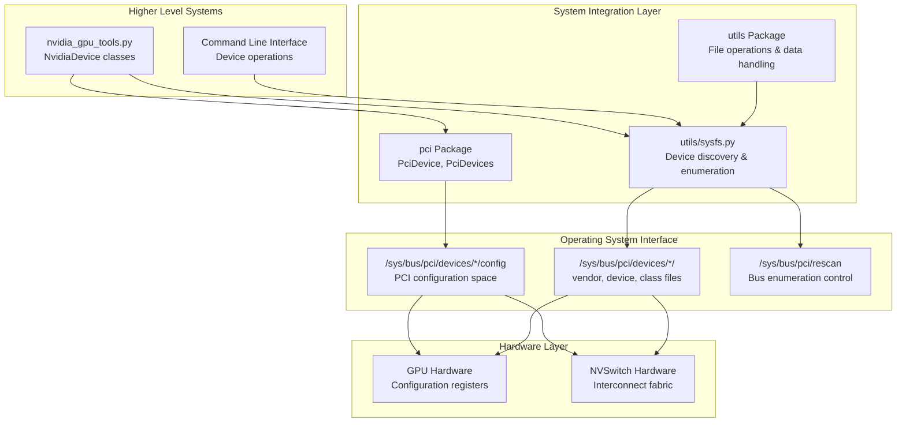
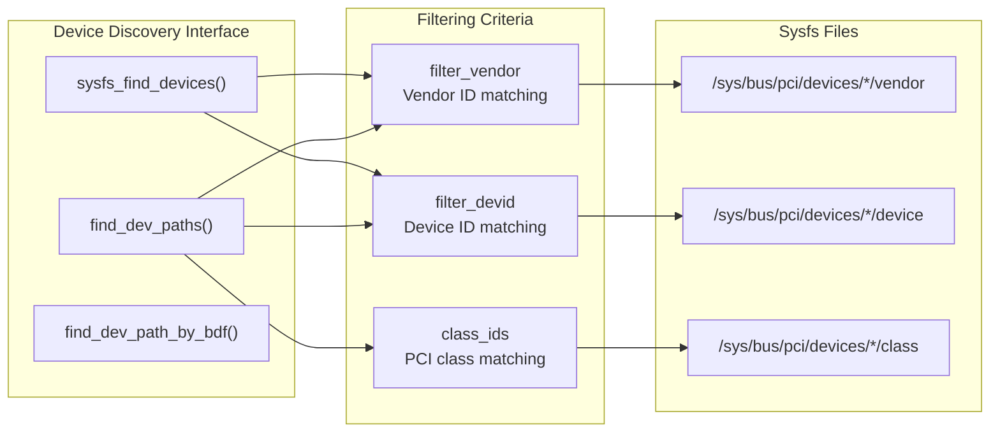
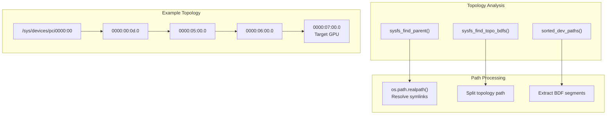
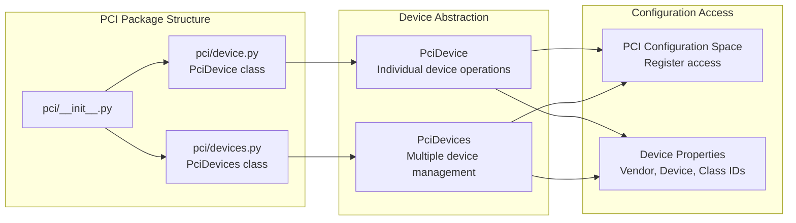
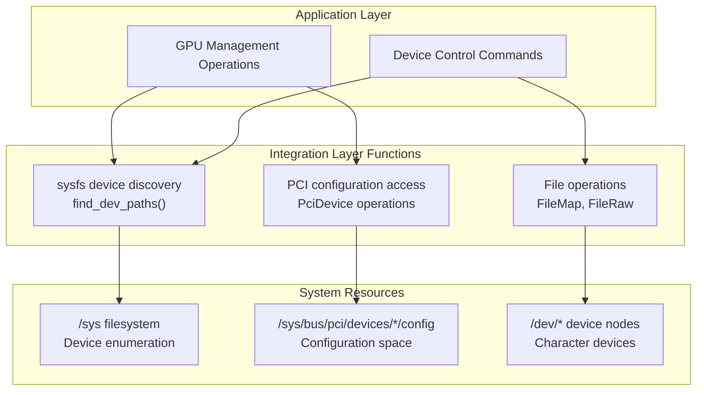

<!-- source: DeepWiki mcp.deepwiki.com · repo NVIDIA/gpu-admin-tools · page 8 System Integration · fetched 2026-10-26 -->

# System Integration

Relevant source files

The following files were used as context for generating this wiki page:

- [pci/__init__.py](pci/__init__.py)
- [utils/__init__.py](utils/__init__.py)
- [utils/sysfs.py](utils/sysfs.py)

## Purpose and Scope

This section covers the system-level integration layer that provides the foundation for all GPU management operations. The system integration layer handles direct interaction with the Linux kernel through PCI configuration space access and sysfs filesystem operations, enabling device discovery, enumeration, and low-level hardware manipulation.

This layer serves as the bridge between the high-level GPU management APIs (see [Core Architecture](#2)) and the underlying hardware and operating system interfaces. For information about higher-level device management operations, see [Device Management](#5).

## Integration Architecture

The system integration layer consists of three primary components that work together to provide comprehensive hardware and system access:

Sources: [utils/sysfs.py:1-128](), [pci/__init__.py:1-26](), [utils/__init__.py:1-31]()

## Sysfs Integration

The sysfs integration subsystem provides comprehensive device discovery and enumeration capabilities through the Linux sysfs filesystem. The `sysfs` module implements the core functionality for interacting with PCI devices via their sysfs representations.

### Device Discovery Functions

| Function | Purpose | Parameters | Return Value |
|----------|---------|------------|--------------|
| `sysfs_find_devices` | Legacy device discovery | `filter_vendor`, `filter_devid` | List of device paths |
| `find_dev_paths` | Comprehensive device filtering | `vendor_ids`, `device_ids`, `class_ids` | List of matching paths |
| `find_dev_path_by_bdf` | BDF pattern matching | `bdf_pattern` | Single device path or None |

Sources: [utils/sysfs.py:30-45](), [utils/sysfs.py:90-127](), [utils/sysfs.py:70-76]()

### PCI Topology Navigation

The sysfs module provides utilities for navigating PCI device topology and understanding device relationships within the PCIe hierarchy:

Sources: [utils/sysfs.py:47-58](), [utils/sysfs.py:60-68](), [utils/sysfs.py:83-88]()

### System Control Operations

The sysfs integration includes system-level control operations for managing PCI bus state and device enumeration:

| Operation | Function | File Path | Purpose |
|-----------|----------|-----------|---------|
| PCI Rescan | `pci_rescan()` | `/sys/bus/pci/rescan` | Trigger bus re-enumeration |
| File Reading | `read_number_from_file()` | Various sysfs files | Parse numeric values |

The `pci_rescan()` function enables dynamic device discovery after hardware changes or driver operations that may affect device visibility.

Sources: [utils/sysfs.py:26-28](), [utils/sysfs.py:78-81]()

## PCI Interface

The PCI interface subsystem provides object-oriented access to PCI devices and their configuration spaces. The `pci` package implements device abstraction and management capabilities.

### PCI Device Classes

The PCI interface provides standardized access to PCI device configuration registers and properties, enabling the higher-level GPU management systems to interact with hardware in a consistent manner.

Sources: [pci/__init__.py:24-25]()

## Utility Framework Integration

The utilities framework provides supporting infrastructure for file operations, data manipulation, and structured data handling that underlies the entire system integration layer:

### Core Utility Components

| Component | Module | Purpose |
|-----------|--------|---------|
| `NiceStruct` | `utils.nice_struct` | Structured data representation |
| `Bitfield` | `utils.bitfield` | Bit manipulation utilities |
| `FileMap` | `utils.file_map` | Memory-mapped file access |
| `FileRaw` | `utils.file_raw` | Raw file operations |
| `FormattedTuple` | `utils.formatted_tuple` | Data formatting utilities |

### System Integration Data Flow

The system integration layer serves as the foundation that enables all higher-level GPU administration capabilities by providing reliable, standardized access to system resources and hardware interfaces.

Sources: [utils/__init__.py:24-31](), [utils/sysfs.py:1-128](), [pci/__init__.py:1-26]()

---

