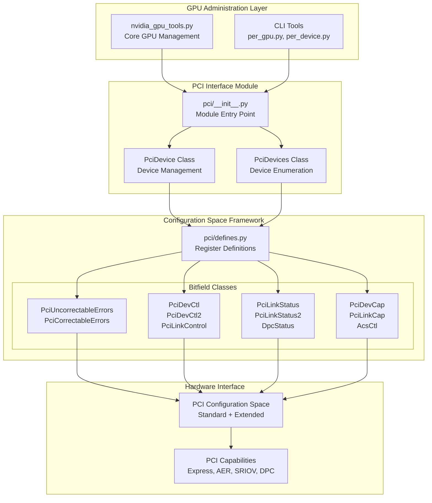
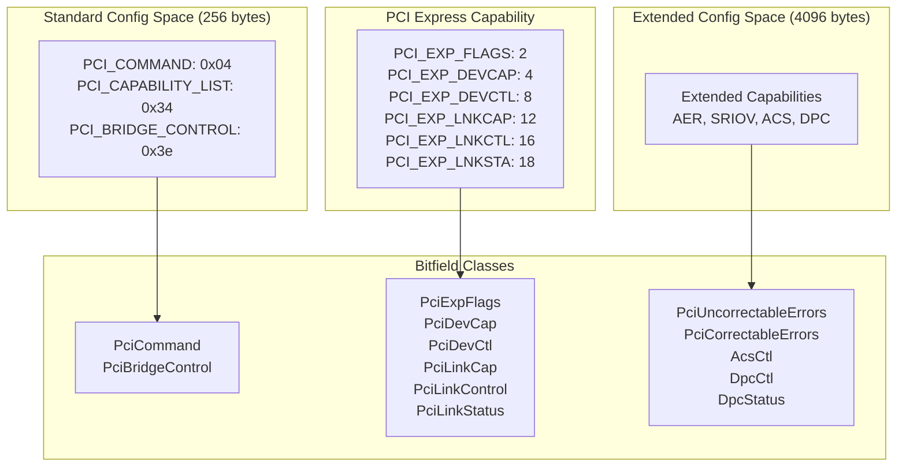
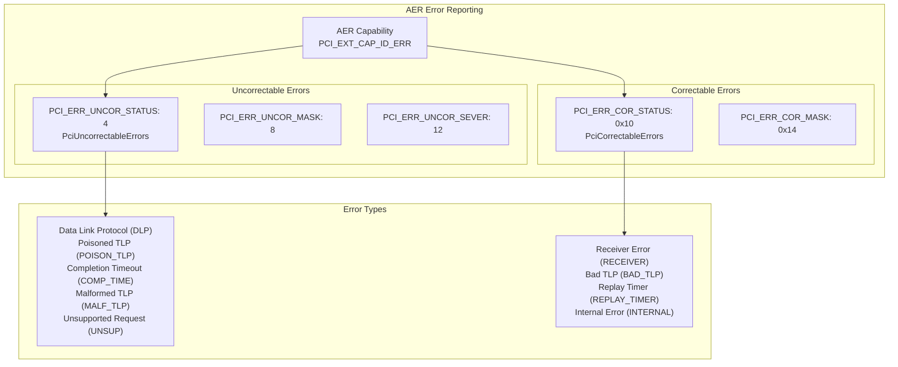
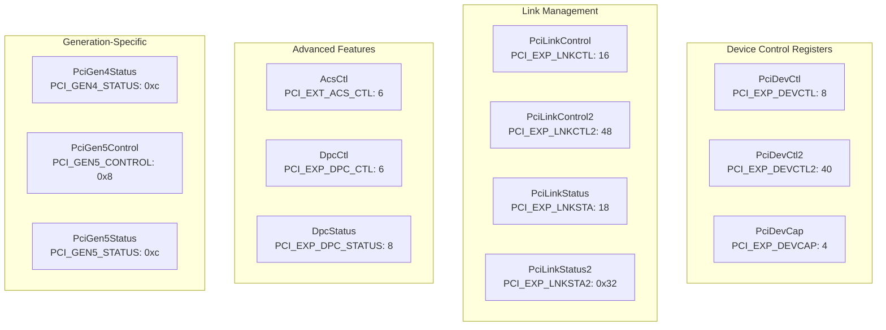
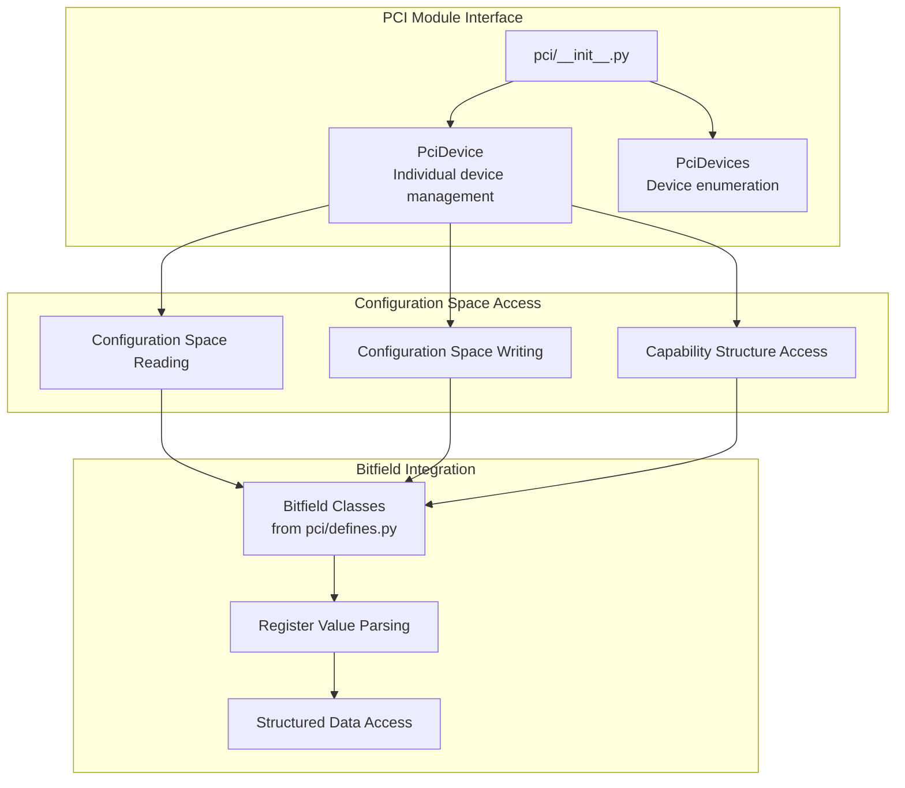

<!-- source: DeepWiki mcp.deepwiki.com · repo NVIDIA/gpu-admin-tools · page 8.1 PCI Interface · fetched 2026-10-26 -->

# PCI Interface

Relevant source files

The following files were used as context for generating this wiki page:

- [pci/__init__.py](pci/__init__.py)
- [pci/defines.py](pci/defines.py)

## Purpose and Scope

The PCI Interface system provides comprehensive PCI device management capabilities for GPU administration tools. This module handles PCI configuration space access, error reporting mechanisms, and device enumeration for NVIDIA GPU and NVSwitch hardware. The interface abstracts low-level PCI operations and provides structured access to PCI capabilities and error states.

For broader system integration topics including sysfs operations, see [Sysfs Integration](#8.2). For general utility functions, see [Utilities and Helpers](#8.3).

## PCI Interface Architecture

The PCI interface is organized around configuration space definitions, device management classes, and error reporting systems that integrate with the broader GPU administration framework.

**Sources:** [pci/__init__.py:24-25](), [pci/defines.py:24-643]()

## Configuration Space Definitions

The PCI interface provides comprehensive definitions for both standard and extended PCI configuration space registers. The system uses structured bitfield classes to represent register layouts and provide type-safe access to configuration data.

### Configuration Space Layout

**Sources:** [pci/defines.py:26-27](), [pci/defines.py:221-643]()

### Key Configuration Space Constants

| Constant | Value | Description |
|----------|-------|-------------|
| `PCI_CFG_SPACE_SIZE` | 256 | Standard configuration space size |
| `PCI_CFG_SPACE_EXP_SIZE` | 4096 | Extended configuration space size |
| `PCI_CAP_ID_EXP` | 0x10 | PCI Express capability ID |
| `PCI_CAP_ID_PM` | 0x01 | Power management capability ID |
| `PCI_EXT_CAP_ID_ERR` | 0x01 | Advanced Error Reporting capability ID |
| `PCI_EXT_CAP_ID_SRIOV` | 0x10 | SR-IOV capability ID |

**Sources:** [pci/defines.py:26-41]()

## Error Reporting System

The PCI interface provides comprehensive error detection and reporting through Advanced Error Reporting (AER) bitfield definitions. The system categorizes errors into correctable and uncorrectable types with detailed status tracking.

### Error Classification Architecture

**Sources:** [pci/defines.py:37-127]()

### Uncorrectable Error Fields

The `PciUncorrectableErrors` class defines critical error conditions that require immediate attention:

| Field | Bit Mask | Description |
|-------|----------|-------------|
| `POISON_TLP` | 0x00001000 | Poisoned Transaction Layer Packet |
| `COMP_TIME` | 0x00004000 | Completion Timeout |
| `COMP_ABORT` | 0x00008000 | Completer Abort |
| `MALF_TLP` | 0x00040000 | Malformed TLP |
| `UNSUP` | 0x00100000 | Unsupported Request |
| `INTN` | 0x00400000 | Internal Error |

**Sources:** [pci/defines.py:50-103]()

### Correctable Error Fields

The `PciCorrectableErrors` class tracks recoverable error conditions:

| Field | Bit Mask | Description |
|-------|----------|-------------|
| `RECEIVER` | 0x00000001 | Receiver Error |
| `BAD_TLP` | 0x00000040 | Bad TLP |
| `REPLAY_TIMER` | 0x00001000 | Replay Timer Timeout |
| `INTERNAL` | 0x00004000 | Internal Error |

**Sources:** [pci/defines.py:111-122]()

## Device Control and Status Management

The PCI interface provides extensive control over device behavior through structured bitfield classes that manage device capabilities, link control, and advanced features.

### Device Control Framework

**Sources:** [pci/defines.py:129-526]()

### Key Control Features

| Bitfield Class | Key Fields | Purpose |
|----------------|------------|---------|
| `PciDevCtl` | `CERE`, `NFERE`, `FERE`, `PAYLOAD` | Error reporting and payload control |
| `PciLinkControl` | `ASPMC`, `LD`, `CCC`, `CLKREQ_EN` | Link state and power management |
| `AcsCtl` | `SOURCE_VALIDATION`, `P2P_REQUEST_REDIRECT` | Access Control Services |
| `DpcCtl` | `EN_FATAL`, `EN_NONFATAL`, `INT_EN` | Downstream Port Containment |

**Sources:** [pci/defines.py:319-360](), [pci/defines.py:383-415](), [pci/defines.py:173-183](), [pci/defines.py:190-202]()

## Device Management Classes

The PCI interface exports two primary classes for device interaction, though their implementations are not visible in the current file scope. These classes provide the high-level interface for PCI device operations within the GPU administration system.

### Device Class Structure

**Sources:** [pci/__init__.py:24-25]()

The exported classes provide the foundation for PCI device management throughout the GPU administration tools, enabling structured access to configuration space registers and comprehensive error reporting capabilities.

---

