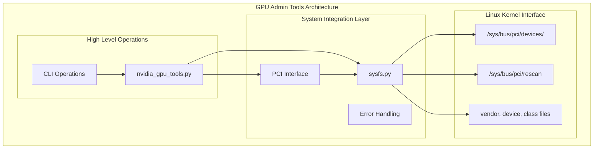
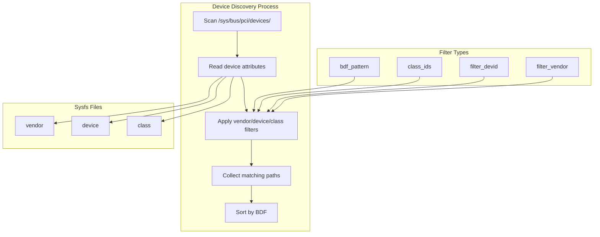
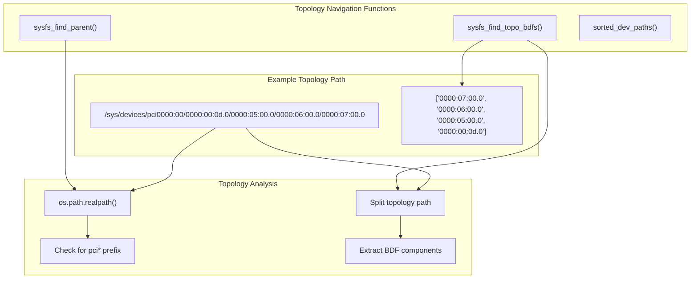
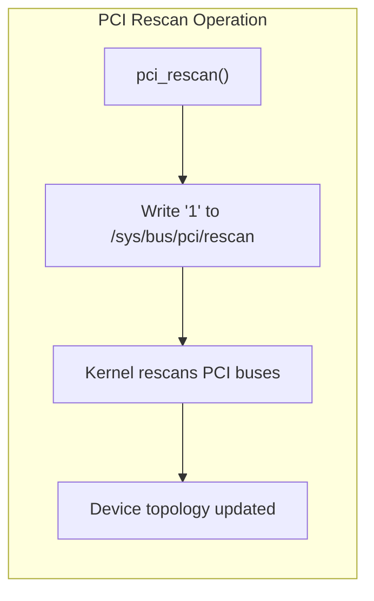
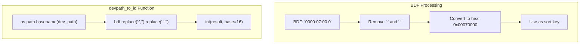

<!-- source: DeepWiki mcp.deepwiki.com · repo NVIDIA/gpu-admin-tools · page 8.2 Sysfs Integration · fetched 2026-10-26 -->

# Sysfs Integration

<details>
<summary>Relevant source files</summary>

The following files were used as context for generating this wiki page:

- [utils/sysfs.py](utils/sysfs.py)

</details>


## Purpose and Scope

The sysfs integration system provides utilities for interacting with the Linux sysfs filesystem to discover, enumerate, and manipulate GPU and NVSwitch devices. This module serves as the foundational layer for device detection and PCIe topology analysis within the gpu-admin-tools framework.

The sysfs utilities enable the system to discover devices by vendor/device ID, navigate PCIe topology hierarchies, and trigger system-level operations like PCI bus rescanning. For PCI configuration space access and device management, see [PCI Interface](#8.1). For higher-level device identification and property management, see [Device Management](#5).

## Sysfs Architecture Integration

The sysfs integration module operates at the system interface layer, providing essential device discovery capabilities that support the broader GPU management architecture.



Sources: [utils/sysfs.py:1-128]()

## Device Discovery Functions

The sysfs module provides multiple approaches for discovering PCI devices based on different criteria, supporting both simple and complex filtering requirements.

### Core Discovery Functions

| Function | Purpose | Parameters | Return Type |
|----------|---------|------------|-------------|
| `sysfs_find_devices` | Basic device filtering | `filter_vendor`, `filter_devid` | `List[str]` |
| `find_dev_paths` | Advanced multi-criteria search | `vendor_ids`, `device_ids`, `class_ids` | `List[str]` |
| `find_dev_path_by_bdf` | BDF pattern matching | `bdf_pattern` | `str or None` |

### Device Discovery Flow



Sources: [utils/sysfs.py:30-45](), [utils/sysfs.py:90-127](), [utils/sysfs.py:70-76]()

## PCIe Topology Navigation

The sysfs utilities provide functions for navigating and analyzing PCIe device topology, enabling understanding of device relationships and hierarchy.

### Topology Functions



Sources: [utils/sysfs.py:47-58](), [utils/sysfs.py:60-68](), [utils/sysfs.py:83-88]()

## System Control Operations

The sysfs integration includes system-level control operations that enable dynamic device management and configuration.

### PCI Bus Control

The `pci_rescan` function provides the ability to trigger a system-wide PCI bus rescan, which is essential for detecting newly added or reconfigured devices.



Sources: [utils/sysfs.py:26-28]()

## Utility Functions

The module provides several utility functions that support the core device discovery and topology navigation capabilities.

### File Reading and Data Conversion

| Function | Purpose | Implementation Details |
|----------|---------|----------------------|
| `read_number_from_file` | Read numeric values from sysfs | Supports hex (0x) and decimal formats |
| `sorted_dev_paths` | Sort device paths by BDF | Converts BDF to numeric for proper ordering |

### BDF Processing

The Bus-Device-Function (BDF) processing utilities handle the conversion and manipulation of PCI device identifiers:



Sources: [utils/sysfs.py:78-81](), [utils/sysfs.py:83-88]()

## Error Handling and Validation

The sysfs utilities implement validation to ensure proper usage and handle edge cases in device discovery.

### Input Validation

The `find_dev_paths` function enforces that at least one filtering criterion must be specified to prevent overly broad device enumeration:

```python
if vendor_ids is None and device_ids is None and class_ids is None:
    raise ValueError("At least one of vendor_ids, device_ids or class_ids must be specified")
```

### Path Safety

The topology navigation functions use `os.path.realpath()` to resolve symbolic links and ensure consistent path handling across different system configurations.

Sources: [utils/sysfs.py:103-104](), [utils/sysfs.py:50](), [utils/sysfs.py:63]()

---

