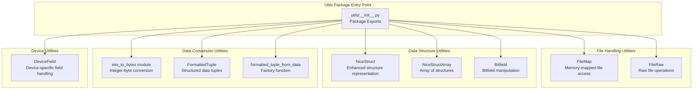
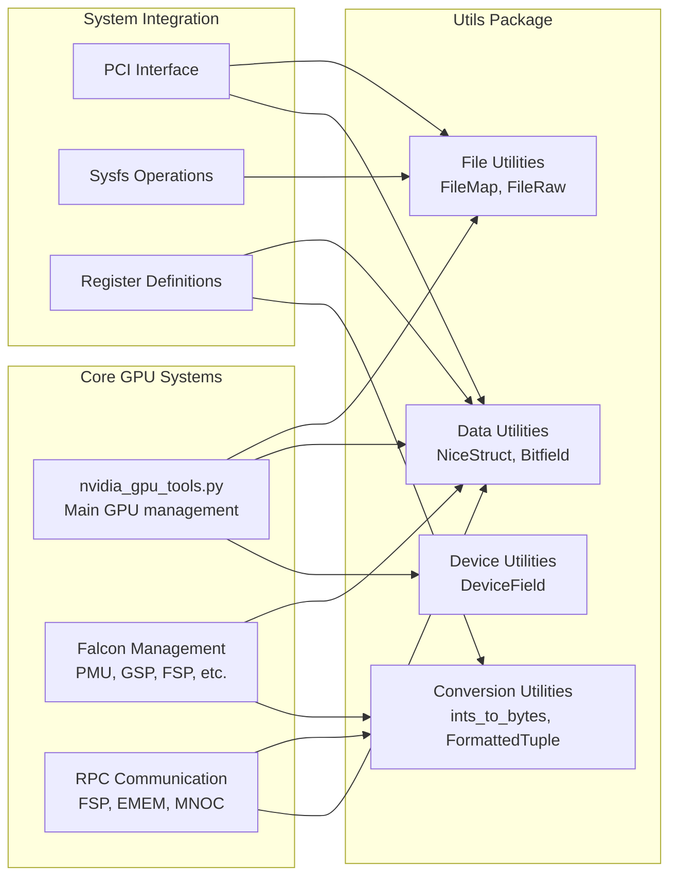

<!-- source: DeepWiki mcp.deepwiki.com · repo NVIDIA/gpu-admin-tools · page 8.3 Utilities and Helpers · fetched 2026-10-26 -->

# Utilities and Helpers

Relevant source files

The following files were used as context for generating this wiki page:

- [utils/__init__.py](utils/__init__.py)

This document covers the utility modules that provide foundational support for file handling, data conversion, and system interaction throughout the nvidia-gpu-admin-tools codebase. These utilities serve as building blocks that enable higher-level GPU management operations across the entire system.

For detailed information about bitfield manipulation specifically, see [Bitfield and Data Utilities](#7.3). For system-level file operations and sysfs integration, see [Sysfs Integration](#8.2).

## Purpose and Scope

The utilities package provides essential helper functions and classes that abstract common operations needed throughout the GPU administration tools. These utilities handle low-level data manipulation, file I/O operations, structured data representation, and device field management that support the core GPU management functionality.

Sources: [utils/__init__.py:1-31]()

## Utility Module Architecture

Sources: [utils/__init__.py:24-30]()

## File Handling Utilities

The file handling utilities provide abstractions for different types of file access patterns commonly needed when working with GPU hardware interfaces and system files.

### FileMap

The `FileMap` class provides memory-mapped file access capabilities, enabling efficient access to large files or device memory regions without loading entire contents into memory.

### FileRaw

The `FileRaw` class offers raw file operations for direct file I/O when memory mapping is not appropriate or when more control over read/write operations is required.

Sources: [utils/__init__.py:28-29]()

## Data Structure Utilities

### NiceStruct and NiceStructArray

The `NiceStruct` class enhances standard structure representation with improved formatting and debugging capabilities. `NiceStructArray` extends this functionality to handle arrays of structured data efficiently.

These utilities are particularly useful for representing GPU register layouts, configuration structures, and other hardware-related data formats in a human-readable manner.

### Bitfield Operations

The `Bitfield` class provides comprehensive bitfield manipulation capabilities for working with hardware registers and packed data structures commonly found in GPU interfaces.

Sources: [utils/__init__.py:24,26]()

## Data Conversion Utilities

### Integer-Byte Conversion

The `ints_to_bytes` module provides functions for converting between integer representations and byte arrays, supporting various endianness and size requirements needed for hardware communication protocols.

### FormattedTuple

The `FormattedTuple` class and `formatted_tuple_from_data` function provide structured data representation with formatting capabilities, useful for presenting complex data structures in readable formats.

Sources: [utils/__init__.py:25,30]()

## Device Field Management

### DeviceField

The `DeviceField` class provides specialized field handling for device-specific operations, abstracting common patterns for accessing and manipulating device registers and properties.

Sources: [utils/__init__.py:27]()

## Integration with Core Systems

The utility modules serve as foundational components that enable higher-level systems to perform their operations efficiently. File utilities support system integration components, data structure utilities enable register and communication operations, and conversion utilities facilitate protocol implementations.

Sources: [utils/__init__.py:24-30]()

## Usage Patterns

| Utility Category | Primary Use Cases | Key Classes/Functions |
|------------------|-------------------|----------------------|
| File Handling | Device file access, memory mapping | `FileMap`, `FileRaw` |
| Data Structures | Register representation, hardware layouts | `NiceStruct`, `NiceStructArray`, `Bitfield` |
| Data Conversion | Protocol serialization, byte manipulation | `ints_to_bytes.*`, `FormattedTuple` |
| Device Operations | Field access, device-specific operations | `DeviceField` |

These utilities are imported and used throughout the codebase wherever low-level data manipulation, file operations, or structured data representation is required, forming the foundation for more complex GPU management operations.

Sources: [utils/__init__.py:24-30]()