# Page: Overview

# Overview

<details>
<summary>Relevant source files</summary>

The following files were used as context for generating this wiki page:

- [README.md](README.md)
- [nvidia_gpu_tools.py](nvidia_gpu_tools.py)

</details>


## Purpose and Scope

The `nvidia-gpu-admin-tools` repository provides a privileged Python-based administration utility for NVIDIA GPU and NVSwitch devices. The system enables low-level configuration, debugging, and security management operations including Confidential Computing mode control, NVLink management, and comprehensive device state inspection. This toolkit operates at the hardware abstraction layer, providing direct access to GPU registers, embedded controllers (Falcons), and communication protocols.

For information about specific CLI operations, see [Command Line Interface](#3). For details about communication protocols and RPC systems, see [Communication Systems](#4). For device-specific hardware management, see [GPU Units and Subsystems](#6).

## System Architecture

The system follows a layered architecture with the core `nvidia_gpu_tools.py` module serving as the foundation for all GPU management operations:

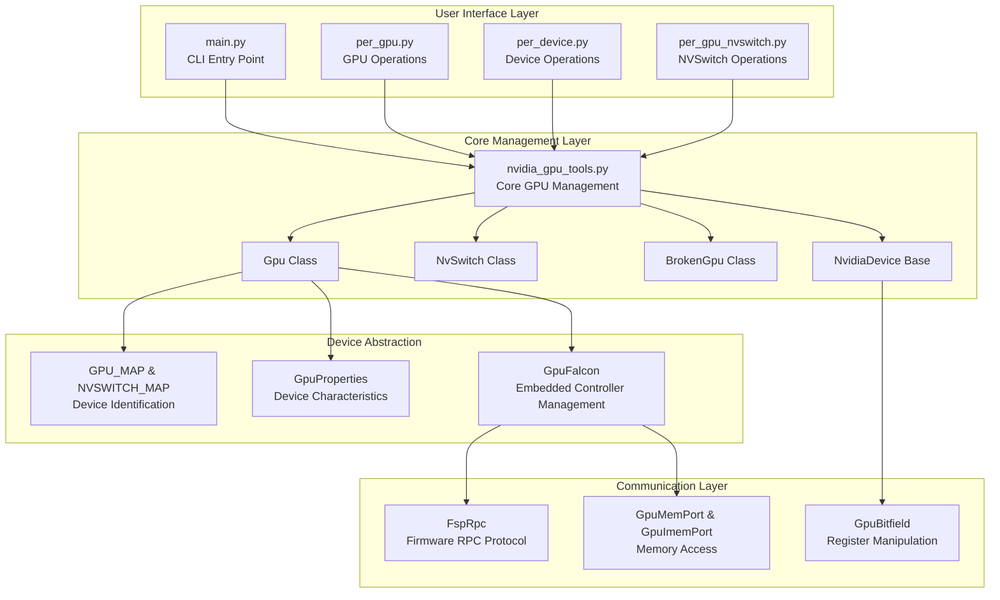

**Sources:** [nvidia_gpu_tools.py:1-50](), [nvidia_gpu_tools.py:100-913](), [README.md:1-25]()

## Core Device Management System

The central management system is built around the `NvidiaDevice` base class and its specialized implementations for different device types and states:

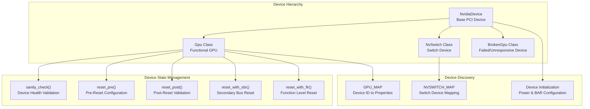

The `GPU_MAP` and `NVSWITCH_MAP` dictionaries provide comprehensive device identification and capability mapping for supported hardware generations from Kepler through Blackwell architectures.

**Sources:** [nvidia_gpu_tools.py:1008-1055](), [nvidia_gpu_tools.py:100-913](), [nvidia_gpu_tools.py:965-1002]()

## Embedded Controller (Falcon) Management

The system provides extensive management of GPU embedded controllers through a hierarchical falcon class system:

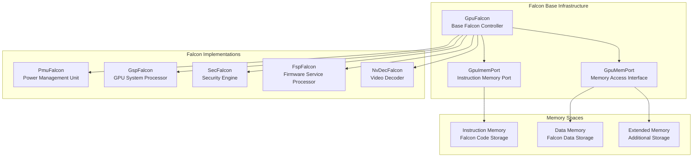

Each falcon provides specific functionality: `PmuFalcon` manages power states, `GspFalcon` handles system-level operations, `SecFalcon` manages security features, and `FspFalcon` provides firmware services and RPC communication.

**Sources:** [nvidia_gpu_tools.py:2037-2494](), [nvidia_gpu_tools.py:2495-2543](), [nvidia_gpu_tools.py:1930-2036]()

## Configuration and Security Management

The system implements comprehensive configuration management through PRC (Product Reconfiguration) knobs and security features:

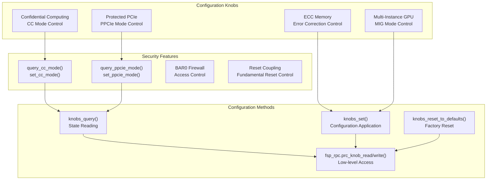

The configuration system supports three CC modes: `"off"` (default operation), `"on"` (full security features), and `"devtools"` (security with debugging enabled).

**Sources:** [nvidia_gpu_tools.py:1662-1800](), [nvidia_gpu_tools.py:1821-1851](), [README.md:5-23]()

## NVLink Management System

The system provides comprehensive NVLink management capabilities for multi-GPU communication:

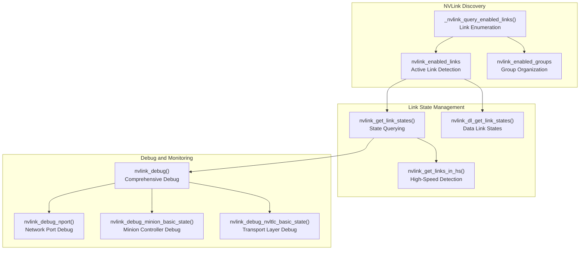

The NVLink system supports architecture-specific implementations with different protocols for Hopper (`nvlink_debug_h100()`) versus Blackwell (`nvlink_debug_b100()`) generations.

**Sources:** [nvidia_gpu_tools.py:1323-1346](), [nvidia_gpu_tools.py:1548-1656](), [nvidia_gpu_tools.py:1261-1322]()

---

# Page: Core Architecture

# Core Architecture

<details>
<summary>Relevant source files</summary>

The following files were used as context for generating this wiki page:

- [gpu/__init__.py](gpu/__init__.py)
- [nvidia_gpu_tools.py](nvidia_gpu_tools.py)

</details>


The Core Architecture represents the foundational system that provides GPU and NVSwitch device management capabilities through the central `nvidia_gpu_tools.py` module. This system handles device identification, instantiation, communication, and control operations across multiple GPU architectures and device types.

For information about specific device operations and CLI interfaces, see [Device Operations](#3.2). For details about communication protocols and RPC systems, see [Communication Systems](#4).

## System Overview

The core architecture establishes a hierarchical device management framework built around the `NvidiaDevice` base class and specialized implementations for different device types and states. The system provides unified interfaces for hardware communication, memory management, and device control operations.

### Core Architecture Diagram

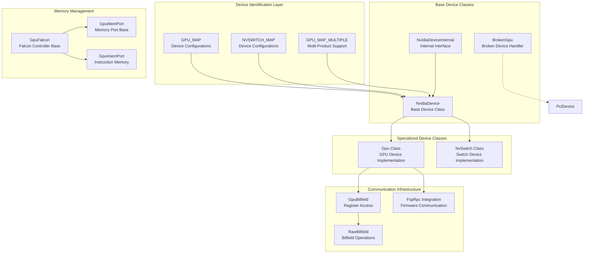

Sources: [nvidia_gpu_tools.py:50-913](), [nvidia_gpu_tools.py:1004-1055](), [nvidia_gpu_tools.py:915-964]()

## Device Identification and Mapping

The system uses comprehensive device mapping tables to identify and configure GPU and NVSwitch devices based on their hardware characteristics.

### Device Mapping Structure

| Component | Purpose | Key Properties |
|-----------|---------|----------------|
| `GPU_MAP` | Primary GPU device configurations | Architecture, memory support, falcon configurations |
| `NVSWITCH_MAP` | NVSwitch device configurations | Link counts, falcon support, architecture |
| `GPU_MAP_MULTIPLE` | Multi-product device disambiguation | Device ID to product name mapping |

### Device Architecture Support

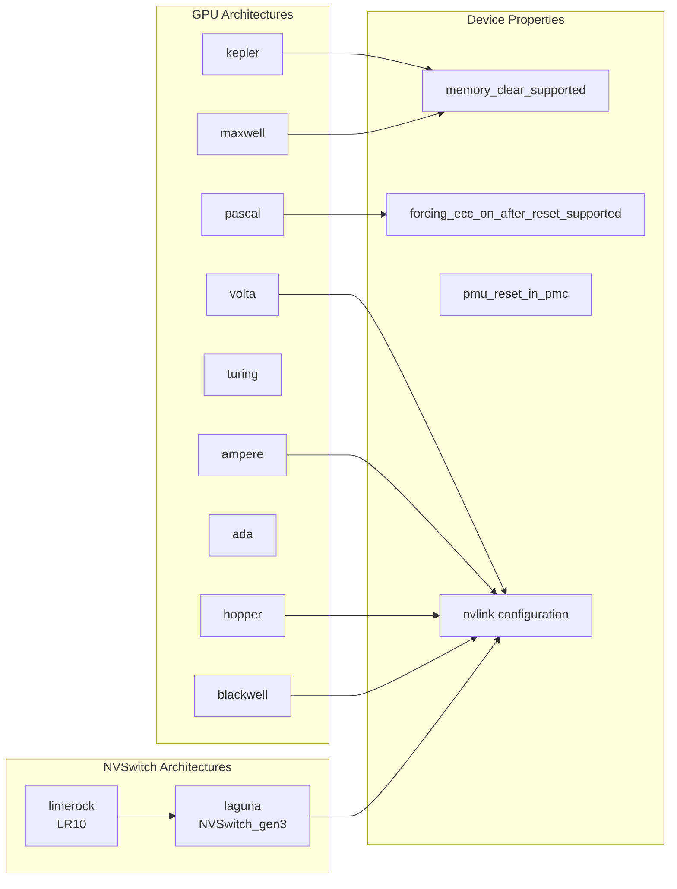

Sources: [nvidia_gpu_tools.py:50-78](), [nvidia_gpu_tools.py:83-913]()

## Base Device Classes

The foundation of the device management system consists of several key base classes that provide common functionality and interfaces.

### Class Hierarchy

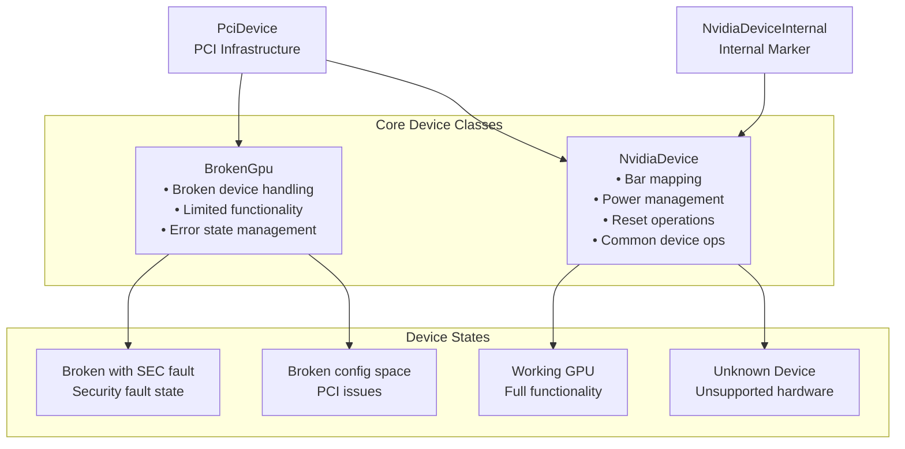

Sources: [nvidia_gpu_tools.py:1004-1055](), [nvidia_gpu_tools.py:965-1003]()

### NvidiaDevice Base Functionality

The `NvidiaDevice` class provides essential device management capabilities:

- **Power Management**: Automatic D0 state enforcement and power control handling
- **BAR0 Mapping**: Memory-mapped register access infrastructure  
- **Reset Operations**: FLR and SBR reset support with pre/post validation
- **Device Units**: Dynamic discovery and caching of GPU functional units
- **Falcon Management**: Embedded controller initialization and communication

Key properties initialized during device creation include form factor detection (`is_pcie`, `is_sxm`), interconnect support (`has_c2c`, `is_nvlink_supported`), and reset capabilities (`is_reset_coupling_supported`).

Sources: [nvidia_gpu_tools.py:1016-1055](), [nvidia_gpu_tools.py:1104-1176]()

## Memory and Communication Infrastructure

The core architecture provides sophisticated memory access and communication systems built around bitfield operations and direct hardware communication.

### Bitfield Access System

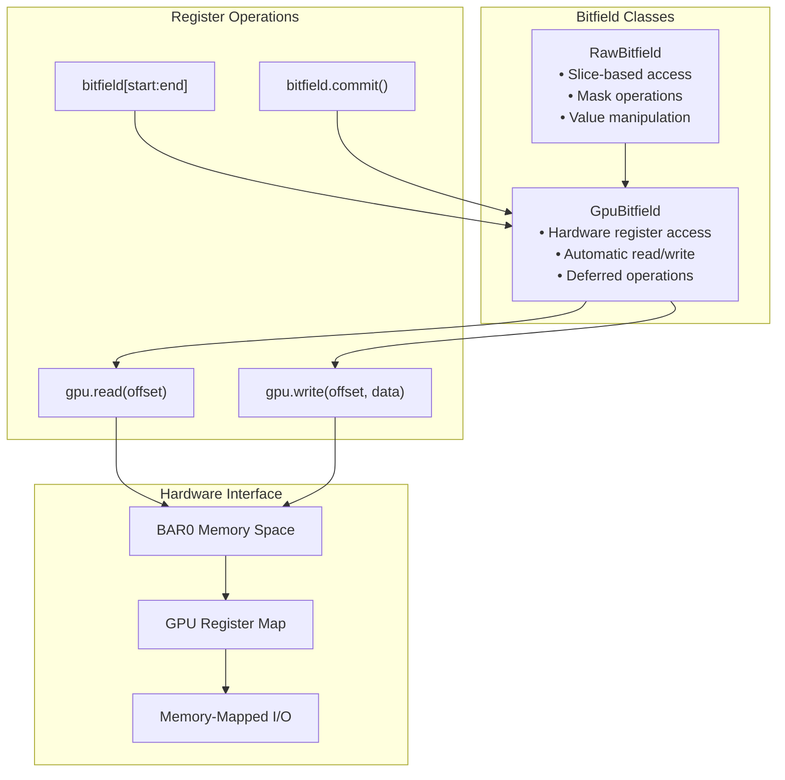

Sources: [nvidia_gpu_tools.py:915-964](), [nvidia_gpu_tools.py:1257-1259]()

### Hardware Communication Methods

The core architecture provides multiple levels of hardware access:

| Method | Purpose | Usage Pattern |
|--------|---------|---------------|
| `read()/write()` | Direct register access | Immediate hardware operations |
| `read_bad_ok()` | Fault-tolerant reads | Accessing potentially offline hardware |
| `bitfield()` | Structured field access | Multi-bit register field manipulation |
| `poll_register()` | Synchronous waiting | Waiting for hardware state changes |

The system includes comprehensive register polling capabilities with timeout handling, automatic retry logic, and debug tracing support for complex hardware state monitoring operations.

Sources: [nvidia_gpu_tools.py:1080-1088](), [nvidia_gpu_tools.py:1194-1249]()

---

# Page: GPU and NVSwitch Classes

# GPU and NVSwitch Classes

<details>
<summary>Relevant source files</summary>

The following files were used as context for generating this wiki page:

- [nvidia_gpu_tools.py](nvidia_gpu_tools.py)

</details>


This document covers the core device classes that represent NVIDIA GPUs and NVSwitches in different operational states. These classes form the foundation of the GPU admin tools architecture, providing device identification, capability detection, and hardware abstraction. For information about the embedded falcon processors managed by these devices, see [Falcon Management System](#2.2). For details about memory interfaces and communication protocols, see [Memory Ports and Communication](#2.3).

## Class Hierarchy and Relationships

The device representation follows a clear inheritance hierarchy with specialized classes for different device types and states:

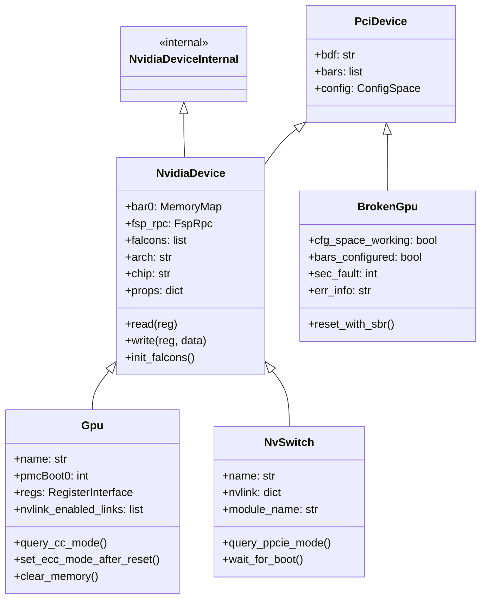

Sources: [nvidia_gpu_tools.py:1004-1018](), [nvidia_gpu_tools.py:3183-3188](), [nvidia_gpu_tools.py:2946-2951](), [nvidia_gpu_tools.py:965-971]()

## Device Identification and Mapping

Device identification relies on multiple mapping structures that translate hardware identifiers to device properties and capabilities:

### Device Mapping Tables

| Map Type | Purpose | Line Reference |
|----------|---------|----------------|
| `GPU_MAP` | Primary GPU device mapping by PMC boot register | [nvidia_gpu_tools.py:100-913]() |
| `GPU_MAP_MULTIPLE` | Multi-product architectures with device ID disambiguation | [nvidia_gpu_tools.py:83-98]() |
| `NVSWITCH_MAP` | NVSwitch device mapping and configuration | [nvidia_gpu_tools.py:51-78]() |
| `GPU_ARCHES` | GPU architecture progression | [nvidia_gpu_tools.py:50]() |
| `NVSWITCH_ARCHES` | NVSwitch architecture progression | [nvidia_gpu_tools.py:79]() |

### Device Recognition Flow

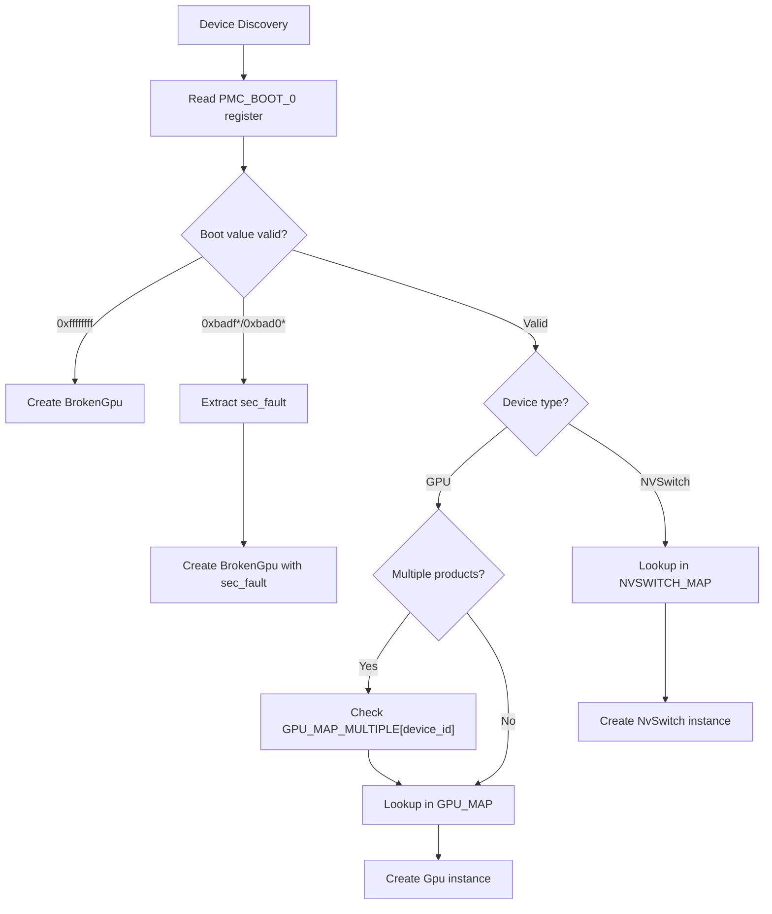

Sources: [nvidia_gpu_tools.py:3251-3280](), [nvidia_gpu_tools.py:2964-2972](), [nvidia_gpu_tools.py:3267-3267]()

## Gpu Class

The `Gpu` class represents functional NVIDIA GPU devices and provides comprehensive hardware management capabilities.

### Core Properties and Initialization

The GPU initialization process involves multiple phases of hardware detection and configuration:

```python
# Key initialization steps from Gpu.__init__
# 1. PCI configuration and BAR mapping
# 2. Architecture detection via device ID or PMC boot register  
# 3. Property lookup and capability detection
# 4. Register interface initialization
# 5. Falcon processor discovery
```

### Architecture Detection and Capabilities

| Architecture | GPU_ARCHES Index | Key Capabilities |
|--------------|------------------|------------------|
| `kepler` | 1 | Basic falcon management |
| `maxwell` | 2 | SEC falcon, NVENC/NVDEC |
| `pascal` | 3 | Enhanced security, EMEM |
| `volta` | 4 | GSP falcon, NVLink |
| `turing` | 5 | Memory clearing, ECC control |
| `ampere` | 6 | Enhanced NVLink, MIG mode |
| `ada` | 7 | Reduced GSP dependency |
| `hopper` | 8 | FSP-based control, CC mode |
| `blackwell` | 9 | MSE, enhanced security |

### Device State Queries

The `Gpu` class provides numerous state query methods:

- `query_cc_mode()` - Confidential Computing mode status [nvidia_gpu_tools.py:3667-3675]()
- `query_ppcie_mode()` - Protected PCIe mode status [nvidia_gpu_tools.py:3772-3781]()  
- `query_final_ecc_state()` - ECC memory state [nvidia_gpu_tools.py:3623-3635]()
- `query_mig_mode()` - Multi-Instance GPU mode [nvidia_gpu_tools.py:3900-3909]()

Sources: [nvidia_gpu_tools.py:3183-3352](), [nvidia_gpu_tools.py:3402-3481]()

## NvSwitch Class

The `NvSwitch` class manages NVIDIA switch fabric devices that provide high-bandwidth GPU-to-GPU connectivity.

### Architecture Support

NVSwitch devices follow their own architecture progression with specific capabilities:

- **limerock** (`LR10`): Basic switch functionality with SOE falcon
- **laguna** (`NVSwitch_gen3`): Enhanced with FSP support, 64 NVLink ports

### Key Capabilities

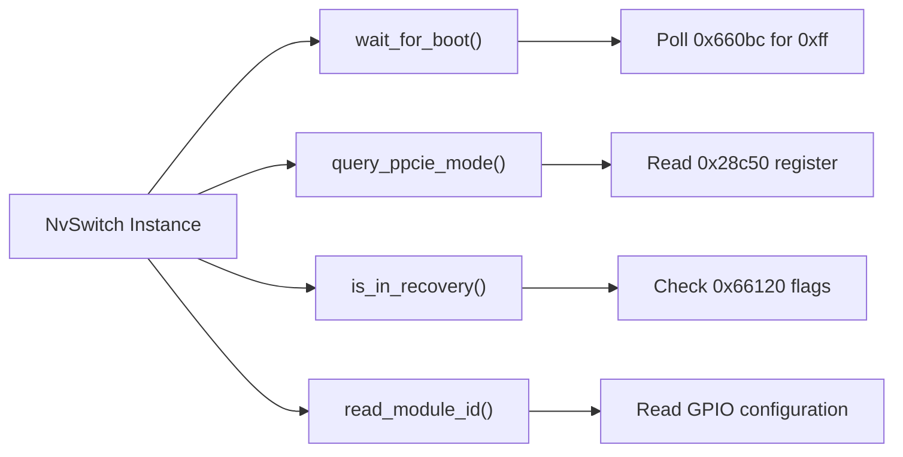

### NVLink Management

NVSwitch devices provide extensive NVLink fabric management:

- Link state monitoring via `nvlink_get_link_states()`
- Debug capabilities through `nvlink_debug_*()` methods
- Topology mapping for multi-switch configurations

Sources: [nvidia_gpu_tools.py:2946-3169](), [nvidia_gpu_tools.py:3000-3014]()

## BrokenGpu Class

The `BrokenGpu` class handles devices that have failed hardware validation or are in error states.

### Error Classification

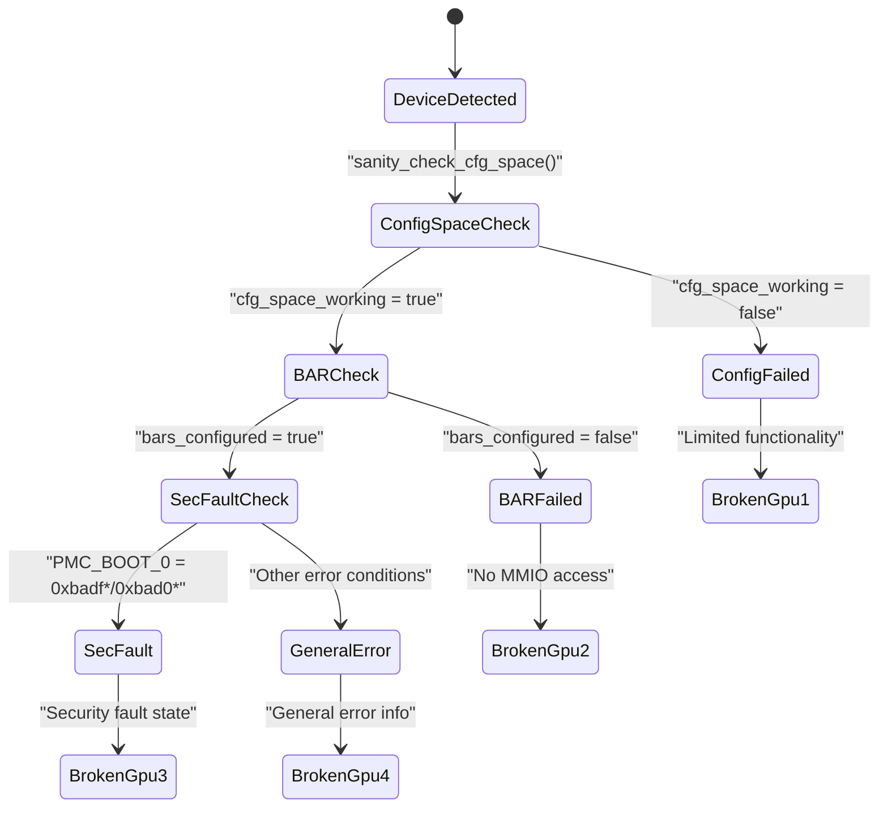

### Recovery Capabilities

The `BrokenGpu` class provides limited recovery options:

- `reset_with_sbr()` - Attempts secondary bus reset through parent bridge
- Basic configuration space access when `cfg_space_working = true`
- BAR0 mapping for security fault analysis when `bars_configured = true`

### Error Information Storage

| Field | Type | Purpose |
|-------|------|---------|
| `cfg_space_working` | bool | PCI config space accessibility |
| `bars_configured` | bool | BAR register validity |
| `sec_fault` | int | Security fault code from hardware |
| `err_info` | str | Human-readable error description |

Sources: [nvidia_gpu_tools.py:965-1002](), [nvidia_gpu_tools.py:989-992]()

## Device State Transitions

The relationship between device classes reflects different operational states and error conditions:

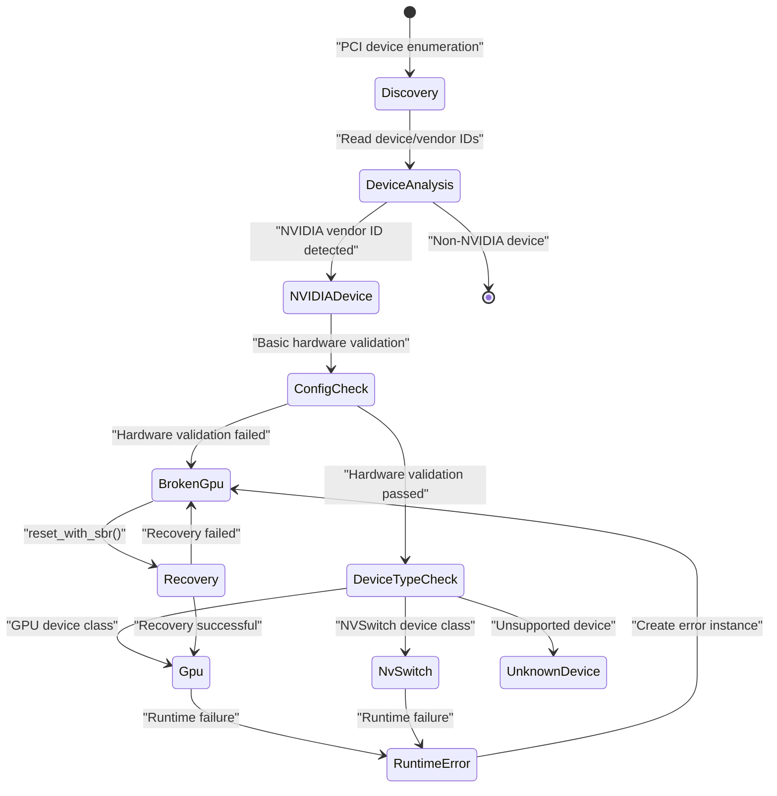

Sources: [nvidia_gpu_tools.py:3190-3304](), [nvidia_gpu_tools.py:2954-2998](), [nvidia_gpu_tools.py:966-982]()

---

# Page: Falcon Management System

# Falcon Management System

<details>
<summary>Relevant source files</summary>

The following files were used as context for generating this wiki page:

- [nvidia_gpu_tools.py](nvidia_gpu_tools.py)

</details>


The Falcon Management System provides a unified interface for managing embedded microcontrollers (Falcons) within NVIDIA GPUs and NVSwitches. This system handles initialization, configuration, memory management, and communication with various specialized falcon processors including PMU (Power Management Unit), GSP (GPU System Processor), SEC (Security Engine), and FSP (Firmware Service Processor).

For information about memory port abstractions and falcon communication mechanisms, see [Memory Ports and Communication](#2.3). For details about the broader GPU device management context, see [GPU and NVSwitch Classes](#2.1).

## Falcon Architecture Overview

The falcon management system is built around a hierarchical class structure with `GpuFalcon` as the base class providing common functionality for all falcon types. Each specialized falcon inherits this base functionality while adding processor-specific capabilities.

### Falcon Class Hierarchy

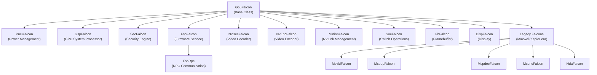

Sources: [nvidia_gpu_tools.py:2037-2700]()

### Falcon Initialization Flow

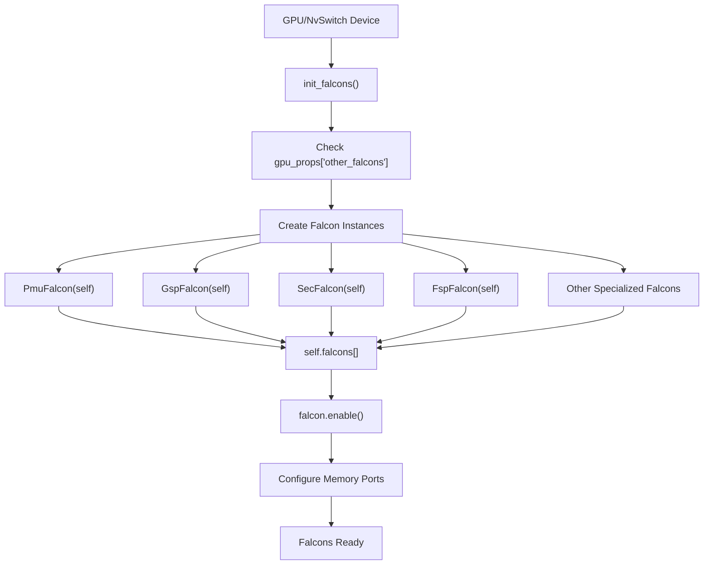

Sources: [nvidia_gpu_tools.py:3354-3400](), [nvidia_gpu_tools.py:3057-3068]()

## Core Falcon Classes

### GpuFalcon Base Class

The `GpuFalcon` class provides the foundational functionality for all falcon processors, including memory port management, hardware configuration discovery, and basic control operations.

| Property | Description | Source Lines |
|----------|-------------|--------------|
| `name` | Falcon identifier string | [nvidia_gpu_tools.py:2039]() |
| `cpuctl` | CPU control register address | [nvidia_gpu_tools.py:2044]() |
| `mem_ports` | List of memory port objects | [nvidia_gpu_tools.py:2060]() |
| `has_emem` | Extended memory support flag | [nvidia_gpu_tools.py:2048]() |
| `max_imem_size` | Instruction memory size | [nvidia_gpu_tools.py:2155-2171]() |
| `max_dmem_size` | Data memory size | [nvidia_gpu_tools.py:2173-2190]() |

### Key Falcon Operations

| Method | Purpose | Source Lines |
|--------|---------|--------------|
| `enable()` | Enable falcon processor | [nvidia_gpu_tools.py:2416-2438]() |
| `disable()` | Disable falcon processor | [nvidia_gpu_tools.py:2390-2401]() |
| `reset()` | Reset falcon to initial state | [nvidia_gpu_tools.py:2450-2451]() |
| `execute()` | Start falcon execution | [nvidia_gpu_tools.py:2364-2369]() |
| `halt()` | Stop falcon execution | [nvidia_gpu_tools.py:2403-2409]() |
| `sreset()` | Software reset falcon | [nvidia_gpu_tools.py:2380-2388]() |

Sources: [nvidia_gpu_tools.py:2037-2494]()

## Falcon Types and Specializations

### Power Management Unit (PMU)

The `PmuFalcon` manages GPU power states, thermal monitoring, and power control operations. It's the primary falcon for pre-Hopper architectures.

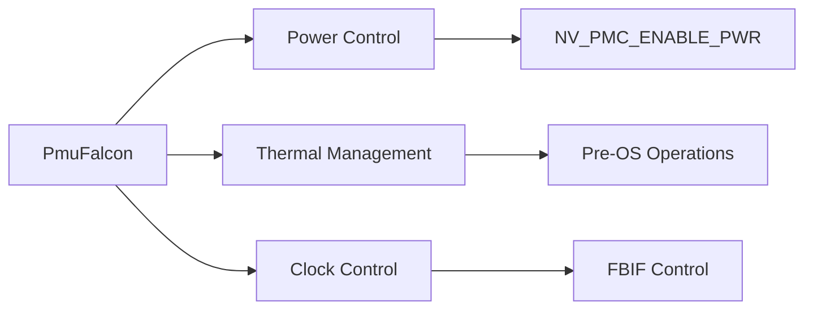

Sources: [nvidia_gpu_tools.py:2495-2514]()

### GPU System Processor (GSP)

The `GspFalcon` handles system-level GPU operations and serves as the primary management processor for modern GPU architectures.

- **EMEM Support**: Has extended memory for larger firmware
- **FBIF Integration**: Framebuffer interface control
- **Hopper+ Primary**: Main management falcon for Hopper and newer

Sources: [nvidia_gpu_tools.py:2557-2572]()

### Security Engine (SEC)

The `SecFalcon` manages cryptographic operations, secure boot, and security policy enforcement.

- **EMEM Support**: From Pascal 10x onwards
- **Microcode Versions**: Readable via `read_ucode_version()`
- **PKC Operations**: Public key cryptography support

Sources: [nvidia_gpu_tools.py:2574-2605]()

### Firmware Service Processor (FSP)

The `FspFalcon` provides system services and RPC communication for Hopper+ architectures.

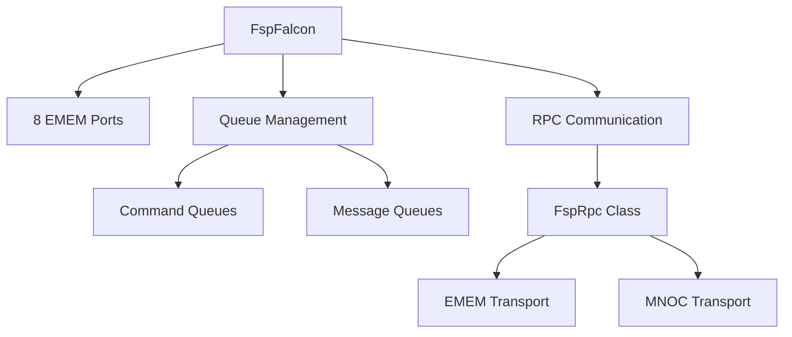

Sources: [nvidia_gpu_tools.py:2682-2700](), [nvidia_gpu_tools.py:2704-2944]()

## Falcon Configuration and Properties

### Configuration Discovery

Falcon properties are determined through a combination of:

1. **Static Configuration**: Defined in `GPU_MAP` and `NVSWITCH_MAP`
2. **Hardware Discovery**: Read from falcon HWCFG registers
3. **Architecture Defaults**: Based on GPU generation

### Configuration Structure

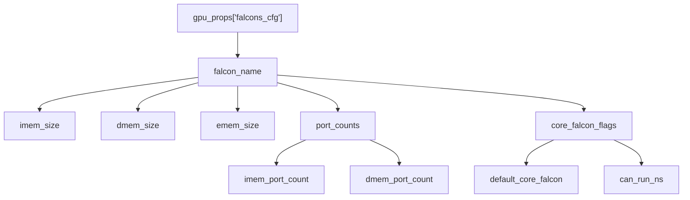

### Example Configuration

| GPU | Falcon | IMEM Size | DMEM Size | EMEM Size | Ports |
|-----|--------|-----------|-----------|-----------|-------|
| A100 | PMU | 131072 | 131072 | - | I:1, D:4 |
| A100 | GSP | 65536 | 65536 | 8192 | I:1, D:1 |
| A100 | SEC | 65536 | 65536 | 8192 | I:1, D:1 |

Sources: [nvidia_gpu_tools.py:517-581](), [nvidia_gpu_tools.py:2155-2277]()

## Falcon Management Operations

### Memory Management

Falcons provide three types of memory access:

| Memory Type | Purpose | Access Method |
|-------------|---------|---------------|
| IMEM | Instruction Memory | `load_imem()`, `read_imem()` |
| DMEM | Data Memory | `load_dmem()`, `read_dmem()` |
| EMEM | Extended Memory | `write_emem()`, `read_emem()` |

### Control Flow Operations

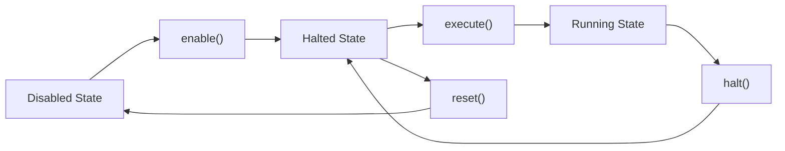

Sources: [nvidia_gpu_tools.py:2334-2475]()

### Hardware Configuration Validation

The system validates falcon configurations by comparing static configuration data with hardware-reported values:

- **Memory Size Validation**: Ensures `falcons_cfg` matches HWCFG registers
- **Port Count Validation**: Verifies port counts against hardware capabilities
- **Feature Flag Validation**: Checks compatibility between configuration and hardware features

Sources: [nvidia_gpu_tools.py:2167-2169](), [nvidia_gpu_tools.py:2186-2188](), [nvidia_gpu_tools.py:2205-2207]()

## FSP RPC Communication

### RPC Architecture

The `FspRpc` class provides Remote Procedure Call communication with the Firmware Service Processor using MCTP (Management Component Transport Protocol) headers.

```mermaid
graph TD
    FspRpc["FspRpc"] --> Transport["Transport Layer"]
    Transport --> EMEMRpc["FspEmemRpc"]
    Transport --> MNOCRpc["FspMnocRpc"]
    
    FspRpc --> Commands["RPC Commands"]
    Commands --> PRCCmd["PRC Commands"]
    Commands --> ECCCmd["ECC Control"]
    Commands --> NVLinkCmd["NVLink Control"]
    Commands --> InfoROM["InfoROM Access"]
    
    PRCCmd --> KnobRead["prc_knob_read()"]
    PRCCmd --> KnobWrite["prc_knob_write()"]
    
    ECCCmd --> ECCSet["prc_ecc()"]
    NVLinkCmd --> LinkBlock["prc_block_nvlinks()"]
```

### Key RPC Operations

| Method | Purpose | Source Lines |
|--------|---------|--------------|
| `prc_knob_read()` | Read PRC configuration knob | [nvidia_gpu_tools.py:2837-2856]() |
| `prc_knob_write()` | Write PRC configuration knob | [nvidia_gpu_tools.py:2858-2874]() |
| `prc_ecc()` | Configure ECC settings | [nvidia_gpu_tools.py:2775-2790]() |
| `prc_block_nvlinks()` | Block specific NVLink ports | [nvidia_gpu_tools.py:2792-2824]() |
| `inforom_read()` | Read InfoROM data | [nvidia_gpu_tools.py:2892-2909]() |

Sources: [nvidia_gpu_tools.py:2704-2944]()

---

# Page: Memory Ports and Communication

# Memory Ports and Communication

<details>
<summary>Relevant source files</summary>

The following files were used as context for generating this wiki page:

- [nvidia_gpu_tools.py](nvidia_gpu_tools.py)

</details>


This page documents the memory port abstractions and communication mechanisms that enable interaction between the host system and GPU falcon processors. It covers the IMEM (instruction memory), DMEM (data memory), and EMEM (extended memory) port implementations and their role in falcon communication protocols.

For information about falcon processor management, see [Falcon Management System](#2.2). For details about specific RPC communication protocols, see [Communication Systems](#4).

## Overview

The memory port system provides a standardized interface for accessing different memory spaces within GPU falcon processors. These ports serve as the fundamental communication mechanism between the host system and embedded falcon controllers, enabling firmware loading, data exchange, and control operations.

```mermaid
graph TB
    subgraph "Host System"
        Host["Host Application"]
        FspRpc["FspRpc"]
    end
    
    subgraph "Memory Port Layer"
        GpuMemPort["GpuMemPort<br/>(Base Class)"]
        GpuImemPort["GpuImemPort<br/>(Instruction Memory)"]
        DmemPort["DMEM Ports"]
        EmemPort["EMEM Ports"]
    end
    
    subgraph "Falcon Hardware"
        IMEM["Instruction Memory<br/>(IMEM)"]
        DMEM["Data Memory<br/>(DMEM)"]
        EMEM["Extended Memory<br/>(EMEM)"]
        Falcon["Falcon Processor"]
    end
    
    Host --> FspRpc
    FspRpc --> GpuMemPort
    GpuMemPort --> GpuImemPort
    GpuMemPort --> DmemPort
    GpuMemPort --> EmemPort
    
    GpuImemPort --> IMEM
    DmemPort --> DMEM
    EmemPort --> EMEM
    
    IMEM --> Falcon
    DMEM --> Falcon
    EMEM --> Falcon
```

Sources: [nvidia_gpu_tools.py:1930-2036](), [nvidia_gpu_tools.py:2704-2942]()

## Memory Port Architecture

The memory port system is built around a hierarchy of classes that abstract different types of memory access:

| Class | Purpose | Memory Type | Special Features |
|-------|---------|-------------|------------------|
| `GpuMemPort` | Base memory port | Data memory | Auto-increment, configurable offset |
| `GpuImemPort` | Instruction memory port | Instruction memory | Virtual tagging, code loading |
| EMEM ports | Extended memory port | Extended memory | Multiple ports per falcon |

### GpuMemPort Base Class

The `GpuMemPort` class provides the fundamental memory access interface with the following key properties:

- **Configurable addressing**: Supports offset-based addressing with auto-increment
- **Size constraints**: Enforces maximum memory size limits per falcon
- **Hardware abstraction**: Translates logical operations to register-level access

```mermaid
graph LR
    Configure["configure()"] --> MemControl["Memory Control Register<br/>(control_reg)"]
    MemControl --> DataReg["Data Register<br/>(data_reg)"]
    
    ReadWrite["read()/write()"] --> DataReg
    
    AutoInc["Auto-increment<br/>(auto_inc_read/write)"] --> Offset["offset tracking"]
    Offset --> Wraparound["handle_offset_wraparound()"]
```

Sources: [nvidia_gpu_tools.py:1930-2009]()

## Memory Port Types

### Instruction Memory Ports (IMEM)

Instruction memory ports extend the base functionality with support for virtual addressing and code loading:

```python
# Key capabilities from GpuImemPort
- write_with_tags(): Supports virtual address tagging for code loading
- imemt_reg: Tag register for virtual base address management
- Automatic padding: Ensures proper alignment for instruction blocks
```

The IMEM port handles firmware loading with virtual-to-physical address translation, essential for falcon processor initialization.

Sources: [nvidia_gpu_tools.py:2010-2036]()

### Data Memory Ports (DMEM)

Data memory ports provide standard memory access for falcon data operations:

- **Multiple ports**: Most falcons support multiple DMEM ports for parallel access
- **Data exchange**: Primary mechanism for runtime data communication
- **Configuration storage**: Used for storing operational parameters

### Extended Memory Ports (EMEM)

Extended memory ports offer additional memory space for advanced falcon processors:

- **Larger capacity**: Typically 8KB of additional memory space
- **Multiple instances**: Up to 8 ports per falcon on advanced architectures
- **Communication buffering**: Used by RPC systems for message queuing

Sources: [nvidia_gpu_tools.py:2085-2090]()

## Port Configuration and Management

Memory ports require configuration before use, establishing addressing mode, auto-increment behavior, and security settings:

```mermaid
flowchart TD
    Init["Port Initialization"] --> Config["configure()"]
    Config --> SetOffset["Set Memory Offset"]
    Config --> SetAutoInc["Set Auto-increment Mode"]
    Config --> SetSecurity["Set Security Mode<br/>(IMEM only)"]
    
    SetOffset --> WriteControl["Write Control Register"]
    SetAutoInc --> WriteControl
    SetSecurity --> WriteControl
    
    WriteControl --> Ready["Port Ready for I/O"]
    Ready --> DataOps["read()/write() Operations"]
    
    DataOps --> OffsetUpdate["Auto-update Offset"]
    OffsetUpdate --> Wraparound["Check Wraparound"]
    Wraparound --> DataOps
```

### Configuration Parameters

| Parameter | Description | Values |
|-----------|-------------|---------|
| `offset` | Current memory offset | 0 to `max_size` |
| `auto_inc_read` | Auto-increment on read | True/False |
| `auto_inc_write` | Auto-increment on write | True/False |
| `secure_imem` | Secure instruction mode | True/False (IMEM only) |

Sources: [nvidia_gpu_tools.py:1949-1981]()

## Communication Patterns

### Falcon Initialization

The typical falcon initialization sequence demonstrates memory port usage:

```mermaid
sequenceDiagram
    participant Host
    participant ImemPort as "IMEM Port"
    participant DmemPort as "DMEM Port"
    participant Falcon
    
    Host->>ImemPort: configure(offset=0, secure=false)
    Host->>ImemPort: write_with_tags(firmware_data, virt_base)
    Host->>DmemPort: configure(offset=0)
    Host->>DmemPort: write(initialization_data)
    Host->>Falcon: execute(bootvec=entry_point)
    Falcon-->>Host: execution_complete
```

### Runtime Data Exchange

During normal operation, memory ports facilitate ongoing communication:

```mermaid
graph LR
    subgraph "Runtime Communication"
        HostData["Host Data"] --> DmemWrite["DMEM Write"]
        DmemWrite --> FalconProcess["Falcon Processing"]
        FalconProcess --> DmemRead["DMEM Read"]
        DmemRead --> HostResult["Host Result"]
    end
    
    subgraph "Control Flow"
        HostCmd["Host Command"] --> ImemUpdate["IMEM Update"]
        ImemUpdate --> FalconExec["Falcon Execution"]
        FalconExec --> StatusUpdate["Status via DMEM"]
    end
```

Sources: [nvidia_gpu_tools.py:2334-2378]()

## Integration with Falcon Processors

Memory ports are tightly integrated with the falcon processor architecture through the `GpuFalcon` class:

### Port Allocation

Each falcon processor maintains arrays of memory ports based on hardware capabilities:

```python
# Port allocation pattern from GpuFalcon.__init__
self.imem_ports = []  # Instruction memory ports
self.dmem_ports = []  # Data memory ports  
self.emem_ports = []  # Extended memory ports (if supported)
```

### Hardware Configuration Validation

The system validates port configurations against hardware capabilities:

- **Port counts**: Verified against `imem_port_count` and `dmem_port_count`
- **Memory sizes**: Checked against `max_imem_size` and `max_dmem_size`
- **Feature support**: EMEM availability based on falcon architecture

```mermaid
graph TD
    FalconInit["Falcon Initialization"] --> ReadHWCFG["Read Hardware Config"]
    ReadHWCFG --> ValidateConfig["Validate Against falcons_cfg"]
    ValidateConfig --> CreatePorts["Create Memory Ports"]
    
    CreatePorts --> IMEMPorts["Create IMEM Ports<br/>(imem_port_count)"]
    CreatePorts --> DMEMPorts["Create DMEM Ports<br/>(dmem_port_count)"]
    CreatePorts --> EMEMPorts["Create EMEM Ports<br/>(if has_emem)"]
    
    IMEMPorts --> PortReady["Ports Ready"]
    DMEMPorts --> PortReady
    EMEMPorts --> PortReady
```

Sources: [nvidia_gpu_tools.py:2060-2084](), [nvidia_gpu_tools.py:2155-2247]()

---

# Page: Command Line Interface

# Command Line Interface

<details>
<summary>Relevant source files</summary>

The following files were used as context for generating this wiki page:

- [cli/main.py](cli/main.py)
- [cli/per_gpu_nvswitch.py](cli/per_gpu_nvswitch.py)
- [gpu/units/__init__.py](gpu/units/__init__.py)

</details>


The Command Line Interface (CLI) provides the primary user-facing entry point for the nvidia-gpu-admin-tools system. It implements a comprehensive argument parsing framework, device selection logic, and operation dispatch system that routes commands to appropriate device-specific handlers based on device type and capabilities.

For information about the underlying GPU and device management systems that the CLI controls, see [Core Architecture](#2). For details about specific GPU units and subsystems that can be controlled through the CLI, see [GPU Units and Subsystems](#6).

## CLI Architecture Overview

The CLI system follows a layered dispatch architecture that separates argument parsing, device selection, and operation execution into distinct phases.

```mermaid
graph TB
    Main["main()"]
    CreateArgs["create_args()"]
    ArgParse["argparse.ArgumentParser"]
    PluginLoader["cli.plugins.load_plugins()"]
    
    DeviceSelect["Device Selection Logic"]
    FindGPUs["pci.devices.find_gpus()"]
    FindDevices["pci.devices.find_devices_from_string()"]
    
    Dispatch["Operation Dispatch"]
    NoDevice["main_no_device()"]
    PerDevice["main_per_device()"]
    PerGPU["main_per_gpu()"]
    PerGPUNVSwitch["main_per_gpu_or_nvswitch()"]
    
    Main --> CreateArgs
    CreateArgs --> ArgParse
    CreateArgs --> PluginLoader
    Main --> DeviceSelect
    DeviceSelect --> FindGPUs
    DeviceSelect --> FindDevices
    Main --> Dispatch
    Dispatch --> NoDevice
    Dispatch --> PerDevice
    Dispatch --> PerGPU
    Dispatch --> PerGPUNVSwitch
    
    subgraph "Entry Point"
        Main
    end
    
    subgraph "Argument Processing"
        CreateArgs
        ArgParse
        PluginLoader
    end
    
    subgraph "Device Discovery"
        DeviceSelect
        FindGPUs
        FindDevices
    end
    
    subgraph "Operation Modules"
        NoDevice
        PerDevice
        PerGPU
        PerGPUNVSwitch
    end
```

Sources: [cli/main.py:249-371]()

## Device Selection and Argument Parsing

The CLI supports multiple device selection methods through a flexible argument parsing system implemented in the `create_args()` function.

### Device Selection Methods

| Selection Method | Argument | Description | Example |
|------------------|----------|-------------|---------|
| Device String | `--devices` | Generic selector with multiple formats | `gpus[0:2]`, `nvswitches` |
| GPU Index | `--gpu` | Select GPU by numeric index | `--gpu 0` |
| BDF Address | `--gpu-bdf` | Select by Bus:Device.Function | `--gpu-bdf 01:00` |
| GPU Name | `--gpu-name` | Select by device name substring | `--gpu-name T4` |
| No Device | `--no-gpu` | Operations without device context | `--no-gpu` |

```mermaid
graph LR
    Input["Command Line Arguments"]
    Parser["SmartFormatter ArgumentParser"]
    
    DeviceArgs["Device Selection Arguments"]
    GPUIndex["--gpu (auto_int)"]
    GPUBDF["--gpu-bdf (string)"]
    GPUName["--gpu-name (string)"]
    Devices["--devices (string)"]
    NoGPU["--no-gpu (flag)"]
    
    SelectionLogic["Device Selection Logic"]
    FindGPUsBDF["find_gpus(bdf_substring)"]
    FindGPUsName["find_gpus() + name_filter"]
    FindDevicesString["find_devices_from_string()"]
    
    Input --> Parser
    Parser --> DeviceArgs
    DeviceArgs --> GPUIndex
    DeviceArgs --> GPUBDF
    DeviceArgs --> GPUName
    DeviceArgs --> Devices
    DeviceArgs --> NoGPU
    
    GPUBDF --> FindGPUsBDF
    GPUName --> FindGPUsName
    Devices --> FindDevicesString
```

Sources: [cli/main.py:75-194](), [cli/main.py:278-330]()

## Operation Categories and Dispatch Flow

The CLI dispatches operations through a hierarchical execution model where different operation categories are executed in sequence based on device type and requirements.

### Operation Execution Flow

```mermaid
graph TB
    Start["CLI Start"]
    PluginEarly["plugin.execute_early()"]
    DeviceCheck["Device Selection"]
    
    NoDevOps["main_no_device(opts)"]
    OptionalOps["main_gpu_or_nvswitch_optional()"]
    
    DeviceLoop["For each device"]
    PerDevOps["main_per_device(device, opts)"]
    GPUCheck["device.is_gpu()"]
    PerGPUOps["main_per_gpu(device, opts)"]
    GPUNVSwitchCheck["device.is_gpu() or device.is_nvswitch()"]
    PerGPUNVSwitchOps["main_per_gpu_or_nvswitch(device, opts)"]
    
    SpecialOps["Special Operations"]
    PCIeP2P["pcie_p2p_test()"]
    PluginAfter["plugin.execute_after_main()"]
    
    Start --> PluginEarly
    PluginEarly --> DeviceCheck
    DeviceCheck --> NoDevOps
    NoDevOps --> OptionalOps
    OptionalOps --> DeviceLoop
    DeviceLoop --> PerDevOps
    PerDevOps --> GPUCheck
    GPUCheck -->|Yes| PerGPUOps
    PerGPUOps --> GPUNVSwitchCheck
    GPUCheck -->|No| GPUNVSwitchCheck
    GPUNVSwitchCheck -->|Yes| PerGPUNVSwitchOps
    PerGPUNVSwitchOps --> SpecialOps
    GPUNVSwitchCheck -->|No| SpecialOps
    SpecialOps --> PCIeP2P
    PCIeP2P --> PluginAfter
```

Sources: [cli/main.py:349-371]()

## GPU and NVSwitch Specific Operations

The `main_per_gpu_or_nvswitch()` function handles operations that apply to both GPU and NVSwitch devices, implementing device capability checks and error handling.

### Device State and Recovery Operations

| Operation | CLI Argument | Function | Description |
|-----------|--------------|----------|-------------|
| Broken GPU Recovery | `--recover-broken-gpu` | `device.reset_with_sbr()` | Attempts SBR reset and OS rescan |
| SBR Reset | `--reset-with-sbr` | `device.reset_with_sbr()` | Secondary Bus Reset |
| FLR Reset | `--reset-with-flr` | `device.reset_with_flr()` | Function Level Reset |
| OS Reset | `--reset-with-os` | `device.reset_with_os()` | OS-initiated reset |
| BAR0 Read | `--read-bar0` | `device.read()` | Direct register access |
| BAR0 Write | `--write-bar0` | `device.write_verbose()` | Direct register write |

### Security and Configuration Operations

```mermaid
graph LR
    SecurityOps["Security Operations"]
    CCMode["Confidential Computing"]
    PPCIe["Protected PCIe"]
    BAR0FW["BAR0 Firewall"]
    
    CCQuery["--query-cc-mode"]
    CCSet["--set-cc-mode"]
    CCSettings["--query-cc-settings"]
    
    PPCIeQuery["--query-ppcie-mode"]
    PPCIeSet["--set-ppcie-mode"]
    PPCIeSettings["--query-ppcie-settings"]
    
    BAR0Query["--query-bar0-firewall-mode"]
    BAR0Set["--set-bar0-firewall-mode"]
    
    DeviceMethods["Device Methods"]
    QueryCCMode["device.query_cc_mode()"]
    SetCCMode["device.set_cc_mode()"]
    QueryPPCIe["device.query_ppcie_mode()"]
    SetPPCIe["device.set_ppcie_mode()"]
    
    SecurityOps --> CCMode
    SecurityOps --> PPCIe
    SecurityOps --> BAR0FW
    
    CCMode --> CCQuery
    CCMode --> CCSet
    CCMode --> CCSettings
    
    PPCIe --> PPCIeQuery
    PPCIe --> PPCIeSet
    PPCIe --> PPCIeSettings
    
    BAR0FW --> BAR0Query
    BAR0FW --> BAR0Set
    
    CCQuery --> QueryCCMode
    CCSet --> SetCCMode
    PPCIeQuery --> QueryPPCIe
    PPCIeSet --> SetPPCIe
```

Sources: [cli/per_gpu_nvswitch.py:34-238]()

### NVLink Management Operations

The CLI provides comprehensive NVLink blocking and testing capabilities through the device's NVLink unit interface.

| Operation | CLI Argument | Implementation | Description |
|-----------|--------------|----------------|-------------|
| Block Specific Links | `--block-nvlink [links]` | `device.nvlink_unit.block_nvlinks()` | Block specified NVLink indices |
| Block All Links | `--block-all-nvlinks` | `device.nvlink_unit.block_nvlinks(range(num_nvlinks))` | Block all available NVLinks |
| Test Blocking | `--test-nvlink-blocking` | `device.nvlink_unit.test_nvlink_blocking()` | Validate NVLink blocking functionality |
| Debug Dump | `--nvlink-debug-dump` | `device.nvlink_debug()` | Output NVLink debug information |

Sources: [cli/per_gpu_nvswitch.py:186-230]()

## Plugin System Architecture

The CLI supports a plugin architecture that allows extending functionality through dynamically loaded modules.

```mermaid
graph TB
    PluginLoader["cli.plugins.load_plugins()"]
    PluginRegistry["plugins dict"]
    
    PluginInterface["Plugin Interface"]
    RegisterOptions["plugin.register_options()"]
    ExecuteEarly["plugin.execute_early()"]
    ExecuteBefore["plugin.execute_before_main()"]
    ExecuteAfter["plugin.execute_after_main()"]
    
    ArgParser["ArgumentParser"]
    Subparsers["argparse.add_subparsers()"]
    PluginParser["plugin_parser"]
    
    ExecutionFlow["Execution Flow"]
    EarlyPhase["Early Execution Phase"]
    BeforePhase["Before Main Phase"]
    MainPhase["Main Operations"]
    AfterPhase["After Main Phase"]
    
    PluginLoader --> PluginRegistry
    PluginRegistry --> PluginInterface
    
    PluginInterface --> RegisterOptions
    PluginInterface --> ExecuteEarly
    PluginInterface --> ExecuteBefore
    PluginInterface --> ExecuteAfter
    
    RegisterOptions --> ArgParser
    ArgParser --> Subparsers
    Subparsers --> PluginParser
    
    ExecuteEarly --> EarlyPhase
    ExecuteBefore --> BeforePhase
    BeforePhase --> MainPhase
    MainPhase --> AfterPhase
    ExecuteAfter --> AfterPhase
```

Sources: [cli/main.py:187-194](), [cli/main.py:263-268](), [cli/main.py:335-337](), [cli/main.py:368-371]()

## Error Handling and Device State Management

The CLI implements comprehensive error handling for device state issues and operational failures.

### Broken GPU Recovery Process

```mermaid
graph TB
    BrokenCheck["device.is_broken_gpu()"]
    RecoverFlag["opts.recover_broken_gpu"]
    
    ParentCheck["device.parent.is_hidden()"]
    SBRReset["device.reset_with_sbr()"]
    SysfsRemove["device.sysfs_remove()"]
    PCIRescan["sysfs.pci_rescan()"]
    DeviceReinit["device.reinit()"]
    
    RecoveryCheck["device.is_broken_gpu()"]
    Success["Recovery Successful"]
    Failure["Recovery Failed"]
    
    BrokenCheck -->|True| RecoverFlag
    RecoverFlag -->|True| ParentCheck
    ParentCheck -->|False| SBRReset
    SBRReset -->|Success| SysfsRemove
    SysfsRemove --> PCIRescan
    PCIRescan --> DeviceReinit
    DeviceReinit --> RecoveryCheck
    RecoveryCheck -->|False| Success
    RecoveryCheck -->|True| Failure
    
    ParentCheck -->|True| Failure
    SBRReset -->|Fail| Failure
    RecoverFlag -->|False| Failure
```

Sources: [cli/per_gpu_nvswitch.py:35-59]()

## Configuration Validation and Testing

The CLI includes built-in testing capabilities for validating device configuration changes and system functionality.

| Test Operation | CLI Argument | Purpose | Implementation |
|----------------|--------------|---------|----------------|
| CC Mode Switch | `--test-cc-mode-switch` | Validate CC mode transitions | Device-specific test methods |
| PPCIe Mode Switch | `--test-ppcie-mode-switch` | Validate PPCIe mode transitions | `device.test_ppcie_mode_switch()` |
| NVLink Blocking | `--test-nvlink-blocking` | Validate NVLink blocking functionality | `device.nvlink_unit.test_nvlink_blocking()` |
| PCI P2P | `--test-pcie-p2p` | Test peer-to-peer GPU communication | `pcie_p2p_test()` |
| Knob Reset | `--knobs-reset-to-defaults-test` | Test PRC knob reset functionality | `device.knobs_reset_to_defaults_test()` |

Sources: [cli/main.py:131-139](), [cli/main.py:172-177](), [cli/per_gpu_nvswitch.py:162-177](), [cli/per_gpu_nvswitch.py:206-210](), [cli/per_gpu_nvswitch.py:223-226]()

---

# Page: Main CLI Entry Point

# Main CLI Entry Point

<details>
<summary>Relevant source files</summary>

The following files were used as context for generating this wiki page:

- [cli/main.py](cli/main.py)
- [gpu/units/__init__.py](gpu/units/__init__.py)

</details>


This page documents the main CLI entry point of the nvidia-gpu-admin-tools, focusing on the argument parsing system, device selection logic, plugin architecture, and operation dispatch mechanisms implemented in the primary command-line interface.

For information about specific device operations, see [Device Operations](#3.2). For GPU and NVSwitch-specific operations, see [GPU and NVSwitch Operations](#3.3).

## Purpose and Scope

The main CLI entry point serves as the primary user interface for the nvidia-gpu-admin-tools, providing a unified command-line interface for GPU configuration, debugging, and management operations. It handles argument parsing, device discovery and selection, plugin loading, and orchestrates the execution of various device-specific operations.

## Main Entry Point Structure

The CLI system is built around the `main()` function in [cli/main.py:249-371](), which serves as the primary entry point. The system also provides an `init()` function for library usage at [cli/main.py:243-248]().

```mermaid
flowchart TD
    Start["main()"] --> Version["Print version info"]
    Version --> ParseArgs["create_args() & parse_args()"]
    ParseArgs --> CheckPlugin["Check for plugin commands"]
    CheckPlugin --> SetupLogging["Setup logging"]
    SetupLogging --> DeviceSelection["Device Selection Logic"]
    DeviceSelection --> PrintTopo["print_topo()"]
    PrintTopo --> DispatchOps["Operation Dispatch"]
    
    DispatchOps --> NoDevice["main_no_device()"]
    NoDevice --> OptionalOps["main_gpu_or_nvswitch_optional()"]
    OptionalOps --> PerDevice["main_per_device() for each device"]
    PerDevice --> PerGPU["main_per_gpu() for GPU devices"]
    PerGPU --> PerGPUNVSwitch["main_per_gpu_or_nvswitch() for GPU/NVSwitch"]
    PerGPUNVSwitch --> SpecialTests["Special tests (P2P, etc.)"]
    SpecialTests --> PluginAfter["Plugin execute_after_main()"]
    
    ParseArgs --> PluginSystem["Plugin System"]
    PluginSystem --> LoadPlugins["load_plugins()"]
    LoadPlugins --> RegisterOptions["plugin.register_options()"]
```

Sources: [cli/main.py:249-371]()

## Argument Parsing System

The argument parsing system is implemented through the `create_args()` function at [cli/main.py:75-194](), which creates an `ArgumentParser` with a custom `SmartFormatter` class for enhanced help text formatting.

### Core Argument Categories

| Category | Key Arguments | Purpose |
|----------|---------------|---------|
| Device Selection | `--devices`, `--gpu`, `--gpu-bdf`, `--gpu-name`, `--no-gpu` | Device identification and selection |
| Reset Operations | `--reset-with-sbr`, `--reset-with-flr`, `--reset-with-os` | Device reset mechanisms |
| Configuration | `--set-cc-mode`, `--set-ppcie-mode`, `--set-bar0-firewall-mode` | Security and configuration settings |
| Query Operations | `--query-*` options | Device state and property queries |
| Testing | `--test-*` options | Various device and system tests |
| System Integration | `--sysfs-bind`, `--sysfs-unbind`, `--remove-from-os` | OS integration operations |

### Smart Formatter Implementation

The `SmartFormatter` class at [cli/main.py:68-73]() extends `argparse.HelpFormatter` to support raw text formatting for multi-line help strings when prefixed with `R|`.

```mermaid
classDiagram
    class SmartFormatter {
        +_split_lines(text, width)
    }
    class ArgumentParser {
        +add_argument()
        +parse_args()
    }
    class auto_int {
        +auto_int(x) int
    }
    
    SmartFormatter --|> HelpFormatter
    ArgumentParser --> SmartFormatter : uses
    ArgumentParser --> auto_int : type converter
```

Sources: [cli/main.py:68-73](), [cli/main.py:65-66](), [cli/main.py:75-194]()

## Device Selection Logic

The device selection system provides multiple mechanisms for identifying and selecting target devices, implemented primarily in [cli/main.py:278-330]().

### Selection Methods

```mermaid
flowchart TD
    DeviceSelect["Device Selection"] --> GPUBdf{"`--gpu-bdf`<br/>specified?"}
    DeviceSelect --> GPUName{"`--gpu-name`<br/>specified?"}
    DeviceSelect --> DevicesStr{"`--devices`<br/>specified?"}
    DeviceSelect --> NoGPU{"`--no-gpu`<br/>specified?"}
    DeviceSelect --> DefaultGPU["Default GPU selection"]
    
    GPUBdf -->|Yes| FindBDF["find_gpus(opts.gpu_bdf)"]
    FindBDF --> ValidateSingle["Validate single match"]
    
    GPUName -->|Yes| FindName["find_gpus() + filter by name"]
    FindName --> SelectFirst["Select first match"]
    
    DevicesStr -->|Yes| FindDevices["find_devices_from_string()"]
    FindDevices --> ValidateDevices["Validate devices found"]
    
    NoGPU -->|Yes| SetNone["gpu = None, devices = []"]
    
    DefaultGPU --> FindAll["find_gpus() - list all"]
    FindAll --> CheckIndex["Check --gpu index"]
    CheckIndex --> SelectByIndex["gpus[opts.gpu]"]
```

### Device String Parser

The `--devices` argument supports a sophisticated device specification syntax:
- `gpus` - All NVIDIA GPUs
- `gpus[n]` - Nth NVIDIA GPU  
- `gpus[n:m]` - GPU range from n to m
- `nvswitches` - All NVIDIA NVSwitches
- `vendor:device` - Devices by vendor:device ID
- `domain:bus:device.function` - Specific BDF address

Sources: [cli/main.py:278-330](), [cli/main.py:78-86]()

## Plugin System

The plugin system provides extensibility for the CLI through dynamically loaded plugins, managed by the plugin loading mechanism at [cli/main.py:187-194]().

```mermaid
flowchart TD
    CreateArgs["create_args()"] --> LoadPlugins["load_plugins()"]
    LoadPlugins --> PluginDict["plugins dict"]
    PluginDict --> AddSubparsers["argp.add_subparsers()"]
    
    AddSubparsers --> IteratePlugins["for name, plugin in plugins"]
    IteratePlugins --> CreateParser["subparsers.add_parser(name)"]
    CreateParser --> RegisterOptions["plugin.register_options(parser)"]
    
    MainExec["main() execution"] --> CheckCommand["opts.command"]
    CheckCommand --> GetPlugin["plugins[opts.command]"]
    GetPlugin --> ExecuteEarly["plugin.execute_early(opts)"]
    ExecuteEarly --> ExecuteBefore["plugin.execute_before_main(opts, devices)"]
    ExecuteBefore --> MainOps["Main operations"]
    MainOps --> ExecuteAfter["plugin.execute_after_main(opts, devices)"]
```

### Plugin Execution Phases

| Phase | Method | Timing | Purpose |
|-------|--------|--------|---------|
| Early | `execute_early()` | Before device discovery | Early validation and setup |
| Before Main | `execute_before_main()` | After device selection | Pre-operation setup |
| After Main | `execute_after_main()` | After all operations | Cleanup and post-processing |

Sources: [cli/main.py:187-194](), [cli/main.py:264-268](), [cli/main.py:335-337](), [cli/main.py:368-370]()

## Operation Dispatch Flow

The main execution flow orchestrates different types of operations through a structured dispatch system, implemented in [cli/main.py:349-370]().

```mermaid
sequenceDiagram
    participant Main as main()
    participant NoDevice as main_no_device
    participant Optional as main_gpu_or_nvswitch_optional  
    participant PerDevice as main_per_device
    participant PerGPU as main_per_gpu
    participant PerGPUNVSwitch as main_per_gpu_or_nvswitch
    participant Tests as Special Tests
    
    Main->>NoDevice: Execute device-independent operations
    NoDevice-->>Main: Success/failure status
    
    Main->>Optional: Execute optional GPU/NVSwitch operations
    Optional-->>Main: Success/failure status
    
    loop For each device
        Main->>PerDevice: Execute per-device operations
        PerDevice-->>Main: Success/failure status
        
        alt Device is GPU
            Main->>PerGPU: Execute GPU-specific operations
            PerGPU-->>Main: Success/failure status
        end
        
        alt Device is GPU or NVSwitch
            Main->>PerGPUNVSwitch: Execute GPU/NVSwitch operations
            PerGPUNVSwitch-->>Main: Success/failure status
        end
    end
    
    opt Special tests enabled
        Main->>Tests: Execute P2P tests, etc.
        Tests-->>Main: Test results
    end
```

### Operation Categories

The dispatch system handles four main categories of operations:

1. **Device-Independent Operations** - Operations that don't require specific devices
2. **Optional Operations** - Operations that can work with or without devices
3. **Per-Device Operations** - Operations executed for each selected device
4. **Device-Type-Specific Operations** - Operations specific to GPUs or NVSwitches

Sources: [cli/main.py:349-370]()

## Topology and Device Information

The system provides device topology visualization through the `print_topo()` function at [cli/main.py:57-63](), which displays the PCI device hierarchy.

```mermaid
flowchart TD
    PrintTopo["print_topo()"] --> IterateDevices["Iterate PciDevices.DEVICES"]
    IterateDevices --> CheckRoot["dev.is_root()"]
    CheckRoot -->|Yes| PrintIndent["print_topo_indent(dev, 1)"]
    PrintIndent --> CheckHidden["root.is_hidden()"]
    CheckHidden -->|No| PrintDevice["print(' ' * indent, root)"]
    CheckHidden -->|Yes| DecrementIndent["indent = indent - 1"]
    PrintDevice --> IterateChildren["for c in root.children"]
    IterateChildren --> RecursivePrint["print_topo_indent(c, indent + 1)"]
```

### Version and Diagnostic Information

The system displays version information and command-line arguments at startup through [cli/main.py:250-252](), using the version constant defined at [cli/main.py:42]().

Sources: [cli/main.py:57-63](), [cli/main.py:48-54](), [cli/main.py:250-252](), [cli/main.py:42]()

---

# Page: Device Operations

# Device Operations

<details>
<summary>Relevant source files</summary>

The following files were used as context for generating this wiki page:

- [cli/no_device.py](cli/no_device.py)
- [cli/per_device.py](cli/per_device.py)

</details>


This page documents the per-device operations available through the command line interface, specifically focusing on device-level management functions that operate on individual PCI devices rather than GPU-specific functionality. These operations provide fundamental device control including sysfs manipulation, various reset mechanisms, and configuration space access.

For GPU-specific operations that leverage the full GPU object model, see [GPU and NVSwitch Operations](#3.3). For the main CLI entry point and argument parsing, see [Main CLI Entry Point](#3.1). For PCI-level configuration space definitions, see [PCI Interface](#8.1).

## Operation Categories

The device operations are implemented in the `main_per_device` function and fall into three main categories:

| Category | Operations | Purpose |
|----------|------------|---------|
| Sysfs Management | `sysfs_bind`, `sysfs_unbind`, `sysfs_remove` | Control driver binding and device visibility |
| Reset Operations | `reset_with_sbr`, `reset_with_flr`, `reset_with_os` | Various device reset mechanisms |
| Configuration Access | `read_config_space`, `write_config_space` | Direct PCI configuration space manipulation |

Sources: [cli/per_device.py:26-64]()

## Device Operation Flow

```mermaid
flowchart TD
    CLI["CLI Entry Point"] --> DeviceSelection["Device Selection"]
    DeviceSelection --> PerDevice["main_per_device()"]
    
    PerDevice --> SysfsOps["Sysfs Operations"]
    PerDevice --> ResetOps["Reset Operations"] 
    PerDevice --> ConfigOps["Config Space Operations"]
    
    SysfsOps --> SysfsUnbind["device.sysfs_unbind()"]
    SysfsOps --> SysfsBind["device.sysfs_bind(driver)"]
    SysfsOps --> SysfsRemove["device.sysfs_remove()"]
    
    ResetOps --> ResetSBR["device.reset_with_sbr()"]
    ResetOps --> ResetFLR["device.reset_with_flr()"]
    ResetOps --> ResetOS["device.reset_with_os()"]
    
    ConfigOps --> ConfigRead["device.config.read32(addr)"]
    ConfigOps --> ConfigWrite["device.config.write32(addr, data)"]
    
    ResetSBR --> BridgeCheck["parent.is_bridge()"]
    ResetFLR --> FLRCheck["device.is_flr_supported()"]
```

Sources: [cli/per_device.py:26-64]()

## Sysfs Operations

The sysfs operations provide control over device driver binding and kernel visibility:

### Unbind Operation
The `sysfs_unbind` operation detaches the current driver from the device without specifying a replacement driver.

```python
device.sysfs_unbind()
```

### Bind Operation  
The `sysfs_bind` operation attaches a specified driver to the device. The driver name is provided as a command line argument.

```python
device.sysfs_bind(opts.sysfs_bind)
```

### Remove Operation
The `sysfs_remove` operation removes the device from the operating system's view entirely.

```python
device.sysfs_remove()
```

Sources: [cli/per_device.py:27-31](), [cli/per_device.py:49-50]()

## Reset Operations

Three different reset mechanisms are supported, each with different scopes and requirements:

```mermaid
graph TB
    subgraph "Reset Types"
        SBR["Secondary Bus Reset (SBR)"]
        FLR["Function Level Reset (FLR)"]  
        OSReset["OS Reset"]
    end
    
    subgraph "Requirements & Checks"
        BridgeCheck["parent.is_bridge()"]
        FLRSupport["device.is_flr_supported()"]
        NoCheck["No Prerequisites"]
    end
    
    subgraph "Implementation"
        SBRImpl["device.reset_with_sbr()"]
        FLRImpl["device.reset_with_flr()"]
        OSImpl["device.reset_with_os()"]
    end
    
    SBR --> BridgeCheck
    FLR --> FLRSupport  
    OSReset --> NoCheck
    
    BridgeCheck --> SBRImpl
    FLRSupport --> FLRImpl
    NoCheck --> OSImpl
```

### Secondary Bus Reset (SBR)
SBR resets the device by resetting the upstream PCI bridge. This requires that the parent device is accessible and is a bridge.

```python
if not device.parent.is_bridge():
    error("Cannot reset the GPU with SBR as the upstream bridge is not accessible")
else:
    device.reset_with_sbr()
```

### Function Level Reset (FLR)
FLR resets only the specific PCI function and requires device support for this capability.

```python
if device.is_flr_supported():
    device.reset_with_flr()
else:
    error(f"{device} cannot reset with FLR as it is not supported")
```

### OS Reset
OS reset uses operating system mechanisms to reset the device and has no specific hardware requirements.

```python
device.reset_with_os()
```

Sources: [cli/per_device.py:33-47]()

## Configuration Space Access

Direct access to PCI configuration space is provided through read and write operations:

### Configuration Read
Reads a 32-bit value from the specified configuration space address:

```python
addr = opts.read_config_space
data = device.config.read32(addr)
info("Config space read 0x%x = 0x%x", addr, data)
```

### Configuration Write  
Writes a 32-bit value to the specified configuration space address:

```python
addr = opts.write_config_space[0]
data = opts.write_config_space[1]  
device.config.write32(addr, data)
```

Sources: [cli/per_device.py:52-60]()

## Operation Mapping

```mermaid
graph LR
    subgraph "CLI Arguments"
        UnbindArg["--sysfs-unbind"]
        BindArg["--sysfs-bind DRIVER"]
        RemoveArg["--remove-from-os"]
        SBRArg["--reset-with-sbr"]
        FLRArg["--reset-with-flr"] 
        OSResetArg["--reset-with-os"]
        ReadArg["--read-config-space ADDR"]
        WriteArg["--write-config-space ADDR DATA"]
    end
    
    subgraph "Device Methods"
        UnbindMethod["device.sysfs_unbind()"]
        BindMethod["device.sysfs_bind(driver)"]
        RemoveMethod["device.sysfs_remove()"]
        SBRMethod["device.reset_with_sbr()"]
        FLRMethod["device.reset_with_flr()"]
        OSResetMethod["device.reset_with_os()"]
        ReadMethod["device.config.read32(addr)"]
        WriteMethod["device.config.write32(addr, data)"]
    end
    
    UnbindArg --> UnbindMethod
    BindArg --> BindMethod
    RemoveArg --> RemoveMethod
    SBRArg --> SBRMethod
    FLRArg --> FLRMethod
    OSResetArg --> OSResetMethod
    ReadArg --> ReadMethod
    WriteArg --> WriteMethod
```

Sources: [cli/per_device.py:26-64]()

## Error Handling

The device operations include validation and error reporting:

- SBR operations verify bridge accessibility before attempting reset
- FLR operations check device capability support
- Configuration space operations log read values for verification
- Error messages provide specific failure reasons for debugging

The function returns `True` on successful completion, allowing the CLI framework to track operation success.

Sources: [cli/per_device.py:34-44](), [cli/per_device.py:64]()

---

# Page: GPU and NVSwitch Operations

# GPU and NVSwitch Operations

<details>
<summary>Relevant source files</summary>

The following files were used as context for generating this wiki page:

- [cli/per_gpu.py](cli/per_gpu.py)
- [cli/per_gpu_nvswitch.py](cli/per_gpu_nvswitch.py)

</details>


## Purpose and Scope

This document covers the implementation of GPU-specific and NVSwitch-specific command-line operations that are shared between both device types. These operations include PPCIe mode management, NVLink blocking and testing, PRC knob configuration, device recovery, and various diagnostic capabilities. 

The operations documented here are implemented in the shared GPU/NVSwitch CLI handler and are distinct from GPU-only operations covered in [Device Operations](#3.2). For broader CLI architecture and device selection, see [Main CLI Entry Point](#3.1).

## Architecture Overview

The GPU and NVSwitch operations system is centered around the `main_per_gpu_or_nvswitch` function, which handles operations that can be performed on both GPU and NVSwitch devices.

```mermaid
graph TD
    MainCLI["main CLI entry point"]
    DeviceSelection["Device Selection Logic"]
    PerGPUNVSwitch["main_per_gpu_or_nvswitch()"]
    DeviceCheck["Device State Validation"]
    
    subgraph "Operation Categories"
        Recovery["Device Recovery Operations"]
        Memory["Memory/Register Operations"]
        PPCIe["PPCIe Mode Management"]
        NVLink["NVLink Management"]
        Knobs["PRC Knob Operations"]
        Debug["Debug Operations"]
    end
    
    subgraph "Device Objects"
        GPUDevice["Gpu object"]
        NVSwitchDevice["NvSwitch object"]
        BrokenGPU["BrokenGpu object"]
    end
    
    MainCLI --> DeviceSelection
    DeviceSelection --> PerGPUNVSwitch
    PerGPUNVSwitch --> DeviceCheck
    DeviceCheck --> Recovery
    DeviceCheck --> Memory
    DeviceCheck --> PPCIe
    DeviceCheck --> NVLink
    DeviceCheck --> Knobs
    DeviceCheck --> Debug
    
    PerGPUNVSwitch --> GPUDevice
    PerGPUNVSwitch --> NVSwitchDevice
    PerGPUNVSwitch --> BrokenGPU
```

Sources: [cli/per_gpu_nvswitch.py:34-60]()

## Device Recovery Operations

The system provides comprehensive device recovery capabilities for handling broken GPUs and restoring them to functional state.

### Recovery Flow

```mermaid
graph TD
    CheckBroken["device.is_broken_gpu()"]
    RecoverOption["opts.recover_broken_gpu"]
    CheckHidden["device.parent.is_hidden()"]
    SBRReset["device.reset_with_sbr()"]
    SysfsRemove["device.sysfs_remove()"]
    PCIRescan["sysfs.pci_rescan()"]
    Reinit["device.reinit()"]
    FinalCheck["device.is_broken_gpu()"]
    
    CheckBroken -->|"is broken"| RecoverOption
    RecoverOption -->|"recovery requested"| CheckHidden
    CheckHidden -->|"not hidden"| SBRReset
    SBRReset -->|"success"| SysfsRemove
    SysfsRemove --> PCIRescan
    PCIRescan --> Reinit
    Reinit --> FinalCheck
    
    CheckBroken -->|"not broken"| Continue["Continue with operations"]
    RecoverOption -->|"no recovery"| Error["Return failure"]
    CheckHidden -->|"hidden"| Error
    SBRReset -->|"failure"| Error
    FinalCheck -->|"still broken"| Error
    FinalCheck -->|"recovered"| Continue
```

The recovery process uses Secondary Bus Reset (SBR) followed by PCI rescanning to restore broken devices:

| Operation | Purpose | Implementation |
|-----------|---------|----------------|
| `is_broken_gpu()` | Check device state | Device status validation |
| `reset_with_sbr()` | Perform secondary bus reset | Hardware reset operation |
| `sysfs_remove()` | Remove from sysfs | Linux sysfs manipulation |
| `pci_rescan()` | Rescan PCI bus | PCI enumeration refresh |

Sources: [cli/per_gpu_nvswitch.py:35-59]()

## Memory and Register Operations

### BAR0 Access Operations

The system provides direct BAR0 memory access for low-level device interaction:

```mermaid
graph LR
    ReadBAR0["opts.read_bar0"]
    WriteBAR0["opts.write_bar0"]
    DeviceRead["device.read(addr)"]
    DeviceWrite["device.write_verbose(addr, data)"]
    
    ReadBAR0 --> DeviceRead
    WriteBAR0 --> DeviceWrite
    
    DeviceRead --> LogResult["Log read result"]
    DeviceWrite --> LogResult
```

| Operation | CLI Option | Function | Purpose |
|-----------|------------|----------|---------|
| BAR0 Read | `--read-bar0` | `device.read(addr)` | Read 32-bit value from BAR0 offset |
| BAR0 Write | `--write-bar0` | `device.write_verbose(addr, data)` | Write 32-bit value to BAR0 offset |

Sources: [cli/per_gpu_nvswitch.py:77-85]()

## PPCIe Mode Management

PPCIe (Privacy-Preserving PCIe) mode management provides secure communication capabilities for supported devices.

### PPCIe Operation Flow

```mermaid
graph TD
    CheckSupport["device.is_ppcie_query_supported"]
    QueryMode["device.query_ppcie_mode()"]
    SetMode["device.set_ppcie_mode()"]
    QuerySettings["device.query_ppcie_settings()"]
    TestSwitch["device.test_ppcie_mode_switch()"]
    
    subgraph "Error Handling"
        FspError["FspRpcError"]
        InvalidKnob["is_invalid_knob_error"]
        DebugDump["device.debug_dump()"]
        PRCQuery["device.query_prc_knobs()"]
    end
    
    CheckSupport -->|"supported"| QueryMode
    CheckSupport -->|"supported"| SetMode
    CheckSupport -->|"supported"| QuerySettings
    CheckSupport -->|"supported"| TestSwitch
    
    SetMode --> FspError
    QuerySettings --> FspError
    TestSwitch --> FspError
    
    FspError --> InvalidKnob
    InvalidKnob --> DebugDump
    DebugDump --> PRCQuery
```

### PPCIe Operations

| Operation | CLI Option | Function | Purpose |
|-----------|------------|----------|---------|
| Query Mode | `--query-ppcie-mode` | `query_ppcie_mode()` | Get current PPCIe mode |
| Set Mode | `--set-ppcie-mode` | `set_ppcie_mode()` | Configure PPCIe mode |
| Query Settings | `--query-ppcie-settings` | `query_ppcie_settings()` | Get PPCIe configuration |
| Test Switch | `--test-ppcie-mode-switch` | `test_ppcie_mode_switch()` | Validate mode switching |

The system includes automatic reset capability when `--reset-after-ppcie-mode-switch` is specified, which validates the mode change after reset.

Sources: [cli/per_gpu_nvswitch.py:102-177]()

## NVLink Management

NVLink management provides comprehensive control over high-speed interconnect links between GPUs and switches.

### NVLink Operation Architecture

```mermaid
graph TD
    CheckNVLinkSupport["device.is_nvlink_supported"]
    GetNVLinkUnit["device.nvlink_unit"]
    NumLinks["nvlink_unit.num_nvlinks"]
    
    subgraph "Blocking Operations"
        BlockAll["opts.block_all_nvlinks"]
        BlockSpecific["opts.block_nvlink"]
        BlockLinks["nvlink_unit.block_nvlinks()"]
    end
    
    subgraph "Testing Operations"
        TestBlocking["opts.test_nvlink_blocking"]
        TestFunc["nvlink_unit.test_nvlink_blocking()"]
    end
    
    subgraph "Debug Operations"
        DebugDump["opts.nvlink_debug_dump"]
        DebugFunc["device.nvlink_debug()"]
    end
    
    CheckNVLinkSupport --> GetNVLinkUnit
    GetNVLinkUnit --> NumLinks
    NumLinks --> BlockAll
    NumLinks --> BlockSpecific
    BlockAll --> BlockLinks
    BlockSpecific --> BlockLinks
    
    CheckNVLinkSupport --> TestBlocking
    TestBlocking --> TestFunc
    
    CheckNVLinkSupport --> DebugDump
    DebugDump --> DebugFunc
```

### NVLink Operations

| Operation | CLI Option | Implementation | Purpose |
|-----------|------------|----------------|---------|
| Block All Links | `--block-all-nvlinks` | `range(num_nvlinks)` | Block all NVLink connections |
| Block Specific Links | `--block-nvlink` | `opts.block_nvlink` | Block specified link indices |
| Test Blocking | `--test-nvlink-blocking` | `test_nvlink_blocking()` | Validate blocking functionality |
| Debug Dump | `--nvlink-debug-dump` | `nvlink_debug()` | Generate NVLink diagnostics |

The system validates link indices against the device's `num_nvlinks` capability and provides comprehensive error reporting for invalid configurations.

Sources: [cli/per_gpu_nvswitch.py:186-230]()

## PRC Knob Management

Product Reconfiguration (PRC) knobs provide runtime configuration control for device features and security settings.

### Knob Management Flow

```mermaid
graph TD
    CheckFSP["device.has_fsp"]
    QueryKnobs["device.query_prc_knobs()"]
    ListDefaults["device.knob_defaults"]
    ResetKnobs["device.knobs_reset_to_defaults()"]
    TestReset["device.knobs_reset_to_defaults_test()"]
    
    subgraph "Knob Operations"
        QueryOp["opts.query_prc_knobs"]
        ListOp["opts.knobs_reset_to_defaults_list"]
        ResetOp["opts.knobs_reset_to_defaults"]
        TestOp["opts.knobs_reset_to_defaults_test"]
    end
    
    QueryOp --> CheckFSP
    CheckFSP --> QueryKnobs
    
    ListOp --> ListDefaults
    ResetOp --> ResetKnobs
    TestOp --> TestReset
    
    ResetKnobs --> QueryKnobs
    TestReset --> QueryKnobs
```

### PRC Knob Operations

| Operation | CLI Option | Function | Purpose |
|-----------|------------|----------|---------|
| Query Knobs | `--query-prc-knobs` | `query_prc_knobs()` | List all PRC knob values |
| List Defaults | `--knobs-reset-to-defaults-list` | `knob_defaults` | Show available default knobs |
| Reset Knobs | `--knobs-reset-to-defaults` | `knobs_reset_to_defaults()` | Reset specified knobs to defaults |
| Test Reset | `--knobs-reset-to-defaults-test` | `knobs_reset_to_defaults_test()` | Validate reset functionality |

The knob reset operation supports the `--knobs-reset-to-defaults-assume-no-pending-changes` flag for bypassing pending change validation.

Sources: [cli/per_gpu_nvswitch.py:91-226]()

## Device State Monitoring

The system continuously monitors device state and provides warnings for operational modes that may limit functionality.

### State Monitoring Flow

```mermaid
graph TD
    CheckRecovery["device.is_in_recovery()"]
    CheckBootDone["device.is_boot_done()"]
    
    subgraph "GPU Checks"
        IsGPU["device.is_gpu()"]
        CCSupported["device.is_cc_query_supported"]
        CCMode["device.query_cc_mode()"]
    end
    
    subgraph "PPCIe Checks"
        PPCIeSupported["device.is_ppcie_query_supported"]
        PPCIeMode["device.query_ppcie_mode()"]
    end
    
    CheckRecovery -->|"in recovery"| WarnRecovery["Warning: device in recovery"]
    CheckBootDone --> IsGPU
    CheckBootDone --> PPCIeSupported
    
    IsGPU --> CCSupported
    CCSupported --> CCMode
    CCMode -->|"not off"| WarnCC["Warning: CC mode active"]
    
    PPCIeSupported --> PPCIeMode
    PPCIeMode -->|"not off"| WarnPPCIe["Warning: PPCIe mode active"]
```

The monitoring system provides early warnings when devices are in modes that may restrict debugging or administrative functionality:

- **Recovery Mode**: Device is in firmware recovery state
- **CC Mode**: Confidential Computing mode is active
- **PPCIe Mode**: Privacy-Preserving PCIe mode is active

Sources: [cli/per_gpu_nvswitch.py:61-75]()

## Debug and Diagnostic Operations

### Debug Operations

| Operation | CLI Option | Function | Purpose |
|-----------|------------|----------|---------|
| Debug Dump | `--debug-dump` | `device.debug_dump()` | Generate comprehensive device diagnostics |
| Module Name | `--query-module-name` | `device.module_name` | Get device module identifier |

The debug dump operation provides detailed device state information for troubleshooting and is automatically invoked during error conditions in PPCIe and knob operations.

Sources: [cli/per_gpu_nvswitch.py:87-89](), [cli/per_gpu_nvswitch.py:180-184]()

---

# Page: Communication Systems

# Communication Systems

<details>
<summary>Relevant source files</summary>

The following files were used as context for generating this wiki page:

- [gpu/fsp_emem_rpc.py](gpu/fsp_emem_rpc.py)
- [gpu/fsp_mctp.py](gpu/fsp_mctp.py)
- [gpu/fsp_mnoc_rpc.py](gpu/fsp_mnoc_rpc.py)
- [nvidia_gpu_tools.py](nvidia_gpu_tools.py)

</details>


This page provides an overview of the RPC communication architecture that enables host-to-firmware communication between the NVIDIA GPU administration tools and GPU firmware processors. The communication systems facilitate command execution, status monitoring, and configuration management through structured message passing protocols.

For detailed information about specific transport implementations, see [FSP RPC Framework](#4.1), [EMEM Transport](#4.2), and [MNOC Transport](#4.3). For falcon processor management, see [Falcon Management System](#2.2).

## Communication Architecture Overview

The communication system implements a layered architecture where the host communicates with GPU firmware through the Firmware Service Processor (FSP) using either EMEM or MNOC transport protocols. The system automatically selects the appropriate transport based on GPU architecture.

```mermaid
graph TB
    subgraph "Host Layer"
        CLI["CLI Operations"]
        GPUTools["nvidia_gpu_tools.py"]
        DeviceOps["Device Operations"]
    end
    
    subgraph "RPC Framework Layer"
        FspRpc["FspRpc Class"]
        FspRpcMods["FspRpc (mods channel)"]
        InitRpc["_init_fsp_rpc()"]
    end
    
    subgraph "Transport Layer"
        EmemTransport["FspEmemRpc"]
        MnocTransport["FspMnocRpc"]
        MctpHeaders["MctpHeader / MctpMessageHeader"]
    end
    
    subgraph "Hardware Layer"
        FspFalcon["FSP Falcon Processor"]
        EmemQueues["EMEM Queue System"]
        MnocNetwork["MNOC Packet Network"]
        Firmware["GPU Firmware"]
    end
    
    CLI --> GPUTools
    DeviceOps --> GPUTools
    GPUTools --> InitRpc
    InitRpc --> FspRpc
    InitRpc --> FspRpcMods
    
    FspRpc --> EmemTransport
    FspRpc --> MnocTransport
    EmemTransport --> MctpHeaders
    MnocTransport --> MctpHeaders
    
    EmemTransport --> EmemQueues
    MnocTransport --> MnocNetwork
    EmemQueues --> FspFalcon
    MnocNetwork --> FspFalcon
    FspFalcon --> Firmware
```

Sources: [nvidia_gpu_tools.py:1177-1192](), [gpu/fsp_emem_rpc.py:33-141](), [gpu/fsp_mnoc_rpc.py:26-37]()

## Transport Selection Logic

The system automatically selects the appropriate transport mechanism based on GPU architecture and channel requirements. The selection logic is implemented in the `_init_fsp_rpc()` method.

| Architecture | Primary Transport | Channel | Secondary Transport | Channel |
|--------------|------------------|---------|-------------------|---------|
| Blackwell+ | MNOC | 0 | - | - |
| Hopper | EMEM | 2 | EMEM (mods) | 1 |
| Other | EMEM | 2 | - | - |

```mermaid
flowchart TD
    Start["_init_fsp_rpc()"] --> WaitBoot["wait_for_boot()"]
    WaitBoot --> InitFalcons["init_falcons()"]
    InitFalcons --> CheckArch{"is_blackwell_plus?"}
    
    CheckArch -->|Yes| CreateMnoc["FspRpc(fsp, 'mnoc', channel=0)"]
    CheckArch -->|No| CreateEmem["FspRpc(fsp, 'emem', channel=2)"]
    
    CreateEmem --> CheckHopper{"is_hopper?"}
    CheckHopper -->|Yes| CreateModsRpc["fsp_rpc_mods = FspRpc(fsp, 'emem', channel=1)"]
    CheckHopper -->|No| End["RPC Ready"]
    CreateModsRpc --> End
    CreateMnoc --> End
```

Sources: [nvidia_gpu_tools.py:1177-1192]()

## Key Communication Classes

### FspRpc Framework
The `FspRpc` class serves as the primary interface for FSP communication, abstracting transport-specific details and providing a unified API for firmware interaction.

### Transport Layer Classes

| Class | File | Purpose | Max Packet Size |
|-------|------|---------|----------------|
| `FspEmemRpc` | gpu/fsp_emem_rpc.py | EMEM-based transport with queue management | 1024 bytes |
| `FspMnocRpc` | gpu/fsp_mnoc_rpc.py | MNOC-based transport with packet handling | 4160 bytes (port 0), 1024 bytes (port 1) |

### Message Protocol Classes

| Class | File | Purpose |
|-------|------|---------|
| `MctpHeader` | gpu/fsp_mctp.py | MCTP transport header with SOM/EOM sequencing |
| `MctpMessageHeader` | gpu/fsp_mctp.py | MCTP message header with vendor ID and type |

Sources: [gpu/fsp_emem_rpc.py:33-41](), [gpu/fsp_mnoc_rpc.py:26-37](), [gpu/fsp_mctp.py:26-58]()

## Communication Flow and State Management

The communication system implements robust state management with queue monitoring, timeout handling, and automatic recovery mechanisms.

```mermaid
sequenceDiagram
    participant Host as "Host Application"
    participant FspRpc as "FspRpc"
    participant Transport as "Transport Layer"
    participant Queue as "Queue/Network"
    participant FSP as "FSP Falcon"
    
    Host->>FspRpc: send_command()
    FspRpc->>Transport: send_data(packet)
    Transport->>Transport: poll_for_queue_empty()
    Transport->>Queue: write queue/send packet
    Queue->>FSP: deliver message
    
    FSP->>Queue: response message
    Queue->>Transport: notify response ready
    Transport->>Transport: poll_for_msg_queue()
    Transport->>Transport: receive_data()
    Transport->>FspRpc: response data
    FspRpc->>Host: command result
```

### EMEM Transport Flow
- Queue-based communication using head/tail pointers
- Channel-specific EMEM base addresses (channel_num * 1024)
- Dual queue system: command queue and message queue
- Automatic queue reset and state recovery

### MNOC Transport Flow  
- Packet-based communication through MNOC network
- Port-specific packet size limits
- Direct packet transmission without explicit queuing
- Hardware-managed flow control

Sources: [gpu/fsp_emem_rpc.py:42-141](), [gpu/fsp_mnoc_rpc.py:26-37]()

## Integration with GPU Management

The communication systems are tightly integrated with the broader GPU management framework through the `NvidiaDevice` class hierarchy:

- **Initialization**: FSP RPC is lazily initialized when first accessed via `_init_fsp_rpc()`
- **Lifecycle**: RPC connections are managed per-device and persist for the device lifetime
- **Error Handling**: Communication errors are propagated through the GPU error hierarchy
- **Channel Management**: Multiple RPC channels can be established for different purposes (main communication, mods operations)

The communication layer enables all higher-level GPU operations including configuration changes, status monitoring, security operations, and firmware updates through a reliable, architecture-aware transport abstraction.

Sources: [nvidia_gpu_tools.py:1039-1055](), [nvidia_gpu_tools.py:1177-1192]()

---

# Page: FSP RPC Framework

# FSP RPC Framework

<details>
<summary>Relevant source files</summary>

The following files were used as context for generating this wiki page:

- [gpu/fsp_emem_rpc.py](gpu/fsp_emem_rpc.py)
- [gpu/fsp_mctp.py](gpu/fsp_mctp.py)
- [nvidia_gpu_tools.py](nvidia_gpu_tools.py)

</details>


## Purpose and Scope

The FSP RPC Framework provides a standardized communication interface between the host system and the Firmware Service Processor (FSP) falcon on NVIDIA GPU devices. This framework implements the Management Component Transport Protocol (MCTP) for reliable message exchange and supports multiple transport layers including EMEM (Extended Memory) and MNOC (Memory Network on Chip) depending on the GPU architecture.

For information about the broader falcon management system, see [Falcon Management System](#2.2). For details about specific transport implementations, see [EMEM Transport](#4.2) and [MNOC Transport](#4.3).

## Architecture Overview

The FSP RPC Framework consists of three main layers: the MCTP protocol implementation, transport layer abstraction, and the high-level RPC interface.

```mermaid
graph TB
    subgraph "Host System"
        GPU["Gpu Class"]
        FspRpcInit["_init_fsp_rpc()"]
    end
    
    subgraph "FSP RPC Framework"
        FspRpc["FspRpc Class"]
        MctpHeader["MctpHeader"]
        MctpMessageHeader["MctpMessageHeader"]
    end
    
    subgraph "Transport Layer"
        FspEmemRpc["FspEmemRpc"]
        FspMnocRpc["FspMnocRpc"]
        EmemChannel["EMEM Channel"]
        MnocChannel["MNOC Channel"]
    end
    
    subgraph "GPU Hardware"
        FspFalcon["FSP Falcon"]
        EmemQueue["EMEM Queue System"]
        MnocNetwork["MNOC Network"]
    end
    
    GPU --> FspRpcInit
    FspRpcInit --> FspRpc
    FspRpc --> MctpHeader
    FspRpc --> MctpMessageHeader
    
    FspRpc --> FspEmemRpc
    FspRpc --> FspMnocRpc
    
    FspEmemRpc --> EmemChannel
    FspMnocRpc --> MnocChannel
    
    EmemChannel --> EmemQueue
    MnocChannel --> MnocNetwork
    
    EmemQueue --> FspFalcon
    MnocNetwork --> FspFalcon
```

**Sources:** [nvidia_gpu_tools.py:1177-1193](), [gpu/fsp_emem_rpc.py:33-42](), [gpu/fsp_mctp.py:26-57]()

## MCTP Protocol Implementation

The framework implements MCTP (Management Component Transport Protocol) headers for standardized message formatting. The protocol uses NVIDIA's vendor-specific message types for GPU-specific communication.

```mermaid
graph LR
    subgraph "MCTP Packet Structure"
        MctpHdr["MctpHeader"]
        MsgHdr["MctpMessageHeader"] 
        Payload["RPC Payload"]
    end
    
    subgraph "MctpHeader Fields"
        Version["version: 4 bits"]
        DEID["deid: 8 bits"]
        SEID["seid: 8 bits"]
        Tag["tag: 3 bits"]
        TO["to: 1 bit"]
        Seq["seq: 2 bits"]
        EOM["eom: 1 bit"]
        SOM["som: 1 bit"]
    end
    
    subgraph "MctpMessageHeader Fields"
        Type["type: 7 bits = 0x7e"]
        IC["ic: 1 bit"]
        VendorID["vendor_id: 16 bits = 0x10de"]
        NvdmType["nvdm_type: 8 bits"]
    end
    
    MctpHdr --> Version
    MctpHdr --> DEID
    MctpHdr --> SEID
    MctpHdr --> Tag
    MctpHdr --> TO
    MctpHdr --> Seq
    MctpHdr --> EOM
    MctpHdr --> SOM
    
    MsgHdr --> Type
    MsgHdr --> IC
    MsgHdr --> VendorID
    MsgHdr --> NvdmType
    
    MctpHdr --> MsgHdr
    MsgHdr --> Payload
```

The `MctpHeader` class defines the transport-level framing with start-of-message (`som`) and end-of-message (`eom`) flags both set to 1 for single-packet messages. The `MctpMessageHeader` specifies NVIDIA vendor messages with type `0x7e` and vendor ID `0x10de`.

**Sources:** [gpu/fsp_mctp.py:26-57]()

## Transport Layer Architecture

The FSP RPC Framework supports architecture-specific transport mechanisms selected at initialization time based on GPU generation.

### Transport Selection Logic

```mermaid
graph TD
    InitFspRpc["_init_fsp_rpc()"]
    WaitBoot["wait_for_boot()"]
    InitFalcons["init_falcons()"]
    CheckArch{"is_blackwell_plus?"}
    CreateMnoc["FspRpc(fsp, 'mnoc', channel_num=0)"]
    CreateEmem["FspRpc(fsp, 'emem', channel_num=2)"]
    CheckHopper{"is_hopper?"}
    CreateMods["fsp_rpc_mods = FspRpc(fsp, 'emem', channel_num=1)"]
    Complete["RPC Ready"]
    
    InitFspRpc --> WaitBoot
    WaitBoot --> InitFalcons
    InitFalcons --> CheckArch
    CheckArch -->|Yes| CreateMnoc
    CheckArch -->|No| CreateEmem
    CreateEmem --> CheckHopper
    CheckHopper -->|Yes| CreateMods
    CheckHopper -->|No| Complete
    CreateMnoc --> Complete
    CreateMods --> Complete
```

| GPU Architecture | Primary Transport | Channel | Additional Channels |
|------------------|-------------------|---------|-------------------|
| Blackwell+ | MNOC | 0 | None |
| Hopper | EMEM | 2 | Channel 1 for mods |
| Pre-Hopper | EMEM | 2 | None |

**Sources:** [nvidia_gpu_tools.py:1177-1193]()

## EMEM Transport Implementation

The `FspEmemRpc` class implements queue-based communication over the Extended Memory interface with robust error handling and state management.

### Queue Management

The EMEM transport uses dual queue systems for command and response handling:

```mermaid
graph TB
    subgraph "EMEM Transport State"
        Channel["channel_num"]
        BaseAddr["nvdm_emem_base = channel_num * 1024"]
        MaxPacket["max_packet_size_bytes = 1024"]
    end
    
    subgraph "Command Queue"
        CmdHead["queue_head_off()"]
        CmdTail["queue_tail_off()"]
        CmdEmpty["is_queue_empty()"]
    end
    
    subgraph "Message Queue"
        MsgHead["msg_queue_head_off()"]
        MsgTail["msg_queue_tail_off()"]
        MsgEmpty["is_msg_queue_empty()"]
    end
    
    subgraph "Operations"
        SendData["send_data()"]
        ReceiveData["receive_data()"]
        PollEmpty["poll_for_queue_empty()"]
        PollMsg["poll_for_msg_queue()"]
        Reset["reset_rpc_state()"]
    end
    
    Channel --> BaseAddr
    BaseAddr --> MaxPacket
    
    SendData --> CmdHead
    SendData --> CmdTail
    SendData --> PollEmpty
    
    ReceiveData --> MsgHead
    ReceiveData --> MsgTail
    ReceiveData --> PollMsg
    
    Reset --> CmdEmpty
    Reset --> MsgEmpty
```

**Sources:** [gpu/fsp_emem_rpc.py:33-141]()

### Error Handling and Timeout Management

The framework implements comprehensive timeout and error handling:

| Operation | Timeout | Error Type | Recovery Action |
|-----------|---------|------------|-----------------|
| `poll_for_msg_queue()` | 5 seconds | `GpuRpcTimeout` | Fatal by default, optional non-fatal |
| `poll_for_queue_empty()` | 1 second | `GpuRpcTimeout` | Queue state reset |
| `receive_data()` | 5 seconds | `GpuRpcTimeout` | Connection reset |

**Sources:** [gpu/fsp_emem_rpc.py:84-116](), [gpu/error.py]()

## FSP RPC Class Structure

The main `FspRpc` class coordinates between the MCTP protocol layer and the selected transport mechanism. The class is instantiated with transport-specific parameters and maintains the communication session state.

### Initialization Pattern

```mermaid
graph LR
    FspFalcon["fsp: FspFalcon"]
    TransportType["transport: 'emem' | 'mnoc'"]
    ChannelNum["channel_num: int"]
    FspRpcInstance["FspRpc instance"]
    
    FspFalcon --> FspRpcInstance
    TransportType --> FspRpcInstance  
    ChannelNum --> FspRpcInstance
    
    subgraph "Transport Selection"
        EmemTransport["FspEmemRpc"]
        MnocTransport["FspMnocRpc"]
    end
    
    FspRpcInstance --> EmemTransport
    FspRpcInstance --> MnocTransport
```

The FSP RPC system supports multiple concurrent channels, with Hopper GPUs maintaining separate instances for different operational contexts (`fsp_rpc` for general operations, `fsp_rpc_mods` for module-specific commands).

**Sources:** [nvidia_gpu_tools.py:1177-1193](), [nvidia_gpu_tools.py:1040]()

## Integration with Device Management

The FSP RPC Framework integrates tightly with the broader GPU management system, requiring proper falcon initialization and boot completion before activation:

1. **Boot Synchronization**: `wait_for_boot()` ensures FSP firmware is ready
2. **Falcon Initialization**: `init_falcons()` prepares the FSP falcon for communication  
3. **Architecture Detection**: GPU generation determines transport selection
4. **Channel Allocation**: Multiple channels support concurrent operations

**Sources:** [nvidia_gpu_tools.py:1177-1193]()

---

# Page: EMEM Transport

# EMEM Transport

<details>
<summary>Relevant source files</summary>

The following files were used as context for generating this wiki page:

- [gpu/fsp_emem_rpc.py](gpu/fsp_emem_rpc.py)
- [gpu/fsp_mctp.py](gpu/fsp_mctp.py)

</details>


## Purpose and Scope

The EMEM Transport system provides a queue-based communication layer for host-to-firmware Remote Procedure Call (RPC) operations using Extended Memory (EMEM) as the underlying transport medium. This transport layer enables the host system to communicate with the Firmware Service Processor (FSP) falcon through memory-mapped queues and message passing.

For information about the broader FSP RPC framework that utilizes this transport, see [FSP RPC Framework](#4.1). For details about the alternative MNOC-based transport mechanism, see [MNOC Transport](#4.3).

## Architecture Overview

The EMEM transport is implemented through the `FspEmemRpc` class, which manages bi-directional communication between the host and FSP falcon using dedicated memory channels. Each channel operates with a pair of queues: a command queue for host-to-firmware messages and a message queue for firmware-to-host responses.

```mermaid
graph TB
    subgraph "Host System"
        Host["Host Application"]
        FspRpc["FspRpc"]
    end
    
    subgraph "EMEM Transport Layer"
        EmemRpc["FspEmemRpc"]
        Channel0["Channel 0<br/>nvdm_emem_base: 0x0000"]
        Channel1["Channel 1<br/>nvdm_emem_base: 0x0400"]
        ChannelN["Channel N<br/>nvdm_emem_base: N*1024"]
    end
    
    subgraph "GPU Memory"
        subgraph "Channel Memory Layout"
            CmdQueue["Command Queue<br/>(Host → FSP)"]
            MsgQueue["Message Queue<br/>(FSP → Host)"]
            EmemData["EMEM Data Buffer<br/>Max: 1024 bytes"]
        end
    end
    
    subgraph "FSP Falcon"
        FspFirmware["FSP Firmware"]
        QueueProcessor["Queue Processor"]
    end
    
    Host --> FspRpc
    FspRpc --> EmemRpc
    EmemRpc --> Channel0
    EmemRpc --> Channel1
    EmemRpc --> ChannelN
    
    Channel0 --> CmdQueue
    Channel0 --> MsgQueue
    Channel0 --> EmemData
    
    CmdQueue --> QueueProcessor
    MsgQueue --> QueueProcessor
    QueueProcessor --> FspFirmware
```

**Sources:** [gpu/fsp_emem_rpc.py:33-42]()

## Channel and Queue Management

Each `FspEmemRpc` instance manages a single communication channel identified by `channel_num`. The channel uses a dedicated 1024-byte memory region starting at `nvdm_emem_base = channel_num * 1024`. Two separate queue pairs handle bidirectional communication:

| Queue Type | Direction | Purpose | Head/Tail Registers |
|------------|-----------|---------|---------------------|
| Command Queue | Host → FSP | Send RPC requests | `queue_head_off`, `queue_tail_off` |
| Message Queue | FSP → Host | Receive RPC responses | `msg_queue_head_off`, `msg_queue_tail_off` |

```mermaid
graph LR
    subgraph "Queue State Management"
        QueueEmpty["is_queue_empty()<br/>mhead == mtail"]
        QueueState["read_queue_state()<br/>Returns (head, tail)"]
        QueueWrite["write_queue_head_tail()<br/>Updates head/tail ptrs"]
    end
    
    subgraph "Message Queue Management" 
        MsgEmpty["is_msg_queue_empty()<br/>mhead == mtail"]
        MsgState["read_msg_queue_state()<br/>Returns (head, tail)"]
        MsgWrite["write_msg_queue_tail()<br/>Updates tail ptr"]
    end
    
    subgraph "Polling Operations"
        PollMsg["poll_for_msg_queue()<br/>Wait for response"]
        PollEmpty["poll_for_queue_empty()<br/>Wait for cmd complete"]
    end
    
    QueueState --> QueueEmpty
    QueueState --> QueueWrite
    MsgState --> MsgEmpty
    MsgState --> MsgWrite
    
    PollMsg --> MsgEmpty
    PollEmpty --> QueueEmpty
```

**Sources:** [gpu/fsp_emem_rpc.py:61-82](), [gpu/fsp_emem_rpc.py:84-116]()

## Communication Flow

The EMEM transport implements a synchronous request-response communication pattern. Each RPC operation follows a specific sequence of queue operations and memory transfers:

```mermaid
sequenceDiagram
    participant Host as "Host Application"
    participant Emem as "FspEmemRpc"
    participant CmdQ as "Command Queue"
    participant MsgQ as "Message Queue" 
    participant FSP as "FSP Falcon"
    
    Host->>Emem: send_data(data)
    Emem->>CmdQ: poll_for_queue_empty()
    Note over CmdQ: Wait for previous cmd to complete
    
    Emem->>CmdQ: falcon.write_emem(data)
    Note over CmdQ: Write data to EMEM buffer
    
    Emem->>CmdQ: write_queue_head_tail()
    Note over CmdQ: Update queue pointers
    
    FSP->>CmdQ: Process command
    FSP->>MsgQ: Write response
    FSP->>MsgQ: Update msg queue pointers
    
    Host->>Emem: receive_data()
    Emem->>MsgQ: poll_for_msg_queue()
    Note over MsgQ: Wait for response availability
    
    Emem->>MsgQ: falcon.read_emem()
    Note over MsgQ: Read response data
    
    Emem->>MsgQ: write_msg_queue_tail()
    Note over MsgQ: Reset message queue
    
    Emem->>Host: Return response data
```

**Sources:** [gpu/fsp_emem_rpc.py:118-140]()

## Data Transmission Protocol

The EMEM transport handles data packets with a maximum size of 1024 bytes per channel. Data transmission involves direct memory writes to the EMEM buffer followed by queue pointer updates to signal data availability:

### Send Operation
The `send_data` method implements the transmission protocol:
1. **Queue Synchronization**: Wait for command queue to be empty using `poll_for_queue_empty()`
2. **Data Transfer**: Write packet data to EMEM using `falcon.write_emem()`
3. **Queue Signaling**: Update queue head/tail pointers to indicate new data

### Receive Operation  
The `receive_data` method implements the reception protocol:
1. **Response Polling**: Wait for message queue activity using `poll_for_msg_queue()`
2. **Size Calculation**: Determine response size from queue pointer difference
3. **Data Retrieval**: Read response data from EMEM using `falcon.read_emem()`
4. **Queue Reset**: Clear message queue by resetting tail pointer

**Sources:** [gpu/fsp_emem_rpc.py:118-124](), [gpu/fsp_emem_rpc.py:125-140]()

## Error Handling and Timeouts

The EMEM transport implements comprehensive timeout and error handling mechanisms to ensure robust communication:

### Timeout Configuration
| Operation | Default Timeout | Purpose |
|-----------|----------------|---------|
| Message Queue Poll | 5 seconds | Wait for FSP response |
| Command Queue Empty | 1 second | Wait for command completion |
| Sleep Interval | 0.01 seconds | Polling frequency for messages |
| Sleep Interval | 0.001 seconds | Polling frequency for queue empty |

### Error Conditions
The transport raises `GpuRpcTimeout` exceptions when:
- Message queue polling exceeds timeout threshold
- Command queue fails to empty within timeout period
- Unexpected early responses are detected during queue polling

```mermaid
graph TB
    subgraph "Timeout Handling"
        PollLoop["Polling Loop"]
        TimeCheck["Check Elapsed Time"]
        SleepWait["time.sleep(interval)"]
        TimeoutError["raise GpuRpcTimeout"]
    end
    
    subgraph "Queue State Detection"
        QueueCheck["Check Queue State"]
        EmptyDetect["Queue Empty?"]
        DataAvail["Data Available?"]
        UnexpectedResp["Handle Unexpected Response"]
    end
    
    PollLoop --> QueueCheck
    QueueCheck --> EmptyDetect
    QueueCheck --> DataAvail
    DataAvail --> UnexpectedResp
    PollLoop --> TimeCheck
    TimeCheck --> SleepWait
    TimeCheck --> TimeoutError
    SleepWait --> PollLoop
```

**Sources:** [gpu/fsp_emem_rpc.py:84-98](), [gpu/fsp_emem_rpc.py:99-116]()

## State Management and Reset

The EMEM transport provides state management capabilities to handle initialization and error recovery scenarios. The `reset_rpc_state` method ensures clean communication channel startup:

### Reset Sequence
1. **State Assessment**: Check if both command and message queues are empty
2. **Settling Wait**: Allow pending operations to complete if queues are active  
3. **Queue Reset**: Force both queue head/tail pointers to base addresses
4. **Channel Cleanup**: Clear any residual data from previous sessions

This reset mechanism ensures reliable communication channel establishment and provides recovery from error conditions that might leave queues in inconsistent states.

**Sources:** [gpu/fsp_emem_rpc.py:47-60]()

---

# Page: MNOC Transport

# MNOC Transport

<details>
<summary>Relevant source files</summary>

The following files were used as context for generating this wiki page:

- [gpu/fsp_mnoc_rpc.py](gpu/fsp_mnoc_rpc.py)
- [gpu/mnoc.py](gpu/mnoc.py)

</details>


## Purpose and Scope

The MNOC Transport system provides a packet-based communication mechanism for interacting with the GPU's Memory Network on Chip (MNOC). This transport layer enables host-to-firmware communication, particularly for FSP (Firmware Service Processor) RPC operations. The MNOC transport is one of two primary communication transports used by the FSP RPC framework, alongside EMEM transport (see [EMEM Transport](#4.2)). For the broader FSP RPC framework context, see [FSP RPC Framework](#4.1).

## Architecture Overview

The MNOC transport implements a mailbox-based communication protocol that operates through memory-mapped registers. The system uses separate send and receive mailboxes with flow control mechanisms to ensure reliable data transmission between the host and firmware.

### MNOC Transport Architecture

```mermaid
graph TB
    subgraph "Host Layer"
        FspRpc["FspRpc"]
        FspMnocRpc["FspMnocRpc"]
    end
    
    subgraph "MNOC Transport Layer"
        GpuMnoc["GpuMnoc"]
        SendMbox["Send Mailbox"]
        ReceiveMbox["Receive Mailbox"]
        FlowControl["Flow Control"]
    end
    
    subgraph "Hardware Layer"
        MNOCHardware["MNOC Hardware"]
        Registers["Memory-mapped Registers"]
        FSPFirmware["FSP Firmware"]
    end
    
    FspRpc --> FspMnocRpc
    FspMnocRpc --> GpuMnoc
    GpuMnoc --> SendMbox
    GpuMnoc --> ReceiveMbox
    GpuMnoc --> FlowControl
    
    SendMbox --> Registers
    ReceiveMbox --> Registers
    FlowControl --> Registers
    
    Registers --> MNOCHardware
    MNOCHardware --> FSPFirmware
```

Sources: [gpu/mnoc.py:28-36](), [gpu/fsp_mnoc_rpc.py:26-36]()

## Core Components

### GpuMnoc Class

The `GpuMnoc` class serves as the base implementation for MNOC communication, providing low-level mailbox operations and register access patterns.

```mermaid
graph TB
    subgraph "GpuMnoc Class Structure"
        GpuMnoc["GpuMnoc"]
        Properties["Properties"]
        SendOps["Send Operations"]
        ReceiveOps["Receive Operations"]
        ErrorHandling["Error Handling"]
    end
    
    subgraph "Register Offsets"
        RxFifo["offset_rx_fifo_data"]
        InfoSend["offset_info_send_mbox"]
        RdataSend["offset_rdata_send_mbox"]
        InfoReceive["offset_info_receive_mbox"]
        WdataReceive["offset_wdata_receive_mbox"]
    end
    
    subgraph "Core Operations"
        SendData["send_data()"]
        ReceiveData["receive_data()"]
        PollReady["poll_for_message_ready()"]
        PollCredits["poll_for_receive_credits()"]
        CheckErrors["check_*_mbox_errors()"]
    end
    
    GpuMnoc --> Properties
    GpuMnoc --> SendOps
    GpuMnoc --> ReceiveOps
    GpuMnoc --> ErrorHandling
    
    Properties --> RxFifo
    Properties --> InfoSend
    Properties --> RdataSend
    Properties --> InfoReceive
    Properties --> WdataReceive
    
    SendOps --> SendData
    ReceiveOps --> ReceiveData
    ReceiveOps --> PollReady
    SendOps --> PollCredits
    ErrorHandling --> CheckErrors
```

Sources: [gpu/mnoc.py:28-121]()

### Register Layout

The MNOC transport uses a structured register layout with base offsets and port-specific addressing:

| Register | Offset Calculation | Purpose |
|----------|-------------------|---------|
| RX FIFO Data | `base + port * 8` | Data reception FIFO |
| Info Send Mailbox | `base + 0x104 + port * 12` | Send message metadata |
| RData Send Mailbox | `info_send_mbox + 4` | Send message data |
| Info Receive Mailbox | `base + 0x184 + port * 12` | Receive message metadata |
| WData Receive Mailbox | `info_receive_mbox + 4` | Receive message data |

Sources: [gpu/mnoc.py:38-56]()

## Communication Protocol

### Data Transmission Flow

The MNOC transport implements a credit-based flow control mechanism for reliable data transmission:

```mermaid
sequenceDiagram
    participant Host as "Host (GpuMnoc)"
    participant Hardware as "MNOC Hardware"
    participant Firmware as "FSP Firmware"
    
    Note over Host: send_data()
    Host->>Hardware: Check receive mailbox errors
    Host->>Hardware: Poll for receive ready (bit 24)
    Host->>Hardware: Write message metadata + size
    
    loop For each data word
        alt Every 64 bytes
            Host->>Hardware: Poll for receive credits (bit 26)
        end
        Host->>Hardware: Write data word
    end
    
    Host->>Hardware: Check receive mailbox errors
    Hardware->>Firmware: Data transmitted via MNOC
    
    Note over Host: receive_data()
    Host->>Hardware: Poll for message ready (bit 24)
    Host->>Hardware: Read message size
    
    loop While data remaining
        Host->>Hardware: Read data word
    end
    
    Host->>Hardware: Check send mailbox errors
```

Sources: [gpu/mnoc.py:70-121]()

### Message Structure

Messages transmitted through MNOC contain:
- **Size field**: 20-bit message size in the info mailbox [gpu/mnoc.py:76-78]()
- **Control bits**: Bit 20 set for valid messages [gpu/mnoc.py:77]()
- **Data payload**: 32-bit words transmitted through data mailboxes [gpu/mnoc.py:81-85]()

### Flow Control and Error Handling

The protocol implements several safety mechanisms:

| Mechanism | Bit Position | Purpose |
|-----------|--------------|---------|
| Message Ready | Bit 24 | Indicates message available in send mailbox |
| Error Flag | Bit 25 | Indicates mailbox error condition |
| Credits Available | Bit 26 | Flow control for data transmission |

Error conditions are checked at multiple points and raise `GpuError` exceptions with descriptive messages [gpu/mnoc.py:89-97]().

Sources: [gpu/mnoc.py:58-68](), [gpu/mnoc.py:89-97]()

## FSP-Specific Implementation

### FspMnocRpc Class

The `FspMnocRpc` class extends `GpuMnoc` to provide FSP-specific configuration and packet size limits:

```mermaid
graph TB
    subgraph "FSP MNOC Configuration"
        FspMnocRpc["FspMnocRpc"]
        BaseAddr["Base Address: 0x8f1e00"]
        Port0["Port 0: 4160 bytes max"]
        Port1["Port 1: 1024 bytes max"]
    end
    
    subgraph "Inherited Functionality"
        GpuMnoc["GpuMnoc"]
        Mailboxes["Mailbox Operations"]
        FlowControl["Flow Control"]
        ErrorHandling["Error Handling"]
    end
    
    FspMnocRpc --> BaseAddr
    FspMnocRpc --> Port0
    FspMnocRpc --> Port1
    FspMnocRpc -.-> GpuMnoc
    
    GpuMnoc --> Mailboxes
    GpuMnoc --> FlowControl
    GpuMnoc --> ErrorHandling
```

Sources: [gpu/fsp_mnoc_rpc.py:26-36]()

### Port Configuration

FSP MNOC supports two ports with different capabilities:

| Port | Max Packet Size | Use Case |
|------|----------------|----------|
| 0 | 4160 bytes | High-bandwidth operations |
| 1 | 1024 bytes | Standard operations |

The port selection affects the maximum data payload that can be transmitted in a single operation [gpu/fsp_mnoc_rpc.py:31-36]().

## Timeout and Error Recovery

The MNOC transport implements comprehensive timeout handling:

- **Default timeout**: 1 second for most operations [gpu/mnoc.py:61-62]()
- **Receive timeout**: 5 seconds for receive ready polling [gpu/mnoc.py:65]()
- **Credit timeout**: 1 second for flow control [gpu/mnoc.py:68]()

When timeouts occur during receive operations, the system checks for hardware errors before raising `GpuRpcTimeout` exceptions [gpu/mnoc.py:102-108]().

Sources: [gpu/mnoc.py:61-68](), [gpu/mnoc.py:99-108]()

---

# Page: Device Management

# Device Management

<details>
<summary>Relevant source files</summary>

The following files were used as context for generating this wiki page:

- [gpu/devid_names.py](gpu/devid_names.py)
- [gpu/error.py](gpu/error.py)
- [gpu/properties.py](gpu/properties.py)

</details>


This document covers the device management subsystem responsible for identifying GPU devices, determining their properties and capabilities, and handling device-related errors. The system provides the foundation for recognizing different GPU models, understanding their characteristics, and gracefully handling failure conditions.

For information about the core GPU management classes that utilize this device management system, see [Core Architecture](#2). For details about system integration and PCI device handling, see [System Integration](#8).

## Device Identification System

The device identification system maps PCI device IDs to recognizable GPU product names and determines device capabilities. This system is built around a central mapping table that translates hardware identifiers into human-readable names and device classifications.

### Device ID to Name Mapping

The core of device identification is the `GPU_NAME_BY_DEVID` dictionary in [gpu/devid_names.py:24-69](), which maps hexadecimal device IDs to GPU product names. This mapping covers major GPU families including:

| GPU Family | Device ID Range | Examples |
|------------|-----------------|----------|
| L-series (Ada) | 0x26B5 - 0x27B8 | L2, L4, L20, L40, L40S, L40G |
| H-series (Hopper) | 0x2309 - 0x2348 | H100, H200, H800, H20, GH200 |
| B-series (Blackwell) | 0x2901 - 0x2941 | B200, GB200 |

```mermaid
graph TB
    subgraph "Device Identification Flow"
        DeviceID["Device ID (PCI)"]
        SubsystemID["Subsystem ID (PCI)"]
        NameMapping["GPU_NAME_BY_DEVID"]
        PropsMapping["GPU_PROPS_BY_DEVID"]
        ChipMapping["GPU_DEVID_CHIPS"]
        
        DeviceID --> NameMapping
        DeviceID --> ChipMapping
        DeviceID --> PropsMapping
        SubsystemID --> PropsMapping
        
        NameMapping --> ProductName["Product Name (e.g., 'H100')"]
        PropsMapping --> DeviceFlags["Device Flags/Properties"]
        ChipMapping --> ChipFamily["Architecture & Chip Family"]
    end
    
    subgraph "GpuProperties Class"
        Constructor["GpuProperties.__init__(boot0, devid, ssid)"]
        GetProperties["get_properties()"]
        GetChipFamily["get_chip_family(devid)"]
        
        Constructor --> GetProperties
        GetProperties --> ProductName
        GetProperties --> DeviceFlags
        GetChipFamily --> ChipFamily
    end
```

Sources: [gpu/devid_names.py:24-69](), [gpu/properties.py:28-47]()

### Architecture and Chip Family Detection

The system determines GPU architecture and chip family through the `get_chip_family()` static method in the `GpuProperties` class. This method uses device ID ranges defined in `GPU_DEVID_CHIPS` to classify devices into architectural families.

```mermaid
graph LR
    subgraph "Chip Family Detection Process"
        InputDevID["Device ID Input"]
        RangeCheck["Range Matching in GPU_DEVID_CHIPS"]
        ArchResult["Architecture (e.g., 'hopper')"]
        ChipResult["Chip Family (e.g., 'gh100')"]
        
        InputDevID --> RangeCheck
        RangeCheck --> ArchResult
        RangeCheck --> ChipResult
    end
    
    subgraph "Code Implementation"
        StaticMethod["GpuProperties.get_chip_family(devid)"]
        LoopLogic["for devid_low, devid_high, arch, chip in GPU_DEVID_CHIPS"]
        RangeTest["if devid >= devid_low and devid <= devid_high"]
        ReturnValues["return arch, chip"]
        
        StaticMethod --> LoopLogic
        LoopLogic --> RangeTest
        RangeTest --> ReturnValues
    end
```

Sources: [gpu/properties.py:42-47]()

## Device Properties Management

The `GpuProperties` class serves as the central interface for retrieving device characteristics based on hardware identifiers. It combines device ID, subsystem ID, and boot configuration data to provide comprehensive device information.

### GpuProperties Class Interface

The `GpuProperties` class is initialized with three key parameters:
- `boot0`: Boot configuration data
- `devid`: PCI device ID
- `ssid`: PCI subsystem ID

The primary interface method `get_properties()` returns a dictionary containing the device name and capability flags determined from the hardware identifiers.

| Method | Purpose | Return Value |
|--------|---------|--------------|
| `__init__(boot0, devid, ssid)` | Initialize with hardware identifiers | None |
| `get_properties()` | Retrieve device name and flags | Dict with 'name' and 'flags' keys |
| `get_chip_family(devid)` | Determine architecture family | Tuple of (architecture, chip) |

```mermaid
graph TB
    subgraph "Property Resolution System"
        InitParams["boot0, devid, ssid"]
        NameLookup["GPU_NAME_BY_DEVID.get(devid)"]
        PropsLookup["GPU_PROPS_BY_DEVID.get((devid, ssid))"]
        ResultDict["{'name': name, 'flags': props}"]
        
        InitParams --> NameLookup
        InitParams --> PropsLookup
        NameLookup --> ResultDict
        PropsLookup --> ResultDict
    end
    
    subgraph "External Dependencies"
        DevIDNames["devid_names.GPU_NAME_BY_DEVID"]
        DevIDProps["devid_properties.GPU_PROPS_BY_DEVID"]
        DevIDChips["devid_chips.GPU_DEVID_CHIPS"]
        
        DevIDNames --> NameLookup
        DevIDProps --> PropsLookup
    end
```

Sources: [gpu/properties.py:28-47]()

## Error Handling System

The device management system includes a comprehensive error hierarchy for handling various GPU-related failure conditions. These exceptions provide specific error types for different failure scenarios encountered during device operations.

### GPU Error Hierarchy

The error system is organized into several categories based on the type of failure:

| Exception Class | Purpose | Usage Context |
|----------------|---------|---------------|
| `UnknownDevice` | Device not recognized | Device enumeration failures |
| `UnknownGpuError` | GPU state unknown | Initialization failures |
| `BrokenGpuError` | GPU hardware failure | Device malfunction detection |
| `BrokenGpuErrorWithInfo` | GPU failure with details | Extended failure information |
| `BrokenGpuErrorSecFault` | Security fault detection | Security engine failures |
| `GpuError` | General GPU operation error | Base class for GPU errors |
| `GpuPollTimeout` | Polling operation timeout | Waiting for GPU state changes |
| `GpuRpcTimeout` | RPC communication timeout | FSP communication failures |
| `FspRpcError` | FSP RPC specific error | FSP protocol errors with details |

```mermaid
graph TB
    subgraph "Exception Hierarchy"
        BaseException["Exception (Python built-in)"]
        
        BaseException --> UnknownDevice["UnknownDevice"]
        BaseException --> UnknownGpuError["UnknownGpuError"]
        BaseException --> BrokenGpuError["BrokenGpuError"]
        BaseException --> BrokenGpuErrorSecFault["BrokenGpuErrorSecFault"]
        BaseException --> GpuError["GpuError"]
        
        BrokenGpuError --> BrokenGpuErrorWithInfo["BrokenGpuErrorWithInfo"]
        GpuError --> GpuPollTimeout["GpuPollTimeout"]
        GpuError --> GpuRpcTimeout["GpuRpcTimeout"]
        GpuError --> FspRpcError["FspRpcError"]
    end
    
    subgraph "Specialized Error Information"
        ErrorInfo["BrokenGpuErrorWithInfo.err_info"]
        SecFaultInfo["BrokenGpuErrorSecFault.boot, sec_fault"]
        FspRpcInfo["FspRpcError.fsp_rpc, error, data"]
        InvalidKnob["FspRpcError.is_invalid_knob_error"]
        
        BrokenGpuErrorWithInfo --> ErrorInfo
        BrokenGpuErrorSecFault --> SecFaultInfo
        FspRpcError --> FspRpcInfo
        FspRpcError --> InvalidKnob
    end
```

Sources: [gpu/error.py:24-61]()

### Specialized Error Types

#### FSP RPC Error Handling

The `FspRpcError` class provides detailed information about FSP communication failures, including the specific FSP instance, error code, and associated data. It includes specialized detection for invalid knob errors through the `is_invalid_knob_error` property.

#### Security Fault Errors

The `BrokenGpuErrorSecFault` exception captures security engine faults with both boot state and fault information, enabling detailed analysis of security-related failures.

#### Broken GPU State Management

The broken GPU error classes (`BrokenGpuError`, `BrokenGpuErrorWithInfo`) handle cases where GPU hardware has failed or entered an unrecoverable state, with optional extended error information.

## Integration with Core Systems

The device management system integrates closely with the core GPU management architecture, providing the foundational identification and property resolution services used throughout the system.

```mermaid
graph TB
    subgraph "Device Management Integration"
        DeviceIDSystem["Device ID Mapping System"]
        PropertiesSystem["GpuProperties Class"]
        ErrorSystem["GPU Error Hierarchy"]
    end
    
    subgraph "Core GPU Classes"
        GpuClass["Gpu Class"]
        NVSwitchClass["NvSwitch Class"]
        BrokenGpuClass["BrokenGpu Class"]
    end
    
    subgraph "System Components"
        GPUTools["nvidia_gpu_tools.py"]
        CLI["CLI Operations"]
        FalconMgmt["Falcon Management"]
    end
    
    DeviceIDSystem --> GpuClass
    PropertiesSystem --> GpuClass
    ErrorSystem --> BrokenGpuClass
    ErrorSystem --> FalconMgmt
    
    GpuClass --> GPUTools
    NVSwitchClass --> GPUTools
    BrokenGpuClass --> GPUTools
    
    GPUTools --> CLI
```

Sources: [gpu/devid_names.py:24-69](), [gpu/properties.py:28-47](), [gpu/error.py:24-61]()

The device management system serves as the foundation for device recognition and error handling throughout the GPU administration tools, enabling the higher-level systems to make informed decisions about device capabilities and handle failure conditions appropriately.

---

# Page: Device Identification

# Device Identification

<details>
<summary>Relevant source files</summary>

The following files were used as context for generating this wiki page:

- [gpu/devid_names.py](gpu/devid_names.py)
- [gpu/properties.py](gpu/properties.py)

</details>


## Purpose and Scope

This document covers the device identification system that maps GPU device IDs to product names and basic categorization. The system provides the foundational layer for recognizing GPU hardware variants and determining their basic characteristics. For detailed device properties and form factor determination, see [Device Properties and Characteristics](#5.2). For error handling during device identification, see [Error Handling](#5.3).

## System Overview

The device identification system consists of three main components that work together to identify and categorize GPU hardware:

```mermaid
graph TB
    subgraph "Device Identification System"
        DeviceInput["Device Identifiers<br/>(devid, ssid, boot0)"]
        
        subgraph "Core Mapping Tables"
            DevIdNames["GPU_NAME_BY_DEVID<br/>devid_names.py"]
            DevIdProps["GPU_PROPS_BY_DEVID<br/>devid_properties.py"] 
            DevIdChips["GPU_DEVID_CHIPS<br/>devid_chips.py"]
        end
        
        subgraph "Properties Engine"
            GpuProperties["GpuProperties Class<br/>properties.py"]
            GetProperties["get_properties()"]
            GetChipFamily["get_chip_family()"]
        end
        
        subgraph "Output"
            ProductName["Product Name<br/>(e.g., 'H100', 'L4')"]
            PropertyFlags["Property Flags<br/>(form factor, capabilities)"]
            Architecture["Architecture & Chip<br/>(e.g., Hopper, Ada)"]
        end
    end
    
    DeviceInput --> GpuProperties
    DevIdNames --> GetProperties
    DevIdProps --> GetProperties
    DevIdChips --> GetChipFamily
    
    GpuProperties --> GetProperties
    GpuProperties --> GetChipFamily
    
    GetProperties --> ProductName
    GetProperties --> PropertyFlags
    GetChipFamily --> Architecture
```

Sources: [gpu/properties.py:28-48](), [gpu/devid_names.py:24-69]()

## Device ID to Name Mapping

The primary device identification mechanism uses the `GPU_NAME_BY_DEVID` dictionary to map PCI device IDs to product names. This mapping covers the current generation of NVIDIA GPUs across different product lines.

### Supported GPU Families

| Device ID Range | Product Line | Examples |
|----------------|--------------|----------|
| 0x27xx | Ada Lovelace L-series | L2, L4, L20, L40 variants |
| 0x23xx | Hopper H-series | H100, H200, H800, H20 variants |
| 0x29xx | Blackwell B-series | B200, GB200 |

The mapping supports multiple device IDs per product name to accommodate different SKUs and configurations:

```mermaid
graph LR
    subgraph "Device ID Examples"
        DevId1["0x2313"] --> H100_1["H100"]
        DevId2["0x2321"] --> H100_2["H100"] 
        DevId3["0x2330"] --> H100_3["H100"]
        DevId4["0x2335"] --> H200["H200"]
        DevId5["0x27B6"] --> L2["L2"]
        DevId6["0x27B8"] --> L4["L4"]
        DevId7["0x2901"] --> B200["B200"]
    end
    
    subgraph "GPU_NAME_BY_DEVID Lookup"
        Mapping["devid_names.py<br/>Dictionary lookup"]
    end
    
    DevId1 --> Mapping
    DevId2 --> Mapping  
    DevId3 --> Mapping
    DevId4 --> Mapping
    DevId5 --> Mapping
    DevId6 --> Mapping
    DevId7 --> Mapping
    
    Mapping --> ProductNames["Product Names<br/>Used by tools"]
```

Sources: [gpu/devid_names.py:24-69]()

## GPU Properties Class

The `GpuProperties` class provides the interface for device identification and property retrieval. It accepts three key identifiers and provides methods to extract device information.

### Class Interface

```mermaid
graph TB
    subgraph "GpuProperties Constructor"
        Input["Constructor Parameters"]
        Boot0["boot0<br/>(Boot configuration)"]
        DevId["devid<br/>(PCI Device ID)"] 
        SSId["ssid<br/>(Subsystem ID)"]
    end
    
    subgraph "Instance Methods"
        GetProps["get_properties()<br/>Returns name and flags"]
        GetChip["get_chip_family()<br/>Static method<br/>Returns arch and chip"]
    end
    
    subgraph "Return Values"
        NameFlag["{'name': str, 'flags': list}"]
        ArchChip["(architecture, chip)"]
    end
    
    Boot0 --> Input
    DevId --> Input
    SSId --> Input
    
    Input --> GpuPropsClass["GpuProperties(boot0, devid, ssid)"]
    
    GpuPropsClass --> GetProps
    GpuPropsClass --> GetChip
    
    GetProps --> NameFlag
    GetChip --> ArchChip
```

Sources: [gpu/properties.py:28-48]()

### Property Resolution Process

The `get_properties()` method combines device ID and subsystem ID to determine both the product name and specific configuration flags:

1. **Name Resolution**: Uses `devid` to lookup product name in `GPU_NAME_BY_DEVID`
2. **Flag Resolution**: Uses `(devid, ssid)` tuple to lookup configuration flags in `GPU_PROPS_BY_DEVID`
3. **Return Structure**: Provides unified dictionary with both name and flags

Sources: [gpu/properties.py:34-40]()

## Architecture and Chip Family Detection

The system provides architecture-level identification through the static `get_chip_family()` method, which determines the GPU architecture and chip family from device ID ranges.

### Range-Based Detection

The method iterates through `GPU_DEVID_CHIPS` data structure containing tuples of:
- `devid_low`: Lower bound of device ID range
- `devid_high`: Upper bound of device ID range  
- `arch`: Architecture name (e.g., "Hopper", "Ada", "Blackwell")
- `chip`: Chip family designation

```mermaid
graph TB
    subgraph "Architecture Detection Flow"
        DeviceId["Input: Device ID"]
        
        subgraph "GPU_DEVID_CHIPS Iteration"
            Range1["Range 1: (low1, high1, arch1, chip1)"]
            Range2["Range 2: (low2, high2, arch2, chip2)"]  
            RangeN["Range N: (lowN, highN, archN, chipN)"]
        end
        
        subgraph "Range Check Logic"
            Check["devid >= low AND devid <= high"]
        end
        
        subgraph "Output"
            Found["Return (architecture, chip)"]
            NotFound["Return (None, None)"]
        end
    end
    
    DeviceId --> Range1
    DeviceId --> Range2
    DeviceId --> RangeN
    
    Range1 --> Check
    Range2 --> Check
    RangeN --> Check
    
    Check -->|"Match Found"| Found
    Check -->|"No Match"| NotFound
```

Sources: [gpu/properties.py:42-47]()

## Integration with Core System

The device identification system integrates with the broader GPU management architecture through the properties interface, providing the foundation for device-specific behavior and capability determination.

```mermaid
graph TB
    subgraph "Integration Points"
        subgraph "Core GPU Classes"
            GpuClass["Gpu Class<br/>nvidia_gpu_tools.py"]
            NvSwitchClass["NvSwitch Class<br/>nvidia_gpu_tools.py"]
        end
        
        subgraph "Device Identification"
            PropertiesSystem["GpuProperties<br/>properties.py"]
            DeviceIdMap["GPU_NAME_BY_DEVID<br/>devid_names.py"]
        end
        
        subgraph "System Operations"
            DeviceDiscovery["Device Discovery<br/>PCI enumeration"]
            CapabilityCheck["Feature Detection<br/>Architecture-specific"]
            ErrorHandling["Device Validation<br/>BrokenGpu handling"]
        end
    end
    
    GpuClass --> PropertiesSystem
    NvSwitchClass --> PropertiesSystem
    PropertiesSystem --> DeviceIdMap
    
    DeviceDiscovery --> PropertiesSystem
    PropertiesSystem --> CapabilityCheck
    PropertiesSystem --> ErrorHandling
```

Sources: [gpu/properties.py:24-26](), [gpu/devid_names.py:24]()

The identification system serves as the entry point for all device-specific operations, ensuring that the correct drivers, features, and limitations are applied based on the detected hardware configuration.

---

# Page: Device Properties and Characteristics

# Device Properties and Characteristics

<details>
<summary>Relevant source files</summary>

The following files were used as context for generating this wiki page:

- [gpu/devid_names.py](gpu/devid_names.py)
- [gpu/devid_properties.py](gpu/devid_properties.py)
- [gpu/properties.py](gpu/properties.py)

</details>


This document explains how the GPU administration tools determine device properties and characteristics from hardware device identifiers. The system uses device ID (DEVID) and subsystem ID (SSID) combinations to identify form factors, capabilities, and hardware features of GPU devices.

For information about device identification and naming, see [Device Identification](#5.1). For error handling related to device properties, see [Error Handling](#5.3).

## Property Determination System

The device property system operates by matching device and subsystem ID pairs against known configurations to determine hardware characteristics. This enables the tools to adapt behavior based on the specific GPU variant and form factor.

```mermaid
flowchart TD
    DeviceHW["Hardware Device"] --> ReadIDs["Read Device ID & Subsystem ID"]
    ReadIDs --> GpuProperties["GpuProperties Class"]
    GpuProperties --> LookupName["GPU_NAME_BY_DEVID Lookup"]
    GpuProperties --> LookupProps["GPU_PROPS_BY_DEVID Lookup"] 
    GpuProperties --> ChipFamily["get_chip_family() Method"]
    
    LookupName --> DeviceName["Device Name (H100, L4, etc.)"]
    LookupProps --> PropertyFlags["Property Flags Array"]
    ChipFamily --> ArchChip["Architecture & Chip Info"]
    
    DeviceName --> FinalProps["Combined Properties Object"]
    PropertyFlags --> FinalProps
    ArchChip --> FinalProps
    
    subgraph "Property Types"
        FormFactor["Form Factor: is_pcie, is_sxm"]
        Capabilities["Capabilities: has_c2c, has_module_id_bit_flip"]
    end
    
    PropertyFlags --> FormFactor
    PropertyFlags --> Capabilities
```

Sources: [gpu/properties.py:28-48](), [gpu/devid_names.py:24-69](), [gpu/devid_properties.py:24-85]()

## Device Property Mapping System

The property system uses three main data structures to map device identifiers to characteristics:

| Data Structure | Purpose | Key Format | Value Format |
|----------------|---------|-------------|--------------|
| `GPU_NAME_BY_DEVID` | Device naming | Device ID (int) | Product name (string) |
| `GPU_PROPS_BY_DEVID` | Property flags | (Device ID, Subsystem ID) tuple | Property flags (list) |
| `GPU_DEVID_CHIPS` | Architecture mapping | Range specification | Architecture and chip info |

```mermaid
graph LR
    subgraph "Input Identifiers"
        DEVID["Device ID (0x2330)"]
        SSID["Subsystem ID (0x16C0)"]
    end
    
    subgraph "Mapping Tables"
        NameMap["GPU_NAME_BY_DEVID"]
        PropsMap["GPU_PROPS_BY_DEVID"]
        ChipMap["GPU_DEVID_CHIPS"]
    end
    
    subgraph "Resolved Properties"
        Name["name: 'H100'"]
        Flags["flags: ['is_sxm', 'has_module_id_bit_flip']"]
        Arch["arch: 'Hopper'"]
        Chip["chip: 'GH100'"]
    end
    
    DEVID --> NameMap
    DEVID --> ChipMap
    DEVID --> PropsMap
    SSID --> PropsMap
    
    NameMap --> Name
    PropsMap --> Flags
    ChipMap --> Arch
    ChipMap --> Chip
```

Sources: [gpu/devid_names.py:24-69](), [gpu/devid_properties.py:24-85](), [gpu/properties.py:34-46]()

## Form Factor Detection

The system distinguishes between different GPU form factors using specific property flags:

### PCIe Form Factor
Devices with the `is_pcie` flag represent standard PCIe add-in cards suitable for general-purpose systems.

**Example PCIe Devices:**
- H100 PCIe: `(0x2321, 0x1839): ['is_pcie']`
- H800 PCIe: `(0x2322, 0x17A4): ['is_pcie']`
- H200 PCIe: `(0x233B, 0x1996): ['is_pcie']`

### SXM Form Factor  
Devices with the `is_sxm` flag represent SXM (Server eXtension Module) form factors designed for high-performance computing systems.

**Example SXM Devices:**
- H100 SXM: `(0x2330, 0x16C0): ['is_sxm', 'has_module_id_bit_flip']`
- H200 SXM: `(0x2335, 0x18BE): ['is_sxm', 'has_module_id_bit_flip']`

Sources: [gpu/devid_properties.py:25-85]()

## Capability Flags

The property system defines several capability flags that indicate hardware features:

### Chip-to-Chip Communication (`has_c2c`)
Indicates devices that support chip-to-chip interconnect capabilities, typically found in multi-GPU configurations:
- GH200 devices: `(0x2342, 0x16EB): ['has_c2c', 'is_sxm']`
- GB200 devices: `(0x2941, 0x2045): ['has_c2c', 'is_sxm']`

### Module ID Bit Flip (`has_module_id_bit_flip`)
Indicates devices that have a specific hardware characteristic affecting module identification:
- Most SXM H100 variants include this flag
- H20 SXM devices: `(0x2328, 0x1905): ['is_sxm', 'has_module_id_bit_flip']`

Sources: [gpu/devid_properties.py:32-84]()

## GpuProperties Class Implementation

The `GpuProperties` class provides the interface for retrieving device properties:

```mermaid
classDiagram
    class GpuProperties {
        +boot0: int
        +devid: int  
        +ssid: int
        +__init__(boot0, devid, ssid)
        +get_properties() dict
        +get_chip_family(devid) tuple~static~
    }
    
    class "GPU_NAME_BY_DEVID" {
        <<dictionary>>
        +0x2313: "H100"
        +0x2330: "H100" 
        +0x2335: "H200"
        +0x2901: "B200"
    }
    
    class "GPU_PROPS_BY_DEVID" {
        <<dictionary>>
        +(0x2330, 0x16C0): ["is_sxm", "has_module_id_bit_flip"]
        +(0x2321, 0x1839): ["is_pcie"]
        +(0x2342, 0x16EB): ["has_c2c", "is_sxm"]
    }
    
    GpuProperties --> "GPU_NAME_BY_DEVID" : uses for naming
    GpuProperties --> "GPU_PROPS_BY_DEVID" : uses for properties
```

### Key Methods

**`get_properties()`** - Returns a dictionary containing:
- `name`: Product name from `GPU_NAME_BY_DEVID`
- `flags`: Property list from `GPU_PROPS_BY_DEVID`

**`get_chip_family(devid)`** - Static method that determines architecture and chip family from device ID ranges.

Sources: [gpu/properties.py:28-47]()

## Property Resolution Process

The property resolution follows this sequence:

1. **Extract Identifiers**: Device ID and Subsystem ID are read from hardware
2. **Name Resolution**: Device ID is looked up in `GPU_NAME_BY_DEVID` for product name
3. **Property Resolution**: (Device ID, Subsystem ID) tuple is looked up in `GPU_PROPS_BY_DEVID` for capability flags
4. **Architecture Resolution**: Device ID range is matched in `GPU_DEVID_CHIPS` for architecture information
5. **Combine Results**: All resolved properties are combined into a unified properties object

This system enables the GPU administration tools to automatically adapt their behavior based on the specific hardware variant detected, ensuring appropriate handling of form factor differences and hardware capabilities.

Sources: [gpu/properties.py:34-40](), [gpu/devid_names.py:24-69](), [gpu/devid_properties.py:24-85]()

---

# Page: Error Handling

# Error Handling

<details>
<summary>Relevant source files</summary>

The following files were used as context for generating this wiki page:

- [gpu/error.py](gpu/error.py)

</details>


## Purpose and Scope

The error handling system provides a comprehensive hierarchy of exceptions for GPU-related operations and fault management within the nvidia-gpu-admin-tools. This system defines specific exception types for different failure modes including device identification failures, GPU hardware faults, communication timeouts, and RPC protocol errors.

For information about device identification and properties that may trigger these errors, see [Device Identification](#5.1) and [Device Properties and Characteristics](#5.2). For details about the RPC communication systems that use these errors, see [Communication Systems](#4).

## Exception Hierarchy

The error handling system is organized into a hierarchical structure of exception classes, each designed to handle specific failure scenarios in GPU management operations.

```mermaid
graph TB
    Exception["Exception<br/>(Python built-in)"]
    
    UnknownDevice["UnknownDevice"]
    UnknownGpuError["UnknownGpuError"] 
    BrokenGpuError["BrokenGpuError"]
    BrokenGpuErrorWithInfo["BrokenGpuErrorWithInfo"]
    BrokenGpuErrorSecFault["BrokenGpuErrorSecFault"]
    GpuError["GpuError"]
    
    GpuPollTimeout["GpuPollTimeout"]
    GpuRpcTimeout["GpuRpcTimeout"]
    FspRpcError["FspRpcError"]
    
    Exception --> UnknownDevice
    Exception --> UnknownGpuError
    Exception --> BrokenGpuError
    Exception --> BrokenGpuErrorSecFault
    Exception --> GpuError
    
    BrokenGpuError --> BrokenGpuErrorWithInfo
    
    GpuError --> GpuPollTimeout
    GpuError --> GpuRpcTimeout
    GpuError --> FspRpcError
    
    style GpuError fill:#f9f9f9
    style BrokenGpuError fill:#f9f9f9
```

**Exception Hierarchy Overview**

*Sources: [gpu/error.py:24-61]()*

## Device-Level Errors

### UnknownDevice Exception

The `UnknownDevice` exception is raised when the system encounters a device that cannot be identified or is not supported by the current device mapping tables.

### UnknownGpuError Exception  

The `UnknownGpuError` exception handles cases where GPU-specific operations fail due to unrecognized GPU configurations or unsupported GPU variants.

*Sources: [gpu/error.py:24-28]()*

## Broken GPU Error Categories

### BrokenGpuError

The base `BrokenGpuError` exception represents hardware faults or initialization failures that render a GPU unusable for normal operations.

### BrokenGpuErrorWithInfo

`BrokenGpuErrorWithInfo` extends `BrokenGpuError` to include additional diagnostic information about the failure condition. The constructor accepts an `err_info` parameter that contains structured error details.

### BrokenGpuErrorSecFault

`BrokenGpuErrorSecFault` handles security-related hardware faults during GPU initialization. It captures both boot status and security fault information through its `boot` and `sec_fault` attributes.

```mermaid
graph LR
    BrokenGpuError["BrokenGpuError<br/>(Base broken GPU exception)"]
    BrokenGpuErrorWithInfo["BrokenGpuErrorWithInfo<br/>err_info attribute"]
    BrokenGpuErrorSecFault["BrokenGpuErrorSecFault<br/>boot + sec_fault attributes"]
    
    BrokenGpuError --> BrokenGpuErrorWithInfo
    BrokenGpuError -.-> BrokenGpuErrorSecFault
    
    style BrokenGpuError fill:#f9f9f9
```

**Broken GPU Error Specialization**

*Sources: [gpu/error.py:30-41]()*

## General GPU Operation Errors

### GpuError

The `GpuError` base class serves as the parent for all general GPU operation failures that are not related to hardware faults or device identification issues.

### GpuPollTimeout

`GpuPollTimeout` indicates that a polling operation on GPU registers or status has exceeded its timeout threshold without receiving the expected response.

### GpuRpcTimeout  

`GpuRpcTimeout` represents timeout failures in RPC communication between the host and GPU firmware components.

*Sources: [gpu/error.py:42-49]()*

## FSP RPC Error Handling

### FspRpcError Class

The `FspRpcError` class provides detailed error reporting for Firmware Service Processor RPC operations. It captures the complete context of RPC failures including the RPC object, error code, and associated data.

```mermaid
graph TB
    FspRpcError["FspRpcError"]
    
    fsp_rpc_attr["fsp_rpc<br/>(RPC object reference)"]
    error_attr["error<br/>(Error code)"]
    data_attr["data<br/>(Associated data)"]
    is_invalid_knob_error_prop["is_invalid_knob_error<br/>(Property: error == 0x1e3)"]
    
    FspRpcError --> fsp_rpc_attr
    FspRpcError --> error_attr
    FspRpcError --> data_attr
    FspRpcError --> is_invalid_knob_error_prop
    
    style FspRpcError fill:#f9f9f9
```

**FspRpcError Structure and Properties**

#### Constructor Parameters

The `FspRpcError` constructor accepts three parameters:
- `fsp_rpc`: Reference to the FSP RPC object that generated the error
- `fsp_error`: Numeric error code returned by the FSP
- `data`: List of data values associated with the error condition

#### Error Message Format

The exception automatically generates a formatted error message that includes the RPC object identifier, hexadecimal error code, and hexadecimal representation of all data values.

#### Invalid Knob Error Detection

The `is_invalid_knob_error` property provides a convenient way to detect invalid knob operations by checking if the error code equals `0x1e3`. This allows calling code to handle invalid knob errors specifically without hardcoding the error value.

*Sources: [gpu/error.py:51-61]()*

## Integration with GPU Management System

```mermaid
graph TB
    subgraph "GPU Management Layer"
        NvidiaGpuTools["nvidia_gpu_tools.py<br/>Core GPU management"]
        GpuClass["Gpu Class"]
        BrokenGpuClass["BrokenGpu Class"]
    end
    
    subgraph "Communication Layer"
        FspRpc["FspRpc Class"]
        FspEmemRpc["FspEmemRpc"]
        FspMnocRpc["FspMnocRpc"]
    end
    
    subgraph "Error System"
        BrokenGpuError["BrokenGpuError"]
        GpuError["GpuError"]  
        FspRpcError["FspRpcError"]
        GpuPollTimeout["GpuPollTimeout"]
        GpuRpcTimeout["GpuRpcTimeout"]
    end
    
    NvidiaGpuTools -.-> BrokenGpuError
    NvidiaGpuTools -.-> GpuError
    BrokenGpuClass -.-> BrokenGpuError
    
    FspRpc -.-> FspRpcError
    FspEmemRpc -.-> GpuRpcTimeout
    FspMnocRpc -.-> GpuRpcTimeout
    
    GpuClass -.-> GpuPollTimeout
    
    style BrokenGpuError fill:#f9f9f9
    style GpuError fill:#f9f9f9
    style FspRpcError fill:#f9f9f9
```

**Error Handling Integration Points**

The error handling system integrates with the broader GPU management architecture by providing specific exception types that correspond to different failure modes in device management, communication, and hardware operation.

*Sources: [gpu/error.py:24-61]()*

---

# Page: GPU Units and Subsystems

# GPU Units and Subsystems

<details>
<summary>Relevant source files</summary>

The following files were used as context for generating this wiki page:

- [gpu/regs/gb202/top_int.py](gpu/regs/gb202/top_int.py)
- [gpu/unit.py](gpu/unit.py)
- [gpu/units/c2c.py](gpu/units/c2c.py)
- [gpu/units/nvlink.py](gpu/units/nvlink.py)
- [utils/nice_struct.py](utils/nice_struct.py)

</details>


This document provides an overview of the modular GPU unit system that enables hardware abstraction and management of GPU subsystems. The unit framework provides a standardized interface for accessing and controlling various GPU components such as NVLink interconnects, chip-to-chip communication, and other hardware units.

For information about the core GPU management classes that coordinate these units, see [Core Architecture](#2). For details about register-level control and bitfield manipulation used by units, see [Configuration and Control](#7).

## Unit Framework Architecture

The GPU unit system is built around a hierarchical class structure that provides both manual instantiation and automatic discovery mechanisms. The base `GpuUnit` class establishes the fundamental interface for all GPU subsystems.

### Base Unit Classes

```mermaid
classDiagram
    class GpuUnit {
        +str name
        +device device
        +__init__(device)
        +read(bar0_offset)
        +write(bar0_offset, data)
        +debug_print()
    }
    
    class GpuUnitAutoBase {
        +create_instance(device) classmethod
    }
    
    class NvlinkBase {
        +str name = "nvlink"
        +bool is_reset_needed_after_blocking
        +test_nvlink_blocking()
    }
    
    class GpuC2C {
        +str name = "c2c"
        +int num_links = 10
        +firmware_status()
        +debug_print()
    }
    
    class GpuC2CAuto {
        +str name = "c2c"
        +create_instance(device) classmethod
    }
    
    GpuUnit <|-- NvlinkBase
    GpuUnit <|-- GpuC2C
    GpuUnitAutoBase <|-- GpuC2CAuto
```

The `GpuUnit` base class provides the fundamental interface for all GPU subsystems through direct BAR0 memory access. Each unit registers itself with its parent device and provides a standardized `debug_print()` method for diagnostics.

Sources: [gpu/unit.py:24-42]()

### Auto-Discovery Mechanism

The `GpuUnitAutoBase` class enables automatic unit discovery and instantiation based on device capabilities. Auto units implement a `create_instance()` class method that evaluates device properties and returns appropriate unit instances.

```mermaid
flowchart TB
    DeviceInit["Device Initialization"] --> AutoDiscovery["Auto Unit Discovery"]
    AutoDiscovery --> CheckC2C["GpuC2CAuto.create_instance()"]
    CheckC2C --> HasC2C{"device.has_c2c?"}
    HasC2C -->|Yes| CheckArch{"device.is_blackwell_plus?"}
    HasC2C -->|No| NoC2C["Return None"]
    CheckArch -->|Yes| CreateBlackwell["GpuC2CBlackwell(device)"]
    CheckArch -->|No| CreateStandard["GpuC2C(device)"]
    CreateBlackwell --> RegisterUnit["Register with device.units"]
    CreateStandard --> RegisterUnit
```

Sources: [gpu/units/c2c.py:54-68](), [gpu/unit.py:44-50]()

## Key Subsystem Implementations

### NVLink Management System

The NVLink subsystem provides high-speed GPU interconnect management across different architectures. The `NvlinkBase` class implements blocking, unblocking, and status monitoring for NVLink connections.

| Feature | Implementation | Purpose |
|---------|---------------|----------|
| Link Blocking | `block_nvlinks()` | Disable specific NVLink connections |
| Status Monitoring | `get_enabled_nvlinks()` | Query active link status |
| Reset Integration | `is_reset_needed_after_blocking` | Control reset behavior |
| FSP Interface | `NvlinkFspInterface` | Firmware communication for link control |

The NVLink system supports persistent and non-persistent blocking modes through FSP RPC communication.

Sources: [gpu/units/nvlink.py:28-75]()

### Chip-to-Chip Communication

The C2C subsystem manages multi-chip GPU configurations and provides firmware status monitoring. Architecture-specific implementations handle different link counts and capabilities.

```mermaid
graph TB
    C2CBase["GpuC2C"] --> StandardGPU["Standard GPU<br/>10 links"]
    C2CBase --> BlackwellGPU["GpuC2CBlackwell<br/>14 links"]
    
    C2CBase --> FirmwareStatus["firmware_status()"]
    FirmwareStatus --> StatusCheck{"VBIOS Scratch Register 38"}
    StatusCheck -->|"0x0"| NotStarted["not started"]
    StatusCheck -->|"0xff"| Running["up"]
    StatusCheck -->|"other"| Failed["fail status"]
    
    C2CBase --> InstanceData["device.device_info_instances[0x19]"]
```

The C2C firmware status is monitored through VBIOS scratch register 38, providing real-time status of the chip-to-chip communication subsystem.

Sources: [gpu/units/c2c.py:28-52]()

## Unit Registration and Memory Access

### Device Integration

All GPU units integrate with their parent device through a standardized registration mechanism and memory access interface.

```mermaid
sequenceDiagram
    participant Device as "GPU Device"
    participant Unit as "GPU Unit"
    participant BAR0 as "BAR0 Memory"
    
    Device->>Unit: __init__(device)
    Unit->>Device: device.units[name] = self
    Note over Unit,Device: Unit registers itself
    
    Unit->>Device: read(bar0_offset)
    Device->>BAR0: Memory Read
    BAR0-->>Device: Data
    Device-->>Unit: Data
    
    Unit->>Device: write(bar0_offset, data)
    Device->>BAR0: Memory Write
```

Units access GPU registers through the device's BAR0 interface, providing abstracted access to hardware registers while maintaining the parent-child relationship.

Sources: [gpu/unit.py:27-35]()

### Data Structure Support

The unit system leverages structured data handling through the `NiceStruct` framework for complex register and configuration data management.

| Component | Purpose | Implementation |
|-----------|---------|----------------|
| `NiceStructMeta` | Metaclass for struct construction | Format string generation |
| `NiceStruct` | Base structured data class | Byte serialization/deserialization |
| `from_bytes()` | Data deserialization | Binary data parsing |
| `to_bytes()` | Data serialization | Binary data generation |
| Bitfield Support | Register field extraction | Automatic bit manipulation |

The structured data framework enables units to handle complex register layouts and configuration data with automatic serialization support.

Sources: [utils/nice_struct.py:27-205]()

## Register and Configuration Infrastructure

GPU units rely on extensive register definitions and metadata for hardware control. The register system provides privilege control, field definitions, and value mappings.

```mermaid
graph TB
    RegisterMeta["RegisterMetadata"] --> Address["address = 0x224fc"]
    RegisterMeta --> PrivMask["priv_level_mask"]
    
    FieldMeta["FieldMetadata"] --> MSB["msb = 15"]
    FieldMeta --> LSB["lsb = 4"] 
    FieldMeta --> ParentReg["register = parent"]
    
    ValueMeta["ValueMetadata"] --> Value["value = 60"]
    ValueMeta --> ParentField["field = parent"]
    
    ArrayMeta["ArrayMetadata"] --> BaseAddr["base_address = 0x22800"]
    ArrayMeta --> Stride["stride = 4"]
    ArrayMeta --> Size["size = 152"]
```

The register metadata system provides comprehensive definitions for GPU configuration registers, including privilege level controls and structured field access.

Sources: [gpu/regs/gb202/top_int.py:24-31](), [gpu/regs/gb202/top_int.py:587-644]()

---

# Page: Unit Framework

# Unit Framework

<details>
<summary>Relevant source files</summary>

The following files were used as context for generating this wiki page:

- [gpu/unit.py](gpu/unit.py)
- [utils/nice_struct.py](utils/nice_struct.py)

</details>


## Purpose and Scope

The Unit Framework provides a modular hardware abstraction system for GPU subsystems and components. It enables different GPU hardware units (such as NVLink controllers, C2C interfaces, and thermal management systems) to be implemented as separate, reusable modules that integrate seamlessly with GPU device objects. This framework supports both manual unit instantiation and automatic discovery of appropriate units based on device characteristics.

For information about specific unit implementations like NVLink management, see [NVLink Management](#6.2). For C2C subsystem details, see [Chip-to-Chip Communication](#6.3).

## Core Unit Classes

The framework consists of two primary base classes that provide the foundation for all GPU units:

### GpuUnit Base Class

The `GpuUnit` class provides the fundamental interface for GPU hardware units. Each unit maintains a reference to its parent device and registers itself in the device's unit registry upon instantiation.

```mermaid
classDiagram
    class GpuUnit {
        +name: str
        +device: Device
        +__init__(device)
        +read(bar0_offset): int
        +write(bar0_offset, data): void
        +debug_print(): void
        +__str__(): str
    }
    
    class Device {
        +units: dict
        +read(offset): int
        +write(offset, data): void
    }
    
    GpuUnit --> Device : references
    Device --> GpuUnit : contains units
```

**Unit Registration and BAR0 Access**

Units automatically register themselves with their parent device during initialization [gpu/unit.py:27-29](). The framework provides standardized BAR0 register access methods that delegate to the parent device [gpu/unit.py:31-35]().

### GpuUnitAutoBase Auto-Discovery Class

The `GpuUnitAutoBase` class enables automatic unit discovery and instantiation based on device characteristics. Concrete unit implementations inherit from this class and implement device-specific creation logic.

```mermaid
classDiagram
    class GpuUnitAutoBase {
        +create_instance(device): GpuUnit|None
    }
    
    class ConcreteUnit {
        +create_instance(device): ConcreteUnit|None
    }
    
    GpuUnitAutoBase <|-- ConcreteUnit
```

**Factory Pattern Implementation**

The `create_instance` class method serves as a factory function that returns an appropriate unit instance for the given device, or `None` if the unit is not applicable [gpu/unit.py:48-50]().

Sources: [gpu/unit.py:24-51]()

## Unit Discovery and Integration

### Device Unit Registry

Each GPU device maintains a units dictionary that serves as a registry for all active units. Units are indexed by their `name` attribute, providing fast lookup and preventing duplicate registrations.

```mermaid
flowchart TD
    Device["Device Object"] --> UnitRegistry["units: dict"]
    UnitRegistry --> NVLinkUnit["nvlink: NVLinkUnit"]
    UnitRegistry --> C2CUnit["c2c: C2CUnit"] 
    UnitRegistry --> ThermalUnit["thermal: ThermalUnit"]
    
    UnitInstantiation["Unit.__init__(device)"] --> Registration["device.units[self.name] = self"]
    Registration --> UnitRegistry
```

**Automatic Registration Process**

When a unit is instantiated, it automatically adds itself to the device's unit registry using its `name` as the key [gpu/unit.py:29](). This ensures all units are discoverable through the parent device object.

### Auto-Discovery Mechanism

The auto-discovery system allows the framework to automatically instantiate appropriate units for specific device types without manual configuration.

```mermaid
sequenceDiagram
    participant Framework as "Discovery Framework"
    participant AutoBase as "GpuUnitAutoBase"
    participant ConcreteUnit as "Concrete Unit Class"
    participant Device as "GPU Device"
    
    Framework->>AutoBase: Enumerate unit classes
    Framework->>ConcreteUnit: create_instance(device)
    ConcreteUnit->>ConcreteUnit: Check device compatibility
    alt Device Compatible
        ConcreteUnit->>Device: Create unit instance
        Device->>Device: Register in units dict
        ConcreteUnit-->>Framework: Return unit instance
    else Device Incompatible
        ConcreteUnit-->>Framework: Return None
    end
```

**Discovery Implementation**

Unit classes implementing `GpuUnitAutoBase` are automatically discovered from the `gpu/units/` directory. The discovery mechanism iterates through available unit classes and calls their `create_instance` method to determine applicability [gpu/unit.py:45-50]().

Sources: [gpu/unit.py:44-50]()

## Hardware Abstraction Interface

### Register Access Pattern

The unit framework standardizes hardware register access through a consistent BAR0 interface. All units inherit read and write methods that delegate to the parent device's register access functions.

| Method | Purpose | Parameters | Return Type |
|--------|---------|------------|-------------|
| `read()` | Read BAR0 register | `bar0_offset: int` | `int` |
| `write()` | Write BAR0 register | `bar0_offset: int, data: int` | `void` |
| `debug_print()` | Debug output | None | `void` |

**Register Access Delegation**

Units do not directly access hardware registers. Instead, they delegate all register operations to the parent device object, which handles the actual hardware interface [gpu/unit.py:31-35]().

### Unit Lifecycle Management

```mermaid
stateDiagram-v2
    [*] --> Discovered: Auto-discovery scan
    Discovered --> Instantiated: create_instance() returns unit
    Instantiated --> Registered: Unit registers with device
    Registered --> Active: Unit ready for operations
    Active --> Active: read/write operations
    Active --> [*]: Device cleanup
    
    Discovered --> [*]: create_instance() returns None
```

**Lifecycle Phases**

1. **Discovery**: Unit classes are found in the `gpu/units/` directory
2. **Compatibility Check**: `create_instance()` evaluates device compatibility  
3. **Instantiation**: Compatible units are created and initialized
4. **Registration**: Units register themselves in the device's unit registry
5. **Operation**: Units provide hardware abstraction services

Sources: [gpu/unit.py:27-29](), [gpu/unit.py:48-50]()

## Integration Patterns

### Device-Unit Relationship

The framework establishes a bidirectional relationship between devices and their units, enabling both unit-to-device communication and device-to-unit enumeration.

```mermaid
graph TB
    subgraph "GPU Device Object"
        DeviceCore["Device Core"]
        UnitsDict["units: dict"]
    end
    
    subgraph "Unit Instances"
        NVLinkUnit["NVLink Unit"]
        C2CUnit["C2C Unit"]
        ThermalUnit["Thermal Unit"]
    end
    
    DeviceCore --> UnitsDict
    UnitsDict --> NVLinkUnit
    UnitsDict --> C2CUnit  
    UnitsDict --> ThermalUnit
    
    NVLinkUnit --> DeviceCore
    C2CUnit --> DeviceCore
    ThermalUnit --> DeviceCore
```

**Bidirectional Access**

- Units access device functionality through the `device` reference [gpu/unit.py:28]()
- Devices access units through the `units` dictionary registry [gpu/unit.py:29]()
- Register operations flow from units to device hardware interface [gpu/unit.py:31-35]()

### Extensibility Model

The framework supports easy extension through inheritance and the auto-discovery system. New GPU subsystems can be added by creating classes that inherit from either `GpuUnit` or `GpuUnitAutoBase`.

```mermaid
graph TD
    GpuUnit["GpuUnit Base"] --> ManualUnit["Manual Unit"]
    GpuUnitAutoBase["GpuUnitAutoBase"] --> AutoUnit["Auto-Discovered Unit"]
    
    AutoUnit --> ArchSpecific["Architecture-Specific Units"]
    AutoUnit --> FeatureSpecific["Feature-Specific Units"]
    
    ArchSpecific --> AmpereNVLink["Ampere NVLink"]
    ArchSpecific --> HopperNVLink["Hopper NVLink"]
    
    FeatureSpecific --> CCMode["CC Mode Unit"]
    FeatureSpecific --> PPCIe["PPCIe Unit"]
```

**Extension Guidelines**

- Inherit from `GpuUnit` for manually instantiated units
- Inherit from `GpuUnitAutoBase` for automatically discovered units  
- Implement `create_instance()` with device compatibility logic
- Set a unique `name` attribute for unit registry identification

Sources: [gpu/unit.py:24-26](), [gpu/unit.py:44-50]()

---

# Page: NVLink Management

# NVLink Management

<details>
<summary>Relevant source files</summary>

The following files were used as context for generating this wiki page:

- [gpu/regs/gb202/top_int.py](gpu/regs/gb202/top_int.py)
- [gpu/units/nvlink.py](gpu/units/nvlink.py)
- [gpu/units/nvlink_ampere.py](gpu/units/nvlink_ampere.py)
- [gpu/units/nvlink_auto.py](gpu/units/nvlink_auto.py)
- [gpu/units/nvlink_blackwell.py](gpu/units/nvlink_blackwell.py)

</details>


This document covers the NVLink management subsystem, which provides architecture-specific implementations for controlling NVLink interconnects across different GPU generations. The system supports blocking/unblocking NVLinks, status monitoring, and testing functionality through both direct register access and FSP RPC interfaces.

For information about the broader GPU unit framework, see [Unit Framework](#6.1). For chip-to-chip communication beyond NVLink, see [Chip-to-Chip Communication](#6.3).

## Architecture Overview

The NVLink management system uses a modular architecture with automatic device-specific implementation selection. The system supports multiple GPU architectures (Ampere, Hopper, Blackwell) and NVSwitch devices, each with different register layouts, capabilities, and communication protocols.

```mermaid
graph TB
    subgraph "Auto-Selection Layer"
        NvlinkAuto["NvlinkAuto"]
    end
    
    subgraph "Base Framework"
        NvlinkBase["NvlinkBase"]
        NvlinkFspInterface["NvlinkFspInterface"]
    end
    
    subgraph "Architecture Implementations"
        AmpereNvlink["AmpereNvlink"]
        HopperNvlink["HopperNvlink"] 
        BlackwellNvlink["BlackwellNvlink"]
        LagunaNvlink["LagunaNvlink"]
    end
    
    subgraph "Communication Interfaces"
        DirectReg["Direct Register Access"]
        FspRpc["FSP RPC Interface"]
        MseRpc["MSE RPC Interface"]
    end
    
    NvlinkAuto --> NvlinkBase
    NvlinkBase --> AmpereNvlink
    NvlinkBase --> HopperNvlink
    NvlinkBase --> BlackwellNvlink
    NvlinkBase --> LagunaNvlink
    
    NvlinkFspInterface --> BlackwellNvlink
    NvlinkFspInterface --> HopperNvlink
    
    AmpereNvlink --> DirectReg
    HopperNvlink --> FspRpc
    BlackwellNvlink --> FspRpc
    BlackwellNvlink --> MseRpc
    LagunaNvlink --> FspRpc
```

Sources: [gpu/units/nvlink_auto.py:26-49](), [gpu/units/nvlink.py:28-75](), [gpu/units/nvlink_blackwell.py:28-48]()

## Base NVLink Framework

### NvlinkBase Class

The `NvlinkBase` class provides the core framework for NVLink management across all architectures. It defines the interface for blocking/unblocking operations and implements comprehensive testing functionality.

| Property | Description | Default Value |
|----------|-------------|---------------|
| `name` | Unit identifier | `"nvlink"` |
| `is_reset_needed_after_blocking` | Whether reset is required after blocking | `True` |
| `does_flr_reenable_links` | Whether FLR automatically re-enables links | Architecture-dependent |
| `num_nvlinks` | Number of NVLinks supported | Architecture-dependent |

Key methods include:

- `test_nvlink_blocking()` - Comprehensive test that blocks all enabled links, verifies blocking, then unblocks and verifies
- `block_nvlinks(nvlinks)` - Abstract method for blocking specified links
- `get_enabled_nvlinks()` - Returns list of available/enabled NVLink IDs
- `get_blocked_nvlinks()` - Returns list of currently blocked NVLink IDs

Sources: [gpu/units/nvlink.py:28-70]()

### NvlinkFspInterface Class

The `NvlinkFspInterface` provides FSP RPC-based NVLink control for newer architectures that support firmware-mediated NVLink management.

```python
def block_nvlinks(self, nvlinks):
    self.device._init_fsp_rpc()
    self.device.fsp_rpc.prc_block_nvlinks(nvlinks, persistent=False)
```

This interface delegates NVLink blocking operations to the FSP RPC system, which handles the low-level hardware control through firmware.

Sources: [gpu/units/nvlink.py:71-75]()

## Architecture-Specific Implementations

### Ampere NVLink Implementation

The `AmpereNvlink` class provides direct register-based control for Ampere GPUs with 12 NVLinks organized in groups of 4.

| Configuration | Value |
|---------------|-------|
| `num_nvlinks` | 12 |
| `_links_per_group` | 4 |
| `_base_offset` | `0xa00000` |
| `_per_group_offset` | `0x40000` |
| `does_flr_reenable_links` | `False` |
| `is_reset_needed_after_blocking` | `False` |

#### Register Layout

The implementation calculates NVLink register offsets using a hierarchical addressing scheme:

```python
def _nvlink_offset(self, link, reg=0):
    link_0_offset = 0x17000
    per_link_offset = 0x8000
    
    iob = link // self._links_per_group
    iolink = link % self._links_per_group
    link_offset = self._base_offset + self._per_group_offset * iob + link_0_offset + per_link_offset * iolink
    return link_offset + reg
```

#### Blocking Operations

NVLink blocking uses two registers per link:
- Offset `0x64c`: Block control register (set to `0x1` to block)
- Offset `0x650`: Lock register (set to `0x1` to lock the block state)

Sources: [gpu/units/nvlink_ampere.py:26-77]()

### Blackwell NVLink Implementation

The `BlackwellNvlink` class uses FSP RPC and MSE interfaces for NVLink control, with dynamic link discovery through device info tables.

| Configuration | Value |
|---------------|-------|
| `does_flr_reenable_links` | `True` |
| Link discovery | Dynamic via device info instances |

#### Dynamic Link Discovery

```python
def __init__(self, device):
    super().__init__(device)
    self.present_links = self.device.device_info_instances[self.device.regs.top_int.NV_PTOP_DEVICE_INFO2_DEV_TYPE_ENUM_V_EFTKKQKC.value]
    self.num_nvlinks = len(self.present_links)
```

#### Status Monitoring

Blackwell uses MSE RPC for link status monitoring:

```python
def get_blocked_nvlinks(self):
    self.device.init_mse()
    link_states = self.device.mse.portlist_status()
    blocked_links = []
    for link in range(self.num_nvlinks):
        if link_states[link] == "disabled":
            blocked_links.append(link)
    return blocked_links
```

Sources: [gpu/units/nvlink_blackwell.py:28-48]()

## Auto-Selection Mechanism

The `NvlinkAuto` class implements automatic architecture detection and appropriate implementation selection.

```mermaid
flowchart TD
    NvlinkAuto["NvlinkAuto.create_instance()"]
    
    CheckNVSwitch{"device.is_nvswitch()"}
    CheckLaguna{"device.is_laguna_plus"}
    CheckBlackwell{"device.is_blackwell_plus"}
    CheckHopper{"device.is_hopper_plus"}
    CheckAmpere{"device.is_ampere_100"}
    
    LagunaNvlink["LagunaNvlink"]
    BlackwellNvlink["BlackwellNvlink"]
    HopperNvlink["HopperNvlink"]
    AmpereNvlink["AmpereNvlink"]
    ReturnNone["return None"]
    
    NvlinkAuto --> CheckNVSwitch
    CheckNVSwitch -->|"True"| CheckLaguna
    CheckLaguna -->|"True"| LagunaNvlink
    CheckLaguna -->|"False"| ReturnNone
    
    CheckNVSwitch -->|"False"| CheckBlackwell
    CheckBlackwell -->|"True"| BlackwellNvlink
    CheckBlackwell -->|"False"| CheckHopper
    CheckHopper -->|"True"| HopperNvlink
    CheckHopper -->|"False"| CheckAmpere
    CheckAmpere -->|"True"| AmpereNvlink
    CheckAmpere -->|"False"| ReturnNone
```

The selection logic prioritizes newer architectures and includes special handling for NVSwitch devices. Unsupported architectures return `None`, indicating no NVLink support.

Sources: [gpu/units/nvlink_auto.py:26-49]()

## NVLink Operations

### Blocking and Unblocking Flow

The NVLink blocking/unblocking process varies by architecture but follows a consistent high-level pattern:

```mermaid
sequenceDiagram
    participant Test as "test_nvlink_blocking()"
    participant Unit as "NVLink Unit"
    participant Device as "GPU Device"
    participant Hardware as "Hardware Interface"
    
    Test->>Unit: "get_enabled_nvlinks()"
    Unit-->>Test: "enabled_links[]"
    
    Test->>Unit: "block_nvlinks(links)"
    Unit->>Hardware: "Architecture-specific blocking"
    
    alt Reset needed after blocking
        Test->>Device: "reset_with_os()"
        Device->>Device: "wait_for_boot()"
    end
    
    Test->>Unit: "get_blocked_nvlinks()"
    Unit-->>Test: "blocked_links[]"
    
    Test->>Test: "Verify blocking successful"
    
    alt FLR re-enables links
        Test->>Device: "reset_with_os()"
    else Manual unblock needed
        Test->>Device: "reset_with_sbr()"
    end
    
    Device->>Device: "wait_for_boot()"
    
    Test->>Unit: "get_blocked_nvlinks()"
    Unit-->>Test: "remaining_blocked[]"
    
    Test->>Test: "Verify unblocking successful"
```

### Architecture-Specific Differences

| Architecture | Blocking Method | Reset After Block | FLR Re-enables |
|--------------|----------------|-------------------|----------------|
| Ampere | Direct registers | No | No |
| Hopper | FSP RPC | Yes | Yes |
| Blackwell | FSP RPC + MSE | Yes | Yes |
| Laguna (NVSwitch) | FSP RPC | Yes | Implementation-dependent |

Sources: [gpu/units/nvlink.py:37-69](), [gpu/units/nvlink_ampere.py:33-34](), [gpu/units/nvlink_blackwell.py:29]()

## Integration with Device Management

NVLink units integrate with the broader device management system through the GPU unit framework. The unit is automatically instantiated and attached to compatible devices:

```python
def __init__(self, device):
    super().__init__(device)
    device.nvlink_unit = self
    device.is_nvlink_supported = True
```

This integration enables other parts of the system to check NVLink availability (`device.is_nvlink_supported`) and access NVLink operations through the device (`device.nvlink_unit`).

Sources: [gpu/units/nvlink.py:32-35]()

---

# Page: Chip-to-Chip Communication

# Chip-to-Chip Communication

<details>
<summary>Relevant source files</summary>

The following files were used as context for generating this wiki page:

- [gpu/units/c2c.py](gpu/units/c2c.py)

</details>


## Purpose and Scope

This document covers the Chip-to-Chip (C2C) communication subsystem within the GPU units framework. The C2C system enables communication between multiple chips in multi-chip GPU configurations and provides firmware status monitoring capabilities. This system is implemented as part of the modular GPU unit architecture.

For information about the broader GPU unit framework, see [Unit Framework](#6.1). For NVLink management which handles inter-chip communication in other contexts, see [NVLink Management](#6.2).

## System Overview

The C2C subsystem provides hardware abstraction for chip-to-chip communication links in multi-chip GPU configurations. It monitors firmware status, tracks link counts, and handles architecture-specific variations through an auto-discovery mechanism.

```mermaid
graph TB
    subgraph "C2C Unit System"
        GpuUnitAutoBase["GpuUnitAutoBase<br/>(from unit framework)"]
        GpuC2CAuto["GpuC2CAuto<br/>Auto-discovery class"]
        GpuUnit["GpuUnit<br/>(base unit class)"]
        GpuC2C["GpuC2C<br/>Base C2C implementation"]
        GpuC2CBlackwell["GpuC2CBlackwell<br/>Blackwell-specific variant"]
    end
    
    subgraph "GPU Device Integration"
        GPU["GPU Device"]
        DeviceInfo["device_info_instances[0x19]"]
        VBIOSScratch["vbios_scratch_register(38)"]
    end
    
    GpuUnitAutoBase --> GpuC2CAuto
    GpuUnit --> GpuC2C
    GpuC2C --> GpuC2CBlackwell
    GpuC2CAuto --> GpuC2C
    GpuC2CAuto --> GpuC2CBlackwell
    
    GpuC2C --> GPU
    GpuC2C --> DeviceInfo
    GpuC2C --> VBIOSScratch
```

**C2C System Architecture**

Sources: [gpu/units/c2c.py:24-69]()

## Class Hierarchy and Auto-Discovery

The C2C system implements a three-tier class hierarchy with automatic device detection and instantiation.

### Base C2C Implementation

The `GpuC2C` class provides the core C2C functionality:

| Property | Default Value | Description |
|----------|---------------|-------------|
| `name` | "c2c" | Unit identifier |
| `num_links` | 10 | Number of C2C links |
| `instances` | `device_info_instances[0x19]` | Device instance information |

The base implementation supports 10 C2C links and integrates with the GPU device through the `gpu.c2c` attribute assignment.

Sources: [gpu/units/c2c.py:28-49]()

### Architecture-Specific Variants

Architecture-specific classes override base parameters:

```mermaid
graph LR
    GpuC2C["GpuC2C<br/>num_links = 10"]
    GpuC2CBlackwell["GpuC2CBlackwell<br/>num_links = 14"]
    
    GpuC2C --> GpuC2CBlackwell
```

**C2C Architecture Variants**

The Blackwell architecture increases the link count to 14 links compared to the base 10 links.

Sources: [gpu/units/c2c.py:51-52]()

### Auto-Discovery Mechanism

The `GpuC2CAuto` class implements device-specific instantiation logic:

```mermaid
flowchart TD
    Start["GpuC2CAuto.create_instance(device)"]
    CheckGPU{"device.is_gpu()"}
    CheckC2C{"device.has_c2c"}
    CheckBlackwell{"device.is_blackwell_plus"}
    CreateBlackwell["return GpuC2CBlackwell(device)"]
    CreateBase["return GpuC2C(device)"]
    ReturnNone["return None"]
    
    Start --> CheckGPU
    CheckGPU -->|false| ReturnNone
    CheckGPU -->|true| CheckC2C
    CheckC2C -->|false| ReturnNone
    CheckC2C -->|true| CheckBlackwell
    CheckBlackwell -->|true| CreateBlackwell
    CheckBlackwell -->|false| CreateBase
```

**C2C Auto-Discovery Flow**

The auto-discovery process validates device type and C2C capability before selecting the appropriate implementation class.

Sources: [gpu/units/c2c.py:54-68]()

## Firmware Status Monitoring

The C2C unit provides firmware status monitoring through VBIOS scratch register access.

### Status Values

The `firmware_status()` method reads from VBIOS scratch register 38 and interprets the values:

| Register Value | Status | Description |
|----------------|---------|-------------|
| `0x0` | "not started" | Firmware has not begun initialization |
| `0xff` | "up" | Firmware is running and operational |
| Other values | "fail {value:#x}" | Firmware initialization failed with error code |

### Status Implementation

```mermaid
sequenceDiagram
    participant Client
    participant GpuC2C
    participant Device
    participant VBIOSRegister
    
    Client->>GpuC2C: firmware_status()
    GpuC2C->>Device: vbios_scratch_register(38)
    Device->>VBIOSRegister: read()
    VBIOSRegister-->>GpuC2C: status value
    GpuC2C->>GpuC2C: interpret status
    GpuC2C-->>Client: status string
```

**Firmware Status Query Sequence**

The firmware status check involves reading a specific VBIOS scratch register and interpreting the returned value according to predefined status codes.

Sources: [gpu/units/c2c.py:39-46]()

## Debug and Monitoring Interface

The C2C unit provides debug output through the `debug_print()` method, which logs comprehensive status information:

- Device identification
- Current firmware status
- Number of configured links
- Device instance information

This debug interface integrates with the Python logging system using the `info` level.

Sources: [gpu/units/c2c.py:48-49]()

## Integration with GPU Unit Framework

The C2C system integrates with the broader GPU unit framework through several mechanisms:

### Unit Registration

The C2C unit registers itself with the parent GPU device by setting the `gpu.c2c` attribute during initialization, enabling direct access to C2C functionality from the GPU object.

### Auto-Discovery Integration

The `GpuC2CAuto` class inherits from `GpuUnitAutoBase`, participating in the automatic unit discovery and instantiation process managed by the GPU unit framework.

### Memory Access

C2C operations utilize the `GpuUnit` base class's register read/write capabilities for accessing VBIOS scratch registers and device information.

Sources: [gpu/units/c2c.py:24-25, 34-37]()

---

# Page: Configuration and Control

# Configuration and Control

<details>
<summary>Relevant source files</summary>

The following files were used as context for generating this wiki page:

- [gpu/prc.py](gpu/prc.py)
- [utils/bitfield.py](utils/bitfield.py)

</details>


The Configuration and Control system provides low-level infrastructure for managing GPU hardware settings, register manipulation, and hardware feature control. This system encompasses PRC (Product Reconfiguration) knobs for runtime feature control, register definitions for hardware access, and bitfield utilities for structured data manipulation.

For device identification and properties, see [Device Management](#5). For GPU unit-specific configuration, see [GPU Units and Subsystems](#6). For system-level integration, see [System Integration](#8).

## System Overview

The Configuration and Control system forms the foundation for hardware-level GPU management, providing three core capabilities:

```mermaid
graph TB
    subgraph "Configuration and Control System"
        PrcKnobs["`PrcKnob Enum
        gpu/prc.py`"]
        RegDefs["`Register Definitions
        Architecture-specific`"]
        Bitfield["`Bitfield Class
        utils/bitfield.py`"]
    end
    
    subgraph "GPU Management Layer"
        GpuClass["`Gpu Class
        nvidia_gpu_tools.py`"]
        FalconMgmt["`Falcon Management
        Various falcon classes`"]
        UnitSystem["`GPU Unit System
        gpu/units/`"]
    end
    
    subgraph "Hardware Layer"
        GPUHardware["`GPU Hardware
        Registers and Configuration`"]
        FalconProcs["`Falcon Processors
        PMU, GSP, SEC, FSP`"]
        Subsystems["`GPU Subsystems
        NVLink, C2C, Thermal`"]
    end
    
    PrcKnobs --> GpuClass
    RegDefs --> GpuClass
    Bitfield --> GpuClass
    
    PrcKnobs --> FalconMgmt
    RegDefs --> FalconMgmt
    Bitfield --> FalconMgmt
    
    RegDefs --> UnitSystem
    Bitfield --> UnitSystem
    
    GpuClass --> GPUHardware
    FalconMgmt --> FalconProcs
    UnitSystem --> Subsystems
```

**Sources:** [gpu/prc.py:26-113](), [utils/bitfield.py:37-108]()

## PRC Knobs System

The PRC (Product Reconfiguration) knobs system provides runtime control over GPU hardware features through the `PrcKnob` enum. These knobs control critical security, connectivity, and operational modes.

### Core PRC Knob Categories

| Knob Category | Knob IDs | Purpose |
|---------------|----------|---------|
| **Confidential Computing** | `PRC_KNOB_ID_CCD_ALLOW_INB` (5)<br/>`PRC_KNOB_ID_CCD` (6)<br/>`PRC_KNOB_ID_CCM_ALLOW_INB` (7)<br/>`PRC_KNOB_ID_CCM` (8) | Enable/disable confidential computing modes |
| **BAR0 Security** | `PRC_KNOB_ID_BAR0_DECOUPLER_ALLOW_INB` (9)<br/>`PRC_KNOB_ID_BAR0_DECOUPLER` (10) | Control BAR0 access decoupling |
| **PCIe Configuration** | `PRC_KNOB_ID_PPCIE_ALLOW_INB` (44)<br/>`PRC_KNOB_ID_PPCIE` (45) | Control PCIe P2P modes |
| **Reset Control** | `PRC_KNOB_ID_FORCE_RESET_COUPLING_ALLOW_INB` (35)<br/>`PRC_KNOB_ID_FORCE_RESET_COUPLING` (36) | Manage reset coupling behavior |
| **Certificate Authority** | `PRC_KNOB_ID_CECA_ALLOW_INB` (46)<br/>`PRC_KNOB_ID_CECA` (47) | Control certificate authority features |

### PRC Knob Interface

The `PrcKnob` enum provides a standardized interface for knob identification and management:

```mermaid
graph LR
    PrcKnobEnum["`PrcKnob Enum`"]
    KnobValues["`Knob ID Values
    1-47 defined`"]
    StringConversion["`str_from_knob_id()
    Converts ID to readable string`"]
    
    PrcKnobEnum --> KnobValues
    PrcKnobEnum --> StringConversion
    
    subgraph "Knob Types"
        Security["`Security Knobs
        CCD, CCM, BAR0_DECOUPLER`"]
        Connectivity["`Connectivity Knobs
        PPCIE, CECA`"]
        SystemControl["`System Control
        FORCE_RESET_COUPLING`"]
        Reserved["`Reserved Knobs
        IDs 1-4, 11-34, 37-43`"]
    end
    
    KnobValues --> Security
    KnobValues --> Connectivity
    KnobValues --> SystemControl
    KnobValues --> Reserved
```

The `str_from_knob_id()` method at [gpu/prc.py:114-123]() provides human-readable knob identification by combining enum names with numeric values in both decimal and hexadecimal formats.

**Sources:** [gpu/prc.py:26-47](), [gpu/prc.py:90-113](), [gpu/prc.py:114-123]()

## Bitfield Utilities

The `Bitfield` class provides structured access to hardware register bitfields, enabling safe manipulation of register contents through field-based operations rather than raw bit manipulation.

### Bitfield Class Architecture

```mermaid
graph TB
    BitfieldClass["`Bitfield Class
    utils/bitfield.py`"]
    
    subgraph "Core Methods"
        FieldGet["`__getitem__()
        Extract field values`"]
        FieldSet["`__setitem__()
        Set field values`"]
        GetMask["`__field_get_mask()
        Calculate field masks`"]
        GetShift["`__field_get_shift()
        Calculate bit shifts`"]
    end
    
    subgraph "Utility Methods"
        Values["`values()
        Return all field values`"]
        NonZero["`non_zero()
        Return non-zero fields`"]
        StrRepr["`__str__()
        String representation`"]
    end
    
    subgraph "Platform Support"
        LinuxFFS["`libc.ffs()
        Linux find-first-set`"]
        FallbackFFS["`Native ffs()
        Cross-platform fallback`"]
    end
    
    BitfieldClass --> FieldGet
    BitfieldClass --> FieldSet
    BitfieldClass --> GetMask
    BitfieldClass --> GetShift
    
    BitfieldClass --> Values
    BitfieldClass --> NonZero
    BitfieldClass --> StrRepr
    
    GetShift --> LinuxFFS
    GetShift --> FallbackFFS
```

### Field Definition System

Bitfield classes define their fields through a `fields` class attribute, supporting both single-bit and multi-bit field definitions:

- **Single-bit fields**: Defined as integer mask values
- **Multi-bit fields**: Defined as tuples `(high_bit, low_bit)` for bit ranges

The bitfield system automatically handles mask calculation and bit shifting through the internal methods at [utils/bitfield.py:47-63]().

### Platform Optimization

The bitfield system includes platform-specific optimizations for the find-first-set operation:

- **Linux**: Uses `libc.ffs()` for optimal performance [utils/bitfield.py:27-32]()
- **Other platforms**: Falls back to native Python implementation [utils/bitfield.py:34-35]()

**Sources:** [utils/bitfield.py:37-46](), [utils/bitfield.py:47-77](), [utils/bitfield.py:88-107](), [utils/bitfield.py:24-35]()

## Integration with GPU Management

The Configuration and Control system integrates with the broader GPU management infrastructure through multiple pathways:

```mermaid
graph TB
    subgraph "CLI Operations"
        PerGPU["`per_gpu.py
        GPU-specific operations`"]
        PerDevice["`per_device.py
        Device-level operations`"]
    end
    
    subgraph "Configuration and Control"
        PrcKnobs["`PrcKnob Enum
        Feature control knobs`"]
        Bitfields["`Bitfield Class
        Register field access`"]
        RegDefs["`Register Definitions
        Hardware register maps`"]
    end
    
    subgraph "GPU Core"
        GpuClass["`Gpu Class
        Primary GPU interface`"]
        FalconSystem["`Falcon Management
        Embedded controllers`"]
    end
    
    subgraph "Hardware Access"
        BAR0["`BAR0 Access
        Memory-mapped registers`"]
        ConfigSpace["`PCI Config Space
        Configuration registers`"]
        FalconRegs["`Falcon Registers
        Controller-specific regs`"]
    end
    
    PerGPU --> PrcKnobs
    PerDevice --> PrcKnobs
    
    GpuClass --> PrcKnobs
    GpuClass --> Bitfields
    GpuClass --> RegDefs
    
    FalconSystem --> Bitfields
    FalconSystem --> RegDefs
    
    PrcKnobs --> BAR0
    Bitfields --> BAR0
    RegDefs --> BAR0
    
    Bitfields --> ConfigSpace
    RegDefs --> ConfigSpace
    
    FalconSystem --> FalconRegs
```

The configuration system serves as the interface layer between high-level GPU management operations and low-level hardware access, providing:

- **Type-safe configuration**: PRC knobs ensure valid feature control operations
- **Structured register access**: Bitfield utilities prevent register corruption
- **Cross-architecture support**: Register definitions abstract hardware differences
- **Debugging support**: Comprehensive field inspection and string representation

**Sources:** [gpu/prc.py:114-123](), [utils/bitfield.py:79-107]()

---

# Page: PRC Knobs

# PRC Knobs

<details>
<summary>Relevant source files</summary>

The following files were used as context for generating this wiki page:

- [gpu/prc.py](gpu/prc.py)

</details>


This document covers the Product Reconfiguration (PRC) knob system that provides enumerated identifiers for controlling various GPU hardware features and security settings. PRC knobs enable runtime configuration of GPU behavior including Confidential Computing mode, PPCIe functionality, BAR0 decoupling, and reset coupling mechanisms.

For information about register definitions and hardware control interfaces, see [Register Definitions](#7.2). For broader GPU configuration management, see [Configuration and Control](#7).

## Overview

The PRC (Product Reconfiguration) knob system provides a standardized enumeration for identifying configurable GPU hardware features. These knobs represent individual configuration parameters that can be modified to control GPU behavior, security features, and operational modes.

```mermaid
graph TB
    subgraph "GPU Configuration System"
        GPUClass["Gpu Class"]
        PRCSystem["PRC Knob System"]
        RegDefs["Register Definitions"]
        ConfigOps["Configuration Operations"]
    end
    
    subgraph "PRC Knob Categories"
        SecurityKnobs["Security Knobs<br/>CCD, CCM, CECA"]
        ConnectivityKnobs["Connectivity Knobs<br/>PPCIe, BAR0 Decoupler"]
        SystemKnobs["System Control Knobs<br/>Force Reset Coupling"]
        GenericKnobs["Generic Knobs<br/>PRC_KNOB_ID_1-43"]
    end
    
    subgraph "Knob Operations"
        KnobEnum["PrcKnob Enum"]
        KnobFormatter["str_from_knob_id()"]
        AllowINBKnobs["_ALLOW_INB variants"]
    end
    
    GPUClass --> PRCSystem
    PRCSystem --> SecurityKnobs
    PRCSystem --> ConnectivityKnobs
    PRCSystem --> SystemKnobs
    PRCSystem --> GenericKnobs
    
    PRCSystem --> KnobEnum
    KnobEnum --> KnobFormatter
    KnobEnum --> AllowINBKnobs
    
    PRCSystem --> RegDefs
    ConfigOps --> PRCSystem
```

Sources: [gpu/prc.py:1-124]()

## PRC Knob Enumeration

The `PrcKnob` enum class defines all available configuration knobs with their corresponding numeric identifiers. The enumeration provides both named knobs for specific features and generic numbered knobs for extensibility.

### Knob Structure

```mermaid
graph LR
    subgraph "PrcKnob Enum Structure"
        BaseEnum["PrcKnob(Enum)"]
        
        subgraph "Named Feature Knobs"
            CCD["PRC_KNOB_ID_CCD (6)"]
            CCDAllow["PRC_KNOB_ID_CCD_ALLOW_INB (5)"]
            CCM["PRC_KNOB_ID_CCM (8)"]
            CCMAllow["PRC_KNOB_ID_CCM_ALLOW_INB (7)"]
            BAR0["PRC_KNOB_ID_BAR0_DECOUPLER (10)"]
            BAR0Allow["PRC_KNOB_ID_BAR0_DECOUPLER_ALLOW_INB (9)"]
            PPCIe["PRC_KNOB_ID_PPCIE (45)"]
            PPCIeAllow["PRC_KNOB_ID_PPCIE_ALLOW_INB (44)"]
            CECA["PRC_KNOB_ID_CECA (47)"]
            CECAAllow["PRC_KNOB_ID_CECA_ALLOW_INB (46)"]
            ResetCoupling["PRC_KNOB_ID_FORCE_RESET_COUPLING (36)"]
            ResetCouplingAllow["PRC_KNOB_ID_FORCE_RESET_COUPLING_ALLOW_INB (35)"]
        end
        
        subgraph "Generic Knobs"
            Generic1["PRC_KNOB_ID_1 through PRC_KNOB_ID_43"]
        end
        
        subgraph "Utility Methods"
            StrFormatter["str_from_knob_id(knob_id)"]
        end
    end
    
    BaseEnum --> CCD
    BaseEnum --> CCM
    BaseEnum --> BAR0
    BaseEnum --> PPCIe
    BaseEnum --> CECA
    BaseEnum --> ResetCoupling
    BaseEnum --> Generic1
    BaseEnum --> StrFormatter
```

Sources: [gpu/prc.py:26-113]()

## Knob Categories

### Security and Confidential Computing Knobs

These knobs control security features and Confidential Computing functionality:

| Knob Name | ID | Purpose |
|-----------|----|---------| 
| `PRC_KNOB_ID_CCD_ALLOW_INB` | 5 | Controls CCD inbound access permissions |
| `PRC_KNOB_ID_CCD` | 6 | Confidential Computing Device mode control |
| `PRC_KNOB_ID_CCM_ALLOW_INB` | 7 | Controls CCM inbound access permissions |
| `PRC_KNOB_ID_CCM` | 8 | Confidential Computing Mode control |
| `PRC_KNOB_ID_CECA_ALLOW_INB` | 46 | Controls CECA inbound access permissions |
| `PRC_KNOB_ID_CECA` | 47 | Confidential Environment and Compute Attestation |

### Connectivity and Interface Knobs

These knobs manage GPU connectivity and interface behavior:

| Knob Name | ID | Purpose |
|-----------|----|---------| 
| `PRC_KNOB_ID_BAR0_DECOUPLER_ALLOW_INB` | 9 | Controls BAR0 decoupler inbound access |
| `PRC_KNOB_ID_BAR0_DECOUPLER` | 10 | BAR0 decoupling functionality control |
| `PRC_KNOB_ID_PPCIE_ALLOW_INB` | 44 | Controls PPCIe inbound access permissions |
| `PRC_KNOB_ID_PPCIE` | 45 | Private PCIe mode control |

### System Control Knobs

These knobs manage system-level GPU behavior:

| Knob Name | ID | Purpose |
|-----------|----|---------| 
| `PRC_KNOB_ID_FORCE_RESET_COUPLING_ALLOW_INB` | 35 | Controls reset coupling inbound access |
| `PRC_KNOB_ID_FORCE_RESET_COUPLING` | 36 | Forces reset coupling behavior |

Sources: [gpu/prc.py:35-113]()

## Allow INB Pattern

Many PRC knobs follow an "_ALLOW_INB" pattern where each feature knob has a corresponding permission knob that controls inbound access to that feature. This provides fine-grained access control over GPU configuration capabilities.

```mermaid
graph LR
    subgraph "Feature Control Pattern"
        FeatureKnob["Feature Knob<br/>(e.g., PRC_KNOB_ID_CCD)"]
        AllowKnob["Allow INB Knob<br/>(e.g., PRC_KNOB_ID_CCD_ALLOW_INB)"]
        
        AllowKnob -->|"Controls Access To"| FeatureKnob
        
        subgraph "Examples"
            CCD_Allow["PRC_KNOB_ID_CCD_ALLOW_INB (5)"] --> CCD_Feature["PRC_KNOB_ID_CCD (6)"]
            CCM_Allow["PRC_KNOB_ID_CCM_ALLOW_INB (7)"] --> CCM_Feature["PRC_KNOB_ID_CCM (8)"]
            BAR0_Allow["PRC_KNOB_ID_BAR0_DECOUPLER_ALLOW_INB (9)"] --> BAR0_Feature["PRC_KNOB_ID_BAR0_DECOUPLER (10)"]
            PPCIe_Allow["PRC_KNOB_ID_PPCIE_ALLOW_INB (44)"] --> PPCIe_Feature["PRC_KNOB_ID_PPCIE (45)"]
        end
    end
```

Sources: [gpu/prc.py:35-47](), [gpu/prc.py:90-92](), [gpu/prc.py:108-112]()

## Utility Functions

### Knob ID Formatting

The `str_from_knob_id` class method provides human-readable formatting for knob identifiers, combining the enum name (when available) with decimal and hexadecimal representations.

```python
# Example usage pattern:
knob_name = PrcKnob.str_from_knob_id(6)
# Returns: "PRC_KNOB_ID_CCD 6 (0x6)"

knob_name = PrcKnob.str_from_knob_id(999)  # Unknown knob
# Returns: "999 (0x3e7)"
```

The method handles both known enum values and unknown knob IDs gracefully, ensuring robust display formatting for debugging and logging purposes.

Sources: [gpu/prc.py:114-123]()

## Integration with GPU System

PRC knobs integrate with the broader GPU management system through the core GPU class and configuration operations. The enumeration provides a standardized interface for referencing specific hardware configuration parameters across different GPU architectures and firmware versions.

The knob system supports both runtime configuration changes and persistent settings that survive GPU resets, depending on the specific knob implementation and hardware capabilities.

Sources: [gpu/prc.py:1-124]()

---

# Page: Register Definitions

# Register Definitions

<details>
<summary>Relevant source files</summary>

The following files were used as context for generating this wiki page:

- [gpu/regs/gb100/therm_int.py](gpu/regs/gb100/therm_int.py)
- [gpu/regs/gb100/top_int.py](gpu/regs/gb100/top_int.py)
- [gpu/regs/gb202/therm_int.py](gpu/regs/gb202/therm_int.py)
- [gpu/regs/gb202/top_int.py](gpu/regs/gb202/top_int.py)
- [gpu/regs/gh100/gfw_int.py](gpu/regs/gh100/gfw_int.py)
- [gpu/regs/gh100/therm_int.py](gpu/regs/gh100/therm_int.py)
- [gpu/units/nvlink.py](gpu/units/nvlink.py)

</details>


## Purpose and Scope

This document covers the GPU register definition system used to describe hardware registers across different NVIDIA GPU architectures. The register definitions provide structured metadata for register addresses, field layouts, privilege controls, and valid values. This system enables programmatic access to GPU hardware registers for configuration, debugging, and security management.

For information about higher-level configuration through PRC knobs, see [PRC Knobs](#7.1). For utilities that manipulate register bitfields and data, see [Bitfield and Data Utilities](#7.3).

## Register Definition Framework

The register definition system is built around a metadata-driven approach using structured Python classes from `gpu.regs.core`. This framework provides type-safe definitions of hardware registers across multiple GPU architectures.

### Core Metadata Classes

```mermaid
classDiagram
    class RegisterMetadata {
        +string name
        +int address
        +RegisterMetadata priv_level_mask
    }
    
    class FieldMetadata {
        +string name
        +int msb
        +int lsb
        +RegisterMetadata register
    }
    
    class ValueMetadata {
        +string name
        +int value
        +FieldMetadata field
    }
    
    class ArrayMetadata {
        +string name
        +int base_address
        +int stride
        +int size
    }
    
    RegisterMetadata ||--o{ FieldMetadata : contains
    FieldMetadata ||--o{ ValueMetadata : has_values
    RegisterMetadata ||--|| RegisterMetadata : privilege_mask
```

**Sources:** [gpu/regs/gb100/therm_int.py:24](), [gpu/regs/gb202/therm_int.py:24](), [gpu/regs/gh100/therm_int.py:24]()

## Architecture Organization

The register definitions are organized by GPU architecture, with each architecture having its own subdirectory containing subsystem-specific register files.

### Architecture Directory Structure

```mermaid
graph TD
    regs["gpu/regs/"]
    
    regs --> gb100["gb100/"]
    regs --> gb202["gb202/"]  
    regs --> gh100["gh100/"]
    regs --> core["core"]
    
    gb100 --> gb100_therm["therm_int.py"]
    gb100 --> gb100_top["top_int.py"]
    
    gb202 --> gb202_therm["therm_int.py"]
    gb202 --> gb202_top["top_int.py"]
    
    gh100 --> gh100_gfw["gfw_int.py"]
    gh100 --> gh100_therm["therm_int.py"]
    
    core --> metadata["RegisterMetadata"]
    core --> field["FieldMetadata"]
    core --> value["ValueMetadata"]
    core --> array["ArrayMetadata"]
```

**Sources:** [gpu/regs/gb100/therm_int.py:1](), [gpu/regs/gb202/therm_int.py:1](), [gpu/regs/gh100/therm_int.py:1](), [gpu/regs/gb100/top_int.py:1](), [gpu/regs/gb202/top_int.py:1](), [gpu/regs/gh100/gfw_int.py:1]()

## Register Categories

### Privilege Level Mask Registers

Privilege level mask registers control access permissions for other registers based on security privilege levels (0-3).

| Architecture | Register Name | Address | Purpose |
|--------------|---------------|---------|---------|
| GB100 | `NV_R_TZTTQTID_PRIV_LEVEL_MASK` | 0x2002c | Thermal register privilege control |
| GB100 | `NV_R_ZTCGGDUZ_PRIV_LEVEL_MASK` | 0x2038c | Thermal scratch privilege control |
| GB202 | `NV_R_TZTTQTID_PRIV_LEVEL_MASK` | 0xad002c | Thermal register privilege control |
| GB202 | `NV_R_ZTCGGDUZ_PRIV_LEVEL_MASK` | 0xad038c | Thermal scratch privilege control |

**Sources:** [gpu/regs/gb100/therm_int.py:27-30](), [gpu/regs/gb100/therm_int.py:302-305](), [gpu/regs/gb202/therm_int.py:27-30](), [gpu/regs/gb202/therm_int.py:302-305]()

### Privilege Control Fields

Each privilege level mask register contains standardized fields for access control:

```mermaid
graph LR
    subgraph "Privilege Level Mask Register"
        read_prot["READ_PROTECTION[3:0]"]
        write_prot["WRITE_PROTECTION[7:4]"]
        read_viol["READ_VIOLATION[8]"]
        write_viol["WRITE_VIOLATION[9]"]
        read_ctrl["SOURCE_READ_CONTROL[10]"]
        write_ctrl["SOURCE_WRITE_CONTROL[11]"]
        src_enable["SOURCE_ENABLE[31:12]"]
    end
    
    read_prot --> level0["Level 0-3 Enable/Disable"]
    write_prot --> level1["Level 0-3 Enable/Disable"]
    read_viol --> error_mode["Report Error / Soldier On"]
    write_viol --> error_mode
```

**Sources:** [gpu/regs/gb100/therm_int.py:32-141](), [gpu/regs/gb202/therm_int.py:32-141]()

### Thermal Management Registers

Thermal management registers provide temperature monitoring and control functionality:

```mermaid
graph TD
    thermal_regs["Thermal Registers"]
    
    thermal_regs --> scratch["NV_THERM_I2CS_SCRATCH"]
    thermal_regs --> priv_mask["NV_R_ZTCGGDUZ_PRIV_LEVEL_MASK"]
    thermal_regs --> temp_ctrl["NV_R_NRELBYZA"]
    
    scratch --> data_field["DATA[31:0]"]
    temp_ctrl --> temp_data["F_QVFZOXLJ[30:0]"]
    temp_ctrl --> enable_flag["F_LFGRYOZH[31]"]
    
    priv_mask --> access_ctrl["Access Control Fields"]
```

**Sources:** [gpu/regs/gb100/therm_int.py:582-637](), [gpu/regs/gb202/therm_int.py:582-637](), [gpu/regs/gh100/therm_int.py:81-97]()

### Device Information Registers

Device information registers contain hardware topology and configuration data:

| Register | Purpose | Architecture |
|----------|---------|--------------|
| `NV_PTOP_DEVICE_INFO_CFG` | Device table configuration | GB100, GB202 |
| `NV_PTOP_DEVICE_INFO2` | Device information array | GB100 |
| `NV_R_KMOWNCOL` | Device information array | GB202 |

**Sources:** [gpu/regs/gb100/top_int.py:587-643](), [gpu/regs/gb202/top_int.py:587-643](), [gpu/regs/gb100/top_int.py:689-1064](), [gpu/regs/gb202/top_int.py:689-1038]()

## Array Register Definitions

Many registers are defined as arrays to handle multiple instances of the same register type:

```mermaid
graph LR
    subgraph "Array Register Definition"
        array_meta["ArrayMetadata"]
        base_addr["base_address"]
        stride["stride"] 
        size["size"]
        
        array_meta --> base_addr
        array_meta --> stride
        array_meta --> size
    end
    
    subgraph "Example: NV_R_HFXMPEPY_PRIV_LEVEL_MASK"
        base["base_address: 0x20800"]
        str["stride: 4"]
        sz["size: 8"]
    end
```

**Sources:** [gpu/regs/gb100/therm_int.py:639-644](), [gpu/regs/gb202/therm_int.py:639-644](), [gpu/regs/gh100/therm_int.py:100-105]()

## Architecture-Specific Address Mapping

Different GPU architectures use different base addresses for the same logical registers:

| Register | GB100 Address | GB202 Address | Address Offset |
|----------|---------------|---------------|----------------|
| `NV_R_TZTTQTID_PRIV_LEVEL_MASK` | 0x2002c | 0xad002c | +0xab0000 |
| `NV_R_ZTCGGDUZ_PRIV_LEVEL_MASK` | 0x2038c | 0xad038c | +0xab0000 |
| `NV_THERM_I2CS_SCRATCH` | 0x200bc | 0xad00bc | +0xab0000 |
| `NV_R_HFXMPEPY_PRIV_LEVEL_MASK` | 0x20800 | 0xad0800 | +0xab0000 |

**Sources:** [gpu/regs/gb100/therm_int.py:29](), [gpu/regs/gb202/therm_int.py:29](), [gpu/regs/gb100/therm_int.py:304](), [gpu/regs/gb202/therm_int.py:304]()

## Integration with GPU Units

The register definitions are used by GPU unit implementations for hardware access:

```mermaid
graph TD
    nvlink_unit["NvlinkBase"]
    gpu_unit["GpuUnit"]
    register_access["Register Access"]
    
    nvlink_unit --> gpu_unit
    gpu_unit --> register_access
    register_access --> reg_defs["Register Definitions"]
    
    reg_defs --> gb100_regs["GB100 Registers"]
    reg_defs --> gb202_regs["GB202 Registers"] 
    reg_defs --> gh100_regs["GH100 Registers"]
    
    nvlink_unit --> block_nvlinks["block_nvlinks()"]
    block_nvlinks --> fsp_rpc["FSP RPC Calls"]
    fsp_rpc --> hw_registers["Hardware Registers"]
```

**Sources:** [gpu/units/nvlink.py:28-35](), [gpu/units/nvlink.py:71-74]()

## Register Definition Patterns

### Standard Register Definition Pattern

```python
# Register definition
REGISTER_NAME = RegisterMetadata(
    name='REGISTER_NAME',
    address=0x12345,
    priv_level_mask=PRIVILEGE_MASK_REGISTER  # Optional
)

# Field definition  
REGISTER_NAME_FIELD = FieldMetadata(
    name='REGISTER_NAME_FIELD',
    msb=31,
    lsb=0,
    register=REGISTER_NAME
)

# Value definition
REGISTER_NAME_FIELD_VALUE = ValueMetadata(
    name='REGISTER_NAME_FIELD_VALUE',
    value=1,
    field=REGISTER_NAME_FIELD
)
```

**Sources:** [gpu/regs/gb100/therm_int.py:27-61](), [gpu/regs/gb202/therm_int.py:27-61]()

### Privilege Protection Pattern

Most security-sensitive registers follow a common privilege protection pattern with read/write protection for four privilege levels (0-3) and violation handling controls.

**Sources:** [gpu/regs/gb100/therm_int.py:32-300](), [gpu/regs/gb202/therm_int.py:32-300](), [gpu/regs/gb100/top_int.py:32-305](), [gpu/regs/gb202/top_int.py:32-305]()

---

# Page: Bitfield and Data Utilities

# Bitfield and Data Utilities

<details>
<summary>Relevant source files</summary>

The following files were used as context for generating this wiki page:

- [gpu/unit.py](gpu/unit.py)
- [utils/bitfield.py](utils/bitfield.py)
- [utils/nice_struct.py](utils/nice_struct.py)

</details>


This document covers the low-level data manipulation utilities that enable precise control over GPU hardware registers and structured data. These utilities provide the foundation for bitfield operations, binary data serialization, and structured data handling throughout the GPU management system.

For register definitions that use these utilities, see [Register Definitions](#7.2). For the GPU unit framework that relies on these data utilities, see [Unit Framework](#6.1).

## Purpose and Scope

The bitfield and data utilities serve several critical functions:

- **Bitfield Manipulation**: Extract and modify specific bit ranges within hardware registers
- **Structured Data Handling**: Define and manipulate complex data structures with binary serialization
- **Hardware Register Access**: Provide type-safe access to register fields across different GPU architectures
- **Data Conversion**: Handle conversion between different data representations (bytes, integers, structures)

## Bitfield Manipulation System

The `Bitfield` class in [utils/bitfield.py]() provides a comprehensive framework for manipulating bit fields within hardware registers.

### Core Bitfield Operations

```mermaid
graph TB
    subgraph "Bitfield Class"
        BitfieldClass["`Bitfield`<br/>Base class"]
        Fields["`fields = {}`<br/>Field definitions"]
        RawValue["`raw`<br/>Underlying value"]
    end
    
    subgraph "Field Access"
        GetItem["`__getitem__(field)`<br/>Extract field value"]
        SetItem["`__setitem__(field, val)`<br/>Modify field value"]
        Values["`values()`<br/>All field values"]
        NonZero["`non_zero()`<br/>Non-zero fields only"]
    end
    
    subgraph "Platform Support"
        FFSLinux["`ffs()` via libc<br/>Linux implementation"]
        FFSGeneric["`ffs()` native<br/>Fallback implementation"]
    end
    
    BitfieldClass --> Fields
    BitfieldClass --> RawValue
    BitfieldClass --> GetItem
    BitfieldClass --> SetItem
    BitfieldClass --> Values
    BitfieldClass --> NonZero
    
    GetItem --> FFSLinux
    GetItem --> FFSGeneric
    SetItem --> FFSLinux
    SetItem --> FFSGeneric
```

The bitfield system uses two key internal methods:

- **Mask Calculation**: The `__field_get_mask()` method computes bit masks for field extraction [utils/bitfield.py:47-58]()
- **Shift Calculation**: The `__field_get_shift()` method determines bit positions using the `ffs()` function [utils/bitfield.py:60-63]()

### Field Definition Format

Bitfield classes define their fields using a `fields` dictionary that maps field names to bit specifications:

| Field Type | Format | Example |
|------------|--------|---------|
| Single Bit | `int` | `"enable": 0` |
| Bit Range | `(high, low)` | `"value": (15, 8)` |

### Platform-Specific Optimization

The system uses platform-specific implementations of the `ffs()` (find first set) function:

- **Linux**: Uses libc's optimized `ffs()` function [utils/bitfield.py:27-32]()
- **Other Platforms**: Falls back to Python bit manipulation [utils/bitfield.py:34-35]()

Sources: [utils/bitfield.py:1-108]()

## Structured Data Handling System

The `NiceStruct` framework provides sophisticated binary data serialization with support for bitfields, arrays, and automatic format string generation.

### NiceStruct Architecture

```mermaid
graph TB
    subgraph "Metaclass System"
        NiceStructMeta["`NiceStructMeta`<br/>Metaclass"]
        FormatConstruction["`_construct_format_string()`<br/>Automatic format generation"]
        SizeCalculation["`size`<br/>Calculated structure size"]
    end
    
    subgraph "NiceStruct Class"
        NiceStructClass["`NiceStruct`<br/>Base class"]
        FieldsAttr["`_fields_`<br/>Field definitions"]
        FormatString["`fmt_string`<br/>struct format"]
    end
    
    subgraph "Serialization Methods"
        FromBytes["`from_bytes(bytedata)`<br/>Deserialize from binary"]
        ToBytes["`to_bytes()`<br/>Serialize to binary"]
        FromIntArray["`from_int_array(ints)`<br/>From integer array"]
        ToIntArray["`to_int_array()`<br/>To integer array"]
    end
    
    subgraph "Field Types"
        RegularField["`(name, format)`<br/>Standard fields"]
        BitfieldType["`(name, format, bits)`<br/>Bitfield fields"]
        ArrayField["`format with count`<br/>Array fields"]
    end
    
    NiceStructMeta --> FormatConstruction
    NiceStructMeta --> SizeCalculation
    NiceStructClass --> FieldsAttr
    NiceStructClass --> FormatString
    
    NiceStructClass --> FromBytes
    NiceStructClass --> ToBytes
    NiceStructClass --> FromIntArray
    NiceStructClass --> ToIntArray
    
    FieldsAttr --> RegularField
    FieldsAttr --> BitfieldType
    FieldsAttr --> ArrayField
```

### Bitfield Integration

The `NiceStruct` system provides advanced bitfield support within structured data:

- **Automatic Packing**: Bitfields are automatically packed into the smallest suitable integer type
- **Boundary Enforcement**: Bitfield boundaries must align with type boundaries [utils/nice_struct.py:56-62]()
- **Mixed Fields**: Regular fields and bitfields can be intermixed with validation

### Array Support

The framework includes `NiceStructArray` for handling arrays of structures:

- **Fixed Size**: Arrays have predetermined sizes calculated from element count [utils/nice_struct.py:207-210]()
- **Batch Operations**: Supports batch serialization and deserialization [utils/nice_struct.py:237-238]()
- **Indexing**: Provides standard Python indexing and iteration [utils/nice_struct.py:212-224]()

Sources: [utils/nice_struct.py:1-239]()

## GPU Unit Integration

The bitfield and data utilities integrate closely with the GPU unit framework to provide hardware abstraction.

### Unit Base Classes

```mermaid
graph TB
    subgraph "GPU Unit Framework"
        GpuUnit["`GpuUnit`<br/>Base unit class"]
        GpuUnitAuto["`GpuUnitAutoBase`<br/>Auto-discovery base"]
        DeviceRef["`device`<br/>Device reference"]
    end
    
    subgraph "Register Access"
        ReadMethod["`read(bar0_offset)`<br/>Register read"]
        WriteMethod["`write(bar0_offset, data)`<br/>Register write"]
        UnitName["`name`<br/>Unit identifier"]
    end
    
    subgraph "Data Utilities Usage"
        BitfieldOps["`Bitfield` classes<br/>Register field access"]
        StructOps["`NiceStruct` classes<br/>Complex data structures"]
        DataConversion["`ints_to_bytes`<br/>Data format conversion"]
    end
    
    GpuUnit --> DeviceRef
    GpuUnit --> ReadMethod
    GpuUnit --> WriteMethod
    GpuUnit --> UnitName
    
    ReadMethod --> BitfieldOps
    WriteMethod --> BitfieldOps
    ReadMethod --> StructOps
    WriteMethod --> StructOps
    
    BitfieldOps --> DataConversion
    StructOps --> DataConversion
```

### Register Access Pattern

GPU units typically follow this pattern for register manipulation:

1. **Read Raw Value**: Use `device.read()` to get raw register data
2. **Apply Bitfield**: Wrap raw value in appropriate `Bitfield` subclass
3. **Manipulate Fields**: Use field accessors to modify specific bits
4. **Write Back**: Use `device.write()` to update hardware register

### Auto-Discovery Integration

The `GpuUnitAutoBase` class provides a framework for automatic unit discovery that relies on these data utilities:

- **Instance Creation**: The `create_instance()` method determines unit applicability [gpu/unit.py:48-50]()
- **Device Registration**: Units register themselves in the device's unit dictionary [gpu/unit.py:28-29]()

Sources: [gpu/unit.py:1-51]()

## Data Conversion Utilities

The system includes several data conversion utilities that bridge different data representations:

### Integer-Byte Conversion

The `ints_to_bytes` module (referenced in [utils/nice_struct.py:25]()) provides bidirectional conversion between integer arrays and byte arrays:

- **Bytearray Generation**: Convert integer arrays to byte arrays for hardware communication
- **Integer Extraction**: Extract integer arrays from binary data received from hardware
- **Endianness Handling**: Manage byte order for different hardware architectures

### Usage Patterns

| Use Case | Method | Purpose |
|----------|--------|---------|
| Register Fields | `Bitfield.__getitem__()` | Extract specific register fields |
| Register Updates | `Bitfield.__setitem__()` | Modify register field values |
| Complex Structures | `NiceStruct.from_bytes()` | Parse firmware data structures |
| Data Transmission | `NiceStruct.to_bytes()` | Serialize data for transmission |
| Debug Output | `Bitfield.non_zero()` | Show only active register fields |

### Error Handling

The utilities include comprehensive validation:

- **Mask Validation**: Ensures field values fit within their bit ranges [utils/bitfield.py:75]()
- **Format Validation**: Validates struct format strings during metaclass initialization [utils/nice_struct.py:61-69]()
- **Size Validation**: Ensures data lengths match expected structure sizes

Sources: [utils/bitfield.py:70-77](), [utils/nice_struct.py:226-235]()

---

# Page: System Integration

# System Integration

<details>
<summary>Relevant source files</summary>

The following files were used as context for generating this wiki page:

- [pci/__init__.py](pci/__init__.py)
- [utils/__init__.py](utils/__init__.py)
- [utils/sysfs.py](utils/sysfs.py)

</details>


## Purpose and Scope

This section covers the system-level integration layer that provides the foundation for all GPU management operations. The system integration layer handles direct interaction with the Linux kernel through PCI configuration space access and sysfs filesystem operations, enabling device discovery, enumeration, and low-level hardware manipulation.

This layer serves as the bridge between the high-level GPU management APIs (see [Core Architecture](#2)) and the underlying hardware and operating system interfaces. For information about higher-level device management operations, see [Device Management](#5).

## Integration Architecture

The system integration layer consists of three primary components that work together to provide comprehensive hardware and system access:

```mermaid
graph TB
    subgraph "Higher Level Systems"
        GPUTools["nvidia_gpu_tools.py<br/>NvidiaDevice classes"]
        CLI["Command Line Interface<br/>Device operations"]
    end
    
    subgraph "System Integration Layer"
        PCI["pci Package<br/>PciDevice, PciDevices"]
        Sysfs["utils/sysfs.py<br/>Device discovery & enumeration"]
        Utils["utils Package<br/>File operations & data handling"]
    end
    
    subgraph "Operating System Interface"
        PCIConfigSpace["/sys/bus/pci/devices/*/config<br/>PCI configuration space"]
        SysfsFiles["/sys/bus/pci/devices/*/<br/>vendor, device, class files"]
        PCIRescan["/sys/bus/pci/rescan<br/>Bus enumeration control"]
    end
    
    subgraph "Hardware Layer"
        GPUHardware["GPU Hardware<br/>Configuration registers"]
        NVSwitchHardware["NVSwitch Hardware<br/>Interconnect fabric"]
    end
    
    GPUTools --> PCI
    GPUTools --> Sysfs
    CLI --> Sysfs
    
    PCI --> PCIConfigSpace
    Sysfs --> SysfsFiles
    Sysfs --> PCIRescan
    Utils --> Sysfs
    
    PCIConfigSpace --> GPUHardware
    PCIConfigSpace --> NVSwitchHardware
    SysfsFiles --> GPUHardware
    SysfsFiles --> NVSwitchHardware
```

Sources: [utils/sysfs.py:1-128](), [pci/__init__.py:1-26](), [utils/__init__.py:1-31]()

## Sysfs Integration

The sysfs integration subsystem provides comprehensive device discovery and enumeration capabilities through the Linux sysfs filesystem. The `sysfs` module implements the core functionality for interacting with PCI devices via their sysfs representations.

### Device Discovery Functions

```mermaid
graph LR
    subgraph "Device Discovery Interface"
        FindDevices["sysfs_find_devices()"]
        FindDevPaths["find_dev_paths()"]
        FindByBDF["find_dev_path_by_bdf()"]
    end
    
    subgraph "Filtering Criteria"
        VendorFilter["filter_vendor<br/>Vendor ID matching"]
        DeviceFilter["filter_devid<br/>Device ID matching"] 
        ClassFilter["class_ids<br/>PCI class matching"]
    end
    
    subgraph "Sysfs Files"
        VendorFile["/sys/bus/pci/devices/*/vendor"]
        DeviceFile["/sys/bus/pci/devices/*/device"]
        ClassFile["/sys/bus/pci/devices/*/class"]
    end
    
    FindDevices --> VendorFilter
    FindDevices --> DeviceFilter
    FindDevPaths --> VendorFilter
    FindDevPaths --> DeviceFilter
    FindDevPaths --> ClassFilter
    
    VendorFilter --> VendorFile
    DeviceFilter --> DeviceFile
    ClassFilter --> ClassFile
```

| Function | Purpose | Parameters | Return Value |
|----------|---------|------------|--------------|
| `sysfs_find_devices` | Legacy device discovery | `filter_vendor`, `filter_devid` | List of device paths |
| `find_dev_paths` | Comprehensive device filtering | `vendor_ids`, `device_ids`, `class_ids` | List of matching paths |
| `find_dev_path_by_bdf` | BDF pattern matching | `bdf_pattern` | Single device path or None |

Sources: [utils/sysfs.py:30-45](), [utils/sysfs.py:90-127](), [utils/sysfs.py:70-76]()

### PCI Topology Navigation

The sysfs module provides utilities for navigating PCI device topology and understanding device relationships within the PCIe hierarchy:

```mermaid
graph TB
    subgraph "Topology Analysis"
        FindParent["sysfs_find_parent()"]
        FindTopoBDFs["sysfs_find_topo_bdfs()"]
        SortedPaths["sorted_dev_paths()"]
    end
    
    subgraph "Path Processing"
        RealPath["os.path.realpath()<br/>Resolve symlinks"]
        PathSplit["Split topology path"]
        BDFExtraction["Extract BDF segments"]
    end
    
    subgraph "Example Topology"
        Root["/sys/devices/pci0000:00"]
        Bridge1["0000:00:0d.0"]
        Bridge2["0000:05:00.0"] 
        Bridge3["0000:06:00.0"]
        Device["0000:07:00.0<br/>Target GPU"]
    end
    
    FindParent --> RealPath
    FindTopoBDFs --> PathSplit
    SortedPaths --> BDFExtraction
    
    Root --> Bridge1
    Bridge1 --> Bridge2
    Bridge2 --> Bridge3
    Bridge3 --> Device
```

Sources: [utils/sysfs.py:47-58](), [utils/sysfs.py:60-68](), [utils/sysfs.py:83-88]()

### System Control Operations

The sysfs integration includes system-level control operations for managing PCI bus state and device enumeration:

| Operation | Function | File Path | Purpose |
|-----------|----------|-----------|---------|
| PCI Rescan | `pci_rescan()` | `/sys/bus/pci/rescan` | Trigger bus re-enumeration |
| File Reading | `read_number_from_file()` | Various sysfs files | Parse numeric values |

The `pci_rescan()` function enables dynamic device discovery after hardware changes or driver operations that may affect device visibility.

Sources: [utils/sysfs.py:26-28](), [utils/sysfs.py:78-81]()

## PCI Interface

The PCI interface subsystem provides object-oriented access to PCI devices and their configuration spaces. The `pci` package implements device abstraction and management capabilities.

### PCI Device Classes

```mermaid
graph LR
    subgraph "PCI Package Structure"
        PCIInit["pci/__init__.py"]
        PCIDevice["pci/device.py<br/>PciDevice class"]
        PCIDevices["pci/devices.py<br/>PciDevices class"]
    end
    
    subgraph "Device Abstraction"
        SingleDevice["PciDevice<br/>Individual device operations"]
        DeviceCollection["PciDevices<br/>Multiple device management"]
    end
    
    subgraph "Configuration Access"
        ConfigSpace["PCI Configuration Space<br/>Register access"]
        DeviceProps["Device Properties<br/>Vendor, Device, Class IDs"]
    end
    
    PCIInit --> PCIDevice
    PCIInit --> PCIDevices
    
    PCIDevice --> SingleDevice
    PCIDevices --> DeviceCollection
    
    SingleDevice --> ConfigSpace
    SingleDevice --> DeviceProps
    DeviceCollection --> ConfigSpace
    DeviceCollection --> DeviceProps
```

The PCI interface provides standardized access to PCI device configuration registers and properties, enabling the higher-level GPU management systems to interact with hardware in a consistent manner.

Sources: [pci/__init__.py:24-25]()

## Utility Framework Integration

The utilities framework provides supporting infrastructure for file operations, data manipulation, and structured data handling that underlies the entire system integration layer:

### Core Utility Components

| Component | Module | Purpose |
|-----------|--------|---------|
| `NiceStruct` | `utils.nice_struct` | Structured data representation |
| `Bitfield` | `utils.bitfield` | Bit manipulation utilities |
| `FileMap` | `utils.file_map` | Memory-mapped file access |
| `FileRaw` | `utils.file_raw` | Raw file operations |
| `FormattedTuple` | `utils.formatted_tuple` | Data formatting utilities |

### System Integration Data Flow

```mermaid
graph TB
    subgraph "Application Layer"
        GPUManagement["GPU Management Operations"]
        DeviceControl["Device Control Commands"]
    end
    
    subgraph "Integration Layer Functions"
        SysfsDiscovery["sysfs device discovery<br/>find_dev_paths()"]
        PCIAccess["PCI configuration access<br/>PciDevice operations"]
        FileOps["File operations<br/>FileMap, FileRaw"]
    end
    
    subgraph "System Resources"
        SysfsFS["/sys filesystem<br/>Device enumeration"]
        PCIConfigFiles["/sys/bus/pci/devices/*/config<br/>Configuration space"]
        DeviceFiles["/dev/* device nodes<br/>Character devices"]
    end
    
    GPUManagement --> SysfsDiscovery
    GPUManagement --> PCIAccess
    DeviceControl --> SysfsDiscovery
    DeviceControl --> FileOps
    
    SysfsDiscovery --> SysfsFS
    PCIAccess --> PCIConfigFiles
    FileOps --> DeviceFiles
```

The system integration layer serves as the foundation that enables all higher-level GPU administration capabilities by providing reliable, standardized access to system resources and hardware interfaces.

Sources: [utils/__init__.py:24-31](), [utils/sysfs.py:1-128](), [pci/__init__.py:1-26]()

---

# Page: PCI Interface

# PCI Interface

<details>
<summary>Relevant source files</summary>

The following files were used as context for generating this wiki page:

- [pci/__init__.py](pci/__init__.py)
- [pci/defines.py](pci/defines.py)

</details>


## Purpose and Scope

The PCI Interface system provides comprehensive PCI device management capabilities for GPU administration tools. This module handles PCI configuration space access, error reporting mechanisms, and device enumeration for NVIDIA GPU and NVSwitch hardware. The interface abstracts low-level PCI operations and provides structured access to PCI capabilities and error states.

For broader system integration topics including sysfs operations, see [Sysfs Integration](#8.2). For general utility functions, see [Utilities and Helpers](#8.3).

## PCI Interface Architecture

The PCI interface is organized around configuration space definitions, device management classes, and error reporting systems that integrate with the broader GPU administration framework.

```mermaid
graph TB
    subgraph "GPU Administration Layer"
        GPUTools["nvidia_gpu_tools.py<br/>Core GPU Management"]
        CLITools["CLI Tools<br/>per_gpu.py, per_device.py"]
    end
    
    subgraph "PCI Interface Module"
        PciInit["pci/__init__.py<br/>Module Entry Point"]
        PciDevice["PciDevice Class<br/>Device Management"]
        PciDevices["PciDevices Class<br/>Device Enumeration"]
    end
    
    subgraph "Configuration Space Framework"
        PciDefines["pci/defines.py<br/>Register Definitions"]
        
        subgraph "Bitfield Classes"
            ErrorBitfields["PciUncorrectableErrors<br/>PciCorrectableErrors"]
            ControlBitfields["PciDevCtl<br/>PciDevCtl2<br/>PciLinkControl"]
            StatusBitfields["PciLinkStatus<br/>PciLinkStatus2<br/>DpcStatus"]
            CapabilityBitfields["PciDevCap<br/>PciLinkCap<br/>AcsCtl"]
        end
    end
    
    subgraph "Hardware Interface"
        ConfigSpace["PCI Configuration Space<br/>Standard + Extended"]
        Capabilities["PCI Capabilities<br/>Express, AER, SRIOV, DPC"]
    end
    
    GPUTools --> PciInit
    CLITools --> PciInit
    
    PciInit --> PciDevice
    PciInit --> PciDevices
    
    PciDevice --> PciDefines
    PciDevices --> PciDefines
    
    PciDefines --> ErrorBitfields
    PciDefines --> ControlBitfields
    PciDefines --> StatusBitfields
    PciDefines --> CapabilityBitfields
    
    ErrorBitfields --> ConfigSpace
    ControlBitfields --> ConfigSpace
    StatusBitfields --> ConfigSpace
    CapabilityBitfields --> ConfigSpace
    
    ConfigSpace --> Capabilities
```

**Sources:** [pci/__init__.py:24-25](), [pci/defines.py:24-643]()

## Configuration Space Definitions

The PCI interface provides comprehensive definitions for both standard and extended PCI configuration space registers. The system uses structured bitfield classes to represent register layouts and provide type-safe access to configuration data.

### Configuration Space Layout

```mermaid
graph TB
    subgraph "Standard Config Space (256 bytes)"
        StandardRegs["PCI_COMMAND: 0x04<br/>PCI_CAPABILITY_LIST: 0x34<br/>PCI_BRIDGE_CONTROL: 0x3e"]
    end
    
    subgraph "Extended Config Space (4096 bytes)"
        ExtendedCaps["Extended Capabilities<br/>AER, SRIOV, ACS, DPC"]
    end
    
    subgraph "PCI Express Capability"
        ExpressRegs["PCI_EXP_FLAGS: 2<br/>PCI_EXP_DEVCAP: 4<br/>PCI_EXP_DEVCTL: 8<br/>PCI_EXP_LNKCAP: 12<br/>PCI_EXP_LNKCTL: 16<br/>PCI_EXP_LNKSTA: 18"]
    end
    
    subgraph "Bitfield Classes"
        StandardBitfields["PciCommand<br/>PciBridgeControl"]
        ExpressBitfields["PciExpFlags<br/>PciDevCap<br/>PciDevCtl<br/>PciLinkCap<br/>PciLinkControl<br/>PciLinkStatus"]
        ExtendedBitfields["PciUncorrectableErrors<br/>PciCorrectableErrors<br/>AcsCtl<br/>DpcCtl<br/>DpcStatus"]
    end
    
    StandardRegs --> StandardBitfields
    ExpressRegs --> ExpressBitfields
    ExtendedCaps --> ExtendedBitfields
```

**Sources:** [pci/defines.py:26-27](), [pci/defines.py:221-643]()

### Key Configuration Space Constants

| Constant | Value | Description |
|----------|-------|-------------|
| `PCI_CFG_SPACE_SIZE` | 256 | Standard configuration space size |
| `PCI_CFG_SPACE_EXP_SIZE` | 4096 | Extended configuration space size |
| `PCI_CAP_ID_EXP` | 0x10 | PCI Express capability ID |
| `PCI_CAP_ID_PM` | 0x01 | Power management capability ID |
| `PCI_EXT_CAP_ID_ERR` | 0x01 | Advanced Error Reporting capability ID |
| `PCI_EXT_CAP_ID_SRIOV` | 0x10 | SR-IOV capability ID |

**Sources:** [pci/defines.py:26-41]()

## Error Reporting System

The PCI interface provides comprehensive error detection and reporting through Advanced Error Reporting (AER) bitfield definitions. The system categorizes errors into correctable and uncorrectable types with detailed status tracking.

### Error Classification Architecture

```mermaid
graph TB
    subgraph "AER Error Reporting"
        AERCap["AER Capability<br/>PCI_EXT_CAP_ID_ERR"]
        
        subgraph "Uncorrectable Errors"
            UncorStatus["PCI_ERR_UNCOR_STATUS: 4<br/>PciUncorrectableErrors"]
            UncorMask["PCI_ERR_UNCOR_MASK: 8"]
            UncorSever["PCI_ERR_UNCOR_SEVER: 12"]
        end
        
        subgraph "Correctable Errors"
            CorStatus["PCI_ERR_COR_STATUS: 0x10<br/>PciCorrectableErrors"]
            CorMask["PCI_ERR_COR_MASK: 0x14"]
        end
    end
    
    subgraph "Error Types"
        UncorrTypes["Data Link Protocol (DLP)<br/>Poisoned TLP (POISON_TLP)<br/>Completion Timeout (COMP_TIME)<br/>Malformed TLP (MALF_TLP)<br/>Unsupported Request (UNSUP)"]
        CorrTypes["Receiver Error (RECEIVER)<br/>Bad TLP (BAD_TLP)<br/>Replay Timer (REPLAY_TIMER)<br/>Internal Error (INTERNAL)"]
    end
    
    AERCap --> UncorStatus
    AERCap --> CorStatus
    
    UncorStatus --> UncorrTypes
    CorStatus --> CorrTypes
```

**Sources:** [pci/defines.py:37-127]()

### Uncorrectable Error Fields

The `PciUncorrectableErrors` class defines critical error conditions that require immediate attention:

| Field | Bit Mask | Description |
|-------|----------|-------------|
| `POISON_TLP` | 0x00001000 | Poisoned Transaction Layer Packet |
| `COMP_TIME` | 0x00004000 | Completion Timeout |
| `COMP_ABORT` | 0x00008000 | Completer Abort |
| `MALF_TLP` | 0x00040000 | Malformed TLP |
| `UNSUP` | 0x00100000 | Unsupported Request |
| `INTN` | 0x00400000 | Internal Error |

**Sources:** [pci/defines.py:50-103]()

### Correctable Error Fields

The `PciCorrectableErrors` class tracks recoverable error conditions:

| Field | Bit Mask | Description |
|-------|----------|-------------|
| `RECEIVER` | 0x00000001 | Receiver Error |
| `BAD_TLP` | 0x00000040 | Bad TLP |
| `REPLAY_TIMER` | 0x00001000 | Replay Timer Timeout |
| `INTERNAL` | 0x00004000 | Internal Error |

**Sources:** [pci/defines.py:111-122]()

## Device Control and Status Management

The PCI interface provides extensive control over device behavior through structured bitfield classes that manage device capabilities, link control, and advanced features.

### Device Control Framework

```mermaid
graph TB
    subgraph "Device Control Registers"
        DevCtl["PciDevCtl<br/>PCI_EXP_DEVCTL: 8"]
        DevCtl2["PciDevCtl2<br/>PCI_EXP_DEVCTL2: 40"]
        DevCap["PciDevCap<br/>PCI_EXP_DEVCAP: 4"]
    end
    
    subgraph "Link Management"
        LinkCtl["PciLinkControl<br/>PCI_EXP_LNKCTL: 16"]
        LinkCtl2["PciLinkControl2<br/>PCI_EXP_LNKCTL2: 48"]
        LinkSta["PciLinkStatus<br/>PCI_EXP_LNKSTA: 18"]
        LinkSta2["PciLinkStatus2<br/>PCI_EXP_LNKSTA2: 0x32"]
    end
    
    subgraph "Advanced Features"
        AcsCtl["AcsCtl<br/>PCI_EXT_ACS_CTL: 6"]
        DpcCtl["DpcCtl<br/>PCI_EXP_DPC_CTL: 6"]
        DpcSta["DpcStatus<br/>PCI_EXP_DPC_STATUS: 8"]
    end
    
    subgraph "Generation-Specific"
        Gen4Status["PciGen4Status<br/>PCI_GEN4_STATUS: 0xc"]
        Gen5Control["PciGen5Control<br/>PCI_GEN5_CONTROL: 0x8"]
        Gen5Status["PciGen5Status<br/>PCI_GEN5_STATUS: 0xc"]
    end
```

**Sources:** [pci/defines.py:129-526]()

### Key Control Features

| Bitfield Class | Key Fields | Purpose |
|----------------|------------|---------|
| `PciDevCtl` | `CERE`, `NFERE`, `FERE`, `PAYLOAD` | Error reporting and payload control |
| `PciLinkControl` | `ASPMC`, `LD`, `CCC`, `CLKREQ_EN` | Link state and power management |
| `AcsCtl` | `SOURCE_VALIDATION`, `P2P_REQUEST_REDIRECT` | Access Control Services |
| `DpcCtl` | `EN_FATAL`, `EN_NONFATAL`, `INT_EN` | Downstream Port Containment |

**Sources:** [pci/defines.py:319-360](), [pci/defines.py:383-415](), [pci/defines.py:173-183](), [pci/defines.py:190-202]()

## Device Management Classes

The PCI interface exports two primary classes for device interaction, though their implementations are not visible in the current file scope. These classes provide the high-level interface for PCI device operations within the GPU administration system.

### Device Class Structure

```mermaid
graph TB
    subgraph "PCI Module Interface"
        PciInit["pci/__init__.py"]
        PciDevice["PciDevice<br/>Individual device management"]
        PciDevices["PciDevices<br/>Device enumeration"]
    end
    
    subgraph "Configuration Space Access"
        ConfigRead["Configuration Space Reading"]
        ConfigWrite["Configuration Space Writing"]
        CapabilityAccess["Capability Structure Access"]
    end
    
    subgraph "Bitfield Integration"
        BitfieldClasses["Bitfield Classes<br/>from pci/defines.py"]
        RegisterParsing["Register Value Parsing"]
        StructuredAccess["Structured Data Access"]
    end
    
    PciInit --> PciDevice
    PciInit --> PciDevices
    
    PciDevice --> ConfigRead
    PciDevice --> ConfigWrite
    PciDevice --> CapabilityAccess
    
    ConfigRead --> BitfieldClasses
    ConfigWrite --> BitfieldClasses
    CapabilityAccess --> BitfieldClasses
    
    BitfieldClasses --> RegisterParsing
    RegisterParsing --> StructuredAccess
```

**Sources:** [pci/__init__.py:24-25]()

The exported classes provide the foundation for PCI device management throughout the GPU administration tools, enabling structured access to configuration space registers and comprehensive error reporting capabilities.

---

# Page: Sysfs Integration

# Sysfs Integration

<details>
<summary>Relevant source files</summary>

The following files were used as context for generating this wiki page:

- [utils/sysfs.py](utils/sysfs.py)

</details>


## Purpose and Scope

The sysfs integration system provides utilities for interacting with the Linux sysfs filesystem to discover, enumerate, and manipulate GPU and NVSwitch devices. This module serves as the foundational layer for device detection and PCIe topology analysis within the gpu-admin-tools framework.

The sysfs utilities enable the system to discover devices by vendor/device ID, navigate PCIe topology hierarchies, and trigger system-level operations like PCI bus rescanning. For PCI configuration space access and device management, see [PCI Interface](#8.1). For higher-level device identification and property management, see [Device Management](#5).

## Sysfs Architecture Integration

The sysfs integration module operates at the system interface layer, providing essential device discovery capabilities that support the broader GPU management architecture.

```mermaid
graph TB
    subgraph "GPU Admin Tools Architecture"
        subgraph "High Level Operations"
            CLI["CLI Operations"]
            GPUTools["nvidia_gpu_tools.py"]
        end
        
        subgraph "System Integration Layer"
            SysfsUtils["sysfs.py"]
            PCIInterface["PCI Interface"]
            ErrorSystem["Error Handling"]
        end
        
        subgraph "Linux Kernel Interface"
            SysfsFS["/sys/bus/pci/devices/"]
            PCIRescan["/sys/bus/pci/rescan"]
            DeviceAttrs["vendor, device, class files"]
        end
    end
    
    CLI --> GPUTools
    GPUTools --> SysfsUtils
    GPUTools --> PCIInterface
    
    SysfsUtils --> SysfsFS
    SysfsUtils --> PCIRescan
    SysfsUtils --> DeviceAttrs
    
    PCIInterface --> SysfsUtils
```

Sources: [utils/sysfs.py:1-128]()

## Device Discovery Functions

The sysfs module provides multiple approaches for discovering PCI devices based on different criteria, supporting both simple and complex filtering requirements.

### Core Discovery Functions

| Function | Purpose | Parameters | Return Type |
|----------|---------|------------|-------------|
| `sysfs_find_devices` | Basic device filtering | `filter_vendor`, `filter_devid` | `List[str]` |
| `find_dev_paths` | Advanced multi-criteria search | `vendor_ids`, `device_ids`, `class_ids` | `List[str]` |
| `find_dev_path_by_bdf` | BDF pattern matching | `bdf_pattern` | `str or None` |

### Device Discovery Flow

```mermaid
graph TB
    subgraph "Device Discovery Process"
        ScanStart["Scan /sys/bus/pci/devices/"]
        ReadAttrs["Read device attributes"]
        ApplyFilters["Apply vendor/device/class filters"]
        CollectPaths["Collect matching paths"]
        SortResults["Sort by BDF"]
    end
    
    subgraph "Filter Types"
        VendorFilter["filter_vendor"]
        DeviceFilter["filter_devid"] 
        ClassFilter["class_ids"]
        BDFPattern["bdf_pattern"]
    end
    
    subgraph "Sysfs Files"
        VendorFile["vendor"]
        DeviceFile["device"]
        ClassFile["class"]
    end
    
    ScanStart --> ReadAttrs
    ReadAttrs --> VendorFile
    ReadAttrs --> DeviceFile
    ReadAttrs --> ClassFile
    
    VendorFilter --> ApplyFilters
    DeviceFilter --> ApplyFilters
    ClassFilter --> ApplyFilters
    BDFPattern --> ApplyFilters
    
    ReadAttrs --> ApplyFilters
    ApplyFilters --> CollectPaths
    CollectPaths --> SortResults
```

Sources: [utils/sysfs.py:30-45](), [utils/sysfs.py:90-127](), [utils/sysfs.py:70-76]()

## PCIe Topology Navigation

The sysfs utilities provide functions for navigating and analyzing PCIe device topology, enabling understanding of device relationships and hierarchy.

### Topology Functions

```mermaid
graph TB
    subgraph "Topology Navigation Functions"
        FindParent["sysfs_find_parent()"]
        ExtractBDFs["sysfs_find_topo_bdfs()"]
        SortDevices["sorted_dev_paths()"]
    end
    
    subgraph "Topology Analysis"
        RealPath["os.path.realpath()"]
        PathSplit["Split topology path"]
        ParentCheck["Check for pci* prefix"]
        BDFExtract["Extract BDF components"]
    end
    
    subgraph "Example Topology Path"
        TopoPath["/sys/devices/pci0000:00/0000:00:0d.0/0000:05:00.0/0000:06:00.0/0000:07:00.0"]
        BDFList["['0000:07:00.0', '0000:06:00.0', '0000:05:00.0', '0000:00:0d.0']"]
    end
    
    FindParent --> RealPath
    RealPath --> ParentCheck
    
    ExtractBDFs --> PathSplit
    PathSplit --> BDFExtract
    ExtractBDFs --> BDFList
    
    TopoPath --> RealPath
    TopoPath --> PathSplit
```

Sources: [utils/sysfs.py:47-58](), [utils/sysfs.py:60-68](), [utils/sysfs.py:83-88]()

## System Control Operations

The sysfs integration includes system-level control operations that enable dynamic device management and configuration.

### PCI Bus Control

The `pci_rescan` function provides the ability to trigger a system-wide PCI bus rescan, which is essential for detecting newly added or reconfigured devices.

```mermaid
graph LR
    subgraph "PCI Rescan Operation"
        TriggerRescan["pci_rescan()"]
        SysfsWrite["Write '1' to /sys/bus/pci/rescan"]
        KernelAction["Kernel rescans PCI buses"]
        DeviceUpdate["Device topology updated"]
    end
    
    TriggerRescan --> SysfsWrite
    SysfsWrite --> KernelAction
    KernelAction --> DeviceUpdate
```

Sources: [utils/sysfs.py:26-28]()

## Utility Functions

The module provides several utility functions that support the core device discovery and topology navigation capabilities.

### File Reading and Data Conversion

| Function | Purpose | Implementation Details |
|----------|---------|----------------------|
| `read_number_from_file` | Read numeric values from sysfs | Supports hex (0x) and decimal formats |
| `sorted_dev_paths` | Sort device paths by BDF | Converts BDF to numeric for proper ordering |

### BDF Processing

The Bus-Device-Function (BDF) processing utilities handle the conversion and manipulation of PCI device identifiers:

```mermaid
graph TB
    subgraph "BDF Processing"
        BDFInput["BDF: '0000:07:00.0'"]
        StripChars["Remove ':' and '.'"]
        HexConvert["Convert to hex: 0x00070000"]
        SortKey["Use as sort key"]
    end
    
    subgraph "devpath_to_id Function"
        ExtractBDF["os.path.basename(dev_path)"]
        ProcessBDF["bdf.replace(':','').replace('.','')"]
        ToInt["int(result, base=16)"]
    end
    
    BDFInput --> StripChars
    StripChars --> HexConvert
    HexConvert --> SortKey
    
    ExtractBDF --> ProcessBDF
    ProcessBDF --> ToInt
```

Sources: [utils/sysfs.py:78-81](), [utils/sysfs.py:83-88]()

## Error Handling and Validation

The sysfs utilities implement validation to ensure proper usage and handle edge cases in device discovery.

### Input Validation

The `find_dev_paths` function enforces that at least one filtering criterion must be specified to prevent overly broad device enumeration:

```python
if vendor_ids is None and device_ids is None and class_ids is None:
    raise ValueError("At least one of vendor_ids, device_ids or class_ids must be specified")
```

### Path Safety

The topology navigation functions use `os.path.realpath()` to resolve symbolic links and ensure consistent path handling across different system configurations.

Sources: [utils/sysfs.py:103-104](), [utils/sysfs.py:50](), [utils/sysfs.py:63]()

---

# Page: Utilities and Helpers

# Utilities and Helpers

<details>
<summary>Relevant source files</summary>

The following files were used as context for generating this wiki page:

- [utils/__init__.py](utils/__init__.py)

</details>


This document covers the utility modules that provide foundational support for file handling, data conversion, and system interaction throughout the nvidia-gpu-admin-tools codebase. These utilities serve as building blocks that enable higher-level GPU management operations across the entire system.

For detailed information about bitfield manipulation specifically, see [Bitfield and Data Utilities](#7.3). For system-level file operations and sysfs integration, see [Sysfs Integration](#8.2).

## Purpose and Scope

The utilities package provides essential helper functions and classes that abstract common operations needed throughout the GPU administration tools. These utilities handle low-level data manipulation, file I/O operations, structured data representation, and device field management that support the core GPU management functionality.

Sources: [utils/__init__.py:1-31]()

## Utility Module Architecture

```mermaid
graph TB
    subgraph "Utils Package Entry Point"
        UtilsInit["utils/__init__.py<br/>Package Exports"]
    end
    
    subgraph "File Handling Utilities"
        FileMap["FileMap<br/>Memory-mapped file access"]
        FileRaw["FileRaw<br/>Raw file operations"]
    end
    
    subgraph "Data Structure Utilities"
        NiceStruct["NiceStruct<br/>Enhanced structure representation"]
        NiceStructArray["NiceStructArray<br/>Array of structures"]
        Bitfield["Bitfield<br/>Bitfield manipulation"]
    end
    
    subgraph "Data Conversion Utilities"
        IntsToBytes["ints_to_bytes module<br/>Integer-byte conversion"]
        FormattedTuple["FormattedTuple<br/>Structured data tuples"]
        FormattedTupleFunc["formatted_tuple_from_data<br/>Factory function"]
    end
    
    subgraph "Device Utilities"
        DeviceField["DeviceField<br/>Device-specific field handling"]
    end
    
    UtilsInit --> FileMap
    UtilsInit --> FileRaw
    UtilsInit --> NiceStruct
    UtilsInit --> NiceStructArray
    UtilsInit --> Bitfield
    UtilsInit --> IntsToBytes
    UtilsInit --> FormattedTuple
    UtilsInit --> FormattedTupleFunc
    UtilsInit --> DeviceField
```

Sources: [utils/__init__.py:24-30]()

## File Handling Utilities

The file handling utilities provide abstractions for different types of file access patterns commonly needed when working with GPU hardware interfaces and system files.

### FileMap

The `FileMap` class provides memory-mapped file access capabilities, enabling efficient access to large files or device memory regions without loading entire contents into memory.

### FileRaw

The `FileRaw` class offers raw file operations for direct file I/O when memory mapping is not appropriate or when more control over read/write operations is required.

Sources: [utils/__init__.py:28-29]()

## Data Structure Utilities

### NiceStruct and NiceStructArray

The `NiceStruct` class enhances standard structure representation with improved formatting and debugging capabilities. `NiceStructArray` extends this functionality to handle arrays of structured data efficiently.

These utilities are particularly useful for representing GPU register layouts, configuration structures, and other hardware-related data formats in a human-readable manner.

### Bitfield Operations

The `Bitfield` class provides comprehensive bitfield manipulation capabilities for working with hardware registers and packed data structures commonly found in GPU interfaces.

Sources: [utils/__init__.py:24,26]()

## Data Conversion Utilities

### Integer-Byte Conversion

The `ints_to_bytes` module provides functions for converting between integer representations and byte arrays, supporting various endianness and size requirements needed for hardware communication protocols.

### FormattedTuple

The `FormattedTuple` class and `formatted_tuple_from_data` function provide structured data representation with formatting capabilities, useful for presenting complex data structures in readable formats.

Sources: [utils/__init__.py:25,30]()

## Device Field Management

### DeviceField

The `DeviceField` class provides specialized field handling for device-specific operations, abstracting common patterns for accessing and manipulating device registers and properties.

Sources: [utils/__init__.py:27]()

## Integration with Core Systems

```mermaid
graph LR
    subgraph "Core GPU Systems"
        GPUTools["nvidia_gpu_tools.py<br/>Main GPU management"]
        Falcons["Falcon Management<br/>PMU, GSP, FSP, etc."]
        RPC["RPC Communication<br/>FSP, EMEM, MNOC"]
    end
    
    subgraph "Utils Package"
        FileUtils["File Utilities<br/>FileMap, FileRaw"]
        DataUtils["Data Utilities<br/>NiceStruct, Bitfield"]
        ConvUtils["Conversion Utilities<br/>ints_to_bytes, FormattedTuple"]
        DeviceUtils["Device Utilities<br/>DeviceField"]
    end
    
    subgraph "System Integration"
        PCI["PCI Interface"]
        Sysfs["Sysfs Operations"]
        RegDefs["Register Definitions"]
    end
    
    GPUTools --> FileUtils
    GPUTools --> DataUtils
    GPUTools --> DeviceUtils
    
    Falcons --> DataUtils
    Falcons --> ConvUtils
    
    RPC --> ConvUtils
    RPC --> DataUtils
    
    PCI --> FileUtils
    PCI --> DataUtils
    
    Sysfs --> FileUtils
    
    RegDefs --> DataUtils
    RegDefs --> ConvUtils
```

The utility modules serve as foundational components that enable higher-level systems to perform their operations efficiently. File utilities support system integration components, data structure utilities enable register and communication operations, and conversion utilities facilitate protocol implementations.

Sources: [utils/__init__.py:24-30]()

## Usage Patterns

| Utility Category | Primary Use Cases | Key Classes/Functions |
|------------------|-------------------|----------------------|
| File Handling | Device file access, memory mapping | `FileMap`, `FileRaw` |
| Data Structures | Register representation, hardware layouts | `NiceStruct`, `NiceStructArray`, `Bitfield` |
| Data Conversion | Protocol serialization, byte manipulation | `ints_to_bytes.*`, `FormattedTuple` |
| Device Operations | Field access, device-specific operations | `DeviceField` |

These utilities are imported and used throughout the codebase wherever low-level data manipulation, file operations, or structured data representation is required, forming the foundation for more complex GPU management operations.

Sources: [utils/__init__.py:24-30]()