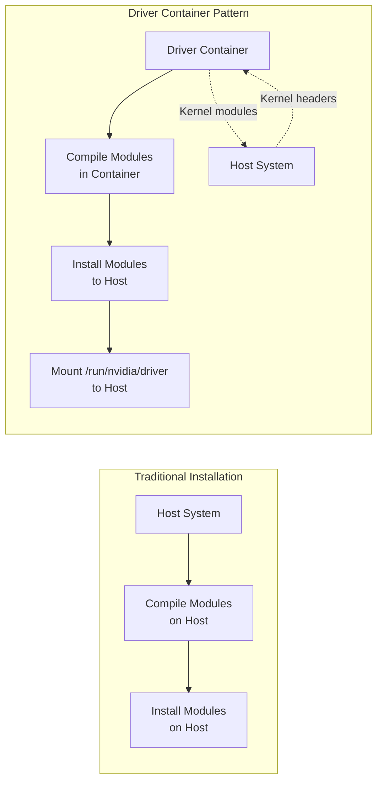
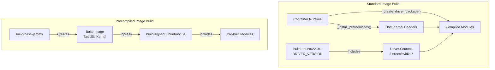
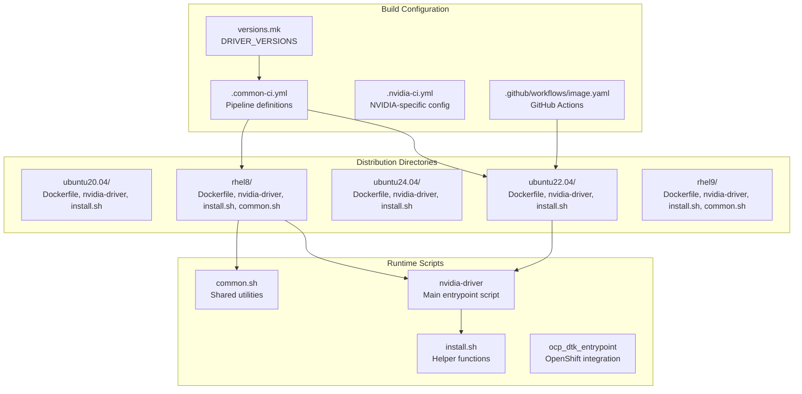
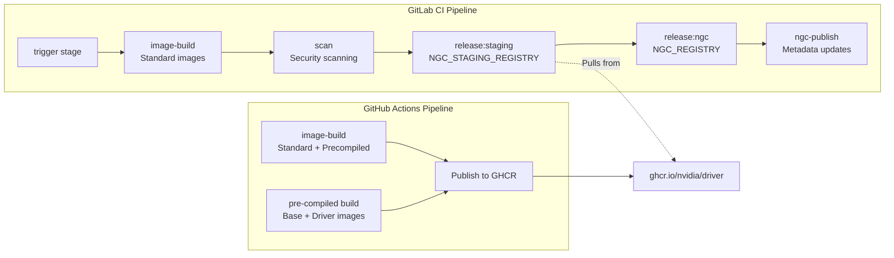
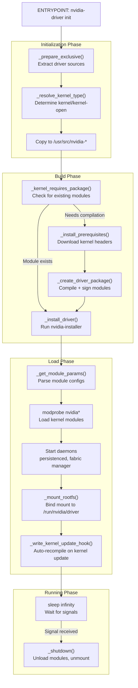

<!-- source: DeepWiki mcp.deepwiki.com · repo NVIDIA/gpu-driver-container · page 1 Overview · fetched 2026-10-26 -->

# Overview

Relevant source files

The following files were used as context for generating this wiki page:

- [.common-ci.yml](.common-ci.yml)
- [.github/workflows/image.yaml](.github/workflows/image.yaml)
- [.nvidia-ci.yml](.nvidia-ci.yml)
- [rhel8/Dockerfile](rhel8/Dockerfile)
- [rhel8/nvidia-driver](rhel8/nvidia-driver)
- [rhel9/Dockerfile](rhel9/Dockerfile)
- [rhel9/nvidia-driver](rhel9/nvidia-driver)
- [ubuntu20.04/Dockerfile](ubuntu20.04/Dockerfile)
- [ubuntu20.04/nvidia-driver](ubuntu20.04/nvidia-driver)
- [ubuntu22.04/Dockerfile](ubuntu22.04/Dockerfile)
- [ubuntu22.04/nvidia-driver](ubuntu22.04/nvidia-driver)
- [versions.mk](versions.mk)

This document introduces the NVIDIA GPU Driver Container repository, a system for building and distributing containerized NVIDIA GPU drivers across multiple Linux distributions. This page provides context for understanding the repository's architecture, build system, and runtime behavior.

For information about specific subsystems, see:
- CI/CD pipeline details: [CI/CD Pipeline](#3)
- Container image variants: [Container Image Types](#4)
- Runtime driver management: [Driver Management Scripts](#5)
- Build system configuration: [Build System Configuration](#6)

## Purpose and Scope

The gpu-driver-container repository builds container images that install and manage NVIDIA GPU drivers on host systems. These driver containers enable:

1. **Containerized driver deployment** - GPU drivers packaged as containers that install kernel modules on the host
2. **Kernel compatibility** - Support for runtime compilation against arbitrary host kernels or precompiled modules for specific kernels
3. **Multi-distribution support** - Single build system producing images for Ubuntu, RHEL, CoreOS, Flatcar, and Fedora
4. **Automated updates** - CI/CD pipelines that rebuild drivers for new kernel versions and security patches
5. **Integration with Kubernetes** - Designed for use with the NVIDIA GPU Operator and OpenShift Driver Toolkit

This repository does **not** contain the NVIDIA driver source code itself. It downloads driver installers from NVIDIA repositories and packages them into containers with appropriate runtime scripts.

Sources: [.common-ci.yml:1-367](), [versions.mk:1-19](), [rhel8/nvidia-driver:1-50]()

## The Driver Container Pattern

Traditional GPU driver installation requires compiling kernel modules directly on the host system. Driver containers reverse this approach: the container holds the driver sources and toolchain, compiles modules for the host kernel, then installs them from within the container.

**Sources:** [rhel8/nvidia-driver:559-583](), [ubuntu22.04/Dockerfile:1-117]()

### Container Lifecycle

The driver container follows this lifecycle:

1. **Initialization** (`nvidia-driver init`) - Extracts driver sources, determines kernel module type, prepares for compilation
2. **Build** - Downloads kernel headers, compiles modules against host kernel, optionally signs modules
3. **Load** - Loads kernel modules with `modprobe`, starts daemons (persistenced, fabric manager, vGPU grid)
4. **Mount** - Bind-mounts container filesystem to `/run/nvidia/driver` for host access to libraries
5. **Running** - Sleeps indefinitely while monitoring for shutdown signals

**Sources:** [rhel8/nvidia-driver:753-759](), [rhel9/nvidia-driver:770-776](), [ubuntu22.04/nvidia-driver:641-709]()

## Deployment Modes

The system supports three distinct deployment modes based on GPU virtualization requirements:

| Deployment Mode | Description | Use Case | Driver Type |
|----------------|-------------|----------|-------------|
| **Passthrough/Baremetal** | Standard GPU pass-through to containers or bare metal workloads | Kubernetes pods, Docker containers, physical servers | `DRIVER_TYPE=passthrough` |
| **vGPU Guest** | Virtual GPU guest drivers for VMs | Virtual machines with vGPU | `DRIVER_TYPE=vgpu` with guest components |
| **vGPU Host** | Virtual GPU host drivers for hypervisors | ESXi, KVM hypervisors managing vGPUs | `DRIVER_TYPE=vgpu` with host components |

```mermaid
graph TB
    subgraph "Passthrough Mode"
        PASS_CONTAINER["nvidia-driver Container<br/>DRIVER_TYPE=passthrough"]
        PASS_HOST["Host Kernel"]
        PASS_GPU["Physical GPU"]
        
        PASS_CONTAINER -->|"modprobe nvidia"| PASS_HOST
        PASS_HOST -->|Direct access| PASS_GPU
    end
    
    subgraph "vGPU Guest Mode"
        VGPU_G_CONTAINER["nvidia-driver Container<br/>DRIVER_TYPE=vgpu"]
        VGPU_G_VM["Guest VM Kernel"]
        VGPU_DEVICE["vGPU Device"]
        
        VGPU_G_CONTAINER -->|"modprobe nvidia"| VGPU_G_VM
        VGPU_G_CONTAINER -->|"nvidia-gridd"| VGPU_LICENSE["License Server"]
        VGPU_G_VM -->|Virtual access| VGPU_DEVICE
    end
    
    subgraph "vGPU Host Mode"
        VGPU_H_CONTAINER["nvidia-driver Container<br/>DRIVER_TYPE=vgpu<br/>Host components"]
        VGPU_H_HOST["Hypervisor Kernel"]
        VGPU_H_GPU["Physical GPU"]
        
        VGPU_H_CONTAINER -->|"modprobe nvidia-vgpu-vfio"| VGPU_H_HOST
        VGPU_H_HOST -->|Create vGPUs| VGPU_H_GPU
    end
```

**Sources:** [rhel8/Dockerfile:38-45](), [rhel8/nvidia-driver:387-401](), [ubuntu20.04/nvidia-driver:307-321]()

## Build Modes: Standard vs Precompiled

### Standard Images (Runtime Compilation)

Standard images contain driver sources and compile kernel modules at container startup against the host's kernel.

**Advantages:**
- Single image supports many kernel versions
- Smaller image size (no precompiled modules)
- Flexibility for custom kernels

**Disadvantages:**
- Slower startup time (compilation required)
- Requires kernel headers on host or downloaded at runtime
- Requires build toolchain in container

**Sources:** [rhel8/nvidia-driver:196-259](), [ubuntu22.04/nvidia-driver:135-199]()

### Precompiled Images (Pre-built Modules)

Precompiled images contain kernel modules built for specific kernel versions, eliminating runtime compilation.

**Advantages:**
- Fast startup (no compilation)
- No kernel headers required
- Smaller attack surface (no build tools)

**Disadvantages:**
- Larger total footprint (many images for many kernels)
- Requires exact kernel version match
- Only supported on Ubuntu 22.04, 24.04 and RHEL 9

**Sources:** [.github/workflows/image.yaml:93-194](), [.common-ci.yml:92-107](), [.nvidia-ci.yml:115-128]()

## Distribution Support Matrix

The system builds images for multiple Linux distributions and architectures:

| Distribution | Versions | Architectures | Precompiled Support | Driver Branches |
|-------------|----------|---------------|---------------------|-----------------|
| **Ubuntu** | 20.04, 22.04, 24.04 | amd64, arm64 | 22.04, 24.04 only | 535, 570, 580 (535 not on 24.04) |
| **RHEL** | 8, 9 | amd64, arm64 | No | 535, 570, 580 |
| **CoreOS** | Various | amd64, arm64 | No | 535, 570, 580 |
| **Flatcar** | Various | amd64, arm64 | No | 535, 570, 580 |
| **Fedora** | 36+ | amd64, arm64 | No | 535, 570, 580 |

**Sources:** [.common-ci.yml:22-23](), [versions.mk:15-16](), [.github/workflows/image.yaml:34-44]()

## Repository Structure and Key Files

**Key directories and their purposes:**

- **Distribution directories** (`ubuntu20.04/`, `rhel8/`, etc.) - Per-distribution Dockerfiles and runtime scripts
- **CI/CD configuration** (`.common-ci.yml`, `.nvidia-ci.yml`, `.github/workflows/`) - Build and release automation
- **Runtime scripts** (`nvidia-driver`, `common.sh`, `install.sh`) - Driver lifecycle management
- **Build configuration** (`versions.mk`, `Makefile`) - Version definitions and build orchestration

**Sources:** [versions.mk:1-19](), [.common-ci.yml:1-50](), [rhel8/Dockerfile:1-110]()

## Image Naming and Versioning

Driver container images follow a consistent naming scheme:

### Standard Images

Format: `{registry}/driver:{version}-{driver_version}-{dist}`

Example: `nvcr.io/nvidia/driver:550.90.07-ubuntu22.04`

Components:
- **registry**: `nvcr.io/nvidia` (production), `ghcr.io/nvidia` (staging)
- **version**: Git commit SHA or release tag
- **driver_version**: NVIDIA driver version (e.g., `535.274.02`, `570.195.03`, `580.95.05`)
- **dist**: Distribution identifier (e.g., `ubuntu22.04`, `rhel9`)

### Precompiled Images

Format: `{registry}/driver:{version}-{driver_version}-{kernel_version}-{dist}`

Example: `nvcr.io/nvidia/driver:550.90.07-6.8.0-1014-aws-signed_ubuntu22.04`

Additional components:
- **kernel_version**: Specific kernel version (e.g., `6.8.0-1014-aws`)
- **dist**: Includes `signed_` prefix (e.g., `signed_ubuntu22.04`)

**Sources:** [.common-ci.yml:163-184](), [.nvidia-ci.yml:45-69]()

## CI/CD Pipeline Overview

The build and release process uses a dual-pipeline architecture:

**Pipeline triggers:**
- **Merge requests** - Build and scan only
- **Main branch commits** - Build, scan, and push to staging
- **Git tags** - Full release to NGC production
- **Scheduled** (GitHub) - Daily precompiled builds for new kernels

**Sources:** [.common-ci.yml:25-50](), [.nvidia-ci.yml:39-148](), [.github/workflows/image.yaml:18-24]()

## Runtime Architecture and Key Scripts

The driver container's runtime behavior is controlled by the `nvidia-driver` script, which exists in distribution-specific versions but follows a common structure:

**Key functions by phase:**

| Phase | Function | Purpose | Location |
|-------|----------|---------|----------|
| Initialization | `_prepare_exclusive()` | Extract driver installer, acquire lock | [rhel8/nvidia-driver:709-724]() |
| Initialization | `_resolve_kernel_type()` | Choose kernel vs kernel-open modules | [rhel8/nvidia-driver:615-643]() |
| Build | `_kernel_requires_package()` | Check if modules need recompilation | [rhel8/nvidia-driver:176-193]() |
| Build | `_create_driver_package()` | Compile, sign, package modules | [rhel8/nvidia-driver:196-259]() |
| Build | `_install_driver()` | Run nvidia-installer | [rhel8/nvidia-driver:525-557]() |
| Load | `_get_module_params()` | Parse custom module parameters | [rhel8/nvidia-driver:305-341]() |
| Load | `_load_driver()` | Load modules and start daemons | [rhel8/nvidia-driver:344-422]() |
| Load | `_mount_rootfs()` | Mount container filesystem to host | [rhel8/nvidia-driver:560-575]() |
| Running | `_shutdown()` | Clean unload and unmount | [rhel8/nvidia-driver:606-613]() |

**Sources:** [rhel8/nvidia-driver:753-820](), [rhel9/nvidia-driver:770-838](), [ubuntu22.04/nvidia-driver:641-772]()

## Integration Points

The driver container integrates with several external systems:

### Kubernetes GPU Operator

The NVIDIA GPU Operator deploys driver containers as DaemonSets on Kubernetes clusters. The operator:
- Manages driver container lifecycle
- Handles kernel updates via the update command
- Validates driver installation via readiness probes
- Integrates with the NVIDIA Device Plugin

### OpenShift Driver Toolkit

For Red Hat OpenShift, the driver container can use the Driver Toolkit to obtain exact kernel headers:
- `ocp_dtk_entrypoint` script provides DTK-specific initialization
- Mounts shared driver toolkit from `/mnt/shared-nvidia-driver-toolkit`
- Supports OpenShift-specific kernel versions (RHCOS)

### Container Registries

Images are published to two registries with different purposes:

| Registry | Purpose | Access | Usage |
|----------|---------|--------|-------|
| `nvcr.io/nvidia/driver` | Production distribution | Public | GPU Operator default |
| `ghcr.io/nvidia/driver` | Staging and development | Public | CI/CD artifacts, testing |

**Sources:** [.common-ci.yml:159-184](), [.nvidia-ci.yml:336-384](), [rhel8/ocp_dtk_entrypoint:1-50]()

## Driver Version Support

Current supported driver branches (as of latest update):

| Branch | Version | Status | Key Features |
|--------|---------|--------|--------------|
| **535** | 535.274.02 | Production | Legacy support, LTS |
| **570** | 570.195.03 | Production | Current production branch |
| **580** | 580.95.05 | Production | Latest features, R580+ |

The repository maintains the latest version in each active datacenter driver branch. Driver versions are defined in [versions.mk:16]() and referenced throughout the build system.

**Sources:** [versions.mk:15-16](), [.common-ci.yml:22]()

## Next Steps

For detailed information about specific subsystems, continue to:

- **[Architecture](#2)** - Detailed system architecture and component interactions
- **[CI/CD Pipeline](#3)** - In-depth pipeline configuration and workflows
- **[Container Image Types](#4)** - Specifications for each image variant
- **[Driver Management Scripts](#5)** - Complete script reference and lifecycle management
- **[Build System Configuration](#6)** - Makefile, Dockerfile, and build variable reference

---

