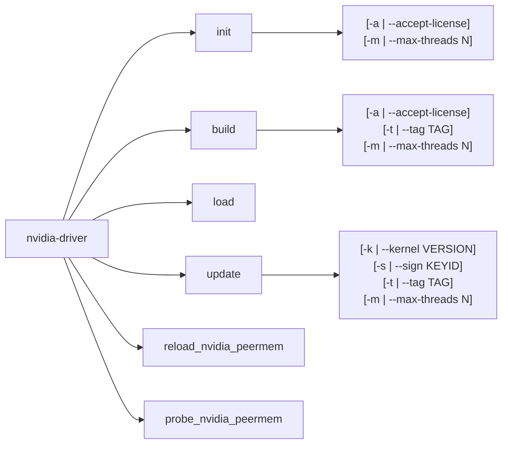
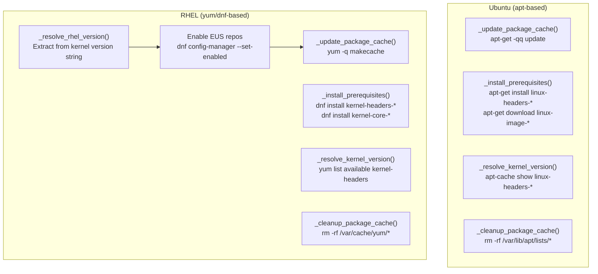
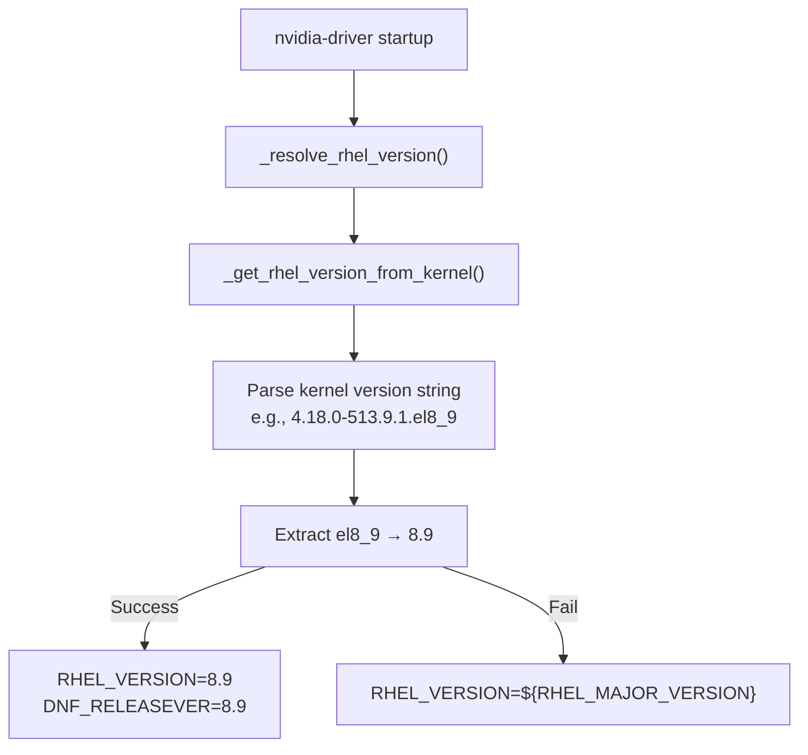
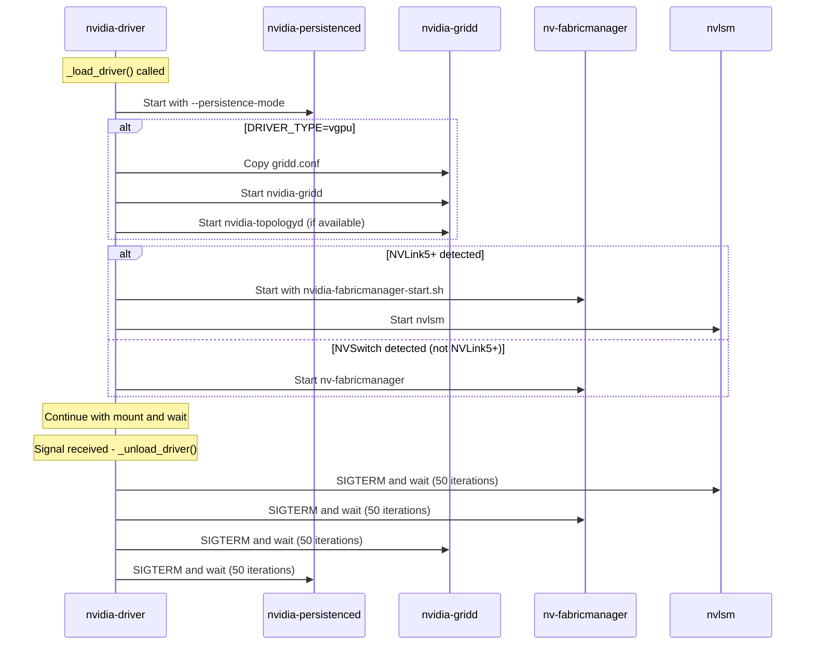
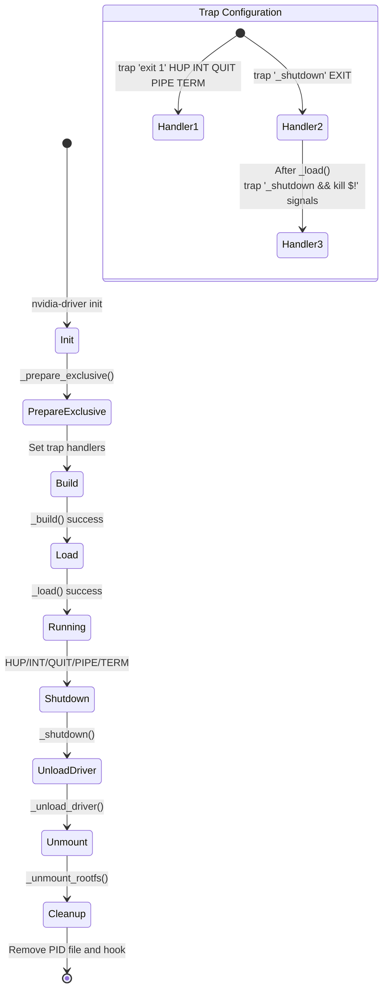
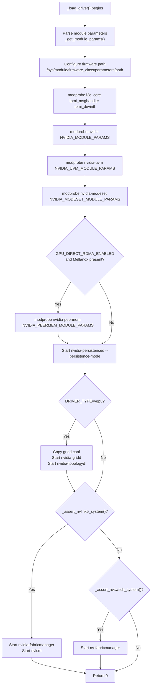
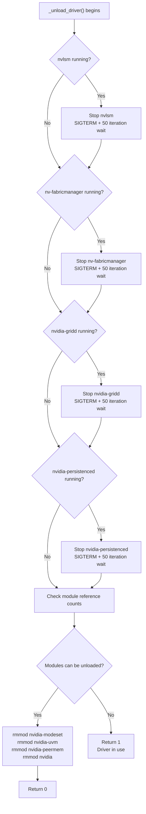
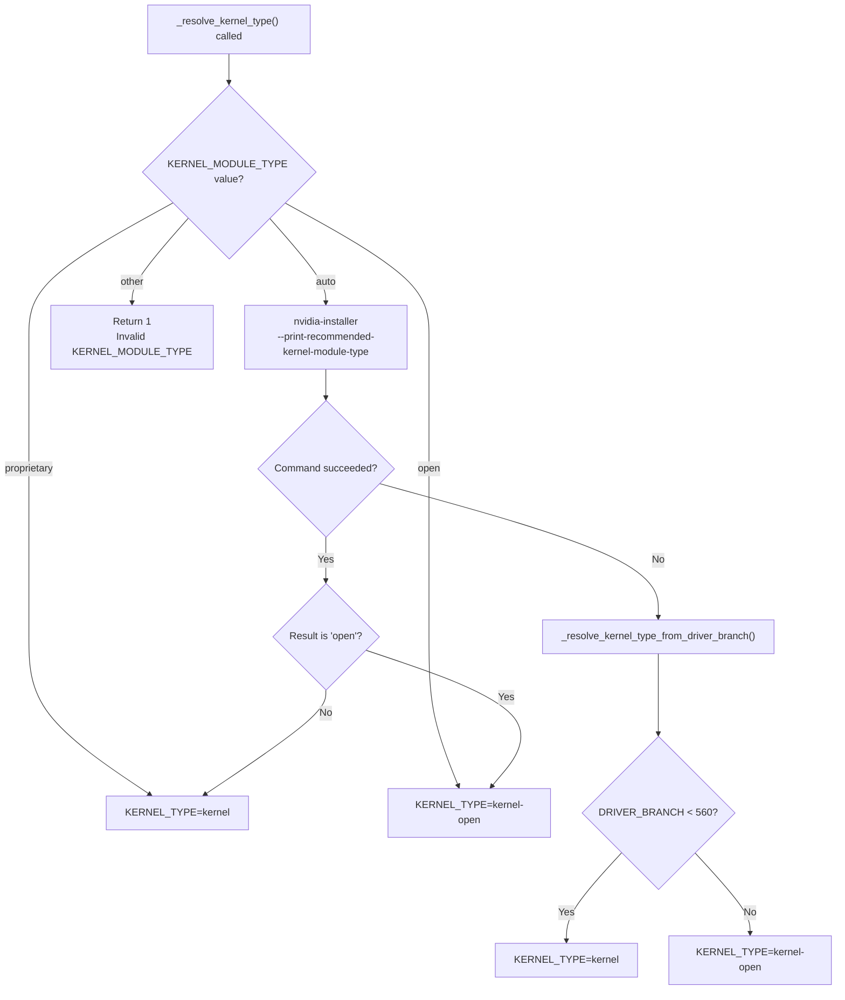

<!-- source: DeepWiki mcp.deepwiki.com · repo NVIDIA/gpu-driver-container · page 10 Reference · fetched 2026-10-26 -->

# Reference

<details>
<summary>Relevant source files</summary>

The following files were used as context for generating this wiki page:

- [rhel8/nvidia-driver](rhel8/nvidia-driver)
- [rhel9/nvidia-driver](rhel9/nvidia-driver)
- [ubuntu20.04/nvidia-driver](ubuntu20.04/nvidia-driver)
- [ubuntu22.04/nvidia-driver](ubuntu22.04/nvidia-driver)
- [ubuntu24.04/Dockerfile](ubuntu24.04/Dockerfile)
- [ubuntu24.04/install.sh](ubuntu24.04/install.sh)
- [ubuntu24.04/nvidia-driver](ubuntu24.04/nvidia-driver)

</details>


## Purpose and Scope

This page provides quick reference materials for the gpu-driver-container system, including environment variables, command-line arguments, file paths, and configuration options. This reference is organized for rapid lookup during development, debugging, and deployment.

For detailed information about specific subsystems:
- For comprehensive environment variable documentation, see [Environment Variables](#10.1)
- For command usage and Makefile targets, see [Command Reference](#10.2)
- For debugging and common issues, see [Troubleshooting](#10.3)

## Environment Variables Quick Reference

The following table summarizes the most commonly used environment variables in the driver container system:

| Variable | Required | Default | Description | Used By |
|----------|----------|---------|-------------|---------|
| `DRIVER_VERSION` | Yes | None | NVIDIA driver version to install (e.g., 535.129.03) | All nvidia-driver scripts |
| `TARGETARCH` | Yes | None | Target architecture: `amd64` or `arm64` | All build/runtime scripts |
| `DRIVER_TYPE` | No | `passthrough` | Driver type: `passthrough`, `vgpu` | All nvidia-driver scripts |
| `DRIVER_BRANCH` | No | Derived from version | Driver branch: 535, 550, 570, 580 | All nvidia-driver scripts |
| `KERNEL_VERSION` | No | `$(uname -r)` | Linux kernel version to build against | nvidia-driver scripts |
| `KERNEL_MODULE_TYPE` | No | `auto` | Module type: `auto`, `open`, `proprietary` | nvidia-driver scripts |
| `ACCEPT_LICENSE` | No | None | Set to `yes` to accept NVIDIA license | nvidia-driver init/build |
| `MAX_THREADS` | No | None | Number of compilation threads | nvidia-driver build/update |
| `GPU_DIRECT_RDMA_ENABLED` | No | `false` | Enable GPUDirect RDMA support | Ubuntu nvidia-driver scripts |
| `USE_HOST_MOFED` | No | `false` | Use host MOFED drivers instead of container | All nvidia-driver scripts |
| `PACKAGE_TAG` | No | None | Tag for precompiled packages | nvidia-driver scripts |
| `PRIVATE_KEY` | No | None | Path to private key for module signing | nvidia-driver scripts |
| `VGPU_LICENSE_SERVER_TYPE` | No | `NLS` | vGPU license server type: `NLS` or legacy | vGPU configurations |
| `DISABLE_VGPU_VERSION_CHECK` | No | `true` | Skip vGPU version compatibility check | vGPU configurations |
| `UBUNTU_PRO_TOKEN` | No | None | Ubuntu Pro subscription token for FIPS | Ubuntu 22.04/24.04 only |
| `DNF_RELEASEVER` | No | Auto-detected | DNF release version for package repos | RHEL nvidia-driver scripts |
| `RHEL_VERSION` | No | Auto-detected | RHEL version (e.g., 8.9, 9.3) | RHEL nvidia-driver scripts |
| `OPENSHIFT_VERSION` | No | None | OpenShift version for repo enablement | RHEL nvidia-driver scripts |

**Sources:** [rhel8/nvidia-driver:1-26](), [ubuntu20.04/nvidia-driver:1-25](), [ubuntu22.04/nvidia-driver:1-24](), [ubuntu24.04/nvidia-driver:1-25](), [rhel9/nvidia-driver:1-27]()

## nvidia-driver Command Reference

### Command Syntax Diagram



### Available Commands

| Command | Description | Availability | Exit Behavior |
|---------|-------------|--------------|---------------|
| `init` | Full initialization: prepare, build, load, and mount driver | All distributions | Runs indefinitely, traps signals |
| `build` | Build kernel modules only (no exclusive lock) | RHEL 8 only | Exits after build completes |
| `load` | Load pre-built driver (requires exclusive lock) | RHEL 8 only | Runs indefinitely, traps signals |
| `update` | Pre-compile modules for a specific kernel version | All distributions | Exits after compilation |
| `reload_nvidia_peermem` | Reload nvidia-peermem module after MOFED update | All distributions | Runs indefinitely until module loaded |
| `probe_nvidia_peermem` | Health check for nvidia-peermem module | All distributions | Exits with status code |

**Note:** Ubuntu 24.04 has a simplified interface with only `init`, `reload_nvidia_peermem`, and `probe_nvidia_peermem` commands.

**Sources:** [rhel8/nvidia-driver:865-919](), [ubuntu20.04/nvidia-driver:737-785](), [ubuntu22.04/nvidia-driver:816-864](), [ubuntu24.04/nvidia-driver:654-698]()

### Command Options

| Option | Long Form | Argument | Commands | Description |
|--------|-----------|----------|----------|-------------|
| `-a` | `--accept-license` | None | init, build | Accept NVIDIA driver license automatically |
| `-k` | `--kernel` | VERSION | update | Specify kernel version (default: `$(uname -r)`) |
| `-m` | `--max-threads` | N | init, build, update | Number of parallel compilation threads |
| `-s` | `--sign` | KEYID | update | Sign kernel modules with specified key |
| `-t` | `--tag` | TAG | build, update | Tag for precompiled package naming |

**Sources:** [rhel8/nvidia-driver:883-891](), [ubuntu22.04/nvidia-driver:832-838]()

## Kernel Module Parameters

### Configuration File Locations

Module parameters are read from configuration files mounted at `/drivers/<module-name>.conf`:

| Module | Configuration File | Environment Variable Array |
|--------|-------------------|---------------------------|
| nvidia | `/drivers/nvidia.conf` | `NVIDIA_MODULE_PARAMS` |
| nvidia-uvm | `/drivers/nvidia-uvm.conf` | `NVIDIA_UVM_MODULE_PARAMS` |
| nvidia-modeset | `/drivers/nvidia-modeset.conf` | `NVIDIA_MODESET_MODULE_PARAMS` |
| nvidia-peermem | `/drivers/nvidia-peermem.conf` | `NVIDIA_PEERMEM_MODULE_PARAMS` |

**Sources:** [rhel8/nvidia-driver:295-341](), [ubuntu20.04/nvidia-driver:221-261]()

### Automatic Module Parameters

Starting from driver branch 580, the following parameter is automatically added:

| Parameter | Value | Purpose | Added In |
|-----------|-------|---------|----------|
| `NVreg_CoherentGPUMemoryMode` | `driver` | Prevent GPU memory from being exposed as NUMA node on coherent systems (GH200, GB200) | R580+ |

**Sources:** [rhel8/nvidia-driver:308-311](), [ubuntu22.04/nvidia-driver:271-274]()

### Module Parameter Format

Each line in a `.conf` file represents module parameters. Multiple parameters on the same line are space-delimited:

```
# Example: /drivers/nvidia.conf
NVreg_EnableGpuFirmware=1
NVreg_EnableStreamMemOPs=1 NVreg_EnableUserNUMAManagement=0
```

**Sources:** [rhel8/nvidia-driver:295-304]()

## Critical File System Paths

### Runtime Paths Diagram

```mermaid
graph TB
    subgraph "Container Filesystem"
        DRIVERS["/drivers/<br/>Driver installer + configs"]
        USR_SRC["/usr/src/nvidia-${DRIVER_VERSION}/<br/>Kernel module sources"]
        KERNEL_TYPE["/usr/src/nvidia-${DRIVER_VERSION}/${KERNEL_TYPE}<br/>(kernel or kernel-open)"]
        PRECOMPILED["/usr/src/nvidia-${DRIVER_VERSION}/${KERNEL_TYPE}/precompiled/<br/>Precompiled packages"]
    end
    
    subgraph "Host-Mounted Paths"
        RUN_NVIDIA["/run/nvidia/<br/>Runtime state"]
        PID["/run/nvidia/nvidia-driver.pid<br/>Driver PID file"]
        DRIVER_MOUNT["/run/nvidia/driver/<br/>Bind-mounted driver rootfs"]
        KERNEL_HOOK["/run/kernel/postinst.d/update-nvidia-driver<br/>Kernel update hook"]
        VALIDATIONS["/run/nvidia/validations/.driver-ctr-ready<br/>Readiness flag"]
    end
    
    subgraph "Host Kernel Paths"
        LIB_MODULES["/lib/modules/${KERNEL_VERSION}/<br/>Kernel modules"]
        PROC_VERSION["/lib/modules/${KERNEL_VERSION}/proc/version<br/>Kernel version string"]
        MODULE_BUILD["/lib/modules/${KERNEL_VERSION}/build<br/>→ /usr/src/kernels/${KERNEL_VERSION}"]
    end
    
    subgraph "MOFED Integration"
        MOFED_DRIVERS["/run/mellanox/drivers/<br/>MOFED container mount"]
        OFA_KERNEL["/run/mellanox/drivers/usr/src/ofa_kernel/<br/>OFED headers"]
        DRIVER_READY["/run/mellanox/drivers/.driver-ready<br/>MOFED readiness flag"]
    end
    
    DRIVERS --> USR_SRC
    USR_SRC --> KERNEL_TYPE
    KERNEL_TYPE --> PRECOMPILED
    
    RUN_NVIDIA --> PID
    RUN_NVIDIA --> DRIVER_MOUNT
    RUN_NVIDIA --> KERNEL_HOOK
    RUN_NVIDIA --> VALIDATIONS
    
    LIB_MODULES --> PROC_VERSION
    LIB_MODULES --> MODULE_BUILD
    
    MOFED_DRIVERS --> OFA_KERNEL
    MOFED_DRIVERS --> DRIVER_READY
```



**Sources:** [rhel8/nvidia-driver:6-9](), [ubuntu20.04/nvidia-driver:6-9](), [rhel8/nvidia-driver:560-575](), [ubuntu20.04/nvidia-driver:449-464]()

### Path Reference Table

| Path | Type | Purpose | Created By |
|------|------|---------|------------|
| `/run/nvidia` | Directory | Runtime state and PID files | nvidia-driver |
| `/run/nvidia/nvidia-driver.pid` | File | Main driver process PID | nvidia-driver init |
| `/run/nvidia/driver` | Mount point | Bind-mounted driver rootfs | `_mount_rootfs()` |
| `/run/nvidia/validations/.driver-ctr-ready` | File | Driver readiness flag for health checks | External (GPU Operator) |
| `/run/kernel/postinst.d/update-nvidia-driver` | Script | Automatic kernel update hook | `_write_kernel_update_hook()` |
| `/usr/src/nvidia-${DRIVER_VERSION}` | Directory | Driver source code and build artifacts | nvidia-driver prepare |
| `/usr/src/nvidia-${DRIVER_VERSION}/${KERNEL_TYPE}` | Directory | Kernel module sources (kernel or kernel-open) | nvidia-driver prepare |
| `/usr/src/nvidia-${DRIVER_VERSION}/${KERNEL_TYPE}/precompiled` | Directory | Precompiled module packages | `_create_driver_package()` |
| `/lib/modules/${KERNEL_VERSION}` | Directory | Kernel modules and metadata | `_install_prerequisites()` |
| `/lib/modules/${KERNEL_VERSION}/proc/version` | File | Kernel version string for matching | `_install_prerequisites()` |
| `/run/mellanox/drivers` | Mount point | MOFED container shared mount | External (MOFED container) |
| `/usr/src/ofa_kernel` | Symlink | OFED kernel headers for GPUDirect | `_create_driver_package()` |
| `/drivers` | Directory | Driver installers and config files | Container image |
| `/sys/module/firmware_class/parameters/path` | Sysfs | Firmware search path configuration | `_load_driver()` |

**Sources:** [rhel8/nvidia-driver:6-9](), [rhel8/nvidia-driver:560-575](), [rhel8/nvidia-driver:586-604](), [ubuntu20.04/nvidia-driver:65-92]()

## Distribution-Specific Differences

### Package Management Functions



**Sources:** [ubuntu20.04/nvidia-driver:26-44](), [rhel8/nvidia-driver:28-72]()

### Key Differences Table

| Feature | Ubuntu | RHEL 8/9 | Notes |
|---------|--------|----------|-------|
| Kernel version resolution | `apt-cache show` | `yum list available` | Different query commands |
| Kernel module files | `linux-image-*`, `linux-modules-*` | `kernel-core-*` or `kernel-*` | Package naming differs |
| Package cache location | `/var/lib/apt/lists/*` | `/var/cache/yum/*` | Different cache paths |
| RHEL version extraction | N/A | Extract from kernel version string | RHEL-specific `_get_rhel_version_from_kernel()` |
| EUS repository support | N/A | Conditional enable/disable | RHEL 8/9 only |
| OpenShift repository | N/A | Optional based on `OPENSHIFT_VERSION` | RHEL only |
| GCC version matching | Not implemented | Parse and install matching gcc | RHEL enforces gcc version match |
| vmlinuz extraction | `ls boot/vmlinuz-*` | `extract-vmlinux` → `unzboot` → `gunzip` | RHEL has fallback chain |
| FIPS support | Ubuntu Pro token | N/A | Ubuntu 22.04/24.04 only |
| SELinux relabeling | N/A | `chcon -R -t container_file_t` | RHEL only |
| Ubuntu 24.04 installer | One-step `nvidia-installer` | Multi-step process | Ubuntu 24.04 simplified |

**Sources:** [ubuntu20.04/nvidia-driver:46-62](), [rhel8/nvidia-driver:74-86](), [rhel9/nvidia-driver:144-176](), [ubuntu22.04/nvidia-driver:27-46](), [ubuntu24.04/nvidia-driver:433-482]()

### RHEL Version Detection Flow



**Sources:** [rhel8/nvidia-driver:46-71](), [rhel9/nvidia-driver:47-73]()

## Daemon Management

### Daemon PID Files and Control

| Daemon | PID File | Start Condition | Configuration |
|--------|----------|-----------------|---------------|
| `nvidia-persistenced` | `/var/run/nvidia-persistenced/nvidia-persistenced.pid` | Always | `--persistence-mode` |
| `nvidia-gridd` (vGPU) | `/var/run/nvidia-gridd/nvidia-gridd.pid` | `DRIVER_TYPE=vgpu` | `/etc/nvidia/gridd.conf` |
| `nvidia-topologyd` (vGPU) | N/A | `DRIVER_TYPE=vgpu` and binary exists | None |
| `nv-fabricmanager` (NVSwitch) | `/var/run/nvidia-fabricmanager/nv-fabricmanager.pid` | NVSwitch devices detected | `/usr/share/nvidia/nvswitch/fabricmanager.cfg` |
| `nv-fabricmanager` (NVLink5+) | `/var/run/nvidia-fabricmanager/nv-fabricmanager.pid` | NVLink5+ system detected | `/usr/share/nvidia/nvswitch/fabricmanager.cfg` |
| `nvlsm` (NVLink Subnet Manager) | `/var/run/nvidia-fabricmanager/nvlsm.pid` | NVLink5+ system detected | `/usr/share/nvidia/nvlsm/nvlsm.conf` |

**Sources:** [rhel8/nvidia-driver:384-421](), [ubuntu20.04/nvidia-driver:304-327](), [rhel8/nvidia-driver:424-492]()

### Daemon Lifecycle Diagram



**Sources:** [rhel8/nvidia-driver:343-422](), [rhel8/nvidia-driver:424-522]()

## Exit Codes and Return Values

### nvidia-driver Command Exit Codes

| Exit Code | Meaning | Common Causes |
|-----------|---------|---------------|
| 0 | Success | Normal completion |
| 1 | General error | Missing dependencies, invalid arguments, module compilation failure |
| N/A (no exit) | Running indefinitely | `init` and `load` commands, `reload_nvidia_peermem` after success |

### Function Return Values

| Function | Return 0 | Return 1 | Notes |
|----------|----------|----------|-------|
| `_resolve_kernel_version()` | Version resolved | Could not resolve version | Uses package manager queries |
| `_install_prerequisites()` | Prerequisites installed | Installation failed | Downloads kernel headers/modules |
| `_kernel_requires_package()` | Precompiled package exists | Need to compile | Checks for matching precompiled module |
| `_create_driver_package()` | Package created | Compilation failed | Builds precompiled package |
| `_install_driver()` | Driver installed | nvidia-installer failed | Uses nvidia-installer |
| `_load_driver()` | Driver loaded | modprobe failed or daemon start failed | Loads modules and starts daemons |
| `_unload_driver()` | Driver unloaded | Modules in use or daemon stop timeout | Cannot unload if GPU in use |
| `_shutdown()` | Clean shutdown | Could not unload driver | Unloads driver and unmounts rootfs |
| `_gpu_direct_rdma_enabled()` | GPUDirect enabled and Mellanox present | Disabled or no Mellanox devices | Ubuntu only |
| `_assert_nvswitch_system()` | NVSwitch devices found | No NVSwitch devices | Checks `/proc/driver/nvidia-nvswitch/devices` |
| `_assert_nvlink5_system()` | NVLink5+ detected | Not NVLink5+ system | Checks for 'SW_MNG' in VPD files |

**Sources:** [rhel8/nvidia-driver:74-86](), [rhel8/nvidia-driver:176-193](), [rhel8/nvidia-driver:261-285](), [rhel8/nvidia-driver:343-422](), [rhel8/nvidia-driver:424-522]()

## Signal Handling

### Signal Traps



**Sources:** [rhel8/nvidia-driver:719-720](), [rhel8/nvidia-driver:747-749](), [ubuntu20.04/nvidia-driver:604-606](), [ubuntu20.04/nvidia-driver:627-629]()

### Trap Behavior by Command

| Command | Signal Trap | EXIT Trap | Infinite Wait |
|---------|-------------|-----------|---------------|
| `init` | Set before build/load | `_shutdown` until after load, then removed | Yes - `sleep infinity &` with wait loop |
| `build` | Not set | Not set | No - exits after build |
| `load` | Set before load | `_shutdown` until after load, then removed | Yes - `sleep infinity &` with wait loop |
| `update` | Set after preparation | Not set | No - exits after compilation |
| `reload_nvidia_peermem` | Set after module loads | Not set | Yes - `sleep inf` if successful |

**Sources:** [rhel8/nvidia-driver:753-771](), [rhel8/nvidia-driver:773-821](), [rhel8/nvidia-driver:824-850]()

## Module Loading Sequence

### Load Order Diagram



**Sources:** [rhel8/nvidia-driver:343-422](), [ubuntu20.04/nvidia-driver:263-329]()

### Unload Order Diagram



**Sources:** [rhel8/nvidia-driver:424-522](), [ubuntu20.04/nvidia-driver:331-416]()

## Kernel Type Resolution

### Resolution Flow



**Sources:** [rhel8/nvidia-driver:615-644](), [ubuntu20.04/nvidia-driver:496-525]()

### Kernel Module Type Table

| Driver Branch | Default (auto) | Notes |
|--------------|----------------|-------|
| < 560 | proprietary (`kernel`) | Uses proprietary kernel modules |
| >= 560 | open (`kernel-open`) | Defaults to open-source kernel modules |
| Any | User-specified | Can override with `KERNEL_MODULE_TYPE=open` or `proprietary` |

**Sources:** [rhel8/nvidia-driver:641-643](), [ubuntu22.04/nvidia-driver:599-601]()

This reference page provides quick access to the most commonly needed information when working with the gpu-driver-container system. For detailed explanations and troubleshooting guidance, consult the linked sub-pages.

---

