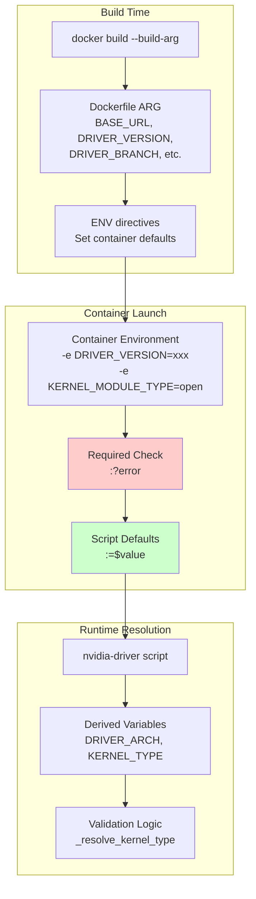
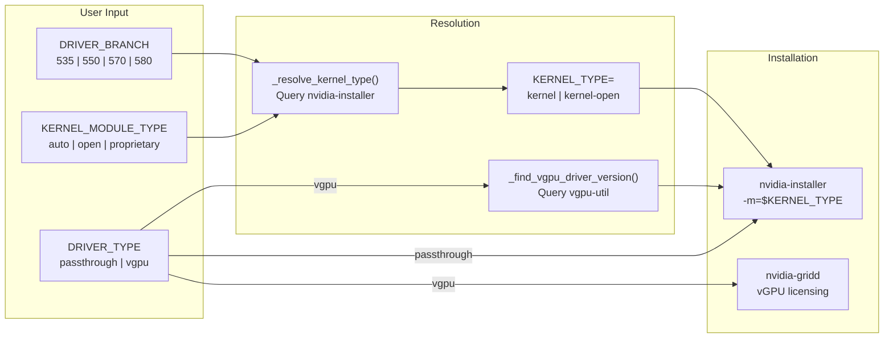
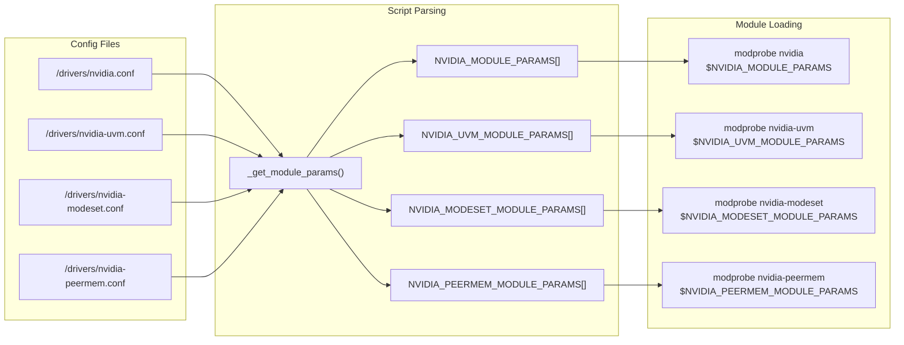
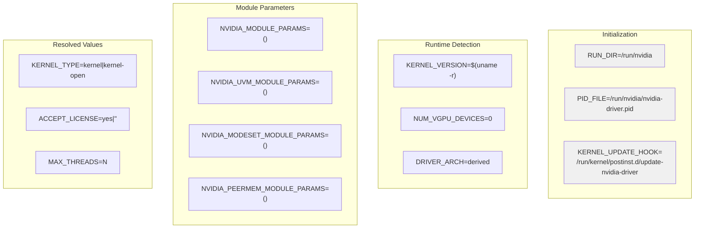
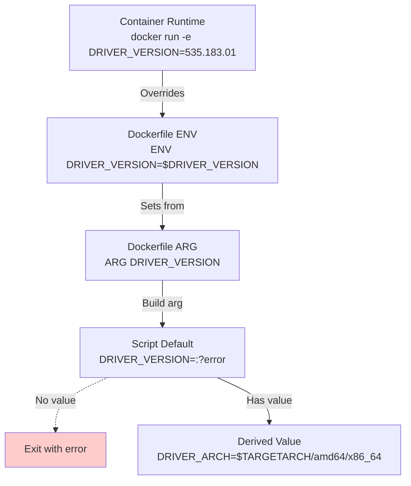

<!-- source: DeepWiki mcp.deepwiki.com · repo NVIDIA/gpu-driver-container · page 10.1 Environment Variables · fetched 2026-10-26 -->

# Environment Variables

<details>
<summary>Relevant source files</summary>

The following files were used as context for generating this wiki page:

- [rhel8/Dockerfile](rhel8/Dockerfile)
- [rhel8/nvidia-driver](rhel8/nvidia-driver)
- [rhel9/Dockerfile](rhel9/Dockerfile)
- [rhel9/nvidia-driver](rhel9/nvidia-driver)
- [ubuntu20.04/Dockerfile](ubuntu20.04/Dockerfile)
- [ubuntu20.04/nvidia-driver](ubuntu20.04/nvidia-driver)
- [ubuntu22.04/Dockerfile](ubuntu22.04/Dockerfile)
- [ubuntu22.04/nvidia-driver](ubuntu22.04/nvidia-driver)
- [ubuntu24.04/Dockerfile](ubuntu24.04/Dockerfile)
- [ubuntu24.04/install.sh](ubuntu24.04/install.sh)
- [ubuntu24.04/nvidia-driver](ubuntu24.04/nvidia-driver)

</details>


This page provides a complete reference for all environment variables used by the NVIDIA GPU driver container system. These variables control driver installation, module compilation, daemon behavior, and various advanced features.

For information about how these variables are used during the driver lifecycle, see [Initialization and Lifecycle](#5.1). For build-time configuration, see [Build Arguments and Variables](#6.3).

## Overview

Environment variables in the GPU driver container system can be categorized into:

- **Required variables**: Must be set for the container to function
- **Driver configuration**: Control which driver type and version to install
- **Feature flags**: Enable or disable optional functionality
- **Build-time variables**: Set during image build via `ARG` directives
- **Internal variables**: Set automatically by scripts, not user-configurable

Variables are consumed by the `nvidia-driver` script family at runtime and by Dockerfiles during build.

## Variable Flow and Resolution



**Sources:** [rhel8/nvidia-driver:1-26](), [rhel8/Dockerfile:1-110](), [ubuntu20.04/Dockerfile:35-56]()

## Required Environment Variables

These variables must be set for the container to operate correctly. The container will exit with an error if they are missing.

| Variable | Description | Set By | Example |
|----------|-------------|---------|---------|
| `DRIVER_VERSION` | NVIDIA driver version to install | Dockerfile `ENV` | `535.183.01` |
| `TARGETARCH` | Target CPU architecture | Dockerfile `ARG` | `amd64`, `arm64` |

**Sources:** [rhel8/nvidia-driver:8](), [rhel8/nvidia-driver:15](), [ubuntu20.04/nvidia-driver:8](), [ubuntu20.04/nvidia-driver:17]()

### DRIVER_VERSION

The `DRIVER_VERSION` variable specifies the exact NVIDIA driver version to install. This must match an available driver release from NVIDIA's repositories.

```bash
# Syntax check from nvidia-driver script
DRIVER_VERSION=${DRIVER_VERSION:?"Missing DRIVER_VERSION env"}
```

**Format:** `<major>.<minor>.<patch>` (e.g., `535.183.01`, `550.54.15`)

**Usage in code:**
- Used to download driver installer: [rhel8/Dockerfile:68]()
- Used to resolve kernel module sources: [rhel8/nvidia-driver:181]()
- Passed to `nvidia-installer`: [rhel8/nvidia-driver:552]()

**Sources:** [rhel8/nvidia-driver:8](), [rhel8/Dockerfile:33-34](), [ubuntu20.04/nvidia-driver:8]()

### TARGETARCH

The `TARGETARCH` variable specifies the target CPU architecture for multi-arch builds. It is automatically set by Docker BuildKit during multi-platform builds.

**Valid values:** `amd64`, `arm64`, `x86_64`, `aarch64`

**Derived variable:** `DRIVER_ARCH` is computed from `TARGETARCH`:
```bash
DRIVER_ARCH=${TARGETARCH/amd64/x86_64} && DRIVER_ARCH=${DRIVER_ARCH/arm64/aarch64}
```

**Sources:** [rhel8/nvidia-driver:15](), [rhel8/nvidia-driver:22-23](), [ubuntu20.04/nvidia-driver:17](), [ubuntu20.04/nvidia-driver:22]()

## Driver Configuration Variables

These variables control which type of driver to install and how it should be configured.



**Sources:** [rhel8/nvidia-driver:615-643](), [ubuntu20.04/nvidia-driver:496-524](), [ubuntu22.04/nvidia-driver:573-601]()

### DRIVER_TYPE

Specifies whether to install a standard passthrough driver or a vGPU guest driver.

**Default:** `passthrough`

**Valid values:**
- `passthrough` - Standard GPU driver for bare metal or direct GPU passthrough
- `vgpu` - Virtual GPU guest driver for virtualized environments

**Effects:**
- When `vgpu`: Calls `_find_vgpu_driver_version()` to detect compatible driver [ubuntu20.04/nvidia-driver:565-567]()
- When `vgpu`: Starts `nvidia-gridd` daemon for license management [rhel8/nvidia-driver:387-401]()
- When `vgpu`: Copies `gridd.conf` and `ClientConfigToken` files [rhel8/nvidia-driver:388-394]()

**Sources:** [rhel8/Dockerfile:39-40](), [rhel8/nvidia-driver:387-401](), [ubuntu20.04/Dockerfile:47-48]()

### KERNEL_MODULE_TYPE

Determines which kernel module type (open-source or proprietary) to install.

**Default:** `auto`

**Valid values:**
- `auto` - Let `nvidia-installer` recommend the appropriate type
- `open` - Force open-source kernel modules (`kernel-open`)
- `proprietary` - Force proprietary kernel modules (`kernel`)

**Resolution logic:**

```bash
_resolve_kernel_type() {
  if [ "${KERNEL_MODULE_TYPE}" == "proprietary" ]; then
    KERNEL_TYPE=kernel
  elif [ "${KERNEL_MODULE_TYPE}" == "open" ]; then
    KERNEL_TYPE=kernel-open
  elif [ "${KERNEL_MODULE_TYPE}" == "auto" ]; then
    kernel_module_type=$(nvidia-installer --print-recommended-kernel-module-type)
    [[ "${kernel_module_type}" == "open" ]] && KERNEL_TYPE=kernel-open || KERNEL_TYPE=kernel
  fi
}
```

**Fallback:** If `nvidia-installer` cannot determine the type, falls back to driver branch logic:
- Driver branch < 560: Use `kernel` (proprietary)
- Driver branch >= 560: Use `kernel-open` (open-source)

**Sources:** [rhel8/nvidia-driver:615-643](), [ubuntu20.04/nvidia-driver:496-524](), [ubuntu22.04/nvidia-driver:573-601]()

### DRIVER_BRANCH

Specifies the major driver branch version. Used for package selection and kernel module type fallback logic.

**Examples:** `535`, `550`, `570`, `580`

**Usage:**
- Enable/disable features based on branch [rhel8/nvidia-driver:548-550]()
- Select appropriate repository packages [rhel8/Dockerfile:55]()
- Determine default kernel module type [rhel8/nvidia-driver:642]()

**Sources:** [rhel8/Dockerfile:35-36](), [rhel8/nvidia-driver:642](), [ubuntu20.04/Dockerfile:49-50]()

## vGPU Configuration Variables

These variables configure vGPU guest driver behavior and licensing.

| Variable | Default | Description |
|----------|---------|-------------|
| `VGPU_LICENSE_SERVER_TYPE` | `NLS` | License server type (NLS or legacy) |
| `DISABLE_VGPU_VERSION_CHECK` | `true` | Skip vGPU version compatibility check |

**Sources:** [rhel8/Dockerfile:41-45](), [ubuntu20.04/Dockerfile:51-55]()

### VGPU_LICENSE_SERVER_TYPE

Specifies the type of vGPU license server to use.

**Valid values:**
- `NLS` - NVIDIA License System (cloud licensing)
- Other values trigger legacy licensing mode

**Effects:**
When `NLS` is set:
```bash
if [ "${VGPU_LICENSE_SERVER_TYPE}" = "NLS" ]; then
    echo "Copying ClientConfigToken..."
    mkdir -p  /etc/nvidia/ClientConfigToken/
    cp /drivers/ClientConfigToken/* /etc/nvidia/ClientConfigToken/
fi
```

**Sources:** [rhel8/nvidia-driver:390-394](), [ubuntu20.04/nvidia-driver:310-314]()

### DISABLE_VGPU_VERSION_CHECK

Controls whether to verify vGPU driver compatibility with host GPU version.

**Default:** `true` (check disabled)

**Effects:**
When `false`, the container calls `vgpu-util` to:
1. Count vGPU devices on host [ubuntu20.04/nvidia-driver:535]()
2. Match compatible driver version from catalog [ubuntu20.04/nvidia-driver:548]()
3. Override `DRIVER_VERSION` if mismatch detected [ubuntu20.04/nvidia-driver:553]()

**Sources:** [rhel8/nvidia-driver:650-679](), [ubuntu20.04/nvidia-driver:526-556]()

## Advanced Feature Variables

These variables enable optional features like GPUDirect RDMA, FIPS mode, and fabric management.

### GPU_DIRECT_RDMA_ENABLED

Enables GPUDirect RDMA support for high-performance networking with Mellanox adapters.

**Default:** `false`

**Effects:**
- Checks for Mellanox devices [ubuntu20.04/nvidia-driver:211-219]()
- Links OFA kernel headers from MOFED [rhel8/nvidia-driver:207-220]()
- Loads `nvidia-peermem` module [rhel8/nvidia-driver:377-382]()

**Sources:** [ubuntu20.04/nvidia-driver:11](), [rhel8/nvidia-driver:207-220](), [rhel8/nvidia-driver:377-382]()

### USE_HOST_MOFED

Specifies whether to use Mellanox OFED drivers from the host or from a separate MOFED container.

**Default:** `false`

**Effects on `reload_nvidia_peermem` command:**
- `true`: Wait for host's `mlx5_core` module [rhel8/nvidia-driver:826]()
- `false`: Wait for MOFED container's readiness flag at `/run/mellanox/drivers/.driver-ready` [rhel8/nvidia-driver:833]()

**Sources:** [rhel8/nvidia-driver:16](), [rhel8/nvidia-driver:825-838](), [ubuntu20.04/nvidia-driver:12]()

### UBUNTU_PRO_TOKEN

Ubuntu Pro subscription token for accessing FIPS-certified packages and updates.

**Default:** Empty string

**Effects:**
Only applies when kernel contains "fips" in version string:
```bash
if [[ -n "${UBUNTU_PRO_TOKEN}" && ${KERNEL_VERSION} =~ "fips" ]]; then
    pro attach --no-auto-enable "${UBUNTU_PRO_TOKEN}"
    pro enable --access-only --assume-yes fips-updates
fi
```

**Ubuntu 24.04 specific:** Sets `OPENSSL_FORCE_FIPS_MODE=0` temporarily during Pro setup [ubuntu24.04/nvidia-driver:34]()

**Sources:** [ubuntu22.04/nvidia-driver:19](), [ubuntu22.04/nvidia-driver:27-36](), [ubuntu24.04/nvidia-driver:19](), [ubuntu24.04/nvidia-driver:27-45]()

## Kernel Module Parameters

These variables are not environment variables but are read from configuration files mounted into the container at `/drivers/*.conf`. They control kernel module behavior at load time.



**Sources:** [rhel8/nvidia-driver:305-341](), [ubuntu20.04/nvidia-driver:231-261]()

### Module Parameter Configuration

The `_get_module_params()` function reads parameters from mounted configuration files:

**File format:** One parameter per line, multiple parameters allowed per file

**Example `/drivers/nvidia.conf`:**
```
NVreg_EnableGpuFirmware=1
NVreg_PreserveVideoMemoryAllocations=1
```

**Automatic parameter (R580+):**
Starting with driver branch 580, the following parameter is automatically added:
```bash
NVIDIA_MODULE_PARAMS+=("NVreg_CoherentGPUMemoryMode=driver")
```
This prevents GPU memory on coherent systems (GH200, GB200) from being exposed as a NUMA node.

**Sources:** [rhel8/nvidia-driver:308-311](), [ubuntu22.04/nvidia-driver:271-274](), [ubuntu24.04/nvidia-driver:212-215]()

## Build-Time Variables

These variables are set during image build via Dockerfile `ARG` directives.

| Variable | Purpose | Example |
|----------|---------|---------|
| `BASE_URL` | URL for downloading driver installer | `https://us.download.nvidia.com/tesla` |
| `GOLANG_VERSION` | Go version for building vgpu-util | `1.20.4` |
| `CVE_UPDATES` | Package list for CVE fixes | `curl libcurl4` |
| `PUBLIC_KEY` | Public key file for module signing | `pubkey.x509` |
| `PRIVATE_KEY` | Private key for signing during build | (secret) |

**Sources:** [rhel8/Dockerfile:32](), [rhel8/Dockerfile:4](), [rhel8/Dockerfile:82-83](), [rhel8/Dockerfile:100-104]()

### BASE_URL

Base URL for downloading NVIDIA driver installers.

**Default:** `https://us.download.nvidia.com/tesla`

**Usage:**
```dockerfile
ARG BASE_URL=https://us.download.nvidia.com/tesla
RUN curl -fSsl -O $BASE_URL/$DRIVER_VERSION/NVIDIA-Linux-$DRIVER_ARCH-$DRIVER_VERSION.run
```

**Sources:** [rhel8/Dockerfile:32](), [rhel8/Dockerfile:68](), [ubuntu20.04/Dockerfile:39]()

### CVE_UPDATES

Space-separated list of packages to update for CVE remediation.

**Usage:**
```dockerfile
ARG CVE_UPDATES
RUN if [ -n "${CVE_UPDATES}" ]; then \
        yum update -y ${CVE_UPDATES} && \
        rm -rf /var/cache/yum/*; \
    fi
```

**Sources:** [rhel8/Dockerfile:100-104](), [ubuntu20.04/Dockerfile:93-97]()

### PUBLIC_KEY and PRIVATE_KEY

Keys used for signing kernel modules to support Secure Boot.

**PUBLIC_KEY:**
- Copied into image at build time [rhel8/Dockerfile:82-83]()
- Path: `/kernel/pubkey.x509` inside container

**PRIVATE_KEY:**
- Used during module compilation [rhel8/nvidia-driver:229-238]()
- Accessed via `donkey get` to avoid embedding in image
- Signs nvidia.ko, nvidia-modeset.ko, and nvidia-uvm.ko

**Sources:** [rhel8/Dockerfile:82-85](), [rhel8/nvidia-driver:229-238]()

## Distribution-Specific Variables

### RHEL/CentOS Variables

| Variable | Default | Purpose |
|----------|---------|---------|
| `DNF_RELEASEVER` | Empty | DNF release version override |
| `RHEL_VERSION` | Derived from kernel | Full RHEL version (e.g., `8.9`) |
| `RHEL_MAJOR_VERSION` | `8` or `9` | RHEL major version |
| `RHEL_MINOR_VERSION` | Derived from kernel | RHEL minor version |
| `OPENSHIFT_VERSION` | Empty | OpenShift version for repo enablement |

**Sources:** [rhel8/nvidia-driver:17-19](), [rhel9/nvidia-driver:17-20]()

#### DNF_RELEASEVER

Overrides the release version used by `dnf` when installing packages.

**Resolution logic:**
1. If set explicitly, use that value
2. Else, try to extract from kernel version string [rhel8/nvidia-driver:46-61]()
3. Else, fall back to `RHEL_MAJOR_VERSION`

**Used in package installation:**
```bash
dnf install -y --releasever=${DNF_RELEASEVER} kernel-headers-${KERNEL_VERSION}
```

**Sources:** [rhel8/nvidia-driver:17](), [rhel8/nvidia-driver:64-71](), [rhel8/nvidia-driver:130]()

#### OPENSHIFT_VERSION

When set, enables OpenShift-specific repositories for kernel packages.

**Effect:**
```bash
if [ -n "${OPENSHIFT_VERSION:-}" ]; then
    dnf config-manager --set-enabled rhocp-${OPENSHIFT_VERSION}-for-rhel-8-$DRIVER_ARCH-rpms
fi
```

**Sources:** [rhel8/nvidia-driver:99-104](), [rhel9/nvidia-driver:101-106]()

### Ubuntu Variables

| Variable | Default | Purpose |
|----------|---------|---------|
| `DEBIAN_FRONTEND` | `noninteractive` | Prevent apt interactive prompts |
| `UBUNTU_PRO_TOKEN` | Empty | Ubuntu Pro subscription token |

**Sources:** [ubuntu20.04/nvidia-driver:20](), [ubuntu22.04/nvidia-driver:19-20]()

## Internal Variables

These variables are set automatically by the `nvidia-driver` script and should not be overridden by users.



**Sources:** [rhel8/nvidia-driver:6-21](), [ubuntu20.04/nvidia-driver:6-18]()

### Directory and File Paths

| Variable | Value | Purpose |
|----------|-------|---------|
| `RUN_DIR` | `/run/nvidia` | Base runtime directory |
| `PID_FILE` | `/run/nvidia/nvidia-driver.pid` | Process ID file for locking |
| `KERNEL_UPDATE_HOOK` | `/run/kernel/postinst.d/update-nvidia-driver` | Auto-recompile hook |

**Sources:** [rhel8/nvidia-driver:6-9](), [ubuntu20.04/nvidia-driver:6-9]()

### Kernel Module Parameter Arrays

| Variable | Type | Purpose |
|----------|------|---------|
| `NVIDIA_MODULE_PARAMS` | Array | Parameters for nvidia.ko module |
| `NVIDIA_UVM_MODULE_PARAMS` | Array | Parameters for nvidia-uvm.ko module |
| `NVIDIA_MODESET_MODULE_PARAMS` | Array | Parameters for nvidia-modeset.ko module |
| `NVIDIA_PEERMEM_MODULE_PARAMS` | Array | Parameters for nvidia-peermem.ko module |

These are populated by `_get_module_params()` from configuration files.

**Sources:** [rhel8/nvidia-driver:11-14](), [ubuntu20.04/nvidia-driver:13-16]()

### Command-Line Option Variables

These variables are set by parsing command-line arguments to the `nvidia-driver` script:

| Variable | Option | Default | Purpose |
|----------|--------|---------|---------|
| `ACCEPT_LICENSE` | `-a, --accept-license` | Empty | Accept NVIDIA license |
| `MAX_THREADS` | `-m, --max-threads` | Empty | Compilation thread count |
| `KERNEL_VERSION` | `-k, --kernel` | `$(uname -r)` | Target kernel version |
| `PRIVATE_KEY` | `-s, --sign` | Empty | Module signing key |
| `PACKAGE_TAG` | `-t, --tag` | Empty | Precompiled package tag |

**Usage example:**
```bash
nvidia-driver init --accept-license --max-threads 8
nvidia-driver update --kernel 5.15.0-91-generic
```

**Sources:** [rhel8/nvidia-driver:896-911](), [ubuntu20.04/nvidia-driver:764-769]()

## Environment Variable Precedence

Variables are resolved in the following order (highest to lowest precedence):

1. **Container runtime** (`docker run -e VAR=value`)
2. **Dockerfile ENV** (default values set in image)
3. **Script defaults** (`:=` syntax in bash)
4. **Derived values** (computed from other variables)



**Sources:** [rhel8/nvidia-driver:8](), [rhel8/nvidia-driver:15](), [rhel8/Dockerfile:33-36]()

## Common Configuration Examples

### Example 1: Standard Passthrough Driver

```bash
docker run -it --privileged \
  -e DRIVER_VERSION=535.183.01 \
  -e TARGETARCH=amd64 \
  -e KERNEL_MODULE_TYPE=auto \
  nvcr.io/nvidia/driver:535.183.01-ubuntu22.04
```

### Example 2: vGPU Guest Driver with NLS Licensing

```bash
docker run -it --privileged \
  -e DRIVER_TYPE=vgpu \
  -e VGPU_LICENSE_SERVER_TYPE=NLS \
  -e DISABLE_VGPU_VERSION_CHECK=false \
  -v /drivers/gridd.conf:/drivers/gridd.conf:ro \
  -v /drivers/ClientConfigToken:/drivers/ClientConfigToken:ro \
  nvcr.io/nvidia/driver:535.183.01-ubuntu22.04
```

### Example 3: Open-Source Kernel Modules with GPUDirect RDMA

```bash
docker run -it --privileged \
  -e KERNEL_MODULE_TYPE=open \
  -e GPU_DIRECT_RDMA_ENABLED=true \
  -v /run/mellanox/drivers:/run/mellanox/drivers:ro \
  nvcr.io/nvidia/driver:550.54.15-ubuntu22.04
```

### Example 4: FIPS Mode with Ubuntu Pro

```bash
docker run -it --privileged \
  -e UBUNTU_PRO_TOKEN=<your-token> \
  -e KERNEL_VERSION=5.15.0-1052-fips \
  nvcr.io/nvidia/driver:535.183.01-ubuntu22.04
```

### Example 5: Custom Module Parameters

```bash
# Create module config files
cat > nvidia.conf <<EOF
NVreg_EnableGpuFirmware=1
NVreg_PreserveVideoMemoryAllocations=1
EOF

docker run -it --privileged \
  -v $(pwd)/nvidia.conf:/drivers/nvidia.conf:ro \
  nvcr.io/nvidia/driver:550.54.15-ubuntu22.04
```

**Sources:** [rhel8/nvidia-driver:305-341](), [ubuntu20.04/nvidia-driver:211-219]()

## Variable Validation and Error Handling

The nvidia-driver script performs validation on critical variables:

**Required variable check:**
```bash
DRIVER_VERSION=${DRIVER_VERSION:?"Missing DRIVER_VERSION env"}
TARGETARCH=${TARGETARCH:?"Missing TARGETARCH env"}
```

**Valid value check:**
```bash
if [ "${KERNEL_MODULE_TYPE}" != "auto" ] && \
   [ "${KERNEL_MODULE_TYPE}" != "open" ] && \
   [ "${KERNEL_MODULE_TYPE}" != "proprietary" ]; then
    echo "invalid value for the KERNEL_MODULE_TYPE variable: ${KERNEL_MODULE_TYPE}"
    exit 1
fi
```

**Sources:** [rhel8/nvidia-driver:8](), [rhel8/nvidia-driver:15](), [rhel8/nvidia-driver:623-638](), [ubuntu20.04/nvidia-driver:504-520]()

---

