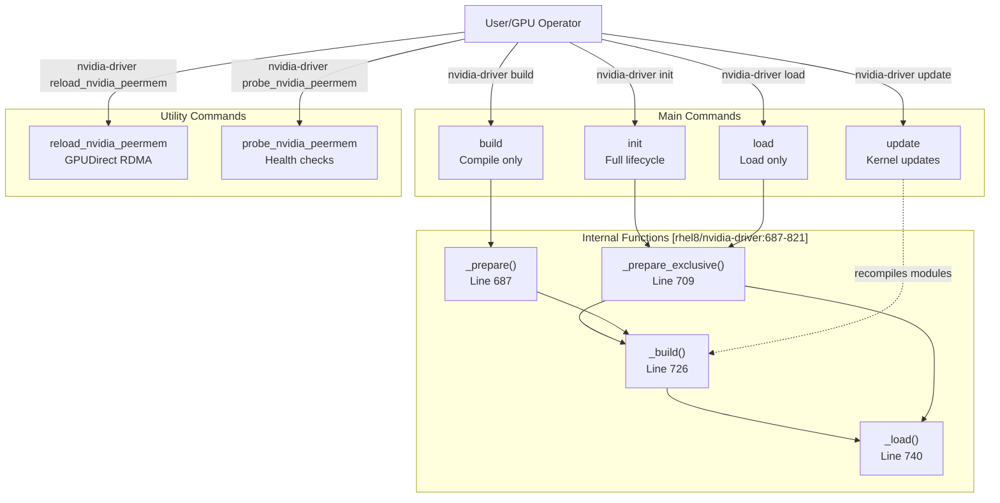
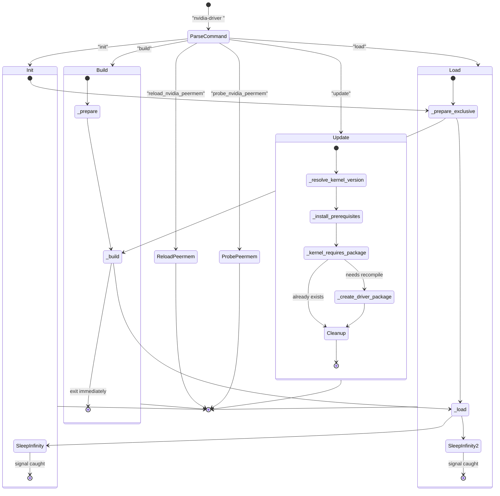
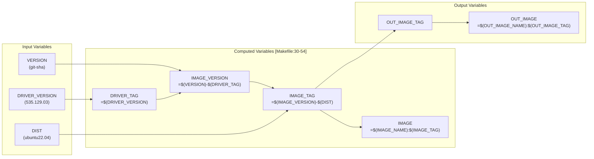
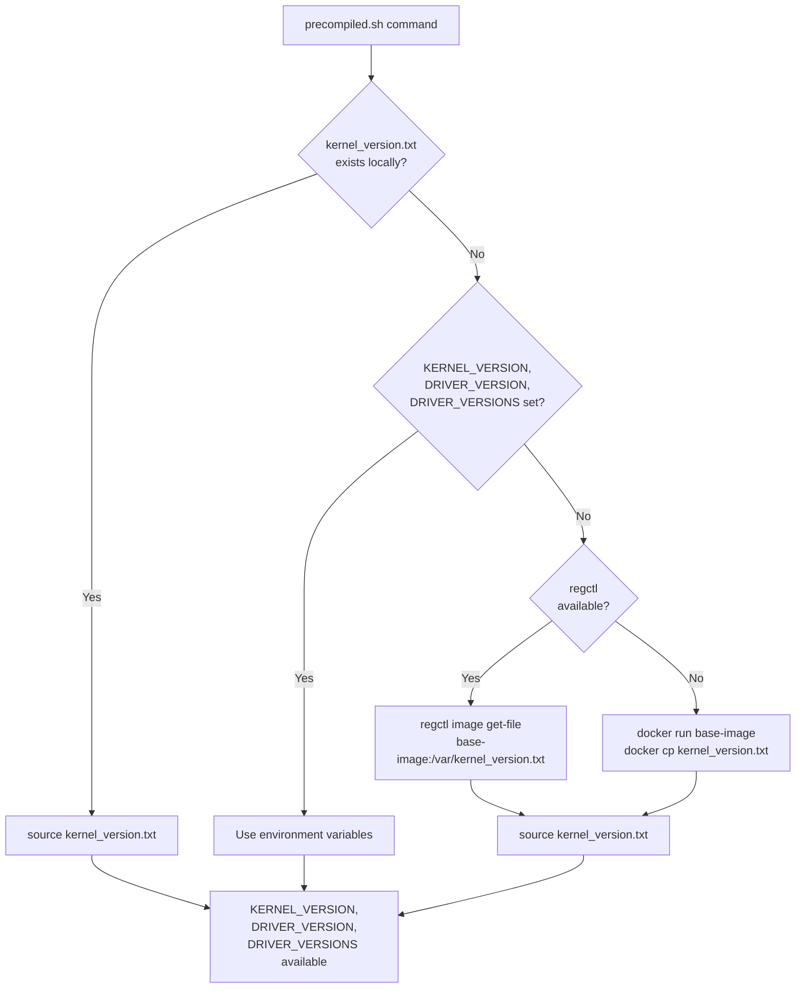

<!-- source: DeepWiki mcp.deepwiki.com · repo NVIDIA/gpu-driver-container · page 10.2 Command Reference · fetched 2026-10-26 -->

# Command Reference

<details>
<summary>Relevant source files</summary>

The following files were used as context for generating this wiki page:

- [.gitlab-ci.yml](.gitlab-ci.yml)
- [Makefile](Makefile)
- [base/Dockerfile](base/Dockerfile)
- [base/generate-ci-config](base/generate-ci-config)
- [multi-arch.mk](multi-arch.mk)
- [native-only.mk](native-only.mk)
- [rhel8/nvidia-driver](rhel8/nvidia-driver)
- [rhel9/nvidia-driver](rhel9/nvidia-driver)
- [scripts/precompiled.sh](scripts/precompiled.sh)
- [ubuntu20.04/nvidia-driver](ubuntu20.04/nvidia-driver)
- [ubuntu22.04/nvidia-driver](ubuntu22.04/nvidia-driver)
- [ubuntu24.04/Dockerfile](ubuntu24.04/Dockerfile)
- [ubuntu24.04/install.sh](ubuntu24.04/install.sh)
- [ubuntu24.04/nvidia-driver](ubuntu24.04/nvidia-driver)

</details>


This page provides a comprehensive reference for all commands and targets available when building and managing NVIDIA GPU driver container images. For information about the runtime driver lifecycle and internal functions, see [Initialization and Lifecycle](#5.1). For environment variable configuration, see [Environment Variables](#10.1).

## nvidia-driver Script Commands

The `nvidia-driver` script is the primary entrypoint for driver container operations. It is embedded in all driver container images and manages the complete driver lifecycle from initialization through shutdown.

### Command Overview Diagram



**Sources:** [rhel8/nvidia-driver:753-821](), [ubuntu20.04/nvidia-driver:564-693](), [ubuntu22.04/nvidia-driver:594-735]()

### Main Commands

#### init

The primary command that performs complete driver initialization, including userspace installation, kernel module compilation, and loading.

**Syntax:**
```bash
nvidia-driver init [-a | --accept-license] [-m | --max-threads MAX_THREADS]
```

**Options:**
- `-a, --accept-license`: Automatically accept the NVIDIA software license agreement
- `-m, --max-threads MAX_THREADS`: Set maximum parallel compilation threads

**Behavior:**
1. Acquires exclusive lock via PID file at `/run/nvidia/nvidia-driver.pid`
2. Installs userspace driver components from `.run` installer
3. Determines kernel module type (open or proprietary) via `_resolve_kernel_type()`
4. Compiles kernel modules if needed via `_build()`
5. Loads modules and starts daemons via `_load_driver()`
6. Mounts driver rootfs to `/run/nvidia/driver`
7. Runs indefinitely until terminated

**Exit Conditions:**
- Caught signal (HUP, INT, QUIT, PIPE, TERM)
- Errors during any phase cause exit with non-zero status

**Sources:** [rhel8/nvidia-driver:753-759](), [ubuntu20.04/nvidia-driver:564-631]()

#### build

Compiles kernel modules without loading them. Used for precompilation or the separated init/build/load workflow in RHEL8+.

**Syntax:**
```bash
nvidia-driver build [-a | --accept-license] [-t | --tag TAG] [-m | --max-threads MAX_THREADS]
```

**Options:**
- `-a, --accept-license`: Automatically accept license
- `-t, --tag TAG`: Package tag for precompiled module naming
- `-m, --max-threads MAX_THREADS`: Compilation thread count

**Behavior:**
1. Installs userspace components
2. Compiles kernel modules if `_kernel_requires_package()` returns true
3. Does not load modules or start daemons
4. Exits immediately after build completes

**Sources:** [rhel8/nvidia-driver:761-765]()

#### load

Loads previously compiled/installed driver modules without compilation.

**Syntax:**
```bash
nvidia-driver load
```

**Options:** None

**Behavior:**
1. Acquires exclusive lock
2. Unloads any existing driver modules
3. Loads kernel modules with configured parameters
4. Starts nvidia-persistenced daemon
5. Starts fabric manager if NVSwitch/NVLink5+ detected
6. Mounts driver rootfs
7. Runs indefinitely

**Sources:** [rhel8/nvidia-driver:767-771]()

#### update

Precompiles driver modules for a new kernel version. Called automatically by kernel update hooks.

**Syntax:**
```bash
nvidia-driver update [-k | --kernel VERSION] [-s | --sign KEYID] [-t | --tag TAG] [-m | --max-threads MAX_THREADS]
```

**Options:**
- `-k, --kernel VERSION`: Target kernel version (default: current kernel from `uname -r`)
- `-s, --sign KEYID`: Private key for module signing (via donkey)
- `-t, --tag TAG`: Package tag for precompiled modules
- `-m, --max-threads MAX_THREADS`: Compilation threads

**Behavior:**
1. Redirects output to running driver container's stdout/stderr if active
2. Resolves kernel version from package repositories
3. Installs kernel headers and build dependencies
4. Compiles and packages modules if needed
5. Cleans up and exits

**Note:** Does not load modules. Compilation occurs for future use.

**Sources:** [rhel8/nvidia-driver:773-821](), [ubuntu20.04/nvidia-driver:633-693]()

### Command Options Reference Table

| Command | Options | Default Values | Environment Variables Used |
|---------|---------|----------------|---------------------------|
| `init` | `-a`, `-m` | `MAX_THREADS=""`, `ACCEPT_LICENSE=""` | `DRIVER_VERSION`, `KERNEL_VERSION` (from `uname -r`) |
| `build` | `-a`, `-t`, `-m` | Same as init + `PACKAGE_TAG=""` | `DRIVER_VERSION`, `KERNEL_VERSION`, `DRIVER_TYPE` |
| `load` | None | N/A | `DRIVER_VERSION`, `KERNEL_VERSION` |
| `update` | `-k`, `-s`, `-t`, `-m` | `KERNEL_VERSION=$(uname -r)`, `PRIVATE_KEY=""`, `PACKAGE_TAG=""` | `DRIVER_VERSION`, `DRIVER_TYPE` |
| `reload_nvidia_peermem` | None | N/A | `USE_HOST_MOFED`, `NVIDIA_PEERMEM_MODULE_PARAMS` |
| `probe_nvidia_peermem` | None | N/A | None |

**Sources:** [rhel8/nvidia-driver:865-914](), [ubuntu20.04/nvidia-driver:737-784]()

### Utility Commands

#### reload_nvidia_peermem

Waits for Mellanox OFED drivers to load, then continuously reloads the `nvidia-peermem` module for GPUDirect RDMA functionality.

**Syntax:**
```bash
nvidia-driver reload_nvidia_peermem
```

**Behavior:**
1. Waits for `/run/mellanox/drivers/.driver-ready` or MOFED modules loaded
2. Waits for `/run/nvidia/validations/.driver-ctr-ready`
3. Loads `nvidia-peermem` module via chroot into driver rootfs
4. Runs `sleep inf` until terminated
5. Exits with error if module load fails

**Use Case:** Sidecar container for dynamic MOFED updates

**Sources:** [rhel8/nvidia-driver:824-850](), [ubuntu20.04/nvidia-driver:696-722]()

#### probe_nvidia_peermem

Checks if `nvidia-peermem` module is loaded. Used for liveness/readiness probes.

**Syntax:**
```bash
nvidia-driver probe_nvidia_peermem
```

**Exit Codes:**
- `0`: Module loaded or MOFED not ready (skips probe)
- `1`: MOFED ready but module not loaded

**Behavior:**
1. Checks if `mlx5_core` module loaded
2. If loaded, checks `/sys/module/nvidia_peermem/refcnt` exists
3. Returns appropriate exit code

**Sources:** [rhel8/nvidia-driver:853-863](), [ubuntu20.04/nvidia-driver:725-735]()

### Command Flow Diagram



**Sources:** [rhel8/nvidia-driver:878-918]()

## Makefile Target Reference

The Makefile provides targets for building, pushing, pulling, and archiving driver container images across multiple distributions and driver versions.

### Target Naming Convention

All targets follow the pattern: `<action>-<dist>[-<driver_version>]`

**Examples:**
- `build-ubuntu22.04-535.129.03`
- `push-rhel8-550.54.15`
- `pull-ubuntu24.04-580.13`

### Variable Resolution Diagram



**Sources:** [Makefile:22-54]()

### Build Targets

#### build-\<dist\>-\<driver_version\>

Builds a standard driver image for the specified distribution and driver version.

**Syntax:**
```bash
make build-<dist>-<driver_version> [OPTIONS]
```

**Examples:**
```bash
make build-ubuntu22.04-550.54.15
make build-rhel8-535.129.03 DOCKER_BUILD_OPTIONS="--no-cache"
make BUILD_MULTI_ARCH_IMAGES=true build-ubuntu24.04-580.13
```

**Variables:**
- `DRIVER_VERSION`: NVIDIA driver version (e.g., 535.129.03)
- `DIST`: Distribution identifier (ubuntu20.04, ubuntu22.04, ubuntu24.04, rhel8, rhel9, fedora36)
- `IMAGE_NAME`: Target image name (default: `nvidia/driver`)
- `VERSION`: Image version prefix (default: empty, uses driver version only)
- `BUILD_MULTI_ARCH_IMAGES`: Set to `true` for multi-arch builds (default: `no`)

**Behavior:**
1. Parses target to extract `DIST` and `DRIVER_VERSION` from target name
2. Sets `DRIVER_BRANCH` from major version (e.g., 535 from 535.129.03)
3. Locates Dockerfile at `<dist>/Dockerfile`
4. Executes `docker buildx build` with:
   - Build args: `DRIVER_VERSION`, `DRIVER_BRANCH`, `CUDA_VERSION`, `GOLANG_VERSION`
   - Platform: `linux/amd64` (single-arch) or `linux/amd64,linux/arm64` (multi-arch)
   - Tag: `$(IMAGE_NAME):$(IMAGE_TAG)`

**Sources:** [Makefile:150-175](), [Makefile:18-20]()

#### build-signed_\<dist\>-\<driver_version\>

Builds a precompiled driver image with kernel modules compiled for a specific kernel version.

**Syntax:**
```bash
make build-signed_ubuntu22.04-<driver_version> KERNEL_VERSION=<kernel> [OPTIONS]
```

**Examples:**
```bash
make build-signed_ubuntu22.04-550.54.15 KERNEL_VERSION=5.15.0-94-generic
make build-signed_ubuntu24.04-580.13 KERNEL_VERSION=6.8.0-31-generic LTS_KERNEL=6.8
```

**Required Variables:**
- `KERNEL_VERSION`: Exact kernel version (e.g., 5.15.0-94-generic)

**Optional Variables:**
- `LTS_KERNEL`: LTS kernel series (default: derived from KERNEL_VERSION)
- `KERNEL_FLAVOR`: Kernel flavor (default: generic)

**Behavior:**
1. Uses `<dist>/precompiled/Dockerfile`
2. Pulls base image containing precompiled modules
3. Tags as `<driver_branch>-<kernel_version>-<dist>`
4. Single-architecture only (linux/amd64)

**Sources:** [Makefile:189-201](), [scripts/precompiled.sh:44-47]()

#### build-vgpuguest-\<dist\>

Builds a vGPU guest driver image from a local `.run` file.

**Syntax:**
```bash
make build-vgpuguest-<dist> VGPU_GUEST_DRIVER_VERSION=<version>
```

**Required Variables:**
- `VGPU_GUEST_DRIVER_VERSION`: vGPU guest driver version

**Prerequisites:**
- Driver `.run` file must exist at `<dist>/drivers/NVIDIA-Linux-*-<version>-grid.run`

**Behavior:**
1. Appends `-grid` suffix to driver version if not present
2. Sets `DRIVER_TYPE=vgpu` build arg
3. Sets `VGPU_LICENSE_SERVER_TYPE=NLS` build arg
4. Tags without `-grid` suffix in image tag

**Sources:** [Makefile:232-262]()

#### build-vgpuhost-\<dist\>

Builds a vGPU host manager driver image from a local `.run` file.

**Syntax:**
```bash
make build-vgpuhost-<dist> VGPU_HOST_DRIVER_VERSION=<version>
```

**Required Variables:**
- `VGPU_HOST_DRIVER_VERSION`: vGPU host driver version

**Prerequisites:**
- Driver `.run` file must exist at `vgpu-manager/<dist>/drivers/NVIDIA-Linux-*-<version>.run`

**Sources:** [Makefile:272-298]()

#### build-base-\<target\>

Builds a base image for kernel version detection in precompiled workflows.

**Syntax:**
```bash
make build-base-<target> LTS_KERNEL=<kernel> KERNEL_FLAVOR=<flavor> DRIVER_BRANCH=<branch>
```

**Targets:**
- `noble` (Ubuntu 24.04)
- `jammy` (Ubuntu 22.04)
- `focal` (Ubuntu 20.04)

**Required Variables:**
- `LTS_KERNEL`: LTS kernel version (e.g., 5.15, 6.8)
- `KERNEL_FLAVOR`: Kernel flavor (generic, lowlatency, fips)
- `DRIVER_BRANCH`: Driver branch (535, 550, 580)

**Behavior:**
1. Builds from `base/Dockerfile` with multi-stage target
2. Runs `generate-ci-config` script to detect latest kernel
3. Exports `KERNEL_VERSION` and `DRIVER_VERSION` to `/var/kernel_version.txt`
4. Tags as `base-<target>-<lts_kernel>-<flavor>-<branch>`

**Sources:** [Makefile:206-222](), [base/Dockerfile:1-110](), [base/generate-ci-config:1-34]()

### Build Target Summary Table

| Target Pattern | Purpose | Dockerfile Location | Multi-Arch |
|----------------|---------|---------------------|------------|
| `build-<dist>-<version>` | Standard driver | `<dist>/Dockerfile` | Yes (except Ubuntu 18.04) |
| `build-signed_<dist>-<version>` | Precompiled driver | `<dist>/precompiled/Dockerfile` | No (amd64 only) |
| `build-vgpuguest-<dist>` | vGPU guest | `<dist>/Dockerfile` | Yes |
| `build-vgpuhost-<dist>` | vGPU host | `vgpu-manager/<dist>/Dockerfile` | Yes |
| `build-base-<target>` | Kernel detection | `base/Dockerfile` | No |

**Sources:** [Makefile:57-76]()

### Push Targets

#### push-\<dist\>-\<driver_version\>

Tags and pushes a built image to the output registry.

**Syntax:**
```bash
make push-<dist>-<driver_version> [OUT_IMAGE_NAME=<name>] [OUT_VERSION=<version>]
```

**Examples:**
```bash
make push-ubuntu22.04-550.54.15 OUT_IMAGE_NAME=nvcr.io/nvidia/driver
make push-rhel8-535.129.03 OUT_IMAGE_NAME=ghcr.io/nvidia/driver OUT_VERSION=latest
```

**Variables:**
- `OUT_IMAGE_NAME`: Destination image name (default: same as `IMAGE_NAME`)
- `OUT_VERSION`: Version prefix for output tag (default: empty)
- `OUT_DIST`: Distribution string for output (default: same as `DIST`)

**Behavior (Multi-arch):**
1. Uses `regctl image copy` to copy manifest
2. Preserves multi-arch manifest structure

**Behavior (Native-only):**
1. Tags local image with `docker tag`
2. Pushes with `docker push`

**Sources:** [Makefile:128-148](), [multi-arch.mk:21-24](), [native-only.mk:17-19]()

#### push-signed_\<dist\>-\<driver_version\>

Pushes a precompiled driver image with kernel-specific tag.

**Syntax:**
```bash
make push-signed_ubuntu22.04-<version> KERNEL_VERSION=<kernel>
```

**Tag Format:**
```
<out_image_name>:[<version>-]<driver_branch>-<kernel_version>-<dist>
```

**Example Tag:**
```
ghcr.io/nvidia/driver:550-5.15.0-94-ubuntu22.04
```

**Sources:** [Makefile:140-148]()

#### push-base-\<target\>

Pushes a base image for precompiled workflow kernel detection.

**Syntax:**
```bash
make push-base-<target> LTS_KERNEL=<kernel> KERNEL_FLAVOR=<flavor>
```

**Sources:** [Makefile:224-230]()

### Pull Targets

#### pull-\<dist\>-\<driver_version\>

Pulls an image from a registry for local use or re-tagging.

**Syntax:**
```bash
make pull-<dist>-<driver_version> [PLATFORM=<platform>]
```

**Examples:**
```bash
make pull-ubuntu22.04-550.54.15
make pull-rhel8-535.129.03 PLATFORM=linux/arm64
```

**Variables:**
- `PLATFORM`: Target platform (default: `linux/amd64`)

**Behavior:**
```bash
docker pull --platform=<platform> <image>:<tag>
```

**Sources:** [Makefile:86-105]()

### Archive Targets

#### archive-\<dist\>-\<driver_version\>

Saves an image to a tar archive file.

**Syntax:**
```bash
make archive-<dist>-<driver_version>
```

**Output:**
- Creates `archive.tar` in current directory

**Behavior:**
```bash
docker save "<image>:<tag>" -o "archive.tar"
```

**Use Case:** Air-gapped environments, artifact storage

**Sources:** [Makefile:107-125]()

### Distribution Aliases

Convenience targets that build/push all driver versions for a distribution:

```bash
make ubuntu22.04          # Builds all driver versions for Ubuntu 22.04
make push-ubuntu22.04     # Pushes all driver versions for Ubuntu 22.04
```

**Supported Distributions:**
- `ubuntu18.04`, `ubuntu20.04`, `ubuntu22.04`, `ubuntu24.04`
- `rhel8`, `rhel9`
- `flatcar`, `fedora36`, `sles15.3`
- `signed_ubuntu20.04`, `signed_ubuntu22.04`, `signed_ubuntu24.04` (precompiled)

**Sources:** [Makefile:57-61](), [Makefile:160-161]()

### Common Makefile Variables

| Variable | Default | Description | Example |
|----------|---------|-------------|---------|
| `IMAGE_NAME` | `nvidia/driver` | Base image name | `nvcr.io/nvidia/driver` |
| `VERSION` | `""` | Image version prefix | `v1.2.3`, `commit-sha` |
| `OUT_IMAGE_NAME` | Same as `IMAGE_NAME` | Output registry image name | `ghcr.io/nvidia/driver` |
| `OUT_VERSION` | `""` | Output version prefix | `latest`, `stable` |
| `BUILD_MULTI_ARCH_IMAGES` | `no` | Enable multi-arch builds | `true`, `false` |
| `DOCKER` | `docker` | Docker command | `podman` |
| `PLATFORM` | `linux/amd64` | Target platform for pulls | `linux/arm64` |
| `PUSH_ON_BUILD` | `false` | Push immediately after build | `true` |
| `CVE_UPDATES` | `""` | Packages to upgrade for CVE fixes | `curl libc6` |

**Sources:** [Makefile:15-54](), [multi-arch.mk:15-18]()

## Script Commands

### scripts/precompiled.sh

Helper script for building and managing precompiled driver images in CI/CD pipelines.

**Commands:**

#### build
```bash
./scripts/precompiled.sh build
```
Builds base image, pushes it, sources kernel version, then builds driver image.

**Behavior:**
1. Calls `buildBaseImage()` → `make build-base-<target>`
2. Calls `pushBaseImage()` → `make push-base-<target>`
3. Calls `sourceVersions()` to extract `KERNEL_VERSION` from base image
4. Calls `buildImage()` → `make build-<dist>-<version>`

#### push
```bash
./scripts/precompiled.sh push
```
Sources kernel version from base image and pushes driver image.

**Behavior:**
1. Calls `sourceVersions()`
2. Checks if image exists with `imageExists()`
3. Calls `pushImage()` → `make push-<dist>`

#### pull
```bash
./scripts/precompiled.sh pull
```
Sources kernel version and pulls driver image.

#### archive
```bash
./scripts/precompiled.sh archive
```
Sources kernel version and creates tar archive.

#### version
```bash
./scripts/precompiled.sh version
```
Extracts and displays `KERNEL_VERSION`, `DRIVER_VERSION`, `DRIVER_VERSIONS` from base image.

**Output:**
```bash
export KERNEL_VERSION=5.15.0-94-generic DRIVER_VERSION=550.54.15 DRIVER_VERSIONS=550.54.15
```

**Sources:** [scripts/precompiled.sh:1-114]()

### Version Sourcing Methods

The script sources version information using two methods:



**Sources:** [scripts/precompiled.sh:7-37]()

## GitLab CI Integration

Makefile targets are invoked by GitLab CI pipeline stages with specific variable configurations:

**Standard Builds:**
```yaml
# .gitlab-ci.yml pattern
image-ubuntu22.04:
  script:
    - make build-${DIST}-${DRIVER_VERSION}
  variables:
    DIST: ubuntu22.04
    DRIVER_VERSION: 550.54.15  # from matrix
```

**Precompiled Builds:**
```yaml
image-precompiled-ubuntu22.04:
  script:
    - ./scripts/precompiled.sh build
  variables:
    DIST: signed_ubuntu22.04
    BASE_TARGET: jammy
    PRECOMPILED: "true"
```

**Sources:** [.gitlab-ci.yml:19-132]()

## Usage Examples

### Local Development

Build and test a driver image locally:
```bash
# Build standard image
make build-ubuntu22.04-550.54.15

# Run container to test
docker run --rm --privileged \
  -v /dev:/dev \
  -v /lib/modules:/lib/modules:ro \
  nvidia/driver:550.54.15-ubuntu22.04 init

# Build precompiled image
export KERNEL_VERSION=5.15.0-94-generic
export LTS_KERNEL=5.15
export KERNEL_FLAVOR=generic
export DRIVER_BRANCH=550

make build-base-jammy
make push-base-jammy OUT_IMAGE_NAME=localhost:5000/driver
make build-signed_ubuntu22.04-550.54.15 KERNEL_VERSION=5.15.0-94-generic

# Update driver for new kernel
docker exec driver-container nvidia-driver update -k 5.15.0-100-generic
```

### Multi-Architecture Builds

Build and push multi-arch images:
```bash
# Enable buildx
docker buildx create --use --name multiarch

# Build for both architectures
make BUILD_MULTI_ARCH_IMAGES=true \
  PUSH_ON_BUILD=true \
  IMAGE_NAME=ghcr.io/nvidia/driver \
  build-ubuntu22.04-550.54.15

# Verify manifest
docker buildx imagetools inspect ghcr.io/nvidia/driver:550.54.15-ubuntu22.04
```

### vGPU Image Builds

Build vGPU images:
```bash
# Place driver file
cp NVIDIA-Linux-x86_64-535.129.03-grid.run ubuntu22.04/drivers/

# Build guest driver
make build-vgpuguest-ubuntu22.04 VGPU_GUEST_DRIVER_VERSION=535.129.03

# Place host driver file
cp NVIDIA-Linux-x86_64-535.129.03-vgpu-kvm.run vgpu-manager/ubuntu22.04/drivers/

# Build host driver
make build-vgpuhost-ubuntu22.04 VGPU_HOST_DRIVER_VERSION=535.129.03
```

**Sources:** [Makefile:232-306]()

---

