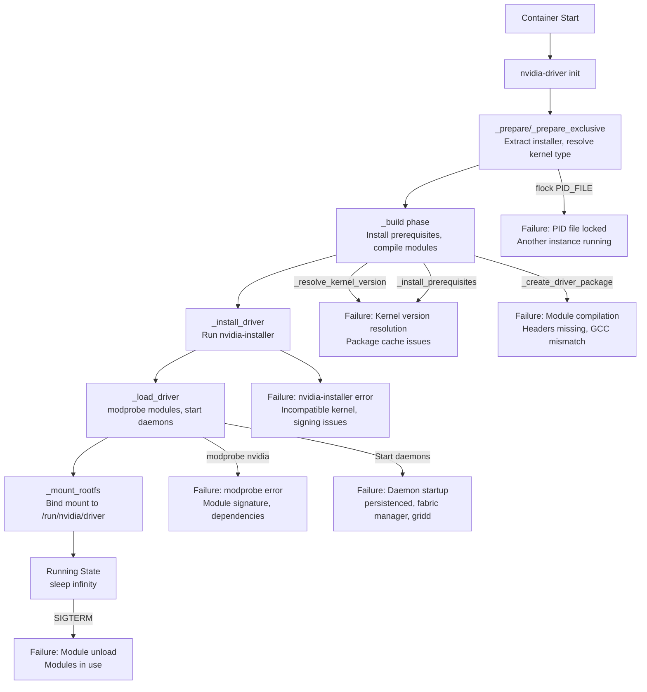
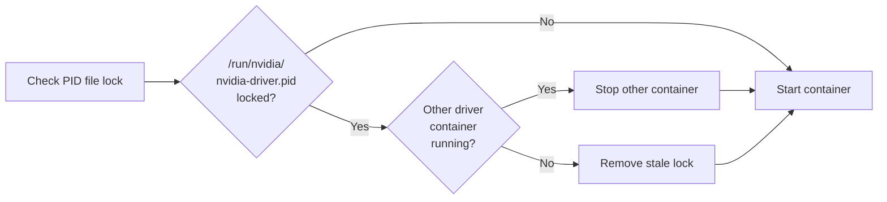
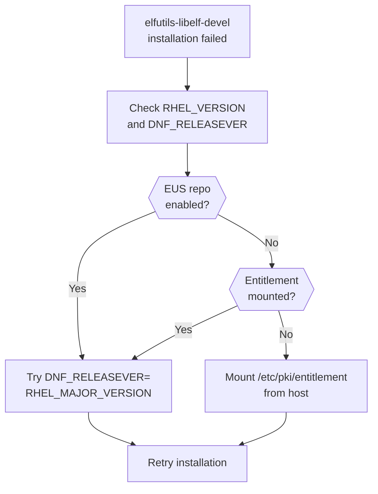
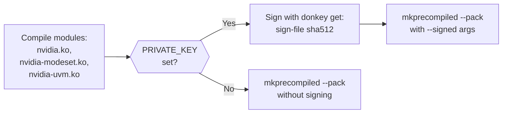
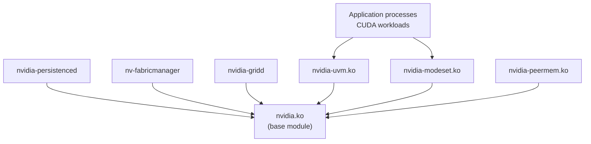
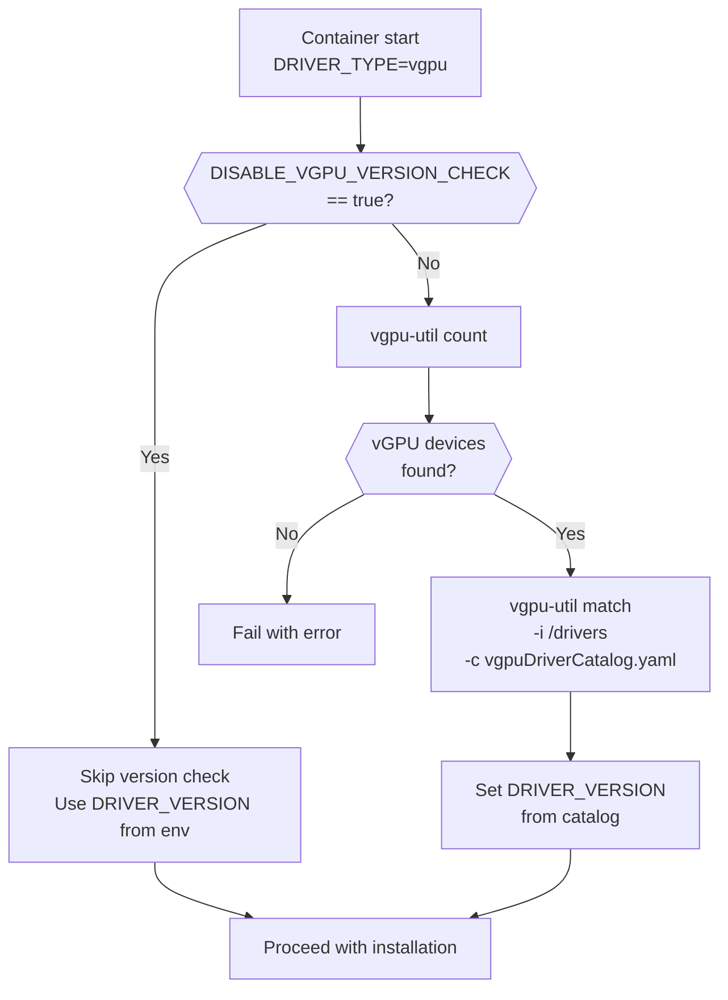
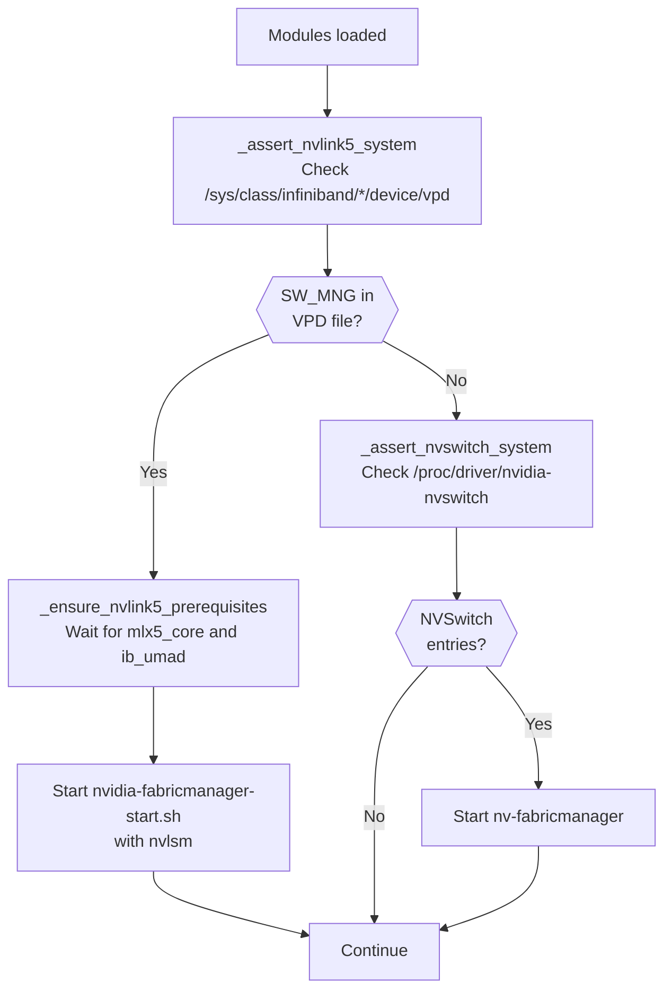
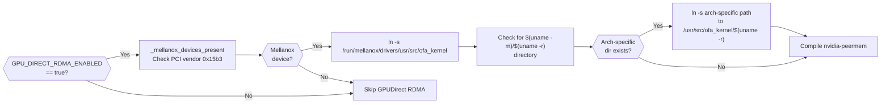
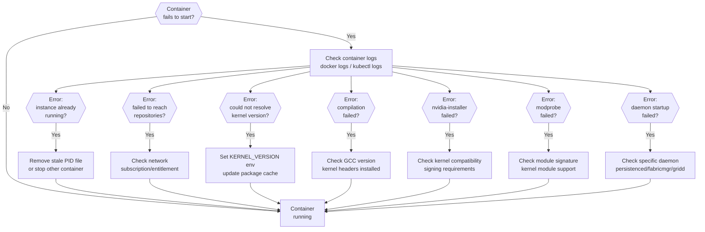

<!-- source: DeepWiki mcp.deepwiki.com · repo NVIDIA/gpu-driver-container · page 10.3 Troubleshooting · fetched 2026-10-26 -->

# Troubleshooting

<details>
<summary>Relevant source files</summary>

The following files were used as context for generating this wiki page:

- [.common-ci.yml](.common-ci.yml)
- [.github/workflows/image.yaml](.github/workflows/image.yaml)
- [.nvidia-ci.yml](.nvidia-ci.yml)
- [rhel8/nvidia-driver](rhel8/nvidia-driver)
- [rhel9/nvidia-driver](rhel9/nvidia-driver)
- [ubuntu20.04/nvidia-driver](ubuntu20.04/nvidia-driver)
- [ubuntu22.04/nvidia-driver](ubuntu22.04/nvidia-driver)
- [ubuntu24.04/Dockerfile](ubuntu24.04/Dockerfile)
- [ubuntu24.04/install.sh](ubuntu24.04/install.sh)
- [ubuntu24.04/nvidia-driver](ubuntu24.04/nvidia-driver)
- [versions.mk](versions.mk)

</details>


## Purpose

This page provides diagnostic guidance for resolving common issues encountered when building, deploying, or running NVIDIA GPU driver containers. It covers failures across the entire lifecycle: CI/CD pipeline issues, container build problems, runtime driver installation errors, and module loading failures. 

For operational details about how the driver management scripts work, see [Driver Management Scripts](#5). For CI/CD pipeline architecture, see [CI/CD Pipeline](#3). For container image types and their specific requirements, see [Container Image Types](#4).

---

## Driver Container Lifecycle and Failure Points

The following diagram shows the major phases of the driver container lifecycle and where failures commonly occur:



**Sources:** [rhel8/nvidia-driver:687-759](), [ubuntu22.04/nvidia-driver:641-690](), [ubuntu24.04/nvidia-driver:569-610]()

---

## Common Failure Scenarios

### Container Initialization Failures

#### Issue: "An instance of the NVIDIA driver is already running, aborting"

**Symptom:** Container fails to start with the message at [rhel8/nvidia-driver:714-716]().

**Cause:** The PID file `/run/nvidia/nvidia-driver.pid` is locked by another container instance.

**Resolution:**
1. Check for existing driver containers: `docker ps | grep driver`
2. Stop conflicting containers or verify only one driver container should run per node
3. If the lock is stale, manually remove: `rm /run/nvidia/nvidia-driver.pid`
4. In Kubernetes, ensure DaemonSet tolerations prevent multiple instances per node



**Sources:** [rhel8/nvidia-driver:712-717](), [ubuntu22.04/nvidia-driver:674-679](), [ubuntu24.04/nvidia-driver:577-582]()

---

### Package Repository Access Failures

#### Issue: "FATAL: failed to reach RHEL package repositories"

**Symptom:** Error message at [rhel8/nvidia-driver:32-34]() during `_update_package_cache`.

**Cause:** Network connectivity issues or missing RHEL entitlements for accessing package repositories.

| Distribution | Repository Access Method | Common Issues |
|--------------|-------------------------|---------------|
| RHEL 8/9 | Red Hat subscription required | Entitlement not attached, EUS repos unavailable |
| Ubuntu | Public apt repositories | Network policy blocks access, proxy configuration |
| OpenShift (RHCOS) | Internal RHOCP repos | OPENSHIFT_VERSION not set, repo disabled |

**Resolution for RHEL:**
1. Verify cluster can reach `cdn.redhat.com`
2. Check entitlement status: `subscription-manager status`
3. Ensure DNF_RELEASEVER matches available repos (set via environment variable)
4. For OpenShift, verify OPENSHIFT_VERSION environment variable

**Resolution for Ubuntu:**
1. Test repository access: `apt-get update`
2. Check proxy settings if required: `http_proxy`, `https_proxy`
3. Verify CA certificates if using internal mirrors: mount custom certs to `/usr/local/share/ca-certificates/`

**Sources:** [rhel8/nvidia-driver:28-37](), [rhel8/nvidia-driver:98-120](), [ubuntu22.04/nvidia-driver:38-43]()

---

#### Issue: "FATAL: failed to install elfutils-libelf-devel. RHEL entitlement may be improperly deployed"

**Symptom:** Error at [rhel8/nvidia-driver:125-127]() during prerequisite installation.

**Cause:** Missing or improperly configured Red Hat entitlements.

**Resolution:**
1. Verify RHEL subscription is active on the node
2. Check if running in entitled build mode with proper secrets mounted
3. For OpenShift, ensure `etc-pki-entitlement` secret is correctly mounted
4. Try with different `DNF_RELEASEVER` values: `8`, `9`, `8.10`, `9.4`, etc.



**Sources:** [rhel8/nvidia-driver:106-120](), [rhel9/nvidia-driver:108-122]()

---

### Kernel Version Resolution Failures

#### Issue: "Could not resolve Linux kernel version"

**Symptom:** Error during `_resolve_kernel_version` [rhel8/nvidia-driver:74-86]() or [ubuntu22.04/nvidia-driver:59-74]().

**Cause:** 
- KERNEL_VERSION environment variable set incorrectly
- Requested kernel version not available in repositories
- Package cache not updated

**Resolution:**

| Distribution | Fix |
|--------------|-----|
| Ubuntu | Set KERNEL_VERSION to a pattern like `5.15.0-*-generic` or specific version `5.15.0-91-generic` |
| RHEL | Set KERNEL_VERSION matching pattern in `yum list kernel-headers`, e.g., `4.18.0-513.9.1.el8_9.x86_64` |
| Latest | Set KERNEL_VERSION to `latest` to auto-select newest available |

**Debug commands:**
```bash
# Ubuntu
apt-cache search linux-headers | grep $(uname -r)

# RHEL
yum list available kernel-headers --showduplicates

# Check current kernel
uname -r
```

**Sources:** [rhel8/nvidia-driver:74-86](), [ubuntu22.04/nvidia-driver:59-74](), [ubuntu24.04/nvidia-driver:69-84]()

---

### Kernel Module Compilation Failures

#### Issue: GCC version mismatch

**Symptom:** Module compilation fails with GCC version errors during `_create_driver_package`.

**Cause:** The GCC version in the container does not match the GCC version used to compile the running kernel.

**Resolution:**
The driver script automatically detects and installs the correct GCC version at [rhel8/nvidia-driver:154-163]():

```bash
# Kernel GCC requirement extracted from /lib/modules/${KERNEL_VERSION}/proc/version
gcc_version=$(cat /lib/modules/${KERNEL_VERSION}/proc/version | grep -Eo "gcc version ([0-9\.]+)")

# Script automatically installs: dnf install gcc-${gcc_version}
```

If auto-detection fails:
1. Manually inspect kernel version file: `cat /lib/modules/$(uname -r)/proc/version`
2. Install matching GCC: `dnf install gcc-X.Y.Z` (RHEL) or `apt-get install gcc-X.Y` (Ubuntu)
3. Set `IGNORE_CC_MISMATCH=1` environment variable (last resort)

**Sources:** [rhel8/nvidia-driver:154-163](), [rhel9/nvidia-driver:166-175](), [ubuntu22.04/nvidia-driver:161-162]()

---

#### Issue: "Could not locate Linux kernel version string"

**Symptom:** Error at [rhel8/nvidia-driver:149-151]() or [rhel9/nvidia-driver:159-162]() during kernel version string extraction.

**Cause:** Unable to extract version string from `/lib/modules/${KERNEL_VERSION}/vmlinuz`.

**Resolution (RHEL 9):**
The script tries multiple extraction methods at [rhel9/nvidia-driver:144-164]():
1. `extract-vmlinux` (primary)
2. `unzboot` (fallback for RHEL 9.3+)
3. `gunzip` (last resort)

For ARM64 systems, the extraction method differs at [rhel8/nvidia-driver:143-147]().

**Manual verification:**
```bash
# Check vmlinuz exists
ls -lh /lib/modules/$(uname -r)/vmlinuz

# Try manual extraction
extract-vmlinux /lib/modules/$(uname -r)/vmlinuz | strings | grep "Linux version"
```

**Sources:** [rhel8/nvidia-driver:142-152](), [rhel9/nvidia-driver:144-164]()

---

#### Issue: Module signing failures

**Symptom:** Compilation succeeds but modules fail to load with signature verification errors.

**Cause:** Secure Boot is enabled but modules are not signed, or `PRIVATE_KEY` is incorrectly configured.

**Resolution:**
1. Check if Secure Boot is enabled: `mokutil --sb-state`
2. For signed modules, mount private key via `PRIVATE_KEY` environment variable pointing to a `donkey://` URI
3. The signing process at [rhel8/nvidia-driver:229-238]() requires `sign-file` utility
4. Alternatively, disable Secure Boot if not required

**Signing flow:**


**Sources:** [rhel8/nvidia-driver:229-238](), [ubuntu22.04/nvidia-driver:169-178]()

---

### Driver Loading Failures

#### Issue: "Could not unload NVIDIA driver kernel modules, driver is in use"

**Symptom:** Error at [rhel8/nvidia-driver:514-516]() during `_unload_driver`.

**Cause:** Processes or other kernel modules are using NVIDIA modules, preventing unload.

**Diagnosis:**
```bash
# Check module reference counts
cat /sys/module/nvidia/refcnt
cat /sys/module/nvidia_uvm/refcnt
cat /sys/module/nvidia_modeset/refcnt

# Find processes using NVIDIA
lsof /dev/nvidia*

# Check module dependencies
lsmod | grep nvidia
```

**Resolution:**
1. Stop all applications using GPUs (containers with GPU allocations)
2. Stop CUDA applications and monitoring tools (nvidia-smi in watch mode)
3. In Kubernetes, ensure GPU pods are terminated before driver container restart
4. Check for stale processes: `ps aux | grep nvidia`

**Module dependency tree:**


**Sources:** [rhel8/nvidia-driver:424-522](), [ubuntu22.04/nvidia-driver:390-489]()

---

#### Issue: Firmware loading failures

**Symptom:** Modules load but firmware-related errors in `dmesg`, such as "failed to load firmware nvidia/XX/gspXXX.bin".

**Cause:** GPU firmware not found in kernel firmware search path.

**Resolution:**
The driver automatically configures the firmware path at [rhel8/nvidia-driver:348-365]():

```bash
# Firmware location
nv_fw_search_path="/run/nvidia/driver/lib/firmware"

# Check firmware path configuration
cat /sys/module/firmware_class/parameters/path

# Verify firmware files exist
ls -R /run/nvidia/driver/lib/firmware/nvidia/
```

If firmware loading is intentionally disabled, set module parameter: `NVreg_EnableGpuFirmware=0`

**Sources:** [rhel8/nvidia-driver:348-365](), [ubuntu22.04/nvidia-driver:311-328]()

---

### vGPU-Specific Issues

#### Issue: "cannot find vgpu devices on host"

**Symptom:** Error from `vgpu-util` during `_find_vgpu_driver_version` at [rhel8/nvidia-driver:656-658]().

**Cause:** 
- Container misconfigured as `DRIVER_TYPE=vgpu` on non-vGPU system
- vGPU devices not properly initialized on host

**Resolution:**
1. Verify system has vGPU-capable hardware
2. Check vGPU configuration on hypervisor
3. Review vGPU utility logs: `cat /var/log/vgpu-util.log`
4. Set `DISABLE_VGPU_VERSION_CHECK=true` to bypass version checking
5. If not using vGPU, ensure `DRIVER_TYPE=passthrough` (default)

**vGPU driver selection flow:**


**Sources:** [rhel8/nvidia-driver:645-679](), [ubuntu22.04/nvidia-driver:603-633](), [ubuntu24.04/nvidia-driver:531-561]()

---

#### Issue: "cannot find match for compatible vgpu driver from available list"

**Symptom:** Error at [rhel8/nvidia-driver:672-675]() when vGPU version matching fails.

**Cause:** 
- Driver catalog file missing or incorrect
- No compatible driver version available for detected vGPU hardware

**Resolution:**
1. Ensure `vgpuDriverCatalog.yaml` is mounted at `/drivers/vgpuDriverCatalog.yaml`
2. Verify catalog contains entries matching your vGPU hardware
3. Check guest driver versions available at `/drivers/` or `/mnt/shared-nvidia-driver-toolkit/drivers`
4. For OpenShift, ensure driver-toolkit mount is correct

**Sources:** [rhel8/nvidia-driver:645-679]()

---

### Daemon Startup Failures

#### Issue: nvidia-persistenced fails to start

**Symptom:** Error during `_load_driver` when starting nvidia-persistenced at [rhel8/nvidia-driver:384-385]().

**Cause:** Permission issues or conflicting persistence daemon already running.

**Resolution:**
```bash
# Check if daemon is running
ps aux | grep nvidia-persistenced

# Check daemon logs
journalctl -u nvidia-persistenced

# Verify device permissions
ls -l /dev/nvidia*

# Manual daemon start for testing
nvidia-persistenced --persistence-mode --verbose
```

**Sources:** [rhel8/nvidia-driver:384-385](), [ubuntu22.04/nvidia-driver:347-348]()

---

#### Issue: Fabric manager fails to start on NVSwitch systems

**Symptom:** Error at [rhel8/nvidia-driver:418-421]() when starting `nv-fabricmanager`.

**Cause:** 
- NVSwitch device not detected correctly
- Fabric manager configuration file missing
- For NVLink5+: mlx5_core or ib_umad kernel modules not loaded

**NVSwitch detection logic:**


**Resolution:**
1. Verify NVSwitch devices: `ls /proc/driver/nvidia-nvswitch/devices/`
2. For NVLink5+ (GB200, GH200): 
   - Wait for MOFED drivers: `lsmod | grep mlx5_core`
   - Check VPD file: `grep SW_MNG /sys/class/infiniband/*/device/vpd`
3. Check fabric manager config: `cat /usr/share/nvidia/nvswitch/fabricmanager.cfg`
4. Review daemon logs: `journalctl -u nvidia-fabricmanager`

**Sources:** [rhel8/nvidia-driver:261-285](), [rhel8/nvidia-driver:403-421](), [ubuntu22.04/nvidia-driver:209-232](), [ubuntu22.04/nvidia-driver:366-384]()

---

#### Issue: nvidia-gridd fails to start (vGPU)

**Symptom:** Error at [rhel8/nvidia-driver:396-397]() during vGPU guest driver initialization.

**Cause:**
- `gridd.conf` file not mounted
- License server configuration incorrect
- For NLS licensing: ClientConfigToken not mounted

**Resolution:**
1. Ensure `gridd.conf` is mounted to `/drivers/gridd.conf`
2. Verify license server settings in gridd.conf:
   ```ini
   ServerAddress=<license-server>
   ServerPort=7070
   FeatureType=1
   ```
3. For NLS licensing (`VGPU_LICENSE_SERVER_TYPE=NLS`):
   - Mount token to `/drivers/ClientConfigToken/`
   - Verify token validity
4. Check gridd daemon logs: `cat /var/log/nvidia-gridd.log`

**Sources:** [rhel8/nvidia-driver:387-401](), [ubuntu22.04/nvidia-driver:350-364]()

---

### GPUDirect RDMA Issues

#### Issue: nvidia-peermem module fails to load

**Symptom:** Error when loading nvidia-peermem module at [rhel8/nvidia-driver:377-382]().

**Cause:**
- `GPU_DIRECT_RDMA_ENABLED=true` but MOFED drivers not present
- MOFED headers not found at `/run/mellanox/drivers/usr/src/ofa_kernel/`
- Architecture-specific header path not linked correctly

**MOFED integration check:**
```bash
# Check if MOFED drivers loaded
lsmod | grep mlx5_core

# Check for MOFED headers
ls -R /run/mellanox/drivers/usr/src/ofa_kernel/

# Check for architecture-specific paths (MOFED >= 5.5)
ls /run/mellanox/drivers/usr/src/ofa_kernel/$(uname -m)/$(uname -r)
```

**Resolution:**
1. Ensure MOFED drivers are installed on host or via MOFED container
2. Verify `/run/mellanox/drivers` is mounted into driver container
3. Set `USE_HOST_MOFED=true` if using host MOFED
4. Check symlink creation at [rhel8/nvidia-driver:207-220]()

**MOFED header path setup:**


**Sources:** [rhel8/nvidia-driver:207-220](), [ubuntu20.04/nvidia-driver:134-147](), [ubuntu24.04/nvidia-driver:126-140]()

---

### CI/CD Pipeline Failures

#### Issue: Image pull timeout in GitLab CI

**Symptom:** `.image-pull-generic` jobs time out at [.nvidia-ci.yml:45-68]().

**Cause:** Public staging registry images not available yet when delayed job starts.

**Resolution:**
The pipeline includes automatic retry with 30-minute delay at [.nvidia-ci.yml:42-43]():
- Wait time: `start_in: 30 minutes`
- Timeout: 30 minutes at [.nvidia-ci.yml:55]()
- Retries: 2 attempts at [.nvidia-ci.yml:56-60]()

If persistent:
1. Check GitHub Actions completed successfully: images pushed to `ghcr.io/nvidia/driver`
2. Verify registry access: `regctl image get ${IN_REGISTRY}/${IN_IMAGE_NAME}:${TAG}`
3. Manually trigger if schedule timing issue

**Sources:** [.nvidia-ci.yml:39-68]()

---

#### Issue: Security scan failures

**Symptom:** `pulse-cli` scan fails at [.nvidia-ci.yml:176]() with policy violations.

**Cause:** 
- CVE vulnerabilities detected in base image or packages
- SBOM generation failed
- Authentication issues with SSA token

**Resolution:**
1. Review scan artifacts at [.nvidia-ci.yml:177-185]():
   - `pulse-cli.log`
   - `vulns.json`
   - `policy_evaluation.json`
2. Update CVE_UPDATES build argument to patch known vulnerabilities
3. Skip scans for testing with commit message: `[skip-scans]`
4. Verify SSA_TOKEN generation at [.nvidia-ci.yml:171-174]()

**Scan can be skipped with:**
- Commit message containing `[skip scans]`, `[skip-scans]`, or `[skip_scans]`
- Environment variable: `SKIP_SCANS=yes`

**Sources:** [.nvidia-ci.yml:149-186](), [.nvidia-ci.yml:187-193]()

---

#### Issue: Precompiled build failures

**Symptom:** GitHub Actions workflow fails to build precompiled images at [.github/workflows/image.yaml:165-193]().

**Cause:**
- Base image build failed
- Kernel version extraction from container failed
- Kernel headers not available for specified LTS_KERNEL

**Resolution:**
1. Verify base image exists: Check step at [.github/workflows/image.yaml:176]()
2. Kernel version file check at [.github/workflows/image.yaml:182]():
   ```bash
   docker cp base-${BASE_TARGET}-${FLAVOR}:/var/kernel_version.txt kernel_version.txt
   ```
3. Confirm kernel flavor and LTS_KERNEL combination is valid
4. For kernel detection issues, see `scripts/precompiled.sh`

**Sources:** [.github/workflows/image.yaml:93-194]()

---

## Diagnostic Commands and Log Locations

### Container Logs

| Log Location | Description | Access Method |
|--------------|-------------|---------------|
| `stdout/stderr` | Main nvidia-driver script output | `docker logs <container>` or `kubectl logs <pod>` |
| `/var/log/vgpu-util.log` | vGPU utility diagnostics | `cat /var/log/vgpu-util.log` |
| `/var/log/nvidia-gridd.log` | vGPU grid daemon logs | `cat /var/log/nvidia-gridd.log` |
| `pulse-cli.log` | Security scan results (CI) | GitLab artifacts |

### Runtime State

```bash
# Check driver installation state
ls -l /run/nvidia/driver/

# Check module load state
lsmod | grep nvidia

# Check device creation
ls -l /dev/nvidia*

# Check daemon processes
ps aux | grep nvidia

# Check PID file
cat /run/nvidia/nvidia-driver.pid

# Check kernel update hook
cat /run/kernel/postinst.d/update-nvidia-driver
```

### Module Information

```bash
# Module parameters
cat /sys/module/nvidia/parameters/*

# Module reference counts
cat /sys/module/nvidia/refcnt
cat /sys/module/nvidia_uvm/refcnt
cat /sys/module/nvidia_modeset/refcnt

# Module information
modinfo nvidia
modinfo nvidia-uvm

# Kernel messages
dmesg | grep -i nvidia

# Firmware path configuration
cat /sys/module/firmware_class/parameters/path
```

### Package and Repository State

```bash
# Ubuntu
apt-cache policy linux-headers-$(uname -r)
dpkg -l | grep nvidia

# RHEL
yum list installed | grep nvidia
yum list kernel-headers --showduplicates
subscription-manager status

# Check DNF release version (RHEL)
echo $DNF_RELEASEVER
```

**Sources:** [rhel8/nvidia-driver:1-1245](), [ubuntu22.04/nvidia-driver:1-803](), [ubuntu24.04/nvidia-driver:1-698]()

---

## Environment Variables for Debugging

| Variable | Purpose | Default | Notes |
|----------|---------|---------|-------|
| `KERNEL_VERSION` | Override kernel version detection | `$(uname -r)` | Set to specific version or `latest` |
| `KERNEL_MODULE_TYPE` | Force module type | `auto` | Options: `auto`, `open`, `proprietary` |
| `DRIVER_VERSION` | Override driver version | (from image) | Required for vGPU dynamic selection |
| `MAX_THREADS` | Parallel compilation threads | (unset) | Set to limit CPU usage during build |
| `ACCEPT_LICENSE` | Auto-accept NVIDIA license | (unset) | Set to `yes` to skip prompt |
| `DISABLE_VGPU_VERSION_CHECK` | Skip vGPU version matching | `false` | Set to `true` for testing |
| `GPU_DIRECT_RDMA_ENABLED` | Enable nvidia-peermem | `false` | Requires MOFED drivers |
| `USE_HOST_MOFED` | Use host MOFED instead of container | `false` | For pre-installed MOFED |
| `UBUNTU_PRO_TOKEN` | Ubuntu Pro subscription token | (unset) | Required for FIPS kernels |
| `DNF_RELEASEVER` | RHEL release version for repos | (auto-detected) | E.g., `8`, `8.10`, `9.4` |
| `OPENSHIFT_VERSION` | OpenShift version for RHOCP repos | (unset) | E.g., `4.14`, `4.15` |
| `PRIVATE_KEY` | donkey:// URI for module signing | (unset) | Required for Secure Boot |

**Sources:** [rhel8/nvidia-driver:6-21](), [ubuntu22.04/nvidia-driver:6-19](), [ubuntu24.04/nvidia-driver:6-19]()

---

## Known Limitations and Workarounds

### Limitation: Kernel Update During Runtime

**Issue:** If the host kernel is updated while the driver container is running, modules become incompatible.

**Workaround:** The kernel update hook at [rhel8/nvidia-driver:586-604]() automatically recompiles modules on kernel update. Verify hook is created:
```bash
ls -l /run/kernel/postinst.d/update-nvidia-driver
```

**Sources:** [rhel8/nvidia-driver:586-604](), [ubuntu22.04/nvidia-driver:544-562]()

---

### Limitation: Secure Boot with Unsigned Modules

**Issue:** Modules fail to load on Secure Boot systems without proper signing.

**Workaround:** 
1. Disable Secure Boot in BIOS (if acceptable)
2. Or provide `PRIVATE_KEY` for module signing
3. Or enroll custom MOK key and sign modules manually

**Sources:** [rhel8/nvidia-driver:229-238]()

---

### Limitation: Multiple Driver Containers per Node

**Issue:** Only one driver container can run per node due to PID file locking.

**This is by design.** Ensure DaemonSet configuration enforces single instance per node.

**Sources:** [rhel8/nvidia-driver:712-717]()

---

### Limitation: Ubuntu 24.04 FIPS Mode

**Issue:** OpenSSL fails in Ubuntu 24.04 with FIPS kernel before installing FIPS userspace packages.

**Workaround:** The script sets `OPENSSL_FORCE_FIPS_MODE=0` temporarily at [ubuntu24.04/nvidia-driver:27-44]() during package installation.

**Sources:** [ubuntu24.04/nvidia-driver:27-46]()

---

### Limitation: RHEL 9.3+ Kernel Version Extraction

**Issue:** Standard `extract-vmlinux` fails on RHEL 9.3+ kernels.

**Workaround:** Script automatically tries fallback methods at [rhel9/nvidia-driver:144-164](): `extract-vmlinux` → `unzboot` → `gunzip`.

**Sources:** [rhel9/nvidia-driver:144-164]()

---

## Decision Tree: Troubleshooting Startup Failures



**Sources:** [rhel8/nvidia-driver:687-759](), [ubuntu22.04/nvidia-driver:641-690](), [ubuntu24.04/nvidia-driver:569-610]()