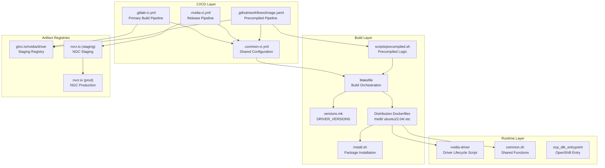
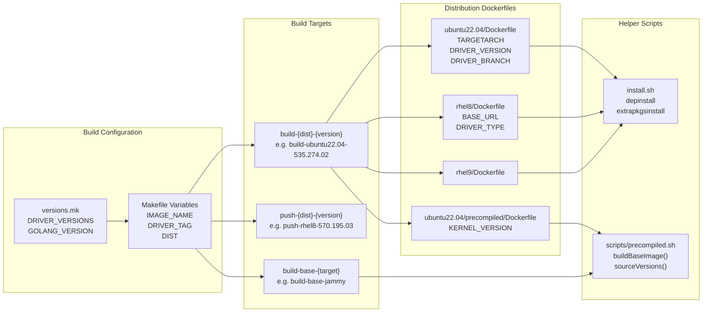
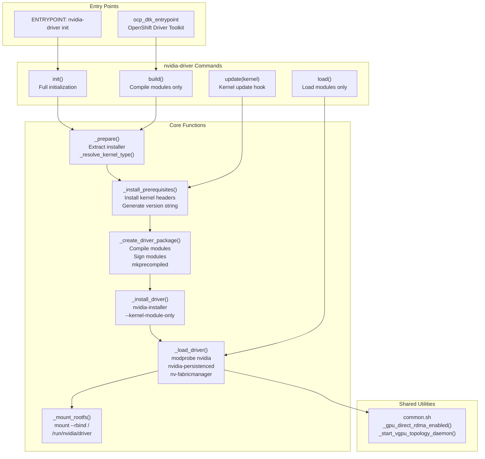
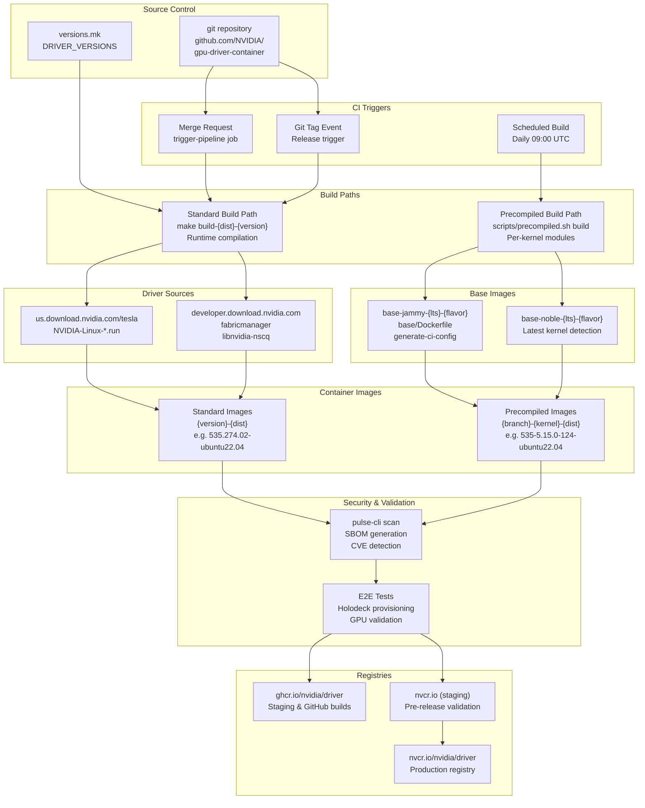
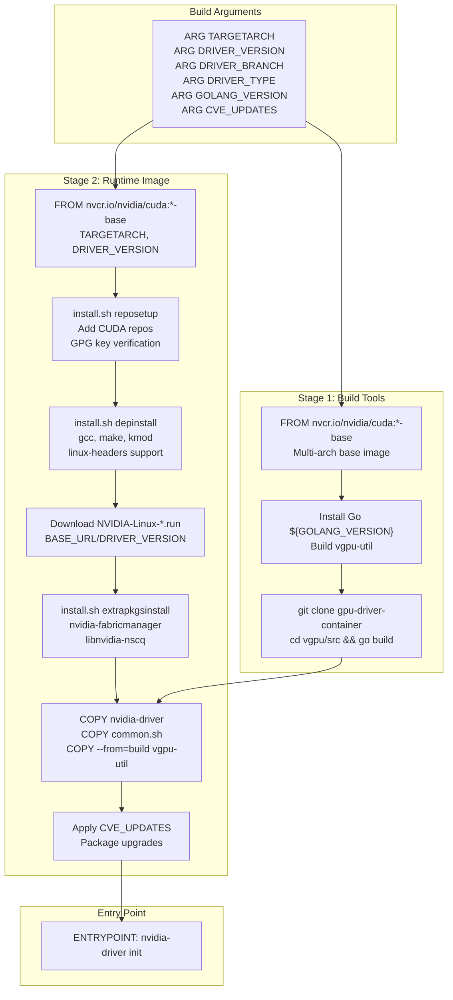
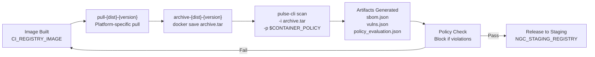

<!-- source: DeepWiki mcp.deepwiki.com · repo NVIDIA/gpu-driver-container · page 2 Architecture · fetched 2026-10-26 -->

# Architecture

<details>
<summary>Relevant source files</summary>

The following files were used as context for generating this wiki page:

- [.common-ci.yml](.common-ci.yml)
- [.github/workflows/image.yaml](.github/workflows/image.yaml)
- [.gitlab-ci.yml](.gitlab-ci.yml)
- [.nvidia-ci.yml](.nvidia-ci.yml)
- [Makefile](Makefile)
- [base/Dockerfile](base/Dockerfile)
- [base/generate-ci-config](base/generate-ci-config)
- [multi-arch.mk](multi-arch.mk)
- [native-only.mk](native-only.mk)
- [rhel8/Dockerfile](rhel8/Dockerfile)
- [rhel8/nvidia-driver](rhel8/nvidia-driver)
- [rhel9/Dockerfile](rhel9/Dockerfile)
- [rhel9/nvidia-driver](rhel9/nvidia-driver)
- [scripts/precompiled.sh](scripts/precompiled.sh)
- [ubuntu20.04/Dockerfile](ubuntu20.04/Dockerfile)
- [ubuntu20.04/nvidia-driver](ubuntu20.04/nvidia-driver)
- [ubuntu22.04/Dockerfile](ubuntu22.04/Dockerfile)
- [ubuntu22.04/nvidia-driver](ubuntu22.04/nvidia-driver)
- [versions.mk](versions.mk)

</details>


This page provides a high-level architectural overview of the NVIDIA GPU Driver Container build and delivery system. It describes the major components, their relationships, and the key design patterns that enable building and distributing containerized GPU drivers across multiple Linux distributions, driver versions, and hardware architectures.

For specific implementation details of the CI/CD pipeline, see [CI/CD Pipeline](#3). For runtime driver management details, see [Driver Management Scripts](#5). For build system configuration specifics, see [Build System Configuration](#6).

## System Overview

The gpu-driver-container repository implements an automated system for packaging NVIDIA GPU drivers as container images. The system supports three primary driver deployment modes:

| Deployment Mode | Description | Primary Use Case |
|----------------|-------------|------------------|
| **Passthrough/Baremetal** | Standard GPU drivers for bare-metal or VM passthrough | Kubernetes clusters, bare-metal systems |
| **vGPU Guest** | Virtual GPU drivers for guest VMs | Virtualized GPU workloads |
| **vGPU Host** | Hypervisor-level vGPU manager | Virtual GPU infrastructure |

The architecture separates concerns into three distinct layers: CI/CD automation, image build orchestration, and runtime driver management. This separation enables independent evolution of each layer while maintaining a cohesive delivery pipeline.

**Sources:** [.common-ci.yml:1-50](), [Makefile:1-84](), [rhel8/nvidia-driver:1-50]()

## Architectural Layers



**Sources:** [.gitlab-ci.yml:1-132](), [.nvidia-ci.yml:1-100](), [.github/workflows/image.yaml:1-194](), [Makefile:1-308](), [rhel8/nvidia-driver:1-30]()

### CI/CD Layer

The CI/CD layer consists of two parallel automation pipelines:

1. **GitLab CI Pipeline** ([.gitlab-ci.yml](), [.nvidia-ci.yml]()): Handles standard driver image builds for all distributions and performs release management to NGC registries. Executes on every merge request, commit to main, and tagged releases.

2. **GitHub Actions Pipeline** ([.github/workflows/image.yaml]()): Manages precompiled driver builds that include pre-built kernel modules for specific kernel versions. Runs on schedule (daily) and on pull requests.

Both pipelines share common configuration from [.common-ci.yml]() which defines:
- Driver version matrix: `DRIVER_VERSIONS ?= 535.274.02 570.195.03 580.95.05` ([versions.mk:16]())
- Distribution matrix: ubuntu20.04, ubuntu22.04, ubuntu24.04, rhel8, rhel9
- Architecture matrix: `linux/amd64`, `linux/arm64` ([.common-ci.yml:132-136]())
- Pipeline stages: `trigger`, `image-build`, `scan`, `release`, `ngc-publish` ([.common-ci.yml:25-31]())

**Sources:** [.common-ci.yml:1-367](), [.gitlab-ci.yml:1-132](), [.nvidia-ci.yml:1-533](), [.github/workflows/image.yaml:1-194]()

### Build Layer

The build layer orchestrates multi-distribution, multi-architecture image construction through a sophisticated Makefile-based system:



The Makefile implements a pattern-based target system where:
- `$(DRIVER_BUILD_TARGETS)` expands to all distribution-version combinations ([Makefile:64-65]())
- Each target parses its name to extract `DIST` and `DRIVER_VERSION` ([Makefile:152-154]())
- Distribution-specific rules override variables (e.g., `build-rhcos%: SUBDIR = rhel8` [Makefile:177]())
- Multi-arch builds conditionally use Docker Buildx based on `BUILD_MULTI_ARCH_IMAGES` ([Makefile:15-20]())

**Sources:** [Makefile:1-308](), [versions.mk:1-19](), [ubuntu22.04/Dockerfile:1-117](), [rhel8/Dockerfile:1-110](), [scripts/precompiled.sh:1-114]()

### Runtime Layer

The runtime layer manages driver installation, kernel module compilation, and daemon lifecycle through distribution-specific `nvidia-driver` scripts:



Each `nvidia-driver` script implements a state machine with distinct phases:

1. **Preparation**: Extract NVIDIA installer `.run` file, install userspace components, determine kernel module type (open vs proprietary) via `_resolve_kernel_type()` ([rhel8/nvidia-driver:622-639]())

2. **Build**: Check if precompiled package exists with `_kernel_requires_package()` ([rhel8/nvidia-driver:176-193]()), compile modules if needed with `_create_driver_package()` ([rhel8/nvidia-driver:196-259]())

3. **Installation**: Run `nvidia-installer --kernel-module-only` to install compiled modules ([rhel8/nvidia-driver:525-557]())

4. **Loading**: Load kernel modules via `modprobe`, start `nvidia-persistenced`, conditionally start `nv-fabricmanager` for NVSwitch systems ([rhel8/nvidia-driver:344-422]())

5. **Mounting**: Bind-mount driver rootfs to `/run/nvidia/driver` for host access ([rhel8/nvidia-driver:560-575]())

**Sources:** [rhel8/nvidia-driver:1-850](), [rhel9/nvidia-driver:1-850](), [ubuntu22.04/nvidia-driver:1-800](), [ubuntu20.04/nvidia-driver:1-700]()

## Data Flow Architecture

The following diagram shows how artifacts flow through the system from source code to production registries, including the distinction between standard and precompiled build paths:



**Standard build path** ([.gitlab-ci.yml:19-99]()):
1. Trigger from merge request or tag
2. Execute `make build-${DIST}-${DRIVER_VERSION}` for each distribution-version pair
3. Download NVIDIA installer from `us.download.nvidia.com` during image build ([rhel8/Dockerfile:65-69]())
4. Run security scans via `pulse-cli` ([.nvidia-ci.yml:151-186]())
5. Push to staging registry `ghcr.io/nvidia/driver` ([.nvidia-ci.yml:45-69]())
6. Promote to NGC staging, then production ([.nvidia-ci.yml:336-419]())

**Precompiled build path** ([scripts/precompiled.sh:1-114]()):
1. Daily schedule triggers GitHub Actions workflow ([.github/workflows/image.yaml:18-24]())
2. Build base images with `build-base-{jammy|noble}` to detect latest kernel ([Makefile:206-222]())
3. Execute `scripts/precompiled.sh build` which sources kernel version from base image ([scripts/precompiled.sh:8-37]())
4. Build per-kernel images with pre-compiled modules ([.gitlab-ci.yml:103-132]())
5. Follow same scan and promotion path as standard builds

**Sources:** [.gitlab-ci.yml:1-132](), [.nvidia-ci.yml:1-533](), [.github/workflows/image.yaml:1-194](), [scripts/precompiled.sh:1-114](), [Makefile:206-230]()

## Build-Time Architecture

The build process uses multi-stage Dockerfiles to separate build dependencies from runtime artifacts:



Key build-time patterns:

1. **Multi-architecture support**: Uses `TARGETARCH` ARG to download architecture-specific binaries ([rhel8/Dockerfile:26-27](), [ubuntu22.04/Dockerfile:45-46]())

2. **Late binding**: Driver `.run` file downloaded during build but not extracted ([rhel8/Dockerfile:65-69]()), actual installation happens at container runtime

3. **Conditional vGPU support**: vGPU utility only built when `DRIVER_TYPE=vgpu` ([ubuntu22.04/Dockerfile:34-38]())

4. **Security hardening**: CVE updates applied via `CVE_UPDATES` build arg ([.common-ci.yml:111](), [ubuntu22.04/Dockerfile:104-108]())

5. **Distribution abstraction**: `install.sh` script abstracts package manager differences between apt (Ubuntu) and dnf (RHEL) ([rhel8/Dockerfile:57](), [ubuntu22.04/Dockerfile:73]())

**Sources:** [rhel8/Dockerfile:1-110](), [ubuntu22.04/Dockerfile:1-117](), [rhel9/Dockerfile:1-115](), [ubuntu20.04/Dockerfile:1-106]()

## Runtime Architecture

At container startup, the `nvidia-driver init` command executes a carefully orchestrated sequence to install and load drivers on the host:

```mermaid
graph TB
    subgraph "Container Startup"
        START["Container starts<br/>ENTRYPOINT: nvidia-driver init"]
        LOCK["Acquire PID lock<br/>/run/nvidia/nvidia-driver.pid"]
    end
    
    subgraph "Driver Preparation Phase"
        EXTRACT["Extract NVIDIA-Linux-*.run<br/>nvidia-installer -x"]
        USERSPACE["Install userspace components<br/>Libraries to /usr/lib64<br/>Binaries to /usr/bin"]
        RESOLVE_TYPE["_resolve_kernel_type()<br/>nvidia-installer --print-recommended<br/>KERNEL_TYPE=kernel|kernel-open"]
        COPY_SOURCES["Copy kernel module sources<br/>/usr/src/nvidia-${DRIVER_VERSION}/<br/>kernel/ or kernel-open/"]
    end
    
    subgraph "Module Build Phase"
        CHECK_PKG["_kernel_requires_package()<br/>Check precompiled/*/"]
        GET_HEADERS["_install_prerequisites()<br/>dnf install kernel-headers<br/>kernel-devel kernel-core"]
        COMPILE["_create_driver_package()<br/>make nv-linux.o<br/>ld -r -o nvidia.ko<br/>mkprecompiled --pack"]
        INSTALLER["_install_driver()<br/>nvidia-installer<br/>--kernel-module-only<br/>--skip-module-load"]
    end
    
    subgraph "Module Load Phase"
        GET_PARAMS["_get_module_params()<br/>Parse /drivers/*.conf<br/>NVIDIA_MODULE_PARAMS"]
        LOAD_MODS["modprobe nvidia<br/>modprobe nvidia-uvm<br/>modprobe nvidia-modeset"]
        LOAD_PEERMEM["if GPU_DIRECT_RDMA_ENABLED<br/>modprobe nvidia-peermem"]
        START_PERSIST["nvidia-persistenced<br/>--persistence-mode"]
        START_GRIDD["if DRIVER_TYPE=vgpu<br/>nvidia-gridd"]
        START_FABRIC["if NVSwitch detected<br/>nv-fabricmanager"]
    end
    
    subgraph "Host Integration Phase"
        MOUNT["_mount_rootfs()<br/>mount --rbind /<br/>/run/nvidia/driver"]
        HOOK["_write_kernel_update_hook()<br/>/run/kernel/postinst.d/"]
        SELINUX["if SELinux enabled<br/>chcon -R -t container_file_t"]
    end
    
    subgraph "Steady State"
        WAIT["sleep infinity &<br/>trap signals for shutdown"]
    end
    
    START --> LOCK
    LOCK --> EXTRACT
    EXTRACT --> USERSPACE
    USERSPACE --> RESOLVE_TYPE
    RESOLVE_TYPE --> COPY_SOURCES
    
    COPY_SOURCES --> CHECK_PKG
    CHECK_PKG -->|"No precompiled package"| GET_HEADERS
    CHECK_PKG -->|"Precompiled exists"| INSTALLER
    GET_HEADERS --> COMPILE
    COMPILE --> INSTALLER
    
    INSTALLER --> GET_PARAMS
    GET_PARAMS --> LOAD_MODS
    LOAD_MODS --> LOAD_PEERMEM
    LOAD_PEERMEM --> START_PERSIST
    START_PERSIST --> START_GRIDD
    START_GRIDD --> START_FABRIC
    
    START_FABRIC --> MOUNT
    MOUNT --> HOOK
    HOOK --> SELINUX
    SELINUX --> WAIT
```



**Kernel module type resolution** ([rhel8/nvidia-driver:622-643]()):
- For driver branch >= 560: Defaults to open kernel modules (`kernel-open`)
- For driver branch < 560: Defaults to proprietary modules (`kernel`)
- Can be overridden via `KERNEL_MODULE_TYPE` environment variable
- Uses `nvidia-installer --print-recommended-kernel-module-type` to determine optimal choice

**Module parameter configuration** ([rhel8/nvidia-driver:305-341]()):
- Reads configuration files from `/drivers/*.conf`
- Supports: `nvidia.conf`, `nvidia-uvm.conf`, `nvidia-modeset.conf`, `nvidia-peermem.conf`
- Starting from driver 580, automatically adds `NVreg_CoherentGPUMemoryMode=driver` ([rhel8/nvidia-driver:311]())
- Parameters passed to `modprobe` during module loading

**Daemon management**:
- `nvidia-persistenced`: Always started for persistence mode ([rhel8/nvidia-driver:385]())
- `nvidia-gridd`: Started only when `DRIVER_TYPE=vgpu` ([rhel8/nvidia-driver:387-401]())
- `nv-fabricmanager`: Started when NVSwitch devices detected ([rhel8/nvidia-driver:418-421]())
- NVLink5+ systems: Both `nv-fabricmanager` and `nvlsm` started ([rhel8/nvidia-driver:403-416]())

**Host integration**:
- Driver files mounted to `/run/nvidia/driver` via bind mount ([rhel8/nvidia-driver:560-575]())
- SELinux contexts applied if enabled ([rhel8/nvidia-driver:567-574]())
- Kernel update hook installed to `/run/kernel/postinst.d/` for automatic recompilation ([rhel8/nvidia-driver:586-604]())

**Sources:** [rhel8/nvidia-driver:753-759](), [rhel8/nvidia-driver:622-643](), [rhel8/nvidia-driver:305-341](), [rhel8/nvidia-driver:344-422](), [rhel8/nvidia-driver:560-604](), [ubuntu22.04/nvidia-driver:564-750]()

## Key Design Patterns

### Late Binding Pattern

Driver kernel modules are compiled at container runtime rather than build time, enabling a single container image to support multiple kernel versions:

```
Image Build Time:
  - Include NVIDIA-Linux-*.run (installer)
  - Include kernel module source code
  - Include mkprecompiled tool

Container Runtime:
  - Detect host kernel version
  - Install kernel headers matching host
  - Compile modules against host kernel
  - Install and load modules
```

This pattern is implemented in `_kernel_requires_package()` ([rhel8/nvidia-driver:176-193]()), which checks if a precompiled package already exists for the current kernel before triggering compilation.

**Sources:** [rhel8/nvidia-driver:176-193](), [rhel8/nvidia-driver:196-259](), [ubuntu22.04/nvidia-driver:115-132]()

### Distribution Abstraction Pattern

Common driver logic is shared via `common.sh` while distribution-specific implementations handle package management differences:

| Function | Ubuntu Implementation | RHEL Implementation |
|----------|----------------------|---------------------|
| Package cache update | `apt-get -qq update` | `yum -q makecache` |
| Install headers | `apt-get install linux-headers-*` | `dnf install kernel-headers-*` |
| Resolve kernel version | Parse `apt-cache show` output | Parse `yum list available` output |
| Extract vmlinuz | Direct `strings` on decompressed kernel | `extract-vmlinux` then `strings` |

Each distribution's `nvidia-driver` script sources `common.sh` ([rhel8/nvidia-driver:26]()) and implements distribution-specific functions with the same interface.

**Sources:** [rhel8/nvidia-driver:28-45](), [ubuntu22.04/nvidia-driver:38-74](), [rhel9/nvidia-driver:29-88]()

### Matrix Build Pattern

The Makefile implements a matrix expansion pattern to generate all distribution-version-architecture combinations:

```makefile
DISTRIBUTIONS := ubuntu18.04 ubuntu20.04 ubuntu22.04 ubuntu24.04 rhel8 rhel9
DRIVER_VERSIONS := 535.274.02 570.195.03 580.95.05

# Generates: build-ubuntu22.04-535.274.02, build-ubuntu22.04-570.195.03, ...
BUILD_TARGETS := $(patsubst %, build-%, $(DISTRIBUTIONS))
DRIVER_BUILD_TARGETS := $(foreach build_target, $(BUILD_TARGETS), 
                        $(addprefix $(build_target)-, $(DRIVER_VERSIONS)))
```

Target names are parsed using Make's `subst` and `word` functions to extract variables ([Makefile:152-156]()):

```makefile
build-%: DIST = $(word 2,$(subst -, ,$@))
build-%: DRIVER_VERSION = $(word 3,$(subst -, ,$@))
build-%: DRIVER_BRANCH = $(word 1,$(subst ., ,${DRIVER_VERSION}))
```

**Sources:** [Makefile:57-77](), [Makefile:150-176](), [.common-ci.yml:81-99]()

### Precompiled Optimization Pattern

For production deployments with known kernel versions, precompiled images skip runtime compilation:

```
Base Image Build (daily):
  - Launch temporary container with target kernel flavor
  - Query package repositories for latest kernel
  - Write KERNEL_VERSION to /var/kernel_version.txt

Precompiled Image Build:
  - Source KERNEL_VERSION from base image
  - Install exact kernel headers at build time
  - Compile and sign modules during image build
  - Package modules in precompiled/ directory

Container Runtime:
  - Skip compilation (_kernel_requires_package returns false)
  - Directly install pre-built modules
  - Load modules and start daemons
```

This pattern reduces container startup time from ~5 minutes to ~30 seconds for kernel module installation.

**Implementation**: [scripts/precompiled.sh:8-37](), [base/generate-ci-config:1-34](), [.github/workflows/image.yaml:165-194]()

**Sources:** [scripts/precompiled.sh:1-114](), [base/generate-ci-config:1-34](), [base/Dockerfile:1-110](), [.github/workflows/image.yaml:93-194]()

### Security Scanning Pattern

Every image passes through automated security validation before promotion to production:



The scan stage runs for each platform (`linux/amd64`, `linux/arm64`) and generates:
- Software Bill of Materials (SBOM) in SPDX format
- Vulnerability scan results
- License compliance report
- Policy evaluation results

Scans can be skipped via commit message `[skip scans]` or environment variable `SKIP_SCANS=yes` ([.nvidia-ci.yml:158-161]()).

**Sources:** [.nvidia-ci.yml:151-253](), [.common-ci.yml:218-228]()

---

