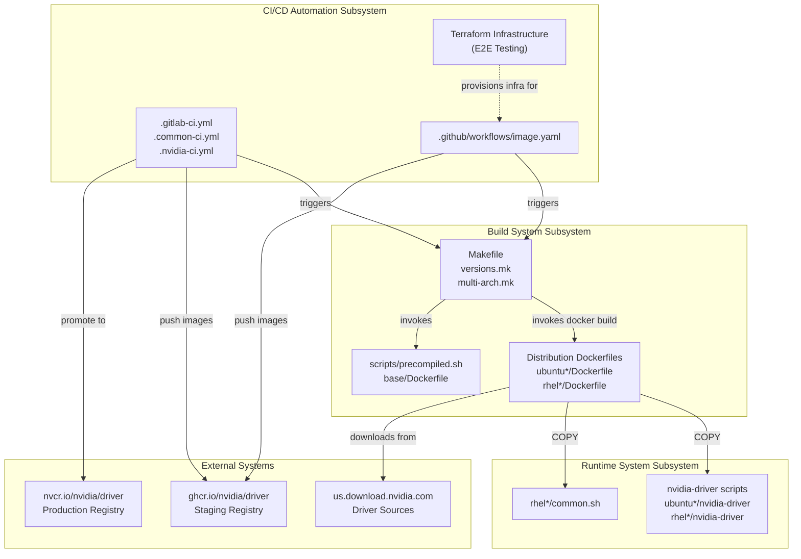
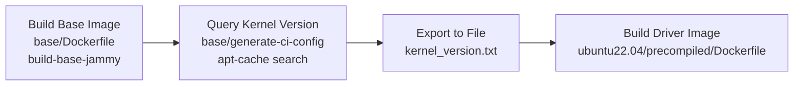
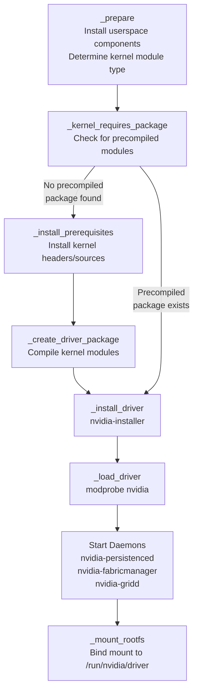
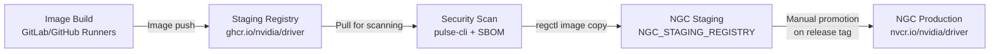

<!-- source: DeepWiki mcp.deepwiki.com · repo NVIDIA/gpu-driver-container · page 2.1 System Components · fetched 2026-10-26 -->

# System Components

<details>
<summary>Relevant source files</summary>

The following files were used as context for generating this wiki page:

- [.common-ci.yml](.common-ci.yml)
- [.github/workflows/image.yaml](.github/workflows/image.yaml)
- [.gitlab-ci.yml](.gitlab-ci.yml)
- [.nvidia-ci.yml](.nvidia-ci.yml)
- [Makefile](Makefile)
- [base/Dockerfile](base/Dockerfile)
- [base/generate-ci-config](base/generate-ci-config)
- [multi-arch.mk](multi-arch.mk)
- [native-only.mk](native-only.mk)
- [rhel8/nvidia-driver](rhel8/nvidia-driver)
- [rhel9/nvidia-driver](rhel9/nvidia-driver)
- [scripts/precompiled.sh](scripts/precompiled.sh)
- [ubuntu20.04/nvidia-driver](ubuntu20.04/nvidia-driver)
- [ubuntu22.04/nvidia-driver](ubuntu22.04/nvidia-driver)
- [versions.mk](versions.mk)

</details>


## Purpose and Scope

This page describes the major subsystems within the gpu-driver-container repository and how they interact to produce, test, and distribute containerized NVIDIA GPU drivers. The three primary subsystems are:

1. **CI/CD Automation Subsystem** - Orchestrates builds, tests, and releases
2. **Build System Subsystem** - Generates container images across multiple distributions
3. **Runtime System Subsystem** - Manages driver lifecycle within containers

For details on specific CI/CD workflows, see [CI/CD Pipeline](#3). For build configuration specifics, see [Build System Configuration](#6). For runtime behavior and driver management, see [Driver Management Scripts](#5).

---

## System Architecture Overview

The repository implements a multi-layer system where CI/CD pipelines trigger builds that produce container images containing runtime scripts. These components are loosely coupled through well-defined interfaces: environment variables, container registries, and file system conventions.



**Component Interaction Model**

Sources: [.common-ci.yml:1-367](), [.nvidia-ci.yml:1-533](), [.github/workflows/image.yaml:1-194](), [Makefile:1-308](), [rhel8/nvidia-driver:1-20]()

---

## CI/CD Automation Subsystem

The CI/CD subsystem consists of two parallel automation pipelines with distinct responsibilities.

### GitLab CI Pipeline

The GitLab CI pipeline is the primary automation system for standard driver images and NGC releases.

**Key Files:**
- [.common-ci.yml:1-367]() - Shared pipeline definitions and stages
- [.nvidia-ci.yml:1-533]() - NVIDIA-internal pipeline configuration
- [.gitlab-ci.yml:1-132]() - Public pipeline configuration

**Pipeline Stages:**

| Stage | Purpose | Key Jobs |
|-------|---------|----------|
| `trigger` | Pipeline entry gate | `trigger-pipeline` |
| `image-build` | Build container images | `image-ubuntu22.04`, `image-rhel8`, `image-precompiled-ubuntu22.04` |
| `scan` | Security scanning | `scan-ubuntu22.04-amd64`, `scan-rhel8-arm64` |
| `release:staging` | Push to staging registry | `release:staging-ubuntu22.04`, `release:staging-precompiled-ubuntu22.04` |
| `release:ngc` | Push to production | `release:ngc-ubuntu22.04`, `release:ngc-rhcos4.14` |
| `ngc-publish` | Update metadata | `update-nspect`, `ngc-image-publish` |

**Pipeline Trigger Rules:**

The pipeline is activated through multiple triggers defined in [.common-ci.yml:33-49]():

```yaml
workflow:
  rules:
    - if: $CI_PIPELINE_SOURCE == 'merge_request_event'
    - if: $CI_PIPELINE_SOURCE == 'schedule'
    - if: $CI_PIPELINE_SOURCE == "web"
    - if: $CI_COMMIT_BRANCH == "main"
    - if: $CI_COMMIT_TAG && $CI_COMMIT_TAG != ""
```

**Driver Version Matrix:**

Driver versions are defined in [.common-ci.yml:22]() and [versions.mk:16]():
```
DRIVER_VERSIONS: 535.274.02 570.195.03 580.95.05
```

The matrix expansion is handled through job inheritance patterns in [.common-ci.yml:81-106](). For example, the Ubuntu 22.04 precompiled builds use:

```yaml
.driver-versions-precompiled-ubuntu22.04:
  parallel:
    matrix:
      - DRIVER_BRANCH: [535, 570, 580]
        KERNEL_FLAVOR: [aws, azure, generic, nvidia, oracle]
        LTS_KERNEL: ["5.15", "6.8"]
```

This creates 30 parallel jobs per architecture (3 branches × 5 flavors × 2 kernels).

Sources: [.common-ci.yml:15-107](), [.gitlab-ci.yml:19-132](), [versions.mk:15-16]()

### GitHub Actions Workflows

GitHub Actions handles precompiled driver builds and end-to-end testing.

**Primary Workflow:** [.github/workflows/image.yaml:1-194]()

**Key Job Matrices:**

1. **Standard Images** ([.github/workflows/image.yaml:26-92]()):
   - Dimensions: `driver` × `dist` 
   - Produces 11 image variants (3 drivers × 4 dists, minus excluded combinations)

2. **Precompiled Images** ([.github/workflows/image.yaml:93-194]()):
   - Dimensions: `driver` × `flavor` × `dist` × `lts_kernel`
   - Produces up to 60 image variants (3 drivers × 5 flavors × 2 dists × 2 kernels)

**Workflow Trigger Conditions:**

```yaml
on:
  push:
    branches:
      - main
      - "pull-request/[0-9]+"
      - release-*
```

**Base Image Build Step:**

For precompiled images, GitHub Actions first builds a base image that queries package repositories for the latest kernel version:

```yaml
- name: Build base image and get kernel version
  run: |
    make DRIVER_BRANCH=${{ matrix.driver }} KERNEL_FLAVOR=${{ matrix.flavor }} \
         LTS_KERNEL=${LTS_KERNEL} build-base-${BASE_TARGET}
    docker run -d --name base-${BASE_TARGET}-${{ matrix.flavor }} \
      ghcr.io/nvidia/driver:base-${BASE_TARGET}-${LTS_KERNEL}-${{ matrix.flavor }}-${{ matrix.driver }}
    docker cp base-${BASE_TARGET}-${{ matrix.flavor }}:/var/kernel_version.txt kernel_version.txt
```

The base image generation is defined in [base/Dockerfile:1-110]() and [base/generate-ci-config:1-34]().

Sources: [.github/workflows/image.yaml:16-194](), [base/Dockerfile:1-110](), [base/generate-ci-config:1-34]()

### Terraform CI Infrastructure

Terraform provisions temporary GPU-enabled infrastructure for E2E testing. While the Terraform configuration files are not included in the provided files, the integration point is visible in the high-level architecture diagrams where Terraform provisions AWS EC2 instances for GitHub Actions runners.

---

## Build System Subsystem

The build system transforms source distributions and driver binaries into multi-architecture container images.

### Makefile Orchestration

The [Makefile:1-308]() serves as the build orchestration layer, providing targets for each distribution and driver version combination.

**Build Target Naming Convention:**

```
build-<DIST>-<DRIVER_VERSION>
```

Examples:
- `build-ubuntu22.04-535.274.02`
- `build-rhel9-570.195.03`
- `build-signed_ubuntu22.04-580.95.05` (precompiled)

**Key Makefile Variables:**

| Variable | Source | Purpose |
|----------|--------|---------|
| `DRIVER_VERSIONS` | [versions.mk:16]() | List of supported driver versions |
| `IMAGE_NAME` | [Makefile:26-27]() | Target registry and image name |
| `VERSION` | [Makefile:35-39]() | Image version tag (commit SHA or release) |
| `DIST` | Parsed from target | Distribution identifier |
| `BUILD_MULTI_ARCH_IMAGES` | [Makefile:15]() | Enable cross-platform builds |

**Target Resolution Logic:**

The Makefile uses pattern matching to extract parameters from targets ([Makefile:152-156]()):

```makefile
build-%: DIST = $(word 2,$(subst -, ,$@))
build-%: DRIVER_VERSION = $(word 3,$(subst -, ,$@))
build-%: DRIVER_BRANCH = $(word 1,$(subst ., ,${DRIVER_VERSION}))
build-%: SUBDIR = $(word 2,$(subst -, ,$@))
build-%: DOCKERFILE = $(CURDIR)/$(SUBDIR)/Dockerfile
```

**Multi-Architecture Support:**

When `BUILD_MULTI_ARCH_IMAGES=true`, the Makefile includes [multi-arch.mk:1-32]() which configures Docker Buildx:

```makefile
DOCKER_BUILD_PLATFORM_OPTIONS = --platform=linux/amd64,linux/arm64
```

Otherwise, it includes [native-only.mk:1-28]() for single-architecture builds.

**Precompiled Image Targets:**

Precompiled images use special naming conventions ([Makefile:189-201]()):

```makefile
build-signed_ubuntu22.04%: DIST = ubuntu22.04
build-signed_ubuntu22.04%: SUBDIR = ubuntu22.04/precompiled
build-signed_ubuntu22.04%: DRIVER_TAG = $(DRIVER_BRANCH)
build-signed_ubuntu22.04%: IMAGE_TAG = $(if $(VERSION),$(VERSION)-)$(DRIVER_BRANCH)-$(KERNEL_VERSION)-$(DIST)
```

The `signed_` prefix indicates that these images contain pre-signed kernel modules for specific kernel versions.

Sources: [Makefile:1-308](), [versions.mk:1-19](), [multi-arch.mk:1-32](), [native-only.mk:1-28]()

### Dockerfile Architecture

Each supported distribution has its own Dockerfile that follows a common multi-stage pattern:

1. **Base Stage** - Install build dependencies
2. **Build Stage** - Download and prepare NVIDIA driver installer
3. **Runtime Stage** - Copy runtime components and scripts

**Distribution-Specific Dockerfiles:**

- Ubuntu: `ubuntu20.04/Dockerfile`, `ubuntu22.04/Dockerfile`, `ubuntu24.04/Dockerfile`
- RHEL: `rhel8/Dockerfile`, `rhel9/Dockerfile`
- Others: `fedora/Dockerfile`, `sle15/Dockerfile`, `flatcar/Dockerfile`

**Build Arguments:**

All Dockerfiles accept these common build arguments ([Makefile:168-172]()):

```dockerfile
ARG DRIVER_VERSION
ARG GOLANG_VERSION
ARG DRIVER_BRANCH
ARG CUDA_VERSION
ARG CVE_UPDATES
```

**Precompiled Dockerfiles:**

Precompiled images use different Dockerfiles located in `<dist>/precompiled/Dockerfile` and add:

```dockerfile
ARG KERNEL_VERSION
```

This allows building images for specific kernel versions.

Sources: [Makefile:163-175](), [Makefile:189-201]()

### Precompiled Image Workflow

Precompiled images follow a two-stage build process managed by [scripts/precompiled.sh:1-114]().



**Base Image Kernel Detection:**

The [base/generate-ci-config:1-34]() script queries package repositories for the latest kernel version with pre-signed NVIDIA modules:

```bash
SUPPORTED_KERNELS_LINUX_SIGNATURES_LIST=$(apt-cache search \
  "linux-signatures-nvidia.*${LTS_KERNEL}.*${KERNEL_FLAVOR}" | \
  awk '{print $1}' | sed -e "s/^.*${LTS_KERNEL}/${LTS_KERNEL}/" | \
  sort -n -t'-' -k2 | grep "${KERNEL_FLAVOR}$")
```

The script writes the discovered kernel version to `/var/kernel_version.txt` inside the container.

**Version Extraction:**

The [scripts/precompiled.sh:7-37]() `sourceVersions()` function extracts the kernel version:

```bash
function sourceVersions(){
    if [ -f kernel_version.txt ]; then
        source kernel_version.txt
        return 0
    fi
    regctl image get-file ghcr.io/nvidia/driver:base-${BASE_TARGET}-${LTS_KERNEL}-${KERNEL_FLAVOR}-${DRIVER_BRANCH} \
      /var/kernel_version.txt kernel_version.txt
    source kernel_version.txt
}
```

This approach ensures precompiled images target the exact kernel version available in distribution repositories at build time.

Sources: [scripts/precompiled.sh:1-114](), [base/Dockerfile:1-110](), [base/generate-ci-config:1-34]()

---

## Runtime System Subsystem

The runtime system consists of bash scripts that execute inside driver containers to manage the complete driver lifecycle.

### nvidia-driver Script Architecture

Each distribution provides an `nvidia-driver` script that implements a common interface:

- Ubuntu: [ubuntu20.04/nvidia-driver:1-700](), [ubuntu22.04/nvidia-driver:1-700]()
- RHEL: [rhel8/nvidia-driver:1-900](), [rhel9/nvidia-driver:1-900]()

**Command Interface:**

```bash
nvidia-driver init      # Install, compile, load, and mount driver
nvidia-driver build     # Only compile kernel modules
nvidia-driver load      # Only load kernel modules
nvidia-driver update    # Recompile for new kernel version
```

**Script Entry Points:**

All scripts follow this structure ([rhel8/nvidia-driver:753-821]()):

```bash
init() {
    _prepare_exclusive
    _build
    _load
}

build() {
    _prepare
    _build
}

load() {
    _prepare_exclusive
    _load
}

update() {
    # Kernel update hook logic
}
```

The script is invoked as the container `ENTRYPOINT` with the command as an argument.

Sources: [rhel8/nvidia-driver:753-821](), [ubuntu22.04/nvidia-driver:564-631]()

### Driver Lifecycle Functions

The core lifecycle is implemented through private functions that follow a consistent pattern across distributions.



**Function Descriptions:**

| Function | Location | Purpose |
|----------|----------|---------|
| `_prepare` | [rhel8/nvidia-driver:687-707]() | Extract driver installer, install userspace components, copy kernel module sources |
| `_kernel_requires_package` | [rhel8/nvidia-driver:176-193]() | Check if a precompiled package exists for the current kernel |
| `_install_prerequisites` | [rhel8/nvidia-driver:89-164]() | Install kernel headers, kernel modules, generate version string |
| `_create_driver_package` | [rhel8/nvidia-driver:196-259]() | Compile kernel modules, sign if needed, package with `mkprecompiled` |
| `_install_driver` | [rhel8/nvidia-driver:525-557]() | Run `nvidia-installer` to install kernel modules |
| `_load_driver` | [rhel8/nvidia-driver:344-422]() | Load kernel modules with `modprobe`, start daemons |
| `_mount_rootfs` | [rhel8/nvidia-driver:560-575]() | Bind mount container rootfs to `/run/nvidia/driver` |

**Kernel Module Type Resolution:**

Starting with driver branch 560, NVIDIA provides both proprietary (`kernel`) and open-source (`kernel-open`) module variants. The `_resolve_kernel_type` function ([rhel8/nvidia-driver:615-643]()) determines which to install:

```bash
_resolve_kernel_type() {
  if [ "${KERNEL_MODULE_TYPE}" == "proprietary" ]; then
    KERNEL_TYPE=kernel
  elif [ "${KERNEL_MODULE_TYPE}" == "open" ]; then
    KERNEL_TYPE=kernel-open
  elif [ "${KERNEL_MODULE_TYPE}" == "auto" ]; then
    kernel_module_type=$(nvidia-installer --print-recommended-kernel-module-type)
    [[ "${kernel_module_type}" == "open" ]] && KERNEL_TYPE=kernel-open || KERNEL_TYPE=kernel
  fi
}
```

The `KERNEL_MODULE_TYPE` environment variable (default: `auto`) controls this behavior.

Sources: [rhel8/nvidia-driver:687-707](), [rhel8/nvidia-driver:176-193](), [rhel8/nvidia-driver:89-164](), [rhel8/nvidia-driver:196-259](), [rhel8/nvidia-driver:525-557](), [rhel8/nvidia-driver:344-422](), [rhel8/nvidia-driver:615-643]()

### Module Parameter Configuration

The `_get_module_params` function ([rhel8/nvidia-driver:305-341]()) reads custom module parameters from configuration files:

**Configuration File Locations:**
- `/drivers/nvidia.conf` → `NVIDIA_MODULE_PARAMS` array
- `/drivers/nvidia-uvm.conf` → `NVIDIA_UVM_MODULE_PARAMS` array
- `/drivers/nvidia-modeset.conf` → `NVIDIA_MODESET_MODULE_PARAMS` array
- `/drivers/nvidia-peermem.conf` → `NVIDIA_PEERMEM_MODULE_PARAMS` array

**Automatic Parameter Injection (R580+):**

For driver versions 580 and above, the script automatically adds the coherent GPU memory management parameter ([rhel8/nvidia-driver:308-311]()):

```bash
NVIDIA_MODULE_PARAMS+=("NVreg_CoherentGPUMemoryMode=driver")
```

This prevents coherent GPU memory (on GH200, GB200 systems) from being exposed as a NUMA node in Kubernetes.

**Module Loading:**

Parameters are passed to `modprobe` during driver loading ([rhel8/nvidia-driver:370-382]()):

```bash
modprobe nvidia "${NVIDIA_MODULE_PARAMS[@]}"
modprobe nvidia-uvm "${NVIDIA_UVM_MODULE_PARAMS[@]}"
modprobe nvidia-modeset "${NVIDIA_MODESET_MODULE_PARAMS[@]}"
```

Sources: [rhel8/nvidia-driver:305-341](), [rhel8/nvidia-driver:308-311](), [rhel8/nvidia-driver:370-382](), [ubuntu22.04/nvidia-driver:268-304]()

### Distribution-Specific Implementation Differences

While the overall structure is consistent, distributions have unique requirements:

**RHEL-Specific Features:**

1. **DNF Release Version Management** ([rhel8/nvidia-driver:64-71]()):
   ```bash
   _resolve_rhel_version() {
       _get_rhel_version_from_kernel || RHEL_VERSION="${RHEL_MAJOR_VERSION}"
       if [[ -z "${DNF_RELEASEVER}" ]]; then
           DNF_RELEASEVER="${RHEL_VERSION}"
       fi
   }
   ```

2. **EUS Repository Enablement** ([rhel8/nvidia-driver:98-120]()):
   ```bash
   dnf config-manager --set-enabled rhel-8-for-$DRIVER_ARCH-baseos-eus-rpms || true
   ```

3. **Video Module Loading (RHEL9.3+)** ([rhel9/nvidia-driver:382-385]()):
   ```bash
   if [[ "$RHEL_MINOR_VERSION" -ge "3" ]]; then
       modprobe video
   fi
   ```

**Ubuntu-Specific Features:**

1. **FIPS Mode Support** ([ubuntu22.04/nvidia-driver:27-36]()):
   ```bash
   _enable_fips_if_required() {
       if [[ -n "${UBUNTU_PRO_TOKEN}" && ${KERNEL_VERSION} =~ "fips" ]]; then
           pro attach --no-auto-enable "${UBUNTU_PRO_TOKEN}"
           pro enable --access-only --assume-yes fips-updates
       fi
   }
   ```

2. **Kernel Flavor Normalization** ([ubuntu22.04/nvidia-driver:59-73]()):
   ```bash
   kernel_flavor="${kernel_flavor//virtual/generic}"
   KERNEL_VERSION="${version}-${kernel_flavor}"
   ```

Sources: [rhel8/nvidia-driver:64-71](), [rhel8/nvidia-driver:98-120](), [rhel9/nvidia-driver:382-385](), [ubuntu22.04/nvidia-driver:27-36](), [ubuntu22.04/nvidia-driver:59-73]()

### Common Functionality Library

RHEL distributions share common functionality through [rhel8/common.sh]() (referenced in [rhel8/nvidia-driver:26]()):

```bash
SCRIPT_DIR=$( cd -- "$( dirname -- "${BASH_SOURCE[0]}" )" &> /dev/null && pwd )
source $SCRIPT_DIR/common.sh
```

This library provides:
- `_gpu_direct_rdma_enabled()` - Check for GPUDirect RDMA support
- `MAX_THREADS` - Parallel compilation thread count
- Shared utility functions

Sources: [rhel8/nvidia-driver:25-26]()

---

## Component Interaction Patterns

The subsystems interact through well-defined interfaces and conventions.

### Environment Variable Contract

Components communicate through standardized environment variables:

**Build-Time Variables:**

| Variable | Set By | Used By | Purpose |
|----------|--------|---------|---------|
| `DRIVER_VERSION` | Makefile | Dockerfile, nvidia-driver | Driver version to install |
| `DRIVER_BRANCH` | Makefile | Dockerfile, nvidia-driver | Driver branch (535, 570, 580) |
| `KERNEL_VERSION` | Base image | Precompiled Dockerfile | Target kernel version |
| `BUILD_MULTI_ARCH_IMAGES` | CI | Makefile | Enable cross-platform builds |
| `CVE_UPDATES` | CI | Dockerfile | Packages to update for CVE fixes |

**Runtime Variables:**

| Variable | Set By | Used By | Purpose |
|----------|--------|---------|---------|
| `DRIVER_VERSION` | Dockerfile ENV | nvidia-driver | Driver version installed in image |
| `KERNEL_MODULE_TYPE` | User/Operator | nvidia-driver | Module type selection (auto/open/proprietary) |
| `GPU_DIRECT_RDMA_ENABLED` | User/Operator | nvidia-driver | Enable GPUDirect RDMA |
| `UBUNTU_PRO_TOKEN` | User/Operator | nvidia-driver | Ubuntu Pro authentication |
| `TARGETARCH` | Docker | nvidia-driver | Container architecture |

Sources: [Makefile:168-172](), [rhel8/nvidia-driver:8-20](), [ubuntu22.04/nvidia-driver:8-19]()

### Registry Workflow

Container images flow through multiple registries during their lifecycle:



**Registry Variables:**

Defined in [.common-ci.yml:159-184]() and [.nvidia-ci.yml:27-37]():

```yaml
IMAGE_NAME: "${CI_REGISTRY_IMAGE}"
OUT_IMAGE_NAME: "${NGC_STAGING_REGISTRY}/driver"
STAGING_REGISTRY: ghcr.io/nvidia
NGC_REGISTRY: nvcr.io/nvidia
```

**Image Copy Operation:**

The `.release-generic` job template ([.common-ci.yml:159-184]()) uses `regctl` to copy images:

```bash
regctl image copy $(IMAGE) $(OUT_IMAGE)
```

This preserves multi-architecture manifests and attestations.

Sources: [.common-ci.yml:159-184](), [.nvidia-ci.yml:34-37](), [multi-arch.mk:21-24]()

### File System Conventions

The runtime system relies on specific file system locations:

**Driver Installation Paths:**

| Path | Content | Created By |
|------|---------|------------|
| `/usr/src/nvidia-${DRIVER_VERSION}` | Kernel module sources | `_prepare` function |
| `/usr/src/nvidia-${DRIVER_VERSION}/${KERNEL_TYPE}` | Kernel module type directory | `_prepare` function |
| `/usr/src/nvidia-${DRIVER_VERSION}/${KERNEL_TYPE}/precompiled` | Precompiled packages | `_create_driver_package` |
| `/lib/modules/${KERNEL_VERSION}` | Installed kernel modules | `nvidia-installer` |
| `/run/nvidia/driver` | Mounted driver rootfs | `_mount_rootfs` |
| `/run/nvidia/nvidia-driver.pid` | Driver container PID file | `init` function |

**Configuration Paths:**

| Path | Content | Mounted By |
|------|---------|------------|
| `/drivers/nvidia.conf` | nvidia.ko module parameters | User/Operator |
| `/drivers/gridd.conf` | vGPU licensing configuration | User/Operator (vGPU only) |
| `/drivers/ClientConfigToken/*` | NLS license tokens | User/Operator (vGPU only) |

**Temporary Paths:**

| Path | Content | Purpose |
|------|---------|---------|
| `/lib/modules/${KERNEL_VERSION}/proc/version` | Kernel version string | Module compilation matching |
| `/run/kernel/postinst.d/update-nvidia-driver` | Kernel update hook | Automatic recompilation |

Sources: [rhel8/nvidia-driver:687-707](), [rhel8/nvidia-driver:560-575](), [rhel8/nvidia-driver:586-604](), [ubuntu22.04/nvidia-driver:467-485]()

---

## Summary

The gpu-driver-container repository implements a three-tier architecture:

1. **CI/CD Automation** ([.common-ci.yml](), [.nvidia-ci.yml](), [.github/workflows/image.yaml]()) orchestrates builds across platforms
2. **Build System** ([Makefile](), [versions.mk](), Dockerfiles) generates images for 9+ distributions × 3 driver branches × 2 architectures
3. **Runtime System** (nvidia-driver scripts) manages kernel module compilation, loading, and lifecycle within containers

These subsystems communicate through:
- Environment variables (build and runtime configuration)
- Container registries (image distribution)
- File system conventions (driver installation and configuration)

The architecture supports both standard (runtime compilation) and precompiled (pre-signed modules) driver deployment modes, with distribution-specific implementations sharing common patterns and interfaces.

---

