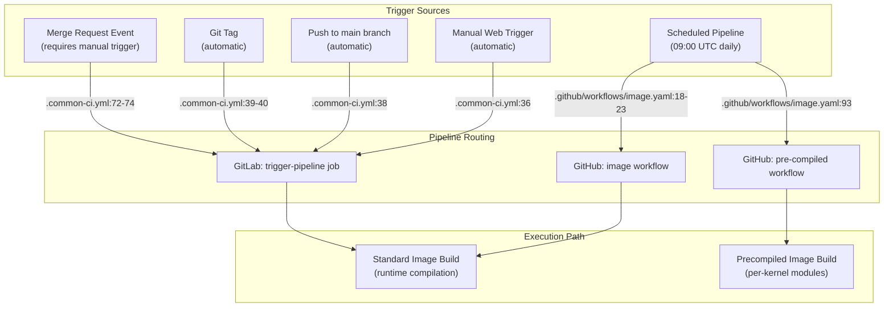
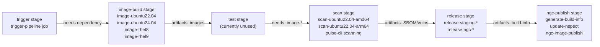
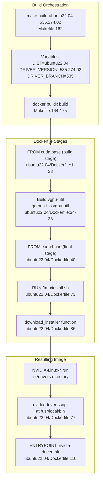
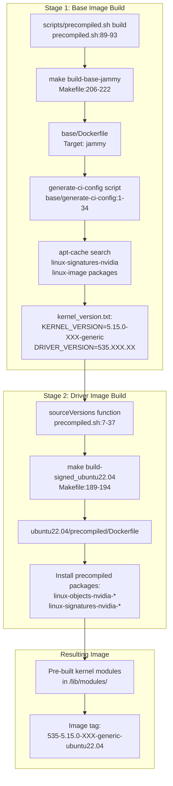
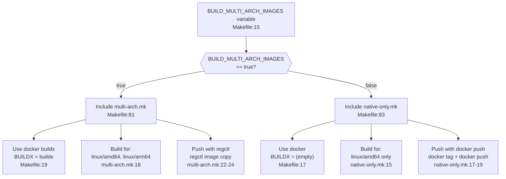
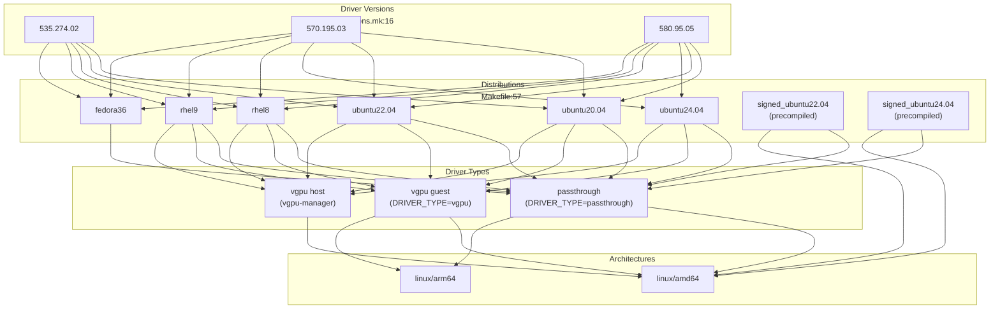
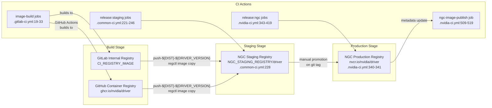

<!-- source: DeepWiki mcp.deepwiki.com · repo NVIDIA/gpu-driver-container · page 2.2 Build Pipeline Flow · fetched 2026-10-26 -->

# Build Pipeline Flow

<details>
<summary>Relevant source files</summary>

The following files were used as context for generating this wiki page:

- [.common-ci.yml](.common-ci.yml)
- [.github/workflows/image.yaml](.github/workflows/image.yaml)
- [.gitlab-ci.yml](.gitlab-ci.yml)
- [.nvidia-ci.yml](.nvidia-ci.yml)
- [Makefile](Makefile)
- [base/Dockerfile](base/Dockerfile)
- [base/generate-ci-config](base/generate-ci-config)
- [multi-arch.mk](multi-arch.mk)
- [native-only.mk](native-only.mk)
- [rhel8/Dockerfile](rhel8/Dockerfile)
- [rhel9/Dockerfile](rhel9/Dockerfile)
- [scripts/precompiled.sh](scripts/precompiled.sh)
- [ubuntu20.04/Dockerfile](ubuntu20.04/Dockerfile)
- [ubuntu22.04/Dockerfile](ubuntu22.04/Dockerfile)
- [versions.mk](versions.mk)

</details>


## Purpose and Scope

This document explains how source code and configuration flows through the build pipeline stages to produce containerized NVIDIA GPU driver images. It covers both the GitLab CI and GitHub Actions workflows, the role of the Makefile build orchestration system, and the different paths taken by standard versus precompiled driver images.

For information about the runtime behavior of driver containers after they are built, see [Runtime Architecture](#2.3). For detailed documentation of individual CI/CD systems, see [GitLab CI Workflows](#3.1) and [GitHub Actions Workflows](#3.2).

## Build Pipeline Entry Points

The build pipeline can be triggered through multiple entry points, each serving different purposes and following slightly different execution paths.

### Pipeline Trigger Mechanisms

**Diagram: Pipeline Entry Points and Trigger Rules**



Sources: [.common-ci.yml:33-79](), [.github/workflows/image.yaml:18-24]()

The pipeline uses conditional execution based on the trigger source:

| Trigger Type | Target System | Build Type | Notes |
|--------------|---------------|------------|-------|
| Merge Request | GitLab CI | Standard | Requires manual approval ([.common-ci.yml:72-74]()) |
| Git Tag | GitLab CI | Standard | Triggers release flow ([.common-ci.yml:39-40]()) |
| Push to main | GitLab CI | Standard | Automatic build ([.common-ci.yml:38]()) |
| Daily Schedule | GitHub Actions | Precompiled | Runs at 09:00 UTC ([.common-ci.yml:47]()) |
| Manual | GitLab CI | Standard | Triggered via web UI ([.common-ci.yml:36]()) |

## Build Stages Overview

The GitLab CI pipeline defines six sequential stages that process images from initial build through final publication.

**Diagram: GitLab CI Stage Sequence**



Sources: [.common-ci.yml:25-31](), [.gitlab-ci.yml:70-94](), [.nvidia-ci.yml:254-334]()

### Stage Descriptions

1. **trigger stage**: Single gating job that controls pipeline execution ([.common-ci.yml:66-78]())
2. **image-build stage**: Parallel matrix builds across distributions, driver versions, and architectures ([.gitlab-ci.yml:19-33]())
3. **test stage**: Reserved for future E2E tests (currently no jobs defined) ([.common-ci.yml:28]())
4. **scan stage**: Security scanning with `pulse-cli`, generates SBOM and vulnerability reports ([.nvidia-ci.yml:151-185]())
5. **release stage**: Push images to staging and production registries ([.common-ci.yml:159-184]())
6. **ngc-publish stage**: Update metadata in NGC catalog and create publication merge requests ([.nvidia-ci.yml:441-532]())

## Standard Image Build Flow

Standard driver images compile kernel modules at runtime against the host kernel. The build process follows a multi-stage approach defined in distribution-specific Dockerfiles.

**Diagram: Standard Build Flow - Code Entity Mapping**



Sources: [Makefile:150-175](), [ubuntu22.04/Dockerfile:1-116]()

### Build Process Steps

The standard build flow executes these steps:

1. **Makefile Target Resolution**: The target `build-ubuntu22.04-535.274.02` is parsed to extract `DIST`, `DRIVER_VERSION`, and `DRIVER_BRANCH` ([Makefile:152-154]())

2. **Docker Build Invocation**: `docker buildx build` is called with build arguments ([Makefile:163-175]()):
   - `DRIVER_VERSION`: e.g., "535.274.02"
   - `GOLANG_VERSION`: from [versions.mk:18]()
   - `DRIVER_BRANCH`: extracted from driver version (e.g., "535")
   - `CVE_UPDATES`: packages to update for security fixes

3. **Multi-Stage Dockerfile Execution**:
   - **Build stage**: Compiles Go utilities like `vgpu-util` ([ubuntu22.04/Dockerfile:1-38]())
   - **Final stage**: Sets up the driver installation environment ([ubuntu22.04/Dockerfile:40-116]())

4. **Driver Download**: The `install.sh` script's `download_installer` function fetches the driver `.run` file from `https://us.download.nvidia.com/tesla` ([ubuntu22.04/Dockerfile:86]())

5. **Package Installation**: Additional packages are installed:
   - `nvidia-fabricmanager-${DRIVER_BRANCH}` (for multi-GPU fabrics)
   - `libnvidia-nscq-${DRIVER_BRANCH}` (for network scaling)
   - ([ubuntu22.04/Dockerfile:88]())

6. **Image Tagging**: Result is tagged as `${IMAGE_NAME}:${VERSION}-${DRIVER_VERSION}-${DIST}` ([Makefile:38-42]())

### Distribution-Specific Variations

Different distributions follow the same general pattern but with variations:

| Distribution | Dockerfile | Base Image | Package Manager |
|--------------|-----------|------------|-----------------|
| Ubuntu 22.04 | [ubuntu22.04/Dockerfile:1-116]() | `cuda:13.0.1-base-ubuntu22.04` | apt-get |
| Ubuntu 24.04 | Similar structure | `cuda:base-ubuntu24.04` | apt-get |
| RHEL 8 | [rhel8/Dockerfile:1-110]() | `cuda:13.0.1-base-ubi8` | dnf |
| RHEL 9 | [rhel9/Dockerfile:1-114]() | `cuda:13.0.1-base-ubi9` | dnf |

Sources: [ubuntu22.04/Dockerfile:1-116](), [rhel8/Dockerfile:1-110](), [rhel9/Dockerfile:1-114]()

## Precompiled Image Build Flow

Precompiled images contain kernel modules built for specific kernel versions, eliminating the need for runtime compilation. This flow is more complex and involves a two-stage process.

**Diagram: Precompiled Build Flow - Two-Stage Process**



Sources: [scripts/precompiled.sh:1-113](), [Makefile:204-222](), [base/Dockerfile:38-73](), [base/generate-ci-config:1-34]()

### Precompiled Build Process

The precompiled build follows these detailed steps:

1. **Base Image Creation** ([scripts/precompiled.sh:39-42]()):
   - Target: `build-base-jammy` or `build-base-noble`
   - Uses [base/Dockerfile:38-73]() for Ubuntu 22.04 (jammy)
   - Dockerfile target is specified via `--target` flag ([Makefile:215]())

2. **Kernel Version Detection** ([base/generate-ci-config:1-34]()):
   - Queries Ubuntu repositories for available kernels
   - Matches kernels with NVIDIA precompiled packages: `apt-cache search "linux-signatures-nvidia.*${LTS_KERNEL}.*${KERNEL_FLAVOR}"` ([base/generate-ci-config:19]())
   - Intersects with available `linux-image` packages ([base/generate-ci-config:21-29]())
   - Writes result to `/var/kernel_version.txt` ([base/generate-ci-config:32]())

3. **Version Extraction** ([scripts/precompiled.sh:7-37]()):
   - The `sourceVersions` function retrieves kernel version from base image
   - Uses `regctl` or `docker cp` to extract the file ([scripts/precompiled.sh:24-34]())
   - Sources the file to set `KERNEL_VERSION`, `DRIVER_VERSION`, `DRIVER_VERSIONS` ([scripts/precompiled.sh:36]())

4. **Driver Image Build** ([scripts/precompiled.sh:44-47]()):
   - Invokes `make build-signed_ubuntu22.04` with extracted versions
   - Makefile overrides for precompiled builds ([Makefile:189-201]()):
     - `DIST = ubuntu22.04`
     - `SUBDIR = ubuntu22.04/precompiled`
     - `DRIVER_TAG = $(DRIVER_BRANCH)` (e.g., "535" instead of full version)
     - `IMAGE_TAG` includes kernel version: `${DRIVER_BRANCH}-${KERNEL_VERSION}-${DIST}`

5. **Precompiled Package Installation**:
   - The precompiled Dockerfile installs Ubuntu's signed precompiled packages
   - Packages include `linux-objects-nvidia-${DRIVER_BRANCH}-${KERNEL_VERSION}` and `linux-signatures-nvidia-${DRIVER_BRANCH}-${KERNEL_VERSION}`
   - These contain pre-built `.ko` modules for the specific kernel

6. **Image Push** ([scripts/precompiled.sh:57-72]()):
   - Uses `make push-signed_ubuntu22.04`
   - Tag format: `${DRIVER_BRANCH}-${KERNEL_VERSION}-${DIST}` (e.g., `535-5.15.0-125-generic-ubuntu22.04`)
   - Checks if image already exists before pushing ([scripts/precompiled.sh:62-69]())

### Build Matrix for Precompiled Images

Precompiled builds execute in a matrix across multiple dimensions:

**Matrix Configuration** ([.common-ci.yml:92-106]()):

```
Ubuntu 22.04 x {
  DRIVER_BRANCH: [535, 570, 580]
  KERNEL_FLAVOR: [aws, azure, generic, nvidia, oracle]
  LTS_KERNEL: ["5.15", "6.8"]
}

Ubuntu 24.04 x {
  DRIVER_BRANCH: [570, 580]  # 535 excluded
  KERNEL_FLAVOR: [aws, azure, generic, nvidia, oracle]
  LTS_KERNEL: ["6.8"]  # 5.15 not supported
}
```

This results in:
- Ubuntu 22.04: 3 branches × 5 flavors × 2 LTS kernels = **30 job variations**
- Ubuntu 24.04: 2 branches × 5 flavors × 1 LTS kernel = **10 job variations**

Sources: [.common-ci.yml:92-106](), [.github/workflows/image.yaml:93-127]()

## Multi-Architecture Build Process

The build system supports both single-architecture and multi-architecture image builds through conditional configuration.

**Diagram: Multi-Arch Build Decision Flow**



Sources: [Makefile:15-84](), [multi-arch.mk:1-32](), [native-only.mk:1-28]()

### Multi-Arch Configuration

The build system uses makefile includes to switch between build modes:

**Multi-Architecture Mode** ([multi-arch.mk:1-32]()):
- Enabled when `BUILD_MULTI_ARCH_IMAGES=true` ([Makefile:18-20]())
- Uses Docker Buildx with `--platform=linux/amd64,linux/arm64` ([multi-arch.mk:18]())
- Build and push in single step: `--output=type=image,push=$(PUSH_ON_BUILD)` ([multi-arch.mk:17]())
- Uses `regctl` for manifest manipulation ([multi-arch.mk:20-24]())

**Native-Only Mode** ([native-only.mk:1-28]()):
- Default mode when `BUILD_MULTI_ARCH_IMAGES` is not set or false ([Makefile:15]())
- Builds for host architecture only: `--platform=linux/amd64` ([native-only.mk:15]())
- Separate tag and push steps using standard `docker` commands ([native-only.mk:17-19]())

### Architecture-Specific Handling

Some distributions only support single architecture:

```makefile
# No multi-arch support for the following distributions
build-ubuntu18.04%: DOCKER_BUILD_PLATFORM_OPTIONS = --platform=linux/amd64
build-signed_ubuntu20.04%: DOCKER_BUILD_PLATFORM_OPTIONS = --platform=linux/amd64
build-signed_ubuntu22.04%: DOCKER_BUILD_PLATFORM_OPTIONS = --platform=linux/amd64
build-signed_ubuntu24.04%: DOCKER_BUILD_PLATFORM_OPTIONS = --platform=linux/amd64
build-sles%: DOCKER_BUILD_PLATFORM_OPTIONS = --platform=linux/amd64
```

Sources: [multi-arch.mk:26-31]()

Precompiled images are AMD64-only because they contain specific kernel binaries.

## Build Matrix and Variants

The build system generates a matrix of images across multiple dimensions: distributions, driver versions, driver types, and architectures.

**Diagram: Complete Build Matrix**



Sources: [versions.mk:16](), [Makefile:57](), [.common-ci.yml:22-23](), [.common-ci.yml:81-106]()

### Build Target Generation

The Makefile generates build targets dynamically:

1. **Base Distributions**: Defined in [Makefile:57]()
   ```makefile
   DISTRIBUTIONS := ubuntu18.04 ubuntu20.04 ubuntu22.04 ubuntu24.04 \
                    signed_ubuntu20.04 signed_ubuntu22.04 signed_ubuntu24.04 \
                    rhel8 rhel9 flatcar fedora36 sles15.3 precompiled_rhcos
   ```

2. **Driver Versions**: Defined in [versions.mk:16]()
   ```makefile
   DRIVER_VERSIONS ?= 535.274.02 570.195.03 580.95.05
   ```

3. **Target Matrix Expansion**: [Makefile:63-76]()
   - `BUILD_TARGETS`: `build-ubuntu22.04`, `build-rhel8`, etc.
   - `DRIVER_BUILD_TARGETS`: Cross product of distributions and driver versions
   - Example: `build-ubuntu22.04-535.274.02`, `build-ubuntu22.04-570.195.03`, etc.

4. **vGPU Target Variants**: [Makefile:61-67]()
   - `VGPU_GUEST_DRIVER_BUILD_TARGETS`: `build-vgpuguest-ubuntu22.04`, etc.
   - `VGPU_HOST_DRIVER_BUILD_TARGETS`: `build-vgpuhost-ubuntu22.04`, etc.

### Image Tag Naming Convention

Image tags follow a structured format:

**Standard Images**:
```
${IMAGE_NAME}:${VERSION}-${DRIVER_VERSION}-${DIST}
# Example: nvidia/driver:abc123de-535.274.02-ubuntu22.04
```
Sources: [Makefile:38-42]()

**Precompiled Images**:
```
${IMAGE_NAME}:${VERSION}-${DRIVER_BRANCH}-${KERNEL_VERSION}-${DIST}
# Example: nvidia/driver:abc123de-535-5.15.0-125-generic-ubuntu22.04
```
Sources: [Makefile:118-122]()

**Base Images** (for precompiled builds):
```
${IMAGE_NAME}:base-${TARGET}-${LTS_KERNEL}-${KERNEL_FLAVOR}-${DRIVER_BRANCH}
# Example: nvidia/driver:base-jammy-5.15-generic-535
```
Sources: [Makefile:209]()

## Registry Flow and Image Promotion

Images flow through multiple registries from initial build to final production deployment.

**Diagram: Registry Promotion Flow**



Sources: [.common-ci.yml:159-228](), [.nvidia-ci.yml:336-383](), [.nvidia-ci.yml:497-532]()

### Registry Stages

1. **Build Registry** ([.gitlab-ci.yml:22-24]()):
   - GitLab CI builds push to `${CI_REGISTRY_IMAGE}` (internal GitLab registry)
   - GitHub Actions builds push to `ghcr.io/nvidia/driver` ([.github/workflows/image.yaml:80-85]())
   - Images are tagged with commit SHA ([.gitlab-ci.yml:23]())

2. **Staging Registry** ([.common-ci.yml:221-228]()):
   - Target: `${NGC_STAGING_REGISTRY}/driver`
   - All successful builds are promoted to staging ([.common-ci.yml:192-216]())
   - Authentication via `NGC_REGISTRY_USER` and `NGC_REGISTRY_TOKEN` ([.common-ci.yml:225-226]())

3. **Production Registry** ([.nvidia-ci.yml:336-383]()):
   - Target: `nvcr.io/nvidia/driver` (NGC production registry)
   - Only triggered on git tags ([.nvidia-ci.yml:490]())
   - Multiple distribution aliases published:
     - `rhcos4.14`, `rhcos4.15`, `rhcos4.16` from RHEL9 base ([.nvidia-ci.yml:385-418]())
     - `rhel8.10`, `rhel9.4`, `rhel9.6` specific minor versions ([.nvidia-ci.yml:420-439]())

4. **Metadata Publication** ([.nvidia-ci.yml:497-532]()):
   - Job: `ngc-image-publish`
   - Generates YAML manifest with `cnt-ngc-publish render` ([.nvidia-ci.yml:505]())
   - Creates merge request to NGC publishing repository ([.nvidia-ci.yml:506]())
   - Updates nspect security catalog ([.nvidia-ci.yml:441-495]())

### Image Push Implementation

**GitLab CI Push** ([.common-ci.yml:176-184]()):
```bash
regctl registry login "${OUT_REGISTRY}" -u "${OUT_REGISTRY_USER}" -p "${OUT_REGISTRY_TOKEN}"
if [[ "${PRECOMPILED}" == "true" ]]; then 
    ./scripts/precompiled.sh push
else 
    make push-${DIST}-${DRIVER_VERSION}
fi
```

**Make Target Execution** ([Makefile:129-148]()):
- Parses target to extract `DIST` and `DRIVER_VERSION`
- Calls distribution-specific push rules
- For multi-arch: uses `regctl image copy` ([multi-arch.mk:22-24]())
- For native: uses `docker tag` + `docker push` ([native-only.mk:17-19]())

**Precompiled Push** ([scripts/precompiled.sh:57-72]()):
- Checks if image already exists: `regctl manifest get $out_image`
- Honors `FORCE_PUSH` flag to overwrite existing images
- Invokes `make push-signed_ubuntu22.04` with correct variables

Sources: [.common-ci.yml:176-184](), [Makefile:129-148](), [scripts/precompiled.sh:57-72](), [multi-arch.mk:20-24](), [native-only.mk:17-19]()

## Summary of Build Flow Variations

The system implements three distinct build flows:

| Build Type | Trigger | Compilation | Image Tag Format | Registry Path |
|------------|---------|-------------|------------------|---------------|
| Standard (GitLab) | MR, tag, main push | Runtime | `${VERSION}-${DRIVER_VERSION}-${DIST}` | GitLab → NGC Staging → NGC Prod |
| Standard (GitHub) | Push to branch | Runtime | Same | GHCR → NGC Staging |
| Precompiled | Daily schedule | Pre-built modules | `${DRIVER_BRANCH}-${KERNEL_VERSION}-${DIST}` | GHCR → NGC Staging → NGC Prod |

All flows converge at the NGC Staging Registry, providing a unified testing point before production promotion.

Sources: [.gitlab-ci.yml:1-132](), [.github/workflows/image.yaml:1-194](), [.common-ci.yml:159-367]()

---

