<!-- source: DeepWiki mcp.deepwiki.com · repo NVIDIA/gpu-driver-container · page 2.3 Runtime Architecture · fetched 2026-10-26 -->

# Runtime Architecture

<details>
<summary>Relevant source files</summary>

The following files were used as context for generating this wiki page:

- [rhel8/Dockerfile](rhel8/Dockerfile)
- [rhel8/nvidia-driver](rhel8/nvidia-driver)
- [rhel9/Dockerfile](rhel9/Dockerfile)
- [rhel9/nvidia-driver](rhel9/nvidia-driver)
- [ubuntu20.04/Dockerfile](ubuntu20.04/Dockerfile)
- [ubuntu20.04/nvidia-driver](ubuntu20.04/nvidia-driver)
- [ubuntu22.04/Dockerfile](ubuntu22.04/Dockerfile)
- [ubuntu22.04/nvidia-driver](ubuntu22.04/nvidia-driver)
- [ubuntu24.04/Dockerfile](ubuntu24.04/Dockerfile)
- [ubuntu24.04/install.sh](ubuntu24.04/install.sh)
- [ubuntu24.04/nvidia-driver](ubuntu24.04/nvidia-driver)

</details>


This page documents how NVIDIA GPU driver containers operate at runtime and interact with the host system. It covers the container lifecycle from initialization through steady-state operation, including kernel module management, daemon startup, and host system integration.

For information about how these containers are built, see [Build Pipeline Flow](#2.2). For detailed documentation of the `nvidia-driver` script commands, see [Initialization and Lifecycle](#5.1).

## Runtime Execution Model

The driver container operates as a long-running privileged container that manages the NVIDIA driver lifecycle on the host system. The container's entrypoint is set to `nvidia-driver init`, which orchestrates the entire driver installation and loading process.

**Container Lifecycle Phases:**

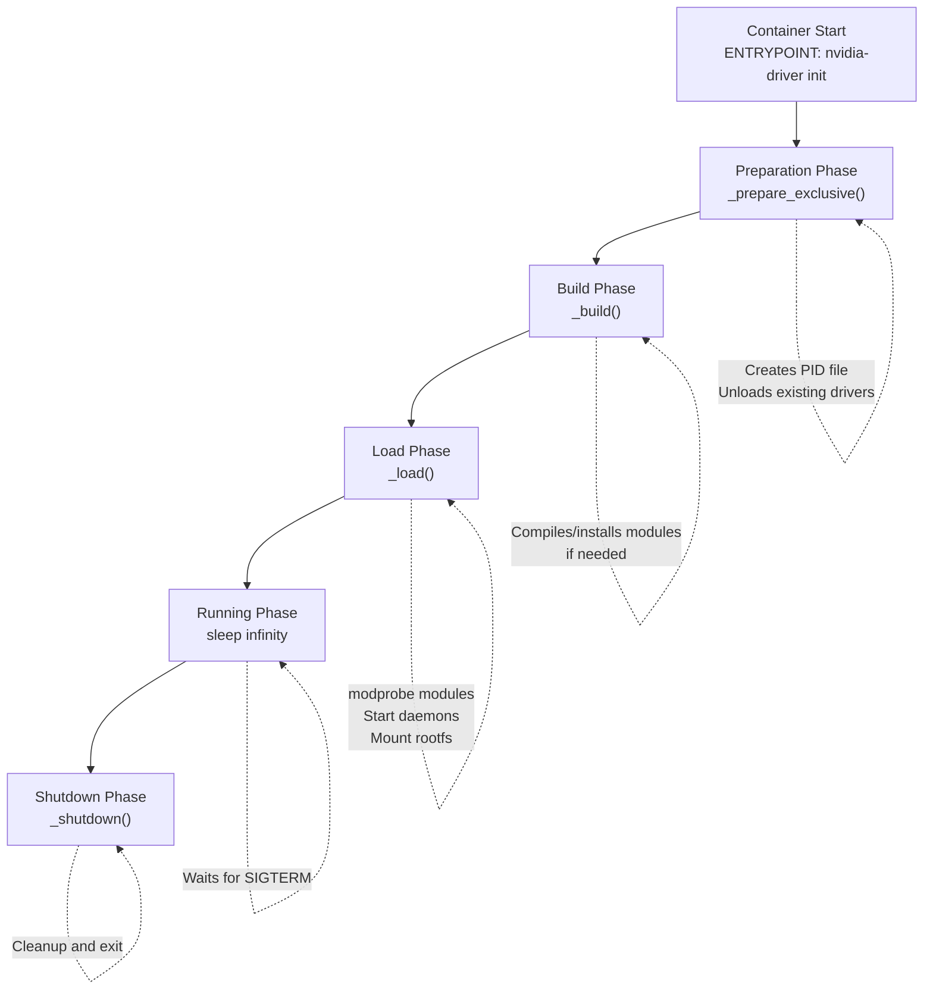

Sources: [rhel8/nvidia-driver:753-759](), [ubuntu20.04/nvidia-driver:564-631]()

## Initialization Phase

The initialization phase ensures exclusive driver management and prepares the host environment.

### Exclusive Lock Acquisition

The driver container uses a PID file to ensure only one instance manages the driver at a time:

| File Path | Purpose |
|-----------|---------|
| `/run/nvidia/nvidia-driver.pid` | Stores container PID for exclusive lock |
| `/run/kernel/postinst.d/update-nvidia-driver` | Kernel update hook for automatic recompilation |

The lock mechanism uses `flock` to prevent concurrent driver operations:

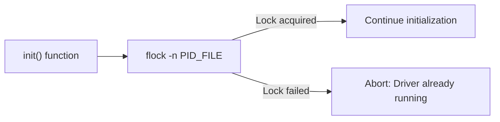

Sources: [rhel8/nvidia-driver:712-717](), [ubuntu22.04/nvidia-driver:674-679]()

### Driver Unloading

Before installing new drivers, any existing drivers must be safely unloaded:

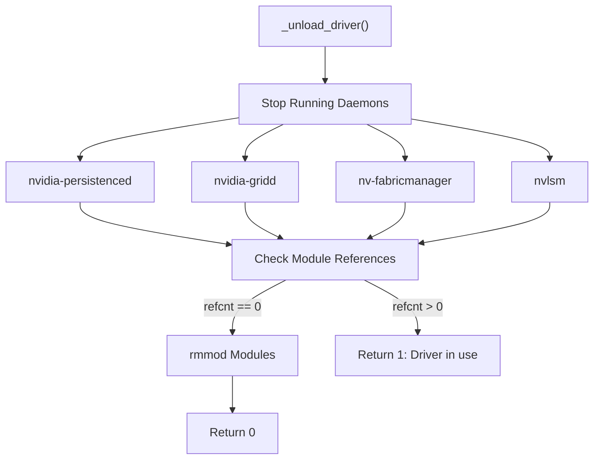

**Module Unload Order:**
1. `nvidia-modeset`
2. `nvidia-uvm`
3. `nvidia-peermem` (if loaded)
4. `nvidia` (core module)

Sources: [rhel8/nvidia-driver:424-522](), [ubuntu22.04/nvidia-driver:390-489]()

## Build Phase

The build phase compiles kernel modules against the host kernel if precompiled modules are not available.

### Kernel Module Type Resolution

Starting with driver branch 560, the system determines whether to use open-source or proprietary kernel modules:

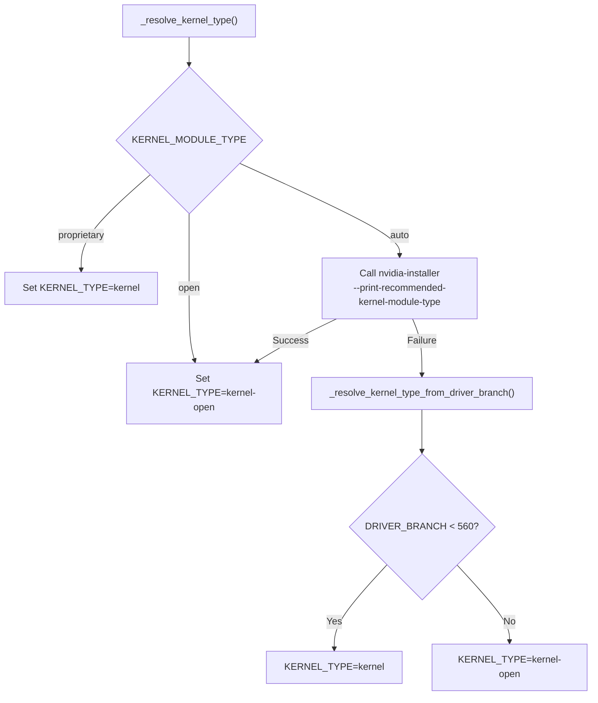

Sources: [rhel8/nvidia-driver:615-643](), [ubuntu22.04/nvidia-driver:573-601]()

### Prerequisite Installation

Before compilation, the system installs necessary packages:

**Ubuntu Prerequisites:**
- `linux-headers-${KERNEL_VERSION}`
- `linux-image-${KERNEL_VERSION}`
- `linux-modules-${KERNEL_VERSION}`

**RHEL Prerequisites:**
- `kernel-headers-${KERNEL_VERSION}`
- `kernel-devel-${KERNEL_VERSION}`
- `kernel-core-${KERNEL_VERSION}` (RHEL 8)
- `kernel-${KERNEL_VERSION}` (RHEL 9)
- `elfutils-libelf` and `elfutils-libelf-devel`
- GCC matching kernel compilation version

Sources: [rhel8/nvidia-driver:89-164](), [ubuntu22.04/nvidia-driver:76-104]()

### Module Compilation and Packaging

The compilation process creates a precompiled driver package:

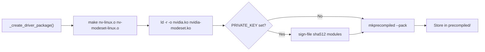

**Compilation Environment Variables:**
- `SYSSRC=/lib/modules/${KERNEL_VERSION}/build`
- `IGNORE_CC_MISMATCH=1`
- `MAX_THREADS` (parallelization)

Sources: [rhel8/nvidia-driver:196-259](), [ubuntu22.04/nvidia-driver:135-199]()

### Driver Installation

The `nvidia-installer` binary performs the final installation:

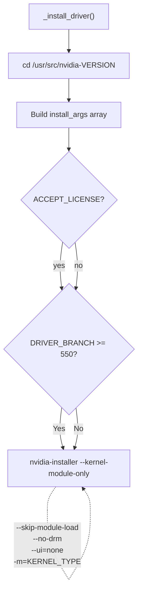

Sources: [rhel8/nvidia-driver:524-557](), [ubuntu22.04/nvidia-driver:492-524]()

## Load Phase

The load phase activates the installed drivers and starts necessary daemons.

### Module Parameter Configuration

Kernel modules accept custom parameters via configuration files:

| Configuration File | Module | Purpose |
|-------------------|--------|---------|
| `/drivers/nvidia.conf` | `nvidia` | Core driver parameters |
| `/drivers/nvidia-uvm.conf` | `nvidia-uvm` | Unified memory parameters |
| `/drivers/nvidia-modeset.conf` | `nvidia-modeset` | Modesetting parameters |
| `/drivers/nvidia-peermem.conf` | `nvidia-peermem` | GPUDirect RDMA parameters |

**Automatic Parameters (Driver Branch >= 580):**
- `NVreg_CoherentGPUMemoryMode=driver` - Prevents GPU memory over-reporting in Kubernetes

Sources: [rhel8/nvidia-driver:305-341](), [ubuntu22.04/nvidia-driver:268-304]()

### Firmware Search Path Configuration

The driver configures the kernel firmware loader to find GPU firmware:

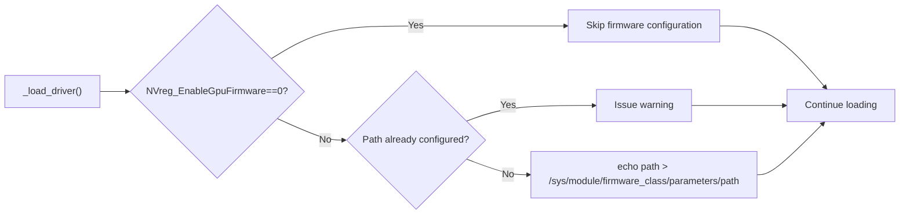

**Firmware Path:** `/run/nvidia/driver/lib/firmware`

Sources: [rhel8/nvidia-driver:348-365](), [ubuntu22.04/nvidia-driver:311-328]()

### Module Loading Sequence

Kernel modules are loaded in a specific order:

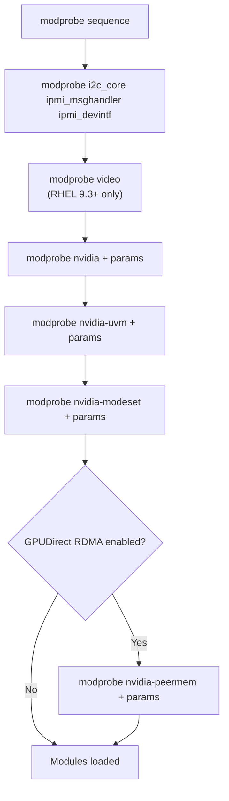

Sources: [rhel8/nvidia-driver:367-382](), [rhel9/nvidia-driver:379-399]()

### Daemon Management

Multiple daemons may be started depending on system configuration:

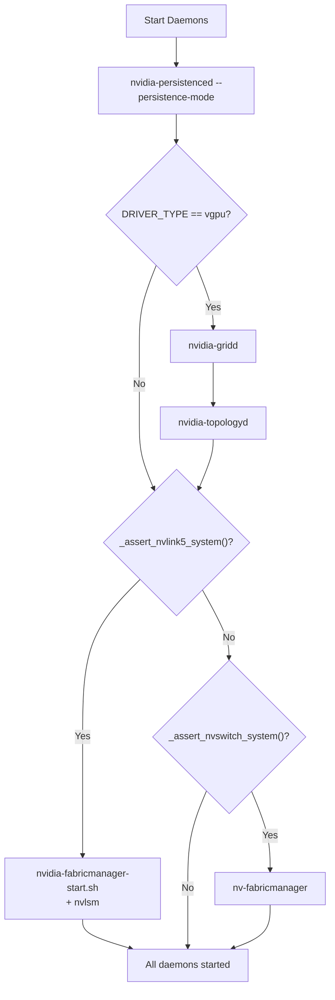

**Daemon Detection Logic:**

- **NVLink5+ Systems:** Check for `SW_MNG` string in `/sys/class/infiniband/*/device/vpd`
- **NVSwitch Systems:** Check for entries in `/proc/driver/nvidia-nvswitch/devices/`
- **vGPU Systems:** Determined by `DRIVER_TYPE` environment variable

Sources: [rhel8/nvidia-driver:384-422](), [rhel9/nvidia-driver:420-438]()

## Host System Integration

### Root Filesystem Mounting

The driver container mounts its entire filesystem (except `/sys`) to the host at a shared location:

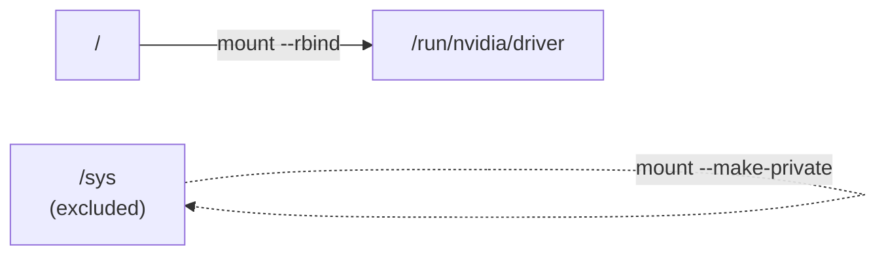

**Mount Operations:**
1. `mount --make-runbindable /sys` - Prevent sysfs from propagating
2. `mount --make-private /sys` - Isolate sysfs
3. `mount --rbind / /run/nvidia/driver` - Recursive bind mount

This makes userspace libraries and binaries available to the host:
- `/usr/lib64/libcuda.so*` (RHEL)
- `/usr/lib/x86_64-linux-gnu/libcuda.so*` (Ubuntu)
- `/usr/bin/nvidia-smi`
- `/etc/nvidia/*` configuration files

Sources: [rhel8/nvidia-driver:560-575](), [ubuntu22.04/nvidia-driver:527-533]()

### SELinux Integration

On RHEL-based systems with SELinux enabled, device files require proper security contexts:

```bash
# Detect SELinux
if [ -e /sys/fs/selinux ]; then
    # Apply container_file_t context
    chcon -R -t container_file_t ${RUN_DIR}/driver/dev
fi
```

Sources: [rhel8/nvidia-driver:567-574]()

### Kernel Update Hook

The container installs a hook script to handle host kernel updates:

**Hook Location:** `/run/kernel/postinst.d/update-nvidia-driver`

```bash
#!/bin/bash
set -eu
trap 'echo "ERROR: Failed to update the NVIDIA driver" >&2; exit 0' ERR

NVIDIA_DRIVER_PID=$(< /run/nvidia/nvidia-driver.pid)
export "$(grep -z DRIVER_VERSION /proc/${NVIDIA_DRIVER_PID}/environ)"
nsenter -t "${NVIDIA_DRIVER_PID}" -m -- nvidia-driver update --kernel "$1"
```

This script:
1. Reads the container's PID from the PID file
2. Extracts `DRIVER_VERSION` from the container's environment
3. Uses `nsenter` to execute `nvidia-driver update` in the container's namespace

Sources: [rhel8/nvidia-driver:586-604](), [ubuntu22.04/nvidia-driver:544-562]()

## Running Phase

Once initialization completes, the container enters a steady state:

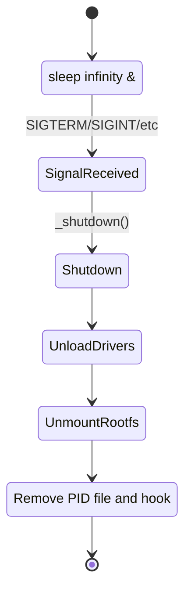

**Signal Handling:**
- Trap: `HUP INT QUIT PIPE TERM`
- Handler: `_shutdown && { kill $!; exit 0; }`
- The `sleep infinity` process is tracked and killed on shutdown

Sources: [rhel8/nvidia-driver:745-750](), [ubuntu22.04/nvidia-driver:703-708]()

## Special Runtime Features

### GPUDirect RDMA Support

When `GPU_DIRECT_RDMA_ENABLED=true` and Mellanox devices are present:

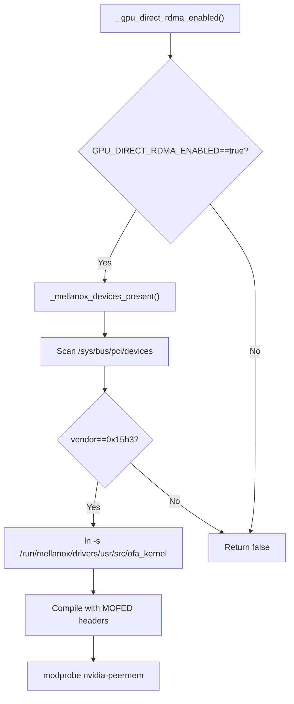

The `nvidia-peermem` module enables GPUDirect RDMA for NCCL and other MPI libraries.

Sources: [ubuntu20.04/nvidia-driver:198-219](), [rhel8/nvidia-driver:207-220]()

### vGPU Driver Selection

For vGPU deployments, the driver version is determined dynamically at runtime:

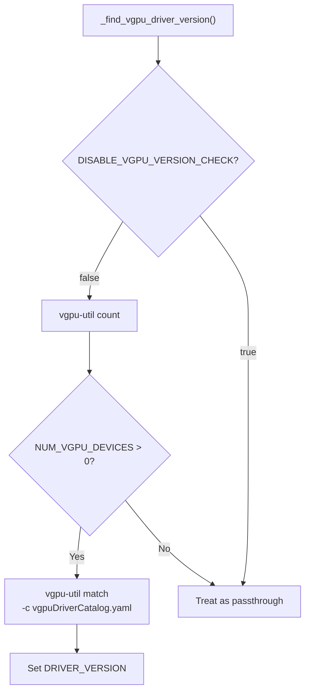

The `vgpu-util` tool (compiled from Go source) queries the host's vGPU configuration and selects a compatible guest driver version.

Sources: [rhel8/nvidia-driver:645-679](), [ubuntu22.04/nvidia-driver:603-633]()

### FIPS Mode (Ubuntu Pro)

Ubuntu 22.04+ with FIPS kernels requires Ubuntu Pro subscription:

```bash
if [[ -n "${UBUNTU_PRO_TOKEN}" && ${KERNEL_VERSION} =~ "fips" ]]; then
    apt-get install ubuntu-advantage-tools
    pro attach --no-auto-enable "${UBUNTU_PRO_TOKEN}"
    pro enable --access-only --assume-yes fips-updates
fi
```

Ubuntu 24.04 requires additional OpenSSL workarounds:
```bash
export OPENSSL_FORCE_FIPS_MODE=0  # Before pro attach
apt-get install ubuntu-fips-userspace
unset OPENSSL_FORCE_FIPS_MODE     # After installation
```

Sources: [ubuntu22.04/nvidia-driver:27-36](), [ubuntu24.04/nvidia-driver:27-46]()

## Runtime Environment Variables

The following environment variables control runtime behavior:

| Variable | Default | Purpose |
|----------|---------|---------|
| `DRIVER_VERSION` | Required | Driver version to install |
| `DRIVER_BRANCH` | Required | Driver branch (535, 550, 570, 580) |
| `DRIVER_TYPE` | `passthrough` | Driver type: `passthrough` or `vgpu` |
| `KERNEL_VERSION` | `uname -r` | Target kernel version |
| `KERNEL_MODULE_TYPE` | `auto` | Module type: `auto`, `open`, `proprietary` |
| `GPU_DIRECT_RDMA_ENABLED` | `false` | Enable nvidia-peermem |
| `USE_HOST_MOFED` | `false` | Use MOFED from host vs container |
| `ACCEPT_LICENSE` | - | Auto-accept NVIDIA license |
| `MAX_THREADS` | - | Parallel compilation threads |
| `PRIVATE_KEY` | - | Key for module signing |
| `VGPU_LICENSE_SERVER_TYPE` | `NLS` | vGPU license server type |
| `DISABLE_VGPU_VERSION_CHECK` | `true` | Skip vGPU version validation |
| `UBUNTU_PRO_TOKEN` | - | Ubuntu Pro token for FIPS |

Sources: [rhel8/nvidia-driver:1-21](), [ubuntu22.04/nvidia-driver:1-19](), [ubuntu24.04/nvidia-driver:1-19]()

## Runtime File Locations

Key files and directories used at runtime:

| Path | Purpose |
|------|---------|
| `/run/nvidia/nvidia-driver.pid` | Container PID for lock management |
| `/run/nvidia/driver/` | Mounted container rootfs |
| `/run/nvidia/validations/.driver-ctr-ready` | Readiness indicator |
| `/run/kernel/postinst.d/update-nvidia-driver` | Kernel update hook |
| `/run/mellanox/drivers/.driver-ready` | MOFED readiness (GPUDirect) |
| `/usr/src/nvidia-${DRIVER_VERSION}/` | Driver source and precompiled modules |
| `/lib/modules/${KERNEL_VERSION}/` | Kernel headers and modules |
| `/var/run/nvidia-persistenced/` | Persistence daemon PID |
| `/var/run/nvidia-fabricmanager/` | Fabric manager PID files |
| `/var/run/nvidia-gridd/` | vGPU grid daemon PID |
| `/drivers/` | Configuration mount point |
| `/drivers/gridd.conf` | vGPU license configuration |
| `/drivers/ClientConfigToken/` | vGPU NLS tokens |

Sources: [rhel8/nvidia-driver:6-9](), [ubuntu20.04/nvidia-driver:6-9]()

---

