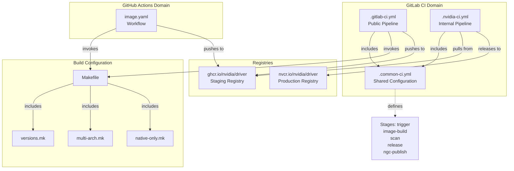
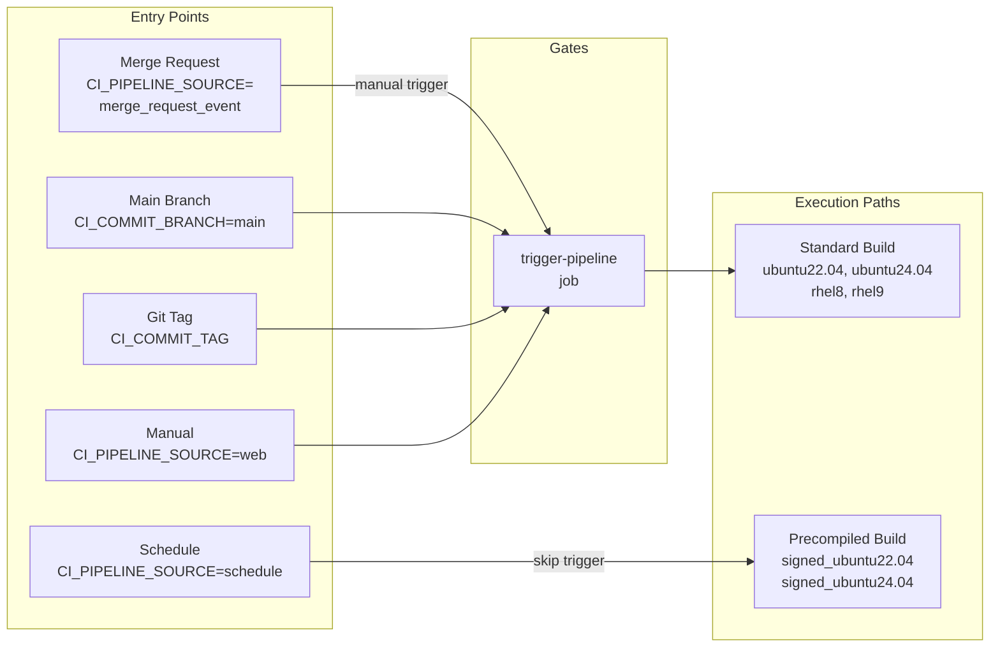
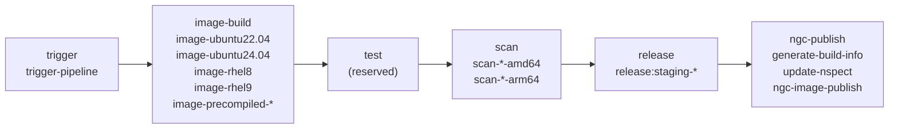
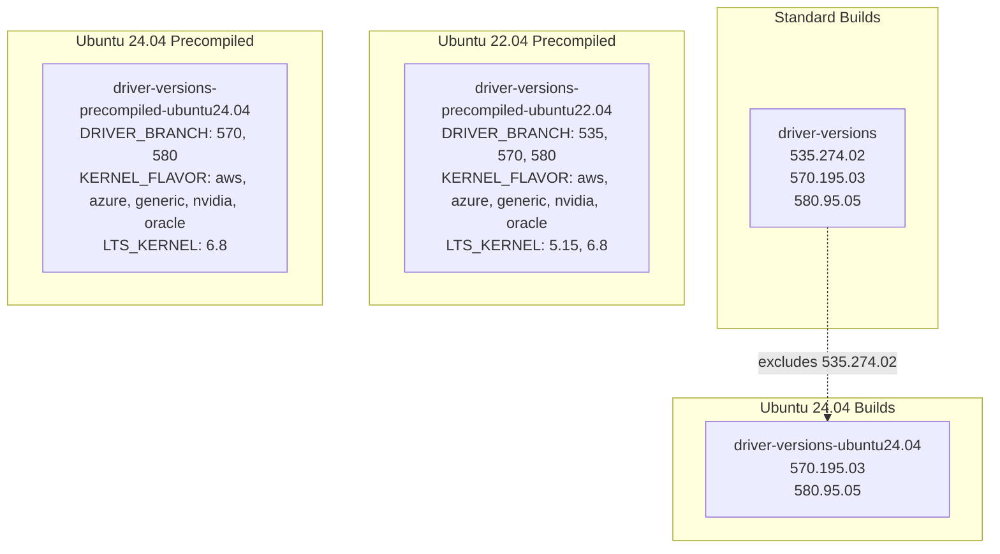
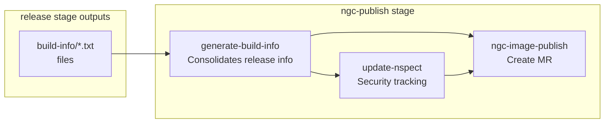
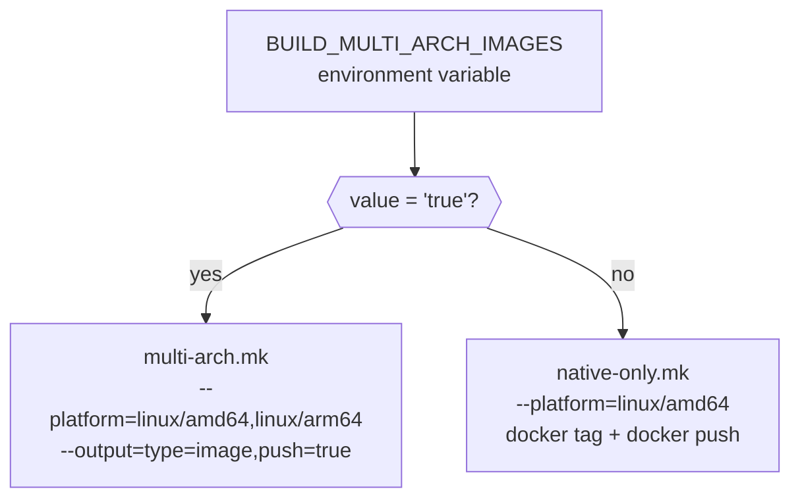
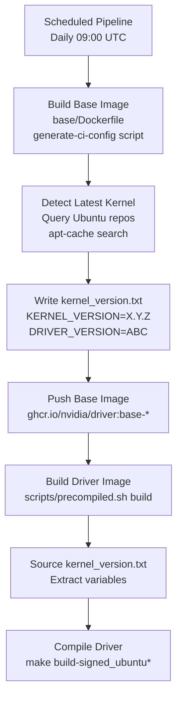
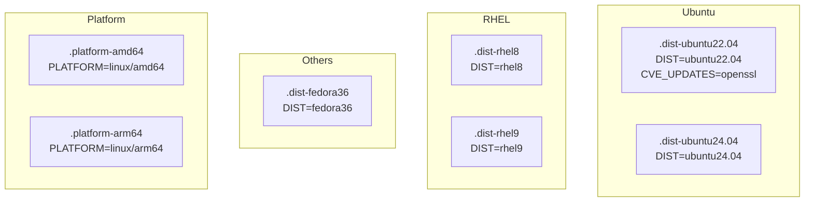

<!-- source: DeepWiki mcp.deepwiki.com · repo NVIDIA/gpu-driver-container · page 3 CI/CD Pipeline · fetched 2026-10-26 -->

# CI/CD Pipeline

Relevant source files

The following files were used as context for generating this wiki page:

- [.common-ci.yml](.common-ci.yml)
- [.github/workflows/image.yaml](.github/workflows/image.yaml)
- [.gitlab-ci.yml](.gitlab-ci.yml)
- [.nvidia-ci.yml](.nvidia-ci.yml)
- [Makefile](Makefile)
- [base/Dockerfile](base/Dockerfile)
- [base/generate-ci-config](base/generate-ci-config)
- [multi-arch.mk](multi-arch.mk)
- [native-only.mk](native-only.mk)
- [scripts/precompiled.sh](scripts/precompiled.sh)
- [versions.mk](versions.mk)

## Purpose and Scope

This document provides a comprehensive overview of the automated build, test, and release pipeline for the gpu-driver-container repository. The CI/CD system orchestrates the creation of driver container images across multiple Linux distributions, driver versions, and CPU architectures, with integrated security scanning and multi-stage release workflows.

For detailed information about specific subsystems:
- GitLab CI implementation details: see [GitLab CI Workflows](#3.1)
- GitHub Actions implementation details: see [GitHub Actions Workflows](#3.2)
- Security scanning and E2E testing: see [Testing and Validation](#3.3)
- Image promotion and NGC publishing: see [Registry Management](#3.4)

**Sources:** [.common-ci.yml:1-367](), [.nvidia-ci.yml:1-533](), [.gitlab-ci.yml:1-132](), [.github/workflows/image.yaml:1-194]()

## CI/CD Architecture

The repository employs a dual-CI architecture with GitLab CI and GitHub Actions serving complementary roles:

**GitLab CI** handles standard driver image builds with runtime kernel module compilation. It includes a public pipeline (`.gitlab-ci.yml`) that builds images and pushes to `ghcr.io/nvidia/driver`, and an internal NVIDIA pipeline (`.nvidia-ci.yml`) that pulls those images, performs security scanning, and releases to NGC registries.

**GitHub Actions** handles precompiled driver image builds, which require detecting the latest kernel versions from Ubuntu repositories and building per-kernel driver variants. It also manages end-to-end testing infrastructure provisioning.

**Sources:** [.common-ci.yml:15-16](), [.gitlab-ci.yml:15-16](), [.nvidia-ci.yml:15-16](), [.github/workflows/image.yaml:16-24](), [Makefile:1-308]()

## Pipeline Entry Points and Triggers

The CI/CD system activates through multiple entry points defined in [.common-ci.yml:33-78]():

| Trigger Type | Pipeline Source | Behavior | Configuration |
|-------------|----------------|----------|---------------|
| Merge Request | `merge_request_event` | Manual trigger required | [.common-ci.yml:44-45,71-74]() |
| Main Branch Push | `push` on `main` | Automatic execution | [.common-ci.yml:38]() |
| Tag Creation | `CI_COMMIT_TAG` | Automatic release flow | [.common-ci.yml:40]() |
| Manual Trigger | `web` | Immediate execution | [.common-ci.yml:36]() |
| Scheduled | `schedule` | Daily 09:00 UTC for precompiled | [.common-ci.yml:47,61-64]() |

The `trigger-pipeline` job acts as a gate for merge requests, requiring manual approval before proceeding to subsequent stages [.common-ci.yml:66-78]().

**Sources:** [.common-ci.yml:33-78](), [.common-ci.yml:58-64]()

## Pipeline Stages and Job Flow

The GitLab CI pipeline consists of six stages defined in [.common-ci.yml:25-31]():

**Sources:** [.common-ci.yml:25-31]()

### Stage 1: trigger

The `trigger-pipeline` job validates pipeline execution conditions. For merge requests, it requires manual approval to prevent accidental resource consumption [.common-ci.yml:66-78]().

### Stage 2: image-build

This stage builds driver container images using a parallel matrix configuration. Each job invokes `make build-${DIST}-${DRIVER_VERSION}` [.gitlab-ci.yml:33]().

**Driver Version Matrix** defined in [.common-ci.yml:81-106]():

**Build Job Configuration** [.gitlab-ci.yml:19-33]():

- **Variables:**
  - `IMAGE_NAME`: `${CI_REGISTRY_IMAGE}` (GitLab container registry)
  - `VERSION`: `${CI_COMMIT_SHORT_SHA}` (8-character Git commit hash)
  - `PUSH_ON_BUILD`: `"true"` (auto-push after build)
- **Setup:**
  - Installs `buildx` for multi-architecture support [.common-ci.yml:139-147]()
  - Installs `regctl` for registry operations [.common-ci.yml:150-157]()
  - Authenticates to `CI_REGISTRY` [.gitlab-ci.yml:31]()
- **Execution:**
  - Standard builds: `make build-${DIST}-${DRIVER_VERSION}` [.gitlab-ci.yml:33]()
  - Precompiled builds: `./scripts/precompiled.sh build` [.gitlab-ci.yml:33]()

**Sources:** [.common-ci.yml:81-106](), [.gitlab-ci.yml:19-132](), [.common-ci.yml:139-157]()

### Stage 3: scan

Security scanning jobs execute on NVIDIA-internal runners using the `pulse-cli` tool. Each job scans a specific distribution and architecture combination [.nvidia-ci.yml:151-185]().

**Scan Process:**
1. Pull image from CI registry [.nvidia-ci.yml:169]()
2. Archive image to `archive.tar` [.nvidia-ci.yml:170]()
3. Obtain SSA authentication token [.nvidia-ci.yml:171-174]()
4. Execute `pulse-cli` scan [.nvidia-ci.yml:176]()
5. Generate artifacts:
   - `sbom.json` (Software Bill of Materials)
   - `vulns.json` (Vulnerability report)
   - `licenses.json` (License information)
   - `policy_evaluation.json` (Policy compliance)

**Scan jobs only execute when:**
- Commit message does NOT contain `[skip scans]` [.nvidia-ci.yml:158-161]()
- `SKIP_SCANS` variable is NOT set to "yes" [.nvidia-ci.yml:160-161]()
- Pipeline is NOT a scheduled run [.nvidia-ci.yml:201-202]()

**Sources:** [.nvidia-ci.yml:151-253]()

### Stage 4: release

The release stage handles image promotion between registries:

**Staging Release** [.common-ci.yml:221-256]():
- Pushes all images to `${NGC_STAGING_REGISTRY}/driver`
- Executes for all pipelines except scheduled runs [.common-ci.yml:192,199-200,207-208]()
- Uses `regctl image copy` or `make push-${DIST}-${DRIVER_VERSION}` [.common-ci.yml:182]()

**NGC Release** [.nvidia-ci.yml:344-440]():
- Executes only when `CI_COMMIT_TAG` is set [.common-ci.yml:262]()
- Pushes to production NGC registry with distribution-specific tags
- Creates RHCOS variants from RHEL9 images [.nvidia-ci.yml:385-418]()

**Sources:** [.common-ci.yml:159-367](), [.nvidia-ci.yml:336-440]()

### Stage 5: ngc-publish

This stage updates NGC metadata and creates GitLab merge requests for final publication [.nvidia-ci.yml:441-533]().

**Workflow:**
1. `generate-build-info`: Aggregates release information from all release jobs [.nvidia-ci.yml:441-456]()
2. `update-nspect`: Updates NVIDIA's security tracking system [.nvidia-ci.yml:458-495]()
3. `ngc-image-publish`: Creates merge request to NGC publishing repository [.nvidia-ci.yml:509-520]()

**Sources:** [.nvidia-ci.yml:441-533]()

## Build System Integration

The CI/CD pipeline delegates actual image building to the Makefile system, which supports both native and multi-architecture builds.

**Build Mode Selection** [Makefile:15-20,80-84]():

**Driver Version Configuration** [versions.mk:15-16]():
- `DRIVER_VERSIONS`: Space-separated list of driver versions (currently `535.274.02 570.195.03 580.95.05`)
- Referenced by CI via `${DRIVER_VERSIONS}` variable

**Build Target Pattern** [Makefile:150-175]():
- Format: `build-${DIST}-${DRIVER_VERSION}`
- Example: `build-ubuntu22.04-535.274.02`
- Parses target name to extract distribution and driver version
- Invokes `docker buildx build` with appropriate build arguments

**Sources:** [Makefile:15-84,150-175](), [versions.mk:15-16](), [multi-arch.mk:1-32](), [native-only.mk:1-28]()

## Precompiled Driver Build Flow

Precompiled driver images require special handling because they build kernel modules for specific kernel versions detected at build time.

**Base Image Process** [base/Dockerfile:1-110]():
1. Start from CUDA base image (`nvcr.io/nvidia/cuda:12.9.1-base-ubuntu*`)
2. Configure Ubuntu apt repositories [base/Dockerfile:24-29,61-66]()
3. Install `generate-ci-config` script [base/Dockerfile:31-34]()
4. Script queries apt repositories for latest kernel versions [base/generate-ci-config:19-29]()
5. Writes `KERNEL_VERSION` and `DRIVER_VERSION` to `/var/kernel_version.txt` [base/generate-ci-config:32]()

**Driver Image Process** [scripts/precompiled.sh:1-113]():
1. `sourceVersions()` function extracts kernel version from base image [scripts/precompiled.sh:7-37]()
2. `buildImage()` invokes `make build-${DIST}-${DRIVER_VERSION}` [scripts/precompiled.sh:44-46]()
3. Dockerfile builds driver against specific `KERNEL_VERSION` [Makefile:189-201]()

**Variable Propagation:**
- Base image: `DRIVER_BRANCH`, `KERNEL_FLAVOR`, `LTS_KERNEL` → `kernel_version.txt`
- Driver build: Source `kernel_version.txt` → `KERNEL_VERSION`, `DRIVER_VERSION`, `DRIVER_VERSIONS`
- Image tag includes kernel version: `${DRIVER_BRANCH}-${KERNEL_VERSION}-${DIST}` [Makefile:142-148]()

**Sources:** [scripts/precompiled.sh:1-113](), [base/Dockerfile:1-110](), [base/generate-ci-config:1-34](), [Makefile:189-201](), [.common-ci.yml:93-106]()

## GitHub Actions Workflow

The GitHub Actions workflow in [.github/workflows/image.yaml]() handles both standard and precompiled image builds for pull requests and pushes to main/release branches.

**Trigger Conditions** [.github/workflows/image.yaml:18-23]():
- Push to `main` branch
- Push to `pull-request/[0-9]+` branches
- Push to `release-*` branches

**Standard Image Job Matrix** [.github/workflows/image.yaml:28-44]():
- **Driver versions:** 535.274.02, 570.195.03, 580.95.05
- **Distributions:** ubuntu22.04, ubuntu24.04, rhel8, rhel9
- **Exclusion:** ubuntu24.04 does not support driver 535.274.02
- **Fail-fast:** Disabled to allow parallel jobs to complete independently

**Precompiled Image Job Matrix** [.github/workflows/image.yaml:95-127]():
- **Driver branches:** 535, 570, 580
- **Kernel flavors:** aws, azure, generic, nvidia, oracle
- **Distributions:** ubuntu22.04, ubuntu24.04
- **LTS kernels:** 5.15, 6.8
- **Pull request optimizations:** azure, aws, nvidia, oracle flavors excluded for PRs [.github/workflows/image.yaml:117-123]()

**Build Process:**
1. Checkout repository [.github/workflows/image.yaml:46-47]()
2. Calculate build variables (commit SHA, repository owner) [.github/workflows/image.yaml:48-70]()
3. Setup QEMU for cross-platform emulation [.github/workflows/image.yaml:72-75]()
4. Setup Docker Buildx [.github/workflows/image.yaml:76-79]()
5. Login to GitHub Container Registry [.github/workflows/image.yaml:80-85]()
6. Build base image (precompiled only) and extract kernel version [.github/workflows/image.yaml:165-184]()
7. Build driver image [.github/workflows/image.yaml:86-92,185-193]()

**Environment Variables:**
- `IMAGE_NAME`: `ghcr.io/${LOWERCASE_REPO_OWNER}/driver`
- `VERSION`: First 8 characters of `GITHUB_SHA`
- `PUSH_ON_BUILD`: Set to "true" for non-dependabot PRs from same repo and all pushes [.github/workflows/image.yaml:57-66]()
- `BUILD_MULTI_ARCH_IMAGES`: Same condition as `PUSH_ON_BUILD` [.github/workflows/image.yaml:66]()

**Sources:** [.github/workflows/image.yaml:1-194]()

## Build Configuration Reference

**Key Variables** used across CI systems:

| Variable | Source | Purpose | Example Value |
|----------|--------|---------|---------------|
| `DRIVER_VERSIONS` | [versions.mk:16]() | List of driver versions to build | `535.274.02 570.195.03 580.95.05` |
| `DRIVER_VERSION` | CI matrix | Specific driver version for single job | `535.274.02` |
| `DRIVER_BRANCH` | Derived from `DRIVER_VERSION` | Major version number | `535` |
| `DIST` | CI job configuration | Target distribution | `ubuntu22.04`, `rhel9` |
| `IMAGE_NAME` | CI environment | Base image name | `${CI_REGISTRY_IMAGE}` |
| `VERSION` | CI environment | Image version tag | `${CI_COMMIT_SHORT_SHA}` |
| `BUILD_MULTI_ARCH_IMAGES` | CI environment | Enable multi-arch builds | `true` or `false` |
| `PLATFORM` | CI job configuration | Target platform for scanning | `linux/amd64`, `linux/arm64` |
| `KERNEL_VERSION` | Base image output | Specific kernel for precompiled | `6.8.0-48-generic` |
| `KERNEL_FLAVOR` | Precompiled configuration | Kernel variant | `aws`, `azure`, `generic` |
| `LTS_KERNEL` | Precompiled configuration | LTS kernel series | `5.15`, `6.8` |

**Distribution Configurations** [.common-ci.yml:108-127]():

**Sources:** [versions.mk:15-18](), [.common-ci.yml:108-136](), [Makefile:22-55]()

## CI/CD Pipeline Summary

The gpu-driver-container CI/CD system coordinates two complementary automation platforms:

**GitLab CI** orchestrates the primary build and release workflow with six stages (trigger, image-build, scan, release, ngc-publish), building standard driver images for 4 distributions across 3 driver versions and 2 architectures.

**GitHub Actions** handles precompiled driver builds that require dynamic kernel version detection, building per-kernel variants for Ubuntu 22.04 and 24.04 across 5 kernel flavors and 2 LTS kernel series.

Both systems push images to the staging registry (`ghcr.io/nvidia/driver`), from which the internal NVIDIA pipeline performs security scanning and promotes to production NGC registries (`nvcr.io/nvidia/driver`).

The build matrix generates approximately 100+ image variants, with intelligent caching and conditional execution preventing unnecessary rebuilds. The entire pipeline supports manual triggers, merge request validation, scheduled builds, and tag-based releases.

**Sources:** [.common-ci.yml:1-367](), [.nvidia-ci.yml:1-533](), [.gitlab-ci.yml:1-132](), [.github/workflows/image.yaml:1-194]()

---

