<!-- source: DeepWiki mcp.deepwiki.com · repo NVIDIA/gpu-driver-container · page 3.1 GitLab CI Workflows · fetched 2026-10-26 -->

# GitLab CI Workflows

<details>
<summary>Relevant source files</summary>

The following files were used as context for generating this wiki page:

- [.common-ci.yml](.common-ci.yml)
- [.github/workflows/image.yaml](.github/workflows/image.yaml)
- [.gitlab-ci.yml](.gitlab-ci.yml)
- [.nvidia-ci.yml](.nvidia-ci.yml)
- [Makefile](Makefile)
- [base/Dockerfile](base/Dockerfile)
- [base/generate-ci-config](base/generate-ci-config)
- [multi-arch.mk](multi-arch.mk)
- [native-only.mk](native-only.mk)
- [scripts/precompiled.sh](scripts/precompiled.sh)
- [versions.mk](versions.mk)

</details>


## Purpose and Scope

This document details the GitLab CI pipeline workflows that orchestrate the build, scan, and release processes for standard GPU driver container images. The pipeline handles multiple Linux distributions (Ubuntu, RHEL, Fedora), driver versions (535, 570, 580 branches), and architectures (amd64, arm64) in a matrix build configuration. 

For precompiled driver builds and end-to-end testing, see [GitHub Actions Workflows](#3.2). For security scanning and validation processes, see [Testing and Validation](#3.3). For registry management and NGC publishing, see [Registry Management](#3.4).

## Pipeline Overview

The GitLab CI system consists of two configuration files: `.gitlab-ci.yml` for public builds and `.nvidia-ci.yml` for internal NVIDIA builds. Both extend `.common-ci.yml` which defines shared templates, stages, and variables.

### Pipeline Stages

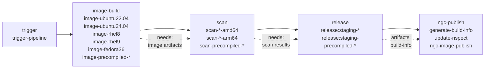

**Sources:** [.common-ci.yml:25-31](), [.gitlab-ci.yml:1-132](), [.nvidia-ci.yml:1-533]()

## Pipeline Trigger Rules

The pipeline activates based on specific Git events and sources:

| Trigger Type | Condition | Behavior |
|--------------|-----------|----------|
| Merge Request | `CI_PIPELINE_SOURCE == 'merge_request_event'` | Manual trigger required |
| Schedule | `CI_PIPELINE_SOURCE == 'schedule'` | Auto-executes (precompiled builds) |
| Web/Manual | `CI_PIPELINE_SOURCE == "web"` | Auto-executes |
| Main Branch | `CI_COMMIT_BRANCH == "main"` | Auto-executes |
| Tag/Release | `CI_COMMIT_TAG && CI_COMMIT_TAG != ""` | Auto-executes (triggers NGC release) |

The `trigger-pipeline` job serves as a gate for merge requests, requiring manual approval before proceeding.

**Sources:** [.common-ci.yml:33-78]()

## Image Build Stage

### Build Job Configuration

The image-build stage executes parallel builds using a matrix configuration. Jobs extend templates that define driver versions, distributions, and platforms.

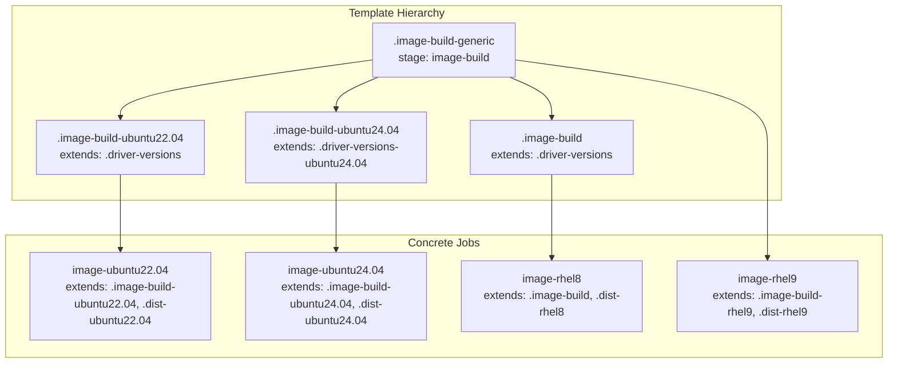

**Sources:** [.gitlab-ci.yml:19-95](), [.common-ci.yml:81-136]()

### Driver Version Matrix Expansion

The `.driver-versions` template creates parallel jobs for each driver version:

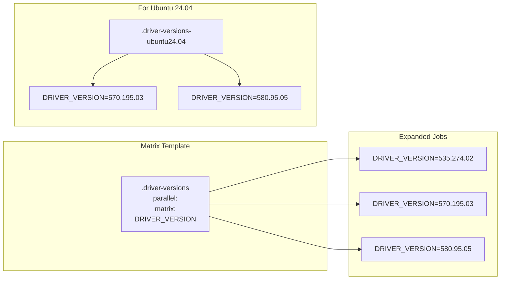

Each concrete job (e.g., `image-ubuntu22.04`) expands into multiple parallel jobs, one per driver version. Ubuntu 24.04 excludes driver 535 as it's not supported on that distribution.

**Sources:** [.common-ci.yml:81-106]()

### Build Script Execution

The build script uses Docker Buildx for multi-architecture support:

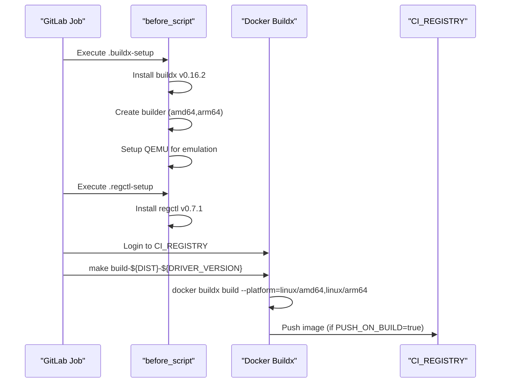

The build process:
1. Sets up Docker Buildx with multi-arch support ([.common-ci.yml:139-148]())
2. Logs into the CI registry ([.gitlab-ci.yml:31]())
3. Invokes `make build-${DIST}-${DRIVER_VERSION}` ([.gitlab-ci.yml:33]())
4. Builds images for both amd64 and arm64 platforms ([multi-arch.mk:18]())

**Sources:** [.gitlab-ci.yml:19-34](), [.common-ci.yml:139-148](), [Makefile:162-175]()

### Precompiled Image Builds

Precompiled builds handle per-kernel driver packages with a more complex matrix:

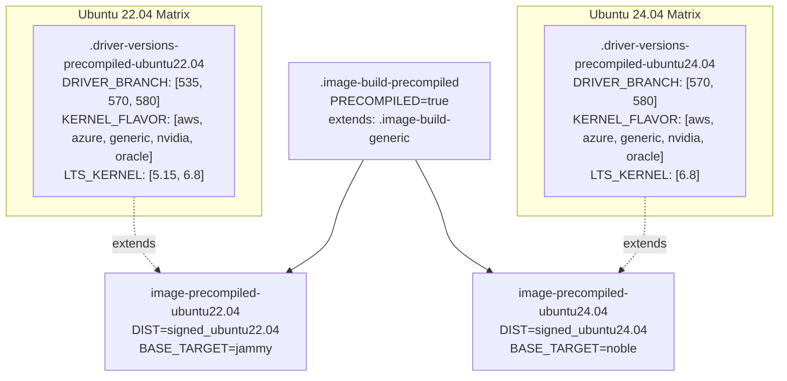

The precompiled matrix creates jobs for:
- 3 driver branches (535, 570, 580) or 2 for Ubuntu 24.04
- 5 kernel flavors (aws, azure, generic, nvidia, oracle)
- 1-2 LTS kernel versions per distribution

This results in 30 parallel jobs for Ubuntu 22.04 and 10 for Ubuntu 24.04.

**Sources:** [.gitlab-ci.yml:103-132](), [.common-ci.yml:93-106]()

## Variable Configuration

### Build Variables

Key variables controlling the build process:

| Variable | Default | Purpose | Source |
|----------|---------|---------|--------|
| `DRIVER_VERSIONS` | `535.274.02 570.195.03 580.95.05` | Driver versions to build | [.common-ci.yml:22]() |
| `BUILD_MULTI_ARCH_IMAGES` | `"true"` | Enable amd64+arm64 builds | [.common-ci.yml:23]() |
| `IMAGE_NAME` | `${CI_REGISTRY_IMAGE}` | Target image name | [.gitlab-ci.yml:22]() |
| `VERSION` | `${CI_COMMIT_SHORT_SHA}` | Image version tag | [.gitlab-ci.yml:23]() |
| `PUSH_ON_BUILD` | `"true"` | Push images during build | [.gitlab-ci.yml:25]() |
| `CVE_UPDATES` | Varies by dist | Packages to update for CVE fixes | [.common-ci.yml:111]() |

**Sources:** [.common-ci.yml:21-24](), [.gitlab-ci.yml:21-26](), [versions.mk:15-16]()

### Distribution Variables

Distribution-specific templates set `DIST` variable:

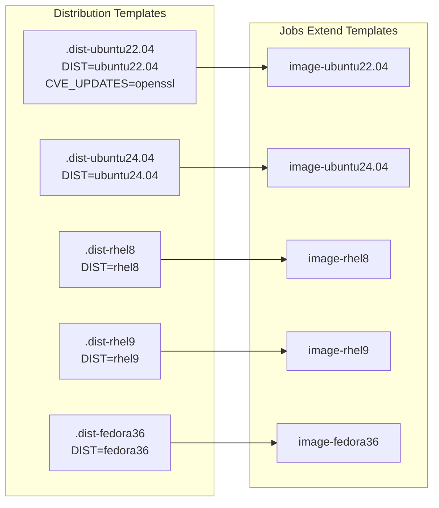

**Sources:** [.common-ci.yml:108-127]()

### Platform Variables

Platform templates control architecture targeting:

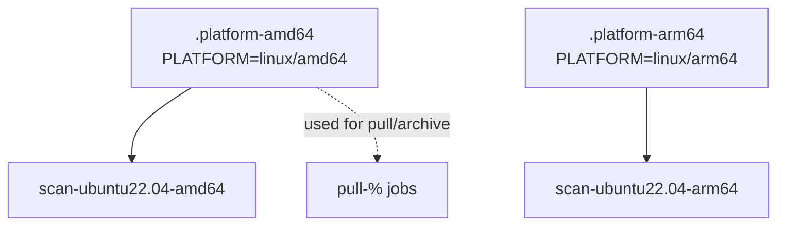

**Sources:** [.common-ci.yml:130-136]()

## Image Pull Workflow (NVIDIA Internal)

The `.nvidia-ci.yml` configuration adds an image-pull workflow for internal builds:

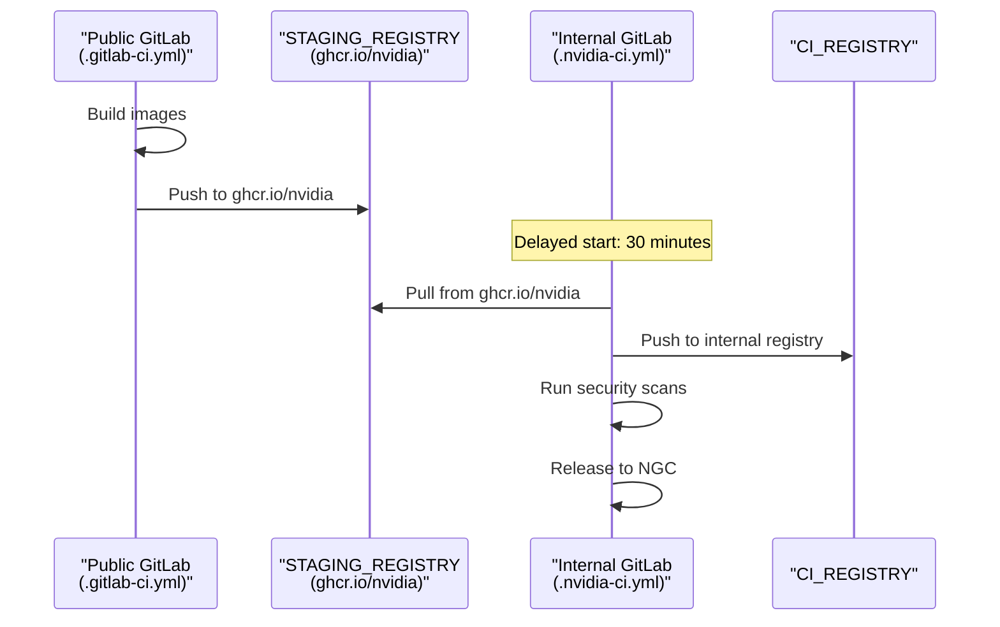

The image-pull jobs:
1. Wait 30 minutes for public pipeline to complete ([.nvidia-ci.yml:42-43]())
2. Pull from `ghcr.io/nvidia/driver` ([.nvidia-ci.yml:48-50]())
3. Push to internal CI registry ([.nvidia-ci.yml:51-54]())
4. Enable security scanning and NGC releases

**Sources:** [.nvidia-ci.yml:39-148]()

## Scan Stage

The scan stage performs security scanning on built images for each distribution and architecture:

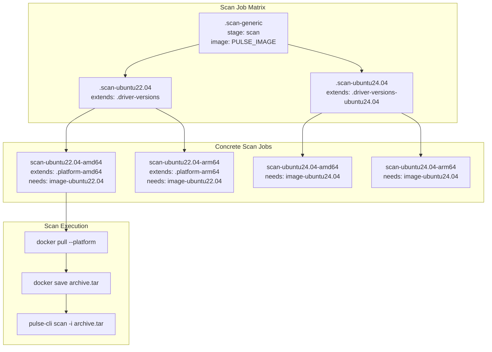

### Scan Script Workflow

The scan process:
1. Pulls the specific platform image ([.nvidia-ci.yml:169]())
2. Saves image as tar archive ([.nvidia-ci.yml:170]())
3. Authenticates with SSA (Security Scanning API) ([.nvidia-ci.yml:171-174]())
4. Executes `pulse-cli` scan ([.nvidia-ci.yml:176]())
5. Generates artifacts: `sbom.json`, `vulns.json`, `policy_evaluation.json` ([.nvidia-ci.yml:177-185]())

**Sources:** [.nvidia-ci.yml:151-185](), [.nvidia-ci.yml:254-334]()

### Scan Rules and Skip Conditions

Scans can be skipped via:

```
[skip scans]
[skip-scans]
[skip_scans]
```

in the commit message, or by setting `SKIP_SCANS=yes` environment variable.

**Sources:** [.nvidia-ci.yml:158-161](), [.nvidia-ci.yml:189-192]()

## Release Workflows

### Staging Release

The staging release pushes images to NGC staging registry for internal validation:

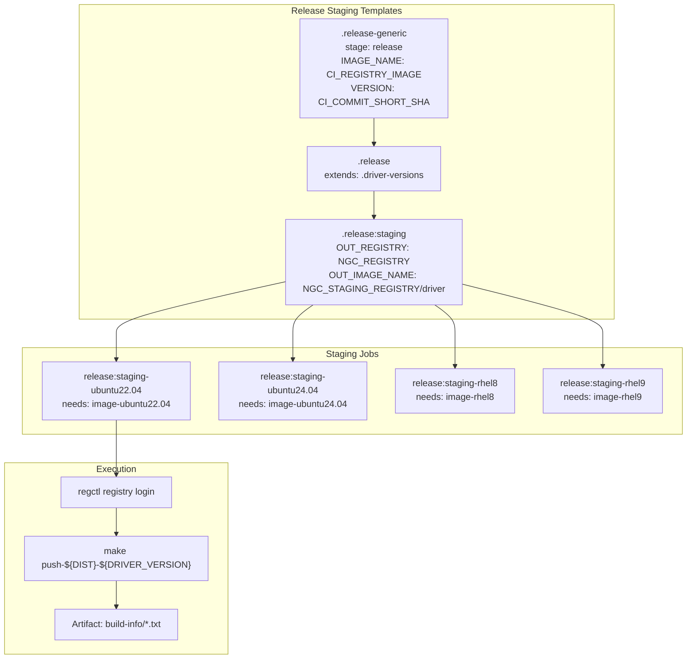

The staging release:
1. Logs into NGC registry using `NGC_REGISTRY_USER` and `NGC_REGISTRY_TOKEN` ([.common-ci.yml:178-180]())
2. Copies images from CI registry to NGC staging ([.common-ci.yml:182]())
3. Generates build info artifact for NGC publishing ([.common-ci.yml:183-184]())

**Sources:** [.common-ci.yml:159-256](), [.common-ci.yml:297-323]()

### NGC Production Release

Production releases are triggered on Git tags and push to the public NGC registry:

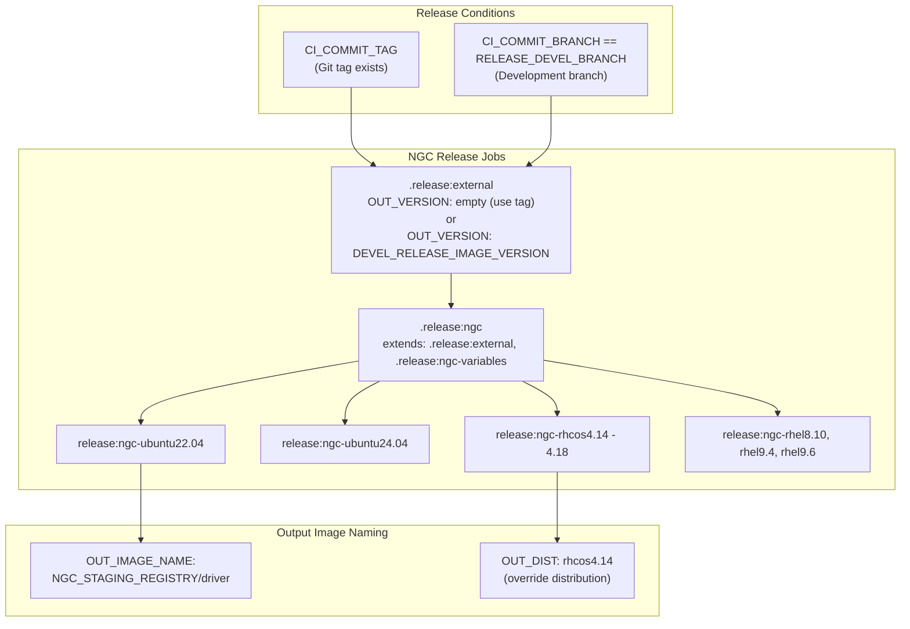

NGC release jobs:
1. Only execute on Git tags ([.nvidia-ci.yml:262-263]())
2. Set `OUT_VERSION` to empty string to use the tag name ([.common-ci.yml:264-265]())
3. Push to NGC staging registry first ([.nvidia-ci.yml:337-341]())
4. Generate RHCOS variants from RHEL9 base images ([.nvidia-ci.yml:385-418]())

**Sources:** [.common-ci.yml:258-270](), [.nvidia-ci.yml:336-440]()

### Build Info Generation and NGC Publishing

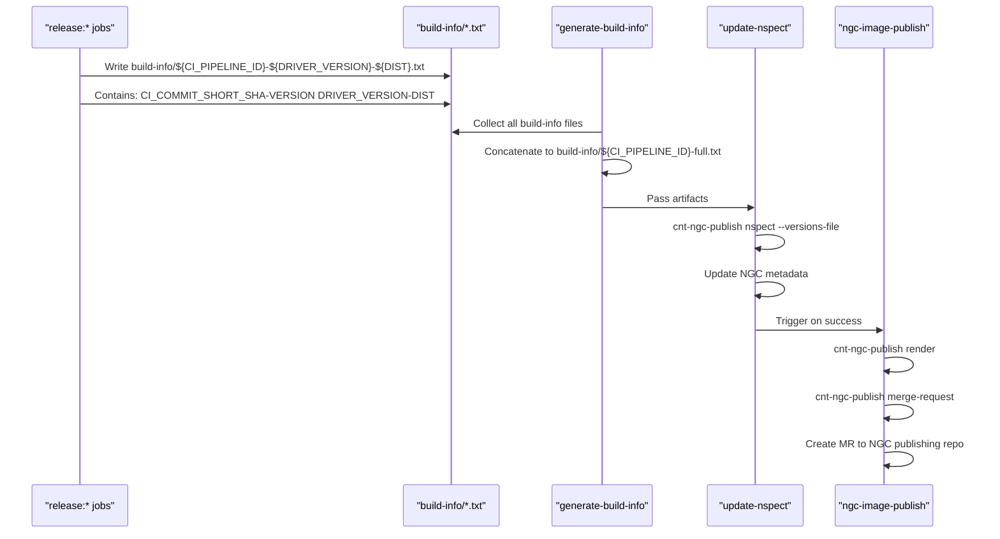

The NGC publishing workflow:
1. Each release job writes a build info file ([.common-ci.yml:183-184]())
2. `generate-build-info` aggregates all files ([.nvidia-ci.yml:441-456]())
3. `update-nspect-staging` updates staging metadata ([.nvidia-ci.yml:475-483]())
4. `update-nspect` updates production metadata (tags only) ([.nvidia-ci.yml:486-495]())
5. `ngc-image-publish` creates MR to publishing repo ([.nvidia-ci.yml:509-532]())

**Sources:** [.nvidia-ci.yml:441-533](), [.common-ci.yml:183-184]()

## Precompiled Release Workflow

Precompiled images follow a distinct release path:

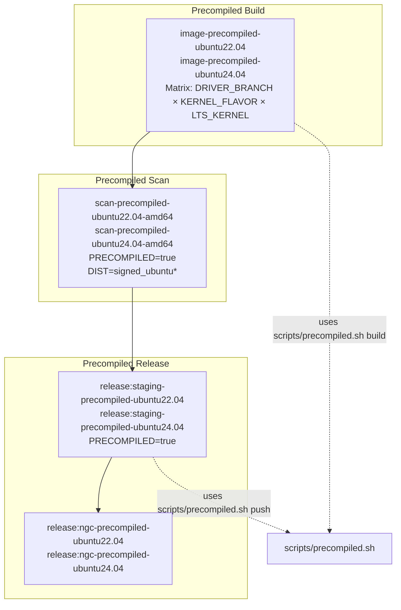

Precompiled-specific variables:
- `PRECOMPILED="true"` - Enables precompiled workflow ([.gitlab-ci.yml:113]())
- `DIST="signed_ubuntu22.04"` or `"signed_ubuntu24.04"` ([.gitlab-ci.yml:117](), [.gitlab-ci.yml:126]())
- `BASE_TARGET="jammy"` or `"noble"` - Base Ubuntu codename ([.gitlab-ci.yml:118](), [.gitlab-ci.yml:127]())
- `CVE_UPDATES="curl libc6"` - Packages to update ([.gitlab-ci.yml:119](), [.gitlab-ci.yml:128]())

The precompiled workflow:
1. Runs on scheduled pipelines only ([.common-ci.yml:58-64]())
2. Uses `scripts/precompiled.sh` for build/push operations ([.gitlab-ci.yml:33]())
3. Includes kernel version in image tag: `${DRIVER_BRANCH}-${KERNEL_VERSION}-${DIST}` ([Makefile:142-143]())

**Sources:** [.gitlab-ci.yml:103-132](), [.common-ci.yml:325-366](), [scripts/precompiled.sh:1-114]()

## Docker Buildx and Multi-Arch Support

### Buildx Setup

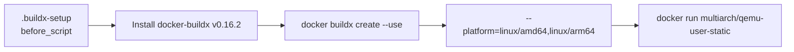

The buildx setup:
1. Downloads buildx v0.16.2 binary ([.common-ci.yml:141-145]())
2. Creates a buildx builder with multi-platform support ([.common-ci.yml:146]())
3. Runs QEMU for cross-platform emulation ([.common-ci.yml:147]())

When `BUILD_MULTI_ARCH_IMAGES=true`:
- Uses `docker buildx build` with `--platform=linux/amd64,linux/arm64` ([multi-arch.mk:18]())
- Pushes images directly during build ([multi-arch.mk:17]())
- Uses `regctl image copy` for release pushes ([multi-arch.mk:22-24]())

**Sources:** [.common-ci.yml:139-148](), [multi-arch.mk:15-32]()

### Platform-Specific Overrides

Some distributions only support amd64:

```makefile
build-ubuntu18.04%: DOCKER_BUILD_PLATFORM_OPTIONS = --platform=linux/amd64
build-signed_ubuntu20.04%: DOCKER_BUILD_PLATFORM_OPTIONS = --platform=linux/amd64
build-signed_ubuntu22.04%: DOCKER_BUILD_PLATFORM_OPTIONS = --platform=linux/amd64
build-signed_ubuntu24.04%: DOCKER_BUILD_PLATFORM_OPTIONS = --platform=linux/amd64
build-sles%: DOCKER_BUILD_PLATFORM_OPTIONS = --platform=linux/amd64
```

**Sources:** [multi-arch.mk:27-31]()

## Manual-Only Distributions

Certain distributions are marked as manual-only to reduce pipeline load:

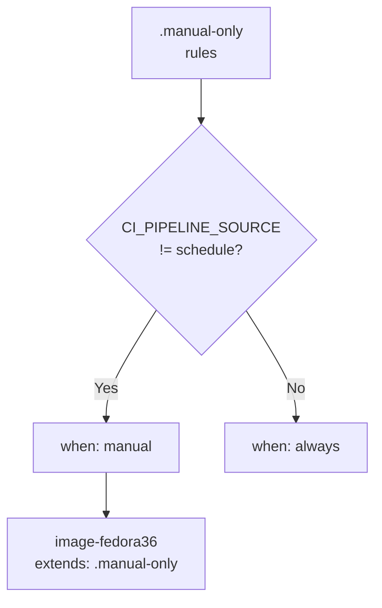

Jobs extending `.manual-only` require manual triggering unless run on a schedule. This reduces resource usage for less commonly used distributions.

**Sources:** [.common-ci.yml:53-56](), [.gitlab-ci.yml:96-101]()

## Pipeline Execution Flow

### Standard Build Pipeline

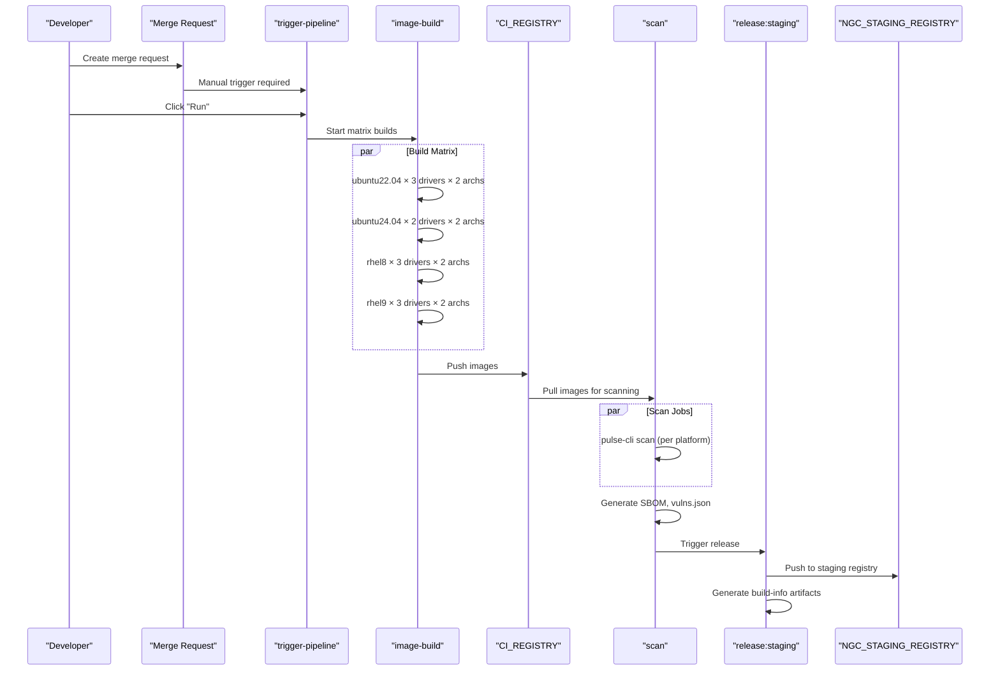

**Sources:** [.common-ci.yml:66-78](), [.gitlab-ci.yml:71-95](), [.nvidia-ci.yml:149-335]()

### Tag-Based Release Pipeline

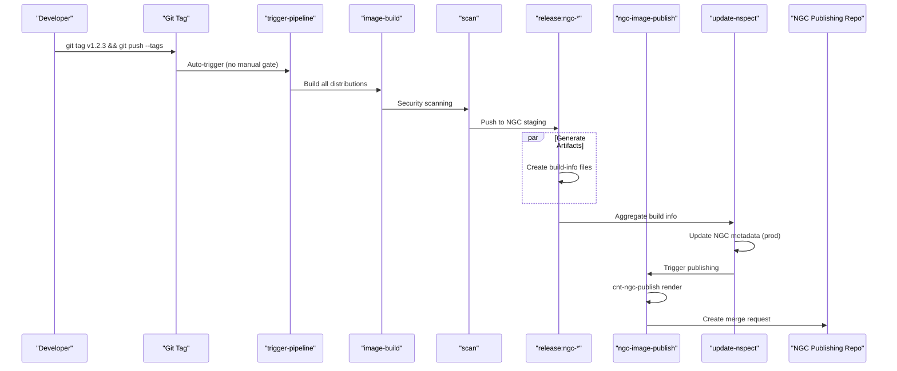

**Sources:** [.common-ci.yml:40](), [.nvidia-ci.yml:262-269](), [.nvidia-ci.yml:509-532]()

## Key CI Variables Reference

### Global Variables

| Variable | Value | Set In |
|----------|-------|--------|
| `CI_REGISTRY_IMAGE` | GitLab's default | GitLab |
| `CI_COMMIT_SHORT_SHA` | First 8 chars of commit | GitLab |
| `CI_COMMIT_TAG` | Git tag name | GitLab |
| `CI_PIPELINE_SOURCE` | Trigger source | GitLab |
| `DRIVER_VERSIONS` | `535.274.02 570.195.03 580.95.05` | [.common-ci.yml:22]() |
| `BUILD_MULTI_ARCH_IMAGES` | `"true"` | [.common-ci.yml:23]() |

### Registry Variables

| Variable | Value | Purpose |
|----------|-------|---------|
| `NGC_REGISTRY` | `nvcr.io` | NGC registry URL |
| `NGC_STAGING_REGISTRY` | `nvcr.io/nvidia/staging` | Staging registry path |
| `NGC_REGISTRY_USER` | Secret | NGC authentication |
| `NGC_REGISTRY_TOKEN` | Secret | NGC authentication |
| `STAGING_REGISTRY` | `ghcr.io/nvidia` | Public staging registry |
| `STAGING_VERSION` | `${CI_COMMIT_SHORT_SHA}` | Public staging version |

### Security Scanning Variables

| Variable | Value | Purpose |
|----------|-------|---------|
| `PULSE_IMAGE` | Internal scanner image | Container for pulse-cli |
| `SSA_CLIENT_ID` | Secret | Security scanning auth |
| `SSA_CLIENT_SECRET` | Secret | Security scanning auth |
| `SSA_ISSUER_URL` | SSA token endpoint | Authentication |
| `NSPECT_ID` | Project ID | NGC metadata system |
| `CONTAINER_POLICY` | Policy name | Scan policy to apply |

**Sources:** [.nvidia-ci.yml:27-37](), [.nvidia-ci.yml:154-174](), [.common-ci.yml:225-228]()

## Integration with Makefile

GitLab CI jobs delegate to Makefile targets:

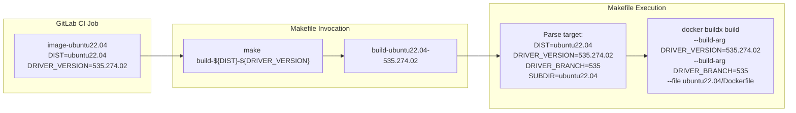

The Makefile:
1. Parses target name to extract `DIST` and `DRIVER_VERSION` ([Makefile:152-156]())
2. Computes `DRIVER_BRANCH` from first component of version ([Makefile:154]())
3. Constructs image tag: `${VERSION}-${DRIVER_TAG}-${DIST}` ([Makefile:41-42]())
4. Invokes Docker buildx with build args ([Makefile:163-175]())

For precompiled images, `scripts/precompiled.sh` handles the build logic:
- Builds base image with kernel detection ([scripts/precompiled.sh:39-42]())
- Sources kernel version from base image ([scripts/precompiled.sh:7-37]())
- Builds final driver image with specific kernel ([scripts/precompiled.sh:44-47]())

**Sources:** [Makefile:150-175](), [scripts/precompiled.sh:38-47](), [.gitlab-ci.yml:33]()

---

